# CCS technology options

32 technologies, from commercial to lab stage. Generated from catalog/technologies/; every figure links to its source.

| Technology | Category | Maturity | TRL | Suppliers | Cost figures |
| --- | --- | --- | --- | --- | --- |
| [Amine solvent post-combustion capture](#ccs-amine-post-combustion) | Post-combustion / chemical solvent | commercial | 6-9 | Mitsubishi Heavy Industries (KM CDR Process with KS-1 solvent); Shell Catalysts & Technologies (CANSOLV CO2 Capture System); SLB Capturi (Just Catch (modular) and larger plants); Fluor (Econamine FG Plus) | cost of CO2 captured, new NGCC (H-class to F-class), 90% capture: 55.9-60.7 USD/t CO2 (2018$)<br>cost of CO2 captured, NGCC retrofit (H-class to F-class), 90% capture: 56.7-61.8 USD/t CO2 (2018$)<br>cost of CO2 captured, new-build power plants with amine capture, 90% capture: 38.1-60.7 USD/t CO2 (2018$)<br>cost of CO2 captured, cement (greenfield, 90% capture): 62.7 USD/t CO2 (2018$)<br>cost of CO2 captured, iron and steel BOF (retrofit, 90% capture): 65.9 USD/t CO2 (2018$) |
| [Biochar](#ccs-biochar) | Carbon removal / pyrolysis | commercial |  | Exomad Green (biochar CDR producer) |  |
| [CO2 compression and dehydration](#ccs-co2-compression-dehydration) | Transport and storage / compression | commercial | 9 | Atlas Copco (CO2 compressors (search result only)); Siemens Energy (register examples); MAN Energy Solutions (Everllence) (register examples); Baker Hughes (register examples) | integrally geared package capex, Drax BECCS case: 32 GBP million |
| [CO2 to concrete and aggregates](#ccs-co2-concrete) | Utilisation / building materials | commercial | 9 | CarbonCure (mineralised ready-mix concrete); Blue Planet (aggregates (register examples)) |  |
| [CO2 to urea and polymers](#ccs-co2-to-urea-polymers) | Utilisation / chemicals | commercial |  | Covestro (cardyon CO2-based polyols); Fertiliser producers (urea) |  |
| [Capture from high-purity CO2 streams (compression and dehydration only)](#ccs-high-purity-compression) | Point source / no separation step | commercial |  | CO2 compressor and dehydration vendors (no licensed process needed) | cost of CO2 captured, natural gas processing (greenfield): 16.1 USD/t CO2 (2018$)<br>cost of CO2 captured, ammonia (greenfield): 19 USD/t CO2 (2018$)<br>cost of CO2 captured, ethylene oxide (greenfield): 26 USD/t CO2 (2018$)<br>cost of CO2 captured, ethanol (greenfield): 31.8 USD/t CO2 (2018$)<br>cost of CO2 captured, gas-to-liquids: 6.4 USD/t CO2 (2018$)<br>average cost of CO2 captured, high-purity industrial streams (over 95% CO2): 17.5 USD/t CO2 (2018$) |
| [Chemical solvent capture from syngas (hydrogen plants)](#ccs-syngas-chemical-solvent) | Pre-combustion / chemical solvent | commercial |  | Shell Catalysts & Technologies (ADIP ULTRA) | cost of CO2 captured, refinery hydrogen (SMR), greenfield 90% capture: 59.9 USD/t CO2 (2018$) |
| [Geological CO2 storage in saline aquifers](#ccs-saline-aquifer-storage) | CO2 storage / geological | commercial | 9 | Equinor; Northern Lights |  |
| [Measurement, monitoring and verification (4D seismic, DAS, satellite InSAR)](#ccs-mmv) | Transport and storage / monitoring | commercial |  | SLB (register examples); Halliburton (register examples); TGS (register examples) | 3D seismic survey cost (NETL storage cost model input): 60000-80000 USD/mi2 (2008$) (2008$) |
| [Physical solvent acid gas removal (pre-combustion)](#ccs-physical-solvent-pre-combustion) | Pre-combustion / physical solvent | commercial | 7 | Rectisol and Selexol licensors (see NETL Gasifipedia) | Total plant cost of two-stage Selexol AGR unit in coal gasification hydrogen plant with CO2 capture (Case 5): 3.89544e+08 USD (2018) (2018$)<br>Total plant cost of CO2 compression and drying unit downstream of the Selexol unit (Case 5): 7.0869e+07 USD (2018) (2018$) |
| [Well integrity and CO2-resistant cements](#ccs-well-integrity-cements) | Transport and storage / wells | commercial |  | SLB (register examples); Halliburton (register examples) |  |
| [Allam-Fetvedt cycle (oxy-combustion supercritical CO2 power)](#ccs-allam-cycle) | Oxyfuel / power cycle | demonstration | 2-5 | NET Power (cycle developer), Toshiba (combustor and turbine) |  |
| [Bioenergy with CCS (BECCS)](#ccs-beccs) | Carbon removal / bioenergy | demonstration | 3-7 | Stockholm Exergi (BECCS Stockholm); Drax (BECCS (register examples)); ADM (Decatur (register examples)) |  |
| [CO2 mineralisation (in-situ basalt)](#ccs-in-situ-mineralisation) | Transport and storage / mineral storage | demonstration | 9 | Carbfix (in-situ mineralisation, Hellisheidi and Coda Terminal) |  |
| [CO2 shipping and terminals](#ccs-co2-shipping) | Transport and storage / shipping | demonstration | 8 | Northern Lights (Equinor, Shell, TotalEnergies) (CO2 transport and storage) | CO2 shipping cost per tonne: 9-50 USD/t CO2 |
| [CO2 to methanol and fuels](#ccs-co2-to-methanol-fuels) | Utilisation / fuels | demonstration | 8 | Carbon Recycling International (George Olah plant) |  |
| [Direct air capture with liquid solvent (KOH and calcium loop)](#ccs-dac-liquid-solvent) | Direct air capture / liquid solvent | demonstration | 5 | Carbon Engineering / 1PointFive (Occidental) | levelised cost of CO2 captured: 94-232 USD/t CO2 (2016$) |
| [Direct air capture with solid sorbent](#ccs-dac-solid-sorbent) | Direct air capture / solid sorbent | demonstration | 5 | Climeworks | cost of CO2 captured, solid-sorbent DAC with natural-gas CHP (gross capture basis): 90-150 USD/t CO2 (2024$)<br>cost of CO2 captured, same system, net removal basis: 130-240 USD/t CO2 (2024$) |
| [Ex-situ mineral carbonation](#ccs-ex-situ-mineral-carbonation) | Transport and storage / mineral storage | demonstration | 9 |  | best-case sequestration cost: 42-78 EUR/t CO2 |
| [Molten carbonate fuel cell capture](#ccs-molten-carbonate-fuel-cell-capture) | Capture / electrochemical | demonstration |  | FuelCell Energy (carbonate fuel cell); ExxonMobil (joint development and Rotterdam pilot (ESSO Nederland)) |  |
| [Oxyfuel combustion in cement kilns](#ccs-oxyfuel-cement) | Oxyfuel | demonstration | 7 | European Cement Research Academy (ECRA) with Heidelberg Materials and Holcim |  |
| [Solid sorbent capture by rapid temperature swing](#ccs-solid-sorbent-tsa) | Post-combustion / solid sorbent | demonstration | 6 | Svante (rapid cycle thermal swing adsorption with structured adsorbents) | Cost of CO2 captured, Svante RC-TSA (power plant TEA basis): 30-50 USD/t CO2 (2024$)<br>Capture unit capital expenditure: 70000-80000 USD per t/day of capacity (2024$)<br>Capture unit operating expenditure: 26-28 USD/t CO2 (2024$)<br>Cost of CO2 captured, Svante VeloxoTherm at Linde SMR hydrogen plant: 65-78 USD/t CO2 (2024$)<br>CALF-20 structured sorbent manufacturing cost: 30-35 USD/kg (2024$) |
| [Storage in depleted oil and gas fields](#ccs-depleted-field-storage) | Transport and storage / storage | demonstration | 8 | Porthos (Port of Rotterdam, Gasunie, EBN) (depleted-field storage); PETRONAS Carigali (Kasawari CCS) |  |
| [Calcium looping](#ccs-calcium-looping) | Post-combustion / high-temperature solid looping | pilot | 6-7 | Research consortia (e.g. CSIC-INCAR, Spain) |  |
| [Cryogenic carbon capture (desublimation)](#ccs-cryogenic) | Post-combustion / cryogenic | pilot | 5 | Sustainable Energy Solutions (Chart Industries) (Cryogenic Carbon Capture) | cost of CO2 captured, InnoSepra sorbent-and-membrane cryogenic process, post-combustion power: 40 USD/t CO2 (2024$) |
| [Enhanced rock weathering and ocean alkalinity enhancement](#ccs-enhanced-weathering) | Carbon removal / geochemical | pilot |  | UNDO (enhanced rock weathering (register examples)); Planetary (ocean alkalinity (register examples)) | removal cost: 60-200 USD/t CO2 (2018$) |
| [Enzyme-catalysed capture](#ccs-enzyme-capture) | Capture / solvent | pilot |  | Saipem (Bluenzyme (from CO2 Solutions)) |  |
| [Polymeric membrane capture](#ccs-polymeric-membrane) | Post-combustion / membrane | pilot | 6 | MTR Carbon Capture (Polaris membrane) | Cost of CO2 captured, MTR Polaris membrane process (FEED study potential): 40 USD/t CO2 (2024$)<br>Cost of CO2 captured, MTR hybrid membrane-absorption process: 43-54 USD/t CO2 (2024$)<br>Membrane material manufacturing cost: 10-30 USD/m2 (2024$)<br>Membrane module manufacturing and installation cost, projected at full commercialization: 50 USD/m2 of membrane (2024$) |
| [CO2 electroreduction to CO, formic acid and ethylene](#ccs-co2-electroreduction) | Utilisation / electrochemical | lab |  | Twelve (E-Jet CO2 electrolysis (register examples)) |  |
| [Chemical looping combustion](#ccs-chemical-looping-combustion) | Oxyfuel / chemical looping | lab | 4-5 | Research stage; no commercial licensor identified in the cited sources |  |
| [Electro-swing and moisture-swing DAC](#ccs-electro-swing-moisture-swing-dac) | Carbon removal / direct air capture | lab | 6 | Verdox (electro-swing adsorption) |  |
| [Emerging capture: water-lean solvents, ionic liquids and electrochemical separation](#ccs-emerging-solvents-electrochemical) | Post-combustion / emerging | lab | 4-5 | Research programmes (see NETL transformational capture programme); DOE-funded R&D projects listed in the NETL Compendium of Carbon Capture Technology 2024 | DOE transformational capture cost target: 30-40 USD/t CO2 |

## Amine solvent post-combustion capture
<a id="ccs-amine-post-combustion"></a>

Flue gas is cooled and contacted counter-currently with an aqueous amine solution, which reacts with CO2. The CO2-rich solution is heated with low-pressure steam in a stripper, releasing a near-pure CO2 stream and regenerating the solvent for reuse. Vendors differ mainly in solvent formulation, heat integration and solvent management.

```mermaid
flowchart LR
    FG["Flue gas pretreatment and cooling<br/><small>direct contact cooler or quench pre-scrubber, SOx/NOx polishing where required, booster fan</small>"]
    ABS["CO2 absorption<br/><small>packed absorber column with intercooling, water wash section</small>"]
    VENT["Treated gas to stack<br/><small>stack</small>"]
    RX["Lean/rich heat exchange<br/><small>lean/rich plate or shell-and-tube exchanger, rich amine pumps</small>"]
    STR["Solvent regeneration<br/><small>stripper (regenerator) column, reboiler on LP steam, overhead condenser and reflux accumulator</small>"]
    COMP["CO2 conditioning and compression<br/><small>multistage CO2 compressor with intercoolers, dehydration unit</small>"]
    FG --> ABS
    ABS -->|rich amine| RX
    ABS -->|treated flue gas| VENT
    RX --> STR
    STR -->|CO2| COMP
    STR -->|lean amine (via exchanger and cooler)| ABS
```

**Key equipment:** direct contact cooler, absorber with water wash, lean/rich exchanger, stripper with reboiler, amine reclaimer or purification unit, filters and lean amine tank, CO2 compressor and dehydration.

**Performance:**
- solvent regeneration reboiler duty, LP steam (CANSOLV, PC cases): 2.4-2.5 GJ/t CO2; NETL Baseline Rev 4: 'approximately 2.5 MJ/kg (1,070 Btu/lb) CO2 for PC cases', steam extracted from the IP/LP crossover; 2.5 MJ/kg x 1,000 kg/t = 2.5 GJ/t (cross-check: 1,070 Btu/lb x 1.05506 kJ/Btu / 0.45359 kg/lb = 2,490 kJ/kg = 2.49 MJ/kg); footnote m: recent vendor feedback states the PC reboiler energy requirement can be reduced to 2.4 MJ/kg (1,020 Btu/lb); the stream tables do not list a reboiler steam stream - the duty is stated in the text. [source](https://netl.doe.gov/projects/files/CostAndPerformanceBaselineForFossilEnergyPlantsVolume1BituminousCoalAndNaturalGasToElectricity_101422.pdf)
- solvent regeneration reboiler duty, LP steam (CANSOLV, NGCC cases e.g. B31B.90): 2.4-2.7 GJ/t CO2; NETL Baseline Rev 4, Case B31B.90 chapter: 'the low-pressure steam requirement for the reboiler only is calculated as approximately 2.4 MJ/kg (1,050 Btu/lb) CO2'; 2.4 MJ/kg x 1,000 kg/t = 2.4 GJ/t (cross-check: 1,050 Btu/lb x 1.05506 kJ/Btu / 0.45359 kg/lb = 2,442 kJ/kg = 2.44 MJ/kg); the generic CANSOLV description (Section 4.1.8.3, based on pre-2021 data without the NGCC mechanical vapour recompression) cites 2.7 MJ/kg (1,160 Btu/lb) for NGCC cases; steam extracted from the IP/LP crossover. [source](https://netl.doe.gov/projects/files/CostAndPerformanceBaselineForFossilEnergyPlantsVolume1BituminousCoalAndNaturalGasToElectricity_101422.pdf)

**Costs:**
- cost of CO2 captured, new NGCC (H-class to F-class), 90% capture: 55.9-60.7 USD/t CO2 (2018$); NETL; Cansolv-type amine system; excludes transport and storage; 85% capacity factor; 95% capture 55.2-59.9. [source](https://www.netl.doe.gov/projects/files/CostandPerformanceofRetrofittingNGCCUnitsforCarbonCaptureRevision3_053123.pdf)
- cost of CO2 captured, NGCC retrofit (H-class to F-class), 90% capture: 56.7-61.8 USD/t CO2 (2018$); NETL; excludes transport and storage; 95% capture 55.9-60.8. [source](https://www.netl.doe.gov/projects/files/CostandPerformanceofRetrofittingNGCCUnitsforCarbonCaptureRevision3_053123.pdf)
- cost of CO2 captured, new-build power plants with amine capture, 90% capture: 38.1-60.7 USD/t CO2 (2018$); NETL Baseline Rev 4; low = supercritical PC (Case B12B.90), high = F-class NGCC (Case B31B.90); H-class NGCC 55.9, 95%-capture NGCC 59.9; excludes transport and storage. [source](https://netl.doe.gov/projects/files/CostAndPerformanceBaselineForFossilEnergyPlantsVolume1BituminousCoalAndNaturalGasToElectricity_101422.pdf)
- cost of CO2 captured, cement (greenfield, 90% capture): 62.7 USD/t CO2 (2018$); NETL industrial case, capture, compression, intercooling and dehydration; 99% capture case 60.8; retrofit 64.3. [source](https://www.netl.doe.gov/projects/files/CostofCapturingCO2fromIndustrialSources_071522.pdf)
- cost of CO2 captured, iron and steel BOF (retrofit, 90% capture): 65.9 USD/t CO2 (2018$); NETL industrial case, retrofit only; 99% capture case 65.4. [source](https://www.netl.doe.gov/projects/files/CostofCapturingCO2fromIndustrialSources_071522.pdf)

**Reference plants:**
- Boundary Dam Unit 3 (SaskPower), CA: 1 Mt/yr CO2 from a 150 MW lignite unit (CANSOLV); operating. [source](https://catalysts.shell.com/hubfs/1220448_Cansolv_CO2_white_paper_d4%20(1).pdf)
- Petra Nova, W.A. Parish Unit 8 (NRG), US: 4,700 t/day design, 240 MW slipstream; 92.4% average capture; 3.54 Mt captured 2017-2019 (KM CDR); commercial operation from 29 Dec 2016; DOE demonstration period 2017-2019. [source](https://publications.ieaghg.org/insightpapers/2020-IP11%20DOE%20report%20on%20Petra%20Nova.pdf)
- Brevik CCS (Heidelberg Materials), NO: up to 400,000 t/yr CO2 from cement (SLB Capturi); in operation since June 2025. [source](https://capturi.slb.com/resources/news/2025/slb-capturi-celebrates-first-anniversary-marking-a-year-of-breakthroughs)
- Twence CCU, Hengelo, NL: 100,000 t/yr CO2 from waste-to-energy (Just Catch); delivered. [source](https://capturi.slb.com/resources/news/2025/slb-capturi-celebrates-first-anniversary-marking-a-year-of-breakthroughs)

TRL source: [IEAGHG review of current and emerging CO2 capture technologies, TCCS-10, June 2019, Task 1 TRL tables](https://www.sintef.no/globalassets/project/tccs-10/dokumenter/d6/tccs-10-monica-garcia-emerging-technologies.pdf)

Sources: [1](https://www.sintef.no/globalassets/project/tccs-10/dokumenter/d6/tccs-10-monica-garcia-emerging-technologies.pdf), [2](https://www.netl.doe.gov/projects/files/CostofCapturingCO2fromIndustrialSources_071522.pdf), [3](https://netl.doe.gov/projects/files/CarbonCaptureTechnologiesStatusandChallenges_012423.pdf), [4](https://catalysts.shell.com/hubfs/1220448_Cansolv_CO2_white_paper_d4%20(1).pdf), [5](https://a.fluor.com/f/1014770/x/a744f915e1/econamine-fg-plus-brochure.pdf), [6](https://www.netl.doe.gov/projects/files/CostandPerformanceofRetrofittingNGCCUnitsforCarbonCaptureRevision3_053123.pdf), [7](https://netl.doe.gov/projects/files/CostAndPerformanceBaselineForFossilEnergyPlantsVolume1BituminousCoalAndNaturalGasToElectricity_101422.pdf). Last reviewed 2026-10-28.

## Biochar
<a id="ccs-biochar"></a>

Biomass is pyrolysed to a stable carbon-rich solid that is put on soils or into materials, locking in carbon for centuries. In 2024 total delivered carbon dioxide removal was 318,600 t, up 120%, and Exomad Green alone delivered 107,000 t of biochar CO2 removal; biochar purchases were a large share of the nearly 8 Mt contracted.

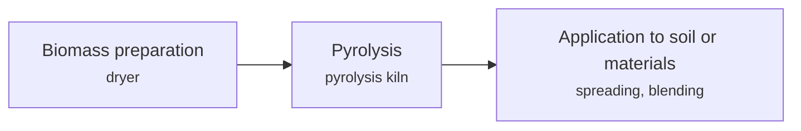

**Key equipment:** pyrolysis unit, feed dryer, quench and handling, off-gas combustion.

**Performance:**
- Exomad Green delivered CO2 removal: 107000 t CO2; described as 'to date'; total CDR deliveries 318,600 t in 2024; only 4.4% of booked volume delivered. [source](https://biochartoday.com/news/biochars-big-year-107000-tonnes-delivered-amid-8m-tonne-carbon-removal-boom/)

**Missing inputs:**
- permanence and yield per tonne feedstock (performance): Not in the source. Where: IBI biochar standards (open). Next: Add permanence figures.
- capital cost and operating or unit cost, with dollar year and basis (costs): No open source read so far gives costs for this technology. Searched arXiv corpus (28 papers) for biochar capital cost, operating cost and unit cost; not present; 2026-10-28 Where: arXiv and open-access journals: techno-economic or review papers (MDPI is blocked by its CDN; use the manual inbox) (catalog: arxiv, open); Licensor and EPC studies; paid cost databases are catalog-only (paid); OSTI.GOV full-text reports from DOE labs: search the technology name plus 'techno-economic' (catalog: osti, blocked). Next: Look for an open techno-economic study; record each figure with metric, range, unit, dollar year, basis and source.
- named plants or projects with capacity and year (reference_plants): The sources read name no specific plant. Where: Licensor and operator press releases for the suppliers listed (open). Next: Add one or two plants with country, capacity and start-up year.
- TRL with a cited source (trl): The IEA ETP Clean Energy Technology Guide has no matching entry. Where: IEA ETP Clean Energy Technology Guide (collected): search for the technology name (catalog: iea-reports, open). Next: Find a TRL table that lists this technology, or leave maturity resting on the evidence on the card.
- process steps and equipment are general engineering practice, not taken from one source (process): The sources read describe the principle but not a full step-by-step flow. Where: Licensor process descriptions and textbooks (open). Next: Check the steps against a licensor description and name it.

Sources: [1](https://biochartoday.com/news/biochars-big-year-107000-tonnes-delivered-amid-8m-tonne-carbon-removal-boom/). Last reviewed 2026-10-28.

## CO2 compression and dehydration
<a id="ccs-co2-compression-dehydration"></a>

Captured CO2 is compressed in integrally geared or in-line compressors to dense phase (around 135 barg in the Drax BECCS case) and dried to about 50 ppmv water (TEG, silica gel or molecular sieve, below 1 ppmv with sieve) before pipeline transport. The Drax cases at about 4 Mtpa needed 32.6 to 40.8 MW of compressor power depending on suction pressure.

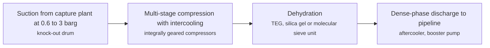

**Key equipment:** integrally geared compressors, intercoolers, dehydration unit, aftercooler, dense-phase pump.

**Performance:**
- compressor absorbed power, Drax BECCS about 4 Mtpa: 32.62-40.76 MW; 2 x 50% integrally geared, suction 0.6 to 3 barg, discharge 135 barg. [source](https://assets.publishing.service.gov.uk/media/621c9528d3bf7f4f0adec82e/KKD_CO2_Compression_and_Dehydration_Unit_Report.pdf)
- dehydration target water content: 1-50 ppmv; 50 ppmv base case; molecular sieve below 1 ppmv. [source](https://assets.publishing.service.gov.uk/media/621c9528d3bf7f4f0adec82e/KKD_CO2_Compression_and_Dehydration_Unit_Report.pdf)

**Costs:**
- integrally geared package capex, Drax BECCS case: 32 GBP million; approximate, one comparison; year not stated in text read. [source](https://assets.publishing.service.gov.uk/media/621c9528d3bf7f4f0adec82e/KKD_CO2_Compression_and_Dehydration_Unit_Report.pdf)

TRL source: [IEA ETP Clean Energy Technology Guide dataset (July 2026), entry 'CO2 transport pipeline'](https://www.iea.org/data-and-statistics/data-tools/etp-clean-energy-technology-guide)

**Missing inputs:**
- operating compression units at CCS plants (reference_plants): The report read is a design study. Where: Boundary Dam, Quest, Sleipner papers (open). Next: Add operating references.
- process steps and equipment are general engineering practice, not taken from one source (process): The sources read describe the principle but not a full step-by-step flow. Where: Licensor process descriptions and textbooks (open). Next: Check the steps against a licensor description and name it.

Sources: [1](https://assets.publishing.service.gov.uk/media/621c9528d3bf7f4f0adec82e/KKD_CO2_Compression_and_Dehydration_Unit_Report.pdf), [2](https://www.iea.org/data-and-statistics/data-tools/etp-clean-energy-technology-guide). Last reviewed 2026-10-28.

## CO2 to concrete and aggregates
<a id="ccs-co2-concrete"></a>

CO2 is injected into concrete during mixing, where it mineralises and raises compressive strength, allowing less cement. CarbonCure reports more than 500,000 t of CO2 saved over 7.5 million truckloads, with hundreds of systems in more than two dozen countries.

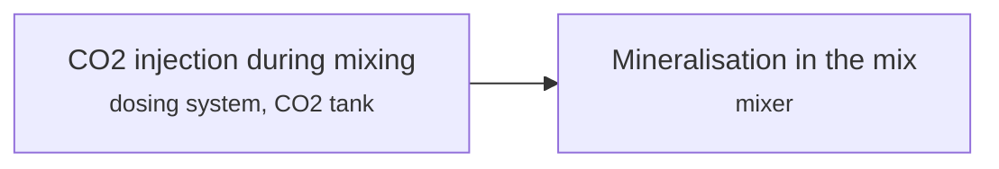

**Key equipment:** CO2 storage tank, dosing control, concrete mixer.

**Performance:**
- CO2 saved by CarbonCure to the date of the article: 500000 t CO2; 7.5 million truckloads; date not stated in text read. [source](https://gasworld.com/story/carboncure-hits-500000-tonnes-co2-milestone-with-mineralised-concrete-tech/2145799.article)

TRL source: [IEA ETP Clean Energy Technology Guide, dataset of 24 July 2026, latest assessment (IEA 1-11 scale): 'CO2 sequestration in inert carbonate materials (mineralisation)' 9 (2025)](https://www.iea.org/data-and-statistics/data-tools/etp-clean-energy-technology-guide)

**Missing inputs:**
- kg CO2 per m3 and cement reduction percent (performance): Not given. Where: CarbonCure technical notes (open). Next: Add typical numbers.
- capital cost and operating or unit cost, with dollar year and basis (costs): No open source read so far gives costs for this technology. Searched arXiv corpus (28 papers) for CO2 mineralisation in concrete, capital cost and unit cost; not present; 2026-10-28 Where: arXiv and open-access journals: techno-economic or review papers (MDPI is blocked by its CDN; use the manual inbox) (catalog: arxiv, open); Licensor and EPC studies; paid cost databases are catalog-only (paid); OSTI.GOV full-text reports from DOE labs: search the technology name plus 'techno-economic' (catalog: osti, blocked). Next: Look for an open techno-economic study; record each figure with metric, range, unit, dollar year, basis and source.
- named plants or projects with capacity and year (reference_plants): The sources read name no specific plant. Where: Licensor and operator press releases for the suppliers listed (open). Next: Add one or two plants with country, capacity and start-up year.
- process steps and equipment are general engineering practice, not taken from one source (process): The sources read describe the principle but not a full step-by-step flow. Where: Licensor process descriptions and textbooks (open). Next: Check the steps against a licensor description and name it.

Sources: [1](https://gasworld.com/story/carboncure-hits-500000-tonnes-co2-milestone-with-mineralised-concrete-tech/2145799.article). Last reviewed 2026-10-28.

## CO2 to urea and polymers
<a id="ccs-co2-to-urea-polymers"></a>

Urea plants consume CO2 from ammonia production as a feedstock, and Covestro makes CO2-based polyether carbonate polyols for polyurethane foam. Covestro's Dormagen polyols plant, started in 2016, has a capacity of 5,000 t/yr and supports foams that contain about 20% CO2.

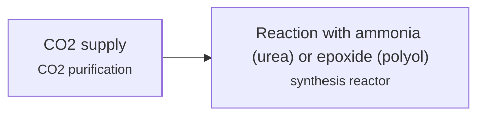

**Key equipment:** CO2 supply and purification, synthesis reactor, product finishing.

**Performance:**
- Covestro polyols plant capacity: 5000 t/yr; Dormagen; PU foams with 20% CO2. [source](https://www.european-rubber-journal.com/2016/06/20/covestro-starts-co2-based-polyols-plant)

**Missing inputs:**
- global CO2 demand for urea (performance): No source read. Global CCS Institute Global Status of CCS 2026 and CO2 shipping brief (2025) state no global urea CO2 demand figure. Where: IEA CCUS in the transition or Global CCS Institute (catalog: global-ccs-institute, open). Next: Add urea CO2 use in Mt/yr.
- capital cost and operating or unit cost, with dollar year and basis (costs): No open source read so far gives costs for this technology. Where: arXiv and open-access journals: techno-economic or review papers (MDPI is blocked by its CDN; use the manual inbox) (catalog: arxiv, open); Licensor and EPC studies; paid cost databases are catalog-only (paid); OSTI.GOV full-text reports from DOE labs: search the technology name plus 'techno-economic' (catalog: osti, blocked). Next: Look for an open techno-economic study; record each figure with metric, range, unit, dollar year, basis and source.
- named plants or projects with capacity and year (reference_plants): The sources read name no specific plant. Where: Licensor and operator press releases for the suppliers listed (open). Next: Add one or two plants with country, capacity and start-up year.
- TRL with a cited source (trl): The IEA ETP Clean Energy Technology Guide has no matching entry. Where: IEA ETP Clean Energy Technology Guide (collected): search for the technology name (catalog: iea-reports, open). Next: Find a TRL table that lists this technology, or leave maturity resting on the evidence on the card.
- process steps and equipment are general engineering practice, not taken from one source (process): The sources read describe the principle but not a full step-by-step flow. Where: Licensor process descriptions and textbooks (open). Next: Check the steps against a licensor description and name it.

Sources: [1](https://www.european-rubber-journal.com/2016/06/20/covestro-starts-co2-based-polyols-plant). Last reviewed 2026-10-28.

## Capture from high-purity CO2 streams (compression and dehydration only)
<a id="ccs-high-purity-compression"></a>

Some plants already separate CO2 as part of their process, for example acid gas removal in gas processing or fermentation in ethanol plants. Capture then only needs the CO2 to be compressed, cooled and dried to pipeline specification, which makes these the lowest-cost capture opportunities.

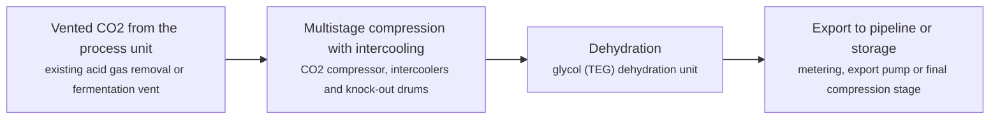

**Key equipment:** CO2 compressor, intercoolers, knock-out drums, glycol dehydration unit.

**Costs:**
- cost of CO2 captured, natural gas processing (greenfield): 16.1 USD/t CO2 (2018$); NETL; compression with intercooling and possibly glycol dehydration. [source](https://www.netl.doe.gov/projects/files/CostofCapturingCO2fromIndustrialSources_071522.pdf)
- cost of CO2 captured, ammonia (greenfield): 19 USD/t CO2 (2018$); NETL; high-purity stream. [source](https://www.netl.doe.gov/projects/files/CostofCapturingCO2fromIndustrialSources_071522.pdf)
- cost of CO2 captured, ethylene oxide (greenfield): 26 USD/t CO2 (2018$); NETL; high-purity stream. [source](https://www.netl.doe.gov/projects/files/CostofCapturingCO2fromIndustrialSources_071522.pdf)
- cost of CO2 captured, ethanol (greenfield): 31.8 USD/t CO2 (2018$); NETL; high-purity stream. [source](https://www.netl.doe.gov/projects/files/CostofCapturingCO2fromIndustrialSources_071522.pdf)
- cost of CO2 captured, gas-to-liquids: 6.4 USD/t CO2 (2018$); NETL; compression of acid gas removal CO2 stream. [source](https://www.netl.doe.gov/projects/files/CostofCapturingCO2fromIndustrialSources_071522.pdf)
- average cost of CO2 captured, high-purity industrial streams (over 95% CO2): 17.5 USD/t CO2 (2018$); NETL average across its high-purity cases; dilute streams (under 50% CO2) average 62.0. [source](https://www.netl.doe.gov/projects/files/CostofCapturingCO2fromIndustrialSources_071522.pdf)

**Reference plants:**
- ExxonMobil Shute Creek gas plant (LaBarge), Wyoming, US: 6-7 Mt/yr CO2 captured from LaBarge gas (about 66% CO2); expansion of up to 1.2 Mt/yr; operating; expansion FID February 2022, start-up estimated 2025. [source](https://www.ogj.com/energy-transition/article/14281919/exxonmobil-gets-blm-approval-for-wyoming-ccs-project)

**Missing inputs:**
- TRL range with a cited source (trl): Commercial technology, so TRL 9 is expected, but no source read states it. The IEA Clean Energy Technology Guide (collected October 2026, 634 entries) has no matching entry. Where: [IEAGHG review of current and emerging CO2 capture technologies (TCCS-10, 2019), Task 1 TRL tables](https://www.sintef.no/globalassets/project/tccs-10/dokumenter/d6/tccs-10-monica-garcia-emerging-technologies.pdf) (catalog: sintef, open); Licensor or industry association statements of commercial deployment; academic reviews (open). Next: Find a TRL table that covers this technology and add trl {low, high, source}.
- key performance figures (energy use, yields, capture or conversion rate) (performance): No source read so far gives performance figures. Searched arXiv corpus (28 papers) for CO2 compression energy and dehydration duty; not present; 2026-10-28 Where: Supplier datasheets and brochures for the companies listed on the card (open); arXiv: open techno-economic and review papers (collector already runs weekly) (catalog: arxiv, open); NETL Cost and Performance Baseline for Fossil Energy Plants, Rev 4a, and other NETL cost studies (catalog: netl, open). Next: Add the figures that matter for comparing options, each with its basis and source.

Sources: [1](https://www.netl.doe.gov/projects/files/CostofCapturingCO2fromIndustrialSources_071522.pdf), [2](https://www.ogj.com/energy-transition/article/14281919/exxonmobil-gets-blm-approval-for-wyoming-ccs-project). Last reviewed 2026-10-28.

## Chemical solvent capture from syngas (hydrogen plants)
<a id="ccs-syngas-chemical-solvent"></a>

In hydrogen plants, CO2 is removed from the shifted syngas at moderate pressure with an activated amine solvent before the hydrogen is purified. The CO2 is released in a regenerator and compressed. Capturing from syngas alone leaves the reformer furnace flue gas uncaptured.

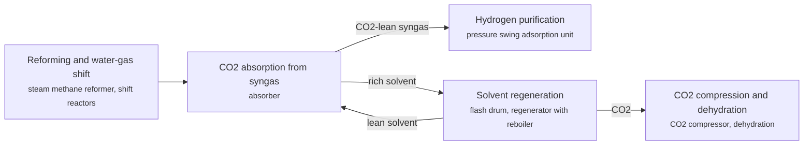

**Key equipment:** absorber, regenerator and reboiler, flash drum, CO2 compressor, PSA unit (existing).

**Costs:**
- cost of CO2 captured, refinery hydrogen (SMR), greenfield 90% capture: 59.9 USD/t CO2 (2018$); NETL industrial case; 99% capture 57.3; retrofit 61.7. Check the report for which streams are captured at each rate. [source](https://www.netl.doe.gov/projects/files/CostofCapturingCO2fromIndustrialSources_071522.pdf)

**Reference plants:**
- Quest, Scotford upgrader (Shell), CA: 1 Mt/yr nameplate; about 80% of CO2 from the hydrogen units; operating; more than 3 Mt captured by early 2019. [source](https://catalysts.shell.com/hubfs/1220448_Cansolv_CO2_white_paper_d4%20(1).pdf)

**Missing inputs:**
- TRL range with a cited source (trl): Commercial technology, so TRL 9 is expected, but no source read states it. The IEA Clean Energy Technology Guide (collected October 2026, 634 entries) has no matching entry. Where: [IEAGHG review of current and emerging CO2 capture technologies (TCCS-10, 2019), Task 1 TRL tables](https://www.sintef.no/globalassets/project/tccs-10/dokumenter/d6/tccs-10-monica-garcia-emerging-technologies.pdf) (catalog: sintef, open); Licensor or industry association statements of commercial deployment; academic reviews (open). Next: Find a TRL table that covers this technology and add trl {low, high, source}.
- key performance figures (energy use, yields, capture or conversion rate) (performance): No source read so far gives performance figures. Searched arXiv corpus (28 papers) for chemical solvent capture energy, reboiler duty and capture rate; not present; 2026-10-28 Where: Supplier datasheets and brochures for the companies listed on the card (open); arXiv: open techno-economic and review papers (collector already runs weekly) (catalog: arxiv, open); NETL Cost and Performance Baseline for Fossil Energy Plants, Rev 4a, and other NETL cost studies (catalog: netl, open). Next: Add the figures that matter for comparing options, each with its basis and source.

Sources: [1](https://catalysts.shell.com/hubfs/1220448_Cansolv_CO2_white_paper_d4%20(1).pdf), [2](https://www.netl.doe.gov/projects/files/CostofCapturingCO2fromIndustrialSources_071522.pdf). Last reviewed 2026-10-28.

## Geological CO2 storage in saline aquifers
<a id="ccs-saline-aquifer-storage"></a>

Captured CO2 is compressed to a dense phase, piped or shipped to an injection site and injected through wells into a porous rock formation filled with salt water, below an impermeable caprock. The CO2 is trapped under the seal, dissolves in the brine and, over long periods, can mineralise. Injection raises reservoir pressure, so capacity is limited by the pressure that the rock and caprock can tolerate; operators manage it with well placement, completion design and sometimes brine production. Monitoring wells and surveys track the plume.

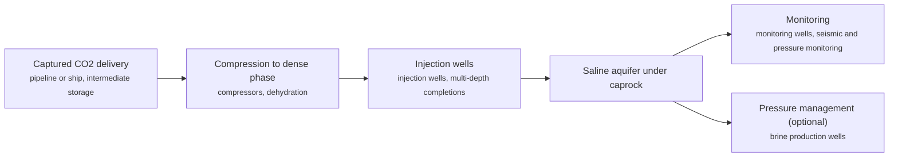

**Key equipment:** CO2 compressors, injection wells, monitoring wells, brine production wells (pressure management), wellhead and downhole sensors.

**Performance:**
- storage capacity gain from lateral pressure redistribution by brine production, Natuna D-Alpha (simulation): 64 % over the base case; thick carbonate aquifer; high-rate brine production; multi-depth injection alone gave 13%, both together 44% with storage efficiency 0.58%. [source](https://journal.lemigas.esdm.go.id/index.php/SCOG/article/view/2119)
- increase in stored CO2 from completion redesign, SK gas field aquifer (simulation): 28-33.3 % over the corresponding baseline cases; 120-year simulation with plume confined to the aquifer zone in most cases; mineral trapping a minor share. [source](https://journal.lemigas.esdm.go.id/index.php/SCOG/article/view/2067)
- pore pressure rise and remaining margin to fracture pressure, sandstone at 1,200 m (simulation): 3.2 MPa; pore pressure 11.8 to 15.8 MPa against 19.0 MPa fracture pressure, safety ratio 1.20; 10 years injection plus 500 years monitoring. [source](https://journal.lemigas.esdm.go.id/index.php/SCOG/article/view/2135)
- Upper Baturaja candidate reservoir depth and porosity (screening): 1600-1900 m depth; porosity 20-25%, dominated by secondary porosity; Kandanghaur-Gantar High, West Java; literature-based pre-feasibility. [source](https://journal.lemigas.esdm.go.id/index.php/SCOG/article/view/2126)

TRL source: [IEA ETP Clean Energy Technology Guide, dataset of 24 July 2026, 2025 assessment (IEA 1-11 scale): 'CO2 storage in saline formation' 9](https://www.iea.org/data-and-statistics/data-tools/etp-clean-energy-technology-guide)

**Missing inputs:**
- operating saline aquifer storage projects (for example Sleipner, Northern Lights) with injection rates and start years (reference_plants): The register names them but no source read describes them. Where: Global CCS Institute facilities database and operator pages (registration). Next: Read an open source on each project and add country, rate and start year.
- cost of transport and storage in USD per tonne CO2 with dollar year (costs): No source read gives storage costs. Where: IEA CCUS reports (iea-reports corpus) (catalog: iea-reports, open); NETL cost reports (corpus/netl) (catalog: netl, open). Next: Add storage cost per tonne with dollar year and basis.
- measured field injectivity and storage efficiency (performance): Only simulation results were read. Where: Operator monitoring reports (open). Next: Add measured values from operating projects.

Sources: [1](https://journal.lemigas.esdm.go.id/index.php/SCOG/article/view/2119), [2](https://journal.lemigas.esdm.go.id/index.php/SCOG/article/view/2067), [3](https://journal.lemigas.esdm.go.id/index.php/SCOG/article/view/2135), [4](https://journal.lemigas.esdm.go.id/index.php/SCOG/article/view/2126), [5](https://www.iea.org/data-and-statistics/data-tools/etp-clean-energy-technology-guide). Last reviewed 2026-10-24.

## Measurement, monitoring and verification (4D seismic, DAS, satellite InSAR)
<a id="ccs-mmv"></a>

MMV tracks injected CO2 and checks containment: time-lapse (4D) seismic and VSP image the plume, fibre-optic DAS and DTS give continuous well data, InSAR measures ground displacement, and soil gas and groundwater sampling check the surface. Quest (Alberta) injects about 1 Mt/yr with a 27 Mt target and has recorded no microseismic event indicating loss of containment.


**Key equipment:** seismic sources and receivers, fibre-optic cables, InSAR data, soil gas and groundwater sampling, pressure gauges.

**Performance:**
- Quest injection rate: 1-1.1 Mt CO2/yr; total target 27 Mt; MMV plan revised every 3 years. [source](https://albertainnovates.ca/wp-content/uploads/2022/07/CCUS-paper-carbon-MMV-Lawton-et-al.pdf)
- minimum detectable atmospheric CO2 release, single CRDS monitoring station: 14-22 t CO2/d; statistical model of background CO2 built on four years of cavity ring-down spectroscopy data (Wilson et al. 2014): 22 t/d for a 100 m x 100 m area source and 14 t/d for a point source about 1 km from a single station, with a high alarm rate (56 percent); the manual concludes single-station atmospheric monitoring is better suited to quantifying an identified release than kilometre-scale release detection over vegetated regions; no cost figures for monitoring methods are given in the manual. [source](https://netl.doe.gov/sites/default/files/2018-10/BPM-MVA-2012.pdf)
- microseismic detection threshold, Cranfield six-well array: 0 moment magnitude (Mw); no microseismicity was detected at the Cranfield site, with a calculated detection threshold of magnitude 0 and local pressure elevation of about 1,000 psi above hydrostatic; the manual states gravity-method CO2 detection thresholds are site-specific, with deeper reservoirs less suitable for gravity monitoring. [source](https://netl.doe.gov/sites/default/files/2018-10/BPM-MVA-2012.pdf)

**Costs:**
- 3D seismic survey cost (NETL storage cost model input): 60000-80000 USD/mi2 (2008$) (2008$); NETL storage cost model parameter for 3D seismic monitoring across project phases: 60,000 (low-cost scenario), 67,000 (base), 80,000 (high-cost) 2008$/mi2; the only per-method monitoring cost stated in the NETL corpus documents read. [source](https://netl.doe.gov/projects/VueConnection/download.aspx?id=c6081462-66d8-4cf2-a8e8-cd3424dce3d9&filename=QualityGuidelinesforEnergySystemStudiesCarbonDioxideTransportandStorageCostsinNETLStudies_073124.pdf)

**Missing inputs:**
- capital cost and operating or unit cost, with dollar year and basis (costs): No open source read so far gives costs for this technology. Where: arXiv and open-access journals: techno-economic or review papers (MDPI is blocked by its CDN; use the manual inbox) (catalog: arxiv, open); Licensor and EPC studies; paid cost databases are catalog-only (paid); OSTI.GOV full-text reports from DOE labs: search the technology name plus 'techno-economic' (catalog: osti, blocked). Next: Look for an open techno-economic study; record each figure with metric, range, unit, dollar year, basis and source.
- named plants or projects with capacity and year (reference_plants): The sources read name no specific plant. Where: Licensor and operator press releases for the suppliers listed (open). Next: Add one or two plants with country, capacity and start-up year.
- TRL with a cited source (trl): The IEA ETP Clean Energy Technology Guide has no matching entry. Where: IEA ETP Clean Energy Technology Guide (collected): search for the technology name (catalog: iea-reports, open). Next: Find a TRL table that lists this technology, or leave maturity resting on the evidence on the card.
- process steps and equipment are general engineering practice, not taken from one source (process): The sources read describe the principle but not a full step-by-step flow. Where: Licensor process descriptions and textbooks (open). Next: Check the steps against a licensor description and name it.

Sources: [1](https://albertainnovates.ca/wp-content/uploads/2022/07/CCUS-paper-carbon-MMV-Lawton-et-al.pdf), [2](https://netl.doe.gov/sites/default/files/2018-10/BPM-MVA-2012.pdf), [3](https://netl.doe.gov/projects/VueConnection/download.aspx?id=c6081462-66d8-4cf2-a8e8-cd3424dce3d9&filename=QualityGuidelinesforEnergySystemStudiesCarbonDioxideTransportandStorageCostsinNETLStudies_073124.pdf). Last reviewed 2026-10-28.

## Physical solvent acid gas removal (pre-combustion)
<a id="ccs-physical-solvent-pre-combustion"></a>

At high pressure and high CO2 partial pressure, organic solvents such as chilled methanol (Rectisol) or Selexol dissolve CO2 and H2S without chemical reaction. The rich solvent is depressurised in stages to release CO2, then stripped, and returned to the absorber. Physical solvents favour high-pressure syngas, while chemical solvents suit low partial pressures.

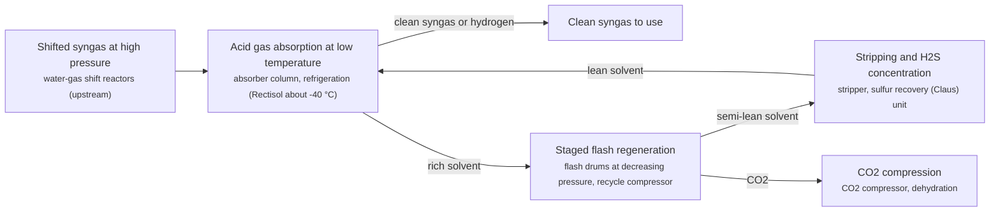

**Key equipment:** absorber, refrigeration system, flash drums, stripper, Claus sulfur recovery unit, CO2 compressor.

**Performance:**
- CO2 capture rate, two-stage Selexol in coal gasification hydrogen plant (Case 5): 92.5 %; Nominal CO2 capture of Case 5 (660,004 kg H2/day, H2S removed in first Selexol stage, CO2 in second); the coal/biomass co-gasification Case 6 with the same process achieves 92.7%. [source](https://netl.doe.gov/projects/files/ComparisonofCommercialStateofArtFossilBasedHydrogenProductionTechnologies_041222.pdf)
- CO2 purity of raw CO2 product from two-stage Selexol: 98 vol %; Case 5: CO2 flashed at 0.55 MPa (HP) and 0.1 MPa (LP) after a 2.0 MPa recycle flash that returns dissolved H2/CH4 to the absorber. [source](https://netl.doe.gov/projects/files/ComparisonofCommercialStateofArtFossilBasedHydrogenProductionTechnologies_041222.pdf)
- H2 recovery per pass in the Selexol process: 99.5 %; Recovery depends on Selexol process design conditions; the report value 99.5% per pass minimizes H2 slip to the CO2 storage stream and maximizes plant efficiency. [source](https://netl.doe.gov/projects/files/ComparisonofCommercialStateofArtFossilBasedHydrogenProductionTechnologies_041222.pdf)
- Overall CO2 capture rate, H-Vision ATR project with Rectisol AGR: 88 %; Exhibit 1-4 survey of operating and planned hydrogen plants with CCUS: H-Vision, Netherlands, 700 kNm3/hr (636 MMSCFD) H2 from ATR with Rectisol, overall CO2 capture rate 88.0%; project under development. [source](https://netl.doe.gov/projects/files/ComparisonofCommercialStateofArtFossilBasedHydrogenProductionTechnologies_041222.pdf)

**Costs:**
- Total plant cost of two-stage Selexol AGR unit in coal gasification hydrogen plant with CO2 capture (Case 5): 3.89544e+08 USD (2018) (2018$); Item 5.1 Double Stage Selexol in Case 5 (Shell gasifier, 660,004 kg H2/day, 92.5% CO2 capture), Cost Base Dec 2018; table reports $389,544 thousand, equal to $590 per kg H2/day of plant capacity; includes equipment $170.7M, labor $69.7M, engineering, fees and contingencies. [source](https://netl.doe.gov/projects/files/ComparisonofCommercialStateofArtFossilBasedHydrogenProductionTechnologies_041222.pdf)
- Total plant cost of CO2 compression and drying unit downstream of the Selexol unit (Case 5): 7.0869e+07 USD (2018) (2018$); Item 5.4 Carbon Dioxide (CO2) Compression & Drying in the same Case 5 plant, Cost Base Dec 2018; table reports $70,869 thousand, equal to $107 per kg H2/day of plant capacity. [source](https://netl.doe.gov/projects/files/ComparisonofCommercialStateofArtFossilBasedHydrogenProductionTechnologies_041222.pdf)

**Reference plants:**
- Great Plains Synfuels Plant (Dakota Gasification), Beulah, North Dakota, US: about 2 Mt/yr CO2 from the Rectisol unit, about 95% pure, piped to Weyburn, Saskatchewan for EOR; 40 Mt captured cumulatively; operating. [source](https://dakotagas.com/News-Center/news-releases/carbon-capture-milestone-reached-at-dakota-gas)

TRL source: [IEA ETP Clean Energy Technology Guide, dataset of 24 July 2026, 2025 assessment (IEA 1-11 scale): 'Pre-combustion: physical absorption (coal with CCUS)' 7](https://www.iea.org/data-and-statistics/data-tools/etp-clean-energy-technology-guide)

Sources: [1](https://netl.doe.gov/research/Coal/energy-systems/gasification/gasifipedia/agr), [2](https://dakotagas.com/News-Center/news-releases/carbon-capture-milestone-reached-at-dakota-gas), [3](https://netl.doe.gov/projects/files/ComparisonofCommercialStateofArtFossilBasedHydrogenProductionTechnologies_041222.pdf). Last reviewed 2026-10-28.

## Well integrity and CO2-resistant cements
<a id="ccs-well-integrity-cements"></a>

Portland cement degrades in CO2-rich brine by acid-driven decalcification, carbonation and leaching. Candidate systems include modified Portland, calcium aluminate (CAC), calcium aluminate phosphate (CAPC), magnesium phosphate (MPC) cements, geopolymers and resin sealants; a 2025 review found CAC, CAPC and MPC best at retaining strength and limiting carbonation depth.

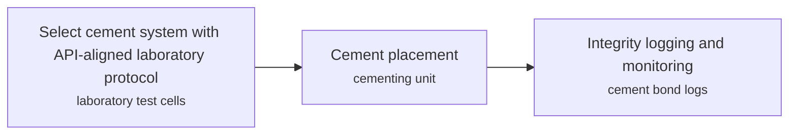

**Key equipment:** cementing unit, CO2-resistant cement slurries, cement bond logging tools, pressure monitoring.

**Missing inputs:**
- quantified strength retention and carbonation depth (performance): Only the abstract was read. Where: Full text of Rasool et al. 2025 (Petroleum Research) (open). Next: Add figures from the full text.
- capital cost and operating or unit cost, with dollar year and basis (costs): No open source read so far gives costs for this technology. Where: arXiv and open-access journals: techno-economic or review papers (MDPI is blocked by its CDN; use the manual inbox) (catalog: arxiv, open); Licensor and EPC studies; paid cost databases are catalog-only (paid); OSTI.GOV full-text reports from DOE labs: search the technology name plus 'techno-economic' (catalog: osti, blocked). Next: Look for an open techno-economic study; record each figure with metric, range, unit, dollar year, basis and source.
- named plants or projects with capacity and year (reference_plants): The sources read name no specific plant. Where: Licensor and operator press releases for the suppliers listed (open). Next: Add one or two plants with country, capacity and start-up year.
- TRL with a cited source (trl): The IEA ETP Clean Energy Technology Guide has no matching entry. Where: IEA ETP Clean Energy Technology Guide (collected): search for the technology name (catalog: iea-reports, open). Next: Find a TRL table that lists this technology, or leave maturity resting on the evidence on the card.
- process steps and equipment are general engineering practice, not taken from one source (process): The sources read describe the principle but not a full step-by-step flow. Where: Licensor process descriptions and textbooks (open). Next: Check the steps against a licensor description and name it.

Sources: [1](https://pure.unileoben.ac.at/en/publications/a-review-on-cementing-system-for-co2-storage-wells-mechanisms-tes/). Last reviewed 2026-10-25.

## Allam-Fetvedt cycle (oxy-combustion supercritical CO2 power)
<a id="ccs-allam-cycle"></a>

Natural gas burns in oxygen diluted with hot recycled CO2. The high-pressure CO2 and water mixture drives a turbine, is cooled in a recuperator, and the water is condensed out. Most CO2 is recompressed and recycled; the excess is near-pure and goes straight to a pipeline.

```mermaid
flowchart LR
    ASU["Oxygen supply<br/><small>air separation unit</small>"]
    COMB["Oxy-combustion with recycled CO2 (about 1,150 °C)<br/><small>high-pressure combustor</small>"]
    TURB["Supercritical CO2 turbine<br/><small>turbine-generator</small>"]
    REC["Recuperator and water removal<br/><small>recuperative heat exchanger, cooler and water separator</small>"]
    CMP["CO2 compression and pumping<br/><small>CO2 compressor and pump</small>"]
    PIPE["CO2 to pipeline"]
    ASU --> COMB
    COMB --> TURB
    TURB --> REC
    REC --> CMP
    CMP -->|recycled CO2 (reheated in recuperator)| COMB
    CMP -->|excess CO2| PIPE
```

**Key equipment:** air separation unit, high-pressure oxy-combustor, sCO2 turbine, recuperator, CO2 compressor and pump.

**Reference plants:**
- La Porte demonstration, US: 50 MWth (25 MWe); first fire 30 May 2018. [source](https://www.powermag.com/inside-net-power-gas-power-goes-supercritical/)
- Project Permian (NET Power), west Texas, US: initial phase now targets 80 MW, using Siemens A35 gas turbines with Entropy post-combustion capture rather than an Allam-Fetvedt cycle plant; FID expected second half 2026, commercial operation targeted early 2029 (as of March 2026). [source](https://www.businesswire.com/news/home/20260309883836/en/Net-Power-Reports-Fourth-Quarter-and-Year-End-2025-Results-and-Provides-Business-Update)

TRL source: [IEAGHG review of current and emerging CO2 capture technologies, TCCS-10, June 2019, Task 1 TRL tables](https://www.sintef.no/globalassets/project/tccs-10/dokumenter/d6/tccs-10-monica-garcia-emerging-technologies.pdf)

**Missing inputs:**
- capital cost and levelized or unit cost, with dollar year and basis (costs): No open source read so far gives costs for this technology. Searched the 11 NETL corpus documents for 'Allam', 'NET Power' and 'sCO2 power cycle'; no mention. Where: NETL Cost and Performance Baseline for Fossil Energy Plants, Rev 4a, and other NETL cost studies (catalog: netl, open); OSTI.GOV full-text reports from DOE labs (NETL, NREL, PNNL): search the technology name plus 'techno-economic' (catalog: osti, blocked); IEAGHG technical reports (private copy only) (catalog: iea-ghg, open). Next: Look for an open techno-economic study; record each figure with metric, range, unit, dollar year, basis and source.
- key performance figures (energy use, yields, capture or conversion rate) (performance): No source read so far gives performance figures. Searched the 11 NETL corpus documents for 'Allam', 'NET Power' and 'sCO2 power cycle'; no mention. Where: Supplier datasheets and brochures for the companies listed on the card (open); arXiv: open techno-economic and review papers (collector already runs weekly) (catalog: arxiv, open); NETL Cost and Performance Baseline for Fossil Energy Plants, Rev 4a, and other NETL cost studies (catalog: netl, open). Next: Add the figures that matter for comparing options, each with its basis and source.
- whether any utility-scale Allam-Fetvedt cycle plant is still planned (status): NET Power's March 2026 update describes its first commercial project as gas turbines with post-combustion capture; it does not say when or whether an Allam-cycle plant follows. Where: [NET Power 10-K for FY2025 and later quarterly reports (SEC EDGAR)](https://www.sec.gov/Archives/edgar/data/1845437/000184543726000009/npwr-20251231.htm) (open). Next: Read the 10-K technology section and record NET Power's stated plan for the Allam-Fetvedt cycle; revisit the card's maturity if no plant is planned.

Sources: [1](https://www.powermag.com/inside-net-power-gas-power-goes-supercritical/), [2](https://www.sintef.no/globalassets/project/tccs-10/dokumenter/d6/tccs-10-monica-garcia-emerging-technologies.pdf), [3](https://www.businesswire.com/news/home/20260309883836/en/Net-Power-Reports-Fourth-Quarter-and-Year-End-2025-Results-and-Provides-Business-Update). Last reviewed 2026-10-28.

## Bioenergy with CCS (BECCS)
<a id="ccs-beccs"></a>

CO2 from biomass combustion or fermentation is captured and stored, so net emissions are negative. Stockholm Exergi converts an existing biomass cogeneration plant using hot potassium carbonate capture, with liquefied CO2 shipped for permanent storage. The project avoids about seven million tonnes of CO2 over its first ten years; capture is targeted for late 2028 with EUR 180 million Innovation Fund support. IEA rates bioenergy with post-combustion capture at TRL 7.

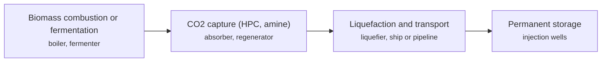

**Key equipment:** biomass boiler, capture plant, CO2 liquefaction, CO2 transport, injection wells.

**Performance:**
- CO2 avoided over the first ten years, Stockholm BECCS: 7 Mt CO2; page gives no annual rate. [source](https://cinea.ec.europa.eu/featured-projects/beccs-stockholm-delivering-net-carbon-removals-clean-energy_bg)

**Reference plants:**
- BECCS Stockholm (Stockholm Exergi), SE: about 0.7 Mt CO2/yr implied by 7 Mt over ten years; environmental permit 28 March 2024; capture targeted late 2028. [source](https://cinea.ec.europa.eu/featured-projects/beccs-stockholm-delivering-net-carbon-removals-clean-energy_bg)
- ADM Illinois Industrial, US: 1 Mtpa CO2 capture (biomass / ethanol, deep saline formation storage); operating. [source](https://www.globalccsinstitute.com/wp-content/uploads/2026/10/Global-Status-of-CCS-2026-report-Global-CCS-Institute.pdf)
- ADM Columbus, US: 1 Mtpa CO2 capture (biomass / ethanol, deep saline formation storage); operating. [source](https://www.globalccsinstitute.com/wp-content/uploads/2026/10/Global-Status-of-CCS-2026-report-Global-CCS-Institute.pdf)
- CapturePoint Arkalon CO2 Compression Facility, US: 0.5 Mtpa CO2 capture (biomass / ethanol, enhanced oil recovery); operating. [source](https://www.globalccsinstitute.com/wp-content/uploads/2026/10/Global-Status-of-CCS-2026-report-Global-CCS-Institute.pdf)
- Conestoga Energy Bonanza BioEnergy, US: 0.16 Mtpa CO2 capture (biomass / ethanol, enhanced oil recovery); operating. [source](https://www.globalccsinstitute.com/wp-content/uploads/2026/10/Global-Status-of-CCS-2026-report-Global-CCS-Institute.pdf)
- Green Plains Wood River Biorefinery, US: 0.35 Mtpa CO2 capture (biomass / ethanol, deep saline formation storage); operating. [source](https://www.globalccsinstitute.com/wp-content/uploads/2026/10/Global-Status-of-CCS-2026-report-Global-CCS-Institute.pdf)
- BioCirc Vesthimmerland Biogas Plant, DK: 0.0276 Mtpa CO2 capture (biomass / ethanol, depleted oil and gas field storage); operating. [source](https://www.globalccsinstitute.com/wp-content/uploads/2026/10/Global-Status-of-CCS-2026-report-Global-CCS-Institute.pdf)

TRL source: [IEA ETP Clean Energy Technology Guide, dataset of 24 July 2026, latest assessment (IEA 1-11 scale): 'Bioenergy with post-combustion CO2 capture' 7 (2025); 'Bioenergy with pre-combustion CO2 capture' 3 (2025)](https://www.iea.org/data-and-statistics/data-tools/etp-clean-energy-technology-guide)

**Missing inputs:**
- capital cost and operating or unit cost, with dollar year and basis (costs): No open source read so far gives costs for this technology. Where: arXiv and open-access journals: techno-economic or review papers (MDPI is blocked by its CDN; use the manual inbox) (catalog: arxiv, open); Licensor and EPC studies; paid cost databases are catalog-only (paid); OSTI.GOV full-text reports from DOE labs: search the technology name plus 'techno-economic' (catalog: osti, blocked). Next: Look for an open techno-economic study; record each figure with metric, range, unit, dollar year, basis and source.
- process steps and equipment are general engineering practice, not taken from one source (process): The sources read describe the principle but not a full step-by-step flow. Where: Licensor process descriptions and textbooks (open). Next: Check the steps against a licensor description and name it.

Sources: [1](https://cinea.ec.europa.eu/featured-projects/beccs-stockholm-delivering-net-carbon-removals-clean-energy_bg), [2](https://assets.publishing.service.gov.uk/media/621c9528d3bf7f4f0adec82e/KKD_CO2_Compression_and_Dehydration_Unit_Report.pdf), [3](https://www.globalccsinstitute.com/wp-content/uploads/2026/10/Global-Status-of-CCS-2026-report-Global-CCS-Institute.pdf). Last reviewed 2026-10-28.

## CO2 mineralisation (in-situ basalt)
<a id="ccs-in-situ-mineralisation"></a>

CO2 is dissolved in water at the surface and injected into basalt, where it reacts with calcium, magnesium and iron in the rock to form carbonate minerals. At Hellisheidi in Iceland, Carbfix reports nearly 95% of injected CO2 mineralised within two years. The Coda Terminal is planned to mineralise 3 Mt CO2 when fully operating in 2031. IEA rates CO2 mineralisation (inert carbonate materials) at TRL 9.


**Key equipment:** water supply, dissolution unit, injection wells, monitoring wells.

**Performance:**
- CO2 mineralised within two years at Hellisheidi: 95 %; nearly 95%. [source](https://alcircle.com/news/carbfix-transforming-co2-emissions-into-stone-for-a-sustainable-future-101764)
- Coda Terminal planned mineralisation: 3 Mt CO2; when fully operational (2031). [source](https://alcircle.com/news/carbfix-transforming-co2-emissions-into-stone-for-a-sustainable-future-101764)

TRL source: [IEA ETP Clean Energy Technology Guide, dataset of 24 July 2026, latest assessment (IEA 1-11 scale): 'CO2 sequestration in inert carbonate materials (mineralisation)' 9 (2025)](https://www.iea.org/data-and-statistics/data-tools/etp-clean-energy-technology-guide)

**Missing inputs:**
- cost per tonne (costs): The article gives none. Where: Carbfix publications (open). Next: Add costs.
- named plants or projects with capacity and year (reference_plants): The sources read name no specific plant. Where: Licensor and operator press releases for the suppliers listed (open). Next: Add one or two plants with country, capacity and start-up year.
- process steps and equipment are general engineering practice, not taken from one source (process): The sources read describe the principle but not a full step-by-step flow. Where: Licensor process descriptions and textbooks (open). Next: Check the steps against a licensor description and name it.

Sources: [1](https://alcircle.com/news/carbfix-transforming-co2-emissions-into-stone-for-a-sustainable-future-101764). Last reviewed 2026-10-25.

## CO2 shipping and terminals
<a id="ccs-co2-shipping"></a>

Liquefied CO2 is carried by ship to an onshore receiving terminal, then piped to an offshore injection well. At Northern Lights in Norway, CO2 from Heidelberg Materials' Brevik cement plant is shipped to a terminal at Øygarden and injected 2,600 m below the seabed in the Aurora reservoir; first injection was reported on 25 August 2025. IEA rates CO2 shipping at TRL 8.

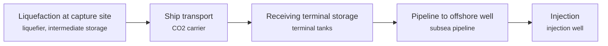

**Key equipment:** liquefaction unit, CO2 carrier ships, terminal storage tanks, subsea pipeline, injection well.

**Performance:**
- Northern Lights phase 1 capacity: 1.5 Mtpa CO2; fully booked; phase 2 at least 5 Mtpa. [source](https://www.equinor.com/news/20250825-first-co2-volumes-stored-at-northern-lights)
- storage depth: 2600 m below seabed; Aurora reservoir. [source](https://www.equinor.com/news/20250825-first-co2-volumes-stored-at-northern-lights)

**Costs:**
- CO2 shipping cost per tonne: 9-50 USD/t CO2; Global CCS Institute 2025 brief: USD 9/t at 1 Mtpa over 600 km to USD 50/t at 5 Mtpa over 1,200 km; dollar year not stated; shipping dominated by opex unlike pipeline capex. [source](https://www.globalccsinstitute.com/wp-content/uploads/2025/11/Global-CCS-Institute-Needs-Opportunities-and-Prospects-for-CO2-Shipping-in-CCS-Projects.pdf)

**Reference plants:**
- Northern Lights, Øygarden terminal and Aurora storage, NO: 1.5 Mtpa phase 1; first CO2 injected, reported 25 August 2025. [source](https://www.equinor.com/news/20250825-first-co2-volumes-stored-at-northern-lights)

TRL source: [IEA ETP Clean Energy Technology Guide, dataset of 24 July 2026, latest assessment (IEA 1-11 scale): 'CO2 shipping' 8 (2025)](https://www.iea.org/data-and-statistics/data-tools/etp-clean-energy-technology-guide)

**Missing inputs:**
- process steps and equipment are general engineering practice, not taken from one source (process): The sources read describe the principle but not a full step-by-step flow. Where: Licensor process descriptions and textbooks (open). Next: Check the steps against a licensor description and name it.

Sources: [1](https://www.equinor.com/news/20250825-first-co2-volumes-stored-at-northern-lights). Last reviewed 2026-10-25.

## CO2 to methanol and fuels
<a id="ccs-co2-to-methanol-fuels"></a>

CO2 from a point source and electrolytic hydrogen are reacted over a catalyst to make methanol. Carbon Recycling International's George Olah plant at Svartsengi, Iceland uses geothermal power plant flue-gas CO2 and electrolysis hydrogen, was commissioned in 2012 and was scaled from 1,300 to 4,000 t/yr.

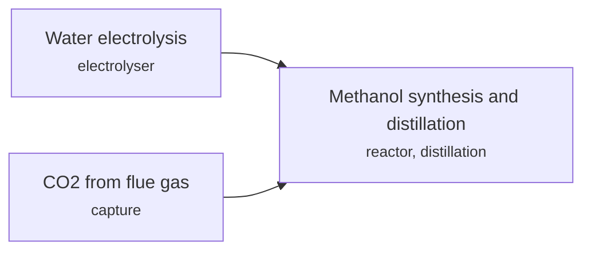

**Key equipment:** electrolyser, CO2 capture, methanol reactor, distillation.

**Performance:**
- George Olah plant capacity: 4000 t/yr methanol; scaled up from 1,300 t/yr. [source](https://carbonrecycling.com/projects/george-olah)

**Reference plants:**
- George Olah plant, Svartsengi, IS: 4,000 t/yr methanol; . [source](https://carbonrecycling.com/projects/george-olah)

TRL source: [IEA ETP Clean Energy Technology Guide, dataset of 24 July 2026, latest assessment (IEA 1-11 scale): 'Direct CO₂-to-methanol synthesis' 8 (2025)](https://www.iea.org/data-and-statistics/data-tools/etp-clean-energy-technology-guide)

**Missing inputs:**
- production cost (costs): Not on the page. Where: IRENA innovation outlook: renewable methanol (catalog: irena, open). Next: Add costs.
- process steps and equipment are general engineering practice, not taken from one source (process): The sources read describe the principle but not a full step-by-step flow. Where: Licensor process descriptions and textbooks (open). Next: Check the steps against a licensor description and name it.

Sources: [1](https://carbonrecycling.com/projects/george-olah). Last reviewed 2026-10-25.

## Direct air capture with liquid solvent (KOH and calcium loop)
<a id="ccs-dac-liquid-solvent"></a>

Fans push air through large contactors wetted with potassium hydroxide, which absorbs CO2 as carbonate. Calcium hydroxide in a pellet reactor transfers the carbonate to calcium carbonate pellets, which are calcined at about 900 °C in an oxygen-fired furnace to release concentrated CO2. The lime is slaked and returned to the loop.

```mermaid
flowchart LR
    AC["Air contactor (KOH solution)<br/><small>cross-flow contactor with packing, fans, solution pumps</small>"]
    PR["Pellet reactor<br/><small>fluidised bed pellet reactor</small>"]
    CALC["Oxy-fired calciner (about 900 °C)<br/><small>circulating fluidised bed calciner, air separation unit</small>"]
    SL["Steam slaker<br/><small>fluidised steam slaker</small>"]
    COMP["CO2 compression to 15 MPa<br/><small>four-stage CO2 compressor</small>"]
    AC -->|K2CO3 solution| PR
    PR -->|CaCO3 pellets| CALC
    PR -->|regenerated KOH| AC
    CALC -->|CaO| SL
    CALC -->|CO2| COMP
    SL -->|Ca(OH)2| PR
```

**Key equipment:** air contactors and fans, pellet reactor, oxy-fired calciner, steam slaker, air separation unit, CO2 compressor, gas turbine and HRSG (power island).

**Performance:**
- natural gas input, baseline design: 8.81 GJ/t CO2; 1 Mt/yr design, CO2 at 15 MPa, no net electricity. [source](https://www.jefftk.com/keith2018.pdf)
- energy input, minimum-gas variant: 5.25 GJ/t CO2 gas plus 366 kWh/t electricity; variant C. [source](https://www.jefftk.com/keith2018.pdf)

**Costs:**
- levelised cost of CO2 captured: 94-232 USD/t CO2 (2016$); 1 Mt/yr plant designs, CRF 7.5-12.5%, gas at USD 3.5/GJ; first-plant variant A 168-232. [source](https://www.jefftk.com/keith2018.pdf)

**Reference plants:**
- Squamish pilot, CA: about 0.6 t/day (contactor and pellet reactor loop); operating since 2015 (per 2018 paper). [source](https://www.jefftk.com/keith2018.pdf)
- Stratos, Ector County, Texas, US: up to 500,000 t/yr; start of operations moved to end of 2026 (originally end of 2024); construction began May 2023. [source](https://www.eenews.net/articles/worlds-largest-carbon-removal-plant-to-open-at-the-end-of-2026/)

TRL source: [IEAGHG review of current and emerging CO2 capture technologies, TCCS-10, June 2019, Task 1 TRL tables](https://www.sintef.no/globalassets/project/tccs-10/dokumenter/d6/tccs-10-monica-garcia-emerging-technologies.pdf)

**Missing inputs:**
- Stratos start-up and first-year capture (status): Due to start at the end of 2026; re-check after that date. Where: Occidental and 1PointFive news releases and quarterly results (open). Next: After January 2027, record start-up date and any reported tonnes captured.

Sources: [1](https://www.jefftk.com/keith2018.pdf), [2](https://netl.doe.gov/projects/files/CarbonCaptureTechnologiesStatusandChallenges_012423.pdf), [3](https://www.sintef.no/globalassets/project/tccs-10/dokumenter/d6/tccs-10-monica-garcia-emerging-technologies.pdf), [4](https://www.eenews.net/articles/worlds-largest-carbon-removal-plant-to-open-at-the-end-of-2026/). Last reviewed 2026-10-24.

## Direct air capture with solid sorbent
<a id="ccs-dac-solid-sorbent"></a>

Fans draw air through collectors where CO2 binds to a solid sorbent. When the sorbent is saturated the collector closes and is heated to about 100 °C, releasing concentrated CO2 that is then stored. Low-temperature heat means waste or geothermal heat can be used.

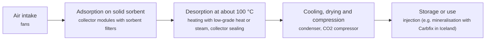

**Key equipment:** collector modules, fans, sorbent, heat supply, vacuum and condensing system, CO2 compressor.

**Performance:**
- CO2 captured at Mammoth, first half of 2026: 675 t CO2; against nameplate of up to 36,000 t/yr; almost six times a year earlier after design upgrades and new filter material; Climeworks says operating cost per tonne fell by more than half (not disclosed). [source](https://www.energyconnects.com/news/renewables/2026/september/carbon-removal-pioneer-climeworks-increases-co2-capture-sixfold/)

**Costs:**
- cost of CO2 captured, solid-sorbent DAC with natural-gas CHP (gross capture basis): 90-150 USD/t CO2 (2024$); preliminary estimates from the Black & Veatch / Global Thermostat FEED study for a kilotonne-scale modular TVSA solid-sorbent DAC system (honeycomb amine monoliths, desorption at 100 C) paired with a natural-gas CHP plant, post-combustion capture of the CHP flue gas and compression; design basis more than 100,000 t/yr net capture; dollar year not stated, publication year used. [source](https://netl.doe.gov/sites/default/files/2025-01/Carbon-Capture-Compendium-2024.pdf)
- cost of CO2 captured, same system, net removal basis: 130-240 USD/t CO2 (2024$); net removal from the atmosphere (CO2 produced by the CHP plant deducted); the same Table 2 gives annualized CAPEX at 10 percent of CAPEX of 70-130 USD/t (net) and OPEX of 60-110 USD/t (net); dollar year not stated, publication year used. [source](https://netl.doe.gov/sites/default/files/2025-01/Carbon-Capture-Compendium-2024.pdf)

**Reference plants:**
- Mammoth, Iceland, IS: up to 36,000 t/yr nameplate; geothermal energy; storage by Carbfix; first CO2 captured, May 2024. [source](https://www.esgtoday.com/climeworks-starts-up-largest-ever-dac-carbon-removal-plant)

TRL source: [IEAGHG review of current and emerging CO2 capture technologies, TCCS-10, June 2019, Task 1 TRL tables](https://www.sintef.no/globalassets/project/tccs-10/dokumenter/d6/tccs-10-monica-garcia-emerging-technologies.pdf)

Sources: [1](https://climeworks.com/highly-scalable-direct-air-capture), [2](https://netl.doe.gov/projects/files/CarbonCaptureTechnologiesStatusandChallenges_012423.pdf), [3](https://www.sintef.no/globalassets/project/tccs-10/dokumenter/d6/tccs-10-monica-garcia-emerging-technologies.pdf), [4](https://www.energyconnects.com/news/renewables/2026/september/carbon-removal-pioneer-climeworks-increases-co2-capture-sixfold/), [5](https://netl.doe.gov/sites/default/files/2025-01/Carbon-Capture-Compendium-2024.pdf). Last reviewed 2026-10-28.

## Ex-situ mineral carbonation
<a id="ccs-ex-situ-mineral-carbonation"></a>

Crushed Mg/Ca silicates or alkaline wastes react with CO2 in a plant to form stable carbonates. The ECN review found direct aqueous carbonation the most promising route (olivine 91% in 6 h at about 185 degC and 150 atm), with an energy penalty of about 27% of a power plant (75% from grinding) and best-case costs of EUR 42/t CO2 for olivine, 49 for wollastonite and 78 for serpentine.

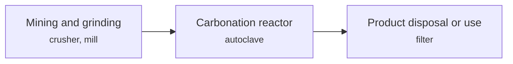

**Key equipment:** mill, high-pressure autoclave, heat recovery, solids handling.

**Performance:**
- olivine conversion in direct aqueous route: 91 %; 6 h, about 185 degC, about 150 atm CO2, feed 80% below 37 um. [source](https://publications.tno.nl/publication/34628514/f2Z0x3/c05022.pdf)
- energy penalty, aqueous route at a power plant: 27 %; about 75% of it from grinding. [source](https://publications.tno.nl/publication/34628514/f2Z0x3/c05022.pdf)

**Costs:**
- best-case sequestration cost: 42-78 EUR/t CO2; olivine 42, wollastonite 49, serpentine 78; ECN review 2003-2004 literature. [source](https://publications.tno.nl/publication/34628514/f2Z0x3/c05022.pdf)

TRL source: [IEA ETP Clean Energy Technology Guide, dataset of 24 July 2026, latest assessment (IEA 1-11 scale): 'CO2 sequestration in inert carbonate materials (mineralisation)' 9 (2025)](https://www.iea.org/data-and-statistics/data-tools/etp-clean-energy-technology-guide)

**Missing inputs:**
- current plant data (performance): The review is from 2003-2004 data. Where: Recent pilot reports on mineral carbonation and alkaline wastes (open). Next: Add post-2020 pilots.
- named plants or projects with capacity and year (reference_plants): The sources read name no specific plant. Where: Licensor and operator press releases for the suppliers listed (open). Next: Add one or two plants with country, capacity and start-up year.
- process steps and equipment are general engineering practice, not taken from one source (process): The sources read describe the principle but not a full step-by-step flow. Where: Licensor process descriptions and textbooks (open). Next: Check the steps against a licensor description and name it.

Sources: [1](https://publications.tno.nl/publication/34628514/f2Z0x3/c05022.pdf). Last reviewed 2026-10-25.

## Molten carbonate fuel cell capture
<a id="ccs-molten-carbonate-fuel-cell-capture"></a>

Flue gas passes over the cathode of a carbonate fuel cell. CO2 migrates through the electrolyte to the anode side, where it is concentrated and condensed from the anode exhaust, while the cell generates power. FuelCell Energy and ExxonMobil have worked on the design since 2016 and ExxonMobil is building a pilot at its Rotterdam complex.

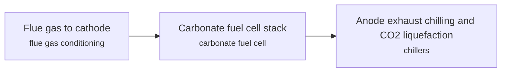

**Key equipment:** carbonate fuel cell stacks, flue gas conditioning, anode exhaust chillers, CO2 compression.

**Performance:**
- NOx destroyed in the cell: 70 %; approximate, per the article. [source](https://www.thechemicalengineer.com/news/exxonmobil-to-build-ccs-pilot-plant-using-carbonate-fuel-cell-technology/)
- power penalty of conventional capture, as stated by FuelCell Energy: 20 % of plant output; vendor claim; carbonate cells instead generate power. [source](https://www.thechemicalengineer.com/news/exxonmobil-to-build-ccs-pilot-plant-using-carbonate-fuel-cell-technology/)

**Missing inputs:**
- capture rate, power output per tonne CO2, cost (performance): The article gives none. Where: EU CFC Pilot4CCS project page (cinea.ec.europa.eu) (open); FuelCell Energy announcements (open). Next: Add measured pilot results.
- capital cost and operating or unit cost, with dollar year and basis (costs): No open source read so far gives costs for this technology. Searched arXiv corpus (28 papers) for molten carbonate fuel cell capture capital cost and unit cost; not present; 2026-10-28 Where: arXiv and open-access journals: techno-economic or review papers (MDPI is blocked by its CDN; use the manual inbox) (catalog: arxiv, open); Licensor and EPC studies; paid cost databases are catalog-only (paid); OSTI.GOV full-text reports from DOE labs: search the technology name plus 'techno-economic' (catalog: osti, blocked). Next: Look for an open techno-economic study; record each figure with metric, range, unit, dollar year, basis and source.
- named plants or projects with capacity and year (reference_plants): The sources read name no specific plant. Where: Licensor and operator press releases for the suppliers listed (open). Next: Add one or two plants with country, capacity and start-up year.
- TRL with a cited source (trl): The IEA ETP Clean Energy Technology Guide has no matching entry. Where: IEA ETP Clean Energy Technology Guide (collected): search for the technology name (catalog: iea-reports, open). Next: Find a TRL table that lists this technology, or leave maturity resting on the evidence on the card.
- process steps and equipment are general engineering practice, not taken from one source (process): The sources read describe the principle but not a full step-by-step flow. Where: Licensor process descriptions and textbooks (open). Next: Check the steps against a licensor description and name it.

Sources: [1](https://www.thechemicalengineer.com/news/exxonmobil-to-build-ccs-pilot-plant-using-carbonate-fuel-cell-technology/). Last reviewed 2026-10-28.

## Oxyfuel combustion in cement kilns
<a id="ccs-oxyfuel-cement"></a>

The kiln burns fuel in oxygen instead of air, and part of the exhaust is recirculated to control temperature. Without nitrogen, the exhaust is 70% CO2 or more, so it only needs purification and compression rather than a separation process.

```mermaid
flowchart LR
    ASU["Oxygen production<br/><small>air separation unit</small>"]
    KILN["Kiln and calciner firing in O2 with flue gas recirculation<br/><small>kiln burner, recirculation fan and ducts</small>"]
    CPU["CO2 purification<br/><small>dust removal, drying, CO2 purification unit (inerts removal)</small>"]
    COMP["CO2 compression<br/><small>CO2 compressor</small>"]
    ASU --> KILN
    KILN -->|CO2-rich exhaust (70%+)| CPU
    CPU --> COMP
```

**Key equipment:** air separation unit, flue gas recirculation fan, modified burners and seals, CO2 purification unit, CO2 compressor.

**Reference plants:**
- catch4climate pure oxyfuel plant (CI4C), Mergelstetten cement plant, DE: 450 t/day clinker; designed by thyssenkrupp Polysius; over EUR 120 million, no public funding; inaugurated 8 July 2026; first clinker end of May 2026, first oxygen mid-June 2026. [source](https://www.vicat.com/sites/default/files/2026-07/Press%20Release%20CI4C%20Inauguration%20Event_EN.pdf)
- Colleferro (IT) and Retznei (AT) industrial-scale test conversions: industrial scale; test phase about EUR 80 million; planned March 2018; the conversions did not go ahead — Heidelberg Materials' current CCUS project list and ECRA's CCS project pages name neither plant (both read 28 October 2026), and the industrial-scale oxyfuel demonstration instead proceeded via the catch4climate new-build plant at Mergelstetten, inaugurated 8 July 2026 as the world's first industrial-scale pure oxyfuel facility. [source](https://www.heidelbergmaterials.com/en/ecra-oxyfuel)

TRL source: [IEA ETP Clean Energy Technology Guide, dataset of 24 July 2026, 2025 assessment (IEA 1-11 scale): 'Oxy-fuelling and carbon capture' 7](https://www.iea.org/data-and-statistics/data-tools/etp-clean-energy-technology-guide)

**Missing inputs:**
- capital cost and levelized or unit cost, with dollar year and basis (costs): No open source read so far gives costs for this technology. Searched the 11 NETL corpus docs for 'oxyfuel', 'oxy-fuel', 'oxy-combustion'; NETL's cement capture cases (Cost of Capturing CO2 from Industrial Sources 2022; Heidelberg Mitchell FEED in the 2024 Compendium) use Shell Cansolv / MHI amine, not oxyfuel. Where: NETL Cost and Performance Baseline for Fossil Energy Plants, Rev 4a, and other NETL cost studies (catalog: netl, open); OSTI.GOV full-text reports from DOE labs (NETL, NREL, PNNL): search the technology name plus 'techno-economic' (catalog: osti, blocked); IEAGHG technical reports (private copy only) (catalog: iea-ghg, open). Next: Look for an open techno-economic study; record each figure with metric, range, unit, dollar year, basis and source.
- key performance figures (energy use, yields, capture or conversion rate) (performance): No source read so far gives performance figures. Searched the 11 NETL corpus docs for 'oxyfuel', 'oxy-fuel', 'oxy-combustion' and cement kiln terms; no oxyfuel-cement performance data present. Where: Supplier datasheets and brochures for the companies listed on the card (open); arXiv: open techno-economic and review papers (collector already runs weekly) (catalog: arxiv, open); NETL Cost and Performance Baseline for Fossil Energy Plants, Rev 4a, and other NETL cost studies (catalog: netl, open). Next: Add the figures that matter for comparing options, each with its basis and source.

Sources: [1](https://www.heidelbergmaterials.com/en/ecra-oxyfuel), [2](https://www.heidelbergmaterials.com/en/ccus), [3](https://www.ecra-online.org/research/ccs), [4](https://www.vicat.com/sites/default/files/2026-07/Press%20Release%20CI4C%20Inauguration%20Event_EN.pdf). Last reviewed 2026-10-28.

## Solid sorbent capture by rapid temperature swing
<a id="ccs-solid-sorbent-tsa"></a>

CO2 adsorbs onto a solid sorbent (amine-based or a metal-organic framework such as CALF-20) laid out as thin structured filters. The filters rotate through adsorption, steam regeneration and cooling zones in about a minute, so a small sorbent inventory handles a large gas flow.

```mermaid
flowchart LR
    FG["Flue gas cooling and pretreatment<br/><small>direct contact cooler, SOx polishing</small>"]
    ADS["Adsorption on structured sorbent<br/><small>rotary adsorption machine with structured filters</small>"]
    VENT["Treated gas to stack"]
    DES["Steam regeneration<br/><small>low-pressure steam supply, condenser</small>"]
    COMP["CO2 compression<br/><small>CO2 compressor, dehydration</small>"]
    FG --> ADS
    ADS -->|loaded sorbent| DES
    ADS -->|CO2-lean gas| VENT
    DES -->|CO2| COMP
    DES -->|regenerated sorbent| ADS
```

**Key equipment:** rotary adsorption machine, structured sorbent filters, direct contact cooler, steam condenser, CO2 compressor.

**Performance:**
- CO2 recovery of VeloxoTherm RC-TSA process: 90-95 %; Process parameter table: CO2 recovery 90-95% (current R&D value), target 95%; CO2 product at 95% purity and 150 bar; engineering-scale test ran at about 8% feed CO2 (10.5% dry basis) with flexibility over 4-14% CO2. [source](https://netl.doe.gov/sites/default/files/2025-01/Carbon-Capture-Compendium-2024.pdf)
- CO2 capture efficiency, Svante VeloxoTherm design at Linde SMR hydrogen plant: 92 %; Commercial-scale design for an existing US Gulf Coast Linde SMR capturing about 1,435,000 t/yr net CO2 with at least 90% reduction in direct CO2 emissions; flue gas flow 596,000 kg/hr; blue H2 at 99.97% purity. [source](https://netl.doe.gov/sites/default/files/2025-01/Carbon-Capture-Compendium-2024.pdf)
- Adsorption and desorption temperature of CALF-20 rapid cycle: 50-140 degC; Adsorption at about 50 degC and 1-1.1 bar; desorption (direct steam regeneration at slight vacuum) at 120-140 degC and 0.8-1.0 bar. [source](https://netl.doe.gov/sites/default/files/2025-01/Carbon-Capture-Compendium-2024.pdf)
- Heat of adsorption of CALF-20 sorbent: 35-38 kJ/mol CO2; Physisorption mechanism; equilibrium loading 1.7-1.9 g mol CO2/kg dry sorbent in 20% CO2/N2 at adsorption and 0.3-0.4 g mol CO2/kg after desorption; heat of desorption 35-38 kJ/mol CO2. [source](https://netl.doe.gov/sites/default/files/2025-01/Carbon-Capture-Compendium-2024.pdf)
- Sorbent lifetime without bed replacement: 3-5 years; Three-to-five-year lifetime without bed replacement; high oxidation resistance below 50 ppm SOx and NOx and very stable under direct steam regeneration. [source](https://netl.doe.gov/sites/default/files/2025-01/Carbon-Capture-Compendium-2024.pdf)
- Cycle time of rapid-cycle TSA process: 60 s; Fast process cycle of less than 60 seconds in the segmented-bed Mark II VeloxoTherm (rapid-cycle rotary valve moving bed); temperature and relative humidity vary along the bed within the cycle. [source](https://netl.doe.gov/sites/default/files/2025-01/Carbon-Capture-Compendium-2024.pdf)

**Costs:**
- Cost of CO2 captured, Svante RC-TSA (power plant TEA basis): 30-50 USD/t CO2 (2024$); Chevron/Svante project economics table for a nominal 550-MW(net) natural gas power plant retrofit: current R&D value $50/t CO2, target $30/t; TEA numbers validated from pilot-scale data; dollar year not stated. [source](https://netl.doe.gov/sites/default/files/2025-01/Carbon-Capture-Compendium-2024.pdf)
- Capture unit capital expenditure: 70000-80000 USD per t/day of capacity (2024$); Current R&D value $70,000-80,000 per tonne-per-day of capture capacity; target $60,000-70,000/TPD; dollar year not stated. [source](https://netl.doe.gov/sites/default/files/2025-01/Carbon-Capture-Compendium-2024.pdf)
- Capture unit operating expenditure: 26-28 USD/t CO2 (2024$); Current R&D value $26-28/t CO2 including filter bed replacement and compression cost; target $20-23/t; dollar year not stated. [source](https://netl.doe.gov/sites/default/files/2025-01/Carbon-Capture-Compendium-2024.pdf)
- Cost of CO2 captured, Svante VeloxoTherm at Linde SMR hydrogen plant: 65-78 USD/t CO2 (2024$); Linde engineering study for a US Gulf Coast SMR capturing 1,435,000 t/yr net CO2 (92% capture efficiency): current R&D value $78/t, target $65/t; study status projects $88/t CO2 for a 30-year project life with debt plus equity financing and $124/t for 15-year equity-only financing; dollar year not stated. [source](https://netl.doe.gov/sites/default/files/2025-01/Carbon-Capture-Compendium-2024.pdf)
- CALF-20 structured sorbent manufacturing cost: 30-35 USD/kg (2024$); Current value is market price of material $30-35/kg; target estimated bulk manufacturing cost $20-25/kg; dollar year not stated. [source](https://netl.doe.gov/sites/default/files/2025-01/Carbon-Capture-Compendium-2024.pdf)

**Reference plants:**
- Chevron Kern River oil field, US: 25 t/day engineering-scale; design, construction and operation (DOE-funded, USD 13M). [source](https://netl.doe.gov/node/11418)
- CO2MENT Richmond, Lafarge cement plant, CA: 1 t/day with CALF-20; field testing. [source](https://netl.doe.gov/node/11418)

TRL source: [IEAGHG review of current and emerging CO2 capture technologies, TCCS-10, June 2019, Task 1 TRL tables](https://www.sintef.no/globalassets/project/tccs-10/dokumenter/d6/tccs-10-monica-garcia-emerging-technologies.pdf)

Sources: [1](https://netl.doe.gov/node/11418), [2](https://www.sintef.no/globalassets/project/tccs-10/dokumenter/d6/tccs-10-monica-garcia-emerging-technologies.pdf), [3](https://netl.doe.gov/sites/default/files/2025-01/Carbon-Capture-Compendium-2024.pdf). Last reviewed 2026-10-28.

## Storage in depleted oil and gas fields
<a id="ccs-depleted-field-storage"></a>

CO2 is injected into depleted gas or oil reservoirs, which have proven seals and known capacity. Porthos in the Netherlands will inject 2.5 Mtpa at about 3 km depth into depleted fields P18-2, P18-4 and P18-6 about 20 km off the coast. PETRONAS Kasawari CCS will reinject 3.3 Mtpa into the depleted M1 field offshore Sarawak.

```mermaid
flowchart LR
    TRN["Pipeline transport<br/><small>pipeline, compressor station</small>"]
    INJ["Injection into depleted reservoir<br/><small>platform, injection well</small>"]
    MON["Pressure and plume monitoring<br/><small>gauges, seismic</small>"]
    TRN --> INJ
    INJ --> MON
```

**Key equipment:** injection platform, injection wells, pipeline, monitoring wells.

**Performance:**
- Porthos capacity: 2.5 Mtpa CO2; 37 Mt over 15 years; injection pressure up to 130 bar. [source](https://ioplus.nl/en/posts/the-first-dutch-carbon-capture-and-storage-plant-is-taking-shape)
- Kasawari CCS capacity: 3.3 Mtpa CO2; 71 to 76 Mt over project life. [source](https://www.ogj.com/energy-transition/article/14286402/petronas-takes-fid-for-offshore-malaysia-ccs)

**Reference plants:**
- Porthos, Rotterdam to North Sea, NL: 2.5 Mtpa; operational expected 2026. [source](https://ioplus.nl/en/posts/the-first-dutch-carbon-capture-and-storage-plant-is-taking-shape)
- Kasawari CCS, Sarawak, MY: 3.3 Mtpa; FID October 2022. [source](https://www.ogj.com/energy-transition/article/14286402/petronas-takes-fid-for-offshore-malaysia-ccs)

TRL source: [IEA ETP Clean Energy Technology Guide dataset (July 2026), entry 'CO2 storage in depleted oil and gas reservoir'](https://www.iea.org/data-and-statistics/data-tools/etp-clean-energy-technology-guide)

**Missing inputs:**
- capital cost and operating or unit cost, with dollar year and basis (costs): No open source read so far gives costs for this technology. Where: arXiv and open-access journals: techno-economic or review papers (MDPI is blocked by its CDN; use the manual inbox) (catalog: arxiv, open); Licensor and EPC studies; paid cost databases are catalog-only (paid); OSTI.GOV full-text reports from DOE labs: search the technology name plus 'techno-economic' (catalog: osti, blocked). Next: Look for an open techno-economic study; record each figure with metric, range, unit, dollar year, basis and source.
- process steps and equipment are general engineering practice, not taken from one source (process): The sources read describe the principle but not a full step-by-step flow. Where: Licensor process descriptions and textbooks (open). Next: Check the steps against a licensor description and name it.

Sources: [1](https://ioplus.nl/en/posts/the-first-dutch-carbon-capture-and-storage-plant-is-taking-shape), [2](https://www.ogj.com/energy-transition/article/14286402/petronas-takes-fid-for-offshore-malaysia-ccs), [3](https://www.iea.org/data-and-statistics/data-tools/etp-clean-energy-technology-guide). Last reviewed 2026-10-28.

## Calcium looping
<a id="ccs-calcium-looping"></a>

Lime (CaO) captures CO2 from flue gas in a carbonator at about 650 °C, forming CaCO3. The solids circulate to a calciner at about 900-950 °C, fired with fuel in oxygen and CO2, which releases a concentrated CO2 stream and regenerates CaO. Fresh limestone is added to make up for sorbent decay.

```mermaid
flowchart LR
    FG["Flue gas feed"]
    CARB["Carbonator (CaO + CO2 to CaCO3, about 650 °C)<br/><small>circulating fluidised bed carbonator, cyclone</small>"]
    VENT["Heat recovery and stack<br/><small>heat recovery steam generator</small>"]
    CALC["Oxy-fired calciner (about 900-950 °C)<br/><small>circulating fluidised bed calciner, air separation unit for oxygen, limestone make-up feeder</small>"]
    CPU["Heat recovery, CO2 purification and compression<br/><small>heat recovery, CO2 purification unit, CO2 compressor</small>"]
    FG --> CARB
    CARB -->|CaCO3-rich solids| CALC
    CARB -->|CO2-lean flue gas| VENT
    CALC -->|CO2-rich gas| CPU
    CALC -->|regenerated CaO| CARB
```

**Key equipment:** two interconnected circulating fluidised bed reactors, cyclones, air separation unit, limestone feeder, heat recovery system, CO2 compressor.

**Reference plants:**
- La Pereda pilot, ES: 1.7 MWth; biomass-fired calciner tests reached capture efficiencies above 99% in some periods (2024). [source](https://pmc.ncbi.nlm.nih.gov/articles/PMC11299141)

TRL source: [Energy & Fuels 38(15), 2024, CC BY 4.0: pilot at TRL7; IEAGHG 2019 gave TRL 6](https://pmc.ncbi.nlm.nih.gov/articles/PMC11299141)

**Missing inputs:**
- capital cost and levelized or unit cost, with dollar year and basis (costs): No open source read so far gives costs for this technology. Searched the 11 NETL corpus docs for 'calcium looping', 'carbonate looping', 'CaO', 'Calix', 'LEILAC'; no calcium-looping content (NETL's cement capture cases use Cansolv amine). Where: NETL Cost and Performance Baseline for Fossil Energy Plants, Rev 4a, and other NETL cost studies (catalog: netl, open); OSTI.GOV full-text reports from DOE labs (NETL, NREL, PNNL): search the technology name plus 'techno-economic' (catalog: osti, blocked); IEAGHG technical reports (private copy only) (catalog: iea-ghg, open). Next: Look for an open techno-economic study; record each figure with metric, range, unit, dollar year, basis and source.
- key performance figures (energy use, yields, capture or conversion rate) (performance): No source read so far gives performance figures. Searched the 11 NETL corpus docs for 'calcium looping', 'carbonate looping', 'calcination' and related terms; no calcium-looping performance data present. Where: Supplier datasheets and brochures for the companies listed on the card (open); arXiv: open techno-economic and review papers (collector already runs weekly) (catalog: arxiv, open); NETL Cost and Performance Baseline for Fossil Energy Plants, Rev 4a, and other NETL cost studies (catalog: netl, open). Next: Add the figures that matter for comparing options, each with its basis and source.

Sources: [1](https://pmc.ncbi.nlm.nih.gov/articles/PMC11299141), [2](https://www.sintef.no/globalassets/project/tccs-10/dokumenter/d6/tccs-10-monica-garcia-emerging-technologies.pdf). Last reviewed 2026-10-28.

## Cryogenic carbon capture (desublimation)
<a id="ccs-cryogenic"></a>

Flue gas is dried and cooled to about -117 °C or colder so that CO2 freezes out (desublimes) and is separated as a solid, then melted and pumped as high-purity liquid CO2. Cold is recovered between the incoming and outgoing streams in multi-stream heat exchangers.

```mermaid
flowchart LR
    FG["Drying and cooling<br/><small>dryer, multi-stream heat exchanger (5 °C minimum approach)</small>"]
    DS["CO2 desublimation at about -117 °C<br/><small>desublimating heat exchanger or contact liquid vessel, refrigeration loop</small>"]
    SEP["Solid separation and melting<br/><small>solid-liquid separator, melter</small>"]
    VENT["Cold recovery and stack<br/><small>multi-stream heat exchanger</small>"]
    PUMP["Liquid CO2 pressurisation<br/><small>cryogenic pump</small>"]
    FG --> DS
    DS --> SEP
    SEP -->|liquid CO2| PUMP
    SEP -->|cold CO2-lean gas (cold recovered)| VENT
```

**Key equipment:** multi-stream heat exchangers, refrigeration system, desublimation unit, solid separator and melter, liquid CO2 pump.

**Performance:**
- target electricity use, full-scale TEA: up to 0.83 MJe/kg CO2; project target, not measured. [source](https://netl.doe.gov/sites/default/files/netl-file/22CM_PSC15_Hoeger.pdf)

**Costs:**
- cost of CO2 captured, InnoSepra sorbent-and-membrane cryogenic process, post-combustion power: 40 USD/t CO2 (2024$); NETL Compendium status: completed project achieved 'a CO2 capture cost of less than $40/tonne', recorded here as <=40 USD/t; project goal was 'about $30/MT by 2030' with capture cost 'greater than 40% lower' than solvent-based capture; bench-scale TEA, >=90% removal and >95% purity target; dollar year not stated, 2024 is the Compendium publication year; note the InnoSepra design is a sorbent/membrane process operating at near-cryogenic conditions, not the SES desublimation CCC design. [source](https://netl.doe.gov/sites/default/files/2025-01/Carbon-Capture-Compendium-2024.pdf)

**Reference plants:**
- Sugar Creek cement plant pilot, US: 30 t/day nominal (after 1 t/day tests); DOE project Feb 2022 to Apr 2025; target 95% capture and 95% purity. [source](https://netl.doe.gov/sites/default/files/netl-file/22CM_PSC15_Hoeger.pdf)

TRL source: [IEAGHG review of current and emerging CO2 capture technologies, TCCS-10, June 2019, Task 1 TRL tables](https://www.sintef.no/globalassets/project/tccs-10/dokumenter/d6/tccs-10-monica-garcia-emerging-technologies.pdf)

Sources: [1](https://netl.doe.gov/sites/default/files/netl-file/22CM_PSC15_Hoeger.pdf), [2](https://www.sintef.no/globalassets/project/tccs-10/dokumenter/d6/tccs-10-monica-garcia-emerging-technologies.pdf), [3](https://netl.doe.gov/sites/default/files/2025-01/Carbon-Capture-Compendium-2024.pdf). Last reviewed 2026-10-28.

## Enhanced rock weathering and ocean alkalinity enhancement
<a id="ccs-enhanced-weathering"></a>

Crushed silicate rock (basalt, olivine) is spread on land or added to seawater so it weathers faster and converts CO2 to bicarbonate. Strefler and colleagues estimated potentials of up to 95 Gt CO2/yr for dunite and 4.9 Gt for basalt on cropland and costs of about USD 60 per tonne CO2 for dunite and USD 200 for basalt. UNDO and Planetary are listed as developers.

```mermaid
flowchart LR
    MIN["Mine and crush rock<br/><small>crusher</small>"]
    APP["Spread on cropland or add to seawater<br/><small>spreaders, ships</small>"]
    MON["Monitor weathering and CO2 uptake<br/><small>soil and water sampling</small>"]
    MIN --> APP
    APP --> MON
```

**Key equipment:** rock crushers, transport, spreading equipment, monitoring and sampling.

**Performance:**
- removal potential on cropland: 4.9-95 Gt CO2/yr; basalt 4.9, dunite 95. [source](https://oa.tib.eu/renate/items/5c9d035a-23d0-4d16-af2f-eacc94b97374/full)

**Costs:**
- removal cost: 60-200 USD/t CO2 (2018$); dunite about 60, basalt about 200; paper published 2018, dollar year not stated. [source](https://oa.tib.eu/renate/items/5c9d035a-23d0-4d16-af2f-eacc94b97374/full)

**Missing inputs:**
- field trial results (reference_plants): Only a potential and cost study read. Where: UNDO and Planetary field data (open). Next: Add field results.
- TRL with a cited source (trl): The IEA ETP Clean Energy Technology Guide has no matching entry. IEA ETP Guide (July 2026) has no matching entry (searched enhanced weathering, weathering, alkalinity, olivine, carbon removal); 2026-10-28 Where: IEA ETP Clean Energy Technology Guide (collected): search for the technology name (catalog: iea-reports, open). Next: Find a TRL table that lists this technology, or leave maturity resting on the evidence on the card.
- process steps and equipment are general engineering practice, not taken from one source (process): The sources read describe the principle but not a full step-by-step flow. Where: Licensor process descriptions and textbooks (open). Next: Check the steps against a licensor description and name it.

Sources: [1](https://oa.tib.eu/renate/items/5c9d035a-23d0-4d16-af2f-eacc94b97374/full). Last reviewed 2026-10-28.

## Enzyme-catalysed capture
<a id="ccs-enzyme-capture"></a>

Carbonic anhydrase enzyme speeds up CO2 hydration in a non-toxic, non-volatile solvent, so capture can run on low-grade heat. Saipem sells it as Bluenzyme; the first product, Bluenzyme 200, has a nominal capacity of 200 t CO2 per day and was tested within the EU ACCSESS project.

```mermaid
flowchart LR
    ABS["Absorption with enzyme-enhanced solvent<br/><small>absorber</small>"]
    REG["Low-temperature regeneration<br/><small>regenerator</small>"]
    ABS --> REG
```

**Key equipment:** absorber, regenerator, enzyme solvent system.

**Performance:**
- nominal capture capacity of Bluenzyme 200: 200 t CO2/day; Saipem product. [source](https://www.digitalrefining.com/news/1007573/bluenzyme-sustainable-co2-capture-solution-from-saipem)

**Missing inputs:**
- specific energy and capture rate (performance): Not given. Where: ACCSESS project results (open); Saipem technical papers (catalog: saipem, open). Next: Add measured figures.
- capital cost and operating or unit cost, with dollar year and basis (costs): No open source read so far gives costs for this technology. Searched arXiv corpus (28 papers) for enzyme capture, carbonic anhydrase, capital cost and unit cost; not present; 2026-10-28 Where: arXiv and open-access journals: techno-economic or review papers (MDPI is blocked by its CDN; use the manual inbox) (catalog: arxiv, open); Licensor and EPC studies; paid cost databases are catalog-only (paid); OSTI.GOV full-text reports from DOE labs: search the technology name plus 'techno-economic' (catalog: osti, blocked). Next: Look for an open techno-economic study; record each figure with metric, range, unit, dollar year, basis and source.
- named plants or projects with capacity and year (reference_plants): The sources read name no specific plant. Where: Licensor and operator press releases for the suppliers listed (open). Next: Add one or two plants with country, capacity and start-up year.
- TRL with a cited source (trl): The IEA ETP Clean Energy Technology Guide has no matching entry. Where: IEA ETP Clean Energy Technology Guide (collected): search for the technology name (catalog: iea-reports, open). Next: Find a TRL table that lists this technology, or leave maturity resting on the evidence on the card.
- process steps and equipment are general engineering practice, not taken from one source (process): The sources read describe the principle but not a full step-by-step flow. Where: Licensor process descriptions and textbooks (open). Next: Check the steps against a licensor description and name it.

Sources: [1](https://www.digitalrefining.com/news/1007573/bluenzyme-sustainable-co2-capture-solution-from-saipem). Last reviewed 2026-10-28.

## Polymeric membrane capture
<a id="ccs-polymeric-membrane"></a>

Flue gas passes over a CO2-selective polymer membrane. A pressure difference across the membrane, created by compressing the feed and/or applying vacuum on the permeate side, drives CO2 through faster than nitrogen. Multiple stages and recycle raise purity and capture rate; no chemicals or steam are needed.

```mermaid
flowchart LR
    FG["Flue gas cooling and conditioning<br/><small>cooler, particulate and SOx polishing</small>"]
    CMP["Feed compression<br/><small>blower or compressor</small>"]
    M1["First membrane stage<br/><small>membrane modules (spiral wound or hollow fibre), vacuum pump on permeate</small>"]
    VENT["Residue to stack<br/><small>stack</small>"]
    M2["Second stage or liquefaction for purity<br/><small>membrane modules or CO2 liquefaction unit</small>"]
    COMP["CO2 compression<br/><small>CO2 compressor, dehydration</small>"]
    FG --> CMP
    CMP --> M1
    M1 -->|CO2-enriched permeate| M2
    M1 -->|CO2-lean residue| VENT
    M2 --> COMP
```

**Key equipment:** feed compressor or blower, membrane modules, vacuum pumps, heat exchangers, CO2 compressor.

**Performance:**
- CO2 permeance of Polaris membrane: 1000-3000 GPU; Commercial Polaris averages 1,000 GPU (about 10 times conventional gas separation membranes); lab-scale studies demonstrated 3,000 GPU; design tables list 1,000 GPU (spiral-wound) and 1,700 GPU (plate-and-frame) at 30 degC, mixed gas. [source](https://netl.doe.gov/sites/default/files/2025-01/Carbon-Capture-Compendium-2024.pdf)
- CO2/N2 selectivity of Polaris membrane: 30-50 dimensionless; Module design tables list CO2/N2 selectivity 30 (mixed gas, 30 degC) for spiral-wound and plate-and-frame; the narrative cites an average CO2/N2 selectivity of 50. [source](https://netl.doe.gov/sites/default/files/2025-01/Carbon-Capture-Compendium-2024.pdf)
- CO2 recovery of membrane capture system (module design value): 70-90 %; Design values: 90% recovery at >96% purity and 140 bar (spiral-wound configuration); 70% recovery at >96% purity and 150 bar (plate-and-frame configuration). [source](https://netl.doe.gov/sites/default/files/2025-01/Carbon-Capture-Compendium-2024.pdf)
- CO2 capture rate of multi-stage membrane process: 50-75 %; Multi-stage design overcomes the pressure-ratio constraint of single-stage systems; FEED study design basis captures 70% of Dry Fork Station emissions; operation at about 70%+ capture without recycle noted as lower-cost option. [source](https://netl.doe.gov/sites/default/files/2025-01/Carbon-Capture-Compendium-2024.pdf)
- CO2 capture rate with selective recycle to boiler, 1-MWe pilot: 90 %; Integrated membrane-boiler test with B&W 0.6-MWe coal-fired research boiler; a modest boiler efficiency reduction of 1.8% was measured at 90% capture, showing the selective-recycle process is feasible. [source](https://netl.doe.gov/sites/default/files/2025-01/Carbon-Capture-Compendium-2024.pdf)
- CO2 purity of product from membrane process: 85-99 vol %; First capture stage permeate about 55-60% CO2, enriched to >85% CO2 by the second membrane stage; FEED design adds a CO2 purification unit producing >99% CO2 at 150 bar. [source](https://netl.doe.gov/sites/default/files/2025-01/Carbon-Capture-Compendium-2024.pdf)
- Membrane module lifetime: 3 years; Target module lifetime three years; in extended flue-gas testing (more than 13,000 hours) fouling was not significant; spiral-wound modules accumulated 11,000 hours without significant degradation. [source](https://netl.doe.gov/sites/default/files/2025-01/Carbon-Capture-Compendium-2024.pdf)

**Costs:**
- Cost of CO2 captured, MTR Polaris membrane process (FEED study potential): 40 USD/t CO2 (2024$); Stated as potential to capture below the DOE capture cost target of $40/tonne CO2 from coal-fired flue gas; FEED design basis is 5,600 t/d (about 2.0 Mt/yr), 70% of the 400-MWe Dry Fork Station plant's CO2; dollar year not stated. [source](https://netl.doe.gov/sites/default/files/2025-01/Carbon-Capture-Compendium-2024.pdf)
- Cost of CO2 captured, MTR hybrid membrane-absorption process: 43-54 USD/t CO2 (2024$); Hybrid of Polaris membrane recycle stage (enriching flue gas from about 13 to 20% CO2) with a 5 molal piperazine advanced flash stripper on coal flue gas; current R&D value $54/t, target $43/t; dollar year not stated. [source](https://netl.doe.gov/sites/default/files/2025-01/Carbon-Capture-Compendium-2024.pdf)
- Membrane material manufacturing cost: 10-30 USD/m2 (2024$); Design value $10/m2 for spiral-wound modules and $30/m2 for plate-and-frame modules; dollar year not stated. [source](https://netl.doe.gov/sites/default/files/2025-01/Carbon-Capture-Compendium-2024.pdf)
- Membrane module manufacturing and installation cost, projected at full commercialization: 50 USD/m2 of membrane (2024$); Projected cost of planar plate-and-frame module skids at full commercialization stage; dollar year not stated. [source](https://netl.doe.gov/sites/default/files/2025-01/Carbon-Capture-Compendium-2024.pdf)

**Reference plants:**
- Wyoming Integrated Test Center large pilot, Dry Fork Station, US: 150 t/day CO2; under construction in Sept 2023, slated to operate in 2024. [source](https://www.businesswire.com/news/home/20230906900880/en/MTR-Carbon-Capture-Building-World’s-Largest-Membrane-Based-Carbon-Capture-Plant)

TRL source: [IEAGHG review of current and emerging CO2 capture technologies, TCCS-10, June 2019, Task 1 TRL tables](https://www.sintef.no/globalassets/project/tccs-10/dokumenter/d6/tccs-10-monica-garcia-emerging-technologies.pdf)

Sources: [1](https://www.sintef.no/globalassets/project/tccs-10/dokumenter/d6/tccs-10-monica-garcia-emerging-technologies.pdf), [2](https://netl.doe.gov/projects/files/CarbonCaptureTechnologiesStatusandChallenges_012423.pdf), [3](https://netl.doe.gov/sites/default/files/2025-01/Carbon-Capture-Compendium-2024.pdf). Last reviewed 2026-10-28.

## CO2 electroreduction to CO, formic acid and ethylene
<a id="ccs-co2-electroreduction"></a>

CO2 is reduced at a cathode to CO (Ag, Au), formate (Pb, Sn) or ethylene (Cu). Kenis and colleagues report CO at 94% Faradaic efficiency and 91 mA/cm2 on a silver gas-diffusion electrode and say commercial use needs overpotential below 0.2 V at above 100 mA/cm2; no standard durability protocols existed in 2013.

```mermaid
flowchart LR
    IN["CO2 and water or electrolyte feed<br/><small>gas diffusion electrode cell</small>"]
    EL["Electrolysis<br/><small>electrolyser stack</small>"]
    SEP["Product separation<br/><small>separation</small>"]
    IN --> EL
    EL --> SEP
```

**Key equipment:** electrolyser stack, gas diffusion electrodes, CO2 supply, product separation.

**Performance:**
- CO faradaic efficiency on Ag GDE: 94 %; 91 mA/cm2, energy efficiency 46%. [source](https://kenis-group.chbe.illinois.edu/Publications/2013/jhong_2013_eco2rropportunities.pdf)
- C1-C2 fuels at high current: 70 % faradaic efficiency; 600 mA/cm2, energy efficiency below 22%. [source](https://kenis-group.chbe.illinois.edu/Publications/2013/jhong_2013_eco2rropportunities.pdf)

**Missing inputs:**
- current TRL and Twelve plant data (trl): The review is from 2013. IEA ETP Guide (July 2026) has no matching entry (searched electroreduction, electrochemical, CO2 electrolysis, co-electrolysis, ethylene, formic); 2026-10-28 Where: IEA ETP Clean Energy Technology Guide (collected): search for the technology name (catalog: iea-reports, open). Next: Add post-2020 pilot data.
- capital cost and operating or unit cost, with dollar year and basis (costs): No open source read so far gives costs for this technology. Where: arXiv and open-access journals: techno-economic or review papers (MDPI is blocked by its CDN; use the manual inbox) (catalog: arxiv, open); Licensor and EPC studies; paid cost databases are catalog-only (paid); OSTI.GOV full-text reports from DOE labs: search the technology name plus 'techno-economic' (catalog: osti, blocked). Next: Look for an open techno-economic study; record each figure with metric, range, unit, dollar year, basis and source.
- named plants or projects with capacity and year (reference_plants): The sources read name no specific plant. Where: Licensor and operator press releases for the suppliers listed (open). Next: Add one or two plants with country, capacity and start-up year.
- process steps and equipment are general engineering practice, not taken from one source (process): The sources read describe the principle but not a full step-by-step flow. Where: Licensor process descriptions and textbooks (open). Next: Check the steps against a licensor description and name it.

Sources: [1](https://kenis-group.chbe.illinois.edu/Publications/2013/jhong_2013_eco2rropportunities.pdf). Last reviewed 2026-10-28.

## Chemical looping combustion
<a id="ccs-chemical-looping-combustion"></a>

A solid metal oxide oxygen carrier circulates between an air reactor, where it picks up oxygen, and a fuel reactor, where it burns the fuel without contact with air. The fuel reactor exhaust is only CO2 and water, so CO2 is obtained by condensing the water, without an air separation unit.

```mermaid
flowchart LR
    AR["Air reactor (carrier oxidation)<br/><small>fluidised bed air reactor, cyclone</small>"]
    VENT["Depleted air to stack"]
    FR["Fuel reactor (fuel oxidised by carrier)<br/><small>fluidised bed fuel reactor</small>"]
    CON["Water condensation and CO2 compression<br/><small>condenser, CO2 compressor</small>"]
    AR -->|oxidised carrier| FR
    AR -->|depleted air| VENT
    FR -->|reduced carrier| AR
    FR -->|CO2 + H2O| CON
```

**Key equipment:** interconnected fluidised bed reactors, cyclones and loop seals, oxygen carrier material, condenser, CO2 compressor.

TRL source: [IEAGHG review of current and emerging CO2 capture technologies, TCCS-10, June 2019, Task 1 TRL tables](https://www.sintef.no/globalassets/project/tccs-10/dokumenter/d6/tccs-10-monica-garcia-emerging-technologies.pdf)

**Missing inputs:**
- capital cost and levelized or unit cost, with dollar year and basis (costs): No open source read so far gives costs for this technology. Searched the 11 NETL corpus docs for 'chemical looping', 'oxygen carrier', 'looping combustion'; only chemical looping reforming appears, as a future-advanced-concept note with no cost figures. Where: NETL Cost and Performance Baseline for Fossil Energy Plants, Rev 4a, and other NETL cost studies (catalog: netl, open); OSTI.GOV full-text reports from DOE labs (NETL, NREL, PNNL): search the technology name plus 'techno-economic' (catalog: osti, blocked); IEAGHG technical reports (private copy only) (catalog: iea-ghg, open). Next: Look for an open techno-economic study; record each figure with metric, range, unit, dollar year, basis and source.
- key performance figures (energy use, yields, capture or conversion rate) (performance): No source read so far gives performance figures. Searched the 11 NETL corpus docs for 'chemical looping', 'oxygen carrier', 'looping combustion'; no chemical-looping-combustion performance data present. Where: Supplier datasheets and brochures for the companies listed on the card (open); arXiv: open techno-economic and review papers (collector already runs weekly) (catalog: arxiv, open); NETL Cost and Performance Baseline for Fossil Energy Plants, Rev 4a, and other NETL cost studies (catalog: netl, open). Next: Add the figures that matter for comparing options, each with its basis and source.
- named operating or planned plants with capacity and status (reference_plants): Lab-stage technology: pilot units may exist but none was found in sources read. Where: IEA CCUS Projects Database (free registration) (catalog: iea-ccus-db, registration); Global CCS Institute CO2RE facilities database (catalog: global-ccs-co2re, open); Press releases from the suppliers listed on the card (open). Next: Add one to three reference plants with country, capacity, status and source.

Sources: [1](https://www.sintef.no/globalassets/project/tccs-10/dokumenter/d6/tccs-10-monica-garcia-emerging-technologies.pdf). Last reviewed 2026-10-28.

## Electro-swing and moisture-swing DAC
<a id="ccs-electro-swing-moisture-swing-dac"></a>

Electro-swing adsorption toggles the CO2 affinity of a redox-active material electrochemically: it captures at 400 ppm while charging and releases when discharged. Moisture-swing sorbents capture CO2 when dry and release it when wetted. Verdox's 2020-21 DOE project tuned quinone redox molecules and electrode channels, reporting a channel pressure drop below 1,000 Pa. IEA rates electrochemical DAC at TRL 6.

```mermaid
flowchart LR
    CHG["Charge: capture CO2 from air<br/><small>electrochemical cell with air channels</small>"]
    DCH["Discharge: release CO2<br/><small>electrochemical cell</small>"]
    CMP["CO2 collection and compression<br/><small>compressor</small>"]
    CHG --> DCH
    DCH --> CMP
```

**Key equipment:** electrochemical cell stack, air contactor channels, power electronics, CO2 compression.

**Performance:**
- channel pressure drop reported: up to 1000 Pa; Verdox DOE kickoff slides, February 2021. [source](https://netl.doe.gov/sites/default/files/netl-file/21DAC_Voskian_A.pdf)

TRL source: [IEA ETP Clean Energy Technology Guide, dataset of 24 July 2026, latest assessment (IEA 1-11 scale): 'Electrochemical DAC (e-DAC)' 6 (2025)](https://www.iea.org/data-and-statistics/data-tools/etp-clean-energy-technology-guide)

**Missing inputs:**
- kJ per mole CO2 and capacity of electro-swing; moisture-swing sorbents (performance): The slides give neither; no moisture-swing source read. Where: Verdox papers (open); Review of moisture swing sorbents (Inderscience) (open). Next: Add the numbers and a moisture-swing source.
- capital cost and operating or unit cost, with dollar year and basis (costs): No open source read so far gives costs for this technology. Searched arXiv corpus (28 papers) for electro-swing, moisture swing and direct air capture cost; not present; 2026-10-28 Where: arXiv and open-access journals: techno-economic or review papers (MDPI is blocked by its CDN; use the manual inbox) (catalog: arxiv, open); Licensor and EPC studies; paid cost databases are catalog-only (paid); OSTI.GOV full-text reports from DOE labs: search the technology name plus 'techno-economic' (catalog: osti, blocked). Next: Look for an open techno-economic study; record each figure with metric, range, unit, dollar year, basis and source.
- named plants or projects with capacity and year (reference_plants): The sources read name no specific plant. Where: Licensor and operator press releases for the suppliers listed (open). Next: Add one or two plants with country, capacity and start-up year.
- process steps and equipment are general engineering practice, not taken from one source (process): The sources read describe the principle but not a full step-by-step flow. Where: Licensor process descriptions and textbooks (open). Next: Check the steps against a licensor description and name it.

Sources: [1](https://netl.doe.gov/sites/default/files/netl-file/21DAC_Voskian_A.pdf). Last reviewed 2026-10-28.

## Emerging capture: water-lean solvents, ionic liquids and electrochemical separation
<a id="ccs-emerging-solvents-electrochemical"></a>

Next-generation solvents reduce the water in the solvent, or use ionic liquids, to cut the heat needed for regeneration. Electrochemical routes release CO2 by changing the oxidation state or pH of a carrier with electricity instead of heat. The IEAGHG 2019 review rated water-lean absorbents TRL 5, ionic liquids TRL 4 and electrochemical separation TRL 4.

```mermaid
flowchart LR
    ABS["CO2 uptake in solvent or electrochemical cell<br/><small>absorber or electrochemical cell stack</small>"]
    REG["Release by heat (lower duty) or by voltage<br/><small>regenerator or electrochemical release cell</small>"]
    COMP["CO2 compression<br/><small>CO2 compressor</small>"]
    ABS --> REG
    REG --> COMP
```

**Key equipment:** absorber or electrochemical cell stack, regenerator, CO2 compressor.

**Costs:**
- DOE transformational capture cost target: 30-40 USD/t CO2; programme targets: 40 by 2025, 30 by 2030; dollar year not stated in source. [source](https://netl.doe.gov/projects/files/CarbonCaptureTechnologiesStatusandChallenges_012423.pdf)

TRL source: [IEAGHG review of current and emerging CO2 capture technologies, TCCS-10, June 2019, Task 1 TRL tables](https://www.sintef.no/globalassets/project/tccs-10/dokumenter/d6/tccs-10-monica-garcia-emerging-technologies.pdf)

**Missing inputs:**
- key performance figures (energy use, yields, capture or conversion rate) (performance): No source read so far gives performance figures. Searched arXiv corpus (28 papers) for water-lean solvents, ionic liquids and electrochemical separation energy and capture rate; not present; 2026-10-28 Where: Supplier datasheets and brochures for the companies listed on the card (open); arXiv: open techno-economic and review papers (collector already runs weekly) (catalog: arxiv, open); NETL Cost and Performance Baseline for Fossil Energy Plants, Rev 4a, and other NETL cost studies (catalog: netl, open). Next: Add the figures that matter for comparing options, each with its basis and source.
- named operating or planned plants with capacity and status (reference_plants): Lab-stage technology: pilot units may exist but none was found in sources read. Where: IEA CCUS Projects Database (free registration) (catalog: iea-ccus-db, registration); Global CCS Institute CO2RE facilities database (catalog: global-ccs-co2re, open); Press releases from the suppliers listed on the card (open). Next: Add one to three reference plants with country, capacity, status and source.

Sources: [1](https://www.sintef.no/globalassets/project/tccs-10/dokumenter/d6/tccs-10-monica-garcia-emerging-technologies.pdf), [2](https://netl.doe.gov/projects/files/CarbonCaptureTechnologiesStatusandChallenges_012423.pdf), [3](https://netl.doe.gov/sites/default/files/2025-01/Carbon-Capture-Compendium-2024.pdf). Last reviewed 2026-10-28.
