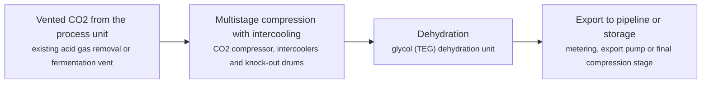
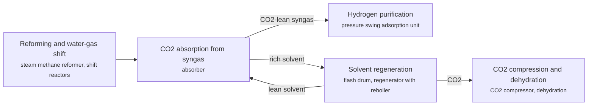
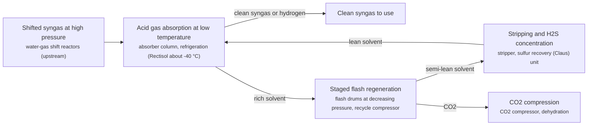
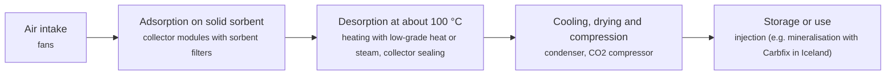
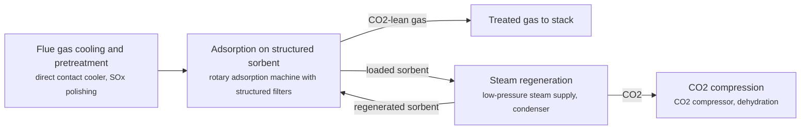
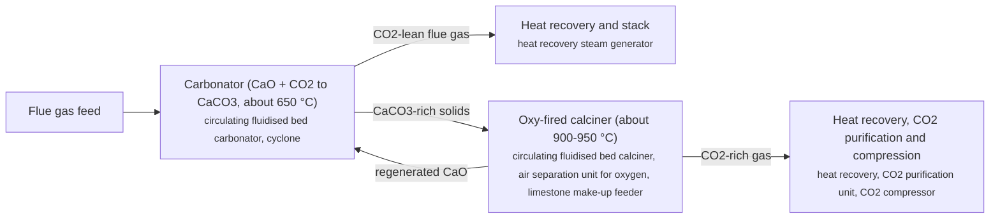
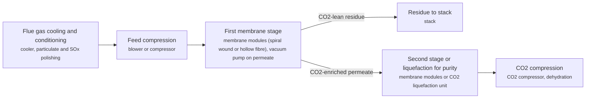
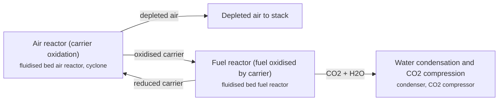
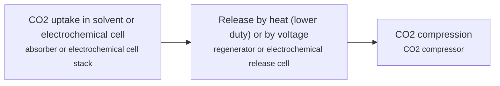

# CCS technology options

14 technologies, from commercial to lab stage. Generated from catalog/technologies/; every figure links to its source.

| Technology | Category | Maturity | TRL | Suppliers | Cost figures |
| --- | --- | --- | --- | --- | --- |
| [Amine solvent post-combustion capture](#ccs-amine-post-combustion) | Post-combustion / chemical solvent | commercial | 6-9 | Mitsubishi Heavy Industries (KM CDR Process with KS-1 solvent); Shell Catalysts & Technologies (CANSOLV CO2 Capture System); SLB Capturi (Just Catch (modular) and larger plants); Fluor (Econamine FG Plus) | cost of CO2 captured, new NGCC (H-class to F-class), 90% capture: 55.9-60.7 USD/t CO2 (2018$)<br>cost of CO2 captured, NGCC retrofit (H-class to F-class), 90% capture: 56.7-61.8 USD/t CO2 (2018$)<br>cost of CO2 captured, cement (greenfield, 90% capture): 62.7 USD/t CO2 (2018$)<br>cost of CO2 captured, iron and steel BOF (retrofit, 90% capture): 65.9 USD/t CO2 (2018$) |
| [Capture from high-purity CO2 streams (compression and dehydration only)](#ccs-high-purity-compression) | Point source / no separation step | commercial |  | CO2 compressor and dehydration vendors (no licensed process needed) | cost of CO2 captured, natural gas processing (greenfield): 16.1 USD/t CO2 (2018$)<br>cost of CO2 captured, ammonia (greenfield): 19 USD/t CO2 (2018$)<br>cost of CO2 captured, ethylene oxide (greenfield): 26 USD/t CO2 (2018$)<br>cost of CO2 captured, ethanol (greenfield): 31.8 USD/t CO2 (2018$)<br>cost of CO2 captured, gas-to-liquids: 6.4 USD/t CO2 (2018$)<br>average cost of CO2 captured, high-purity industrial streams (over 95% CO2): 17.5 USD/t CO2 (2018$) |
| [Chemical solvent capture from syngas (hydrogen plants)](#ccs-syngas-chemical-solvent) | Pre-combustion / chemical solvent | commercial |  | Shell Catalysts & Technologies (ADIP ULTRA) | cost of CO2 captured, refinery hydrogen (SMR), greenfield 90% capture: 59.9 USD/t CO2 (2018$) |
| [Physical solvent acid gas removal (pre-combustion)](#ccs-physical-solvent-pre-combustion) | Pre-combustion / physical solvent | commercial | 7 | Rectisol and Selexol licensors (see NETL Gasifipedia) |  |
| [Allam-Fetvedt cycle (oxy-combustion supercritical CO2 power)](#ccs-allam-cycle) | Oxyfuel / power cycle | demonstration | 2-5 | NET Power (cycle developer), Toshiba (combustor and turbine) |  |
| [Direct air capture with liquid solvent (KOH and calcium loop)](#ccs-dac-liquid-solvent) | Direct air capture / liquid solvent | demonstration | 5 | Carbon Engineering / 1PointFive (Occidental) | levelised cost of CO2 captured: 94-232 USD/t CO2 (2016$) |
| [Direct air capture with solid sorbent](#ccs-dac-solid-sorbent) | Direct air capture / solid sorbent | demonstration | 5 | Climeworks |  |
| [Oxyfuel combustion in cement kilns](#ccs-oxyfuel-cement) | Oxyfuel | demonstration | 7 | European Cement Research Academy (ECRA) with Heidelberg Materials and Holcim |  |
| [Solid sorbent capture by rapid temperature swing](#ccs-solid-sorbent-tsa) | Post-combustion / solid sorbent | demonstration | 6 | Svante (rapid cycle thermal swing adsorption with structured adsorbents) |  |
| [Calcium looping](#ccs-calcium-looping) | Post-combustion / high-temperature solid looping | pilot | 6-7 | Research consortia (e.g. CSIC-INCAR, Spain) |  |
| [Cryogenic carbon capture (desublimation)](#ccs-cryogenic) | Post-combustion / cryogenic | pilot | 5 | Sustainable Energy Solutions (Chart Industries) (Cryogenic Carbon Capture) |  |
| [Polymeric membrane capture](#ccs-polymeric-membrane) | Post-combustion / membrane | pilot | 6 | MTR Carbon Capture (Polaris membrane) |  |
| [Chemical looping combustion](#ccs-chemical-looping-combustion) | Oxyfuel / chemical looping | lab | 4-5 | Research stage; no commercial licensor identified in the cited sources |  |
| [Emerging capture: water-lean solvents, ionic liquids and electrochemical separation](#ccs-emerging-solvents-electrochemical) | Post-combustion / emerging | lab | 4-5 | Research programmes (see NETL transformational capture programme); DOE-funded R&D projects listed in the NETL Compendium of Carbon Capture Technology 2024 | DOE transformational capture cost target: 30-40 USD/t CO2 |

## Amine solvent post-combustion capture
<a id="ccs-amine-post-combustion"></a>

Flue gas is cooled and contacted counter-currently with an aqueous amine solution, which reacts with CO2. The CO2-rich solution is heated with low-pressure steam in a stripper, releasing a near-pure CO2 stream and regenerating the solvent for reuse. Vendors differ mainly in solvent formulation, heat integration and solvent management.

```mermaid
flowchart LR
    FG["Flue gas pretreatment and cooling<br/><small>direct contact cooler or quench pre-scrubber, SOx/NOx polishing where required, booster fan</small>"]
    ABS["CO2 absorption<br/><small>packed absorber column with intercooling, water wash section</small>"]
    VENT["Treated gas to stack<br/><small>stack</small>"]
    RX["Lean/rich heat exchange<br/><small>lean/rich plate or shell-and-tube exchanger, rich amine pumps</small>"]
    STR["Solvent regeneration<br/><small>stripper (regenerator) column, reboiler on LP steam, overhead condenser and reflux accumulator</small>"]
    COMP["CO2 conditioning and compression<br/><small>multistage CO2 compressor with intercoolers, dehydration unit</small>"]
    FG --> ABS
    ABS -->|rich amine| RX
    ABS -->|treated flue gas| VENT
    RX --> STR
    STR -->|CO2| COMP
    STR -->|lean amine (via exchanger and cooler)| ABS
```

**Key equipment:** direct contact cooler, absorber with water wash, lean/rich exchanger, stripper with reboiler, amine reclaimer or purification unit, filters and lean amine tank, CO2 compressor and dehydration.

**Costs:**
- cost of CO2 captured, new NGCC (H-class to F-class), 90% capture: 55.9-60.7 USD/t CO2 (2018$); NETL; Cansolv-type amine system; excludes transport and storage; 85% capacity factor; 95% capture 55.2-59.9. [source](https://www.netl.doe.gov/projects/files/CostandPerformanceofRetrofittingNGCCUnitsforCarbonCaptureRevision3_053123.pdf)
- cost of CO2 captured, NGCC retrofit (H-class to F-class), 90% capture: 56.7-61.8 USD/t CO2 (2018$); NETL; excludes transport and storage; 95% capture 55.9-60.8. [source](https://www.netl.doe.gov/projects/files/CostandPerformanceofRetrofittingNGCCUnitsforCarbonCaptureRevision3_053123.pdf)
- cost of CO2 captured, cement (greenfield, 90% capture): 62.7 USD/t CO2 (2018$); NETL industrial case, capture, compression, intercooling and dehydration; 99% capture case 60.8; retrofit 64.3. [source](https://www.netl.doe.gov/projects/files/CostofCapturingCO2fromIndustrialSources_071522.pdf)
- cost of CO2 captured, iron and steel BOF (retrofit, 90% capture): 65.9 USD/t CO2 (2018$); NETL industrial case, retrofit only; 99% capture case 65.4. [source](https://www.netl.doe.gov/projects/files/CostofCapturingCO2fromIndustrialSources_071522.pdf)

**Reference plants:**
- Boundary Dam Unit 3 (SaskPower), CA: 1 Mt/yr CO2 from a 150 MW lignite unit (CANSOLV); operating. [source](https://catalysts.shell.com/hubfs/1220448_Cansolv_CO2_white_paper_d4%20(1).pdf)
- Petra Nova, W.A. Parish Unit 8 (NRG), US: 4,700 t/day design, 240 MW slipstream; 92.4% average capture; 3.54 Mt captured 2017-2019 (KM CDR); commercial operation from 29 Dec 2016; DOE demonstration period 2017-2019. [source](https://publications.ieaghg.org/insightpapers/2020-IP11%20DOE%20report%20on%20Petra%20Nova.pdf)
- Brevik CCS (Heidelberg Materials), NO: up to 400,000 t/yr CO2 from cement (SLB Capturi); in operation since June 2025. [source](https://capturi.slb.com/resources/news/2025/slb-capturi-celebrates-first-anniversary-marking-a-year-of-breakthroughs)
- Twence CCU, Hengelo, NL: 100,000 t/yr CO2 from waste-to-energy (Just Catch); delivered. [source](https://capturi.slb.com/resources/news/2025/slb-capturi-celebrates-first-anniversary-marking-a-year-of-breakthroughs)

TRL source: [IEAGHG review of current and emerging CO2 capture technologies, TCCS-10, June 2019, Task 1 TRL tables](https://www.sintef.no/globalassets/project/tccs-10/dokumenter/d6/tccs-10-monica-garcia-emerging-technologies.pdf)

**Missing inputs:**
- solvent regeneration energy (GJ/t CO2) and power-plant cost of capture (performance): Both are in the NETL Cost and Performance Baseline Rev 4a, which is hosted on osti.gov; osti.gov is unreachable from the collector. Where: NETL Cost and Performance Baseline for Fossil Energy Plants Volume 1, Rev 4a (catalog: netl, open); OSTI.GOV full-text reports from DOE labs (NETL, NREL, PNNL): search the technology name plus 'techno-economic' (catalog: osti, blocked). Next: Collect the baseline when osti.gov is reachable, or download it by hand into corpus/_inbox/netl/; then add the figures. Blocked by: osti.gov reachable from the Mac, or a manual download.

Sources: [1](https://www.sintef.no/globalassets/project/tccs-10/dokumenter/d6/tccs-10-monica-garcia-emerging-technologies.pdf), [2](https://www.netl.doe.gov/projects/files/CostofCapturingCO2fromIndustrialSources_071522.pdf), [3](https://netl.doe.gov/projects/files/CarbonCaptureTechnologiesStatusandChallenges_012423.pdf), [4](https://catalysts.shell.com/hubfs/1220448_Cansolv_CO2_white_paper_d4%20(1).pdf), [5](https://a.fluor.com/f/1014770/x/a744f915e1/econamine-fg-plus-brochure.pdf), [6](https://www.netl.doe.gov/projects/files/CostandPerformanceofRetrofittingNGCCUnitsforCarbonCaptureRevision3_053123.pdf). Last reviewed 2026-10-24.

## Capture from high-purity CO2 streams (compression and dehydration only)
<a id="ccs-high-purity-compression"></a>

Some plants already separate CO2 as part of their process, for example acid gas removal in gas processing or fermentation in ethanol plants. Capture then only needs the CO2 to be compressed, cooled and dried to pipeline specification, which makes these the lowest-cost capture opportunities.



**Key equipment:** CO2 compressor, intercoolers, knock-out drums, glycol dehydration unit.

**Costs:**
- cost of CO2 captured, natural gas processing (greenfield): 16.1 USD/t CO2 (2018$); NETL; compression with intercooling and possibly glycol dehydration. [source](https://www.netl.doe.gov/projects/files/CostofCapturingCO2fromIndustrialSources_071522.pdf)
- cost of CO2 captured, ammonia (greenfield): 19 USD/t CO2 (2018$); NETL; high-purity stream. [source](https://www.netl.doe.gov/projects/files/CostofCapturingCO2fromIndustrialSources_071522.pdf)
- cost of CO2 captured, ethylene oxide (greenfield): 26 USD/t CO2 (2018$); NETL; high-purity stream. [source](https://www.netl.doe.gov/projects/files/CostofCapturingCO2fromIndustrialSources_071522.pdf)
- cost of CO2 captured, ethanol (greenfield): 31.8 USD/t CO2 (2018$); NETL; high-purity stream. [source](https://www.netl.doe.gov/projects/files/CostofCapturingCO2fromIndustrialSources_071522.pdf)
- cost of CO2 captured, gas-to-liquids: 6.4 USD/t CO2 (2018$); NETL; compression of acid gas removal CO2 stream. [source](https://www.netl.doe.gov/projects/files/CostofCapturingCO2fromIndustrialSources_071522.pdf)
- average cost of CO2 captured, high-purity industrial streams (over 95% CO2): 17.5 USD/t CO2 (2018$); NETL average across its high-purity cases; dilute streams (under 50% CO2) average 62.0. [source](https://www.netl.doe.gov/projects/files/CostofCapturingCO2fromIndustrialSources_071522.pdf)

**Reference plants:**
- ExxonMobil Shute Creek gas plant (LaBarge), Wyoming, US: 6-7 Mt/yr CO2 captured from LaBarge gas (about 66% CO2); expansion of up to 1.2 Mt/yr; operating; expansion FID February 2022, start-up estimated 2025. [source](https://www.ogj.com/energy-transition/article/14281919/exxonmobil-gets-blm-approval-for-wyoming-ccs-project)

**Missing inputs:**
- TRL range with a cited source (trl): Commercial technology, so TRL 9 is expected, but no source read states it. The IEA Clean Energy Technology Guide (collected October 2026, 634 entries) has no matching entry. Where: [IEAGHG review of current and emerging CO2 capture technologies (TCCS-10, 2019), Task 1 TRL tables](https://www.sintef.no/globalassets/project/tccs-10/dokumenter/d6/tccs-10-monica-garcia-emerging-technologies.pdf) (catalog: sintef, open); Licensor or industry association statements of commercial deployment; academic reviews (open). Next: Find a TRL table that covers this technology and add trl {low, high, source}.
- key performance figures (energy use, yields, capture or conversion rate) (performance): No source read so far gives performance figures. Where: Supplier datasheets and brochures for the companies listed on the card (open); arXiv: open techno-economic and review papers (collector already runs weekly) (catalog: arxiv, open); NETL Cost and Performance Baseline for Fossil Energy Plants, Rev 4a, and other NETL cost studies (catalog: netl, open). Next: Add the figures that matter for comparing options, each with its basis and source.

Sources: [1](https://www.netl.doe.gov/projects/files/CostofCapturingCO2fromIndustrialSources_071522.pdf), [2](https://www.ogj.com/energy-transition/article/14281919/exxonmobil-gets-blm-approval-for-wyoming-ccs-project). Last reviewed 2026-10-24.

## Chemical solvent capture from syngas (hydrogen plants)
<a id="ccs-syngas-chemical-solvent"></a>

In hydrogen plants, CO2 is removed from the shifted syngas at moderate pressure with an activated amine solvent before the hydrogen is purified. The CO2 is released in a regenerator and compressed. Capturing from syngas alone leaves the reformer furnace flue gas uncaptured.



**Key equipment:** absorber, regenerator and reboiler, flash drum, CO2 compressor, PSA unit (existing).

**Costs:**
- cost of CO2 captured, refinery hydrogen (SMR), greenfield 90% capture: 59.9 USD/t CO2 (2018$); NETL industrial case; 99% capture 57.3; retrofit 61.7. Check the report for which streams are captured at each rate. [source](https://www.netl.doe.gov/projects/files/CostofCapturingCO2fromIndustrialSources_071522.pdf)

**Reference plants:**
- Quest, Scotford upgrader (Shell), CA: 1 Mt/yr nameplate; about 80% of CO2 from the hydrogen units; operating; more than 3 Mt captured by early 2019. [source](https://catalysts.shell.com/hubfs/1220448_Cansolv_CO2_white_paper_d4%20(1).pdf)

**Missing inputs:**
- TRL range with a cited source (trl): Commercial technology, so TRL 9 is expected, but no source read states it. The IEA Clean Energy Technology Guide (collected October 2026, 634 entries) has no matching entry. Where: [IEAGHG review of current and emerging CO2 capture technologies (TCCS-10, 2019), Task 1 TRL tables](https://www.sintef.no/globalassets/project/tccs-10/dokumenter/d6/tccs-10-monica-garcia-emerging-technologies.pdf) (catalog: sintef, open); Licensor or industry association statements of commercial deployment; academic reviews (open). Next: Find a TRL table that covers this technology and add trl {low, high, source}.
- key performance figures (energy use, yields, capture or conversion rate) (performance): No source read so far gives performance figures. Where: Supplier datasheets and brochures for the companies listed on the card (open); arXiv: open techno-economic and review papers (collector already runs weekly) (catalog: arxiv, open); NETL Cost and Performance Baseline for Fossil Energy Plants, Rev 4a, and other NETL cost studies (catalog: netl, open). Next: Add the figures that matter for comparing options, each with its basis and source.

Sources: [1](https://catalysts.shell.com/hubfs/1220448_Cansolv_CO2_white_paper_d4%20(1).pdf), [2](https://www.netl.doe.gov/projects/files/CostofCapturingCO2fromIndustrialSources_071522.pdf). Last reviewed 2026-10-24.

## Physical solvent acid gas removal (pre-combustion)
<a id="ccs-physical-solvent-pre-combustion"></a>

At high pressure and high CO2 partial pressure, organic solvents such as chilled methanol (Rectisol) or Selexol dissolve CO2 and H2S without chemical reaction. The rich solvent is depressurised in stages to release CO2, then stripped, and returned to the absorber. Physical solvents favour high-pressure syngas, while chemical solvents suit low partial pressures.



**Key equipment:** absorber, refrigeration system, flash drums, stripper, Claus sulfur recovery unit, CO2 compressor.

**Reference plants:**
- Great Plains Synfuels Plant (Dakota Gasification), Beulah, North Dakota, US: about 2 Mt/yr CO2 from the Rectisol unit, about 95% pure, piped to Weyburn, Saskatchewan for EOR; 40 Mt captured cumulatively; operating. [source](https://dakotagas.com/News-Center/news-releases/carbon-capture-milestone-reached-at-dakota-gas)

TRL source: [IEA ETP Clean Energy Technology Guide, dataset of 24 July 2026, 2025 assessment (IEA 1-11 scale): 'Pre-combustion: physical absorption (coal with CCUS)' 7](https://www.iea.org/data-and-statistics/data-tools/etp-clean-energy-technology-guide)

**Missing inputs:**
- capital cost and levelized or unit cost, with dollar year and basis (costs): No open source read so far gives costs for this technology. Where: NETL Cost and Performance Baseline for Fossil Energy Plants, Rev 4a, and other NETL cost studies (catalog: netl, open); OSTI.GOV full-text reports from DOE labs (NETL, NREL, PNNL): search the technology name plus 'techno-economic' (catalog: osti, blocked); IEAGHG technical reports (private copy only) (catalog: iea-ghg, open). Next: Look for an open techno-economic study; record each figure with metric, range, unit, dollar year, basis and source.
- key performance figures (energy use, yields, capture or conversion rate) (performance): No source read so far gives performance figures. Where: Supplier datasheets and brochures for the companies listed on the card (open); arXiv: open techno-economic and review papers (collector already runs weekly) (catalog: arxiv, open); NETL Cost and Performance Baseline for Fossil Energy Plants, Rev 4a, and other NETL cost studies (catalog: netl, open). Next: Add the figures that matter for comparing options, each with its basis and source.

Sources: [1](https://netl.doe.gov/research/Coal/energy-systems/gasification/gasifipedia/agr), [2](https://dakotagas.com/News-Center/news-releases/carbon-capture-milestone-reached-at-dakota-gas). Last reviewed 2026-10-24.

## Allam-Fetvedt cycle (oxy-combustion supercritical CO2 power)
<a id="ccs-allam-cycle"></a>

Natural gas burns in oxygen diluted with hot recycled CO2. The high-pressure CO2 and water mixture drives a turbine, is cooled in a recuperator, and the water is condensed out. Most CO2 is recompressed and recycled; the excess is near-pure and goes straight to a pipeline.

```mermaid
flowchart LR
    ASU["Oxygen supply<br/><small>air separation unit</small>"]
    COMB["Oxy-combustion with recycled CO2 (about 1,150 °C)<br/><small>high-pressure combustor</small>"]
    TURB["Supercritical CO2 turbine<br/><small>turbine-generator</small>"]
    REC["Recuperator and water removal<br/><small>recuperative heat exchanger, cooler and water separator</small>"]
    CMP["CO2 compression and pumping<br/><small>CO2 compressor and pump</small>"]
    PIPE["CO2 to pipeline"]
    ASU --> COMB
    COMB --> TURB
    TURB --> REC
    REC --> CMP
    CMP -->|recycled CO2 (reheated in recuperator)| COMB
    CMP -->|excess CO2| PIPE
```

**Key equipment:** air separation unit, high-pressure oxy-combustor, sCO2 turbine, recuperator, CO2 compressor and pump.

**Reference plants:**
- La Porte demonstration, US: 50 MWth (25 MWe); first fire 30 May 2018. [source](https://www.powermag.com/inside-net-power-gas-power-goes-supercritical/)
- Project Permian (NET Power), west Texas, US: initial phase now targets 80 MW, using Siemens A35 gas turbines with Entropy post-combustion capture rather than an Allam-Fetvedt cycle plant; FID expected second half 2026, commercial operation targeted early 2029 (as of March 2026). [source](https://www.businesswire.com/news/home/20260309883836/en/Net-Power-Reports-Fourth-Quarter-and-Year-End-2025-Results-and-Provides-Business-Update)

TRL source: [IEAGHG review of current and emerging CO2 capture technologies, TCCS-10, June 2019, Task 1 TRL tables](https://www.sintef.no/globalassets/project/tccs-10/dokumenter/d6/tccs-10-monica-garcia-emerging-technologies.pdf)

**Missing inputs:**
- capital cost and levelized or unit cost, with dollar year and basis (costs): No open source read so far gives costs for this technology. Where: NETL Cost and Performance Baseline for Fossil Energy Plants, Rev 4a, and other NETL cost studies (catalog: netl, open); OSTI.GOV full-text reports from DOE labs (NETL, NREL, PNNL): search the technology name plus 'techno-economic' (catalog: osti, blocked); IEAGHG technical reports (private copy only) (catalog: iea-ghg, open). Next: Look for an open techno-economic study; record each figure with metric, range, unit, dollar year, basis and source.
- key performance figures (energy use, yields, capture or conversion rate) (performance): No source read so far gives performance figures. Where: Supplier datasheets and brochures for the companies listed on the card (open); arXiv: open techno-economic and review papers (collector already runs weekly) (catalog: arxiv, open); NETL Cost and Performance Baseline for Fossil Energy Plants, Rev 4a, and other NETL cost studies (catalog: netl, open). Next: Add the figures that matter for comparing options, each with its basis and source.
- whether any utility-scale Allam-Fetvedt cycle plant is still planned (status): NET Power's March 2026 update describes its first commercial project as gas turbines with post-combustion capture; it does not say when or whether an Allam-cycle plant follows. Where: [NET Power 10-K for FY2025 and later quarterly reports (SEC EDGAR)](https://www.sec.gov/Archives/edgar/data/1845437/000184543726000009/npwr-20251231.htm) (open). Next: Read the 10-K technology section and record NET Power's stated plan for the Allam-Fetvedt cycle; revisit the card's maturity if no plant is planned.

Sources: [1](https://www.powermag.com/inside-net-power-gas-power-goes-supercritical/), [2](https://www.sintef.no/globalassets/project/tccs-10/dokumenter/d6/tccs-10-monica-garcia-emerging-technologies.pdf), [3](https://www.businesswire.com/news/home/20260309883836/en/Net-Power-Reports-Fourth-Quarter-and-Year-End-2025-Results-and-Provides-Business-Update). Last reviewed 2026-10-24.

## Direct air capture with liquid solvent (KOH and calcium loop)
<a id="ccs-dac-liquid-solvent"></a>

Fans push air through large contactors wetted with potassium hydroxide, which absorbs CO2 as carbonate. Calcium hydroxide in a pellet reactor transfers the carbonate to calcium carbonate pellets, which are calcined at about 900 °C in an oxygen-fired furnace to release concentrated CO2. The lime is slaked and returned to the loop.

```mermaid
flowchart LR
    AC["Air contactor (KOH solution)<br/><small>cross-flow contactor with packing, fans, solution pumps</small>"]
    PR["Pellet reactor<br/><small>fluidised bed pellet reactor</small>"]
    CALC["Oxy-fired calciner (about 900 °C)<br/><small>circulating fluidised bed calciner, air separation unit</small>"]
    SL["Steam slaker<br/><small>fluidised steam slaker</small>"]
    COMP["CO2 compression to 15 MPa<br/><small>four-stage CO2 compressor</small>"]
    AC -->|K2CO3 solution| PR
    PR -->|CaCO3 pellets| CALC
    PR -->|regenerated KOH| AC
    CALC -->|CaO| SL
    CALC -->|CO2| COMP
    SL -->|Ca(OH)2| PR
```

**Key equipment:** air contactors and fans, pellet reactor, oxy-fired calciner, steam slaker, air separation unit, CO2 compressor, gas turbine and HRSG (power island).

**Performance:**
- natural gas input, baseline design: 8.81 GJ/t CO2; 1 Mt/yr design, CO2 at 15 MPa, no net electricity. [source](https://www.jefftk.com/keith2018.pdf)
- energy input, minimum-gas variant: 5.25 GJ/t CO2 gas plus 366 kWh/t electricity; variant C. [source](https://www.jefftk.com/keith2018.pdf)

**Costs:**
- levelised cost of CO2 captured: 94-232 USD/t CO2 (2016$); 1 Mt/yr plant designs, CRF 7.5-12.5%, gas at USD 3.5/GJ; first-plant variant A 168-232. [source](https://www.jefftk.com/keith2018.pdf)

**Reference plants:**
- Squamish pilot, CA: about 0.6 t/day (contactor and pellet reactor loop); operating since 2015 (per 2018 paper). [source](https://www.jefftk.com/keith2018.pdf)
- Stratos, Ector County, Texas, US: up to 500,000 t/yr; start of operations moved to end of 2026 (originally end of 2024); construction began May 2023. [source](https://www.eenews.net/articles/worlds-largest-carbon-removal-plant-to-open-at-the-end-of-2026/)

TRL source: [IEAGHG review of current and emerging CO2 capture technologies, TCCS-10, June 2019, Task 1 TRL tables](https://www.sintef.no/globalassets/project/tccs-10/dokumenter/d6/tccs-10-monica-garcia-emerging-technologies.pdf)

**Missing inputs:**
- Stratos start-up and first-year capture (status): Due to start at the end of 2026; re-check after that date. Where: Occidental and 1PointFive news releases and quarterly results (open). Next: After January 2027, record start-up date and any reported tonnes captured.

Sources: [1](https://www.jefftk.com/keith2018.pdf), [2](https://netl.doe.gov/projects/files/CarbonCaptureTechnologiesStatusandChallenges_012423.pdf), [3](https://www.sintef.no/globalassets/project/tccs-10/dokumenter/d6/tccs-10-monica-garcia-emerging-technologies.pdf), [4](https://www.eenews.net/articles/worlds-largest-carbon-removal-plant-to-open-at-the-end-of-2026/). Last reviewed 2026-10-24.

## Direct air capture with solid sorbent
<a id="ccs-dac-solid-sorbent"></a>

Fans draw air through collectors where CO2 binds to a solid sorbent. When the sorbent is saturated the collector closes and is heated to about 100 °C, releasing concentrated CO2 that is then stored. Low-temperature heat means waste or geothermal heat can be used.



**Key equipment:** collector modules, fans, sorbent, heat supply, vacuum and condensing system, CO2 compressor.

**Performance:**
- CO2 captured at Mammoth, first half of 2026: 675 t CO2; against nameplate of up to 36,000 t/yr; almost six times a year earlier after design upgrades and new filter material; Climeworks says operating cost per tonne fell by more than half (not disclosed). [source](https://www.energyconnects.com/news/renewables/2026/september/carbon-removal-pioneer-climeworks-increases-co2-capture-sixfold/)

**Reference plants:**
- Mammoth, Iceland, IS: up to 36,000 t/yr nameplate; geothermal energy; storage by Carbfix; first CO2 captured, May 2024. [source](https://www.esgtoday.com/climeworks-starts-up-largest-ever-dac-carbon-removal-plant)

TRL source: [IEAGHG review of current and emerging CO2 capture technologies, TCCS-10, June 2019, Task 1 TRL tables](https://www.sintef.no/globalassets/project/tccs-10/dokumenter/d6/tccs-10-monica-garcia-emerging-technologies.pdf)

**Missing inputs:**
- capital cost and levelized or unit cost, with dollar year and basis (costs): No open source read so far gives costs for this technology. Where: NETL Cost and Performance Baseline for Fossil Energy Plants, Rev 4a, and other NETL cost studies (catalog: netl, open); OSTI.GOV full-text reports from DOE labs (NETL, NREL, PNNL): search the technology name plus 'techno-economic' (catalog: osti, blocked); IEAGHG technical reports (private copy only) (catalog: iea-ghg, open). Next: Look for an open techno-economic study; record each figure with metric, range, unit, dollar year, basis and source.

Sources: [1](https://climeworks.com/highly-scalable-direct-air-capture), [2](https://netl.doe.gov/projects/files/CarbonCaptureTechnologiesStatusandChallenges_012423.pdf), [3](https://www.sintef.no/globalassets/project/tccs-10/dokumenter/d6/tccs-10-monica-garcia-emerging-technologies.pdf), [4](https://www.energyconnects.com/news/renewables/2026/september/carbon-removal-pioneer-climeworks-increases-co2-capture-sixfold/). Last reviewed 2026-10-24.

## Oxyfuel combustion in cement kilns
<a id="ccs-oxyfuel-cement"></a>

The kiln burns fuel in oxygen instead of air, and part of the exhaust is recirculated to control temperature. Without nitrogen, the exhaust is 70% CO2 or more, so it only needs purification and compression rather than a separation process.

```mermaid
flowchart LR
    ASU["Oxygen production<br/><small>air separation unit</small>"]
    KILN["Kiln and calciner firing in O2 with flue gas recirculation<br/><small>kiln burner, recirculation fan and ducts</small>"]
    CPU["CO2 purification<br/><small>dust removal, drying, CO2 purification unit (inerts removal)</small>"]
    COMP["CO2 compression<br/><small>CO2 compressor</small>"]
    ASU --> KILN
    KILN -->|CO2-rich exhaust (70%+)| CPU
    CPU --> COMP
```

**Key equipment:** air separation unit, flue gas recirculation fan, modified burners and seals, CO2 purification unit, CO2 compressor.

**Reference plants:**
- catch4climate pure oxyfuel plant (CI4C), Mergelstetten cement plant, DE: 450 t/day clinker; designed by thyssenkrupp Polysius; over EUR 120 million, no public funding; inaugurated 8 July 2026; first clinker end of May 2026, first oxygen mid-June 2026. [source](https://www.vicat.com/sites/default/files/2026-07/Press%20Release%20CI4C%20Inauguration%20Event_EN.pdf)
- Colleferro (IT) and Retznei (AT) industrial-scale test conversions: industrial scale; test phase about EUR 80 million; planned as of March 2018. [source](https://www.heidelbergmaterials.com/en/ecra-oxyfuel)

TRL source: [IEA ETP Clean Energy Technology Guide, dataset of 24 July 2026, 2025 assessment (IEA 1-11 scale): 'Oxy-fuelling and carbon capture' 7](https://www.iea.org/data-and-statistics/data-tools/etp-clean-energy-technology-guide)

**Missing inputs:**
- capital cost and levelized or unit cost, with dollar year and basis (costs): No open source read so far gives costs for this technology. Where: NETL Cost and Performance Baseline for Fossil Energy Plants, Rev 4a, and other NETL cost studies (catalog: netl, open); OSTI.GOV full-text reports from DOE labs (NETL, NREL, PNNL): search the technology name plus 'techno-economic' (catalog: osti, blocked); IEAGHG technical reports (private copy only) (catalog: iea-ghg, open). Next: Look for an open techno-economic study; record each figure with metric, range, unit, dollar year, basis and source.
- key performance figures (energy use, yields, capture or conversion rate) (performance): No source read so far gives performance figures. Where: Supplier datasheets and brochures for the companies listed on the card (open); arXiv: open techno-economic and review papers (collector already runs weekly) (catalog: arxiv, open); NETL Cost and Performance Baseline for Fossil Energy Plants, Rev 4a, and other NETL cost studies (catalog: netl, open). Next: Add the figures that matter for comparing options, each with its basis and source.
- status of the Colleferro and Retznei test conversions planned in 2018 (status): No later source on these two plants was read. Where: ECRA and Heidelberg Materials news (open). Next: Check whether the conversions went ahead; update or remove that reference plant.

Sources: [1](https://www.heidelbergmaterials.com/en/ecra-oxyfuel), [2](https://www.vicat.com/sites/default/files/2026-07/Press%20Release%20CI4C%20Inauguration%20Event_EN.pdf). Last reviewed 2026-10-24.

## Solid sorbent capture by rapid temperature swing
<a id="ccs-solid-sorbent-tsa"></a>

CO2 adsorbs onto a solid sorbent (amine-based or a metal-organic framework such as CALF-20) laid out as thin structured filters. The filters rotate through adsorption, steam regeneration and cooling zones in about a minute, so a small sorbent inventory handles a large gas flow.



**Key equipment:** rotary adsorption machine, structured sorbent filters, direct contact cooler, steam condenser, CO2 compressor.

**Reference plants:**
- Chevron Kern River oil field, US: 25 t/day engineering-scale; design, construction and operation (DOE-funded, USD 13M). [source](https://netl.doe.gov/node/11418)
- CO2MENT Richmond, Lafarge cement plant, CA: 1 t/day with CALF-20; field testing. [source](https://netl.doe.gov/node/11418)

TRL source: [IEAGHG review of current and emerging CO2 capture technologies, TCCS-10, June 2019, Task 1 TRL tables](https://www.sintef.no/globalassets/project/tccs-10/dokumenter/d6/tccs-10-monica-garcia-emerging-technologies.pdf)

**Missing inputs:**
- capital cost and levelized or unit cost, with dollar year and basis (costs): No open source read so far gives costs for this technology. Where: NETL Cost and Performance Baseline for Fossil Energy Plants, Rev 4a, and other NETL cost studies (catalog: netl, open); OSTI.GOV full-text reports from DOE labs (NETL, NREL, PNNL): search the technology name plus 'techno-economic' (catalog: osti, blocked); IEAGHG technical reports (private copy only) (catalog: iea-ghg, open). Next: Look for an open techno-economic study; record each figure with metric, range, unit, dollar year, basis and source.
- key performance figures (energy use, yields, capture or conversion rate) (performance): No source read so far gives performance figures. Where: Supplier datasheets and brochures for the companies listed on the card (open); arXiv: open techno-economic and review papers (collector already runs weekly) (catalog: arxiv, open); NETL Cost and Performance Baseline for Fossil Energy Plants, Rev 4a, and other NETL cost studies (catalog: netl, open). Next: Add the figures that matter for comparing options, each with its basis and source.

Sources: [1](https://netl.doe.gov/node/11418), [2](https://www.sintef.no/globalassets/project/tccs-10/dokumenter/d6/tccs-10-monica-garcia-emerging-technologies.pdf). Last reviewed 2026-10-24.

## Calcium looping
<a id="ccs-calcium-looping"></a>

Lime (CaO) captures CO2 from flue gas in a carbonator at about 650 °C, forming CaCO3. The solids circulate to a calciner at about 900-950 °C, fired with fuel in oxygen and CO2, which releases a concentrated CO2 stream and regenerates CaO. Fresh limestone is added to make up for sorbent decay.



**Key equipment:** two interconnected circulating fluidised bed reactors, cyclones, air separation unit, limestone feeder, heat recovery system, CO2 compressor.

**Reference plants:**
- La Pereda pilot, ES: 1.7 MWth; biomass-fired calciner tests reached capture efficiencies above 99% in some periods (2024). [source](https://pmc.ncbi.nlm.nih.gov/articles/PMC11299141)

TRL source: [Energy & Fuels 38(15), 2024, CC BY 4.0: pilot at TRL7; IEAGHG 2019 gave TRL 6](https://pmc.ncbi.nlm.nih.gov/articles/PMC11299141)

**Missing inputs:**
- capital cost and levelized or unit cost, with dollar year and basis (costs): No open source read so far gives costs for this technology. Where: NETL Cost and Performance Baseline for Fossil Energy Plants, Rev 4a, and other NETL cost studies (catalog: netl, open); OSTI.GOV full-text reports from DOE labs (NETL, NREL, PNNL): search the technology name plus 'techno-economic' (catalog: osti, blocked); IEAGHG technical reports (private copy only) (catalog: iea-ghg, open). Next: Look for an open techno-economic study; record each figure with metric, range, unit, dollar year, basis and source.
- key performance figures (energy use, yields, capture or conversion rate) (performance): No source read so far gives performance figures. Where: Supplier datasheets and brochures for the companies listed on the card (open); arXiv: open techno-economic and review papers (collector already runs weekly) (catalog: arxiv, open); NETL Cost and Performance Baseline for Fossil Energy Plants, Rev 4a, and other NETL cost studies (catalog: netl, open). Next: Add the figures that matter for comparing options, each with its basis and source.

Sources: [1](https://pmc.ncbi.nlm.nih.gov/articles/PMC11299141), [2](https://www.sintef.no/globalassets/project/tccs-10/dokumenter/d6/tccs-10-monica-garcia-emerging-technologies.pdf). Last reviewed 2026-10-24.

## Cryogenic carbon capture (desublimation)
<a id="ccs-cryogenic"></a>

Flue gas is dried and cooled to about -117 °C or colder so that CO2 freezes out (desublimes) and is separated as a solid, then melted and pumped as high-purity liquid CO2. Cold is recovered between the incoming and outgoing streams in multi-stream heat exchangers.

```mermaid
flowchart LR
    FG["Drying and cooling<br/><small>dryer, multi-stream heat exchanger (5 °C minimum approach)</small>"]
    DS["CO2 desublimation at about -117 °C<br/><small>desublimating heat exchanger or contact liquid vessel, refrigeration loop</small>"]
    SEP["Solid separation and melting<br/><small>solid-liquid separator, melter</small>"]
    VENT["Cold recovery and stack<br/><small>multi-stream heat exchanger</small>"]
    PUMP["Liquid CO2 pressurisation<br/><small>cryogenic pump</small>"]
    FG --> DS
    DS --> SEP
    SEP -->|liquid CO2| PUMP
    SEP -->|cold CO2-lean gas (cold recovered)| VENT
```

**Key equipment:** multi-stream heat exchangers, refrigeration system, desublimation unit, solid separator and melter, liquid CO2 pump.

**Performance:**
- target electricity use, full-scale TEA: up to 0.83 MJe/kg CO2; project target, not measured. [source](https://netl.doe.gov/sites/default/files/netl-file/22CM_PSC15_Hoeger.pdf)

**Reference plants:**
- Sugar Creek cement plant pilot, US: 30 t/day nominal (after 1 t/day tests); DOE project Feb 2022 to Apr 2025; target 95% capture and 95% purity. [source](https://netl.doe.gov/sites/default/files/netl-file/22CM_PSC15_Hoeger.pdf)

TRL source: [IEAGHG review of current and emerging CO2 capture technologies, TCCS-10, June 2019, Task 1 TRL tables](https://www.sintef.no/globalassets/project/tccs-10/dokumenter/d6/tccs-10-monica-garcia-emerging-technologies.pdf)

**Missing inputs:**
- capital cost and levelized or unit cost, with dollar year and basis (costs): No open source read so far gives costs for this technology. Where: NETL Cost and Performance Baseline for Fossil Energy Plants, Rev 4a, and other NETL cost studies (catalog: netl, open); OSTI.GOV full-text reports from DOE labs (NETL, NREL, PNNL): search the technology name plus 'techno-economic' (catalog: osti, blocked); IEAGHG technical reports (private copy only) (catalog: iea-ghg, open). Next: Look for an open techno-economic study; record each figure with metric, range, unit, dollar year, basis and source.

Sources: [1](https://netl.doe.gov/sites/default/files/netl-file/22CM_PSC15_Hoeger.pdf), [2](https://www.sintef.no/globalassets/project/tccs-10/dokumenter/d6/tccs-10-monica-garcia-emerging-technologies.pdf). Last reviewed 2026-10-24.

## Polymeric membrane capture
<a id="ccs-polymeric-membrane"></a>

Flue gas passes over a CO2-selective polymer membrane. A pressure difference across the membrane, created by compressing the feed and/or applying vacuum on the permeate side, drives CO2 through faster than nitrogen. Multiple stages and recycle raise purity and capture rate; no chemicals or steam are needed.



**Key equipment:** feed compressor or blower, membrane modules, vacuum pumps, heat exchangers, CO2 compressor.

**Reference plants:**
- Wyoming Integrated Test Center large pilot, Dry Fork Station, US: 150 t/day CO2; under construction in Sept 2023, slated to operate in 2024. [source](https://www.businesswire.com/news/home/20230906900880/en/MTR-Carbon-Capture-Building-World’s-Largest-Membrane-Based-Carbon-Capture-Plant)

TRL source: [IEAGHG review of current and emerging CO2 capture technologies, TCCS-10, June 2019, Task 1 TRL tables](https://www.sintef.no/globalassets/project/tccs-10/dokumenter/d6/tccs-10-monica-garcia-emerging-technologies.pdf)

**Missing inputs:**
- capital cost and levelized or unit cost, with dollar year and basis (costs): No open source read so far gives costs for this technology. Where: NETL Cost and Performance Baseline for Fossil Energy Plants, Rev 4a, and other NETL cost studies (catalog: netl, open); OSTI.GOV full-text reports from DOE labs (NETL, NREL, PNNL): search the technology name plus 'techno-economic' (catalog: osti, blocked); IEAGHG technical reports (private copy only) (catalog: iea-ghg, open). Next: Look for an open techno-economic study; record each figure with metric, range, unit, dollar year, basis and source.
- key performance figures (energy use, yields, capture or conversion rate) (performance): No source read so far gives performance figures. Where: Supplier datasheets and brochures for the companies listed on the card (open); arXiv: open techno-economic and review papers (collector already runs weekly) (catalog: arxiv, open); NETL Cost and Performance Baseline for Fossil Energy Plants, Rev 4a, and other NETL cost studies (catalog: netl, open). Next: Add the figures that matter for comparing options, each with its basis and source.

Sources: [1](https://www.sintef.no/globalassets/project/tccs-10/dokumenter/d6/tccs-10-monica-garcia-emerging-technologies.pdf), [2](https://netl.doe.gov/projects/files/CarbonCaptureTechnologiesStatusandChallenges_012423.pdf). Last reviewed 2026-10-24.

## Chemical looping combustion
<a id="ccs-chemical-looping-combustion"></a>

A solid metal oxide oxygen carrier circulates between an air reactor, where it picks up oxygen, and a fuel reactor, where it burns the fuel without contact with air. The fuel reactor exhaust is only CO2 and water, so CO2 is obtained by condensing the water, without an air separation unit.



**Key equipment:** interconnected fluidised bed reactors, cyclones and loop seals, oxygen carrier material, condenser, CO2 compressor.

TRL source: [IEAGHG review of current and emerging CO2 capture technologies, TCCS-10, June 2019, Task 1 TRL tables](https://www.sintef.no/globalassets/project/tccs-10/dokumenter/d6/tccs-10-monica-garcia-emerging-technologies.pdf)

**Missing inputs:**
- capital cost and levelized or unit cost, with dollar year and basis (costs): No open source read so far gives costs for this technology. Where: NETL Cost and Performance Baseline for Fossil Energy Plants, Rev 4a, and other NETL cost studies (catalog: netl, open); OSTI.GOV full-text reports from DOE labs (NETL, NREL, PNNL): search the technology name plus 'techno-economic' (catalog: osti, blocked); IEAGHG technical reports (private copy only) (catalog: iea-ghg, open). Next: Look for an open techno-economic study; record each figure with metric, range, unit, dollar year, basis and source.
- key performance figures (energy use, yields, capture or conversion rate) (performance): No source read so far gives performance figures. Where: Supplier datasheets and brochures for the companies listed on the card (open); arXiv: open techno-economic and review papers (collector already runs weekly) (catalog: arxiv, open); NETL Cost and Performance Baseline for Fossil Energy Plants, Rev 4a, and other NETL cost studies (catalog: netl, open). Next: Add the figures that matter for comparing options, each with its basis and source.
- named operating or planned plants with capacity and status (reference_plants): Lab-stage technology: pilot units may exist but none was found in sources read. Where: IEA CCUS Projects Database (free registration) (catalog: iea-ccus-db, registration); Global CCS Institute CO2RE facilities database (catalog: global-ccs-co2re, open); Press releases from the suppliers listed on the card (open). Next: Add one to three reference plants with country, capacity, status and source.

Sources: [1](https://www.sintef.no/globalassets/project/tccs-10/dokumenter/d6/tccs-10-monica-garcia-emerging-technologies.pdf). Last reviewed 2026-10-24.

## Emerging capture: water-lean solvents, ionic liquids and electrochemical separation
<a id="ccs-emerging-solvents-electrochemical"></a>

Next-generation solvents reduce the water in the solvent, or use ionic liquids, to cut the heat needed for regeneration. Electrochemical routes release CO2 by changing the oxidation state or pH of a carrier with electricity instead of heat. The IEAGHG 2019 review rated water-lean absorbents TRL 5, ionic liquids TRL 4 and electrochemical separation TRL 4.



**Key equipment:** absorber or electrochemical cell stack, regenerator, CO2 compressor.

**Costs:**
- DOE transformational capture cost target: 30-40 USD/t CO2; programme targets: 40 by 2025, 30 by 2030; dollar year not stated in source. [source](https://netl.doe.gov/projects/files/CarbonCaptureTechnologiesStatusandChallenges_012423.pdf)

TRL source: [IEAGHG review of current and emerging CO2 capture technologies, TCCS-10, June 2019, Task 1 TRL tables](https://www.sintef.no/globalassets/project/tccs-10/dokumenter/d6/tccs-10-monica-garcia-emerging-technologies.pdf)

**Missing inputs:**
- key performance figures (energy use, yields, capture or conversion rate) (performance): No source read so far gives performance figures. Where: Supplier datasheets and brochures for the companies listed on the card (open); arXiv: open techno-economic and review papers (collector already runs weekly) (catalog: arxiv, open); NETL Cost and Performance Baseline for Fossil Energy Plants, Rev 4a, and other NETL cost studies (catalog: netl, open). Next: Add the figures that matter for comparing options, each with its basis and source.
- named operating or planned plants with capacity and status (reference_plants): Lab-stage technology: pilot units may exist but none was found in sources read. Where: IEA CCUS Projects Database (free registration) (catalog: iea-ccus-db, registration); Global CCS Institute CO2RE facilities database (catalog: global-ccs-co2re, open); Press releases from the suppliers listed on the card (open). Next: Add one to three reference plants with country, capacity, status and source.

Sources: [1](https://www.sintef.no/globalassets/project/tccs-10/dokumenter/d6/tccs-10-monica-garcia-emerging-technologies.pdf), [2](https://netl.doe.gov/projects/files/CarbonCaptureTechnologiesStatusandChallenges_012423.pdf), [3](https://netl.doe.gov/sites/default/files/2025-01/Carbon-Capture-Compendium-2024.pdf). Last reviewed 2026-10-24.
