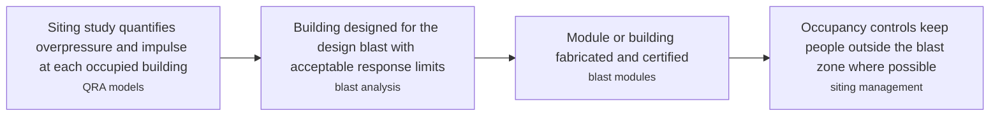
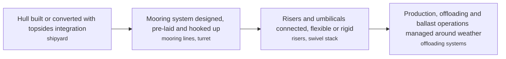
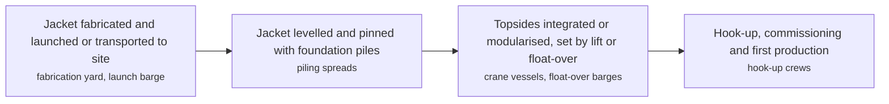
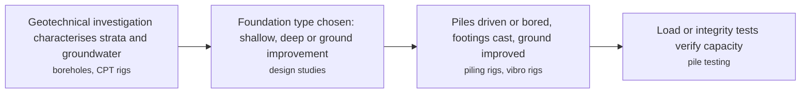
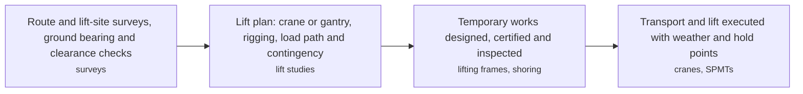
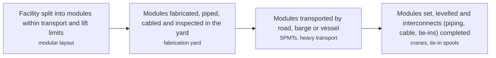
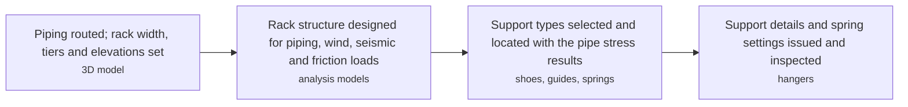
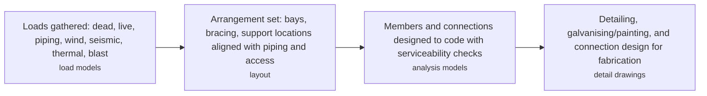
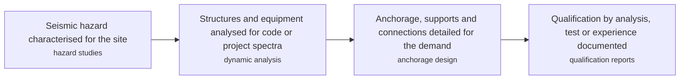
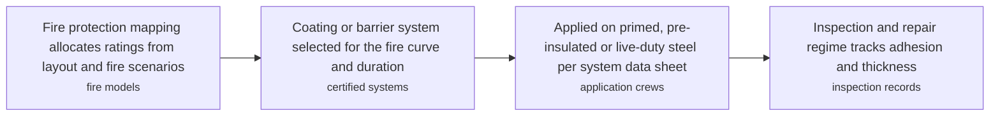

# CIV technology options

10 technologies, from commercial to lab stage. Generated from catalog/technologies/; every figure links to its source.

| Technology | Category | Maturity | TRL | Suppliers | Cost figures |
| --- | --- | --- | --- | --- | --- |
| [Blast-resistant buildings](#civ-blast-resistant-buildings) | Protective structures | commercial |  | RedGuard (blast-resistant modular buildings) |  |
| [FPSO and floating production structures](#civ-floating-structures-fpso) | Offshore structures | commercial |  | SBM Offshore (FPSO lease and operate); Modec (FPSO EPC and operation); Yinson Production (FPSO EPC and operation) |  |
| [Fixed platform topsides and substructures](#civ-offshore-platform-structures) | Offshore structures | commercial |  | Saipem (platform EPC and installation); McDermott (platform EPC and installation); Seatrium (topsides fabrication); Samsung Heavy Industries (topsides fabrication) |  |
| [Foundations and piling](#civ-foundations-piling) | Geotechnical | commercial |  | Bauer (piling and ground engineering); Keller (ground improvement) |  |
| [Heavy lift, transport and temporary works](#civ-heavy-lift-temporary-works) | Construction engineering | commercial |  | Mammoet (heavy lift and transport); Sarens (heavy lift and transport); Heerema (offshore heavy lift) |  |
| [Modular construction and industrialised building systems](#civ-modular-construction-ibs) | Construction methods | commercial |  | Kiewit (modular EPC and fabrication); Fluor (modular EPC); Saipem (modular fabrication); CIDB Malaysia (IBS industrialised building system programme) |  |
| [Pipe racks, sleepers and pipe supports](#civ-pipe-racks-supports) | Structures | commercial |  | Anvil (pipe supports); Carpenter & Paterson (pipe supports and hangers); Lisega (pipe supports) |  |
| [Plant structural steel design](#civ-structural-steel-design) | Structures | commercial |  | Bechtel (EPC structural engineering); Fluor (EPC structural engineering); Saipem (EPC structural engineering) |  |
| [Seismic design of process facilities](#civ-seismic-design) | Structures | commercial |  | EPC structural consultants (seismic design services) |  |
| [Structural fireproofing and passive fire protection](#civ-fireproofing-passive-protection) | Passive fire protection | commercial |  | AkzoNobel (Chartek hydrocarbon intumescent coatings); Hempel (fireproofing coatings); Carboline (fireproofing coatings) |  |

## Blast-resistant buildings

Occupied buildings inside blast overpressure range are engineered to protect people, not just stand up: energy-absorbing steel or reinforced concrete construction, controlled response (ductile, repairable deformation rather than brittle failure), protected openings, and anchored doors and HVAC. Design starts from a siting study and quantified overpressure/impulse from dispersion and explosion modelling (API RP 752/753 onshore; temporary refuge criteria offshore), then verifies member response against that loading.

**Key equipment:** blast-rated steel modules, reinforced concrete construction, blast doors, protected HVAC.

**Missing inputs:**
- blast overpressure rating range and panel weight per square metre, with a cited source (performance): The sources read describe the method but publish no measurable performance figure for it. Where: Contractor and fabricator technical literature; Standards-body design guides. Next: Add the figures that let this technology be compared with alternatives, each with its basis and source.
- capital cost per square metre of blast-resistant building by overpressure rating, with dollar year and basis (costs): No source read so far gives a cost figure for this construction technology; the card was authored from standards-body and vendor material that describes method, not price. Where: Blast-rated modular building vendors (budget quotes per m2 by kPa rating); Offshore and petrochemical shelter vendors. Next: Add a figure with metric, range, unit, dollar year, basis and source.
- named reference projects with structure type, scale and country (reference_plants): The card cites no named project, so the technology rests on method description alone. Its reference-plant register was empty at the 2026-11-14 audit. Where: Named projects with structure type, capacity and country (the projects layer carries 239 records); Operator and contractor press releases for awarded structures. Next: Add two or three named projects with country, scale, status and source.

Sources: [1](https://www.hse.gov.uk/comah/), [2](https://en.wikipedia.org/wiki/Blast_resistance). Last reviewed 2026-11-14.

## FPSO and floating production structures

Floating production systems keep process plant on a floating hull: converted tankers or newbuild FPSOs, semi-submersibles or spar hulls, held by moorings or dynamic positioning. Turret-moored FPSOs weathervane into the environment with a swivel stack carrying fluids, power and signals; spread-moored units suit calm or unidirectional seas. Hull design, station-keeping, riser and umbilical dynamics, and motion effects on process equipment (sloshing, level control, rotating equipment limits) define the engineering.

**Key equipment:** hull, mooring system, turret and swivel stack, risers, offloading systems.

**Performance:**
- MODEC FPSO project experience: 59 units in 20 countries; MODEC FPSO Projects experience page states 59 units in 20 countries (delivered/operated fleet). [source](https://www.modec.com/)

**Missing inputs:**
- conversion and new-build capex for an FPSO hull and topside structure, with dollar year and basis (costs): No source read so far gives a cost figure for this construction technology; the card was authored from standards-body and vendor material that describes method, not price. Where: Published FPSO contract award values from operators and shipyards; SBM Offshore and MODEC annual reports. Next: Add a figure with metric, range, unit, dollar year, basis and source.
- named reference projects with structure type, scale and country (reference_plants): The card cites no named project, so the technology rests on method description alone. Its reference-plant register was empty at the 2026-11-14 audit. Where: Named projects with structure type, capacity and country (the projects layer carries 239 records); Operator and contractor press releases for awarded structures. Next: Add two or three named projects with country, scale, status and source.

Sources: [1](https://www.sbmoffshore.com/), [2](https://www.offshore-mag.com/). Last reviewed 2026-11-14.

## Fixed platform topsides and substructures

Fixed offshore platforms combine a substructure (welded steel jacket, or concrete gravity-base structure) founded on or pinned to the seabed with a topsides deck carrying drilling, production and power. Jackets are launched or lifted in place and piled through legs; topsides are built as integrated or modularised decks and set by float-over or lift. Design is governed by ISO 19902 (steel) and structural reliability against extreme wave, wind and fatigue loads; weight control and deck elevation against air gap are the persistent constraints.

**Key equipment:** steel jacket, foundation piles, topsides modules, conductor guides, boat landings and riser guards.

**Missing inputs:**
- topsides and jacket weight against water depth and production capacity, with a cited source (performance): The sources read describe the method but publish no measurable performance figure for it. Where: Contractor and fabricator technical literature; Standards-body design guides. Next: Add the figures that let this technology be compared with alternatives, each with its basis and source.
- jacket and topside fabrication cost per tonne, with dollar year and basis (costs): No source read so far gives a cost figure for this construction technology; the card was authored from standards-body and vendor material that describes method, not price. Where: Published EPC contract award values for fixed platforms; Fabrication yard public order books. Next: Add a figure with metric, range, unit, dollar year, basis and source.
- named reference projects with structure type, scale and country (reference_plants): The card cites no named project, so the technology rests on method description alone. Its reference-plant register was empty at the 2026-11-14 audit. Where: Named projects with structure type, capacity and country (the projects layer carries 239 records); Operator and contractor press releases for awarded structures. Next: Add two or three named projects with country, scale, status and source.

Sources: [1](https://en.wikipedia.org/wiki/Oil_platform), [2](https://www.offshore-mag.com/). Last reviewed 2026-11-14.

## Foundations and piling

Foundations transfer structural loads to the ground safely and within settlement limits. Shallow footings serve competent soils; driven or bored piles take loads past weak layers; ground improvement (stone columns, deep soil mixing, preloading) treats marginal ground instead of deep foundations. Site investigation drives everything — boreholes, SPT/CPT profiles, groundwater — and equipment foundations add dynamic checks for machines, plus settlement and vibration limits.

**Key equipment:** driven steel and concrete piles, bored piles, vibro and stone columns, pile caps.

**Missing inputs:**
- achievable pile capacity and productivity by pile type, with a cited source (performance): The sources read describe the method but publish no measurable performance figure for it. Where: Contractor and fabricator technical literature; Standards-body design guides. Next: Add the figures that let this technology be compared with alternatives, each with its basis and source.
- cost per pile metre and per cubic metre of foundation concrete, with dollar year and basis (costs): No source read so far gives a cost figure for this construction technology; the card was authored from standards-body and vendor material that describes method, not price. Where: Geotechnical contractor schedules of rates; CIDB Malaysia piling and foundation rates. Next: Add a figure with metric, range, unit, dollar year, basis and source.
- named reference projects with structure type, scale and country (reference_plants): The card cites no named project, so the technology rests on method description alone. Its reference-plant register was empty at the 2026-11-14 audit. Where: Named projects with structure type, capacity and country (the projects layer carries 239 records); Operator and contractor press releases for awarded structures. Next: Add two or three named projects with country, scale, status and source.

Sources: [1](https://en.wikipedia.org/wiki/Deep_foundation). Last reviewed 2026-11-14.

## Heavy lift, transport and temporary works

Heavy lift and transport engineering plans how very large loads are lifted, rolled or floated into position: engineered rigging, crane or gantry selection, ground bearing assessments, SPMT trailer configurations, transport surveys and lifts supervised by independent checking engineers. Temporary works — cradle supports, lifting frames, hauling systems, shoring — are designed, certified and inspected like permanent structures. Success is almost entirely preparation: surveys, simulations and rehearsals before the load moves.

**Key equipment:** crawler cranes, SPMT self-propelled modular transporters, gantry systems, engineered rigging.

**Missing inputs:**
- lifting capacity and load-out weight ranges by method, with a cited source (performance): The sources read describe the method but publish no measurable performance figure for it. Where: Contractor and fabricator technical literature; Standards-body design guides. Next: Add the figures that let this technology be compared with alternatives, each with its basis and source.
- crane and heavy-lift vessel day rates, with dollar year and basis (costs): No source read so far gives a cost figure for this construction technology; the card was authored from standards-body and vendor material that describes method, not price. Where: Heavy-lift contractor published day rates and charter rates; Offshore installation vessel charter market reports. Next: Add a figure with metric, range, unit, dollar year, basis and source.
- named reference projects with structure type, scale and country (reference_plants): The card cites no named project, so the technology rests on method description alone. Its reference-plant register was empty at the 2026-11-14 audit. Where: Named projects with structure type, capacity and country (the projects layer carries 239 records); Operator and contractor press releases for awarded structures. Next: Add two or three named projects with country, scale, status and source.

Sources: [1](https://www.mammoet.com/), [2](https://en.wikipedia.org/wiki/Self-propelled_modular_transporter). Last reviewed 2026-11-14.

## Modular construction and industrialised building systems

Modular construction moves fabrication from the congested site into controlled workshops: equipment, piping, cable and steel are assembled into transportable modules (skids, multi-storey modules, e-houses), shipped, lifted and connected on site. Benefits are schedule compression, quality, weather independence, lower site headcount and local content limits; the trade-offs are transport envelope limits, module weight for lifting, joint design at every module interface, and early engineering freeze. Industrialised Building Systems (IBS) applies the same offsite logic to buildings — precast components, panelised and volumetric systems — promoted in Malaysia through the CIDB IBS programme with content and scoring rules.

**Key equipment:** fabrication yards, SPMT transporters, heavy cranes, module interface joints.

**Missing inputs:**
- programme saving and cost premium against conventional construction, with a cited source (performance): The sources read describe the method but publish no measurable performance figure for it. Where: Contractor and fabricator technical literature; Standards-body design guides. Next: Add the figures that let this technology be compared with alternatives, each with its basis and source.
- cost per square metre of modular or IBS construction against conventional build, with dollar year and basis (costs): No source read so far gives a cost figure for this construction technology; the card was authored from standards-body and vendor material that describes method, not price. Where: CIDB Malaysia IBS cost studies; Modular building fabricators' published rates. Next: Add a figure with metric, range, unit, dollar year, basis and source.
- named reference projects with structure type, scale and country (reference_plants): The card cites no named project, so the technology rests on method description alone. Its reference-plant register was empty at the 2026-11-14 audit. Where: Named projects with structure type, capacity and country (the projects layer carries 239 records); Operator and contractor press releases for awarded structures. Next: Add two or three named projects with country, scale, status and source.

Sources: [1](https://www.cidb.gov.my/), [2](https://en.wikipedia.org/wiki/Modular_construction). Last reviewed 2026-11-14.

## Pipe racks, sleepers and pipe supports

Pipe racks carry interconnecting piping in tiers along roads and unit boundaries; individual supports (shoes, guides, anchors, spring and constant-effort hangers) carry the pipe's own loads while allowing thermal movement. Rack design ties together pipe stress needs (support spacing, guide positions), civil loads (wind, seismic, friction), and constructability (splice points, tier heights). Expansion loops, guides and anchors are positioned from stress analysis, not civil preference.

**Key equipment:** rack steelwork, pipe shoes and guides, spring hangers, constant-effort supports, expansion loops.

**Missing inputs:**
- steel intensity per metre of rack and per pipe, with a cited source (performance): The sources read describe the method but publish no measurable performance figure for it. Where: Contractor and fabricator technical literature; Standards-body design guides. Next: Add the figures that let this technology be compared with alternatives, each with its basis and source.
- cost per metre of pipe rack (steel-only and erected), with dollar year and basis (costs): No source read so far gives a cost figure for this construction technology; the card was authored from standards-body and vendor material that describes method, not price. Where: EPC structural steel rates from published project cost studies; Pipe rack module fabricators' published rates. Next: Add a figure with metric, range, unit, dollar year, basis and source.
- named reference projects with structure type, scale and country (reference_plants): The card cites no named project, so the technology rests on method description alone. Its reference-plant register was empty at the 2026-11-14 audit. Where: Named projects with structure type, capacity and country (the projects layer carries 239 records); Operator and contractor press releases for awarded structures. Next: Add two or three named projects with country, scale, status and source.

Sources: [1](https://en.wikipedia.org/wiki/Pipe_rack). Last reviewed 2026-11-14.

## Plant structural steel design

Process plants are steel frames carrying piping, equipment, platforms and loads under gravity, wind, thermal, seismic and blast demands. Designers size members and connections to structural steel codes (EN 1993, AISC 360, ISO 19902 offshore) with deflection and vibration limits that matter as much as strength: pipe rack spans, equipment nozzle flexibility and platform vibration all drive the geometry. Hot-rolled sections dominate onshore; plate girders, tubulars and cast nodes dominate offshore.

**Key equipment:** hot-rolled beams and columns, bracing, base plates and anchors, gratings and handrails.

**Missing inputs:**
- steel weight per square metre of building and erection productivity, with a cited source (performance): The sources read describe the method but publish no measurable performance figure for it. Where: Contractor and fabricator technical literature; Standards-body design guides. Next: Add the figures that let this technology be compared with alternatives, each with its basis and source.
- erected cost per tonne of structural steel, with dollar year and basis (costs): No source read so far gives a cost figure for this construction technology; the card was authored from standards-body and vendor material that describes method, not price. Where: Quantity-surveyor and steel-fabricator price guides (structural steel per tonne, erected); Malaysian steel fabricator and CIDB schedule-of-rates data. Next: Add a figure with metric, range, unit, dollar year, basis and source.
- named reference projects with structure type, scale and country (reference_plants): The card cites no named project, so the technology rests on method description alone. Its reference-plant register was empty at the 2026-11-14 audit. Where: Named projects with structure type, capacity and country (the projects layer carries 239 records); Operator and contractor press releases for awarded structures. Next: Add two or three named projects with country, scale, status and source.

Sources: [1](https://www.hse.gov.uk/electricity/), [2](https://en.wikipedia.org/wiki/Structural_steel). Last reviewed 2026-11-14.

## Seismic design of process facilities

In seismic regions, structures, equipment, piping and their connections are designed for earthquake demands: site-specific hazard analysis, response spectrum or time-history analysis, anchorage and support design for equipment, and settlement or fault-movement checks for tanks and pipelines. Codes (ASCE 7, EN 1998, and industry guides such as ASCE 4 and API 650 Appendix E) tier the objectives — keep safety systems functional, prevent release of hazardous inventory, allow economic damage elsewhere. Performance-based methods and base isolation are used where downtime cost dominates.

**Key equipment:** anchorage systems, base isolators, seismic qualification test facilities.

**Missing inputs:**
- design ground acceleration ranges and structural steel premium, with a cited source (performance): The sources read describe the method but publish no measurable performance figure for it. Where: Contractor and fabricator technical literature; Standards-body design guides. Next: Add the figures that let this technology be compared with alternatives, each with its basis and source.
- engineering cost and structural premium of seismic design, with dollar year and basis (costs): No source read so far gives a cost figure for this construction technology; the card was authored from standards-body and vendor material that describes method, not price. Where: Structural engineering fee benchmarks; Cost studies of seismic design premiums. Next: Add a figure with metric, range, unit, dollar year, basis and source.
- named reference projects with structure type, scale and country (reference_plants): The card cites no named project, so the technology rests on method description alone. Its reference-plant register was empty at the 2026-11-14 audit. Where: Named projects with structure type, capacity and country (the projects layer carries 239 records); Operator and contractor press releases for awarded structures. Next: Add two or three named projects with country, scale, status and source.

Sources: [1](https://en.wikipedia.org/wiki/Earthquake_engineering). Last reviewed 2026-11-14.

## Structural fireproofing and passive fire protection

Passive fire protection keeps steel below its critical temperature and confines fire by barriers without any active system: cementitious and epoxy intumescent coatings on structure, fire-rated walls, doors and dampers, deck insulation offshore, and fire-protected cabling or trays. Protection classes follow hydrocarbon fire curves (UL 1709 rather than cellulosic) for process zones; the design allocates fireproofing from fire modelling and layout (API 2218 guidance), and inspection regimes track coating condition because PFP failure is invisible until it is needed.

**Key equipment:** cementitious fireproofing, epoxy intumescent coatings, fire-rated barriers and dampers, fireproof cable protection.

**Missing inputs:**
- fire rating achieved per coating thickness and application productivity, with a cited source (performance): The sources read describe the method but publish no measurable performance figure for it. Where: Contractor and fabricator technical literature; Standards-body design guides. Next: Add the figures that let this technology be compared with alternatives, each with its basis and source.
- cost per square metre of fire protection (intumescent coating, board, cementitious), with dollar year and basis (costs): No source read so far gives a cost figure for this construction technology; the card was authored from standards-body and vendor material that describes method, not price. Where: Passive fire protection contractors and intumescent coating suppliers' published rates; Fire-test certification body data on thickness versus rating. Next: Add a figure with metric, range, unit, dollar year, basis and source.
- named reference projects with structure type, scale and country (reference_plants): The card cites no named project, so the technology rests on method description alone. Its reference-plant register was empty at the 2026-11-14 audit. Where: Named projects with structure type, capacity and country (the projects layer carries 239 records); Operator and contractor press releases for awarded structures. Next: Add two or three named projects with country, scale, status and source.

Sources: [1](https://www.hse.gov.uk/comah/), [2](https://en.wikipedia.org/wiki/Fireproofing). Last reviewed 2026-11-14.
