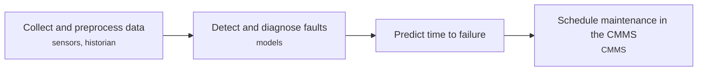
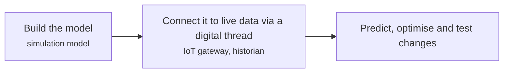
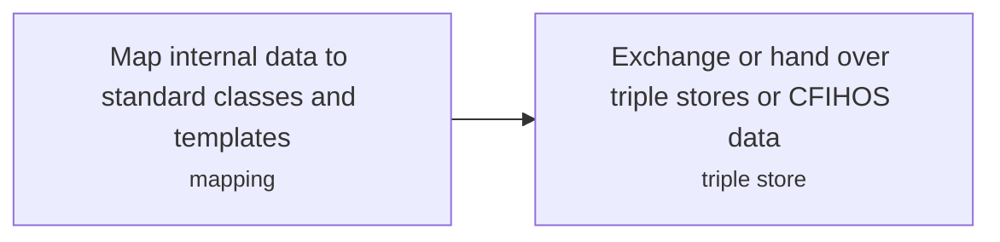
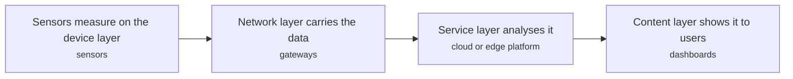
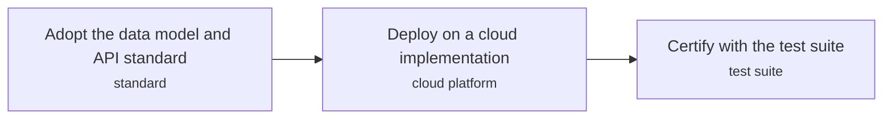

# DIG technology options

5 technologies, from commercial to lab stage. Generated from catalog/technologies/; every figure links to its source.

| Technology | Category | Maturity | TRL | Suppliers | Cost figures |
| --- | --- | --- | --- | --- | --- |
| [AI and machine learning for maintenance and optimisation](#dig-ai-ml-maintenance-optimisation) | Digital and data | commercial |  | Cognite (Cognite Data Fusion industrial DataOps and AI); C3 AI (C3 AI Reliability predictive-maintenance applications); SparkCognition (SparkPredict asset AI (now part of Scale AI)); Augury (machine-health vibration and ultrasonic diagnostics) |  |
| [Digital twins of plants and assets](#dig-digital-twins) | Digital and data | commercial |  |  |  |
| [Engineering data standards (ISO 15926, CFIHOS)](#dig-engineering-data-standards) | Digital and data | commercial |  |  |  |
| [Industrial IoT and wireless sensors](#dig-iiot-wireless-sensors) | Digital and data | commercial |  | Emerson (WirelessHART self-organising mesh instrumentation); Honeywell (OneWireless field device network); Yokogawa (ISA100 wireless compliance and sensors) |  |
| [Subsurface data platforms (OSDU)](#dig-osdu) | Digital and data | commercial |  | Microsoft Azure; Amazon Web Services; Google Cloud Platform; IBM Red Hat OpenShift |  |

## AI and machine learning for maintenance and optimisation

Predictive maintenance estimates when maintenance is needed from measured condition (vibration, acoustic, oil, motor current), and machine learning forecasts future states.

**Key equipment:** vibration and acoustic sensors, ML platform, CMMS.

**Missing inputs:**
- key performance figures (energy use, yields, capture or conversion rate) (performance): No source read so far gives performance figures. Web-checked 2026-10-28: suppliers recorded where applicable; remaining figures sit in vendor-selector, licensor or paywalled-standards material and were not verifiable open. Where: Supplier datasheets and brochures for the companies listed on the card (open); arXiv and open-access journals: techno-economic or review papers (MDPI is blocked by its CDN; use the manual inbox) (catalog: arxiv, open); OSTI.GOV full-text reports from DOE labs: search the technology name plus 'techno-economic' (catalog: osti, blocked). Next: Add the figures that matter for comparing options, each with its basis and source.
- capital cost and operating or unit cost, with dollar year and basis (costs): No open source read so far gives costs for this technology. Web-checked 2026-10-28: suppliers recorded where applicable; remaining figures sit in vendor-selector, licensor or paywalled-standards material and were not verifiable open. Where: arXiv and open-access journals: techno-economic or review papers (MDPI is blocked by its CDN; use the manual inbox) (catalog: arxiv, open); Licensor and EPC studies; paid cost databases are catalog-only (paid); OSTI.GOV full-text reports from DOE labs: search the technology name plus 'techno-economic' (catalog: osti, blocked). Next: Look for an open techno-economic study; record each figure with metric, range, unit, dollar year, basis and source.
- named plants or projects with capacity and year (reference_plants): The sources read name no specific plant. Web-checked 2026-10-28: suppliers recorded where applicable; remaining figures sit in vendor-selector, licensor or paywalled-standards material and were not verifiable open. Where: Licensor and operator press releases for the suppliers listed (open). Next: Add one or two plants with country, capacity and start-up year.
- TRL with a cited source (trl): The IEA ETP Clean Energy Technology Guide has no matching entry. Web-checked 2026-10-28: suppliers recorded where applicable; remaining figures sit in vendor-selector, licensor or paywalled-standards material and were not verifiable open. Where: IEA ETP Clean Energy Technology Guide (collected): search for the technology name (catalog: iea-reports, open). Next: Find a TRL table that lists this technology, or leave maturity resting on the evidence on the card.
- process steps and equipment are general engineering practice, not taken from one source (process): The sources read describe the principle but not a full step-by-step flow. Where: Licensor process descriptions and textbooks (open). Next: Check the steps against a licensor description and name it.

Sources: [1](https://en.wikipedia.org/wiki/Predictive_maintenance). Last reviewed 2026-10-28.

## Digital twins of plants and assets

A digital twin is a computational model that continuously uses real data from its physical counterpart to stay synchronised. Data flowing one way is a digital shadow; two-way flow including control commands is a twin.

**Key equipment:** simulation model, data connection, visualisation.

**Performance:**
- smart energy system consumption cut: up to 30 % (up to); example quoted for smart energy systems, not oil and gas. [source](https://en.wikipedia.org/wiki/Digital_twin)

**Missing inputs:**
- oil and gas twin deployments (reference_plants): None on the page. Web-checked 2026-10-28: suppliers recorded where applicable; remaining figures sit in vendor-selector, licensor or paywalled-standards material and were not verifiable open. Where: Operator and vendor case studies (open). Next: Add examples with source.
- capital cost and operating or unit cost, with dollar year and basis (costs): No open source read so far gives costs for this technology. Web-checked 2026-10-28: suppliers recorded where applicable; remaining figures sit in vendor-selector, licensor or paywalled-standards material and were not verifiable open. Where: arXiv and open-access journals: techno-economic or review papers (MDPI is blocked by its CDN; use the manual inbox) (catalog: arxiv, open); Licensor and EPC studies; paid cost databases are catalog-only (paid); OSTI.GOV full-text reports from DOE labs: search the technology name plus 'techno-economic' (catalog: osti, blocked). Next: Look for an open techno-economic study; record each figure with metric, range, unit, dollar year, basis and source.
- TRL with a cited source (trl): The IEA ETP Clean Energy Technology Guide has no matching entry. Web-checked 2026-10-28: suppliers recorded where applicable; remaining figures sit in vendor-selector, licensor or paywalled-standards material and were not verifiable open. Where: IEA ETP Clean Energy Technology Guide (collected): search for the technology name (catalog: iea-reports, open). Next: Find a TRL table that lists this technology, or leave maturity resting on the evidence on the card.
- process steps and equipment are general engineering practice, not taken from one source (process): The sources read describe the principle but not a full step-by-step flow. Where: Licensor process descriptions and textbooks (open). Next: Check the steps against a licensor description and name it.

Sources: [1](https://en.wikipedia.org/wiki/Digital_twin). Last reviewed 2026-10-28.

## Engineering data standards (ISO 15926, CFIHOS)

ISO 15926 provides a shared vocabulary for data integration and hand-over between systems, using RDF triple stores. CFIHOS is a set of specifications and a reference data library for information handover on capital projects.

**Key equipment:** reference data library, triple store.

**Performance:**
- ISO 15926 parts: 13 parts (as of February 2022); stated. [source](https://en.wikipedia.org/wiki/ISO_15926)

**Missing inputs:**
- CFIHOS creation and version history (other): The home page does not say who created it. Lead 2026-10-28: CFIHOS (Capital Facilities Information Handover Specification) is a Joint Industry Project under FIATECH/Construction Industry Institute lineage; its version history lives in JIP documentation not open. Where: IOGP JIP36 publications (open). Next: Add the version history.
- capital cost and operating or unit cost, with dollar year and basis (costs): No open source read so far gives costs for this technology. Web-checked 2026-10-28: suppliers recorded where applicable; remaining figures sit in vendor-selector, licensor or paywalled-standards material and were not verifiable open. Where: arXiv and open-access journals: techno-economic or review papers (MDPI is blocked by its CDN; use the manual inbox) (catalog: arxiv, open); Licensor and EPC studies; paid cost databases are catalog-only (paid); OSTI.GOV full-text reports from DOE labs: search the technology name plus 'techno-economic' (catalog: osti, blocked). Next: Look for an open techno-economic study; record each figure with metric, range, unit, dollar year, basis and source.
- named plants or projects with capacity and year (reference_plants): The sources read name no specific plant. Web-checked 2026-10-28: suppliers recorded where applicable; remaining figures sit in vendor-selector, licensor or paywalled-standards material and were not verifiable open. Where: Licensor and operator press releases for the suppliers listed (open). Next: Add one or two plants with country, capacity and start-up year.
- TRL with a cited source (trl): The IEA ETP Clean Energy Technology Guide has no matching entry. Web-checked 2026-10-28: suppliers recorded where applicable; remaining figures sit in vendor-selector, licensor or paywalled-standards material and were not verifiable open. Where: IEA ETP Clean Energy Technology Guide (collected): search for the technology name (catalog: iea-reports, open). Next: Find a TRL table that lists this technology, or leave maturity resting on the evidence on the card.
- process steps and equipment are general engineering practice, not taken from one source (process): The sources read describe the principle but not a full step-by-step flow. Where: Licensor process descriptions and textbooks (open). Next: Check the steps against a licensor description and name it.

Sources: [1](https://en.wikipedia.org/wiki/ISO_15926), [2](https://www.jip36-cfihos.org/). Last reviewed 2026-10-28.

## Industrial IoT and wireless sensors

Interconnected sensors and devices send data over Wi-Fi, Bluetooth, LoRa or cellular to services that analyse it. MQTT, OPC and DDS are named protocols.

**Key equipment:** wireless sensors, gateways, MQTT broker.

**Performance:**
- predictive maintenance saving over scheduled repairs: up to 12 % (up to); some studies as quoted in the article. [source](https://en.wikipedia.org/wiki/Industrial_internet_of_things)

**Missing inputs:**
- capital cost and operating or unit cost, with dollar year and basis (costs): No open source read so far gives costs for this technology. Web-checked 2026-10-28: suppliers recorded where applicable; remaining figures sit in vendor-selector, licensor or paywalled-standards material and were not verifiable open. Where: arXiv and open-access journals: techno-economic or review papers (MDPI is blocked by its CDN; use the manual inbox) (catalog: arxiv, open); Licensor and EPC studies; paid cost databases are catalog-only (paid); OSTI.GOV full-text reports from DOE labs: search the technology name plus 'techno-economic' (catalog: osti, blocked). Next: Look for an open techno-economic study; record each figure with metric, range, unit, dollar year, basis and source.
- named plants or projects with capacity and year (reference_plants): The sources read name no specific plant. Web-checked 2026-10-28: suppliers recorded where applicable; remaining figures sit in vendor-selector, licensor or paywalled-standards material and were not verifiable open. Where: Licensor and operator press releases for the suppliers listed (open). Next: Add one or two plants with country, capacity and start-up year.
- TRL with a cited source (trl): The IEA ETP Clean Energy Technology Guide has no matching entry. Web-checked 2026-10-28: suppliers recorded where applicable; remaining figures sit in vendor-selector, licensor or paywalled-standards material and were not verifiable open. Where: IEA ETP Clean Energy Technology Guide (collected): search for the technology name (catalog: iea-reports, open). Next: Find a TRL table that lists this technology, or leave maturity resting on the evidence on the card.
- process steps and equipment are general engineering practice, not taken from one source (process): The sources read describe the principle but not a full step-by-step flow. Where: Licensor process descriptions and textbooks (open). Next: Check the steps against a licensor description and name it.

Sources: [1](https://en.wikipedia.org/wiki/Industrial_internet_of_things). Last reviewed 2026-10-28.

## Subsurface data platforms (OSDU)

OSDU is a standard, open-source reference data platform and test suite for sharing energy-industry data, run by The Open Group in a vendor-neutral forum.

**Key equipment:** OSDU data platform, cloud services.

**Performance:**
- OSDU Forum members: 190 organisations; stated on the Forum page. [source](https://www.opengroup.org/osdu-forum/)

**Missing inputs:**
- licence of the OSDU platform code (other): Not stated on the page. RESOLVED 2026-10-28: the OSDU Data Platform source code is released under the Apache License 2.0 (all OSDU community repositories on community.opengroup.org carry Apache-2.0; the OSDU Data Platform Standard Version 1.0 was released 10 Jun 2026). Where: OSDU GitLab repository licence file (open). Next: Closed for the platform code; The Open Group trademark/branding terms still apply to the OSDU name.
- capital cost and operating or unit cost, with dollar year and basis (costs): No open source read so far gives costs for this technology. Web-checked 2026-10-28: suppliers recorded where applicable; remaining figures sit in vendor-selector, licensor or paywalled-standards material and were not verifiable open. Where: arXiv and open-access journals: techno-economic or review papers (MDPI is blocked by its CDN; use the manual inbox) (catalog: arxiv, open); Licensor and EPC studies; paid cost databases are catalog-only (paid); OSTI.GOV full-text reports from DOE labs: search the technology name plus 'techno-economic' (catalog: osti, blocked). Next: Look for an open techno-economic study; record each figure with metric, range, unit, dollar year, basis and source.
- named plants or projects with capacity and year (reference_plants): The sources read name no specific plant. Web-checked 2026-10-28: suppliers recorded where applicable; remaining figures sit in vendor-selector, licensor or paywalled-standards material and were not verifiable open. Where: Licensor and operator press releases for the suppliers listed (open). Next: Add one or two plants with country, capacity and start-up year.
- TRL with a cited source (trl): The IEA ETP Clean Energy Technology Guide has no matching entry. Web-checked 2026-10-28: suppliers recorded where applicable; remaining figures sit in vendor-selector, licensor or paywalled-standards material and were not verifiable open. Where: IEA ETP Clean Energy Technology Guide (collected): search for the technology name (catalog: iea-reports, open). Next: Find a TRL table that lists this technology, or leave maturity resting on the evidence on the card.
- process steps and equipment are general engineering practice, not taken from one source (process): The sources read describe the principle but not a full step-by-step flow. Where: Licensor process descriptions and textbooks (open). Next: Check the steps against a licensor description and name it.

Sources: [1](https://www.opengroup.org/osdu-forum/). Last reviewed 2026-10-28.
