# ELE technology options

12 technologies, from commercial to lab stage. Generated from catalog/technologies/; every figure links to its source.

| Technology | Category | Maturity | TRL | Suppliers | Cost figures |
| --- | --- | --- | --- | --- | --- |
| [Earthing and lightning protection](#ele-earthing-lightning) | Electrical safety | commercial |  | nVent ERICO (earthing and lightning protection systems); Dehn (lightning and surge protection); Furse (lightning protection systems) |  |
| [Electrical heat tracing](#ele-heat-tracing) | Electrical heating | commercial |  | nVent (Raychem heat tracing systems); Chromalox (industrial heat tracing); Emerson (industrial heat tracing (Bergman Series)) |  |
| [Emergency, standby and UPS power systems](#ele-emergency-up-power) | Emergency power | commercial |  | Cummins (generator sets); Eaton (UPS systems); ABB (UPS and emergency power); Schneider Electric (Galaxy UPS systems); Vertiv (critical power UPS) |  |
| [HV/MV switchgear and site power distribution](#ele-hv-switchgear-distribution) | Power distribution | commercial |  | ABB (MV/LV switchgear, UniGear, HySec); Schneider Electric (MV switchgear, RM6, SM6); Siemens Energy (switchgear and grid solutions); Hitachi Energy (HV switchgear, GIS); Eaton (MV/LV switchgear and MCCs) |  |
| [Hazardous area electrical equipment](#ele-hazardous-area-electrical) | Explosion protection | commercial |  | Eaton Crouse-Hinds (Ex enclosures and lighting); R. Stahl (Ex equipment and IS barriers); Pepperl+Fuchs (intrinsic safety interfaces); ABB (Ex motors and instrumentation); Emerson (Ex-rated instrumentation) |  |
| [Motors and variable speed drives](#ele-motors-drives) | Electrical drives | commercial |  | ABB (motors and drives, ACS family); WEG (motors and MV drives); Siemens Energy (large drives and motors); Nidec (industrial motors) |  |
| [On-site gas turbine power generation](#ele-gt-power-generation) | Power generation | commercial |  | Siemens Energy (industrial and aeroderivative gas turbines); Mitsubishi Heavy Industries (gas turbines); Baker Hughes (NovaLT and aeroderivative gensets); MAN Energy Solutions (gensets) |  |
| [Power and control cable systems](#ele-cable-systems) | Power distribution | commercial |  | Prysmian (power and submarine cable systems); Nexans (power, instrument and subsea cables); LS Cable & System (power cables) |  |
| [Power and distribution transformers](#ele-transformers) | Power transformation | commercial |  | Hitachi Energy (power, distribution, GIT and dry-type transformers); Siemens Energy (power and distribution transformers); GE Vernova (power transformers); WEG (distribution and special transformers) |  |
| [Power management and electrical SCADA](#ele-power-management-systems) | Electrical automation | commercial |  | GE Vernova (power management systems); ABB (electrical SCADA and PMS); Schneider Electric (EcoStruxure Power and PMS); Hitachi Energy (grid automation) |  |
| [Power system protection and relaying](#ele-protection-relaying) | Power protection | commercial |  | Schweitzer Engineering Laboratories (protective relays and automation platforms); ABB (Relion protection and control); Schneider Electric (Easergy protection relays); Siemens Energy (SIPROTEC protection relays); GE Vernova (Multilin protection relays) |  |
| [Subsea power and umbilical systems](#ele-subsea-umbilicals-power) | Subsea electrical | commercial |  | Aker Solutions (umbilicals and subsea power); Nexans (subsea cables and umbilicals); Siemens Energy (subsea power grids and drives) |  |

## Earthing and lightning protection

Earthing connects metalwork and neutral points to earth so that fault current, lightning and static charge have a safe, low-impedance path and touch voltages stay within limits; lightning protection intercepts strikes with air terminals and down conductors and disposes of the surge through the earth grid. Plant design separates power, instrument and clean earths, bonds across structures and pipelines, and fits surge protective devices on vulnerable circuits. Design rules come from IEC 62305 (lightning), IEC 60364 (installations) and company earth-grid studies for soil resistivity and fault current.

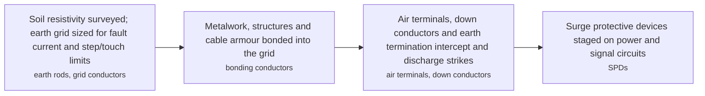

**Key equipment:** earth rods and grid, bonding conductors, air terminals, surge protective devices, test links.

Sources: [1](https://www.hse.gov.uk/electricity/), [2](https://www.dehn-international.com/en), [3](https://www.iec.ch/standards). Last reviewed 2026-11-07.

## Electrical heat tracing

Electrical heat tracing maintains or raises the temperature of pipes, tanks and instruments by applying heat along the surface. Self-regulating parallel trace cables vary their resistance with temperature and cannot overheat a dry section, constant-wattage cables deliver fixed power, and mineral-insulated or skin-effect systems serve long, hot or high-power duties. Heating replaces or supplements steam tracing, and digital control panels monitor every circuit for current and temperature alarms.

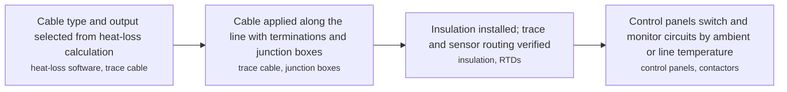

**Key equipment:** self-regulating trace cable, constant-wattage cable, mineral-insulated cable, control and monitoring panels, RTDs.

Sources: [1](https://www.chromalox.com/), [2](https://www.nvent.com/). Last reviewed 2026-11-07.

## Emergency, standby and UPS power systems

A facility secures loads that must not fail through layers: battery-backed uninterruptible power supplies (classified VFI, VI or DXI by output dependency under IEC 62040-3) ride through the first seconds, standby generating sets start and close onto the emergency bus, and automatic transfer switching restores normal supply after the outage. Emergency generation is sized for essential process, fire and life-safety loads; batteries carry instrumentation, control and safety systems through the transition and support black-start of larger units.

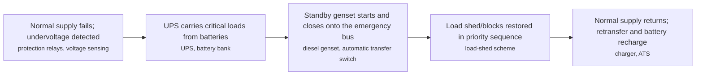

**Key equipment:** standby diesel or gas gensets, UPS units, battery banks (VRLA, lithium), automatic transfer switches, battery chargers.

Sources: [1](https://www.iec.ch/standards), [2](https://www.hse.gov.uk/electricity/). Last reviewed 2026-11-07.

## HV/MV switchgear and site power distribution

Medium-voltage switchgear receives, protects and distributes electrical power across a facility. Power arrives from utility infeed or site generation at high voltage (typically 132 kV and above for large plants), is transformed to a main distribution voltage (usually 11 kV or 33/36 kV onshore, 11 kV offshore), and flows through switchboards to transformers, motors and downstream boards. Air-insulated, gas-insulated (GIS) and hybrid designs exist; modern breakers use vacuum or SF6 interrupting technology.

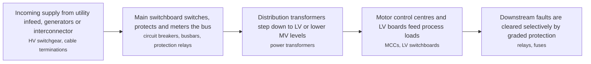

**Key equipment:** circuit breakers (vacuum, SF6), switchboards, busbars, ring main units, power transformers, protection relays, surge arresters.

**Performance:**
- IEC 62271-200 rated voltage range of metal-enclosed MV switchgear: 1-52 kV; IEC 62271-200 covers AC metal-enclosed switchgear and controlgear above 1 kV up to and including 52 kV. [source](https://www.iec.ch/standards)

Sources: [1](https://www.iec.ch/standards), [2](https://www.hitachienergy.com/products-and-solutions/transformers). Last reviewed 2026-11-07.

## Hazardous area electrical equipment

Where flammable atmospheres can occur, electrical equipment is selected to exclude or contain ignition sources. Areas are classified by likelihood and duration (gas: Zone 0/1/2; dust: Zone 20/21/22) under IEC 60079-10 or DSEAR in the UK, then protected by equipment protection concepts matched to the zone: intrinsic safety (Ex ia/ib) for instrumentation, flameproof enclosures (Ex d), increased safety (Ex e), pressurisation (Ex p), encapsulation (Ex m) and others. The IECEx certification system covers equipment certification, conformity of installation and personnel competence across member countries.

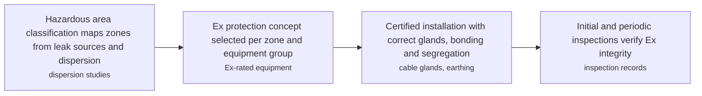

**Key equipment:** flameproof enclosures, intrinsically safe circuits and isolators, purge and pressurisation panels, Ex lighting and motors, sealing glands.

Sources: [1](https://www.iecex.com/), [2](https://www.iec.ch/standards), [3](https://www.hse.gov.uk/electricity/). Last reviewed 2026-11-07.

## Motors and variable speed drives

Three-phase induction motors remain the workhorse driver; synchronous machines serve large compressors and high-efficiency duties. Efficiency classes IE1 to IE5 are defined in IEC 60034-30-1 for line-operated motors. Variable frequency drives rectify the supply and synthesise an adjustable-voltage, adjustable-frequency output, giving soft starts, process speed control, energy savings on centrifugal loads (affinity laws: power roughly follows speed cubed) and regenerative braking on hoisting duties. Drives inject harmonics, so input filters or multi-pulse/active front ends are applied.

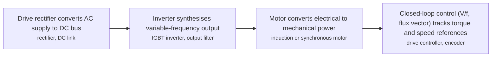

**Key equipment:** induction motors, synchronous motors, variable frequency drives, soft starters, harmonic filters, motor protection relays.

Sources: [1](https://www.energy.gov/eere/amo/motors), [2](https://www.iec.ch/standards). Last reviewed 2026-11-07.

## On-site gas turbine power generation

Facilities generate their own power with gas turbine generator sets when the grid is weak, absent or considered unreliable, or when waste heat from exhaust can drive steam for process use (cogeneration). Industrial and aeroderivative turbines from about 5 MW to well above 100 MW are installed per train; multiple units run with a power management system, spinning reserve and load-shed logic. Offshore and remote platforms historically ran at 4.16 kV or 11 kV with closed-bus transfer between boards.

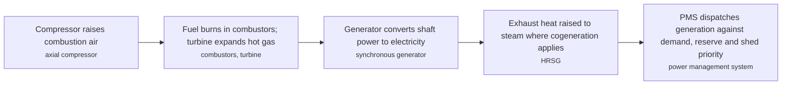

**Key equipment:** gas turbine generator sets, HRSG, generators, power management system, fuel gas conditioning.

Sources: [1](https://www.siemens-energy.com/global/en/home.html), [2](https://www.mhi.com/), [3](https://www.eia.gov/electricity/). Last reviewed 2026-11-07.

## Power and control cable systems

Cable systems move power and signals between equipment and boards. Construction is chosen per duty: XLPE or EPR insulation for power, fire-resistant (circuit integrity) cables for safety circuits that must keep working during a fire, armoured and lead-sheathed designs for direct burial and submarine routes, and segregated tray/ladder routing with derating for bunching, ambient temperature and harmonic heating. Standards such as IEC 60502 (1–30 kV) and IEC 60332 (fire behaviour) govern selection and testing.

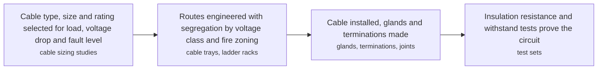

**Key equipment:** XLPE power cables, fire-resistant cables, armoured and submarine cables, cable trays, glands and terminations.

Sources: [1](https://www.prysmian.com/), [2](https://www.nexans.com/), [3](https://www.iec.ch/standards). Last reviewed 2026-11-07.

## Power and distribution transformers

Transformers couple windings through a magnetic core to change voltage levels at essentially constant power. Oil-filled units (mineral oil, ester or gas-insulated) dominate power ratings, with ONAN/ONAF/OFAF/ODAF cooling stages; dry-type cast-resin units suit fire-sensitive or confined locations. An on-load tap changer (OLTC) regulates the output voltage under load. Losses, sound level and thermal behaviour are standardised in the IEC 60076 series.

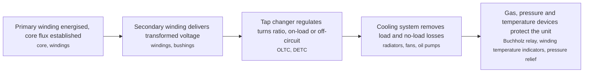

**Key equipment:** core, windings, on-load tap changer, bushings, cooling system, Buchholz relay.

**Performance:**
- 800 kV UHVDC power transformers delivered: 20 units (more than); Hitachi Energy states its power transformer fleet includes more than 20 units of 800 kV UHVDC and more than 500 units in the 735-765 kV AC class. [source](https://www.hitachienergy.com/products-and-solutions/transformers)
- 735-765 kV AC power transformers delivered: 500 units (more than); same statement as above. [source](https://www.hitachienergy.com/products-and-solutions/transformers)

Sources: [1](https://www.hitachienergy.com/products-and-solutions/transformers), [2](https://www.iec.ch/standards). Last reviewed 2026-11-07.

## Power management and electrical SCADA

A power management system supervises generation, tie-lines and major loads: it schedules and dispatches running generator sets, synchronises and parallels them, maintains frequency and voltage, arms staged load shedding for generator or tie loss, and manages islanding and re-synchronisation with the grid. PMS logic sits on electrical SCADA above the protection relays and complements them — protection clears faults in milliseconds while the PMS re-balances the network in seconds.

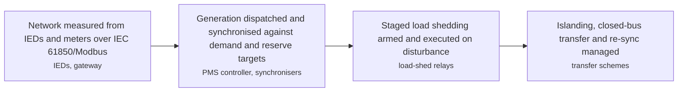

**Key equipment:** PMS controllers, electrical SCADA, protection relays and IEDs, synchronisers, load-shed schemes.

Sources: [1](https://www.gevernova.com/), [2](https://www.iec.ch/standards). Last reviewed 2026-11-07.

## Power system protection and relaying

Protection relays continuously compare measured current, voltage, frequency, phase and differential quantities against settings and command circuit breakers to isolate faults before equipment or people are harmed. Modern numerical relays combine many protection functions (ANSI 50/51 overcurrent, 87 differential, 27/59 voltage, 81 frequency, 46 negative sequence) with recording, metering and IEC 61850 communication in one device. Selectivity is achieved through current grading, time grading or zone-based differential schemes, with breaker-failure back-up tripping the surrounding breakers when the primary trip fails.

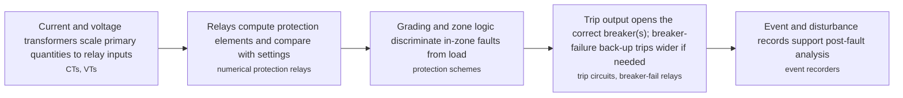

**Key equipment:** numerical protection relays, current transformers, voltage transformers, trip coils, breaker failure protection, disturbance recorders.

Sources: [1](https://www.selinc.com/products/), [2](https://www.hse.gov.uk/electricity/). Last reviewed 2026-11-07.

## Subsea power and umbilical systems

Subsea electrical systems take power from a platform or shore through a power umbilical — cable plus steel tubes for hydraulic signals — to subsea distribution units, transformers, variable speed drives and motors on the seabed. Moves toward higher voltage and longer step-outs have already delivered megawatt-class subsea compression, where the whole drive train sits on the seabed without an topsides compressor. Reliability engineering, connector technology and dynamic cable design for floating hosts dominate the design space.

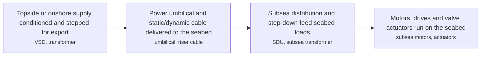

**Key equipment:** power umbilicals, subsea transformers, subsea distribution units, subsea drives, wet-mate connectors.

Sources: [1](https://www.nexans.com/), [2](https://www.siemens-energy.com/global/en/home.html). Last reviewed 2026-11-07.
