# ELE technology options

17 technologies, from commercial to lab stage. Generated from catalog/technologies/; every figure links to its source.

| Technology | Category | Maturity | TRL | Suppliers | Cost figures |
| --- | --- | --- | --- | --- | --- |
| [Earthing and lightning protection](#ele-earthing-lightning) | Electrical safety | commercial |  | nVent ERICO (earthing and lightning protection systems); Dehn (lightning and surge protection); Furse (lightning protection systems) |  |
| [Electrical heat tracing](#ele-heat-tracing) | Electrical heating | commercial |  | nVent (Raychem heat tracing systems); Chromalox (industrial heat tracing); Emerson (industrial heat tracing (Bergman Series)) |  |
| [Emergency, standby and UPS power systems](#ele-emergency-up-power) | Emergency power | commercial |  | Cummins (generator sets); Eaton (UPS systems); ABB (UPS and emergency power); Schneider Electric (Galaxy UPS systems); Vertiv (critical power UPS) |  |
| [Grid connection and interconnection studies](#ele-grid-connection) | Power generation and distribution | commercial |  | Grid System Operator (GSO) (Malaysian grid code administration); Tenaga Nasional Berhad (TNB) (connection offer and network access); Siemens PTI (PSS/E modelling and grid studies) |  |
| [HV/MV switchgear and site power distribution](#ele-hv-switchgear-distribution) | Power distribution | commercial |  | ABB (MV/LV switchgear, UniGear, HySec); Schneider Electric (MV switchgear, RM6, SM6); Siemens Energy (switchgear and grid solutions); Hitachi Energy (HV switchgear, GIS); Eaton (MV/LV switchgear and MCCs) |  |
| [Hazardous area electrical equipment](#ele-hazardous-area-electrical) | Explosion protection | commercial |  | Eaton Crouse-Hinds (Ex enclosures and lighting); R. Stahl (Ex equipment and IS barriers); Pepperl+Fuchs (intrinsic safety interfaces); ABB (Ex motors and instrumentation); Emerson (Ex-rated instrumentation) |  |
| [Low-voltage distribution (415/240 V)](#ele-lv-distribution) | Power generation and distribution | commercial |  | Schneider Electric (Prisma/Blokset switchboards, Acti9 MCBs); ABB (MNS boards, S200 MCBs); Siemens (Sivacon switchboards); Eaton (xEnergy boards) |  |
| [Medium-voltage distribution (11 kV and 33 kV)](#ele-mv-distribution) | Power generation and distribution | commercial |  | ABB (SafeRing/SafePlus RMUs, UniGear MV switchgear); Schneider Electric (RM6, Premset, SM6); Siemens (8DJH RMU, NXPlusC); Eaton (Xiria medium-voltage switchgear) |  |
| [Motors and variable speed drives](#ele-motors-drives) | Electrical drives | commercial |  | ABB (motors and drives, ACS family); WEG (motors and MV drives); Siemens Energy (large drives and motors); Nidec (industrial motors) |  |
| [On-site gas turbine power generation](#ele-gt-power-generation) | Power generation | commercial |  | Siemens Energy (industrial and aeroderivative gas turbines); Mitsubishi Heavy Industries (gas turbines); Baker Hughes (NovaLT and aeroderivative gensets); MAN Energy Solutions (gensets) |  |
| [Overhead transmission lines (132-500 kV)](#ele-transmission-lines) | Power generation and distribution | commercial |  | Siemens Energy (grid transmission equipment); GE Vernova (grid solutions); Hitachi Energy (FACTS and transmission equipment); Tenaga Nasional Berhad (TNB) (owner and operator of the Peninsular grid) |  |
| [Power and control cable systems](#ele-cable-systems) | Power distribution | commercial |  | Prysmian (power and submarine cable systems); Nexans (power, instrument and subsea cables); LS Cable & System (power cables) |  |
| [Power and distribution transformers](#ele-transformers) | Power transformation | commercial |  | Hitachi Energy (power, distribution, GIT and dry-type transformers); Siemens Energy (power and distribution transformers); GE Vernova (power transformers); WEG (distribution and special transformers) |  |
| [Power management and electrical SCADA](#ele-power-management-systems) | Electrical automation | commercial |  | GE Vernova (power management systems); ABB (electrical SCADA and PMS); Schneider Electric (EcoStruxure Power and PMS); Hitachi Energy (grid automation) |  |
| [Power system protection and relaying](#ele-protection-relaying) | Power protection | commercial |  | Schweitzer Engineering Laboratories (protective relays and automation platforms); ABB (Relion protection and control); Schneider Electric (Easergy protection relays); Siemens Energy (SIPROTEC protection relays); GE Vernova (Multilin protection relays) |  |
| [Subsea power and umbilical systems](#ele-subsea-umbilicals-power) | Subsea electrical | commercial |  | Aker Solutions (umbilicals and subsea power); Nexans (subsea cables and umbilicals); Siemens Energy (subsea power grids and drives) |  |
| [UHV and HV substations (275-500 kV)](#ele-uhv-substations) | Power generation and distribution | commercial |  | Hitachi Energy (power transformers, GIS and HVDC); Siemens Energy (GIS, transformers and substation automation); GE Vernova (high-voltage equipment); Hyundai Electric (transformers and switchgear) |  |

## Earthing and lightning protection

Earthing connects metalwork and neutral points to earth so that fault current, lightning and static charge have a safe, low-impedance path and touch voltages stay within limits; lightning protection intercepts strikes with air terminals and down conductors and disposes of the surge through the earth grid. Plant design separates power, instrument and clean earths, bonds across structures and pipelines, and fits surge protective devices on vulnerable circuits. Design rules come from IEC 62305 (lightning), IEC 60364 (installations) and company earth-grid studies for soil resistivity and fault current.

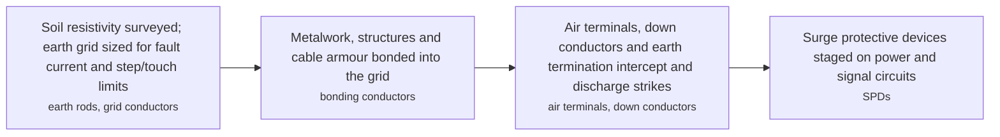

**Key equipment:** earth rods and grid, bonding conductors, air terminals, surge protective devices, test links.

**Performance:**
- transmission voltage levels needing insulation coordination: 132-500 kV; TNB transmission at 132-500 kV drives arresters and clearances. [source](https://www.tnb.com.my/)

**Missing inputs:**
- cost per substation earthing system (costs): Vendor and licensee sites do not publish installed prices. Where: Ask the owner for a Malaysian contractor benchmark. Next: Ask owner for a priced reference or a contractor quote.

Sources: [1](https://www.hse.gov.uk/electricity/), [2](https://www.dehn-international.com/en), [3](https://www.iec.ch/standards), [4](https://www.tnb.com.my/), [5](https://www.gso.org.my/). Last reviewed 2026-11-13.

## Electrical heat tracing

Electrical heat tracing maintains or raises the temperature of pipes, tanks and instruments by applying heat along the surface. Self-regulating parallel trace cables vary their resistance with temperature and cannot overheat a dry section, constant-wattage cables deliver fixed power, and mineral-insulated or skin-effect systems serve long, hot or high-power duties. Heating replaces or supplements steam tracing, and digital control panels monitor every circuit for current and temperature alarms.

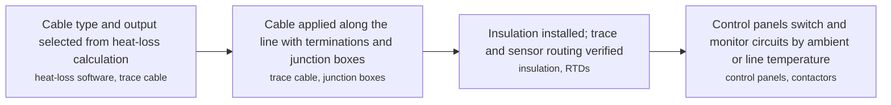

**Key equipment:** self-regulating trace cable, constant-wattage cable, mineral-insulated cable, control and monitoring panels, RTDs.

**Performance:**
- heat-tracing supply voltage: 230-415 V; single-phase 230 V and three-phase 415 V tracing at Malaysian LV. [source](https://www.tnb.com.my/)

**Missing inputs:**
- cost per metre of traced pipe (costs): Vendor and licensee sites do not publish installed prices. Where: Ask the owner for a Malaysian contractor benchmark. Next: Ask owner for a priced reference or a contractor quote.

Sources: [1](https://www.chromalox.com/), [2](https://www.nvent.com/), [3](https://www.tnb.com.my/), [4](https://www.gso.org.my/). Last reviewed 2026-11-13.

## Emergency, standby and UPS power systems

A facility secures loads that must not fail through layers: battery-backed uninterruptible power supplies (classified VFI, VI or DXI by output dependency under IEC 62040-3) ride through the first seconds, standby generating sets start and close onto the emergency bus, and automatic transfer switching restores normal supply after the outage. Emergency generation is sized for essential process, fire and life-safety loads; batteries carry instrumentation, control and safety systems through the transition and support black-start of larger units.

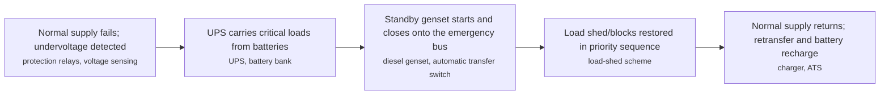

**Key equipment:** standby diesel or gas gensets, UPS units, battery banks (VRLA, lithium), automatic transfer switches, battery chargers.

**Performance:**
- LV standby supply voltage: 400-415 V; standby generators and UPS output at the TNB LV level. [source](https://www.tnb.com.my/)
- required periodic inspection for MV installations: 4 visits/month; Energy Commission inspection frequency above 11 kV to 132 kV. [source](https://www.st.gov.my/)

**Missing inputs:**
- cost per kVA of standby capacity installed (costs): Vendor and licensee sites do not publish installed prices. Where: Ask the owner for a Malaysian contractor benchmark. Next: Ask owner for a priced reference or a contractor quote.

Sources: [1](https://www.iec.ch/standards), [2](https://www.hse.gov.uk/electricity/), [3](https://www.tnb.com.my/), [4](https://www.gso.org.my/). Last reviewed 2026-11-13.

## Grid connection and interconnection studies

A connection must satisfy the Malaysian Grid Code, which the Grid System Operator owns and administers. The chain is load-flow, short-circuit and transient-stability modelling of the proposed connection, then compliance checks for voltage limits, fault ride-through and reactive capability, then a connection agreement with TNB and GSO approval before energisation. Industrial loads above about 25,000 kVA take supply at 132 kV or 275 kV, which places them inside grid-code territory.

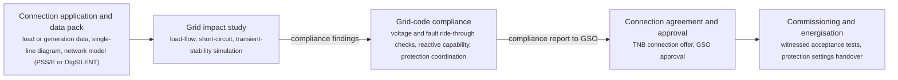

**Key equipment:** network modelling software, protection coordination tools, commissioning test sets.

**Performance:**
- TNB 132/275 kV supply threshold: 25000 kVA; TNB supplies 132 kV and 275 kV for demands above about 25,000 kVA. [source](https://www.tnb.com.my/)
- transmission voltage tolerance at 132/275 kV: -5-10 %; TNB limits at 132 kV and 275 kV. [source](https://www.tnb.com.my/)

**Missing inputs:**
- study cost per MW connected, with a Malaysian consultant benchmark (costs): Consultancies do not publish study prices. Where: Ask the owner for a benchmarked study cost. Next: Ask owner for a priced reference.

Sources: [1](https://www.gso.org.my/). Last reviewed 2026-11-13.

## HV/MV switchgear and site power distribution

Medium-voltage switchgear receives, protects and distributes electrical power across a facility. Power arrives from utility infeed or site generation at high voltage (typically 132 kV and above for large plants), is transformed to a main distribution voltage (usually 11 kV or 33/36 kV onshore, 11 kV offshore), and flows through switchboards to transformers, motors and downstream boards. Air-insulated, gas-insulated (GIS) and hybrid designs exist; modern breakers use vacuum or SF6 interrupting technology.

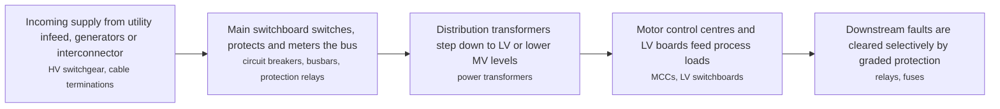

**Key equipment:** circuit breakers (vacuum, SF6), switchboards, busbars, ring main units, power transformers, protection relays, surge arresters.

**Performance:**
- IEC 62271-200 rated voltage range of metal-enclosed MV switchgear: 1-52 kV; IEC 62271-200 covers AC metal-enclosed switchgear and controlgear above 1 kV up to and including 52 kV. [source](https://www.iec.ch/standards)

**Missing inputs:**
- cost per panel by voltage class (costs): Vendor and licensee sites do not publish installed prices. Where: Ask the owner for a Malaysian contractor benchmark. Next: Ask owner for a priced reference or a contractor quote.

Sources: [1](https://www.iec.ch/standards), [2](https://www.hitachienergy.com/products-and-solutions/transformers), [3](https://www.tnb.com.my/), [4](https://www.gso.org.my/). Last reviewed 2026-11-13.

## Hazardous area electrical equipment

Where flammable atmospheres can occur, electrical equipment is selected to exclude or contain ignition sources. Areas are classified by likelihood and duration (gas: Zone 0/1/2; dust: Zone 20/21/22) under IEC 60079-10 or DSEAR in the UK, then protected by equipment protection concepts matched to the zone: intrinsic safety (Ex ia/ib) for instrumentation, flameproof enclosures (Ex d), increased safety (Ex e), pressurisation (Ex p), encapsulation (Ex m) and others. The IECEx certification system covers equipment certification, conformity of installation and personnel competence across member countries.

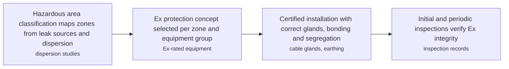

**Key equipment:** flameproof enclosures, intrinsically safe circuits and isolators, purge and pressurisation panels, Ex lighting and motors, sealing glands.

**Performance:**
- LV equipment used in hazardous areas: 400-415 V; hazardous-area equipment operates at the TNB LV level in process plants. [source](https://www.tnb.com.my/)

**Missing inputs:**
- cost premium of Ex-rated over standard equipment (costs): Vendor and licensee sites do not publish installed prices. Where: Ask the owner for a Malaysian contractor benchmark. Next: Ask owner for a priced reference or a contractor quote.

Sources: [1](https://www.iecex.com/), [2](https://www.iec.ch/standards), [3](https://www.hse.gov.uk/electricity/), [4](https://www.tnb.com.my/), [5](https://www.gso.org.my/). Last reviewed 2026-11-13.

## Low-voltage distribution (415/240 V)

The Malaysian LV level: TNB supplies 415/240 V (also written 400/230 V) three-phase four-wire to premises up to roughly 1,000 kVA via CT metering. Within the installation a main switchboard divides into sub-boards, motor control centres and final circuits; discrimination between breakers and the fault level at each board set the breaking capacities. Per the Electricity Regulations, LV work is done by licensed wiremen/chargemen and needs a Test Certificate (Form H) before TNB energises.

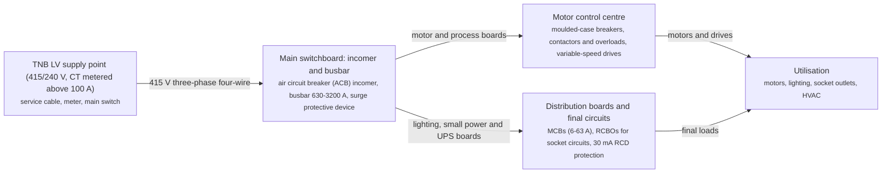

**Key equipment:** main switchboard with ACB, motor control centre, distribution board, MCB and RCBO devices, surge protective devices.

**Performance:**
- LV supply voltage, three-phase: 400-415 V; TNB supply-voltage table; both 400/230 V and 415/240 V describe the same LV level. [source](https://www.tnb.com.my/)
- LV supply available up to (CT metered): 1000 kVA; TNB three-phase four-wire CT metered up to about 1,000 kVA; above that an 11 kV supply applies. [source](https://www.tnb.com.my/)
- LV steady-state voltage tolerance: -6-10 %; TNB voltage-fluctuation limits at 400/230 V under normal conditions. [source](https://www.tnb.com.my/)
- required RCD sensitivity for socket circuits: 30 mA; Malaysian practice for socket-outlet final circuits (30 mA RCD). [source](https://www.st.gov.my/)

**Missing inputs:**
- cost per board or per kVA of installed LV distribution (costs): Vendor and licensee sites do not publish installed prices. Where: Manufacturer price books or a Malaysian licensed-contractor benchmark. Next: Ask owner for a priced reference or a quote from a licensed contractor.

Sources: [1](https://www.tnb.com.my/). Last reviewed 2026-11-13.

## Medium-voltage distribution (11 kV and 33 kV)

Malaysia's MV distribution levels: TNB supplies 11 kV for roughly 1,000-5,000 kVA and 33 kV up to about 25,000 kVA (22 kV appears in parts of Johor and Perak). At site level an intake substation receives the supply and ring-main units feed substation transformers, often with redundant transformers and an N+1 scheme for critical process loads. MV installations carry the highest periodic-inspection frequency under the Electricity Regulations.

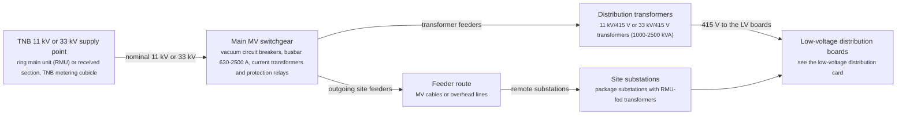

**Key equipment:** ring main units, vacuum circuit breakers, distribution transformers, MV cables, protection relays.

**Performance:**
- 11 kV supply range for TNB customers: 1000-5000 kVA; TNB three-phase three-wire 11 kV for 1,000-5,000 kVA. [source](https://www.tnb.com.my/)
- 33 kV supply range for TNB customers: 5000-25000 kVA; TNB three-phase three-wire 33 kV for 5,000-25,000 kVA. [source](https://www.tnb.com.my/)
- MV steady-state voltage tolerance: -5-5 %; TNB limits at 6.6 kV, 11 kV, 22 kV and 33 kV. [source](https://www.tnb.com.my/)
- 33 kV fault level rating: 25 kA; TNB 33 kV short-circuit rating 25 kA for 3 s. [source](https://www.tnb.com.my/)
- 11 kV fault level rating: 20 kA; TNB 11 kV short-circuit rating 20 kA for 3 s. [source](https://www.tnb.com.my/)

**Missing inputs:**
- cost per substation installed, ring versus radial, with a Malaysian contractor benchmark (costs): Vendor and licensee sites do not publish installed prices. Where: Malaysian electrical contractor tender benchmarks. Next: Ask owner for a priced reference or a contractor quote.

Sources: [1](https://www.tnb.com.my/). Last reviewed 2026-11-13.

## Motors and variable speed drives

Three-phase induction motors remain the workhorse driver; synchronous machines serve large compressors and high-efficiency duties. Efficiency classes IE1 to IE5 are defined in IEC 60034-30-1 for line-operated motors. Variable frequency drives rectify the supply and synthesise an adjustable-voltage, adjustable-frequency output, giving soft starts, process speed control, energy savings on centrifugal loads (affinity laws: power roughly follows speed cubed) and regenerative braking on hoisting duties. Drives inject harmonics, so input filters or multi-pulse/active front ends are applied.

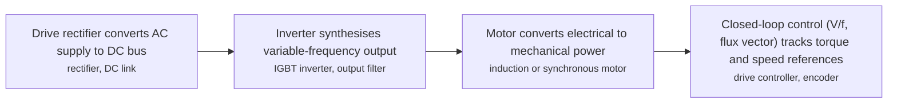

**Key equipment:** induction motors, synchronous motors, variable frequency drives, soft starters, harmonic filters, motor protection relays.

**Performance:**
- LV motor supply voltage: 400-415 V; TNB LV supply voltage for compatible LV motors and drives. [source](https://www.tnb.com.my/)
- MV motor supply voltage: 11 kV; TNB 11 kV supply is the standard MV motor voltage in Malaysia. [source](https://www.tnb.com.my/)
- MV voltage tolerance the drive must ride through: -5-5 %; TNB steady-state limits at 11 kV and 33 kV. [source](https://www.tnb.com.my/)

**Missing inputs:**
- cost per kW by drive size and voltage (costs): Vendor and licensee sites do not publish installed prices. Where: Ask the owner for a Malaysian contractor benchmark. Next: Ask owner for a priced reference or a contractor quote.

Sources: [1](https://www.energy.gov/eere/amo/motors), [2](https://www.iec.ch/standards), [3](https://www.tnb.com.my/), [4](https://www.gso.org.my/). Last reviewed 2026-11-13.

## On-site gas turbine power generation

Facilities generate their own power with gas turbine generator sets when the grid is weak, absent or considered unreliable, or when waste heat from exhaust can drive steam for process use (cogeneration). Industrial and aeroderivative turbines from about 5 MW to well above 100 MW are installed per train; multiple units run with a power management system, spinning reserve and load-shed logic. Offshore and remote platforms historically ran at 4.16 kV or 11 kV with closed-bus transfer between boards.

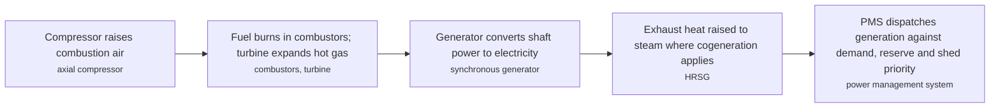

**Key equipment:** gas turbine generator sets, HRSG, generators, power management system, fuel gas conditioning.

**Performance:**
- generator connection voltage to TNB grid: 11-275 kV; embedded generation connects at 11 kV through to 275 kV by size. [source](https://www.tnb.com.my/)
- 132/275 kV supply threshold for large connections: 25000 kVA; TNB supplies 132 kV and 275 kV above about 25,000 kVA. [source](https://www.tnb.com.my/)

**Missing inputs:**
- cost per MW installed, open cycle and combined cycle (costs): Vendor and licensee sites do not publish installed prices. Where: Ask the owner for a Malaysian contractor benchmark. Next: Ask owner for a priced reference or a contractor quote.

Sources: [1](https://www.siemens-energy.com/global/en/home.html), [2](https://www.mhi.com/), [3](https://www.eia.gov/electricity/), [4](https://www.tnb.com.my/), [5](https://www.gso.org.my/). Last reviewed 2026-11-13.

## Overhead transmission lines (132-500 kV)

The transmission backbone: TNB operates 132 kV, 275 kV and 500 kV lines. Insulator creepage and clearance are set by the phase voltage and local pollution; the tower type (lattice steel or monopole) follows terrain and corridor constraints; ACSR or AAAC conductors are sized by ampacity and sag; earth wires or line surge arresters protect against lightning, which matters heavily in Malaysia's thunderstorm climate. Live-line working and patrols carry the lifecycle.

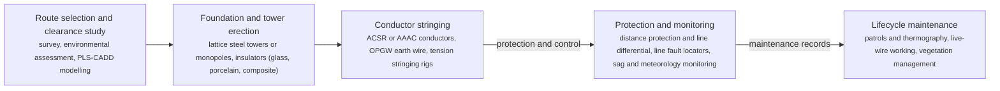

**Key equipment:** lattice towers, ACSR or AAAC conductor, insulators, OPGW, distance protection relays.

**Performance:**
- transmission voltage levels in Peninsular Malaysia: 132-500 kV; TNB transmission at 132 kV, 275 kV and 500 kV. [source](https://www.tnb.com.my/)
- 500 kV fault level rating: 50 kA; TNB 500 kV short-circuit rating 50 kA for 1 s. [source](https://www.tnb.com.my/)
- 132 kV fault level rating: 31.5-40 kA; TNB 132 kV 31.5 kA for 3 s, 40 kA near power stations. [source](https://www.tnb.com.my/)
- 500 kV steady-state voltage tolerance: -5-5 %; TNB 500 kV voltage limits. [source](https://www.tnb.com.my/)

**Missing inputs:**
- cost per kilometre by voltage and terrain (costs): Network operators do not publish line costs. Where: Energy Commission or GSO tariff filings. Next: Ask owner for a priced reference.

Sources: [1](https://www.tnb.com.my/). Last reviewed 2026-11-13.

## Power and control cable systems

Cable systems move power and signals between equipment and boards. Construction is chosen per duty: XLPE or EPR insulation for power, fire-resistant (circuit integrity) cables for safety circuits that must keep working during a fire, armoured and lead-sheathed designs for direct burial and submarine routes, and segregated tray/ladder routing with derating for bunching, ambient temperature and harmonic heating. Standards such as IEC 60502 (1–30 kV) and IEC 60332 (fire behaviour) govern selection and testing.

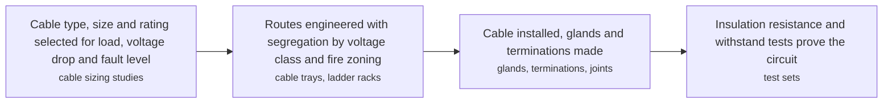

**Key equipment:** XLPE power cables, fire-resistant cables, armoured and submarine cables, cable trays, glands and terminations.

**Performance:**
- MV cable working voltage: 11-33 kV; TNB MV distribution voltages for cable rating. [source](https://www.tnb.com.my/)
- LV cable working voltage: 400-415 V; TNB LV supply for LV power and control cables. [source](https://www.tnb.com.my/)

**Missing inputs:**
- cost per metre by voltage class and conductor size (costs): Vendor and licensee sites do not publish installed prices. Where: Ask the owner for a Malaysian contractor benchmark. Next: Ask owner for a priced reference or a contractor quote.

Sources: [1](https://www.prysmian.com/), [2](https://www.nexans.com/), [3](https://www.iec.ch/standards), [4](https://www.tnb.com.my/), [5](https://www.gso.org.my/). Last reviewed 2026-11-13.

## Power and distribution transformers

Transformers couple windings through a magnetic core to change voltage levels at essentially constant power. Oil-filled units (mineral oil, ester or gas-insulated) dominate power ratings, with ONAN/ONAF/OFAF/ODAF cooling stages; dry-type cast-resin units suit fire-sensitive or confined locations. An on-load tap changer (OLTC) regulates the output voltage under load. Losses, sound level and thermal behaviour are standardised in the IEC 60076 series.

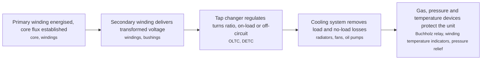

**Key equipment:** core, windings, on-load tap changer, bushings, cooling system, Buchholz relay.

**Performance:**
- 800 kV UHVDC power transformers delivered: 20 units (more than); Hitachi Energy states its power transformer fleet includes more than 20 units of 800 kV UHVDC and more than 500 units in the 735-765 kV AC class. [source](https://www.hitachienergy.com/products-and-solutions/transformers)
- 735-765 kV AC power transformers delivered: 500 units (more than); same statement as above. [source](https://www.hitachienergy.com/products-and-solutions/transformers)

**Missing inputs:**
- cost per MVA installed, by transformer class and voltage (costs): Vendor and licensee sites do not publish installed prices. Where: Ask the owner for a Malaysian contractor benchmark. Next: Ask owner for a priced reference or a contractor quote.

Sources: [1](https://www.hitachienergy.com/products-and-solutions/transformers), [2](https://www.iec.ch/standards), [3](https://www.tnb.com.my/), [4](https://www.gso.org.my/). Last reviewed 2026-11-13.

## Power management and electrical SCADA

A power management system supervises generation, tie-lines and major loads: it schedules and dispatches running generator sets, synchronises and parallels them, maintains frequency and voltage, arms staged load shedding for generator or tie loss, and manages islanding and re-synchronisation with the grid. PMS logic sits on electrical SCADA above the protection relays and complements them — protection clears faults in milliseconds while the PMS re-balances the network in seconds.

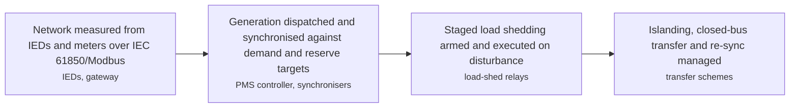

**Key equipment:** PMS controllers, electrical SCADA, protection relays and IEDs, synchronisers, load-shed schemes.

**Performance:**
- voltage limits the SCADA must alarm on at 132 kV: -5-10 %; TNB 132 kV and 275 kV voltage limits. [source](https://www.tnb.com.my/)
- 500 kV voltage limit monitored by the system: -5-5 %; TNB 500 kV voltage limit. [source](https://www.tnb.com.my/)

**Missing inputs:**
- cost per substation of SCADA and automation (costs): Vendor and licensee sites do not publish installed prices. Where: Ask the owner for a Malaysian contractor benchmark. Next: Ask owner for a priced reference or a contractor quote.

Sources: [1](https://www.gevernova.com/), [2](https://www.iec.ch/standards), [3](https://www.tnb.com.my/), [4](https://www.gso.org.my/). Last reviewed 2026-11-13.

## Power system protection and relaying

Protection relays continuously compare measured current, voltage, frequency, phase and differential quantities against settings and command circuit breakers to isolate faults before equipment or people are harmed. Modern numerical relays combine many protection functions (ANSI 50/51 overcurrent, 87 differential, 27/59 voltage, 81 frequency, 46 negative sequence) with recording, metering and IEC 61850 communication in one device. Selectivity is achieved through current grading, time grading or zone-based differential schemes, with breaker-failure back-up tripping the surrounding breakers when the primary trip fails.

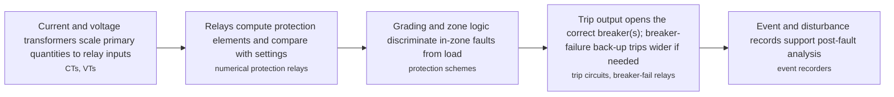

**Key equipment:** numerical protection relays, current transformers, voltage transformers, trip coils, breaker failure protection, disturbance recorders.

**Performance:**
- 11 kV clearing requirement implied by fault rating: 20 kA; protection must clear the 20 kA, 3 s 11 kV fault duty. [source](https://www.tnb.com.my/)
- 500 kV fault ratings protection must handle: 50 kA; 50 kA for 1 s at 500 kV. [source](https://www.tnb.com.my/)

**Missing inputs:**
- cost per protection panel or per feeder (costs): Vendor and licensee sites do not publish installed prices. Where: Ask the owner for a Malaysian contractor benchmark. Next: Ask owner for a priced reference or a contractor quote.

Sources: [1](https://www.selinc.com/products/), [2](https://www.hse.gov.uk/electricity/), [3](https://www.tnb.com.my/), [4](https://www.gso.org.my/). Last reviewed 2026-11-13.

## Subsea power and umbilical systems

Subsea electrical systems take power from a platform or shore through a power umbilical — cable plus steel tubes for hydraulic signals — to subsea distribution units, transformers, variable speed drives and motors on the seabed. Moves toward higher voltage and longer step-outs have already delivered megawatt-class subsea compression, where the whole drive train sits on the seabed without an topsides compressor. Reliability engineering, connector technology and dynamic cable design for floating hosts dominate the design space.

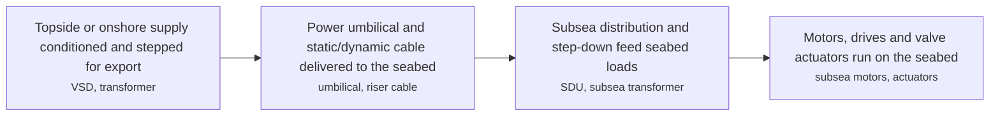

**Key equipment:** power umbilicals, subsea transformers, subsea distribution units, subsea drives, wet-mate connectors.

**Missing inputs:**
- cost per kilometre of umbilical (costs): Vendor and licensee sites do not publish installed prices. Where: Ask the owner for a Malaysian contractor benchmark. Next: Ask owner for a priced reference or a contractor quote.

Sources: [1](https://www.nexans.com/), [2](https://www.siemens-energy.com/global/en/home.html), [3](https://www.tnb.com.my/), [4](https://www.gso.org.my/). Last reviewed 2026-11-13.

## UHV and HV substations (275-500 kV)

The 275 kV and 500 kV bulk nodes of the Malaysian grid. Air-insulated switchyard designs (dead-tank breakers, disconnectors, CTs and VTs, surge arresters, lattice busbars) dominate on land, with gas-insulated switchgear for space-constrained urban sites. Transformer banks step 500/275 kV and 275/132 kV; shunt reactors and capacitor banks or SVC/STATCOM manage voltage on long lines; IEC 61850 substation automation runs protection and monitoring.

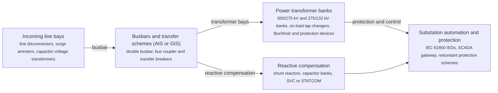

**Key equipment:** power transformers, dead-tank and GIS circuit breakers, disconnectors and earthing switches, current and voltage transformers, surge arresters, protection IEDs.

**Performance:**
- 275 kV fault level rating: 40-50 kA; TNB 275 kV 40 kA for 3 s, 50 kA near power stations. [source](https://www.tnb.com.my/)
- 500 kV fault level rating: 50 kA; TNB 500 kV 50 kA for 1 s. [source](https://www.tnb.com.my/)

**Missing inputs:**
- cost per bay or per MVA of substation capacity (costs): Network operators do not publish substation costs. Where: GSO or Energy Commission regulatory filings. Next: Ask owner for a priced reference.

Sources: [1](https://www.tnb.com.my/). Last reviewed 2026-11-13.
