# GAS technology options

30 technologies, from commercial to lab stage. Generated from catalog/technologies/; every figure links to its source.

| Technology | Category | Maturity | TRL | Suppliers | Cost figures |
| --- | --- | --- | --- | --- | --- |
| [Amine acid gas removal (MDEA, formulated amines)](#gas-amine-agr) | Gas treating / chemical solvent | commercial | 9 | BASF (OASE); Dow (UCARSOL); ExxonMobil (FLEXSORB); Honeywell UOP (Amine Guard FS); Shell (ADIP (ADIP-ULTRA per Shell catalysts pages)); Axens (Hysweet sour-gas sweetening solvent technology) |  |
| [Bio-LNG and liquefied biomethane](#gas-bio-lng) | LNG / renewable gas | commercial |  | Shell (bio-LNG plant, about 100,000 t/yr (April 2024)); Titan (bio-LNG (register examples; not verified)) |  |
| [Boil-off gas management and reliquefaction](#gas-boil-off-reliquefaction) | LNG / shipping | commercial |  | Wärtsilä (LNG reliquefaction system); Burckhardt Compression (Laby-GI fuel gas compressors) |  |
| [Carbon capture on LNG plants (acid gas reinjection)](#gas-lng-acid-gas-reinjection) | LNG / CO2 management | commercial |  | Chevron Australia (Gorgon CO2 injection); ExxonMobil (partner and register example) | Gorgon CO2 injection system capital cost: 1.7 USD billion |
| [Cascade liquefaction](#lng-optimized-cascade) | LNG liquefaction | commercial |  | ConocoPhillips (Optimized Cascade Process); Bechtel (EPC partner) |  |
| [Compressed natural gas and LNG as vehicle fuel](#gas-natural-gas-vehicle-fuel) | Gas use / transport | commercial |  | Clean Energy Fuels (US stations (more than 550 per the OIES report)) |  |
| [Dual mixed refrigerant liquefaction](#lng-dmr) | LNG liquefaction | commercial |  | Shell (Shell DMR); Air Products (AP-DMR) |  |
| [Electric-drive liquefaction (e-LNG)](#gas-electric-drive-lng) | LNG / liquefaction drive | commercial |  | Equinor (Hammerfest LNG electrification (Snøhvit Future)); Freeport LNG (three electric-driven trains); McDermott (e-drive solutions (search result only; page not read)) |  |
| [Floating LNG (FLNG)](#lng-flng) | LNG liquefaction / floating | commercial |  | PETRONAS (owner-operator, PFLNG SATU and DUA); Shell (owner-operator, Prelude); Golar LNG (FLNG conversions (Hilli)) |  |
| [Floating storage and regasification units (FSRU)](#lng-fsru) | LNG import / regasification | commercial |  | Excelerate Energy; Höegh LNG; Golar LNG |  |
| [Gas-to-liquids (Fischer-Tropsch)](#gas-gtl-ft) | Gas conversion | commercial |  | Shell (Shell Middle Distillate Synthesis (SMDS)); Sasol |  |
| [Gas-to-methanol and methanol-to-gasoline](#gas-to-methanol) | Gas conversion / methanol | commercial |  | Topsoe (methanol (register examples; not verified)); Johnson Matthey (Honeywell) (methanol (register examples)); ExxonMobil (MTG (register examples)) |  |
| [Helium recovery](#gas-helium-recovery) | Gas processing / helium | commercial |  | RasGas / Qatargas (operators) (Helium 2 plant; liquefier co-owned); Linde Engineering (PSA plus HISELECT helium purification hybrid with NRU) |  |
| [Hot potassium carbonate (Benfield)](#gas-hot-potassium-carbonate) | Gas treating / chemical solvent | commercial |  | Honeywell UOP (Benfield, Benfield HiPure) |  |
| [Hybrid solvent gas treating (Sulfinol)](#gas-hybrid-solvent-sulfinol) | Gas treating / hybrid solvent | commercial |  | Shell (Sulfinol) |  |
| [LNG bunkering](#gas-lng-bunkering) | LNG / marine fuel | commercial |  | FueLNG (ship-to-ship LNG bunkering, Singapore (Shell and Seatrium)); Shell (LNG bunkering); TotalEnergies (LNG bunkering (register examples)); PETRONAS (LNG bunkering (register examples)) |  |
| [LNG regasification (open rack, submerged combustion, ambient air vaporisers)](#gas-lng-regasification) | LNG / import terminals | commercial |  | Sumitomo Precision Products (vaporisers (register examples; not verified)); Kobe Steel (vaporisers (register examples; not verified)); Chart Industries (ambient-air vaporisers with HVAC pre-heating, 30 to 100% turndown) |  |
| [Liquid redox sulfur recovery (LO-CAT)](#gas-liquid-redox-lo-cat) | Gas treating / sulfur recovery | commercial |  | Merichem (LO-CAT); Axens (SweetSulf (redox, H2S below 1 ppmv achievable per Axens)) |  |
| [Membrane CO2 removal for high-CO2 gas](#gas-membrane-co2) | Gas treating / membrane | commercial |  | Honeywell UOP (Separex); SLB (Cynara); Air Liquide |  |
| [Mercury removal units](#gas-mercury-removal) | Gas treating / adsorption | commercial |  | Axens (AxTrap Mercury Series); Johnson Matthey (Honeywell) (PURASPEC); Clariant |  |
| [Mixed fluid cascade](#lng-mixed-fluid-cascade) | LNG liquefaction | commercial |  | Linde Engineering (MFC) |  |
| [Molecular sieve and glycol dehydration](#gas-dehydration) | Gas treating / dehydration | commercial |  | Honeywell UOP; BASF; Axens |  |
| [NGL fractionation and LPG recovery](#gas-ngl-fractionation) | Gas processing / NGL | commercial |  | Honeywell UOP (fractionation modules); Enerflex (LPG extraction and NGL recovery (search result only; page not read)) | cost reduction for a deethanizer single-tower design compared with historical two-tower projects: 14 % |
| [Nitrogen rejection units](#gas-nitrogen-rejection) | Gas processing / nitrogen removal | commercial |  | Linde Engineering (single-column, partitioned-column, double-column and enrichment NRUs); Air Products (NRU (register examples column; not verified in sources read)) |  |
| [Physical solvent gas treating (Selexol, Rectisol, Purisol)](#gas-physical-solvent-agr) | Gas treating / physical solvent | commercial |  | Honeywell UOP (Selexol (Union Carbide solvent, licensed through UOP)); Linde (Rectisol (examples column of the register; not verified in sources read)); Air Liquide (Rectisol (examples column of the register; not verified in sources read)); Linde Engineering (Rectisol chilled-methanol wash licensor (with Air Liquide)); Air Liquide Engineering & Construction (Rectisol process (originally Lurgi) and Purisol (N-methylpyrrolidone) gas purification) |  |
| [Propane-precooled mixed refrigerant liquefaction (C3MR, AP-X)](#lng-c3mr-apx) | LNG liquefaction | commercial |  | Air Products (AP-C3MR, AP-X, AP-DMR, AP-N) |  |
| [Small and mid-scale modular LNG](#gas-small-scale-lng) | LNG / liquefaction | commercial |  | Honeywell UOP (AP-N nitrogen expander, AP-C1, AP-SMR processes (document hosted by UOP)); Chart Industries (small-scale LNG (register examples; not verified)); Black & Veatch (PRICO (register examples; not verified)) |  |
| [Sulfur recovery (Claus, tail gas treating, SuperClaus)](#gas-sulfur-recovery) | Gas treating / sulfur recovery | commercial |  | Shell; Worley Comprimo; Jacobs; KT Tecnimont; Baker Hughes; BASF (OASE yellow, sulfexx); Axens (Claus, SmartSulf, Sultimate) |  |
| [Turbo-expander NGL recovery (GSP, RSV processes)](#gas-turboexpander-ngl) | NGL recovery / cryogenic | commercial |  | Honeywell UOP Ortloff (GSP, RSV, SCORE, SRP, SRC, SRX); Linde Engineering |  |
| [High-CO2 gas field development with reinjection](#gas-high-co2-reinjection) | Gas treating / field development | demonstration |  | PETRONAS Carigali (operator of Kasawari CCS); Baker Hughes (gas turbine compressor trains (PGT25+ / PGT25 DLE), two trains each for booster and reinjection); Malaysia Marine and Heavy Engineering (CCS platform EPCIC (awarded November 2022)); Technip Energies (FEED within the NPCC consortium) |  |

## Amine acid gas removal (MDEA, formulated amines)
<a id="gas-amine-agr"></a>

Sour gas is contacted with an aqueous amine solution in an absorber, which takes up CO2 and H2S. The rich solution is flashed, heated against lean solution and regenerated by steam stripping, releasing acid gas to a sulfur recovery unit or CO2 handling. MDEA-based formulations can be tuned for selective H2S removal for sales gas or deep CO2 removal for LNG.

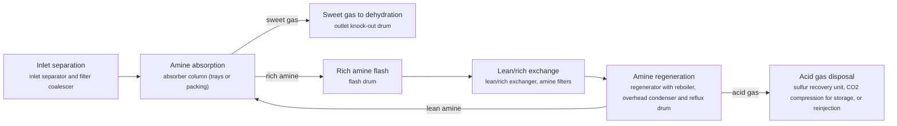

**Key equipment:** inlet separator, amine absorber, flash drum, lean/rich exchanger, regenerator and reboiler, amine filtration, lean amine cooler and pumps.

**Performance:**
- CO2 content of feed gas to LNG pretreatment and after acid gas removal: 50-7050 ppmv CO2; NETL LNG model: removal from about 7,050 ppmv in pipeline feed to about 50 ppmv (low = outlet, high = inlet). [source](https://www.energy.gov/sites/prod/files/2019/09/f66/2019%20NETL%20LCA-GHG%20Report.pdf)

**Reference plants:**
- PETRONAS PFLNG DUA, Rotan field, offshore Sabah, MY: 1.5 Mtpa LNG, 1,300 m water depth; first floating LNG reference for BASF OASE; first cargo 24 March 2021. [source](https://energy-resources.basf.com/global/en/gas-treatment/gas-treatment-oase/solution_natural_gas)
- PETRONAS PFLNG 1 (SATU), offshore Sarawak, Amine Guard FS, MY: 1.2 Mtpa LNG; about 112 miles off Sarawak; acid gas removal designed by PETRONAS and UOP for floating service; start-up scheduled for end 2015 in the 2013 announcement; not confirmed there. [source](https://hydrocarbonprocessing.com/news/2013/04/uop-technology-to-remove-acid-gases-for-petronas-floating-lng-in-malaysia/)

TRL source: [IEA ETP Clean Energy Technology Guide, dataset of 24 July 2026, 2025 assessment (IEA 1-11 scale): 'Advanced acid gas removal' 9](https://www.iea.org/data-and-statistics/data-tools/etp-clean-energy-technology-guide)

**Missing inputs:**
- capital cost and levelized or unit cost, with dollar year and basis (costs): No open source read so far gives costs for this technology. Refinery and gas plant unit costs are mostly published in paid sources. Web-checked 2026-10-28; AGR unit costs are licensor-quoted. Where: Oxford Institute for Energy Studies LNG and gas papers (private copy only) (catalog: oxford-oies, open); arXiv: open techno-economic and review papers (collector already runs weekly) (catalog: arxiv, open); Open-access journal techno-economic papers (MDPI Energies, Processes); MDPI is blocked by its CDN, use the manual inbox (blocked); Paid cost databases (consultancies, licensor studies): catalog-only until the owner provides access (paid). Next: Look for an open techno-economic study; record each figure with metric, range, unit, dollar year, basis and source.

Sources: [1](https://www.energy.gov/sites/prod/files/2019/09/f66/2019%20NETL%20LCA-GHG%20Report.pdf), [2](https://energy-resources.basf.com/global/en/gas-treatment/gas-treatment-oase/solution_natural_gas), [3](https://hydrocarbonprocessing.com/news/2013/04/uop-technology-to-remove-acid-gases-for-petronas-floating-lng-in-malaysia/), [4](https://uop.com/en/industry-solutions/gas-processing/gas-treating/acid-gas-removal). Last reviewed 2026-10-28.

## Bio-LNG and liquefied biomethane
<a id="gas-bio-lng"></a>

Biogas is upgraded to biomethane, then liquefied with a small-scale liquefier to give a drop-in LNG substitute for heavy transport and shipping. Shell commissioned a bio-LNG plant of about 100,000 tonnes a year in April 2024 (location not confirmed by the page read).


**Key equipment:** digesters, biogas upgrading unit, small-scale liquefier, LNG tank, truck loading.

**Performance:**
- Shell bio-LNG plant capacity: 100000 t/yr; Natural Gas World, April 2024; site and feedstock not stated in the text read. [source](https://naturalgasworld.com/shell-inaugurates-germanys-largest-bio-lng-production-plant-117526)

**Reference plants:**
- Nordsol bio-LNG plant, Amsterdam (Nordsol/Shell/Renewi), NL: 3,400 t/yr bio-LNG plus 6,800 t/yr liquid bio-CO2; feedstock is biogas from Renewi waste processing; opened 15 Oct 2021 - the first bio-LNG plant in the Netherlands; operating. [source](https://www.bioenergy-news.com)
- Vireo Hardanger bio-LNG plant, Norway (Bright Renewables/Nordsol), NO: about 125,000 t/yr organic feedstock (salmon-processing residues) to bio-LNG; Norway's first bio-LNG facility (2025); operating. [source](https://www.bright-renewables.com)

**Missing inputs:**
- capital cost and operating or unit cost, with dollar year and basis (costs): No open source read so far gives costs for this technology. Web-checked 2026-10-28; no open figures. Where: arXiv and open-access journals: techno-economic or review papers (MDPI is blocked by its CDN; use the manual inbox) (catalog: arxiv, open); Licensor and EPC studies; paid cost databases are catalog-only (paid); OSTI.GOV full-text reports from DOE labs: search the technology name plus 'techno-economic' (catalog: osti, blocked). Next: Look for an open techno-economic study; record each figure with metric, range, unit, dollar year, basis and source.
- TRL with a cited source (trl): The IEA ETP Clean Energy Technology Guide has no matching entry. no open TRL table found (IEA ETP guide checked 2026-10-28). Where: IEA ETP Clean Energy Technology Guide (collected): search for the technology name (catalog: iea-reports, open). Next: Find a TRL table that lists this technology, or leave maturity resting on the evidence on the card.
- process steps and equipment are general engineering practice, not taken from one source (process): The sources read describe the principle but not a full step-by-step flow. Where: Licensor process descriptions and textbooks (open). Next: Check the steps against a licensor description and name it.

Sources: [1](https://naturalgasworld.com/shell-inaugurates-germanys-largest-bio-lng-production-plant-117526). Last reviewed 2026-10-28.

## Boil-off gas management and reliquefaction
<a id="gas-boil-off-reliquefaction"></a>

Heat leaks into LNG tanks and evaporates a fraction each day. Boil-off gas is used as fuel, burnt in a gas combustion unit or compressed, cooled and returned to the cargo tanks in a reliquefaction plant. Wärtsilä's system compresses boil-off, cools it in a cold box on a nitrogen compression-expansion cycle, removes nitrogen and returns LNG to the tanks.


**Key equipment:** BOG compressors, cold box, nitrogen compander, separator, gas combustion unit.

**Performance:**
- attainable boil-off rate with current containment: 0.07 % of cargo per day; Chemical Engineering Transactions paper; 0.05% expected in the future. [source](https://www.aidic.it/cet/21/88/153.pdf)
- power saving of latest Wärtsilä reliquefaction generation: 15 %; Wärtsilä: condensing BOG at higher pressure and temperature with early removal of compression heat. [source](https://www.wartsila.com/encyclopedia/term/lng-reliquefaction-system)
- operating experience of Laby-GI compressors for MAN ME-GI engines: 1e+06 operating hours; Burckhardt claim. [source](https://www.gasworld.com/story/burckhardt-compression-passes-1m-operating-hours-with-laby-gi-compressors/2091950.article)

**Missing inputs:**
- kWh per tonne reliquefied (performance): No source read gives it. Web-checked 2026-10-28; specific-power figures sit in vendor (Wartsila/Hamworthy/Mitsubishi) brochures not open. Where: Wärtsilä and Burckhardt brochures (open). Next: Add specific energy from a vendor datasheet.
- capital cost and operating or unit cost, with dollar year and basis (costs): No open source read so far gives costs for this technology. Web-checked 2026-10-28; vendor quotes only. Where: arXiv and open-access journals: techno-economic or review papers (MDPI is blocked by its CDN; use the manual inbox) (catalog: arxiv, open); Licensor and EPC studies; paid cost databases are catalog-only (paid); OSTI.GOV full-text reports from DOE labs: search the technology name plus 'techno-economic' (catalog: osti, blocked). Next: Look for an open techno-economic study; record each figure with metric, range, unit, dollar year, basis and source.
- named plants or projects with capacity and year (reference_plants): The sources read name no specific plant. Web-checked 2026-10-28; no verifiable named installation added. Where: Licensor and operator press releases for the suppliers listed (open). Next: Add one or two plants with country, capacity and start-up year.
- TRL with a cited source (trl): The IEA ETP Clean Energy Technology Guide has no matching entry. no open TRL table found (IEA ETP guide checked 2026-10-28). Where: IEA ETP Clean Energy Technology Guide (collected): search for the technology name (catalog: iea-reports, open). Next: Find a TRL table that lists this technology, or leave maturity resting on the evidence on the card.
- process steps and equipment are general engineering practice, not taken from one source (process): The sources read describe the principle but not a full step-by-step flow. Where: Licensor process descriptions and textbooks (open). Next: Check the steps against a licensor description and name it.

Sources: [1](https://www.wartsila.com/encyclopedia/term/lng-reliquefaction-system), [2](https://www.gasworld.com/story/burckhardt-compression-passes-1m-operating-hours-with-laby-gi-compressors/2091950.article), [3](https://www.aidic.it/cet/21/88/153.pdf). Last reviewed 2026-10-28.

## Carbon capture on LNG plants (acid gas reinjection)
<a id="gas-lng-acid-gas-reinjection"></a>

CO2 removed from the feed gas at an LNG plant is compressed and injected into deep reservoirs instead of being vented. Gorgon LNG on Barrow Island, Western Australia, is the largest example: Chevron started the injection system in August 2019 with a design of 3.4 to 4 Mtpa.

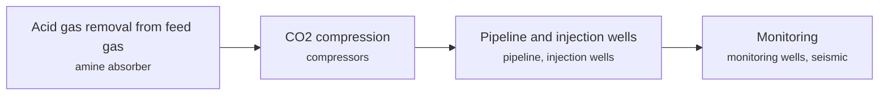

**Key equipment:** amine absorber, CO2 compressors, dehydration, injection pipeline, injection and monitoring wells.

**Performance:**
- Gorgon CO2 injection design rate: 3.4-4 Mtpa; capture and injection; about 100 Mt over the 40-year project life. [source](https://www.ogj.com/pipelines-transportation/lng/article/14038048/chevron-australia-starts-up-gorgon-lng-carbon-capture-project)
- Gorgon emissions cut when fully operational: 40 %; Chevron claim for total greenhouse gas emissions. [source](https://www.ogj.com/pipelines-transportation/lng/article/14038048/chevron-australia-starts-up-gorgon-lng-carbon-capture-project)

**Costs:**
- Gorgon CO2 injection system capital cost: 1.7 USD billion; includes A$60 million Australian government contribution; year of dollars not stated. [source](https://www.ogj.com/pipelines-transportation/lng/article/14038048/chevron-australia-starts-up-gorgon-lng-carbon-capture-project)

**Reference plants:**
- Gorgon CO2 Injection, Barrow Island, AU: 3.4 to 4 Mtpa; started up per the August 2019 article after delays from March 2017. [source](https://www.ogj.com/pipelines-transportation/lng/article/14038048/chevron-australia-starts-up-gorgon-lng-carbon-capture-project)

**Missing inputs:**
- operating record since 2019 (reference_plants): The article is from start-up. Global CCS Institute 2026 database lists Gorgon as operating since 2019 (4 Mtpa capture capacity, deep saline) but states no Gorgon-specific actual injected tonnes per year. Where: Chevron Australia reports (open); Global CCS Institute facility database (catalog: global-ccs-institute, open). Next: Add actual injected tonnes per year.
- TRL with a cited source (trl): The IEA ETP Clean Energy Technology Guide has no matching entry. no open TRL table found (IEA ETP guide checked 2026-10-28; Gorgon operating record recorded in Wave 2). Where: IEA ETP Clean Energy Technology Guide (collected): search for the technology name (catalog: iea-reports, open). Next: Find a TRL table that lists this technology, or leave maturity resting on the evidence on the card.
- process steps and equipment are general engineering practice, not taken from one source (process): The sources read describe the principle but not a full step-by-step flow. Where: Licensor process descriptions and textbooks (open). Next: Check the steps against a licensor description and name it.

Sources: [1](https://www.ogj.com/pipelines-transportation/lng/article/14038048/chevron-australia-starts-up-gorgon-lng-carbon-capture-project), [2](https://www.globalccsinstitute.com/wp-content/uploads/2026/10/Global-Status-of-CCS-2026-report-Global-CCS-Institute.pdf). Last reviewed 2026-10-28.

## Cascade liquefaction
<a id="lng-optimized-cascade"></a>

Three pure-component refrigeration cycles in series, propane, ethylene and methane, cool the gas in steps, each in brazed aluminium exchangers or core-in-kettle units. ConocoPhillips' 'two-trains-in-one' layout puts two compressors on each refrigerant service, so the train keeps running at reduced rate when one machine trips.

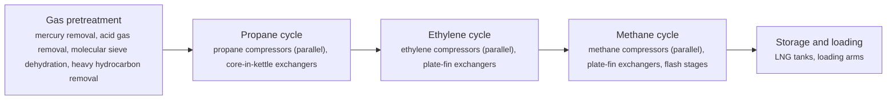

**Key equipment:** propane, ethylene and methane compressors, core-in-kettle and plate-fin exchangers, gas turbine drivers, heavies removal unit, nitrogen rejection unit (option), LNG tanks.

**Performance:**
- reference list capacity: 120.3 Mtpa LNG; 28 trains at 12 operating plants on the ConocoPhillips reference list. [source](https://static.conocophillips.com/files/resources/23-0622-lng-quick-reference-card.pdf)
- plant availability: 95 %; licensor claim for the two-trains-in-one configuration. [source](https://static.conocophillips.com/files/resources/23-0622-lng-quick-reference-card.pdf)
- turndown: 10-100 % of nameplate; licensor claim. [source](https://static.conocophillips.com/files/resources/23-0622-lng-quick-reference-card.pdf)
- pretreatment and liquefaction fuel energy: 2.78-3.35 MJ/kg gas liquefied; NETL model of a US C3MR plant from Mallapragada et al. 2018; range covers adsorption or cryogenic heavy hydrocarbon removal, with or without HRSG; fuel is a parasitic stream of feed gas, not compressor shaft power. [source](https://www.energy.gov/sites/prod/files/2019/09/f66/2019%20NETL%20LCA-GHG%20Report.pdf)

**Reference plants:**
- Sabine Pass Liquefaction, Louisiana, US: 6 trains, 30.0 Mtpa; operating. [source](https://static.conocophillips.com/files/resources/23-0622-lng-quick-reference-card.pdf)
- Corpus Christi Liquefaction, Texas, US: 3 trains, 15.0 Mtpa; operating. [source](https://static.conocophillips.com/files/resources/23-0622-lng-quick-reference-card.pdf)
- Australia Pacific LNG, Curtis Island, AU: 2 trains, 9.0 Mtpa; operating. [source](https://static.conocophillips.com/files/resources/23-0622-lng-quick-reference-card.pdf)
- Darwin LNG, AU: 1 train, 3.7 Mtpa; operating. [source](https://static.conocophillips.com/files/resources/23-0622-lng-quick-reference-card.pdf)

**Missing inputs:**
- TRL range with a cited source (trl): Commercial technology, so TRL 9 is expected, but no source read states it. The IEA Clean Energy Technology Guide (collected October 2026, 634 entries) has no matching entry. Where: Licensor or industry association statements of commercial deployment; academic reviews (open). Next: Find a TRL table that covers this technology and add trl {low, high, source}.
- capital cost and levelized or unit cost, with dollar year and basis (costs): No open source read so far gives costs for this technology. Refinery and gas plant unit costs are mostly published in paid sources. Where: Oxford Institute for Energy Studies LNG and gas papers (private copy only) (catalog: oxford-oies, open); arXiv: open techno-economic and review papers (collector already runs weekly) (catalog: arxiv, open); Open-access journal techno-economic papers (MDPI Energies, Processes); MDPI is blocked by its CDN, use the manual inbox (blocked); Paid cost databases (consultancies, licensor studies): catalog-only until the owner provides access (paid). Next: Look for an open techno-economic study; record each figure with metric, range, unit, dollar year, basis and source.
- specific power of the liquefaction process (kWh/t LNG) and how it differs from other processes (performance): An open 2020 comparison (OGST, CC BY 4.0) gives specific power for C3MR, DMR and MFC (about 320-391 kWh/t) but not for the cascade process. Where: ConocoPhillips Optimized Cascade technical papers (LNG conference proceedings) (open); [NETL LNG life cycle report 2019 (collected): Exhibit 5-7 only](https://www.energy.gov/sites/prod/files/2019/09/f66/2019%20NETL%20LCA-GHG%20Report.pdf) (catalog: netl, open); IEA gas and LNG reports (catalog: iea-reports, open); Open journal comparisons of LNG processes (MDPI Energies is blocked; use the manual inbox) (blocked); arXiv: open techno-economic and review papers (collector already runs weekly) (catalog: arxiv, open). Next: Find an open paper or report that compares specific power across C3MR, AP-X, cascade, DMR and MFC on the same basis.

Sources: [1](https://static.conocophillips.com/files/resources/23-0622-lng-quick-reference-card.pdf), [2](https://www.energy.gov/sites/prod/files/2019/09/f66/2019%20NETL%20LCA-GHG%20Report.pdf). Last reviewed 2026-10-24.

## Compressed natural gas and LNG as vehicle fuel
<a id="gas-natural-gas-vehicle-fuel"></a>

Natural gas is compressed to about 200 bar (CNG) or liquefied (LNG) and used in spark-ignition or dual-fuel engines. The global fleet was 26.2 million vehicles in 2018, mostly in China, Iran, India, Pakistan, Argentina and Brazil.

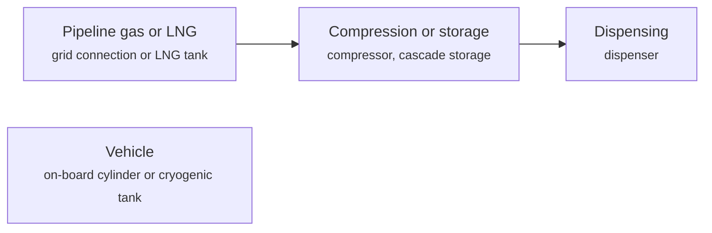

**Key equipment:** compressors, cascade storage, dispensers, on-board cylinders or LNG tanks.

**Performance:**
- global natural gas vehicle fleet: 26.2 million vehicles; NGV Global/IANGV, 2018, via OIES; definitions differ by country. [source](https://oxfordenergy.org/wpcms/wp-content/uploads/2019/04/A-review-of-prospects-for-natural-gas-as-a-fuel-in-road-transport-Insight-50.pdf)
- share of global fleet in top three countries (China, Iran, India): 52.2 %; 23.2 + 17.2 + 11.8. [source](https://oxfordenergy.org/wpcms/wp-content/uploads/2019/04/A-review-of-prospects-for-natural-gas-as-a-fuel-in-road-transport-Insight-50.pdf)
- LNG trucks in China: 350000 vehicles; end of 2017. [source](https://oxfordenergy.org/wpcms/wp-content/uploads/2019/04/A-review-of-prospects-for-natural-gas-as-a-fuel-in-road-transport-Insight-50.pdf)
- natural-gas vehicle fleet and refuelling stations: 23-29 million NGVs worldwide (US DOE AFDC: about 23 million; 2026 industry counts: more than 29 million CNG vehicles with over 39,000 public CNG stations); US: more than 175,000 vehicles, 1,385 CNG plus 81 LNG stations (2026); US DOE Alternative Fuels Data Center: "more than 175,000 vehicles in the United States and roughly 23 million vehicles worldwide"; businessresearchinsights (Sep 2026): more than 29 million CNG vehicles, over 39,000 public CNG stations; transportproject.org (15 Dec 2025): 1,385 US CNG + 81 LNG stations. [source](https://afdc.energy.gov/vehicles/natural-gas)

**Missing inputs:**
- capital cost and operating or unit cost, with dollar year and basis (costs): No open source read so far gives costs for this technology. Web-checked 2026-10-28: US station costs (fast-fill about USD 400k; large stations USD 0.6-1.7 m) exist in industry PDFs but without a citable primary; named plants n/a. Where: arXiv and open-access journals: techno-economic or review papers (MDPI is blocked by its CDN; use the manual inbox) (catalog: arxiv, open); Licensor and EPC studies; paid cost databases are catalog-only (paid); OSTI.GOV full-text reports from DOE labs: search the technology name plus 'techno-economic' (catalog: osti, blocked). Next: Look for an open techno-economic study; record each figure with metric, range, unit, dollar year, basis and source.
- named plants or projects with capacity and year (reference_plants): The sources read name no specific plant. Web-checked 2026-10-28; station counts recorded in performance. Where: Licensor and operator press releases for the suppliers listed (open). Next: Add one or two plants with country, capacity and start-up year.
- TRL with a cited source (trl): The IEA ETP Clean Energy Technology Guide has no matching entry. no open TRL table found (IEA ETP guide checked 2026-10-28). Where: IEA ETP Clean Energy Technology Guide (collected): search for the technology name (catalog: iea-reports, open). Next: Find a TRL table that lists this technology, or leave maturity resting on the evidence on the card.
- process steps and equipment are general engineering practice, not taken from one source (process): The sources read describe the principle but not a full step-by-step flow. Where: Licensor process descriptions and textbooks (open). Next: Check the steps against a licensor description and name it.

Sources: [1](https://oxfordenergy.org/wpcms/wp-content/uploads/2019/04/A-review-of-prospects-for-natural-gas-as-a-fuel-in-road-transport-Insight-50.pdf), [2](https://afdc.energy.gov/vehicles/natural-gas). Last reviewed 2026-10-28.

## Dual mixed refrigerant liquefaction
<a id="lng-dmr"></a>

Two mixed refrigerant cycles replace the propane-plus-mixed-refrigerant arrangement. A precooling mixed refrigerant cools the gas in spiral-wound precoolers, and a second mixed refrigerant of nitrogen, methane, ethane, propane and some butane liquefies the gas over about -40 °C to -150 °C in the main cryogenic heat exchanger. Adjusting the two compositions lets the plant follow seasonal ambient temperature.

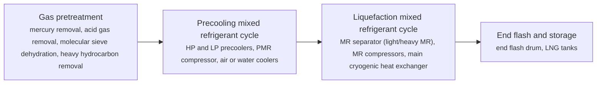

**Key equipment:** spiral-wound precoolers, main cryogenic heat exchanger, precooling and liquefaction MR compressors, gas turbine drivers, MR separators.

**Performance:**
- liquefaction temperature range of the MR cycle: -150--40 °C; Sakhalin LNG plant description. [source](https://gasprocessingnews.com/articles/2018/10/optimal-control-of-mixed-refrigerant-composition-at-sakhalin-lng-plant)
- pretreatment and liquefaction fuel energy: 2.78-3.35 MJ/kg gas liquefied; NETL model of a US C3MR plant from Mallapragada et al. 2018; range covers adsorption or cryogenic heavy hydrocarbon removal, with or without HRSG; fuel is a parasitic stream of feed gas, not compressor shaft power. [source](https://www.energy.gov/sites/prod/files/2019/09/f66/2019%20NETL%20LCA-GHG%20Report.pdf)
- specific power consumption: 375 kWh/t LNG; DMR configuration (Mehrpooya et al., cited); process simulation of integrated NGL/LNG plants (this study: Aspen Plus, 37 °C air, 25 °C seawater, 3.33 Mtpa); values from different studies on different bases, so compare with care. [source](https://ogst.ifpenergiesnouvelles.fr/en/articles/ogst/full_html/2020/01/ogst200035/ogst200035.html)

**Reference plants:**
- Sakhalin LNG (Prigorodnoye), RU: not stated in source read; operating (Shell DMR). [source](https://gasprocessingnews.com/articles/2018/10/optimal-control-of-mixed-refrigerant-composition-at-sakhalin-lng-plant)

**Missing inputs:**
- TRL range with a cited source (trl): Commercial technology, so TRL 9 is expected, but no source read states it. The IEA Clean Energy Technology Guide (collected October 2026, 634 entries) has no matching entry. Where: Licensor or industry association statements of commercial deployment; academic reviews (open). Next: Find a TRL table that covers this technology and add trl {low, high, source}.
- capital cost and levelized or unit cost, with dollar year and basis (costs): No open source read so far gives costs for this technology. Refinery and gas plant unit costs are mostly published in paid sources. Where: Oxford Institute for Energy Studies LNG and gas papers (private copy only) (catalog: oxford-oies, open); arXiv: open techno-economic and review papers (collector already runs weekly) (catalog: arxiv, open); Open-access journal techno-economic papers (MDPI Energies, Processes); MDPI is blocked by its CDN, use the manual inbox (blocked); Paid cost databases (consultancies, licensor studies): catalog-only until the owner provides access (paid). Next: Look for an open techno-economic study; record each figure with metric, range, unit, dollar year, basis and source.
- Sakhalin LNG train count and capacity (reference_plants): The Sakhalin article read gives no capacity. Where: Sakhalin Energy publications; GIIGNL annual report (catalog: giignl, open). Next: Add capacity and train count.

Sources: [1](https://gasprocessingnews.com/articles/2018/10/optimal-control-of-mixed-refrigerant-composition-at-sakhalin-lng-plant), [2](https://www.energy.gov/sites/prod/files/2019/09/f66/2019%20NETL%20LCA-GHG%20Report.pdf), [3](https://ogst.ifpenergiesnouvelles.fr/en/articles/ogst/full_html/2020/01/ogst200035/ogst200035.html). Last reviewed 2026-10-24.

## Electric-drive liquefaction (e-LNG)
<a id="gas-electric-drive-lng"></a>

Large electric motors, rather than gas turbines, drive the refrigerant compressors in the liquefaction trains, so the plant burns no fuel gas for compression and, if power is low-carbon, has far lower CO2. Freeport LNG in Texas runs three electric-driven trains; Equinor's Hammerfest LNG plans to replace its gas turbine generators with power from shore.

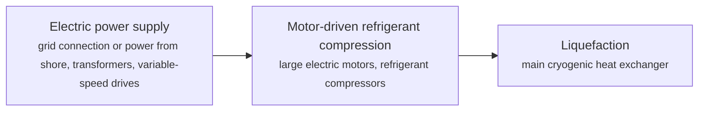

**Key equipment:** large electric motors, variable-speed drives or starters, refrigerant compressors, main cryogenic heat exchanger.

**Performance:**
- CO2 reduction from Hammerfest electrification: 850000 t CO2 per year; Equinor: about 850,000 t/yr, equal to 450,000 ICE cars; carbon footprint 3.8 to 0.6 g CO2e/MJ. [source](https://equinor.com/news/20221220-high-gas-exports-and-emissions-cuts-from-hammerfest-lng)

**Reference plants:**
- Freeport LNG, Texas, Trains 1 to 3 (electric motor drive), US: ; Train 1 commercial December 2019, Train 2 January 2020 (performance test 37 days against 107 for Train 1), Train 3 expected May 2020 per the article. [source](https://www.turbomachinerymag.com/view/second-of-three-electric-driven-lng-trains-starts-operations-at-us-facility)
- Hammerfest LNG (Melkøya, Norway), electrification and onshore compression, NO: 4.65 Mt LNG, 0.34 Mt LPG, 0.73 Mt condensate per year; electrical operation scheduled to start 2028. [source](https://equinor.com/news/20221220-high-gas-exports-and-emissions-cuts-from-hammerfest-lng)
- Hammerfest LNG (Snohvit), Norway (Equinor) - all-electric liquefaction, NO: world-scale LNG plant in which, for the first time, all main refrigeration compressors are electrically driven; Equinor investing about USD 1.3 bn to grid-connect and further electrify the plant; operating. [source](https://www.offshore-energy.biz/hammerfest-lng-one-hundredth-tanker-successfully-loaded-with-liquefied-natural-gas-norway)
- Freeport LNG, Texas (electric-motor-driven refrigeration compressors), US: three trains equipped with the largest electric motor-powered refrigeration compressors in the US; Train 1 commercial operation December 2019; operating. [source](https://www.nsenergybusiness.com/company-news/freeport-lng-project-train-3)

**Missing inputs:**
- MW per train and specific energy for electric versus gas-turbine drive (performance): The articles read give neither. Web-checked 2026-10-28: motor ratings circulate in trade press but were not verifiable on the open pages read; specific-energy comparison not found. Where: McDermott e-drive page (catalog: mcdermott, open); Equinor technical papers (catalog: equinor-tech, open). Next: Add motor sizes and kWh per tonne from vendor or LNG conference papers.
- capital cost and operating or unit cost, with dollar year and basis (costs): No open source read so far gives costs for this technology. Web-checked 2026-10-28; project-level figures only. Where: arXiv and open-access journals: techno-economic or review papers (MDPI is blocked by its CDN; use the manual inbox) (catalog: arxiv, open); Licensor and EPC studies; paid cost databases are catalog-only (paid); OSTI.GOV full-text reports from DOE labs: search the technology name plus 'techno-economic' (catalog: osti, blocked). Next: Look for an open techno-economic study; record each figure with metric, range, unit, dollar year, basis and source.
- TRL with a cited source (trl): The IEA ETP Clean Energy Technology Guide has no matching entry. no open TRL table found (IEA ETP guide checked 2026-10-28). Where: IEA ETP Clean Energy Technology Guide (collected): search for the technology name (catalog: iea-reports, open). Next: Find a TRL table that lists this technology, or leave maturity resting on the evidence on the card.
- process steps and equipment are general engineering practice, not taken from one source (process): The sources read describe the principle but not a full step-by-step flow. Where: Licensor process descriptions and textbooks (open). Next: Check the steps against a licensor description and name it.

Sources: [1](https://equinor.com/news/20221220-high-gas-exports-and-emissions-cuts-from-hammerfest-lng), [2](https://www.turbomachinerymag.com/view/second-of-three-electric-driven-lng-trains-starts-operations-at-us-facility). Last reviewed 2026-10-28.

## Floating LNG (FLNG)
<a id="lng-flng"></a>

Gas treating, liquefaction, storage and offloading are built on a moored hull over the field. Processes are chosen for compactness and motion tolerance, for example dual mixed refrigerant or expander cycles, and LNG is transferred to carriers side by side or in tandem.

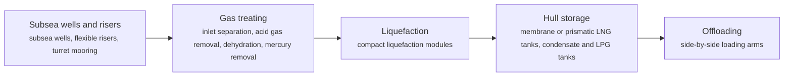

**Key equipment:** turret and mooring, topsides gas treating, liquefaction modules, hull LNG tanks, offloading arms.

**Reference plants:**
- Shell Prelude FLNG, AU: 488 m long; 3.6 Mtpa LNG, 1.3 Mtpa condensate, 0.4 Mtpa LPG; 475 km NNE of Broome; first condensate cargo shipped by March 2019. [source](https://www.offshore-technology.com/news/shell-prelude-flng/)
- PETRONAS PFLNG DUA, Rotan field, Sabah, MY: 1.5 Mtpa LNG in 1,300 m water depth; first cargo 24 March 2021. [source](https://www.petronas.com/media/press-release/petronas-becomes-worlds-first-produce-lng-two-floating-facilities)
- PETRONAS PFLNG SATU, MY: not stated in source read; world's first operational FLNG (2016); moved from Kanowit to Kebabangan field in 2019. [source](https://www.petronas.com/media/press-release/petronas-becomes-worlds-first-produce-lng-two-floating-facilities)

**Missing inputs:**
- TRL range with a cited source (trl): Commercial technology, so TRL 9 is expected, but no source read states it. The IEA Clean Energy Technology Guide (collected October 2026, 634 entries) has no matching entry. Where: Licensor or industry association statements of commercial deployment; academic reviews (open). Next: Find a TRL table that covers this technology and add trl {low, high, source}.
- capital cost and levelized or unit cost, with dollar year and basis (costs): No open source read so far gives costs for this technology. Refinery and gas plant unit costs are mostly published in paid sources. Where: Oxford Institute for Energy Studies LNG and gas papers (private copy only) (catalog: oxford-oies, open); arXiv: open techno-economic and review papers (collector already runs weekly) (catalog: arxiv, open); Open-access journal techno-economic papers (MDPI Energies, Processes); MDPI is blocked by its CDN, use the manual inbox (blocked); Paid cost databases (consultancies, licensor studies): catalog-only until the owner provides access (paid). Next: Look for an open techno-economic study; record each figure with metric, range, unit, dollar year, basis and source.
- key performance figures (energy use, yields, capture or conversion rate) (performance): No source read so far gives performance figures. Where: Supplier datasheets and brochures for the companies listed on the card (open); arXiv: open techno-economic and review papers (collector already runs weekly) (catalog: arxiv, open); Oxford Institute for Energy Studies LNG and gas papers (private copy only) (catalog: oxford-oies, open). Next: Add the figures that matter for comparing options, each with its basis and source.
- PFLNG SATU capacity (reference_plants): The PETRONAS release read does not state SATU's capacity. Where: PETRONAS press releases on PFLNG SATU (2016) (catalog: petronas-tech, open). Next: Add capacity with source.

Sources: [1](https://www.offshore-technology.com/news/shell-prelude-flng/), [2](https://www.petronas.com/media/press-release/petronas-becomes-worlds-first-produce-lng-two-floating-facilities). Last reviewed 2026-10-24.

## Floating storage and regasification units (FSRU)
<a id="lng-fsru"></a>

A ship with LNG tanks and onboard vaporisers is moored at a jetty or buoy. LNG from carriers is transferred ship to ship, stored, pumped to pressure and vaporised with seawater or a closed loop, then sent to shore through a high-pressure arm or pipeline. NETL's import terminal model uses open rack vaporisers, which serve about all Asian and about 60% of European terminals.


**Key equipment:** LNG cargo tanks, BOG compressor or recondenser, HP send-out pumps, vaporisers, metering, jetty or buoy mooring.

**Performance:**
- regasification energy requirement: 0.214 MJ/kg LNG; NETL import terminal model (open rack vaporisers). [source](https://www.energy.gov/sites/prod/files/2019/09/f66/2019%20NETL%20LCA-GHG%20Report.pdf)
- newbuild FSRU send-out capacity: 1000 MMscf/d; Excelerate newbuild at HHI, 170,000 m3 storage, delivery June 2026. [source](https://excelerateenergy.com/news/excelerate-energy-finalizes-agreement-with-hhi-for-newbuild-fsru/)

**Reference plants:**
- Excelerate newbuild FSRU (Hyundai Heavy Industries): 170,000 m3 storage, 1,000 MMscf/d send-out; fleet of 11 FSRUs operating or building; delivery June 2026. [source](https://excelerateenergy.com/news/excelerate-energy-finalizes-agreement-with-hhi-for-newbuild-fsru/)

**Missing inputs:**
- TRL range with a cited source (trl): Commercial technology, so TRL 9 is expected, but no source read states it. The IEA Clean Energy Technology Guide (collected October 2026, 634 entries) has no matching entry. Where: Licensor or industry association statements of commercial deployment; academic reviews (open). Next: Find a TRL table that covers this technology and add trl {low, high, source}.
- capital cost and levelized or unit cost, with dollar year and basis (costs): No open source read so far gives costs for this technology. Refinery and gas plant unit costs are mostly published in paid sources. Where: Oxford Institute for Energy Studies LNG and gas papers (private copy only) (catalog: oxford-oies, open); arXiv: open techno-economic and review papers (collector already runs weekly) (catalog: arxiv, open); Open-access journal techno-economic papers (MDPI Energies, Processes); MDPI is blocked by its CDN, use the manual inbox (blocked); Paid cost databases (consultancies, licensor studies): catalog-only until the owner provides access (paid). Next: Look for an open techno-economic study; record each figure with metric, range, unit, dollar year, basis and source.

Sources: [1](https://www.energy.gov/sites/prod/files/2019/09/f66/2019%20NETL%20LCA-GHG%20Report.pdf), [2](https://excelerateenergy.com/news/excelerate-energy-finalizes-agreement-with-hhi-for-newbuild-fsru/). Last reviewed 2026-10-24.

## Gas-to-liquids (Fischer-Tropsch)
<a id="gas-gtl-ft"></a>

Natural gas is converted to syngas by partial oxidation or reforming with oxygen. Fischer-Tropsch synthesis over a cobalt catalyst builds long-chain paraffinic waxes, which are hydrocracked and fractionated into clean diesel, kerosene, naphtha and base oils.

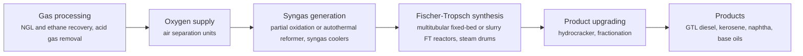

**Key equipment:** air separation units, syngas generators, FT reactors, hydrocracker, fractionation, water treatment.

**Performance:**
- Pearl GTL conversion scale (world's largest GTL plant): 140000 bpd GTL products from 1.6 bcf/d of wellhead gas (plus about 120,000 boe/d NGLs); Pearl GTL reached full capacity in 2012: 1.6 billion scf/d of North Field gas converted via Shell Middle Distillate Synthesis into about 140,000 bpd of GTL products, with about 120,000 boe/d of NGLs and LPGs; about USD 19 bn project. [source](https://www.shell.com.qa/about-us/projects-and-sites/pearl-gtl.html)

**Reference plants:**
- Pearl GTL, Ras Laffan, QA: 140,000 bbl/d GTL products in two 70,000 bbl/d trains, plus about 120,000 boe/d NGLs and ethane, from 1.6 bcf/d North Field gas; first sour gas into the plant March 2011. [source](https://www.offshore-technology.com/projects/pearl/)

**Missing inputs:**
- TRL range with a cited source (trl): Commercial technology, so TRL 9 is expected, but no source read states it. The IEA Clean Energy Technology Guide (collected October 2026, 634 entries) has no matching entry. no open TRL table found (IEA ETP guide checked 2026-10-28). Where: Licensor or industry association statements of commercial deployment; academic reviews (open). Next: Find a TRL table that covers this technology and add trl {low, high, source}.
- capital cost and levelized or unit cost, with dollar year and basis (costs): No open source read so far gives costs for this technology. Refinery and gas plant unit costs are mostly published in paid sources. Web-checked 2026-10-28: Pearl GTL project cost about USD 19 bn recorded in the performance basis; unit costs are case-specific. Where: Oxford Institute for Energy Studies LNG and gas papers (private copy only) (catalog: oxford-oies, open); arXiv: open techno-economic and review papers (collector already runs weekly) (catalog: arxiv, open); Open-access journal techno-economic papers (MDPI Energies, Processes); MDPI is blocked by its CDN, use the manual inbox (blocked); Paid cost databases (consultancies, licensor studies): catalog-only until the owner provides access (paid). Next: Look for an open techno-economic study; record each figure with metric, range, unit, dollar year, basis and source.

Sources: [1](https://www.offshore-technology.com/projects/pearl/), [2](https://www.shell.com.qa/about-us/projects-and-sites/pearl-gtl.html). Last reviewed 2026-10-28.

## Gas-to-methanol and methanol-to-gasoline
<a id="gas-to-methanol"></a>

Natural gas is reformed to synthesis gas, which is converted to methanol over a copper catalyst in a synthesis loop. Methanol-to-gasoline (ExxonMobil MTG) then converts methanol to gasoline-range hydrocarbons over a zeolite. A 2017 comparison of three natural-gas routes found large exergetic differences between a plain steam-methane-reforming plant and combined reforming.

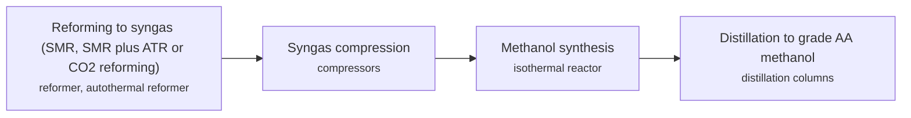

**Key equipment:** reformer, autothermal reformer (large plants), syngas compressor, methanol reactor, distillation columns.

**Performance:**
- exergetic efficiency, three natural-gas routes: 28.2-55.6 %; Case I SMR 28.2% (2,200 t/d); Case III CO2 plus steam reforming 41.0%; Case II SMR+ATR 55.6%; paper's simulation, not plant data. [source](https://depositonce.tu-berlin.de/items/c222282b-e88c-41d3-813f-ff34d6f7aba4/full)

**Reference plants:**
- Motunui synthetic fuels plant (New Zealand Synfuels), Taranaki, New Zealand, NZ: 14,500 bpd of synthetic gasoline from Maui natural gas via methanol; the world's first natural-gas-to-gasoline plant, opened February 1985 (Methanex later closed the Taranaki units after 30+ years); closed. [source](https://www.digitalrefining.com/news/1003028/zeogas-awarded-methanol-to-gasoline-technology-license-by-exxonmobil)

**Missing inputs:**
- methanol-to-gasoline step (process): The MTG step is now sourced: methanol is dehydrated to dimethyl ether then converted over a ZSM-5 zeolite fixed bed to 90-octane gasoline, first commercialised at Motunui in 1985 (14,500 bpd); ExxonMobil licenses the technology (ZeoGas licence awarded 2014). What remains open is licensor-level detail on yields and catalyst life. Where: ExxonMobil MTG technology pages and DigitalRefining news, 21 Jul 2014 (open). Next: If a deeper process description is needed, read an ExxonMobil MTG technical paper.
- capital cost and operating or unit cost, with dollar year and basis (costs): No open source read so far gives costs for this technology. Web-checked 2026-10-28; project capex case-specific. Where: arXiv and open-access journals: techno-economic or review papers (MDPI is blocked by its CDN; use the manual inbox) (catalog: arxiv, open); Licensor and EPC studies; paid cost databases are catalog-only (paid); OSTI.GOV full-text reports from DOE labs: search the technology name plus 'techno-economic' (catalog: osti, blocked). Next: Look for an open techno-economic study; record each figure with metric, range, unit, dollar year, basis and source.
- TRL with a cited source (trl): The IEA ETP Clean Energy Technology Guide has no matching entry. no open TRL table found (IEA ETP guide checked 2026-10-28). Where: IEA ETP Clean Energy Technology Guide (collected): search for the technology name (catalog: iea-reports, open). Next: Find a TRL table that lists this technology, or leave maturity resting on the evidence on the card.

Sources: [1](https://depositonce.tu-berlin.de/items/c222282b-e88c-41d3-813f-ff34d6f7aba4/full), [2](https://www.digitalrefining.com/news/1003028/zeogas-awarded-methanol-to-gasoline-technology-license-by-exxonmobil). Last reviewed 2026-10-28.

## Helium recovery
<a id="gas-helium-recovery"></a>

Helium is a trace component of some natural gases. It concentrates in the nitrogen-rich off-gas of the liquefaction or nitrogen-rejection unit, is upgraded to crude helium, purified, liquefied and shipped. Qatar's Helium 2 plant takes crude helium from six LNG trains.

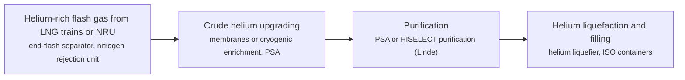

**Key equipment:** NRU or end-flash unit, crude helium upgrading, helium purifier, helium liquefier, ISO container filling.

**Performance:**
- Helium 2 plant capacity: 1.3 billion cubic feet per year; RasGas Helium 2, operational July 2013; with the existing plant 2 billion cubic feet per year. [source](https://www.gulf-times.com/story/358882/New-plant-takes-Qatar-to-top-spot-in-helium-export)
- share of global liquid helium demand met by the two Qatar plants: 25 %; Gulf Times, 2013 expectation. [source](https://www.gulf-times.com/story/358882/New-plant-takes-Qatar-to-top-spot-in-helium-export)

**Reference plants:**
- RasGas Helium 2, Ras Laffan, QA: 1.3 billion cubic feet per year; . [source](https://www.gulf-times.com/story/358882/New-plant-takes-Qatar-to-top-spot-in-helium-export)
- World helium supply by plant (Ras Laffan, Amur GPP, US BLM Cliffside), QA: Ras Laffan (Qatar): about 75-81 million m3/yr across three plants - roughly a third of world supply; Amur GPP (Russia): about 45-50 million m3/yr (designed up to 60 Mm3/yr); US BLM Cliffside (Amarillo, Texas) enrichment units; world production capacity about 360 million m3 (13 bcf) per year in 2023 (USGS); operating. [source](https://pubs.usgs.gov)

**Missing inputs:**
- capital cost and operating or unit cost, with dollar year and basis (costs): No open source read so far gives costs for this technology. Web-checked 2026-10-28; no open figures. Where: arXiv and open-access journals: techno-economic or review papers (MDPI is blocked by its CDN; use the manual inbox) (catalog: arxiv, open); Licensor and EPC studies; paid cost databases are catalog-only (paid); OSTI.GOV full-text reports from DOE labs: search the technology name plus 'techno-economic' (catalog: osti, blocked). Next: Look for an open techno-economic study; record each figure with metric, range, unit, dollar year, basis and source.
- TRL with a cited source (trl): The IEA ETP Clean Energy Technology Guide has no matching entry. no open TRL table found (IEA ETP guide checked 2026-10-28). Where: IEA ETP Clean Energy Technology Guide (collected): search for the technology name (catalog: iea-reports, open). Next: Find a TRL table that lists this technology, or leave maturity resting on the evidence on the card.
- process steps and equipment are general engineering practice, not taken from one source (process): The sources read describe the principle but not a full step-by-step flow. Where: Licensor process descriptions and textbooks (open). Next: Check the steps against a licensor description and name it.

Sources: [1](https://www.gulf-times.com/story/358882/New-plant-takes-Qatar-to-top-spot-in-helium-export), [2](https://www.linde-engineering.com/en/process-plants/lng-and-natural-gas-processing-plants/nitrogen-rejection/). Last reviewed 2026-10-28.

## Hot potassium carbonate (Benfield)
<a id="gas-hot-potassium-carbonate"></a>

Hot aqueous potassium carbonate, promoted with an amine such as DEA, absorbs CO2 and H2S at 80 to 120 degC and is regenerated by pressure reduction and steam stripping. Absorber and regenerator run at similar temperatures, so there is no lean/rich exchanger. For LNG-grade gas the HiPure variant adds a second stage with an amine solution.

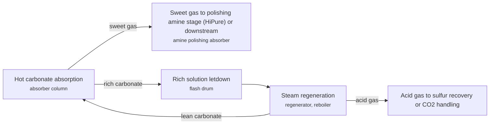

**Key equipment:** absorber, regenerator with reboiler, flash drum, hydraulic turbine on rich solvent letdown, polishing amine absorber (HiPure).

**Performance:**
- sweet gas CO2 at ADGAS Train 3 (plant data / simulation): 19-25 ppmv; Benfield HiPure with carbonate stage (30 wt% K2CO3, 3 wt% DEA) and DEA polishing stage (20 wt% DEA); plant 19 ppmv, simulation 25 ppmv. [source](https://www.bre.com/PDF/Simulation-of-the-Benfield-HiPure-Process-of-Natural-Gas-Sweetening-for-LNG-Production-and-Evaluation-of-Alternatives.pdf)
- sweet gas H2S at ADGAS Train 3 (simulation / plant): 0.4-0.41 ppmv; same plant and basis. [source](https://www.bre.com/PDF/Simulation-of-the-Benfield-HiPure-Process-of-Natural-Gas-Sweetening-for-LNG-Production-and-Evaluation-of-Alternatives.pdf)
- total reboiler duty, Benfield HiPure at ADGAS Train 3: 59 Gcal/h; carbonate unit 44 Gcal/h plus DEA unit 15 Gcal/h; feed about 477 MMSCFD at 52 barg with 4.7% H2S and 2.1% CO2 as reported (source is internally inconsistent on which is which). [source](https://www.bre.com/PDF/Simulation-of-the-Benfield-HiPure-Process-of-Natural-Gas-Sweetening-for-LNG-Production-and-Evaluation-of-Alternatives.pdf)

**Reference plants:**
- ADGAS Train 3, Das Island, AE: feed about 477 MMSCFD; . [source](https://www.bre.com/PDF/Simulation-of-the-Benfield-HiPure-Process-of-Natural-Gas-Sweetening-for-LNG-Production-and-Evaluation-of-Alternatives.pdf)
- BECCS Stockholm (Stockholm Exergi), hot potassium carbonate capture on a biomass cogeneration plant, SE: about 7 Mt CO2 avoided over ten years; capture targeted late 2028. [source](https://cinea.ec.europa.eu/featured-projects/beccs-stockholm-delivering-net-carbon-removals-clean-energy_bg)

**Missing inputs:**
- BRE's comparison is a vendor-neutral simulation; no UOP-published figures were read (performance): UOP's page lists Benfield without specifications. Gap item restated 2026-10-28: UOP-published Benfield figures remain in licensor material. Where: Honeywell UOP Benfield datasheet (catalog: honeywell-uop, open). Next: Add UOP datasheet figures.
- capital cost and operating or unit cost, with dollar year and basis (costs): No open source read so far gives costs for this technology. Web-checked 2026-10-28; licensor quotes only. Where: arXiv and open-access journals: techno-economic or review papers (MDPI is blocked by its CDN; use the manual inbox) (catalog: arxiv, open); Licensor and EPC studies; paid cost databases are catalog-only (paid); OSTI.GOV full-text reports from DOE labs: search the technology name plus 'techno-economic' (catalog: osti, blocked). Next: Look for an open techno-economic study; record each figure with metric, range, unit, dollar year, basis and source.
- TRL with a cited source (trl): The IEA ETP Clean Energy Technology Guide has no matching entry. no open TRL table found (IEA ETP guide checked 2026-10-28). Where: IEA ETP Clean Energy Technology Guide (collected): search for the technology name (catalog: iea-reports, open). Next: Find a TRL table that lists this technology, or leave maturity resting on the evidence on the card.
- process steps and equipment are general engineering practice, not taken from one source (process): The sources read describe the principle but not a full step-by-step flow. Where: Licensor process descriptions and textbooks (open). Next: Check the steps against a licensor description and name it.

Sources: [1](https://uop.com/en/industry-solutions/gas-processing/gas-treating/acid-gas-removal), [2](https://www.bre.com/PDF/Simulation-of-the-Benfield-HiPure-Process-of-Natural-Gas-Sweetening-for-LNG-Production-and-Evaluation-of-Alternatives.pdf), [3](https://cinea.ec.europa.eu/featured-projects/beccs-stockholm-delivering-net-carbon-removals-clean-energy_bg). Last reviewed 2026-10-28.

## Hybrid solvent gas treating (Sulfinol)
<a id="gas-hybrid-solvent-sulfinol"></a>

A mixed solvent of an amine and the physical solvent sulfolane, in water. In Shell's current Sulfinol the amine is activated MDEA (MDEA with piperazine). The chemical part holds CO2 and H2S at low partial pressure; the physical part also takes up organic sulfur (mercaptans, COS), which pure amines miss, so one unit meets H2S, CO2 and organic sulfur specifications.

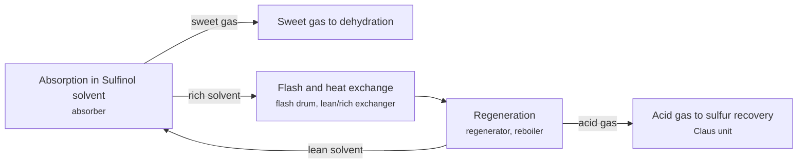

**Key equipment:** absorber, flash drum, lean/rich exchanger, regenerator and reboiler, solvent filtration.

**Performance:**
- treated gas H2S at NAM Emmen: up to 3.5 ppmv; Sulfinol-M (MDEA plus sulfolane); sour gas H2S about 0.1 to 1 vol%, CO2 2 to 5 vol%, mercaptans up to 90 ppmv. [source](https://www.ogj.com/home/article/17238096/gas-desulfurization-plant-handles-wide-range-of-sour-gas-compositions)
- treated gas mercaptans at NAM Emmen: up to 7 ppmv; same plant. [source](https://www.ogj.com/home/article/17238096/gas-desulfurization-plant-handles-wide-range-of-sour-gas-compositions)
- overall sulfur recovery with Claus/SCOT at NAM Emmen: 99.8 %; greater than 99.8%. [source](https://www.ogj.com/home/article/17238096/gas-desulfurization-plant-handles-wide-range-of-sour-gas-compositions)

**Reference plants:**
- NAM gas-desulfurisation plant, Emmen, NL: 300 MMscfd intake; . [source](https://www.ogj.com/home/article/17238096/gas-desulfurization-plant-handles-wide-range-of-sour-gas-compositions)

**Missing inputs:**
- capital cost and operating or unit cost, with dollar year and basis (costs): No open source read so far gives costs for this technology. Web-checked 2026-10-28; licensor quotes only. Where: arXiv and open-access journals: techno-economic or review papers (MDPI is blocked by its CDN; use the manual inbox) (catalog: arxiv, open); Licensor and EPC studies; paid cost databases are catalog-only (paid); OSTI.GOV full-text reports from DOE labs: search the technology name plus 'techno-economic' (catalog: osti, blocked). Next: Look for an open techno-economic study; record each figure with metric, range, unit, dollar year, basis and source.
- TRL with a cited source (trl): The IEA ETP Clean Energy Technology Guide has no matching entry. no open TRL table found (IEA ETP guide checked 2026-10-28). Where: IEA ETP Clean Energy Technology Guide (collected): search for the technology name (catalog: iea-reports, open). Next: Find a TRL table that lists this technology, or leave maturity resting on the evidence on the card.
- process steps and equipment are general engineering practice, not taken from one source (process): The sources read describe the principle but not a full step-by-step flow. Where: Licensor process descriptions and textbooks (open). Next: Check the steps against a licensor description and name it.

Sources: [1](https://catalysts.shell.com/en/lower-costs-sulfinol), [2](https://www.ogj.com/home/article/17238096/gas-desulfurization-plant-handles-wide-range-of-sour-gas-compositions). Last reviewed 2026-10-28.

## LNG bunkering
<a id="gas-lng-bunkering"></a>

LNG is delivered to ships as fuel by bunker vessel, truck or shore terminal. In Singapore, FueLNG (a Shell and Seatrium venture) completed its 500th ship-to-ship bunkering in 2025.

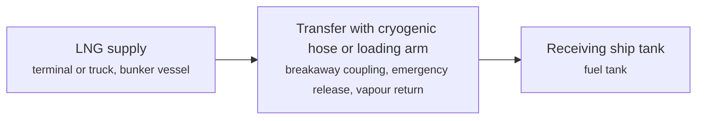

**Key equipment:** bunker vessel, cryogenic hoses, emergency release coupling, vapour return, custody transfer metering.

**Performance:**
- Singapore LNG bunker sales growth 2025 over 2024: 23.9 %; MPA via LNG Prime summary; absolute volumes behind paywall. [source](https://lngprime.com/asia/singapore-lng-bunkering-volumes-hit-new-record-in-2025/174296/)
- Singapore LNG bunker sales, July: 41500 t; Ship & Bunker, market total, down 3.9% year on year. [source](https://shipandbunker.com/news/apac/716479-fuelng-marks-500th-ship-to-ship-lng-bunkering-in-singapore)
- LNG bunker demand outlook and cumulative port volumes: 2-27 million m3 cumulative bonded LNG bunkered at Shanghai to date (2+ M m3, 355 vessels); Shell outlook: global LNG bunker demand rising sevenfold to 27 million mt/yr by 2035; Shell outlook reported by LNG Prime: global LNG bunker demand expected to increase sevenfold to 27 million mt by 2035 as the LNG-fuelled fleet expands; LNG Prime: Shanghai cumulative bonded LNG bunker supplies surpassed 2 million m3 with 355 vessels bunkered; Singapore sales at record highs; a verified global volume total for 2024/25 was not available in open pages. [source](https://www.linkedin.com/posts/lng-prime_singapore-lng-bunkering-volumes-hit-new-record-activity-7472176654832832512-pbGB)

**Reference plants:**
- FueLNG Singapore, 500th ship-to-ship bunkering (receiving ship Amphitrite Highway, K Line), SG: ; . [source](https://shipandbunker.com/news/apac/716479-fuelng-marks-500th-ship-to-ship-lng-bunkering-in-singapore)

**Missing inputs:**
- global LNG bunkering volumes and port list (performance): Only Singapore items were read; the LNG Prime article is paywalled. Outlook and cumulative port figures recorded in performance; a verified global 2024/25 volume total and port list not found open, 2026-10-28. Where: Singapore MPA bunkering statistics (open); Maritime Executive and Ship & Bunker coverage (open). Next: Add global volumes and the Malaysia (Pengerang, Johor) position.
- capital cost and operating or unit cost, with dollar year and basis (costs): No open source read so far gives costs for this technology. Web-checked 2026-10-28; bunker price spreads are commercial. Where: arXiv and open-access journals: techno-economic or review papers (MDPI is blocked by its CDN; use the manual inbox) (catalog: arxiv, open); Licensor and EPC studies; paid cost databases are catalog-only (paid); OSTI.GOV full-text reports from DOE labs: search the technology name plus 'techno-economic' (catalog: osti, blocked). Next: Look for an open techno-economic study; record each figure with metric, range, unit, dollar year, basis and source.
- TRL with a cited source (trl): The IEA ETP Clean Energy Technology Guide has no matching entry. no open TRL table found (IEA ETP guide checked 2026-10-28). Where: IEA ETP Clean Energy Technology Guide (collected): search for the technology name (catalog: iea-reports, open). Next: Find a TRL table that lists this technology, or leave maturity resting on the evidence on the card.
- process steps and equipment are general engineering practice, not taken from one source (process): The sources read describe the principle but not a full step-by-step flow. Where: Licensor process descriptions and textbooks (open). Next: Check the steps against a licensor description and name it.

Sources: [1](https://shipandbunker.com/news/apac/716479-fuelng-marks-500th-ship-to-ship-lng-bunkering-in-singapore), [2](https://lngprime.com/asia/singapore-lng-bunkering-volumes-hit-new-record-in-2025/174296/). Last reviewed 2026-10-28.

## LNG regasification (open rack, submerged combustion, ambient air vaporisers)
<a id="gas-lng-regasification"></a>

Cryogenic LNG is pumped to pipeline pressure and warmed to gas in vaporisers. Open rack vaporisers use seawater flowing over aluminium panels; submerged combustion vaporisers burn send-out gas to heat a water bath; ambient air vaporisers use finned tubes and air. Floating storage and regasification units do the same on a vessel.

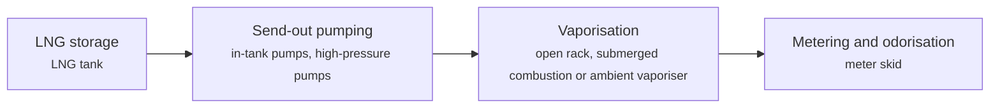

**Key equipment:** LNG tank, send-out pumps, vaporisers, seawater system or fuel gas supply, metering.

**Performance:**
- largest single open rack vaporiser: 200-250 MMSCFD; KBR authors; ORV unusable in seawater below 42 degF. [source](https://www.pumpindustry.com.au/lng-receiving-terminals)
- largest single submerged combustion vaporiser: 150 MMSCFD; KBR authors; burns send-out gas. [source](https://www.pumpindustry.com.au/lng-receiving-terminals)

**Missing inputs:**
- fuel gas percentage and cold-energy use (performance): The article gives no percentage figures. Web-checked 2026-10-28: SCV fuel-gas percentages (~0.01-0.02% class) circulate in vendor material; no verifiable open table found. Where: GIIGNL handbook and terminal operator documents (catalog: giignl, open). Next: Add fuel use and cold-energy recovery options.
- capital cost and operating or unit cost, with dollar year and basis (costs): No open source read so far gives costs for this technology. Web-checked 2026-10-28; no open figures. Where: arXiv and open-access journals: techno-economic or review papers (MDPI is blocked by its CDN; use the manual inbox) (catalog: arxiv, open); Licensor and EPC studies; paid cost databases are catalog-only (paid); OSTI.GOV full-text reports from DOE labs: search the technology name plus 'techno-economic' (catalog: osti, blocked). Next: Look for an open techno-economic study; record each figure with metric, range, unit, dollar year, basis and source.
- named plants or projects with capacity and year (reference_plants): The sources read name no specific plant. Web-checked 2026-10-28; no verifiable terminal added. Where: Licensor and operator press releases for the suppliers listed (open). Next: Add one or two plants with country, capacity and start-up year.
- TRL with a cited source (trl): The IEA ETP Clean Energy Technology Guide has no matching entry. no open TRL table found (IEA ETP guide checked 2026-10-28). Where: IEA ETP Clean Energy Technology Guide (collected): search for the technology name (catalog: iea-reports, open). Next: Find a TRL table that lists this technology, or leave maturity resting on the evidence on the card.
- process steps and equipment are general engineering practice, not taken from one source (process): The sources read describe the principle but not a full step-by-step flow. Where: Licensor process descriptions and textbooks (open). Next: Check the steps against a licensor description and name it.

Sources: [1](https://www.pumpindustry.com.au/lng-receiving-terminals). Last reviewed 2026-10-28.

## Liquid redox sulfur recovery (LO-CAT)
<a id="gas-liquid-redox-lo-cat"></a>

Hydrogen sulfide is absorbed into an aqueous solution of an iron chelate catalyst, where it is oxidised to elemental sulfur (H2S + 1/2 O2 -> S + H2O). The reduced catalyst is regenerated by air in an oxidiser, and the sulfur is separated as a slurry or cake. The process suits small to mid-size H2S loads and streams that are too lean or too dilute for a Claus plant.

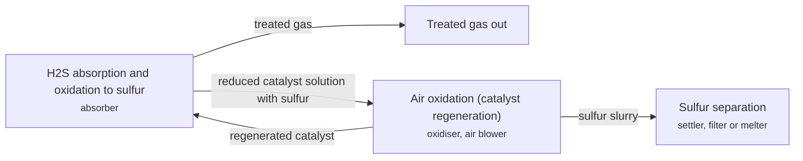

**Key equipment:** absorber, oxidiser vessel, air blowers, sulfur settler and filter, chemical dosing.

**Performance:**
- average inlet H2S over 22 years at one site: up to 0.7 vol%; Coso geothermal Navy 1 unit, designed for 1.2 vol% H2S in the feed. [source](https://www.digitalrefining.com/article/1002993/27-years-of-reliable-sulphur-removal)

**Reference plants:**
- Coso Operating Company geothermal plant, China Lake, California (Navy 1, first unit 1993; three LO-CAT units), US: ; . [source](https://www.digitalrefining.com/article/1002993/27-years-of-reliable-sulphur-removal)

**Missing inputs:**
- H2S removal efficiency, capacity range in tonnes of sulfur per day and installed base (performance): Neither the Digital Refining article text nor the Merichem page read gives them. Web-checked 2026-10-28: LO-CAT vendor pages found but the 99.9+% efficiency and installed-base figures sit in brochure material not readable this pass. Where: Merichem LO-CAT brochure (open); Digital Refining article tables 1 and 2 (not in the text read) (catalog: ptq-digital-refining, open). Next: Add them from a licensor datasheet.
- capital cost and operating or unit cost, with dollar year and basis (costs): No open source read so far gives costs for this technology. Web-checked 2026-10-28; vendor quotes only. Where: arXiv and open-access journals: techno-economic or review papers (MDPI is blocked by its CDN; use the manual inbox) (catalog: arxiv, open); Licensor and EPC studies; paid cost databases are catalog-only (paid); OSTI.GOV full-text reports from DOE labs: search the technology name plus 'techno-economic' (catalog: osti, blocked). Next: Look for an open techno-economic study; record each figure with metric, range, unit, dollar year, basis and source.
- TRL with a cited source (trl): The IEA ETP Clean Energy Technology Guide has no matching entry. no open TRL table found (IEA ETP guide checked 2026-10-28). Where: IEA ETP Clean Energy Technology Guide (collected): search for the technology name (catalog: iea-reports, open). Next: Find a TRL table that lists this technology, or leave maturity resting on the evidence on the card.
- process steps and equipment are general engineering practice, not taken from one source (process): The sources read describe the principle but not a full step-by-step flow. Where: Licensor process descriptions and textbooks (open). Next: Check the steps against a licensor description and name it.

Sources: [1](https://www.digitalrefining.com/article/1002993/27-years-of-reliable-sulphur-removal), [2](https://www.axens.net/markets/natural-gas/sulfur-recovery). Last reviewed 2026-10-28.

## Membrane CO2 removal for high-CO2 gas
<a id="gas-membrane-co2"></a>

Gas flows past a polymer membrane. CO2, H2S and water dissolve into and diffuse through the polymer faster than methane, so they collect on the low-pressure permeate side while methane stays at pressure in the residue. Pretreatment protects the membrane from liquids and heavy hydrocarbons, and two stages or a permeate compressor can be used to reduce methane losses.

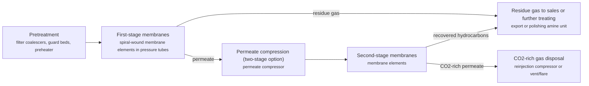

**Key equipment:** filter coalescers and guard beds, preheater, membrane skids, permeate compressor, reinjection compressor.

**Performance:**
- typical feed CO2 content: 3-90 mol% CO2; UOP Separex datasheet, typical range. [source](https://www.honeywell.com.cn/content/dam/honcn/documents/lifecycle-solutions/all-equipment-and-aftermarke/modular-solutions/gas-processing/UOP-Separex-membrane-elements-datasheet.pdf)

**Reference plants:**
- Separex offshore system, South China Sea: 680 MMSCFD on a large platform; installed (per 2016 datasheet). [source](https://www.honeywell.com.cn/content/dam/honcn/documents/lifecycle-solutions/all-equipment-and-aftermarke/modular-solutions/gas-processing/UOP-Separex-membrane-elements-datasheet.pdf)
- Separex trains, Egyptian desert, EG: three trains expanding to five, 560 MMSCFD total; per 2016 datasheet. [source](https://www.honeywell.com.cn/content/dam/honcn/documents/lifecycle-solutions/all-equipment-and-aftermarke/modular-solutions/gas-processing/UOP-Separex-membrane-elements-datasheet.pdf)

**Missing inputs:**
- TRL range with a cited source (trl): Commercial technology, so TRL 9 is expected, but no source read states it. The IEA Clean Energy Technology Guide (collected October 2026, 634 entries) has no matching entry. no open TRL table found (IEA ETP guide checked 2026-10-28). Where: Licensor or industry association statements of commercial deployment; academic reviews (open). Next: Find a TRL table that covers this technology and add trl {low, high, source}.
- capital cost and levelized or unit cost, with dollar year and basis (costs): No open source read so far gives costs for this technology. Refinery and gas plant unit costs are mostly published in paid sources. Web-checked 2026-10-28; vendor quotes only. Where: Oxford Institute for Energy Studies LNG and gas papers (private copy only) (catalog: oxford-oies, open); arXiv: open techno-economic and review papers (collector already runs weekly) (catalog: arxiv, open); Open-access journal techno-economic papers (MDPI Energies, Processes); MDPI is blocked by its CDN, use the manual inbox (blocked); Paid cost databases (consultancies, licensor studies): catalog-only until the owner provides access (paid). Next: Look for an open techno-economic study; record each figure with metric, range, unit, dollar year, basis and source.

Sources: [1](https://www.honeywell.com.cn/content/dam/honcn/documents/lifecycle-solutions/all-equipment-and-aftermarke/modular-solutions/gas-processing/UOP-Separex-membrane-elements-datasheet.pdf). Last reviewed 2026-10-28.

## Mercury removal units
<a id="gas-mercury-removal"></a>

Gas passes through fixed beds of sorbent, typically metal sulfides on alumina, which react irreversibly with mercury to form stable mercury sulfide. Mercury must be removed because it corrodes aluminium cryogenic heat exchangers. Modern designs place the beds upstream, close to the wells, rather than downstream of dryers as was common historically.

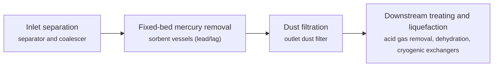

**Key equipment:** inlet coalescer, mercury removal vessels with sorbent, dust filter, mercury analysers, spent sorbent handling.

**Performance:**
- mercury specification for LNG: up to 10 ng/Nm3; Axens; matches the quantification limit of current analysers; raw gas ranges from undetected to 300 µg/Nm3. [source](https://blog.axens.net/how-to-remove-mercury-from-extracted-natural-gas)

**Missing inputs:**
- TRL range with a cited source (trl): Commercial technology, so TRL 9 is expected, but no source read states it. The IEA Clean Energy Technology Guide (collected October 2026, 634 entries) has no matching entry. no open TRL table found (IEA ETP guide checked 2026-10-28). Where: Licensor or industry association statements of commercial deployment; academic reviews (open). Next: Find a TRL table that covers this technology and add trl {low, high, source}.
- capital cost and levelized or unit cost, with dollar year and basis (costs): No open source read so far gives costs for this technology. Refinery and gas plant unit costs are mostly published in paid sources. Web-checked 2026-10-28; vendor quotes only. Where: Oxford Institute for Energy Studies LNG and gas papers (private copy only) (catalog: oxford-oies, open); arXiv: open techno-economic and review papers (collector already runs weekly) (catalog: arxiv, open); Open-access journal techno-economic papers (MDPI Energies, Processes); MDPI is blocked by its CDN, use the manual inbox (blocked); Paid cost databases (consultancies, licensor studies): catalog-only until the owner provides access (paid). Next: Look for an open techno-economic study; record each figure with metric, range, unit, dollar year, basis and source.
- named operating or planned plants with capacity and status (reference_plants): No plant was named in the sources read. Web-checked 2026-10-28; ubiquitous unit type. Where: GIIGNL annual report: LNG plants and terminals by country (private copy only) (catalog: giignl, open); Press releases from the suppliers listed on the card (open). Next: Add one to three reference plants with country, capacity, status and source.

Sources: [1](https://blog.axens.net/how-to-remove-mercury-from-extracted-natural-gas). Last reviewed 2026-10-28.

## Mixed fluid cascade
<a id="lng-mixed-fluid-cascade"></a>

Developed by Statoil and Linde for Arctic conditions, the process uses mixed refrigerant cycles in a cascade for precooling, liquefaction and subcooling, with Linde coil-wound and plate-fin exchangers. At Hammerfest LNG all main compressors are electrically driven to raise availability.

```mermaid
flowchart LR
    PRE["Gas pretreatment<br/><small>mercury removal, acid gas removal, molecular sieve dehydration, heavy hydrocarbon removal</small>"]
    PC["Precooling cycle<br/><small>plate-fin exchangers, precooling MR compressor (electric)</small>"]
    LQ["Liquefaction cycle<br/><small>coil-wound exchanger, liquefaction MR compressor (electric)</small>"]
    SC["Subcooling cycle<br/><small>coil-wound exchanger, subcooling MR compressor (electric)</small>"]
    STO["Storage and loading<br/><small>LNG tanks, loading</small>"]
    PRE --> PC
    PC --> LQ
    LQ --> SC
    SC --> STO
```

**Key equipment:** coil-wound heat exchangers, plate-fin exchangers, three refrigerant compressors with electric motors, LNG tanks.

**Performance:**
- plant capacity, Hammerfest LNG: 4.3 Mtpa LNG; design; running at up to 109% of design after 2011 revision shutdown. [source](https://www.hydrocarbonprocessing.com/news/2011/12/linde-statoil-say-joint-arctic-lng-plant-exceeding-performance-expectations/)
- specific power consumption: 320.5-364 kWh/t LNG; MFC configurations (Ghorbani et al. and Mehrpooya et al., cited); process simulation of integrated NGL/LNG plants (this study: Aspen Plus, 37 °C air, 25 °C seawater, 3.33 Mtpa); values from different studies on different bases, so compare with care. [source](https://ogst.ifpenergiesnouvelles.fr/en/articles/ogst/full_html/2020/01/ogst200035/ogst200035.html)

**Reference plants:**
- Hammerfest LNG, Melkøya, NO: 4.3 Mtpa; all main compressors electric; operating; passed performance test 2011, energy use below guarantee. [source](https://www.hydrocarbonprocessing.com/news/2011/12/linde-statoil-say-joint-arctic-lng-plant-exceeding-performance-expectations/)

**Missing inputs:**
- TRL range with a cited source (trl): Commercial technology, so TRL 9 is expected, but no source read states it. The IEA Clean Energy Technology Guide (collected October 2026, 634 entries) has no matching entry. Where: Licensor or industry association statements of commercial deployment; academic reviews (open). Next: Find a TRL table that covers this technology and add trl {low, high, source}.
- capital cost and levelized or unit cost, with dollar year and basis (costs): No open source read so far gives costs for this technology. Refinery and gas plant unit costs are mostly published in paid sources. Where: Oxford Institute for Energy Studies LNG and gas papers (private copy only) (catalog: oxford-oies, open); arXiv: open techno-economic and review papers (collector already runs weekly) (catalog: arxiv, open); Open-access journal techno-economic papers (MDPI Energies, Processes); MDPI is blocked by its CDN, use the manual inbox (blocked); Paid cost databases (consultancies, licensor studies): catalog-only until the owner provides access (paid). Next: Look for an open techno-economic study; record each figure with metric, range, unit, dollar year, basis and source.
- number and arrangement of MFC refrigerant cycles (process): Described from general knowledge; the source read confirms only name, capacity and electric drive. Where: Linde Engineering MFC process literature (catalog: linde-engineering, open). Next: Confirm the cycle arrangement from a Linde source and cite it.

Sources: [1](https://www.hydrocarbonprocessing.com/news/2011/12/linde-statoil-say-joint-arctic-lng-plant-exceeding-performance-expectations/), [2](https://ogst.ifpenergiesnouvelles.fr/en/articles/ogst/full_html/2020/01/ogst200035/ogst200035.html). Last reviewed 2026-10-24.

## Molecular sieve and glycol dehydration
<a id="gas-dehydration"></a>

Water is removed so it cannot form hydrates, ice or corrosive liquids. Glycol units absorb water into triethylene glycol, which is regenerated by heating, and are enough for pipeline specifications. Cryogenic plants use molecular sieve beds that adsorb water to very low levels and are regenerated by hot gas in a timed cycle. NETL's LNG model dries gas to below 0.5 ppmv water ahead of liquefaction.

```mermaid
flowchart LR
    INL["Inlet separation<br/><small>inlet scrubber, filter separator</small>"]
    GLY["Glycol contactor and regeneration<br/><small>TEG contactor, glycol flash drum, reboiler and still column</small>"]
    MS["Molecular sieve adsorption<br/><small>two or more adsorber vessels, regeneration gas heater and cooler, dust filter</small>"]
    OUT["Dry gas<br/><small>outlet filter, moisture analyser</small>"]
    INL -->|pipeline duty| GLY
    INL -->|cryogenic duty| MS
    GLY --> OUT
    MS --> OUT
```

**Key equipment:** inlet scrubber, TEG contactor and regenerator, molecular sieve adsorbers, regeneration heater, dust filters, moisture analysers.

**Performance:**
- water content after molecular sieve dehydration for LNG: up to 0.5 ppmv H2O; NETL LNG pretreatment assumption (below 0.5 ppmv). [source](https://www.energy.gov/sites/prod/files/2019/09/f66/2019%20NETL%20LCA-GHG%20Report.pdf)

**Missing inputs:**
- TRL range with a cited source (trl): Commercial technology, so TRL 9 is expected, but no source read states it. The IEA Clean Energy Technology Guide (collected October 2026, 634 entries) has no matching entry. no open TRL table found (IEA ETP guide checked 2026-10-28). Where: Licensor or industry association statements of commercial deployment; academic reviews (open). Next: Find a TRL table that covers this technology and add trl {low, high, source}.
- capital cost and levelized or unit cost, with dollar year and basis (costs): No open source read so far gives costs for this technology. Refinery and gas plant unit costs are mostly published in paid sources. Web-checked 2026-10-28; vendor quotes only. Where: Oxford Institute for Energy Studies LNG and gas papers (private copy only) (catalog: oxford-oies, open); arXiv: open techno-economic and review papers (collector already runs weekly) (catalog: arxiv, open); Open-access journal techno-economic papers (MDPI Energies, Processes); MDPI is blocked by its CDN, use the manual inbox (blocked); Paid cost databases (consultancies, licensor studies): catalog-only until the owner provides access (paid). Next: Look for an open techno-economic study; record each figure with metric, range, unit, dollar year, basis and source.
- named operating or planned plants with capacity and status (reference_plants): No plant was named in the sources read. Web-checked 2026-10-28; ubiquitous unit type. Where: GIIGNL annual report: LNG plants and terminals by country (private copy only) (catalog: giignl, open); Press releases from the suppliers listed on the card (open). Next: Add one to three reference plants with country, capacity, status and source.

Sources: [1](https://www.energy.gov/sites/prod/files/2019/09/f66/2019%20NETL%20LCA-GHG%20Report.pdf). Last reviewed 2026-10-28.

## NGL fractionation and LPG recovery
<a id="gas-ngl-fractionation"></a>

Mixed natural gas liquids are separated by distillation in a series of columns: a deethanizer takes ethane overhead, a depropanizer takes propane overhead, a debutanizer separates butane from natural gasoline, and a deisobutanizer splits iso- and normal butane. UOP sells the columns as pre-engineered, factory-built modules.

```mermaid
flowchart LR
    FEED["NGL feed (C2+ or Y-grade) from recovery unit<br/><small>feed pump, feed exchanger</small>"]
    DEC2["Deethanizer<br/><small>column, reboiler, condenser</small>"]
    C2["Ethane product"]
    DEC3["Depropanizer<br/><small>column</small>"]
    C3["Propane (e.g. HD-5 spec)"]
    DEC4["Debutanizer<br/><small>column</small>"]
    DIC4["Deisobutanizer<br/><small>column</small>"]
    NG["Natural gasoline"]
    FEED --> DEC2
    DEC2 -->|C3+ bottoms| DEC3
    DEC2 -->|ethane| C2
    DEC3 -->|butanes+| DEC4
    DEC3 -->|propane| C3
    DEC4 -->|mixed butanes| DIC4
    DEC4 -->|natural gasoline| NG
```

**Key equipment:** fractionation columns (trays), reboilers and condensers, reflux drums and pumps, treaters (not in the source).

**Performance:**
- installed fractionation experience: 800 kbpd; UOP claim, 'more than 800kbpd'. [source](https://www.honeywell.com.cn/content/dam/honcn/download/lifecycle-solutions/all-equipment-and-afterm/gas-processing/modular-ngl-recovery/honeywell-uop-fractionation-datasheet.pdf)
- tray pressure drop with UOP high-capacity trays: up to 0.05 psi per tray; UOP claim. [source](https://www.honeywell.com.cn/content/dam/honcn/download/lifecycle-solutions/all-equipment-and-afterm/gas-processing/modular-ngl-recovery/honeywell-uop-fractionation-datasheet.pdf)
- module delivery time: up to 40 weeks; UOP claim for pre-engineered modules. [source](https://www.honeywell.com.cn/content/dam/honcn/download/lifecycle-solutions/all-equipment-and-afterm/gas-processing/modular-ngl-recovery/honeywell-uop-fractionation-datasheet.pdf)

**Costs:**
- cost reduction for a deethanizer single-tower design compared with historical two-tower projects: 14 %; UOP datasheet cites a USD 2 million saving; results vary by application. [source](https://www.honeywell.com.cn/content/dam/honcn/download/lifecycle-solutions/all-equipment-and-afterm/gas-processing/modular-ngl-recovery/honeywell-uop-fractionation-datasheet.pdf)

**Reference plants:**
- Mont Belvieu NGL complex, Texas (Energy Transfer and others), US: world's largest NGL storage and fractionation hub: Energy Transfer facilities alone hold over 46 million barrels of storage and fractionate over 900,000 bpd; US NGL hub since the 1960s; operating. [source](https://cms.energytransfer.com/wp-content/uploads/2019/04/Mt-Belvieu-Fact-Sheet-3-29-19.pdf)

**Missing inputs:**
- energy use per barrel fractionated and recovery fractions (performance): The datasheet gives experience and delivery figures only. Web-checked 2026-10-28; fractionation energy figures sit in process-licensing material. Where: GPSA Engineering Data Book (catalog: gpsa, paid); Licensor papers (open). Next: Add energy and recovery figures from a published design case.
- TRL with a cited source (trl): The IEA ETP Clean Energy Technology Guide has no matching entry. IEA ETP Guide (July 2026) has no matching entry (searched NGL, natural gas liquids, LPG, fractionation, deethanizer); 2026-10-28 no open TRL table found (IEA ETP guide checked 2026-10-28). Where: IEA ETP Clean Energy Technology Guide (collected): search for the technology name (catalog: iea-reports, open). Next: Find a TRL table that lists this technology, or leave maturity resting on the evidence on the card.
- process steps and equipment are general engineering practice, not taken from one source (process): The sources read describe the principle but not a full step-by-step flow. Where: Licensor process descriptions and textbooks (open). Next: Check the steps against a licensor description and name it.

Sources: [1](https://www.honeywell.com.cn/content/dam/honcn/download/lifecycle-solutions/all-equipment-and-afterm/gas-processing/modular-ngl-recovery/honeywell-uop-fractionation-datasheet.pdf), [2](https://cms.energytransfer.com/wp-content/uploads/2019/04/Mt-Belvieu-Fact-Sheet-3-29-19.pdf). Last reviewed 2026-10-28.

## Nitrogen rejection units
<a id="gas-nitrogen-rejection"></a>

Cryogenic distillation separates nitrogen from methane to meet pipeline or LNG heating value and nitrogen limits. A single-column, partitioned-column or double-column cold box is chosen by feed nitrogen content and by whether nitrogen or helium is to be recovered. Linde states pipeline gas typically needs nitrogen reduced to 3 to 4% and LNG feed to about 1% or less.

```mermaid
flowchart LR
    FEED["Feed compression and pre-treatment<br/><small>compressor, dryers, CO2 removal</small>"]
    CB["Cryogenic distillation in cold box<br/><small>coldbox, distillation column(s), pump modules</small>"]
    PIPE["Sales gas"]
    N2["Nitrogen vent, liquid nitrogen or helium recovery<br/><small>helium PSA and purification (optional)</small>"]
    FEED --> CB
    CB -->|sales gas| PIPE
    CB -->|nitrogen vent or liquid nitrogen| N2
```

**Key equipment:** cold box, distillation columns, brazed aluminium heat exchangers, pumps, feed compressors.

**Performance:**
- nitrogen after rejection for pipeline gas: 3-4 %; Linde statement of typical pipeline specification. [source](https://www.linde-engineering.com/en/process-plants/lng-and-natural-gas-processing-plants/nitrogen-rejection/)
- nitrogen after rejection for LNG storage: up to 1 %; Linde statement. [source](https://www.linde-engineering.com/en/process-plants/lng-and-natural-gas-processing-plants/nitrogen-rejection/)
- helium recovery in the Amur GPP NRU design: 98 %; Linde states more than 98% of helium (well under 1% of the gas) can be recovered. [source](https://www.linde-engineering.com/en/process-plants/lng-and-natural-gas-processing-plants/nitrogen-rejection/)

**Reference plants:**
- Amur GPP (Russia), single-column NRU, under construction when the page was read: ; . [source](https://www.linde-engineering.com/en/process-plants/lng-and-natural-gas-processing-plants/nitrogen-rejection/)

**Missing inputs:**
- power use per unit gas treated (performance): Linde's page gives no capacities or energy figures. Web-checked 2026-10-28; NRJ power figures are vendor-quoted. Where: AIChE Spring Meeting papers on NRU technology (catalog: aiche-spring, open). Next: Add specific energy from an open paper.
- capital cost and operating or unit cost, with dollar year and basis (costs): No open source read so far gives costs for this technology. Web-checked 2026-10-28; vendor quotes only. Where: arXiv and open-access journals: techno-economic or review papers (MDPI is blocked by its CDN; use the manual inbox) (catalog: arxiv, open); Licensor and EPC studies; paid cost databases are catalog-only (paid); OSTI.GOV full-text reports from DOE labs: search the technology name plus 'techno-economic' (catalog: osti, blocked). Next: Look for an open techno-economic study; record each figure with metric, range, unit, dollar year, basis and source.
- TRL with a cited source (trl): The IEA ETP Clean Energy Technology Guide has no matching entry. no open TRL table found (IEA ETP guide checked 2026-10-28). Where: IEA ETP Clean Energy Technology Guide (collected): search for the technology name (catalog: iea-reports, open). Next: Find a TRL table that lists this technology, or leave maturity resting on the evidence on the card.
- process steps and equipment are general engineering practice, not taken from one source (process): The sources read describe the principle but not a full step-by-step flow. Where: Licensor process descriptions and textbooks (open). Next: Check the steps against a licensor description and name it.

Sources: [1](https://www.linde-engineering.com/en/process-plants/lng-and-natural-gas-processing-plants/nitrogen-rejection/). Last reviewed 2026-10-28.

## Physical solvent gas treating (Selexol, Rectisol, Purisol)
<a id="gas-physical-solvent-agr"></a>

Acid gases dissolve in an organic solvent in proportion to their partial pressure, with no chemical reaction. The rich solvent is released by pressure letdown, flashing and, where H2S must be sent to sulfur recovery, heat or stripping gas, so regeneration needs less heat than amine. Selexol uses dimethyl ethers of polyethylene glycol; Rectisol uses refrigerated methanol. Because capacity rises with pressure, physical solvents suit high-pressure gas such as gasification syngas and not low-pressure gas.

```mermaid
flowchart LR
    FEED["Feed gas cooling and water removal<br/><small>feed cooler, knock-out drum</small>"]
    ABS["Acid gas absorption at high pressure<br/><small>absorber column</small>"]
    TR["Treated gas out"]
    FLASH["Staged flash of rich solvent (CO2 release, recycle of co-absorbed hydrocarbons)<br/><small>flash drums, recycle compressor</small>"]
    STR["Stripping or reboiled regeneration (H2S fraction)<br/><small>stripper, reboiler</small>"]
    AG["Acid gas to sulfur recovery or CO2 handling<br/><small>Claus unit, CO2 compression</small>"]
    FEED --> ABS
    ABS -->|treated gas| TR
    ABS -->|rich solvent| FLASH
    FLASH --> STR
    STR -->|lean solvent| ABS
    STR -->|acid gas| AG
```

**Key equipment:** high-pressure absorber, flash drums, solvent stripper, refrigeration (cold solvent cases), lean solvent pumps and exchangers.

**Performance:**
- absorption pressure range at which Selexol is competitive: 2.07-13.8 MPa; feed-gas pressure stated as 300 to 2000 psia; below about 300 psia solvent capacity drops and amines usually perform better. [source](https://en.wikipedia.org/wiki/Selexol)

**Reference plants:**
- Sarlux and api Energia gasification projects (Italy): ; . [source](https://netl.doe.gov/sites/default/files/2021-04/acid-gas-removal.pdf)
- Texaco Cool Water and TVA Muscle Shoals gasification (first use in the 1980s): ; . [source](https://netl.doe.gov/sites/default/files/2021-04/acid-gas-removal.pdf)

**Missing inputs:**
- capital cost and operating or unit cost, with dollar year and basis (costs): No open source read so far gives costs for this technology. Web-checked 2026-10-28; licensor quotes only (NETL Selexol case costs already recorded in Wave 1). Where: arXiv and open-access journals: techno-economic or review papers (MDPI is blocked by its CDN; use the manual inbox) (catalog: arxiv, open); Licensor and EPC studies; paid cost databases are catalog-only (paid); OSTI.GOV full-text reports from DOE labs: search the technology name plus 'techno-economic' (catalog: osti, blocked). Next: Look for an open techno-economic study; record each figure with metric, range, unit, dollar year, basis and source.
- TRL with a cited source (trl): The IEA ETP Clean Energy Technology Guide has no matching entry. no open TRL table found (IEA ETP guide checked 2026-10-28). Where: IEA ETP Clean Energy Technology Guide (collected): search for the technology name (catalog: iea-reports, open). Next: Find a TRL table that lists this technology, or leave maturity resting on the evidence on the card.
- process steps and equipment are general engineering practice, not taken from one source (process): The sources read describe the principle but not a full step-by-step flow. Where: Licensor process descriptions and textbooks (open). Next: Check the steps against a licensor description and name it.

Sources: [1](https://netl.doe.gov/sites/default/files/2021-04/acid-gas-removal.pdf), [2](https://en.wikipedia.org/wiki/Selexol). Last reviewed 2026-10-28.

## Propane-precooled mixed refrigerant liquefaction (C3MR, AP-X)
<a id="lng-c3mr-apx"></a>

A propane refrigeration cycle precools the feed gas and the mixed refrigerant. A mixed refrigerant of nitrogen, methane, ethane and propane then liquefies and subcools the gas in a coil-wound main cryogenic heat exchanger. AP-X adds a nitrogen expander loop that subcools LNG from about -115 °C to about -150 °C, cutting mixed refrigerant flow by 40% per unit of LNG and allowing trains of 7.8 Mtpa and more.

```mermaid
flowchart LR
    PRE["Gas pretreatment<br/><small>mercury removal, acid gas removal, molecular sieve dehydration, heavy hydrocarbon removal</small>"]
    C3["Propane precooling<br/><small>propane kettles or exchangers, propane compressor, condensers</small>"]
    MCHE["Liquefaction<br/><small>main cryogenic heat exchanger, mixed refrigerant compressors</small>"]
    N2["Nitrogen expander subcooling (AP-X)<br/><small>nitrogen expander-compressor, subcooling exchanger</small>"]
    FL["End flash and storage<br/><small>LNG expander, end flash drum, full-containment LNG tanks</small>"]
    LOAD["Loading<br/><small>loading arms and jetty</small>"]
    PRE --> C3
    C3 --> MCHE
    MCHE --> N2
    N2 --> FL
    FL --> LOAD
```

**Key equipment:** main cryogenic heat exchanger, propane compressor, mixed refrigerant compressors, gas turbine or electric drivers, nitrogen expander (AP-X), LNG tanks.

**Performance:**
- train capacity, AP-X (Qatar): 7.8 Mtpa LNG; design capacity of the six original Qatar AP-X trains and four North Field East trains; Air Products says trains can exceed 10 Mtpa. [source](https://www.airproducts.co.uk/-/media/files/en/lng/lng-technology-enables-largest-lng-trains.pdf)
- pretreatment and liquefaction fuel energy: 2.78-3.35 MJ/kg gas liquefied; NETL model of a US C3MR plant from Mallapragada et al. 2018; range covers adsorption or cryogenic heavy hydrocarbon removal, with or without HRSG; fuel is a parasitic stream of feed gas, not compressor shaft power. [source](https://www.energy.gov/sites/prod/files/2019/09/f66/2019%20NETL%20LCA-GHG%20Report.pdf)
- specific power consumption: 347-391 kWh/t LNG; C3MR configurations (0.347-0.391 kWh/kg); no absolute AP-X value given (one study reports 15.56% lower power than its base case); process simulation of integrated NGL/LNG plants (this study: Aspen Plus, 37 °C air, 25 °C seawater, 3.33 Mtpa); values from different studies on different bases, so compare with care. [source](https://ogst.ifpenergiesnouvelles.fr/en/articles/ogst/full_html/2020/01/ogst200035/ogst200035.html)

**Reference plants:**
- Ras Laffan LNG trains, QA: 14 trains on AP-C3MR or AP-X; AP-X trains 7.8 Mtpa each; operating; four North Field East AP-X trains in development. [source](https://www.airproducts.co.uk/-/media/files/en/lng/lng-technology-enables-largest-lng-trains.pdf)

**Missing inputs:**
- TRL range with a cited source (trl): Commercial technology, so TRL 9 is expected, but no source read states it. The IEA Clean Energy Technology Guide (collected October 2026, 634 entries) has no matching entry. Where: Licensor or industry association statements of commercial deployment; academic reviews (open). Next: Find a TRL table that covers this technology and add trl {low, high, source}.
- capital cost and levelized or unit cost, with dollar year and basis (costs): No open source read so far gives costs for this technology. Refinery and gas plant unit costs are mostly published in paid sources. Where: Oxford Institute for Energy Studies LNG and gas papers (private copy only) (catalog: oxford-oies, open); arXiv: open techno-economic and review papers (collector already runs weekly) (catalog: arxiv, open); Open-access journal techno-economic papers (MDPI Energies, Processes); MDPI is blocked by its CDN, use the manual inbox (blocked); Paid cost databases (consultancies, licensor studies): catalog-only until the owner provides access (paid). Next: Look for an open techno-economic study; record each figure with metric, range, unit, dollar year, basis and source.

Sources: [1](https://www.airproducts.co.uk/-/media/files/en/lng/lng-technology-enables-largest-lng-trains.pdf), [2](https://www.energy.gov/sites/prod/files/2019/09/f66/2019%20NETL%20LCA-GHG%20Report.pdf), [3](https://ogst.ifpenergiesnouvelles.fr/en/articles/ogst/full_html/2020/01/ogst200035/ogst200035.html). Last reviewed 2026-10-24.

## Small and mid-scale modular LNG
<a id="gas-small-scale-lng"></a>

Packaged liquefaction trains of tens to hundreds of tonnes per day make LNG from pipeline gas or small fields for trucks, ships and remote power. Nitrogen expander cycles are favoured for simplicity and turndown; methane expansion and single mixed refrigerant cycles are alternatives.

```mermaid
flowchart LR
    PRE["Feed gas treatment<br/><small>acid gas removal, dehydration, mercury removal</small>"]
    LIQ["Liquefaction (N2 expander, methane expander or SMR)<br/><small>compander, plate-fin cold box</small>"]
    STO["LNG storage and loading<br/><small>storage tank, truck loading</small>"]
    PRE --> LIQ
    LIQ --> STO
```

**Key equipment:** compander (compressor-expander), plate-fin cold box, feed treating skids, LNG storage tank, truck loading bay.

**Performance:**
- UOP small-scale offering capacity: up to 800 t/d; AP-N single expander 140 to 250 t/d, dual expander 200 to 650 t/d, AP-C1 60 to 800+ t/d. [source](https://uop.honeywell.com/content/dam/uop/en-us/documents/industry-solutions/gas-processing/lng/hon-ess-uop-032025-small-scale-lng-liquefaction-plant-capabilities.pdf)
- nitrogen expander specific power: 350 kWh/t; 0.56 kWh/gal on lean high-pressure (about 1,100 psig) feed; vendor article, other feeds not covered. [source](https://gasprocessingnews.com/articles/2013/07/nitrogen-expansion-cycle-enhances-flexibility-of-small-scale-lng)
- typical small-scale plant size: 4-42 MMscfd; 50,000 to 500,000 gal/d per Cosmodyne article. [source](https://gasprocessingnews.com/articles/2013/07/nitrogen-expansion-cycle-enhances-flexibility-of-small-scale-lng)

**Reference plants:**
- Japex LNG plants, Japan (AP-N), JP: 144 t/d (2004) and 206 t/d (2007); . [source](https://uop.honeywell.com/content/dam/uop/en-us/documents/industry-solutions/gas-processing/lng/hon-ess-uop-032025-small-scale-lng-liquefaction-plant-capabilities.pdf)
- US plant, 412 t/d AP-N, US: ; . [source](https://uop.honeywell.com/content/dam/uop/en-us/documents/industry-solutions/gas-processing/lng/hon-ess-uop-032025-small-scale-lng-liquefaction-plant-capabilities.pdf)

**Missing inputs:**
- independent comparison of N2 expander and SMR power use (performance): Both sources are vendors. Web-checked 2026-10-28; vendor-specific specific-power claims not independently comparable in open pages. Where: arXiv and open-access journals: techno-economic or review papers (MDPI is blocked by its CDN; use the manual inbox) (catalog: arxiv, open); LNG Industry / Gastech papers (catalog: lng-industry, open). Next: Add an independent comparison.
- capital cost and operating or unit cost, with dollar year and basis (costs): No open source read so far gives costs for this technology. Web-checked 2026-10-28; modular-plant prices are quote-only. Where: arXiv and open-access journals: techno-economic or review papers (MDPI is blocked by its CDN; use the manual inbox) (catalog: arxiv, open); Licensor and EPC studies; paid cost databases are catalog-only (paid); OSTI.GOV full-text reports from DOE labs: search the technology name plus 'techno-economic' (catalog: osti, blocked). Next: Look for an open techno-economic study; record each figure with metric, range, unit, dollar year, basis and source.
- TRL with a cited source (trl): The IEA ETP Clean Energy Technology Guide has no matching entry. no open TRL table found (IEA ETP guide checked 2026-10-28). Where: IEA ETP Clean Energy Technology Guide (collected): search for the technology name (catalog: iea-reports, open). Next: Find a TRL table that lists this technology, or leave maturity resting on the evidence on the card.
- process steps and equipment are general engineering practice, not taken from one source (process): The sources read describe the principle but not a full step-by-step flow. Where: Licensor process descriptions and textbooks (open). Next: Check the steps against a licensor description and name it.

Sources: [1](https://uop.honeywell.com/content/dam/uop/en-us/documents/industry-solutions/gas-processing/lng/hon-ess-uop-032025-small-scale-lng-liquefaction-plant-capabilities.pdf), [2](https://gasprocessingnews.com/articles/2013/07/nitrogen-expansion-cycle-enhances-flexibility-of-small-scale-lng). Last reviewed 2026-10-28.

## Sulfur recovery (Claus, tail gas treating, SuperClaus)
<a id="gas-sulfur-recovery"></a>

Acid gas is partly burned in a reaction furnace, converting 60 to 70% of the H2S, and the rest reacts with SO2 over catalytic converters to make elemental sulfur, taking recovery beyond 95% (BASF). A tail gas unit hydrogenates the remaining sulfur species to H2S over a CoMo catalyst and removes it with a selective amine, which BASF and Baker Hughes say lifts total recovery above 99.9%.

```mermaid
flowchart LR
    FUR["Thermal stage<br/><small>reaction furnace and burner, waste heat boiler</small>"]
    CAT["Catalytic Claus stages<br/><small>reheaters, Claus converters, sulfur condensers</small>"]
    S["Sulfur degassing and storage<br/><small>sulfur pit, degassing unit, loading or prilling</small>"]
    TGT["Tail gas treating<br/><small>hydrogenation reactor (CoMo), quench column, selective amine absorber</small>"]
    INC["Incineration and stack<br/><small>thermal incinerator, stack</small>"]
    FUR --> CAT
    CAT -->|tail gas| TGT
    CAT -->|liquid sulfur| S
    TGT -->|treated tail gas| INC
    TGT -->|recycled H2S| FUR
```

**Key equipment:** reaction furnace, waste heat boiler, Claus converters, sulfur condensers, hydrogenation reactor, quench column, selective amine absorber, incinerator.

**Performance:**
- H2S conversion in the reaction furnace: 60-70 %; BASF. [source](https://energy-resources.basf.com/dam/jcr:46d84926-60eb-3d04-bded-8a1571daa961/basf/energy-resources/download-center-sheets/SRU_Tailgas_Treatment_Brochure.pdf)
- overall sulfur recovery with hydrogenation/amine tail gas treating: 99.9 %; BASF and Baker Hughes claims (above 99.9%). [source](https://energy-resources.basf.com/dam/jcr:46d84926-60eb-3d04-bded-8a1571daa961/basf/energy-resources/download-center-sheets/SRU_Tailgas_Treatment_Brochure.pdf)
- Claus sulfur recovery (Axens): 95-98 %; two-step Claus; single-train capacity from a few t/d up to 2,200 t/d per Axens. [source](https://www.axens.net/markets/natural-gas/sulfur-recovery)
- SmartSulf sub-dewpoint recovery without tail gas unit (Axens): 99.5-99.9 %; base SmartSulf more than 99.5%; with polishing up to 99.9%+. [source](https://www.axens.net/markets/natural-gas/sulfur-recovery)
- Sultimate tail gas treatment recovery (Axens): 99.9 %; amine-based tail gas treatment, typically 99.9%+. [source](https://www.axens.net/markets/natural-gas/sulfur-recovery)

**Missing inputs:**
- TRL range with a cited source (trl): Commercial technology, so TRL 9 is expected, but no source read states it. The IEA Clean Energy Technology Guide (collected October 2026, 634 entries) has no matching entry. no open TRL table found (IEA ETP guide checked 2026-10-28). Where: Licensor or industry association statements of commercial deployment; academic reviews (open). Next: Find a TRL table that covers this technology and add trl {low, high, source}.
- capital cost and levelized or unit cost, with dollar year and basis (costs): No open source read so far gives costs for this technology. Refinery and gas plant unit costs are mostly published in paid sources. Web-checked 2026-10-28; SRU costs are vendor-quoted. Where: Oxford Institute for Energy Studies LNG and gas papers (private copy only) (catalog: oxford-oies, open); arXiv: open techno-economic and review papers (collector already runs weekly) (catalog: arxiv, open); Open-access journal techno-economic papers (MDPI Energies, Processes); MDPI is blocked by its CDN, use the manual inbox (blocked); Paid cost databases (consultancies, licensor studies): catalog-only until the owner provides access (paid). Next: Look for an open techno-economic study; record each figure with metric, range, unit, dollar year, basis and source.
- named operating or planned plants with capacity and status (reference_plants): No plant was named in the sources read. Web-checked 2026-10-28; ubiquitous unit type. Where: GIIGNL annual report: LNG plants and terminals by country (private copy only) (catalog: giignl, open); Press releases from the suppliers listed on the card (open). Next: Add one to three reference plants with country, capacity, status and source.

Sources: [1](https://energy-resources.basf.com/dam/jcr:46d84926-60eb-3d04-bded-8a1571daa961/basf/energy-resources/download-center-sheets/SRU_Tailgas_Treatment_Brochure.pdf), [2](https://www.bakerhughes.com/acid-gas-treatment-and-sulfur-recovery), [3](https://www.axens.net/markets/natural-gas/sulfur-recovery). Last reviewed 2026-10-28.

## Turbo-expander NGL recovery (GSP, RSV processes)
<a id="gas-turboexpander-ngl"></a>

Dry gas is chilled against cold residue gas, then expanded through a turbo-expander, which cools it further and drives a recompressor. A demethaniser column separates methane-rich residue gas from the natural gas liquids. Ortloff variants such as GSP and RSV use subcooled reflux or recycled residue gas to raise ethane recovery, and can switch to ethane rejection while keeping propane recovery high.

```mermaid
flowchart LR
    PRE["Treated, dried gas<br/><small>upstream amine and molecular sieve units</small>"]
    CHL["Gas chilling<br/><small>brazed aluminium plate-fin exchanger, cold separator</small>"]
    EXP["Expansion<br/><small>turbo-expander with recompressor</small>"]
    DEM["Demethaniser<br/><small>demethaniser column with side reboilers, reflux subcooler (GSP)</small>"]
    RES["Residue gas recompression<br/><small>expander-driven recompressor, residue gas compressor</small>"]
    NGL["NGL to fractionation<br/><small>NGL pumps, deethaniser, depropaniser, debutaniser train</small>"]
    PRE --> CHL
    CHL --> EXP
    EXP --> DEM
    DEM -->|residue gas| RES
    DEM -->|NGL| NGL
```

**Key equipment:** plate-fin heat exchanger, cold separator, turbo-expander/recompressor, demethaniser, residue gas compressor, NGL pumps.

**Performance:**
- product recovery, Ortloff ultra-high recovery processes: 99 %; Honeywell UOP brochure (more than 99%); flexible processes keep 99%+ propane recovery in ethane rejection. [source](https://www.honeywell.com.cn/content/dam/honcn/download/oil-and-gas/natural-gas-treatment-and-recovery/honeywell-uop-ortloff-ngl-recovery-brochure.pdf)

**Reference plants:**
- Brazos Midstream gas plants, Permian Basin, US: two plants of 200 MMscfd each, upgraded from GSP to Ortloff RSV2; over 99% ethane and 100% propane recovery in performance tests; upgraded late 2021; tests completed December 2022. [source](https://www.honeywell.com/us/en/insights/articles/brazos-midstream-successfully-commissions-next-generation-honeywell-uop-advanced-recovery-technology)

**Missing inputs:**
- TRL range with a cited source (trl): Commercial technology, so TRL 9 is expected, but no source read states it. The IEA Clean Energy Technology Guide (collected October 2026, 634 entries) has no matching entry. no open TRL table found (IEA ETP guide checked 2026-10-28). Where: Licensor or industry association statements of commercial deployment; academic reviews (open). Next: Find a TRL table that covers this technology and add trl {low, high, source}.
- capital cost and levelized or unit cost, with dollar year and basis (costs): No open source read so far gives costs for this technology. Refinery and gas plant unit costs are mostly published in paid sources. Web-checked 2026-10-28; vendor quotes only. Where: Oxford Institute for Energy Studies LNG and gas papers (private copy only) (catalog: oxford-oies, open); arXiv: open techno-economic and review papers (collector already runs weekly) (catalog: arxiv, open); Open-access journal techno-economic papers (MDPI Energies, Processes); MDPI is blocked by its CDN, use the manual inbox (blocked); Paid cost databases (consultancies, licensor studies): catalog-only until the owner provides access (paid). Next: Look for an open techno-economic study; record each figure with metric, range, unit, dollar year, basis and source.

Sources: [1](https://www.honeywell.com.cn/content/dam/honcn/download/oil-and-gas/natural-gas-treatment-and-recovery/honeywell-uop-ortloff-ngl-recovery-brochure.pdf), [2](https://www.honeywell.com/us/en/insights/articles/brazos-midstream-successfully-commissions-next-generation-honeywell-uop-advanced-recovery-technology). Last reviewed 2026-10-28.

## High-CO2 gas field development with reinjection
<a id="gas-high-co2-reinjection"></a>

A gas field whose gas is largely CO2 is produced with CO2 removed offshore, usually by membranes, and the separated CO2 is compressed and reinjected into a depleted field instead of venting. PETRONAS Kasawari is the reference: a fixed platform bridge-linked to the central processing platform removes CO2, a pipeline carries it to the depleted M1 field and the gas is stored there.

```mermaid
flowchart LR
    FEED["Sour gas from wells to central processing platform<br/><small>wellhead platform, central processing platform (CPP)</small>"]
    REM["CO2 removal with membranes and low-pressure booster compression<br/><small>membrane skids, LP booster compressors</small>"]
    SALES["Treated gas for export"]
    COMP["CO2 compression for reinjection<br/><small>reinjection compressors, gas turbine drivers</small>"]
    PIPE["Subsea CO2 pipeline to depleted field<br/><small>16-inch subsea pipeline</small>"]
    INJ["Injection into depleted field<br/><small>injection well</small>"]
    FEED --> REM
    REM -->|treated gas| SALES
    REM -->|CO2-rich permeate| COMP
    COMP --> PIPE
    PIPE --> INJ
```

**Key equipment:** CO2 removal membranes, LP booster compressors, reinjection compressors, gas turbine drivers, CCS platform and jacket, subsea CO2 pipeline, injection well.

**Performance:**
- CO2 captured and stored: 3.3 Mtpa; Kasawari project; 71 to 76 Mt over the project life reported. [source](https://www.ogj.com/energy-transition/article/14286402/petronas-takes-fid-for-offshore-malaysia-ccs)
- sour gas field size: 3.2 tcf; Kasawari, Block SK316, about 200 km offshore Bintulu, Sarawak. [source](https://www.ogj.com/energy-transition/article/14286402/petronas-takes-fid-for-offshore-malaysia-ccs)
- subsea CO2 pipeline length: 138 km; 16-inch pipeline to depleted M1 field. [source](https://www.hydrocarbonengineering.com/the-environment/06012023/baker-hughes-to-supply-technology-for-offshore-ccs-facilities/)

**Reference plants:**
- PETRONAS Kasawari CCS (Block SK316, offshore Sarawak), MY: 3.3 Mtpa CO2; FID 20 October 2022; the Kasawari gas field began production in August 2024, but CO2 injection had not started as of April 2026 — PETRONAS said on 1 April 2026 it is looking to bring the first CO2 injection forward to as early as 2027, from a previous projection of end-2029/early 2030; the 2025 and end-2025 start-up dates cited in earlier sources did not materialise. [source](https://www.thestar.com.my/business/business-news/2026/04/01/petronas-seeks-to-bring-forward-first-co2-injection-at-kasawari-to-2027)

**Missing inputs:**
- capital cost and operating or unit cost, with dollar year and basis (costs): No open source read so far gives costs for this technology. Web-checked 2026-10-28; Kasawari project capex exists in press but not verifiably per-tonne. Where: arXiv and open-access journals: techno-economic or review papers (MDPI is blocked by its CDN; use the manual inbox) (catalog: arxiv, open); Licensor and EPC studies; paid cost databases are catalog-only (paid); OSTI.GOV full-text reports from DOE labs: search the technology name plus 'techno-economic' (catalog: osti, blocked). Next: Look for an open techno-economic study; record each figure with metric, range, unit, dollar year, basis and source.
- TRL with a cited source (trl): The IEA ETP Clean Energy Technology Guide has no matching entry. no open TRL table found (IEA ETP guide checked 2026-10-28). Where: IEA ETP Clean Energy Technology Guide (collected): search for the technology name (catalog: iea-reports, open). Next: Find a TRL table that lists this technology, or leave maturity resting on the evidence on the card.
- process steps and equipment are general engineering practice, not taken from one source (process): The sources read describe the principle but not a full step-by-step flow. Where: Licensor process descriptions and textbooks (open). Next: Check the steps against a licensor description and name it.

Sources: [1](https://www.ogj.com/energy-transition/article/14286402/petronas-takes-fid-for-offshore-malaysia-ccs), [2](https://www.hydrocarbonengineering.com/the-environment/06012023/baker-hughes-to-supply-technology-for-offshore-ccs-facilities/), [3](https://www.thestar.com.my/business/business-news/2026/04/01/petronas-seeks-to-bring-forward-first-co2-injection-at-kasawari-to-2027), [4](https://geoexpro.com/kasawari-gas-production-has-commenced-but-when-does-the-co2-storage-project/). Last reviewed 2026-10-28.
