# GAS technology options

13 technologies, from commercial to lab stage. Generated from catalog/technologies/; every figure links to its source.

| Technology | Category | Maturity | TRL | Suppliers | Cost figures |
| --- | --- | --- | --- | --- | --- |
| [Amine acid gas removal (MDEA, formulated amines)](#gas-amine-agr) | Gas treating / chemical solvent | commercial |  | BASF (OASE); Shell (ADIP); Dow (UCARSOL); ExxonMobil (FLEXSORB) |  |
| [Cascade liquefaction](#lng-optimized-cascade) | LNG liquefaction | commercial |  | ConocoPhillips (Optimized Cascade Process); Bechtel (EPC partner) |  |
| [Dual mixed refrigerant liquefaction](#lng-dmr) | LNG liquefaction | commercial |  | Shell (Shell DMR); Air Products (AP-DMR) |  |
| [Floating LNG (FLNG)](#lng-flng) | LNG liquefaction / floating | commercial |  | PETRONAS (owner-operator, PFLNG SATU and DUA); Shell (owner-operator, Prelude); Golar LNG (FLNG conversions (Hilli)) |  |
| [Floating storage and regasification units (FSRU)](#lng-fsru) | LNG import / regasification | commercial |  | Excelerate Energy; Höegh LNG; Golar LNG |  |
| [Gas-to-liquids (Fischer-Tropsch)](#gas-gtl-ft) | Gas conversion | commercial |  | Shell (Shell Middle Distillate Synthesis (SMDS)); Sasol |  |
| [Membrane CO2 removal for high-CO2 gas](#gas-membrane-co2) | Gas treating / membrane | commercial |  | Honeywell UOP (Separex); SLB (Cynara); Air Liquide |  |
| [Mercury removal units](#gas-mercury-removal) | Gas treating / adsorption | commercial |  | Axens (AxTrap Mercury Series); Johnson Matthey (Honeywell) (PURASPEC); Clariant |  |
| [Mixed fluid cascade](#lng-mixed-fluid-cascade) | LNG liquefaction | commercial |  | Linde Engineering (MFC) |  |
| [Molecular sieve and glycol dehydration](#gas-dehydration) | Gas treating / dehydration | commercial |  | Honeywell UOP; BASF; Axens |  |
| [Propane-precooled mixed refrigerant liquefaction (C3MR, AP-X)](#lng-c3mr-apx) | LNG liquefaction | commercial |  | Air Products (AP-C3MR, AP-X, AP-DMR, AP-N) |  |
| [Sulfur recovery (Claus, tail gas treating, SuperClaus)](#gas-sulfur-recovery) | Gas treating / sulfur recovery | commercial |  | Shell; Worley Comprimo; Jacobs; KT Tecnimont; Baker Hughes; BASF (OASE yellow, sulfexx) |  |
| [Turbo-expander NGL recovery (GSP, RSV processes)](#gas-turboexpander-ngl) | NGL recovery / cryogenic | commercial |  | Honeywell UOP Ortloff (GSP, RSV, SCORE, SRP, SRC, SRX); Linde Engineering |  |

## Amine acid gas removal (MDEA, formulated amines)

Sour gas is contacted with an aqueous amine solution in an absorber, which takes up CO2 and H2S. The rich solution is flashed, heated against lean solution and regenerated by steam stripping, releasing acid gas to a sulfur recovery unit or CO2 handling. MDEA-based formulations can be tuned for selective H2S removal for sales gas or deep CO2 removal for LNG.

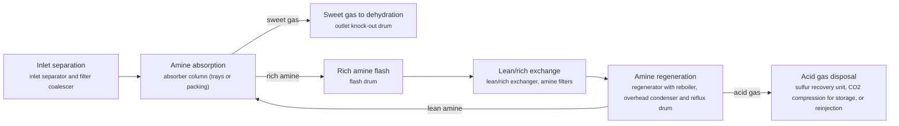

**Key equipment:** inlet separator, amine absorber, flash drum, lean/rich exchanger, regenerator and reboiler, amine filtration, lean amine cooler and pumps.

**Performance:**
- CO2 content of feed gas to LNG pretreatment and after acid gas removal: 50-7050 ppmv CO2; NETL LNG model: removal from about 7,050 ppmv in pipeline feed to about 50 ppmv (low = outlet, high = inlet). [source](https://www.energy.gov/sites/prod/files/2019/09/f66/2019%20NETL%20LCA-GHG%20Report.pdf)

**Reference plants:**
- PETRONAS PFLNG DUA, Rotan field, offshore Sabah, MY: 1.5 Mtpa LNG, 1,300 m water depth; first floating LNG reference for BASF OASE; first cargo 24 March 2021. [source](https://energy-resources.basf.com/global/en/gas-treatment/gas-treatment-oase/solution_natural_gas)

**Missing inputs:**
- TRL range with a cited source (trl): Commercial technology, so TRL 9 is expected, but no source read states it. Where: IEA ETP Clean Energy Technology Guide: TRL per technology and component (CC BY 4.0 data) (catalog: iea-reports, open). Next: Find a TRL table that covers this technology and add trl {low, high, source}.
- capital cost and levelized or unit cost, with dollar year and basis (costs): No open source read so far gives costs for this technology. Refinery and gas plant unit costs are mostly published in paid sources. Where: Oxford Institute for Energy Studies LNG and gas papers (private copy only) (catalog: oxford-oies, open); arXiv: open techno-economic and review papers (collector already runs weekly) (catalog: arxiv, open); Open-access journal techno-economic papers (MDPI Energies, Processes); MDPI is blocked by its CDN, use the manual inbox (blocked); Paid cost databases (consultancies, licensor studies): catalog-only until the owner provides access (paid). Next: Look for an open techno-economic study; record each figure with metric, range, unit, dollar year, basis and source.

Sources: [1](https://www.energy.gov/sites/prod/files/2019/09/f66/2019%20NETL%20LCA-GHG%20Report.pdf), [2](https://energy-resources.basf.com/global/en/gas-treatment/gas-treatment-oase/solution_natural_gas). Last reviewed 2026-10-24.

## Cascade liquefaction

Three pure-component refrigeration cycles in series, propane, ethylene and methane, cool the gas in steps, each in brazed aluminium exchangers or core-in-kettle units. ConocoPhillips' 'two-trains-in-one' layout puts two compressors on each refrigerant service, so the train keeps running at reduced rate when one machine trips.

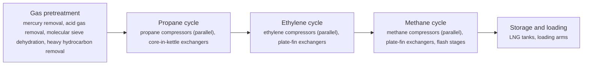

**Key equipment:** propane, ethylene and methane compressors, core-in-kettle and plate-fin exchangers, gas turbine drivers, heavies removal unit, nitrogen rejection unit (option), LNG tanks.

**Performance:**
- reference list capacity: 120.3 Mtpa LNG; 28 trains at 12 operating plants on the ConocoPhillips reference list. [source](https://static.conocophillips.com/files/resources/23-0622-lng-quick-reference-card.pdf)
- plant availability: 95 %; licensor claim for the two-trains-in-one configuration. [source](https://static.conocophillips.com/files/resources/23-0622-lng-quick-reference-card.pdf)
- turndown: 10-100 % of nameplate; licensor claim. [source](https://static.conocophillips.com/files/resources/23-0622-lng-quick-reference-card.pdf)
- pretreatment and liquefaction fuel energy: 2.78-3.35 MJ/kg gas liquefied; NETL model of a US C3MR plant from Mallapragada et al. 2018; range covers adsorption or cryogenic heavy hydrocarbon removal, with or without HRSG; fuel is a parasitic stream of feed gas, not compressor shaft power. [source](https://www.energy.gov/sites/prod/files/2019/09/f66/2019%20NETL%20LCA-GHG%20Report.pdf)

**Reference plants:**
- Sabine Pass Liquefaction, Louisiana, US: 6 trains, 30.0 Mtpa; operating. [source](https://static.conocophillips.com/files/resources/23-0622-lng-quick-reference-card.pdf)
- Corpus Christi Liquefaction, Texas, US: 3 trains, 15.0 Mtpa; operating. [source](https://static.conocophillips.com/files/resources/23-0622-lng-quick-reference-card.pdf)
- Australia Pacific LNG, Curtis Island, AU: 2 trains, 9.0 Mtpa; operating. [source](https://static.conocophillips.com/files/resources/23-0622-lng-quick-reference-card.pdf)
- Darwin LNG, AU: 1 train, 3.7 Mtpa; operating. [source](https://static.conocophillips.com/files/resources/23-0622-lng-quick-reference-card.pdf)

**Missing inputs:**
- TRL range with a cited source (trl): Commercial technology, so TRL 9 is expected, but no source read states it. Where: IEA ETP Clean Energy Technology Guide: TRL per technology and component (CC BY 4.0 data) (catalog: iea-reports, open). Next: Find a TRL table that covers this technology and add trl {low, high, source}.
- capital cost and levelized or unit cost, with dollar year and basis (costs): No open source read so far gives costs for this technology. Refinery and gas plant unit costs are mostly published in paid sources. Where: Oxford Institute for Energy Studies LNG and gas papers (private copy only) (catalog: oxford-oies, open); arXiv: open techno-economic and review papers (collector already runs weekly) (catalog: arxiv, open); Open-access journal techno-economic papers (MDPI Energies, Processes); MDPI is blocked by its CDN, use the manual inbox (blocked); Paid cost databases (consultancies, licensor studies): catalog-only until the owner provides access (paid). Next: Look for an open techno-economic study; record each figure with metric, range, unit, dollar year, basis and source.
- specific power of the liquefaction process (kWh/t LNG) and how it differs from other processes (performance): NETL gives total fuel energy for a C3MR plant (2.78-3.35 MJ/kg) but no source collected gives compressor power by process. Where: [NETL LNG life cycle report 2019 (collected): Exhibit 5-7 only](https://www.energy.gov/sites/prod/files/2019/09/f66/2019%20NETL%20LCA-GHG%20Report.pdf) (catalog: netl, open); IEA gas and LNG reports (catalog: iea-reports, open); Open journal comparisons of LNG processes (MDPI Energies is blocked; use the manual inbox) (blocked); arXiv: open techno-economic and review papers (collector already runs weekly) (catalog: arxiv, open). Next: Find an open paper or report that compares specific power across C3MR, AP-X, cascade, DMR and MFC on the same basis.

Sources: [1](https://static.conocophillips.com/files/resources/23-0622-lng-quick-reference-card.pdf), [2](https://www.energy.gov/sites/prod/files/2019/09/f66/2019%20NETL%20LCA-GHG%20Report.pdf). Last reviewed 2026-10-24.

## Dual mixed refrigerant liquefaction

Two mixed refrigerant cycles replace the propane-plus-mixed-refrigerant arrangement. A precooling mixed refrigerant cools the gas in spiral-wound precoolers, and a second mixed refrigerant of nitrogen, methane, ethane, propane and some butane liquefies the gas over about -40 °C to -150 °C in the main cryogenic heat exchanger. Adjusting the two compositions lets the plant follow seasonal ambient temperature.

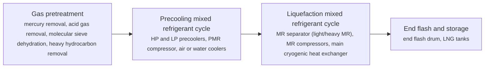

**Key equipment:** spiral-wound precoolers, main cryogenic heat exchanger, precooling and liquefaction MR compressors, gas turbine drivers, MR separators.

**Performance:**
- liquefaction temperature range of the MR cycle: -150--40 °C; Sakhalin LNG plant description. [source](https://gasprocessingnews.com/articles/2018/10/optimal-control-of-mixed-refrigerant-composition-at-sakhalin-lng-plant)
- pretreatment and liquefaction fuel energy: 2.78-3.35 MJ/kg gas liquefied; NETL model of a US C3MR plant from Mallapragada et al. 2018; range covers adsorption or cryogenic heavy hydrocarbon removal, with or without HRSG; fuel is a parasitic stream of feed gas, not compressor shaft power. [source](https://www.energy.gov/sites/prod/files/2019/09/f66/2019%20NETL%20LCA-GHG%20Report.pdf)

**Reference plants:**
- Sakhalin LNG (Prigorodnoye), RU: not stated in source read; operating (Shell DMR). [source](https://gasprocessingnews.com/articles/2018/10/optimal-control-of-mixed-refrigerant-composition-at-sakhalin-lng-plant)

**Missing inputs:**
- TRL range with a cited source (trl): Commercial technology, so TRL 9 is expected, but no source read states it. Where: IEA ETP Clean Energy Technology Guide: TRL per technology and component (CC BY 4.0 data) (catalog: iea-reports, open). Next: Find a TRL table that covers this technology and add trl {low, high, source}.
- capital cost and levelized or unit cost, with dollar year and basis (costs): No open source read so far gives costs for this technology. Refinery and gas plant unit costs are mostly published in paid sources. Where: Oxford Institute for Energy Studies LNG and gas papers (private copy only) (catalog: oxford-oies, open); arXiv: open techno-economic and review papers (collector already runs weekly) (catalog: arxiv, open); Open-access journal techno-economic papers (MDPI Energies, Processes); MDPI is blocked by its CDN, use the manual inbox (blocked); Paid cost databases (consultancies, licensor studies): catalog-only until the owner provides access (paid). Next: Look for an open techno-economic study; record each figure with metric, range, unit, dollar year, basis and source.
- specific power of the liquefaction process (kWh/t LNG) and how it differs from other processes (performance): NETL gives total fuel energy for a C3MR plant (2.78-3.35 MJ/kg) but no source collected gives compressor power by process. Where: [NETL LNG life cycle report 2019 (collected): Exhibit 5-7 only](https://www.energy.gov/sites/prod/files/2019/09/f66/2019%20NETL%20LCA-GHG%20Report.pdf) (catalog: netl, open); IEA gas and LNG reports (catalog: iea-reports, open); Open journal comparisons of LNG processes (MDPI Energies is blocked; use the manual inbox) (blocked); arXiv: open techno-economic and review papers (collector already runs weekly) (catalog: arxiv, open). Next: Find an open paper or report that compares specific power across C3MR, AP-X, cascade, DMR and MFC on the same basis.
- Sakhalin LNG train count and capacity (reference_plants): The Sakhalin article read gives no capacity. Where: Sakhalin Energy publications; GIIGNL annual report (catalog: giignl, open). Next: Add capacity and train count.

Sources: [1](https://gasprocessingnews.com/articles/2018/10/optimal-control-of-mixed-refrigerant-composition-at-sakhalin-lng-plant), [2](https://www.energy.gov/sites/prod/files/2019/09/f66/2019%20NETL%20LCA-GHG%20Report.pdf). Last reviewed 2026-10-24.

## Floating LNG (FLNG)

Gas treating, liquefaction, storage and offloading are built on a moored hull over the field. Processes are chosen for compactness and motion tolerance, for example dual mixed refrigerant or expander cycles, and LNG is transferred to carriers side by side or in tandem.

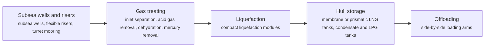

**Key equipment:** turret and mooring, topsides gas treating, liquefaction modules, hull LNG tanks, offloading arms.

**Reference plants:**
- Shell Prelude FLNG, AU: 488 m long; 3.6 Mtpa LNG, 1.3 Mtpa condensate, 0.4 Mtpa LPG; 475 km NNE of Broome; first condensate cargo shipped by March 2019. [source](https://www.offshore-technology.com/news/shell-prelude-flng/)
- PETRONAS PFLNG DUA, Rotan field, Sabah, MY: 1.5 Mtpa LNG in 1,300 m water depth; first cargo 24 March 2021. [source](https://www.petronas.com/media/press-release/petronas-becomes-worlds-first-produce-lng-two-floating-facilities)
- PETRONAS PFLNG SATU, MY: not stated in source read; world's first operational FLNG (2016); moved from Kanowit to Kebabangan field in 2019. [source](https://www.petronas.com/media/press-release/petronas-becomes-worlds-first-produce-lng-two-floating-facilities)

**Missing inputs:**
- TRL range with a cited source (trl): Commercial technology, so TRL 9 is expected, but no source read states it. Where: IEA ETP Clean Energy Technology Guide: TRL per technology and component (CC BY 4.0 data) (catalog: iea-reports, open). Next: Find a TRL table that covers this technology and add trl {low, high, source}.
- capital cost and levelized or unit cost, with dollar year and basis (costs): No open source read so far gives costs for this technology. Refinery and gas plant unit costs are mostly published in paid sources. Where: Oxford Institute for Energy Studies LNG and gas papers (private copy only) (catalog: oxford-oies, open); arXiv: open techno-economic and review papers (collector already runs weekly) (catalog: arxiv, open); Open-access journal techno-economic papers (MDPI Energies, Processes); MDPI is blocked by its CDN, use the manual inbox (blocked); Paid cost databases (consultancies, licensor studies): catalog-only until the owner provides access (paid). Next: Look for an open techno-economic study; record each figure with metric, range, unit, dollar year, basis and source.
- key performance figures (energy use, yields, capture or conversion rate) (performance): No source read so far gives performance figures. Where: Supplier datasheets and brochures for the companies listed on the card (open); arXiv: open techno-economic and review papers (collector already runs weekly) (catalog: arxiv, open); Oxford Institute for Energy Studies LNG and gas papers (private copy only) (catalog: oxford-oies, open). Next: Add the figures that matter for comparing options, each with its basis and source.
- PFLNG SATU capacity (reference_plants): The PETRONAS release read does not state SATU's capacity. Where: PETRONAS press releases on PFLNG SATU (2016) (catalog: petronas-tech, open). Next: Add capacity with source.

Sources: [1](https://www.offshore-technology.com/news/shell-prelude-flng/), [2](https://www.petronas.com/media/press-release/petronas-becomes-worlds-first-produce-lng-two-floating-facilities). Last reviewed 2026-10-24.

## Floating storage and regasification units (FSRU)

A ship with LNG tanks and onboard vaporisers is moored at a jetty or buoy. LNG from carriers is transferred ship to ship, stored, pumped to pressure and vaporised with seawater or a closed loop, then sent to shore through a high-pressure arm or pipeline. NETL's import terminal model uses open rack vaporisers, which serve about all Asian and about 60% of European terminals.

**Key equipment:** LNG cargo tanks, BOG compressor or recondenser, HP send-out pumps, vaporisers, metering, jetty or buoy mooring.

**Performance:**
- regasification energy requirement: 0.214 MJ/kg LNG; NETL import terminal model (open rack vaporisers). [source](https://www.energy.gov/sites/prod/files/2019/09/f66/2019%20NETL%20LCA-GHG%20Report.pdf)
- newbuild FSRU send-out capacity: 1000 MMscf/d; Excelerate newbuild at HHI, 170,000 m3 storage, delivery June 2026. [source](https://excelerateenergy.com/news/excelerate-energy-finalizes-agreement-with-hhi-for-newbuild-fsru/)

**Reference plants:**
- Excelerate newbuild FSRU (Hyundai Heavy Industries): 170,000 m3 storage, 1,000 MMscf/d send-out; fleet of 11 FSRUs operating or building; delivery June 2026. [source](https://excelerateenergy.com/news/excelerate-energy-finalizes-agreement-with-hhi-for-newbuild-fsru/)

**Missing inputs:**
- TRL range with a cited source (trl): Commercial technology, so TRL 9 is expected, but no source read states it. Where: IEA ETP Clean Energy Technology Guide: TRL per technology and component (CC BY 4.0 data) (catalog: iea-reports, open). Next: Find a TRL table that covers this technology and add trl {low, high, source}.
- capital cost and levelized or unit cost, with dollar year and basis (costs): No open source read so far gives costs for this technology. Refinery and gas plant unit costs are mostly published in paid sources. Where: Oxford Institute for Energy Studies LNG and gas papers (private copy only) (catalog: oxford-oies, open); arXiv: open techno-economic and review papers (collector already runs weekly) (catalog: arxiv, open); Open-access journal techno-economic papers (MDPI Energies, Processes); MDPI is blocked by its CDN, use the manual inbox (blocked); Paid cost databases (consultancies, licensor studies): catalog-only until the owner provides access (paid). Next: Look for an open techno-economic study; record each figure with metric, range, unit, dollar year, basis and source.

Sources: [1](https://www.energy.gov/sites/prod/files/2019/09/f66/2019%20NETL%20LCA-GHG%20Report.pdf), [2](https://excelerateenergy.com/news/excelerate-energy-finalizes-agreement-with-hhi-for-newbuild-fsru/). Last reviewed 2026-10-24.

## Gas-to-liquids (Fischer-Tropsch)

Natural gas is converted to syngas by partial oxidation or reforming with oxygen. Fischer-Tropsch synthesis over a cobalt catalyst builds long-chain paraffinic waxes, which are hydrocracked and fractionated into clean diesel, kerosene, naphtha and base oils.

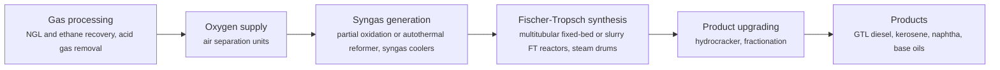

**Key equipment:** air separation units, syngas generators, FT reactors, hydrocracker, fractionation, water treatment.

**Reference plants:**
- Pearl GTL, Ras Laffan, QA: 140,000 bbl/d GTL products in two 70,000 bbl/d trains, plus about 120,000 boe/d NGLs and ethane, from 1.6 bcf/d North Field gas; first sour gas into the plant March 2011. [source](https://www.offshore-technology.com/projects/pearl/)

**Missing inputs:**
- TRL range with a cited source (trl): Commercial technology, so TRL 9 is expected, but no source read states it. Where: IEA ETP Clean Energy Technology Guide: TRL per technology and component (CC BY 4.0 data) (catalog: iea-reports, open). Next: Find a TRL table that covers this technology and add trl {low, high, source}.
- capital cost and levelized or unit cost, with dollar year and basis (costs): No open source read so far gives costs for this technology. Refinery and gas plant unit costs are mostly published in paid sources. Where: Oxford Institute for Energy Studies LNG and gas papers (private copy only) (catalog: oxford-oies, open); arXiv: open techno-economic and review papers (collector already runs weekly) (catalog: arxiv, open); Open-access journal techno-economic papers (MDPI Energies, Processes); MDPI is blocked by its CDN, use the manual inbox (blocked); Paid cost databases (consultancies, licensor studies): catalog-only until the owner provides access (paid). Next: Look for an open techno-economic study; record each figure with metric, range, unit, dollar year, basis and source.
- key performance figures (energy use, yields, capture or conversion rate) (performance): No source read so far gives performance figures. Where: Supplier datasheets and brochures for the companies listed on the card (open); arXiv: open techno-economic and review papers (collector already runs weekly) (catalog: arxiv, open); Oxford Institute for Energy Studies LNG and gas papers (private copy only) (catalog: oxford-oies, open). Next: Add the figures that matter for comparing options, each with its basis and source.

Sources: [1](https://www.offshore-technology.com/projects/pearl/). Last reviewed 2026-10-24.

## Membrane CO2 removal for high-CO2 gas

Gas flows past a polymer membrane. CO2, H2S and water dissolve into and diffuse through the polymer faster than methane, so they collect on the low-pressure permeate side while methane stays at pressure in the residue. Pretreatment protects the membrane from liquids and heavy hydrocarbons, and two stages or a permeate compressor can be used to reduce methane losses.

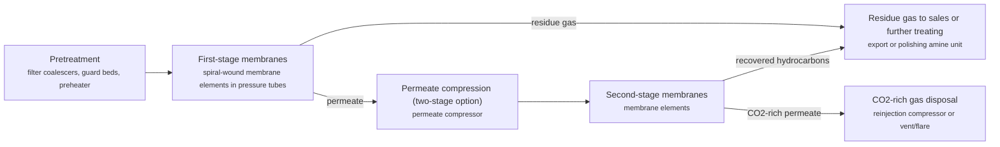

**Key equipment:** filter coalescers and guard beds, preheater, membrane skids, permeate compressor, reinjection compressor.

**Performance:**
- typical feed CO2 content: 3-90 mol% CO2; UOP Separex datasheet, typical range. [source](https://www.honeywell.com.cn/content/dam/honcn/documents/lifecycle-solutions/all-equipment-and-aftermarke/modular-solutions/gas-processing/UOP-Separex-membrane-elements-datasheet.pdf)

**Reference plants:**
- Separex offshore system, South China Sea: 680 MMSCFD on a large platform; installed (per 2016 datasheet). [source](https://www.honeywell.com.cn/content/dam/honcn/documents/lifecycle-solutions/all-equipment-and-aftermarke/modular-solutions/gas-processing/UOP-Separex-membrane-elements-datasheet.pdf)
- Separex trains, Egyptian desert, EG: three trains expanding to five, 560 MMSCFD total; per 2016 datasheet. [source](https://www.honeywell.com.cn/content/dam/honcn/documents/lifecycle-solutions/all-equipment-and-aftermarke/modular-solutions/gas-processing/UOP-Separex-membrane-elements-datasheet.pdf)

**Missing inputs:**
- TRL range with a cited source (trl): Commercial technology, so TRL 9 is expected, but no source read states it. Where: IEA ETP Clean Energy Technology Guide: TRL per technology and component (CC BY 4.0 data) (catalog: iea-reports, open). Next: Find a TRL table that covers this technology and add trl {low, high, source}.
- capital cost and levelized or unit cost, with dollar year and basis (costs): No open source read so far gives costs for this technology. Refinery and gas plant unit costs are mostly published in paid sources. Where: Oxford Institute for Energy Studies LNG and gas papers (private copy only) (catalog: oxford-oies, open); arXiv: open techno-economic and review papers (collector already runs weekly) (catalog: arxiv, open); Open-access journal techno-economic papers (MDPI Energies, Processes); MDPI is blocked by its CDN, use the manual inbox (blocked); Paid cost databases (consultancies, licensor studies): catalog-only until the owner provides access (paid). Next: Look for an open techno-economic study; record each figure with metric, range, unit, dollar year, basis and source.

Sources: [1](https://www.honeywell.com.cn/content/dam/honcn/documents/lifecycle-solutions/all-equipment-and-aftermarke/modular-solutions/gas-processing/UOP-Separex-membrane-elements-datasheet.pdf). Last reviewed 2026-10-24.

## Mercury removal units

Gas passes through fixed beds of sorbent, typically metal sulfides on alumina, which react irreversibly with mercury to form stable mercury sulfide. Mercury must be removed because it corrodes aluminium cryogenic heat exchangers. Modern designs place the beds upstream, close to the wells, rather than downstream of dryers as was common historically.

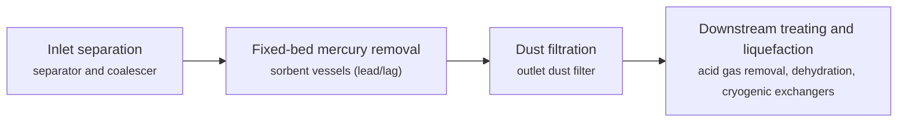

**Key equipment:** inlet coalescer, mercury removal vessels with sorbent, dust filter, mercury analysers, spent sorbent handling.

**Performance:**
- mercury specification for LNG: up to 10 ng/Nm3; Axens; matches the quantification limit of current analysers; raw gas ranges from undetected to 300 µg/Nm3. [source](https://blog.axens.net/how-to-remove-mercury-from-extracted-natural-gas)

**Missing inputs:**
- TRL range with a cited source (trl): Commercial technology, so TRL 9 is expected, but no source read states it. Where: IEA ETP Clean Energy Technology Guide: TRL per technology and component (CC BY 4.0 data) (catalog: iea-reports, open). Next: Find a TRL table that covers this technology and add trl {low, high, source}.
- capital cost and levelized or unit cost, with dollar year and basis (costs): No open source read so far gives costs for this technology. Refinery and gas plant unit costs are mostly published in paid sources. Where: Oxford Institute for Energy Studies LNG and gas papers (private copy only) (catalog: oxford-oies, open); arXiv: open techno-economic and review papers (collector already runs weekly) (catalog: arxiv, open); Open-access journal techno-economic papers (MDPI Energies, Processes); MDPI is blocked by its CDN, use the manual inbox (blocked); Paid cost databases (consultancies, licensor studies): catalog-only until the owner provides access (paid). Next: Look for an open techno-economic study; record each figure with metric, range, unit, dollar year, basis and source.
- named operating or planned plants with capacity and status (reference_plants): No plant was named in the sources read. Where: GIIGNL annual report: LNG plants and terminals by country (private copy only) (catalog: giignl, open); Press releases from the suppliers listed on the card (open). Next: Add one to three reference plants with country, capacity, status and source.

Sources: [1](https://blog.axens.net/how-to-remove-mercury-from-extracted-natural-gas). Last reviewed 2026-10-24.

## Mixed fluid cascade

Developed by Statoil and Linde for Arctic conditions, the process uses mixed refrigerant cycles in a cascade for precooling, liquefaction and subcooling, with Linde coil-wound and plate-fin exchangers. At Hammerfest LNG all main compressors are electrically driven to raise availability.

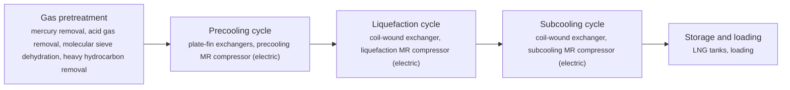

**Key equipment:** coil-wound heat exchangers, plate-fin exchangers, three refrigerant compressors with electric motors, LNG tanks.

**Performance:**
- plant capacity, Hammerfest LNG: 4.3 Mtpa LNG; design; running at up to 109% of design after 2011 revision shutdown. [source](https://www.hydrocarbonprocessing.com/news/2011/12/linde-statoil-say-joint-arctic-lng-plant-exceeding-performance-expectations/)

**Reference plants:**
- Hammerfest LNG, Melkøya, NO: 4.3 Mtpa; all main compressors electric; operating; passed performance test 2011, energy use below guarantee. [source](https://www.hydrocarbonprocessing.com/news/2011/12/linde-statoil-say-joint-arctic-lng-plant-exceeding-performance-expectations/)

**Missing inputs:**
- TRL range with a cited source (trl): Commercial technology, so TRL 9 is expected, but no source read states it. Where: IEA ETP Clean Energy Technology Guide: TRL per technology and component (CC BY 4.0 data) (catalog: iea-reports, open). Next: Find a TRL table that covers this technology and add trl {low, high, source}.
- capital cost and levelized or unit cost, with dollar year and basis (costs): No open source read so far gives costs for this technology. Refinery and gas plant unit costs are mostly published in paid sources. Where: Oxford Institute for Energy Studies LNG and gas papers (private copy only) (catalog: oxford-oies, open); arXiv: open techno-economic and review papers (collector already runs weekly) (catalog: arxiv, open); Open-access journal techno-economic papers (MDPI Energies, Processes); MDPI is blocked by its CDN, use the manual inbox (blocked); Paid cost databases (consultancies, licensor studies): catalog-only until the owner provides access (paid). Next: Look for an open techno-economic study; record each figure with metric, range, unit, dollar year, basis and source.
- specific power of the liquefaction process (kWh/t LNG) and how it differs from other processes (performance): NETL gives total fuel energy for a C3MR plant (2.78-3.35 MJ/kg) but no source collected gives compressor power by process. Where: [NETL LNG life cycle report 2019 (collected): Exhibit 5-7 only](https://www.energy.gov/sites/prod/files/2019/09/f66/2019%20NETL%20LCA-GHG%20Report.pdf) (catalog: netl, open); IEA gas and LNG reports (catalog: iea-reports, open); Open journal comparisons of LNG processes (MDPI Energies is blocked; use the manual inbox) (blocked); arXiv: open techno-economic and review papers (collector already runs weekly) (catalog: arxiv, open). Next: Find an open paper or report that compares specific power across C3MR, AP-X, cascade, DMR and MFC on the same basis.
- number and arrangement of MFC refrigerant cycles (process): Described from general knowledge; the source read confirms only name, capacity and electric drive. Where: Linde Engineering MFC process literature (catalog: linde-engineering, open). Next: Confirm the cycle arrangement from a Linde source and cite it.

Sources: [1](https://www.hydrocarbonprocessing.com/news/2011/12/linde-statoil-say-joint-arctic-lng-plant-exceeding-performance-expectations/). Last reviewed 2026-10-24.

## Molecular sieve and glycol dehydration

Water is removed so it cannot form hydrates, ice or corrosive liquids. Glycol units absorb water into triethylene glycol, which is regenerated by heating, and are enough for pipeline specifications. Cryogenic plants use molecular sieve beds that adsorb water to very low levels and are regenerated by hot gas in a timed cycle. NETL's LNG model dries gas to below 0.5 ppmv water ahead of liquefaction.

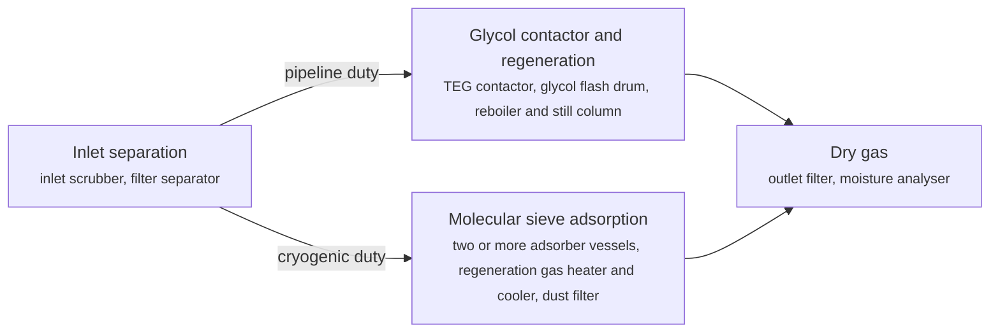

**Key equipment:** inlet scrubber, TEG contactor and regenerator, molecular sieve adsorbers, regeneration heater, dust filters, moisture analysers.

**Performance:**
- water content after molecular sieve dehydration for LNG: up to 0.5 ppmv H2O; NETL LNG pretreatment assumption (below 0.5 ppmv). [source](https://www.energy.gov/sites/prod/files/2019/09/f66/2019%20NETL%20LCA-GHG%20Report.pdf)

**Missing inputs:**
- TRL range with a cited source (trl): Commercial technology, so TRL 9 is expected, but no source read states it. Where: IEA ETP Clean Energy Technology Guide: TRL per technology and component (CC BY 4.0 data) (catalog: iea-reports, open). Next: Find a TRL table that covers this technology and add trl {low, high, source}.
- capital cost and levelized or unit cost, with dollar year and basis (costs): No open source read so far gives costs for this technology. Refinery and gas plant unit costs are mostly published in paid sources. Where: Oxford Institute for Energy Studies LNG and gas papers (private copy only) (catalog: oxford-oies, open); arXiv: open techno-economic and review papers (collector already runs weekly) (catalog: arxiv, open); Open-access journal techno-economic papers (MDPI Energies, Processes); MDPI is blocked by its CDN, use the manual inbox (blocked); Paid cost databases (consultancies, licensor studies): catalog-only until the owner provides access (paid). Next: Look for an open techno-economic study; record each figure with metric, range, unit, dollar year, basis and source.
- named operating or planned plants with capacity and status (reference_plants): No plant was named in the sources read. Where: GIIGNL annual report: LNG plants and terminals by country (private copy only) (catalog: giignl, open); Press releases from the suppliers listed on the card (open). Next: Add one to three reference plants with country, capacity, status and source.

Sources: [1](https://www.energy.gov/sites/prod/files/2019/09/f66/2019%20NETL%20LCA-GHG%20Report.pdf). Last reviewed 2026-10-24.

## Propane-precooled mixed refrigerant liquefaction (C3MR, AP-X)

A propane refrigeration cycle precools the feed gas and the mixed refrigerant. A mixed refrigerant of nitrogen, methane, ethane and propane then liquefies and subcools the gas in a coil-wound main cryogenic heat exchanger. AP-X adds a nitrogen expander loop that subcools LNG from about -115 °C to about -150 °C, cutting mixed refrigerant flow by 40% per unit of LNG and allowing trains of 7.8 Mtpa and more.

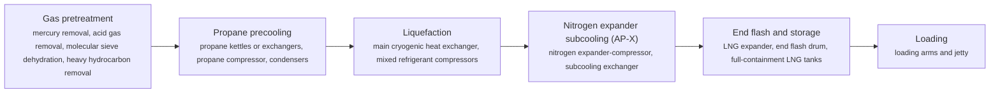

**Key equipment:** main cryogenic heat exchanger, propane compressor, mixed refrigerant compressors, gas turbine or electric drivers, nitrogen expander (AP-X), LNG tanks.

**Performance:**
- train capacity, AP-X (Qatar): 7.8 Mtpa LNG; design capacity of the six original Qatar AP-X trains and four North Field East trains; Air Products says trains can exceed 10 Mtpa. [source](https://www.airproducts.co.uk/-/media/files/en/lng/lng-technology-enables-largest-lng-trains.pdf)
- pretreatment and liquefaction fuel energy: 2.78-3.35 MJ/kg gas liquefied; NETL model of a US C3MR plant from Mallapragada et al. 2018; range covers adsorption or cryogenic heavy hydrocarbon removal, with or without HRSG; fuel is a parasitic stream of feed gas, not compressor shaft power. [source](https://www.energy.gov/sites/prod/files/2019/09/f66/2019%20NETL%20LCA-GHG%20Report.pdf)

**Reference plants:**
- Ras Laffan LNG trains, QA: 14 trains on AP-C3MR or AP-X; AP-X trains 7.8 Mtpa each; operating; four North Field East AP-X trains in development. [source](https://www.airproducts.co.uk/-/media/files/en/lng/lng-technology-enables-largest-lng-trains.pdf)

**Missing inputs:**
- TRL range with a cited source (trl): Commercial technology, so TRL 9 is expected, but no source read states it. Where: IEA ETP Clean Energy Technology Guide: TRL per technology and component (CC BY 4.0 data) (catalog: iea-reports, open). Next: Find a TRL table that covers this technology and add trl {low, high, source}.
- capital cost and levelized or unit cost, with dollar year and basis (costs): No open source read so far gives costs for this technology. Refinery and gas plant unit costs are mostly published in paid sources. Where: Oxford Institute for Energy Studies LNG and gas papers (private copy only) (catalog: oxford-oies, open); arXiv: open techno-economic and review papers (collector already runs weekly) (catalog: arxiv, open); Open-access journal techno-economic papers (MDPI Energies, Processes); MDPI is blocked by its CDN, use the manual inbox (blocked); Paid cost databases (consultancies, licensor studies): catalog-only until the owner provides access (paid). Next: Look for an open techno-economic study; record each figure with metric, range, unit, dollar year, basis and source.
- specific power of the liquefaction process (kWh/t LNG) and how it differs from other processes (performance): NETL gives total fuel energy for a C3MR plant (2.78-3.35 MJ/kg) but no source collected gives compressor power by process. Where: [NETL LNG life cycle report 2019 (collected): Exhibit 5-7 only](https://www.energy.gov/sites/prod/files/2019/09/f66/2019%20NETL%20LCA-GHG%20Report.pdf) (catalog: netl, open); IEA gas and LNG reports (catalog: iea-reports, open); Open journal comparisons of LNG processes (MDPI Energies is blocked; use the manual inbox) (blocked); arXiv: open techno-economic and review papers (collector already runs weekly) (catalog: arxiv, open). Next: Find an open paper or report that compares specific power across C3MR, AP-X, cascade, DMR and MFC on the same basis.

Sources: [1](https://www.airproducts.co.uk/-/media/files/en/lng/lng-technology-enables-largest-lng-trains.pdf), [2](https://www.energy.gov/sites/prod/files/2019/09/f66/2019%20NETL%20LCA-GHG%20Report.pdf). Last reviewed 2026-10-24.

## Sulfur recovery (Claus, tail gas treating, SuperClaus)

Acid gas is partly burned in a reaction furnace, converting 60 to 70% of the H2S, and the rest reacts with SO2 over catalytic converters to make elemental sulfur, taking recovery beyond 95% (BASF). A tail gas unit hydrogenates the remaining sulfur species to H2S over a CoMo catalyst and removes it with a selective amine, which BASF and Baker Hughes say lifts total recovery above 99.9%.

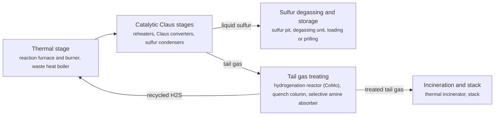

**Key equipment:** reaction furnace, waste heat boiler, Claus converters, sulfur condensers, hydrogenation reactor, quench column, selective amine absorber, incinerator.

**Performance:**
- H2S conversion in the reaction furnace: 60-70 %; BASF. [source](https://energy-resources.basf.com/dam/jcr:46d84926-60eb-3d04-bded-8a1571daa961/basf/energy-resources/download-center-sheets/SRU_Tailgas_Treatment_Brochure.pdf)
- overall sulfur recovery with hydrogenation/amine tail gas treating: 99.9 %; BASF and Baker Hughes claims (above 99.9%). [source](https://energy-resources.basf.com/dam/jcr:46d84926-60eb-3d04-bded-8a1571daa961/basf/energy-resources/download-center-sheets/SRU_Tailgas_Treatment_Brochure.pdf)

**Missing inputs:**
- TRL range with a cited source (trl): Commercial technology, so TRL 9 is expected, but no source read states it. Where: IEA ETP Clean Energy Technology Guide: TRL per technology and component (CC BY 4.0 data) (catalog: iea-reports, open). Next: Find a TRL table that covers this technology and add trl {low, high, source}.
- capital cost and levelized or unit cost, with dollar year and basis (costs): No open source read so far gives costs for this technology. Refinery and gas plant unit costs are mostly published in paid sources. Where: Oxford Institute for Energy Studies LNG and gas papers (private copy only) (catalog: oxford-oies, open); arXiv: open techno-economic and review papers (collector already runs weekly) (catalog: arxiv, open); Open-access journal techno-economic papers (MDPI Energies, Processes); MDPI is blocked by its CDN, use the manual inbox (blocked); Paid cost databases (consultancies, licensor studies): catalog-only until the owner provides access (paid). Next: Look for an open techno-economic study; record each figure with metric, range, unit, dollar year, basis and source.
- named operating or planned plants with capacity and status (reference_plants): No plant was named in the sources read. Where: GIIGNL annual report: LNG plants and terminals by country (private copy only) (catalog: giignl, open); Press releases from the suppliers listed on the card (open). Next: Add one to three reference plants with country, capacity, status and source.

Sources: [1](https://energy-resources.basf.com/dam/jcr:46d84926-60eb-3d04-bded-8a1571daa961/basf/energy-resources/download-center-sheets/SRU_Tailgas_Treatment_Brochure.pdf), [2](https://www.bakerhughes.com/acid-gas-treatment-and-sulfur-recovery). Last reviewed 2026-10-24.

## Turbo-expander NGL recovery (GSP, RSV processes)

Dry gas is chilled against cold residue gas, then expanded through a turbo-expander, which cools it further and drives a recompressor. A demethaniser column separates methane-rich residue gas from the natural gas liquids. Ortloff variants such as GSP and RSV use subcooled reflux or recycled residue gas to raise ethane recovery, and can switch to ethane rejection while keeping propane recovery high.

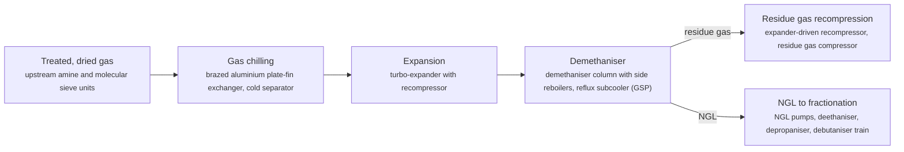

**Key equipment:** plate-fin heat exchanger, cold separator, turbo-expander/recompressor, demethaniser, residue gas compressor, NGL pumps.

**Performance:**
- product recovery, Ortloff ultra-high recovery processes: 99 %; Honeywell UOP brochure (more than 99%); flexible processes keep 99%+ propane recovery in ethane rejection. [source](https://www.honeywell.com.cn/content/dam/honcn/download/oil-and-gas/natural-gas-treatment-and-recovery/honeywell-uop-ortloff-ngl-recovery-brochure.pdf)

**Missing inputs:**
- TRL range with a cited source (trl): Commercial technology, so TRL 9 is expected, but no source read states it. Where: IEA ETP Clean Energy Technology Guide: TRL per technology and component (CC BY 4.0 data) (catalog: iea-reports, open). Next: Find a TRL table that covers this technology and add trl {low, high, source}.
- capital cost and levelized or unit cost, with dollar year and basis (costs): No open source read so far gives costs for this technology. Refinery and gas plant unit costs are mostly published in paid sources. Where: Oxford Institute for Energy Studies LNG and gas papers (private copy only) (catalog: oxford-oies, open); arXiv: open techno-economic and review papers (collector already runs weekly) (catalog: arxiv, open); Open-access journal techno-economic papers (MDPI Energies, Processes); MDPI is blocked by its CDN, use the manual inbox (blocked); Paid cost databases (consultancies, licensor studies): catalog-only until the owner provides access (paid). Next: Look for an open techno-economic study; record each figure with metric, range, unit, dollar year, basis and source.
- named operating or planned plants with capacity and status (reference_plants): No plant was named in the sources read. Where: GIIGNL annual report: LNG plants and terminals by country (private copy only) (catalog: giignl, open); Press releases from the suppliers listed on the card (open). Next: Add one to three reference plants with country, capacity, status and source.

Sources: [1](https://www.honeywell.com.cn/content/dam/honcn/download/oil-and-gas/natural-gas-treatment-and-recovery/honeywell-uop-ortloff-ngl-recovery-brochure.pdf). Last reviewed 2026-10-24.
