# H2 technology options

12 technologies, from commercial to lab stage. Generated from catalog/technologies/; every figure links to its source.

| Technology | Category | Maturity | TRL | Suppliers | Cost figures |
| --- | --- | --- | --- | --- | --- |
| [Alkaline water electrolysis](#h2-alkaline-electrolysis) | Hydrogen production / electrolysis | commercial |  | Thyssenkrupp nucera (20 MW alkaline water electrolysis module); John Cockerill; LONGi Hydrogen; PERIC; Nel Hydrogen; HydrogenPro | uninstalled system capital cost (status): 500-750 USD/kW (2020$) |
| [Autothermal reforming with CO2 capture (blue hydrogen)](#h2-atr-ccs) | Hydrogen production / reforming with capture | commercial |  | Topsoe (SynCOR); Johnson Matthey (Honeywell) (LCH); Air Products | levelized cost of hydrogen, ATR with 94.5% capture: 1.51-1.59 USD/kg H2 (2018$) |
| [Liquid hydrogen](#h2-liquid-hydrogen) | Hydrogen carrier / liquefaction | commercial |  | Linde Engineering; Air Products; Kawasaki Heavy Industries (LH2 carrier and terminal) |  |
| [PEM electrolysis](#h2-pem-electrolysis) | Hydrogen production / electrolysis | commercial |  | Siemens Energy (Silyzer); ITM Power; Plug Power; Cummins (Accelera); Nel Hydrogen | PEM stack capital cost (status; DOE ultimate target 100): 350 USD/kW (2023$)<br>uninstalled system capital cost (status): 700-1100 USD/kW (2020$)<br>levelized cost of hydrogen, hybrid wind-PV power: 4.4-6 USD/kg H2 (2022$)<br>levelized cost of hydrogen, average US grid power: 6.8-8.2 USD/kg H2 (2022$) |
| [Steam methane reforming](#h2-smr) | Hydrogen production / reforming | commercial |  | Topsoe; Air Liquide; Technip Energies; Linde Engineering; Air Products | levelized cost of hydrogen, SMR without capture: 1.06 USD/kg H2 (2018$)<br>levelized cost of hydrogen, SMR with 96.2% CO2 capture: 1.54-1.64 USD/kg H2 (2018$) |
| [Ammonia as hydrogen carrier and ammonia cracking](#h2-ammonia-cracking) | Hydrogen carrier / reconversion | demonstration |  | KBR (H2ACT); Topsoe; Johnson Matthey (Honeywell); Air Products |  |
| [Green and blue ammonia](#h2-green-blue-ammonia) | Hydrogen derivative / ammonia synthesis | demonstration |  | Topsoe; KBR; Thyssenkrupp Uhde; Casale; Air Products |  |
| [Hydrogen storage in salt caverns](#h2-salt-cavern-storage) | Hydrogen storage | demonstration |  | Mitsubishi Power; Magnum Development; HyStock (Gasunie) |  |
| [Liquid organic hydrogen carriers (MCH, DBT)](#h2-lohc) | Hydrogen carrier | demonstration |  | Chiyoda (SPERA Hydrogen (MCH)); Hydrogenious LOHC Technologies (dibenzyltoluene LOHC) |  |
| [Methane pyrolysis (turquoise hydrogen)](#h2-methane-pyrolysis) | Hydrogen production / pyrolysis | demonstration |  | Monolith (plasma methane pyrolysis); BASF (methane pyrolysis pilot); Hazer Group |  |
| [Solid oxide electrolysis](#h2-soec) | Hydrogen production / electrolysis | demonstration |  | Topsoe (SOEC electrolyser (Herning factory, 500 MW/yr initial)); Bloom Energy; Sunfire | uninstalled system capital cost (status): 2000-2500 USD/kW (2020$) |
| [AEM electrolysis](#h2-aem-electrolysis) | Hydrogen production / electrolysis | pilot |  | Enapter (AEM Nexus 1000 and smaller modules) |  |

## Alkaline water electrolysis
<a id="h2-alkaline-electrolysis"></a>

Two electrodes sit in a liquid alkaline electrolyte of potassium or sodium hydroxide, separated by a diaphragm. Water is split by direct current: hydrogen forms at the cathode and oxygen at the anode, and the electrolyte circulates through gas separators. DOE gives an operating range of 60 to 90 °C.

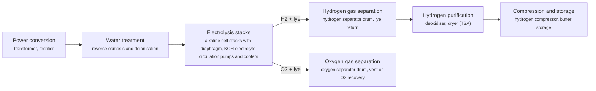

**Key equipment:** transformer and rectifier, alkaline electrolyser stacks, gas-liquid separators, lye circulation and cooling, deoxidiser and dryer, water treatment, hydrogen compressor.

**Performance:**
- operating temperature: 60-90 °C; DOE description of alkaline electrolysers. [source](https://www.energy.gov/eere/fuelcells/hydrogen-production-electrolysis)
- standard module size (thyssenkrupp): 20 MW; thyssenkrupp 20 MW alkaline module used for NEOM and Holland Hydrogen 1. [source](https://ammoniaenergy.org/articles/thyssenkrupp-to-install-2-plus-gw-of-electrolysers-for-neom)
- system electricity use (status, beginning of life): 55 kWh/kg H2; DOE status for liquid alkaline; stack 51 kWh/kg; ultimate target system 48. [source](https://www.energy.gov/sites/default/files/2024-12/hydrogen-shot-water-electrolysis-technology-assessment.pdf)
- stack lifetime (status): 60000 h; DOE status table for liquid alkaline; 0.5 A/cm2 at 1.9 V. [source](https://www.energy.gov/sites/default/files/2024-12/hydrogen-shot-water-electrolysis-technology-assessment.pdf)

**Costs:**
- uninstalled system capital cost (status): 500-750 USD/kW (2020$); DOE H2A-Lite current status for liquid alkaline, 50 t/day plant, based on 4.5 MW stacks and 10 MW modules; installed about 2x (1,000-1,500). [source](https://www.energy.gov/sites/default/files/2024-12/hydrogen-shot-water-electrolysis-technology-assessment.pdf)

**Reference plants:**
- NEOM Green Hydrogen Project, SA: 2 GW+ alkaline electrolysis in 20 MW modules (thyssenkrupp), 600 t/day hydrogen; electrolyser commissioning after 4 GW renewables due mid-2026; first product expected 2027. [source](https://acwapower.com/en/what-we-do/projects/neom-green-hydrogen-project/)
- Sinopec Kuqa green hydrogen pilot, Xinjiang, CN: 20,000 t/yr green hydrogen from solar power; 210,000 m3 hydrogen storage; supplies Tahe Refining & Chemical; in operation from 2023. [source](https://www.aap.com.au/aapreleases/cision20230703ae48443)
- Holland Hydrogen 1 (Shell), Rotterdam, NL: 200 MW, thyssenkrupp 20 MW alkaline modules; hydrogen piped about 40 km to Shell Energy and Chemicals Park Rotterdam; announced January 2022 with start of production intended for 2024. [source](https://digitalrefining.com/news/1006809,thyssenkrupp-to-install-200-mw-green-hydrogen-facility-for-shell-in-port-of-rotterdam.html)
- ACES Delta, Utah, US: 220 MW alkaline (HydrogenPro), up to 100 t/day hydrogen stored in salt caverns; USD 504.4 million conditional DOE loan guarantee, April 2022. [source](https://www.powermag.com/aces-deltas-giant-utah-salt-cavern-hydrogen-storage-project-gets-504m-conditional-doe-loan-guarantee/)

Sources: [1](https://www.energy.gov/eere/fuelcells/hydrogen-production-electrolysis), [2](https://ammoniaenergy.org/articles/thyssenkrupp-to-install-2-plus-gw-of-electrolysers-for-neom), [3](https://acwapower.com/en/what-we-do/projects/neom-green-hydrogen-project/), [4](https://www.aap.com.au/aapreleases/cision20230703ae48443), [5](https://digitalrefining.com/news/1006809,thyssenkrupp-to-install-200-mw-green-hydrogen-facility-for-shell-in-port-of-rotterdam.html), [6](https://www.powermag.com/aces-deltas-giant-utah-salt-cavern-hydrogen-storage-project-gets-504m-conditional-doe-loan-guarantee/), [7](https://www.energy.gov/sites/default/files/2024-12/hydrogen-shot-water-electrolysis-technology-assessment.pdf). Last reviewed 2026-10-24.

## Autothermal reforming with CO2 capture (blue hydrogen)
<a id="h2-atr-ccs"></a>

Natural gas is partly combusted with oxygen from an air separation unit inside the reformer, which supplies the heat for steam reforming in the same vessel. Because there is no large fired furnace, almost all CO2 ends up in the high-pressure shifted syngas, where a solvent unit removes it at high capture rates. A small fired heater remains for preheating.

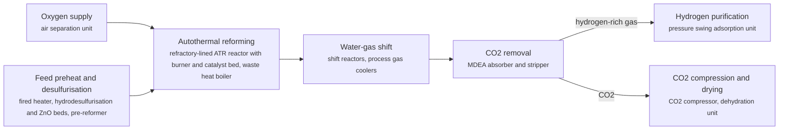

**Key equipment:** air separation unit, ATR reactor, fired heater, shift reactors, MDEA CO2 removal, PSA unit, CO2 compressor.

**Performance:**
- CO2 capture rate (NETL reference case): 94.5 %; NETL ATR case. [source](https://www.netl.doe.gov/projects/files/ComparisonofCommercialStateofArtFossilBasedHydrogenProductionTechnologies_041222.pdf)
- plant hydrogen output (NETL reference case): 660000 kg H2/day; NETL ATR case design capacity. [source](https://www.netl.doe.gov/projects/files/ComparisonofCommercialStateofArtFossilBasedHydrogenProductionTechnologies_041222.pdf)

**Costs:**
- levelized cost of hydrogen, ATR with 94.5% capture: 1.51-1.59 USD/kg H2 (2018$); NETL 2022; natural gas USD 4.42/MMBtu, 90% capacity factor, CO2 transport and storage at USD 10/t where included; low excludes and high includes CO2 transport and storage. [source](https://www.netl.doe.gov/projects/files/ComparisonofCommercialStateofArtFossilBasedHydrogenProductionTechnologies_041222.pdf)

Sources: [1](https://www.netl.doe.gov/projects/files/ComparisonofCommercialStateofArtFossilBasedHydrogenProductionTechnologies_041222.pdf). Last reviewed 2026-10-24.

## Liquid hydrogen
<a id="h2-liquid-hydrogen"></a>

Hydrogen is cooled to about -253 °C in a liquefier using precooling and a hydrogen or helium refrigeration cycle, with ortho-para conversion catalysts so the liquid does not boil off from conversion heat. The liquid is stored and shipped in vacuum-insulated tanks and regasified at the user.

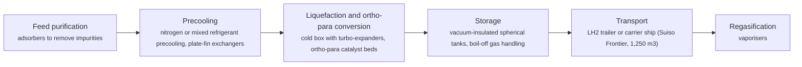

**Key equipment:** hydrogen liquefier cold box, precooling system, turbo-expanders and compressors, ortho-para converters, vacuum-insulated storage, LH2 carrier or trailers.

**Performance:**
- storage temperature: -253 °C; Suiso Frontier cargo tank. [source](https://www.hydrogenenergysupplychain.com/supply-chain/the-suiso-frontier/)
- carrier cargo tank volume (Suiso Frontier): 1250 m3; Kawasaki Heavy Industries, 116 m ship, completed 2020. [source](https://www.hydrogenenergysupplychain.com/supply-chain/the-suiso-frontier/)

**Reference plants:**
- Hydrogen Energy Supply Chain (HESC), Suiso Frontier, AU: 1,250 m3 LH2 tank, loaded at Port of Hastings for Kobe; ship completed 2020; pilot voyage Australia to Japan. [source](https://www.hydrogenenergysupplychain.com/supply-chain/the-suiso-frontier/)

Sources: [1](https://www.hydrogenenergysupplychain.com/supply-chain/the-suiso-frontier/). Last reviewed 2026-10-24.

## PEM electrolysis
<a id="h2-pem-electrolysis"></a>

A solid polymer membrane carries protons from anode to cathode. Water is split at an iridium-based anode into oxygen, protons and electrons; protons cross the membrane and combine with electrons at a platinum-based cathode to form hydrogen. DOE gives 70 to 90 °C operation. The compact cell runs at high current density and follows load quickly.

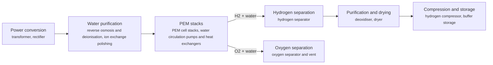

**Key equipment:** transformer and rectifier, PEM stacks, water purification, gas separators, deoxidiser and dryer, hydrogen compressor.

**Performance:**
- operating temperature: 70-90 °C; DOE description of PEM electrolysers. [source](https://www.energy.gov/eere/fuelcells/hydrogen-production-electrolysis)
- stack current density (status): 2 A/cm2; H2NEW PEM stack status, slide 13. [source](https://www.energy.gov/sites/default/files/2023-02/h2iqhour-01262023.pdf)
- stack lifetime (status): 60000 h; H2NEW PEM stack status, slide 13. [source](https://www.energy.gov/sites/default/files/2023-02/h2iqhour-01262023.pdf)
- system electricity use (status, beginning of life): 55 kWh/kg H2; DOE status; stack 51 kWh/kg; DOE ultimate target system 46. [source](https://www.energy.gov/sites/default/files/2024-12/hydrogen-shot-water-electrolysis-technology-assessment.pdf)
- stack lifetime (status): 40000 h; DOE status table; ultimate target 80,000 h. [source](https://www.energy.gov/sites/default/files/2024-12/hydrogen-shot-water-electrolysis-technology-assessment.pdf)

**Costs:**
- PEM stack capital cost (status; DOE ultimate target 100): 350 USD/kW (2023$); H2NEW PEM stack status, slide 13; stack only, not the full system. [source](https://www.energy.gov/sites/default/files/2023-02/h2iqhour-01262023.pdf)
- uninstalled system capital cost (status): 700-1100 USD/kW (2020$); DOE H2A-Lite current status, 50 t/day plant, stack plus balance of plant; installed about 2x (1,400-2,200). [source](https://www.energy.gov/sites/default/files/2024-12/hydrogen-shot-water-electrolysis-technology-assessment.pdf)
- levelized cost of hydrogen, hybrid wind-PV power: 4.4-6 USD/kg H2 (2022$); DOE record 24005; 74% capacity factor, 3.3 cents/kWh; low at USD 1,500/kW and high at 2,500/kW installed capex (baseline 2,000 gives 5.20). [source](https://www.hydrogen.energy.gov/docs/hydrogenprogramlibraries/pdfs/24005-clean-hydrogen-production-cost-pem-electrolyzer.pdf)
- levelized cost of hydrogen, average US grid power: 6.8-8.2 USD/kg H2 (2022$); DOE record 24005; 97% capacity factor, 8.3 cents/kWh; installed capex USD 1,500-2,500/kW. [source](https://www.hydrogen.energy.gov/docs/hydrogenprogramlibraries/pdfs/24005-clean-hydrogen-production-cost-pem-electrolyzer.pdf)

**Reference plants:**
- REFHYNE, Shell Energy and Chemicals Park Rheinland, DE: 10 MW PEM, described by Shell as Europe's largest PEM electrolyser at start-up; operating. [source](https://www.shell.com/news-and-insights/our-stories/green-hydrogen-project-goes-live-in-germany.html)

Sources: [1](https://www.energy.gov/eere/fuelcells/hydrogen-production-electrolysis), [2](https://www.energy.gov/sites/default/files/2023-02/h2iqhour-01262023.pdf), [3](https://www.energy.gov/sites/default/files/2024-12/hydrogen-shot-water-electrolysis-technology-assessment.pdf), [4](https://www.hydrogen.energy.gov/docs/hydrogenprogramlibraries/pdfs/24005-clean-hydrogen-production-cost-pem-electrolyzer.pdf). Last reviewed 2026-10-24.

## Steam methane reforming
<a id="h2-smr"></a>

Natural gas is desulfurised and reacted with steam over a nickel catalyst in externally fired tubes to make syngas. Water-gas shift converts most of the CO to more hydrogen and CO2, and pressure swing adsorption purifies the hydrogen. Without capture the CO2 is vented, partly in the shifted process gas and partly in the reformer flue gas. Blue hydrogen versions capture the process CO2, the flue gas CO2, or both.

```mermaid
flowchart LR
    FEED["Feed gas desulfurisation<br/><small>hydrodesulfurisation reactor, zinc oxide guard beds</small>"]
    PRE["Pre-reforming (optional)<br/><small>adiabatic pre-reformer</small>"]
    REF["Steam reforming<br/><small>fired tubular reformer with catalyst tubes, convection section and waste heat boiler, flue gas stack</small>"]
    WGS["Water-gas shift<br/><small>high- and low-temperature shift reactors, process gas coolers</small>"]
    AGR["Process CO2 removal (capture option)<br/><small>MDEA absorber and stripper or VSA</small>"]
    PSA["Hydrogen purification<br/><small>pressure swing adsorption unit</small>"]
    FGC["Flue gas CO2 capture (option)<br/><small>post-combustion amine unit (e.g. Cansolv)</small>"]
    CO2["CO2 compression and drying<br/><small>CO2 compressor, dehydration unit</small>"]
    FEED --> PRE
    PRE --> REF
    REF -->|syngas| WGS
    REF -->|flue gas (capture option)| FGC
    WGS --> AGR
    AGR -->|hydrogen-rich gas| PSA
    AGR -->|CO2| CO2
    FGC --> CO2
```

**Key equipment:** desulfurisation reactors, tubular steam reformer furnace, waste heat boiler, shift reactors, PSA unit, amine or VSA CO2 removal (blue), CO2 compressor (blue).

**Performance:**
- plant hydrogen output (NETL reference case): 483000 kg H2/day; NETL SMR case design capacity. [source](https://www.netl.doe.gov/projects/files/ComparisonofCommercialStateofArtFossilBasedHydrogenProductionTechnologies_041222.pdf)

**Costs:**
- levelized cost of hydrogen, SMR without capture: 1.06 USD/kg H2 (2018$); NETL 2022; natural gas USD 4.42/MMBtu, 90% capacity factor, CO2 transport and storage at USD 10/t where included. [source](https://www.netl.doe.gov/projects/files/ComparisonofCommercialStateofArtFossilBasedHydrogenProductionTechnologies_041222.pdf)
- levelized cost of hydrogen, SMR with 96.2% CO2 capture: 1.54-1.64 USD/kg H2 (2018$); NETL 2022; natural gas USD 4.42/MMBtu, 90% capacity factor, CO2 transport and storage at USD 10/t where included; low excludes and high includes CO2 transport and storage. [source](https://www.netl.doe.gov/projects/files/ComparisonofCommercialStateofArtFossilBasedHydrogenProductionTechnologies_041222.pdf)

**Reference plants:**
- Air Products Port Arthur SMR CO2 capture (Valero refinery site), US: about 1 Mt/yr CO2 captured by vacuum swing adsorption from SMR process gas, used for enhanced oil recovery; capture began 2013 (first SMR; second planned months later). [source](https://www.energy.gov/fe/articles/breakthrough-large-scale-industrial-project-begins-carbon)

Sources: [1](https://www.netl.doe.gov/projects/files/ComparisonofCommercialStateofArtFossilBasedHydrogenProductionTechnologies_041222.pdf), [2](https://www.energy.gov/fe/articles/breakthrough-large-scale-industrial-project-begins-carbon). Last reviewed 2026-10-24.

## Ammonia as hydrogen carrier and ammonia cracking
<a id="h2-ammonia-cracking"></a>

Hydrogen is shipped as liquid ammonia, which is easy to store and already traded worldwide. At the destination, ammonia is heated over a catalyst and decomposed into hydrogen and nitrogen in an endothermic reaction, then hydrogen is purified and residual ammonia removed. Part of the product or ammonia is burned to supply reaction heat.

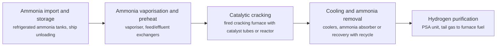

**Key equipment:** refrigerated ammonia storage, vaporiser, cracking furnace or reactor, ammonia recovery, PSA unit.

**Performance:**
- hydrogen purity (KBR H2ACT): 99.97 %; vendor claim; ammonia slip below 0.1 ppmv; KBR also claims 90% efficiency without stating the basis. [source](https://kbr.foleon.com/technology/h2-act-unlocking-the-global-hydrogen-economy-through-ammonia-cracking/)

**Reference plants:**
- SUSO ammonia cracking project, Ulsan, KR: 10 t/day hydrogen from 72 t/day ammonia (KBR H2ACT); moving to EPC, target start-up 2028. [source](https://kbr.foleon.com/technology/h2-act-unlocking-the-global-hydrogen-economy-through-ammonia-cracking/)

Sources: [1](https://kbr.foleon.com/technology/h2-act-unlocking-the-global-hydrogen-economy-through-ammonia-cracking/). Last reviewed 2026-10-24.

## Green and blue ammonia
<a id="h2-green-blue-ammonia"></a>

Hydrogen and nitrogen are compressed and reacted over an iron catalyst in a Haber-Bosch synthesis loop. Green ammonia takes hydrogen from electrolysis on renewable power and nitrogen from an air separation unit; blue ammonia uses reforming with CO2 capture, where the CO2 is already separated in the process.

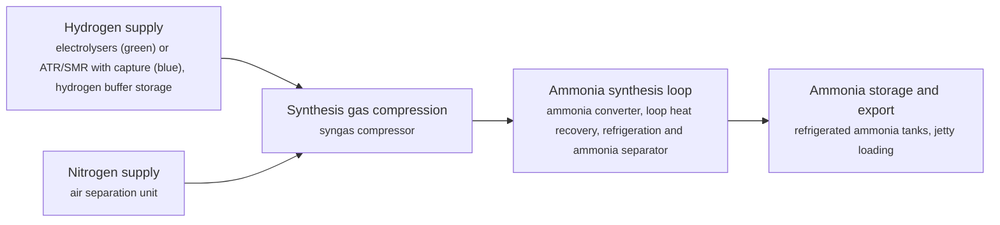

**Key equipment:** electrolysers or reformer with capture, air separation unit, syngas compressor, ammonia converter, refrigeration, ammonia storage.

**Performance:**
- hydrogen production (NEOM): 600 t H2/day; NEOM Green Hydrogen Project. [source](https://acwapower.com/en/what-we-do/projects/neom-green-hydrogen-project/)
- ammonia production (NEOM): 1.2e+06 t NH3/yr; NEOM Green Hydrogen Project, up to. [source](https://acwapower.com/en/what-we-do/projects/neom-green-hydrogen-project/)

**Reference plants:**
- NEOM Green Hydrogen Project, SA: 3.9 to 4 GW solar and wind, 600 t/day hydrogen, up to 1.2 Mt/yr ammonia; thyssenkrupp electrolysis, Air Products air separation; USD 9,046 million; renewables due mid-2026, commissioning and first product 2027. [source](https://acwapower.com/en/what-we-do/projects/neom-green-hydrogen-project/)

Sources: [1](https://acwapower.com/en/what-we-do/projects/neom-green-hydrogen-project/), [2](https://ammoniaenergy.org/articles/thyssenkrupp-to-install-2-plus-gw-of-electrolysers-for-neom). Last reviewed 2026-10-24.

## Hydrogen storage in salt caverns
<a id="h2-salt-cavern-storage"></a>

Caverns are dissolved in deep salt formations by solution mining, then filled with compressed hydrogen. Salt is nearly impermeable to hydrogen and creeps to seal fractures, so caverns can be cycled many times. A cushion gas stays in the cavern to keep the walls stable, and withdrawn gas is dried before use.

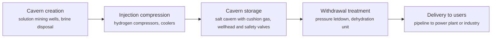

**Key equipment:** solution mining and brine handling, hydrogen compressors, cavern wells and completions, dehydration unit, metering.

**Performance:**
- storage capacity, two caverns (ACES Delta phase one): 300 GWh; two solution-mined caverns about 220 ft wide and 1,200 ft tall, tops 3,500 to 4,100 ft deep. [source](https://www.powermag.com/aces-deltas-giant-utah-salt-cavern-hydrogen-storage-project-gets-504m-conditional-doe-loan-guarantee/)

**Reference plants:**
- ACES Delta, Utah, US: 220 MW electrolysis, up to 100 t/day hydrogen, 300 GWh in two caverns, feeding the 840 MW Intermountain Power combined cycle; USD 504.4 million conditional DOE loan guarantee, April 2022. [source](https://www.powermag.com/aces-deltas-giant-utah-salt-cavern-hydrogen-storage-project-gets-504m-conditional-doe-loan-guarantee/)

Sources: [1](https://www.powermag.com/aces-deltas-giant-utah-salt-cavern-hydrogen-storage-project-gets-504m-conditional-doe-loan-guarantee/). Last reviewed 2026-10-24.

## Liquid organic hydrogen carriers (MCH, DBT)
<a id="h2-lohc"></a>

Hydrogen is chemically bound to a liquid carrier, such as toluene to make methylcyclohexane (MCH), by catalytic hydrogenation. The MCH is a stable liquid at ambient conditions and moves in ordinary chemical tankers and tanks. At the destination, catalytic dehydrogenation releases the hydrogen and the toluene returns for reuse.

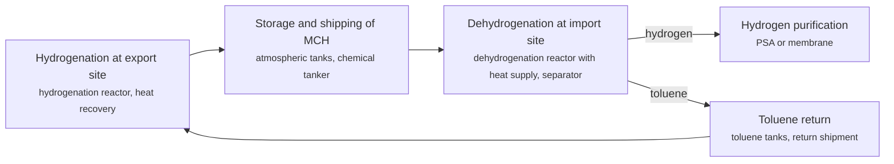

**Key equipment:** hydrogenation reactor, dehydrogenation reactor and fired or electric heater, ambient storage tanks, hydrogen purification.

**Performance:**
- demonstration supply chain capacity: 210 t H2/yr; Brunei to Kawasaki AHEAD demonstration (NEDO), maximum capacity. [source](https://aperc.or.jp/presentations/apec_energy_transition_symposium_series/file/01/2-3_Mr_Yuji_Chishima_Chiyoda_Corp_231011_IEEJ_APERC-Chiyoda_SPERA_Presentation.pdf)

**Reference plants:**
- AHEAD Brunei to Kawasaki hydrogen supply chain, BN: up to 210 t/yr hydrogen as MCH; demonstration completed December 2020. [source](https://aperc.or.jp/presentations/apec_energy_transition_symposium_series/file/01/2-3_Mr_Yuji_Chishima_Chiyoda_Corp_231011_IEEJ_APERC-Chiyoda_SPERA_Presentation.pdf)

Sources: [1](https://aperc.or.jp/presentations/apec_energy_transition_symposium_series/file/01/2-3_Mr_Yuji_Chishima_Chiyoda_Corp_231011_IEEJ_APERC-Chiyoda_SPERA_Presentation.pdf). Last reviewed 2026-10-24.

## Methane pyrolysis (turquoise hydrogen)
<a id="h2-methane-pyrolysis"></a>

Methane is split into hydrogen and solid carbon without oxygen, using plasma, molten metal or salt, or a catalyst bed. No CO2 is formed in the reaction, and the carbon leaves as a solid such as carbon black that can be sold or stored. Monolith's plasma process runs at about 1650 °C.

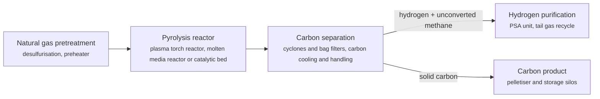

**Key equipment:** pyrolysis reactor (plasma, molten metal or catalytic), solids separation, carbon handling and pelletising, PSA unit.

**Performance:**
- plasma reactor temperature (Monolith): 1650 °C; Monolith plasma process. [source](https://digitalrefining.com/article/1002720/turquoise-hydrogen-production-by-methane-pyrolysis)

**Reference plants:**
- Monolith Olive Creek 1, Nebraska, US: about 14,000 t/yr carbon black and about 2,500 t/yr hydrogen; commissioned 2020; Olive Creek 2 planned at about 194,000 t/yr carbon black and 40,000 t/yr hydrogen. [source](https://digitalrefining.com/article/1002720/turquoise-hydrogen-production-by-methane-pyrolysis)
- BASF methane pyrolysis pilot, Ludwigshafen, DE: pilot; under construction from 2019 per the article. [source](https://digitalrefining.com/article/1002720/turquoise-hydrogen-production-by-methane-pyrolysis)

Sources: [1](https://digitalrefining.com/article/1002720/turquoise-hydrogen-production-by-methane-pyrolysis). Last reviewed 2026-10-24.

## Solid oxide electrolysis
<a id="h2-soec"></a>

A ceramic electrolyte conducts oxide ions at high temperature (650 to 850 °C according to DOE). Steam is fed to the cathode where it splits into hydrogen and oxide ions, which cross the ceramic and form oxygen at the anode. Part of the energy comes as heat, so electricity use per kilogram is lower than in low-temperature electrolysis, especially when steam comes from process heat.

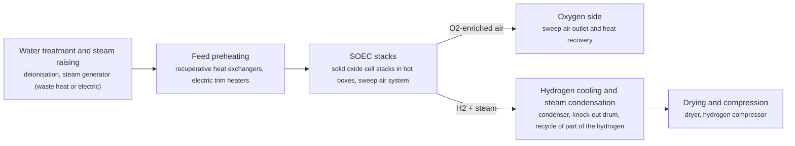

**Key equipment:** steam generator, high-temperature recuperators, SOEC stack modules, condenser, dryer, hydrogen compressor, power electronics.

**Performance:**
- operating temperature: 650-850 °C; DOE description of solid oxide electrolysers. [source](https://www.energy.gov/eere/fuelcells/hydrogen-production-electrolysis)
- system electrical energy use (2022 status): 38 kWh/kg H2; H2NEW SOEC 2022 status, slide 36; stack 34 kWh/kg; total including heat 47 kWh/kg. [source](https://www.energy.gov/sites/default/files/2023-02/h2iqhour-01262023.pdf)
- stack lifetime (2022 status): 20000 h; H2NEW SOEC 2022 status, slide 36. [source](https://www.energy.gov/sites/default/files/2023-02/h2iqhour-01262023.pdf)
- system energy use including heat (status): 47 kWh/kg H2; DOE status for oxide-ion SOEC; electrical stack 34 kWh/kg; target 42 including heat. [source](https://www.energy.gov/sites/default/files/2024-12/hydrogen-shot-water-electrolysis-technology-assessment.pdf)

**Costs:**
- uninstalled system capital cost (status): 2000-2500 USD/kW (2020$); Idaho National Laboratory estimate quoted by DOE for oxide-ion SOEC, giving 7.00-8.00 USD/kg H2 on grid power with gas for heat; DOE ultimate target 200. [source](https://www.energy.gov/sites/default/files/2024-12/hydrogen-shot-water-electrolysis-technology-assessment.pdf)

**Reference plants:**
- Topsoe SOEC manufacturing plant, Herning, DK: initially 500 MW of electrolysers per year; first offtakers First Ammonia (Texas) and Forestal (e-methanol, Spain); inaugurated November 2025. [source](https://www.chemengonline.com/topsoe-inaugurates-soec-electrolyzer-manufacturing-facility-in-denmark)

Sources: [1](https://www.energy.gov/eere/fuelcells/hydrogen-production-electrolysis), [2](https://www.energy.gov/sites/default/files/2023-02/h2iqhour-01262023.pdf), [3](https://www.chemengonline.com/topsoe-inaugurates-soec-electrolyzer-manufacturing-facility-in-denmark), [4](https://www.energy.gov/sites/default/files/2024-12/hydrogen-shot-water-electrolysis-technology-assessment.pdf). Last reviewed 2026-10-24.

## AEM electrolysis
<a id="h2-aem-electrolysis"></a>

An anion exchange membrane carries hydroxide ions between electrodes in a dilute alkaline or pure-water environment. It aims to combine the cheap, platinum-free materials of alkaline electrolysis with the compact, pressurised design of PEM. DOE gives 50 to 80 °C operation.

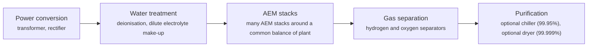

**Key equipment:** AEM stacks, power electronics, gas separators, chiller and dryer options, water treatment.

**Performance:**
- operating temperature: 50-80 °C; DOE description of AEM electrolysers. [source](https://www.energy.gov/eere/fuelcells/hydrogen-production-electrolysis)
- system power consumption: 51.3 kWh/kg H2; Enapter AEM Nexus 1000, all utilities inside battery limits, 99.5% purity configuration. [source](https://handbook.enapter.com/electrolyser/aem_nexus/downloads/Enapter_Datasheet_AEM-Nexus-1000.pdf)
- hydrogen output per unit: 18.2 kg H2/h; Enapter AEM Nexus 1000 (202 Nm3/h) at 933 kW nominal, up to 31 barg outlet. [source](https://handbook.enapter.com/electrolyser/aem_nexus/downloads/Enapter_Datasheet_AEM-Nexus-1000.pdf)

Sources: [1](https://www.energy.gov/eere/fuelcells/hydrogen-production-electrolysis), [2](https://handbook.enapter.com/electrolyser/aem_nexus/downloads/Enapter_Datasheet_AEM-Nexus-1000.pdf). Last reviewed 2026-10-24.
