# H2 technology options

35 technologies, from commercial to lab stage. Generated from catalog/technologies/; every figure links to its source.

| Technology | Category | Maturity | TRL | Suppliers | Cost figures |
| --- | --- | --- | --- | --- | --- |
| [Alkaline water electrolysis](#h2-alkaline-electrolysis) | Hydrogen production / electrolysis | commercial | 9 | Thyssenkrupp nucera (20 MW alkaline water electrolysis module); John Cockerill; LONGi Hydrogen; PERIC; Nel Hydrogen; HydrogenPro | uninstalled system capital cost (status): 500-750 USD/kW (2020$)<br>water electrolysis capex, global average (2024): 2000-2600 USD/kWe (2024$)<br>water electrolysis capex, China (2024): 600-1200 USD/kWe (2024$) |
| [Biogas reforming to hydrogen](#h2-biogas-reforming) | Hydrogen production / biogenic | commercial | 8 | Yara (ammonia from biomethane, Cubatão) |  |
| [Biogas upgrading to biomethane](#h2-biogas-upgrading) | Low-carbon fuels / biogas | commercial |  | Air Liquide (register examples); Bright Biomethane (register examples); Pentair (register examples) |  |
| [Compressed hydrogen storage and tube trailers](#h2-compressed-storage-tube-trailers) | Hydrogen carriers and logistics / compressed gas | commercial |  | Hexagon Purus (Type 4 tube trailers); Linde (register examples; not verified) | gaseous tube-trailer delivery and dispensing cost (excluding production): 8.17-9.46 USD/kg H2 (2016$) |
| [First-generation biofuels (ethanol, FAME biodiesel)](#h2-first-gen-biofuels) | Low-carbon fuels / biofuels | commercial |  | Raízen (register examples); POET (register examples); Neste (register examples (HVO)) |  |
| [Fuel cells (PEM, SOFC)](#h2-fuel-cells) | Hydrogen use / power | commercial | 9 | Ballard (register examples); Toyota (register examples); Bloom Energy (SOFC (register examples)) | HD PEM fuel cell system cost, 275 kWnet Class 8 long-haul truck: 168 USD/kWnet (2016$)<br>stack share of HD fuel cell system cost: 63 % of system cost |
| [Hydrogen compressors (diaphragm, ionic, reciprocating)](#h2-compressors) | Hydrogen carriers and logistics / compression | commercial | 6 | Burckhardt Compression (non-lubricated hydrogen compressors); PDC Machines (register examples); Hydro-Pac (register examples) |  |
| [Hydrogen for refinery and ammonia feedstock](#h2-refinery-ammonia-feedstock) | Hydrogen use / feedstock | commercial | 8 |  | levelised cost of hydrogen, unabated natural gas reforming: 0.8-4.6 USD/kg H2 (2024$)<br>levelised cost of hydrogen, unabated natural gas reforming, STEPS 2030 projection: 0.7-3.7 USD/kg H2 (2024$)<br>levelised cost of hydrogen, natural gas with CCUS, 2022 gas-price episode: 2 USD/kg H2 (2024$)<br>levelised cost of hydrogen, renewable electrolytic, STEPS 2030 projection: 2-4 USD/kg H2 (2024$) |
| [Hydrogen refuelling stations](#h2-refuelling-stations) | Hydrogen carriers and logistics / dispensing | commercial |  | Nel (register examples); Linde (register examples); Air Liquide (register examples) | station capital equipment cost per unit dispensing capacity: 1200-3000 USD/(kg/day) (2016$)<br>average station total capital cost: 1.9e+06 USD per station (2016$) |
| [Liquid hydrogen](#h2-liquid-hydrogen) | Hydrogen carrier / liquefaction | commercial | 7-9 | Linde Engineering; Air Products; Kawasaki Heavy Industries (LH2 carrier and terminal) | levelized liquefaction cost, 27 t/day liquefier: 2.75 USD/kg H2 (2016$)<br>liquefier capital cost, 27 t/day: 104 million USD (2018$) |
| [PEM electrolysis](#h2-pem-electrolysis) | Hydrogen production / electrolysis | commercial | 9 | Siemens Energy (Silyzer); ITM Power; Plug Power; Cummins (Accelera); Nel Hydrogen | PEM stack capital cost (status; DOE ultimate target 100): 350 USD/kW (2023$)<br>uninstalled system capital cost (status): 700-1100 USD/kW (2020$)<br>levelized cost of hydrogen, hybrid wind-PV power: 4.4-6 USD/kg H2 (2022$)<br>levelized cost of hydrogen, average US grid power: 6.8-8.2 USD/kg H2 (2022$)<br>water electrolysis capex, global average (2024): 2000-2600 USD/kWe (2024$)<br>water electrolysis capex, China (2024): 600-1200 USD/kWe (2024$) |
| [Partial oxidation and gasification](#h2-gasification-pox) | Hydrogen production / gasification | commercial | 5-9 | Air Products (Shell-type gasification (NETL case describes it as formerly Shell)); Air Liquide (register examples; not verified) | Levelized cost of hydrogen, coal gasification without CO2 capture (Case 4): 2.58 USD/kg H2 (2018$)<br>Levelized cost of hydrogen, coal gasification with CO2 capture (Case 5): 2.92-3.09 USD/kg H2 (2018$)<br>Total plant cost of coal gasification hydrogen plant without capture (Case 4): 4264 USD per (kg H2/day) of capacity (2018$)<br>Total overnight cost of coal gasification hydrogen plant with capture (Case 5): 6044 USD per (kg H2/day) of capacity (2018$) |
| [Steam methane reforming](#h2-smr) | Hydrogen production / reforming | commercial | 6-9 | Topsoe; Air Liquide; Technip Energies; Linde Engineering; Air Products | levelized cost of hydrogen, SMR without capture: 1.06 USD/kg H2 (2018$)<br>levelized cost of hydrogen, SMR with 96.2% CO2 capture: 1.54-1.64 USD/kg H2 (2018$)<br>total plant cost, SMR without capture: 554 USD per kg H2/day capacity (2018$)<br>reforming capex, without and with CCUS: 720-1420 USD/kW H2 (2024$) |
| [Ammonia as hydrogen carrier and ammonia cracking](#h2-ammonia-cracking) | Hydrogen carrier / reconversion | demonstration | 4-7 | KBR (H2ACT); Topsoe; Johnson Matthey (Honeywell); Air Products |  |
| [Ammonia as marine fuel](#h2-ammonia-marine-fuel) | Hydrogen use / shipping | demonstration | 6-9 | MAN Energy Solutions (Everllence) (two-stroke engine; 100% ammonia run in Denmark); Wärtsilä (four-stroke dual-fuel ammonia engine since 2023, 18% emissions improvement reported); WinGD (52-bore low-speed engine, full-load trials in Switzerland) |  |
| [Cellulosic ethanol](#h2-cellulosic-ethanol) | Low-carbon fuels / biofuels | demonstration | 9 | Clariant (sunliquid) |  |
| [E-methane (synthetic natural gas)](#h2-e-methane) | Low-carbon fuels / synthetic methane | demonstration | 7 | Hitachi Zosen (methanation device for Tokyo Gas); ITM Power (electrolyser for Tokyo Gas trial); Tokyo Gas (trial operator) |  |
| [E-methanol and bio-methanol](#h2-e-methanol) | Low-carbon fuels / methanol | demonstration | 8 | European Energy (Kassø e-methanol); Siemens Energy (electrolysers); Topsoe (register examples); Johnson Matthey (Honeywell) (register examples) | renewable e-methanol production cost (Chinese feasibility study): 4167-10250 CNY per tonne (about USD 580-1,430/t at 7.15 CNY/USD), 2-4 times the market rate of grey methanol (2024$) |
| [Fischer-Tropsch SAF and e-fuels (biomass or CO2 plus H2)](#h2-ft-saf-efuels) | Low-carbon fuels / Fischer-Tropsch | demonstration | 7 | INERATEC (2.5 ktpa e-fuel plant); Infinium (Roadrunner e-fuels plant); Velocys (register examples) | synthetic fuel (e-fuel/FT) production cost per litre: 1.9-8.7 USD per litre (2023 assessment range; market commentary 2026 cites about USD 3-7/litre today) (2023$) |
| [Gas-heated reforming](#h2-gas-heated-reforming) | Hydrogen production / low-carbon reforming | demonstration | 5 | Johnson Matthey (LCH process (GHR-ATR), up to 99% CO2 capture, described as the lowest natural-gas usage commercially available; JM pages read 25 October 2026) |  |
| [Green and blue ammonia](#h2-green-blue-ammonia) | Hydrogen derivative / ammonia synthesis | demonstration | 8 | Topsoe; KBR; Thyssenkrupp Uhde; Casale; Air Products |  |
| [Hydrogen direct reduction of iron](#h2-dri) | Hydrogen use / steel | demonstration | 6 | HYBRIT (SSAB, LKAB, Vattenfall) (Luleå pilot); Stegra (H2 Green Steel) (register examples); Midrex (register examples) |  |
| [Hydrogen storage in salt caverns](#h2-salt-cavern-storage) | Hydrogen storage | demonstration | 6-9 | Mitsubishi Power; Magnum Development; HyStock (Gasunie) | levelized cost of hydrogen storage, salt cavern (Red Lake, AZ case study): 2.2971 USD/kg H2 (2022$)<br>total capital cost, single salt cavern (Red Lake, AZ case study): 51 million USD (2022$) |
| [Liquid organic hydrogen carriers (MCH, DBT)](#h2-lohc) | Hydrogen carrier | demonstration | 7 | Chiyoda (SPERA Hydrogen (MCH)); Hydrogenious LOHC Technologies (dibenzyltoluene LOHC) |  |
| [Methane pyrolysis (turquoise hydrogen)](#h2-methane-pyrolysis) | Hydrogen production / pyrolysis | demonstration | 4-8 | Monolith (plasma methane pyrolysis); BASF (methane pyrolysis pilot); Hazer Group |  |
| [Reverse water-gas shift for e-fuels](#h2-rwgs) | Low-carbon fuels / CO2 conversion | demonstration | 6-7 | Topsoe (eRWGS (FrontFuel, Leuna)); Johnson Matthey (Honeywell) (register examples) |  |
| [Solid oxide electrolysis](#h2-soec) | Hydrogen production / electrolysis | demonstration | 8 | Topsoe (SOEC electrolyser (Herning factory, 500 MW/yr initial)); Bloom Energy; Sunfire | uninstalled system capital cost (status): 2000-2500 USD/kW (2020$) |
| [AEM electrolysis](#h2-aem-electrolysis) | Hydrogen production / electrolysis | pilot | 7 | Enapter (AEM Nexus 1000 and smaller modules) | AEM stack capital cost, preliminary manufactured estimate: 200 USD/kW (2024$) |
| [Autothermal reforming with CO2 capture (blue hydrogen)](#h2-atr-ccs) | Hydrogen production / reforming with capture | pilot | 5 | Topsoe (SynCOR); Johnson Matthey (Honeywell) (LCH); Air Products | levelized cost of hydrogen, ATR with 94.5% capture: 1.51-1.59 USD/kg H2 (2018$)<br>total plant cost, ATR with 94.5% capture: 1092 USD per kg H2/day capacity (2018$) |
| [Biomass gasification to hydrogen](#h2-biomass-gasification) | Hydrogen production / biogenic | pilot | 5-6 |  | levelised hydrogen cost: 2.8-5.4 USD/kg (2009$) |
| [Co-electrolysis of CO2 and water](#h2-co-electrolysis) | Hydrogen production / synthetic fuels | pilot | 6 | Topsoe (SOEC (register examples; not verified)); Sunfire (SOEC (raised EUR 215 million in 2024 per IEA text)) |  |
| [Natural (geologic) hydrogen](#h2-natural-hydrogen) | Hydrogen production / geologic | pilot | 3-5 | Koloma (geologic hydrogen exploration; raised nearly USD 300 million in 2024 (IEA text)); Gold H2 (bio-stimulated hydrogen trial) | natural (geologic) hydrogen production cost estimates: 0.5-1 USD per kg H2 (estimated; no commercial production yet) (2024$) |
| [Pyrolysis oil and hydrothermal liquefaction](#h2-pyrolysis-htl) | Low-carbon fuels / thermochemical | pilot | 6-7 | Ensyn (fast pyrolysis (RTP), plants in North America); Steeper Energy (HTL); Licella (HTL) |  |
| [Algal fuels](#h2-algal-fuels) | Low-carbon fuels / algae | lab |  |  | minimum fuel selling price: 2.46-18.6 USD/gge |
| [Photocatalytic and thermochemical water splitting](#h2-solar-water-splitting) | Hydrogen production / solar fuels | lab | 4-5 | Sparc Hydrogen (photocatalytic pilot (Australia)); SunHydrogen (PEC pilot (US)); CSIRO (beam-down solar reactor pilot) |  |

## Alkaline water electrolysis
<a id="h2-alkaline-electrolysis"></a>

Two electrodes sit in a liquid alkaline electrolyte of potassium or sodium hydroxide, separated by a diaphragm. Water is split by direct current: hydrogen forms at the cathode and oxygen at the anode, and the electrolyte circulates through gas separators. DOE gives an operating range of 60 to 90 °C.

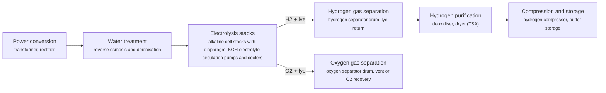

**Key equipment:** transformer and rectifier, alkaline electrolyser stacks, gas-liquid separators, lye circulation and cooling, deoxidiser and dryer, water treatment, hydrogen compressor.

**Performance:**
- operating temperature: 60-90 °C; DOE description of alkaline electrolysers. [source](https://www.energy.gov/eere/fuelcells/hydrogen-production-electrolysis)
- standard module size (thyssenkrupp): 20 MW; thyssenkrupp 20 MW alkaline module used for NEOM and Holland Hydrogen 1. [source](https://ammoniaenergy.org/articles/thyssenkrupp-to-install-2-plus-gw-of-electrolysers-for-neom)
- system electricity use (status, beginning of life): 55 kWh/kg H2; DOE status for liquid alkaline; stack 51 kWh/kg; ultimate target system 48. [source](https://www.energy.gov/sites/default/files/2024-12/hydrogen-shot-water-electrolysis-technology-assessment.pdf)
- stack lifetime (status): 60000 h; DOE status table for liquid alkaline; 0.5 A/cm2 at 1.9 V. [source](https://www.energy.gov/sites/default/files/2024-12/hydrogen-shot-water-electrolysis-technology-assessment.pdf)

**Costs:**
- uninstalled system capital cost (status): 500-750 USD/kW (2020$); DOE H2A-Lite current status for liquid alkaline, 50 t/day plant, based on 4.5 MW stacks and 10 MW modules; installed about 2x (1,000-1,500). [source](https://www.energy.gov/sites/default/files/2024-12/hydrogen-shot-water-electrolysis-technology-assessment.pdf)
- water electrolysis capex, global average (2024): 2000-2600 USD/kWe (2024$); IEA; includes electrolyser system, electrical, gas treatment, balance of plant and EPC, excludes power assets; STEPS 2030 1,400-1,820; not split by electrolyser type. [source](https://iea.blob.core.windows.net/assets/15673ab3-a86a-4434-bff4-490bb42d3563/GlobalHydrogenReview2025AssumptionsAnnex.pdf)
- water electrolysis capex, China (2024): 600-1200 USD/kWe (2024$); IEA, same scope; STEPS 2030 450-900. [source](https://iea.blob.core.windows.net/assets/15673ab3-a86a-4434-bff4-490bb42d3563/GlobalHydrogenReview2025AssumptionsAnnex.pdf)

**Reference plants:**
- NEOM Green Hydrogen Project, SA: 2 GW+ alkaline electrolysis in 20 MW modules (thyssenkrupp), 600 t/day hydrogen; electrolyser commissioning after 4 GW renewables due mid-2026; first product expected 2027. [source](https://acwapower.com/en/what-we-do/projects/neom-green-hydrogen-project/)
- Sinopec Kuqa green hydrogen pilot, Xinjiang, CN: 20,000 t/yr green hydrogen from solar power; 210,000 m3 hydrogen storage; supplies Tahe Refining & Chemical; in operation from 2023. [source](https://www.aap.com.au/aapreleases/cision20230703ae48443)
- Holland Hydrogen 1 (Shell), Rotterdam, NL: 200 MW, thyssenkrupp 20 MW alkaline modules; hydrogen piped about 40 km to Shell Energy and Chemicals Park Rotterdam; announced January 2022 with start of production intended for 2024. [source](https://digitalrefining.com/news/1006809,thyssenkrupp-to-install-200-mw-green-hydrogen-facility-for-shell-in-port-of-rotterdam.html)
- ACES Delta, Utah, US: 220 MW alkaline (HydrogenPro), up to 100 t/day hydrogen stored in salt caverns; USD 504.4 million conditional DOE loan guarantee, April 2022. [source](https://www.powermag.com/aces-deltas-giant-utah-salt-cavern-hydrogen-storage-project-gets-504m-conditional-doe-loan-guarantee/)

TRL source: [IEA ETP Clean Energy Technology Guide, dataset of 24 July 2026, 2025 assessment (IEA 1-11 scale): 'Alkaline electrolyser' 9](https://www.iea.org/data-and-statistics/data-tools/etp-clean-energy-technology-guide)

**Missing inputs:**
- electrolyser type and supplier at Sinopec Kuqa (other): The Sinopec release read does not state the electrolyser type or supplier. Facts recorded 2026-10-28: Sinopec Kuqa (Xinjiang) is the world's largest solar-powered green hydrogen facility - 20,000 t/yr from a 300 MW solar field feeding about 260-390 MW of ALK electrolysis (reported both figures), project cost about USD 831 m; 100% electrolyser load reported January 2025. The electrolyser is alkaline-type; the specific supplier attribution (PERIC-class Chinese ALK vendors) circulates in trade press but was not confirmable on a primary page. Where: Sinopec news releases; LONGi Hydrogen and PERIC project news (catalog: sinopec-tech, open). Next: Confirm the electrolyser supplier from a Sinopec or vendor primary page when available.

Sources: [1](https://www.energy.gov/eere/fuelcells/hydrogen-production-electrolysis), [2](https://ammoniaenergy.org/articles/thyssenkrupp-to-install-2-plus-gw-of-electrolysers-for-neom), [3](https://acwapower.com/en/what-we-do/projects/neom-green-hydrogen-project/), [4](https://www.aap.com.au/aapreleases/cision20230703ae48443), [5](https://digitalrefining.com/news/1006809,thyssenkrupp-to-install-200-mw-green-hydrogen-facility-for-shell-in-port-of-rotterdam.html), [6](https://www.powermag.com/aces-deltas-giant-utah-salt-cavern-hydrogen-storage-project-gets-504m-conditional-doe-loan-guarantee/), [7](https://www.energy.gov/sites/default/files/2024-12/hydrogen-shot-water-electrolysis-technology-assessment.pdf), [8](https://iea.blob.core.windows.net/assets/15673ab3-a86a-4434-bff4-490bb42d3563/GlobalHydrogenReview2025AssumptionsAnnex.pdf), [9](https://en.wikipedia.org/wiki/Alkaline_water_electrolysis). Last reviewed 2026-10-28.

## Biogas reforming to hydrogen
<a id="h2-biogas-reforming"></a>

Upgraded biogas or biomethane is steam-reformed like natural gas to make hydrogen, or used as the hydrogen feed for products such as ammonia. The hydrogen is renewable by feedstock, and CO2 capture can make it carbon-negative. In Cubatão, Brazil, Yara started ammonia production from biomethane, with a goal of 6 to 7 ktpa.

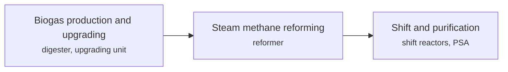

**Key equipment:** digesters, biogas upgrading, steam methane reformer, PSA.

**Performance:**
- Yara Cubatão ammonia target from biomethane: 6-7 ktpa; IEA GHR 2025 text. [source](https://iea.blob.core.windows.net/assets/a6c466dd-b6f0-44bd-a60a-6940eccfb1c3/GlobalHydrogenReview2025.pdf)

**Reference plants:**
- Yara Cubatão, Brazil, ammonia from biomethane, BR: 6 to 7 ktpa goal; . [source](https://iea.blob.core.windows.net/assets/a6c466dd-b6f0-44bd-a60a-6940eccfb1c3/GlobalHydrogenReview2025.pdf)

TRL source: [IEA ETP Clean Energy Technology Guide, dataset of 24 July 2026, latest assessment (IEA 1-11 scale): 'Anaerobic digestion and upgrading with CCUS' 8 (2025)](https://www.iea.org/data-and-statistics/data-tools/etp-clean-energy-technology-guide)

**Missing inputs:**
- reforming efficiency and hydrogen yield per Nm3 biogas (performance): No source read. Web-checked 2026-10-28; per-Nm3 yields sit in journal papers. Where: arXiv and open-access journals: techno-economic or review papers (MDPI is blocked by its CDN; use the manual inbox) (catalog: arxiv, open). Next: Add yield and cost from a review.
- capital cost and operating or unit cost, with dollar year and basis (costs): No open source read so far gives costs for this technology. Web-checked 2026-10-28; no open figures. Where: arXiv and open-access journals: techno-economic or review papers (MDPI is blocked by its CDN; use the manual inbox) (catalog: arxiv, open); Licensor and EPC studies; paid cost databases are catalog-only (paid); OSTI.GOV full-text reports from DOE labs: search the technology name plus 'techno-economic' (catalog: osti, blocked). Next: Look for an open techno-economic study; record each figure with metric, range, unit, dollar year, basis and source.

Sources: [1](https://iea.blob.core.windows.net/assets/a6c466dd-b6f0-44bd-a60a-6940eccfb1c3/GlobalHydrogenReview2025.pdf), [2](https://en.wikipedia.org/wiki/Biogas). Last reviewed 2026-10-28.

## Biogas upgrading to biomethane
<a id="h2-biogas-upgrading"></a>

CO2 is removed from biogas to reach pipeline-grade biomethane using water scrubbing, PSA, membranes, amine scrubbing or cryogenic separation. IEA Bioenergy Task 37 lists methane slip as below 0.1% for amines, 0.5 to 1% for membranes, 1 to 2% for water scrubbing and PSA, and 2 to 4% for physical adsorption.

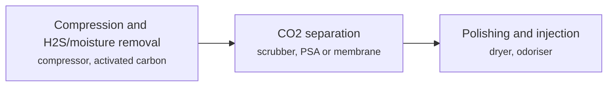

**Key equipment:** biogas compressor, H2S removal, separation unit, gas dryer.

**Performance:**
- methane slip by technology: 0.04-4 vol% of upgraded gas; amine 0.04 to 0.1% (lowest); membrane 0.5 to 1%; water scrubber 1 to 2%; PSA below 2%; physical adsorption 2 to 4%; cryogenic about 2%. [source](https://task37.ieabioenergy.com/wp-content/uploads/sites/32/2023/11/IEA-Bioenergy-Task_37-Methane-slip-Jan.pdf)
- biogas upgrading energy use by technology: 0.15-0.5 kWh per Nm3 raw biogas (water scrubbing about 0.4-0.5, reducible to about 0.3 in advanced designs; PSA 0.15-0.3; membranes 0.2-0.4; amine wash regeneration adds 0.1-0.15 kWh/Nm3); PG&E technical analysis (2 Jul 2018): water/chemical scrubbing needs about 0.4-0.5 kWh/Nm3 raw biogas; Bauer et al. SGC report: PSA electricity 0.15-0.3 kWh/Nm3; Wantz et al. 2023: high-pressure water scrubber measured 0.8 kWh/Nm3, reducible to 0.3; Khan et al. 2021 review (OSTI): amine regeneration adds 0.1-0.15 kWh/Nm3. [source](https://www.pge.com/assets/pipeline/docs/products/biomethane/WaterChemicalScrubbing_TechnicalAnalysis.pdf)

**Missing inputs:**
- capital cost and operating or unit cost, with dollar year and basis (costs): No open source read so far gives costs for this technology. Web-checked 2026-10-28; plant capex vendor-quoted. Where: arXiv and open-access journals: techno-economic or review papers (MDPI is blocked by its CDN; use the manual inbox) (catalog: arxiv, open); Licensor and EPC studies; paid cost databases are catalog-only (paid); OSTI.GOV full-text reports from DOE labs: search the technology name plus 'techno-economic' (catalog: osti, blocked). Next: Look for an open techno-economic study; record each figure with metric, range, unit, dollar year, basis and source.
- named plants or projects with capacity and year (reference_plants): The sources read name no specific plant. Web-checked 2026-10-28; no verifiable named plant added. Where: Licensor and operator press releases for the suppliers listed (open). Next: Add one or two plants with country, capacity and start-up year.
- TRL with a cited source (trl): The IEA ETP Clean Energy Technology Guide has no matching entry. no open TRL table found (IEA ETP guide checked 2026-10-28). Where: IEA ETP Clean Energy Technology Guide (collected): search for the technology name (catalog: iea-reports, open). Next: Find a TRL table that lists this technology, or leave maturity resting on the evidence on the card.
- process steps and equipment are general engineering practice, not taken from one source (process): The sources read describe the principle but not a full step-by-step flow. Where: Licensor process descriptions and textbooks (open). Next: Check the steps against a licensor description and name it.

Sources: [1](https://task37.ieabioenergy.com/wp-content/uploads/sites/32/2023/11/IEA-Bioenergy-Task_37-Methane-slip-Jan.pdf), [2](https://www.pge.com/assets/pipeline/docs/products/biomethane/WaterChemicalScrubbing_TechnicalAnalysis.pdf). Last reviewed 2026-10-28.

## Compressed hydrogen storage and tube trailers
<a id="h2-compressed-storage-tube-trailers"></a>

Hydrogen is held as high-pressure gas in steel (Type 1) or composite (Type 4) cylinders and moved on tube trailers. Hexagon Purus gives 200 to 250 bar and about 300 to 400 kg for steel trailers, and 350 to 700 bar and 800 to 1,200 kg or more for Type 4 composite trailers.


**Key equipment:** Type 1 steel and Type 4 composite cylinders, tube trailer chassis, compressor, offloading skid.

**Performance:**
- hydrogen per trailer, steel versus Type 4: 300-1200 kg; steel 300 to 400 kg at 200 to 250 bar; Type 4 800 to 1,200 kg or more at 350 to 700 bar; vendor page. [source](https://hexagonpurus.com/type-4-cylinders-vs-traditional-steel-tube-trailers)

**Costs:**
- gaseous tube-trailer delivery and dispensing cost (excluding production): 8.17-9.46 USD/kg H2 (2016$); HDSAM v3.1 early-market levelized delivery plus dispensing, urban market, 1% FCEV penetration, 700 bar dispensing, low-volume component costs; low = 1,000 kg/day station, high = 450 kg/day station; liquid tanker routes cost USD 8.31-11.35/kg in the same comparison; DOE record 19001 notes that at delivery distances above ~400 miles liquid tankers are more cost competitive than gaseous tube trailers. [source](https://www.hydrogen.energy.gov/docs/hydrogenprogramlibraries/pdfs/20007-hydrogen-delivery-dispensing-cost.pdf)

**Missing inputs:**
- named plants or projects with capacity and year (reference_plants): The sources read name no specific plant. Web-checked 2026-10-28; delivery economics already recorded from DOE records in Wave 1. Where: Licensor and operator press releases for the suppliers listed (open). Next: Add one or two plants with country, capacity and start-up year.
- TRL with a cited source (trl): The IEA ETP Clean Energy Technology Guide has no matching entry. no open TRL table found (IEA ETP guide checked 2026-10-28). Where: IEA ETP Clean Energy Technology Guide (collected): search for the technology name (catalog: iea-reports, open). Next: Find a TRL table that lists this technology, or leave maturity resting on the evidence on the card.
- process steps and equipment are general engineering practice, not taken from one source (process): The sources read describe the principle but not a full step-by-step flow. Where: Licensor process descriptions and textbooks (open); [Open process-description authority (secondary): Wikipedia article 'Hydrogen storage'. Cross-check the card's process_steps against it, then cite it in sources with note 'secondary'.](https://en.wikipedia.org/wiki/Hydrogen_storage) (open). Next: Verify the card's process_steps against the attached authority page, then cite it and delete this gap. Check the steps against a licensor description and name it.

Sources: [1](https://hexagonpurus.com/type-4-cylinders-vs-traditional-steel-tube-trailers), [2](https://www.hydrogen.energy.gov/docs/hydrogenprogramlibraries/pdfs/20007-hydrogen-delivery-dispensing-cost.pdf), [3](https://www.hydrogen.energy.gov/docs/hydrogenprogramlibraries/pdfs/19001_hydrogen_liquefaction_costs.pdf). Last reviewed 2026-10-28.

## First-generation biofuels (ethanol, FAME biodiesel)
<a id="h2-first-gen-biofuels"></a>

Ethanol is fermented from starch or sugar crops and biodiesel (FAME) is made by transesterifying vegetable oils and fats. REN21 reports US ethanol of 61.4 billion litres (an all-time high), Brazil 32.5 billion, India 6.35 billion, Indonesian biodiesel 13 billion and total global liquid biofuel output of 175.2 billion litres in 2023.

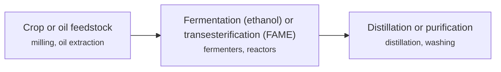

**Key equipment:** fermenters, distillation, transesterification reactors, product storage.

**Performance:**
- global liquid biofuel production, 2023: 175.2 billion litres; up 7% on 2022. [source](https://www.ren21.net/gsr-2025/technologies/bioenergy/)
- US ethanol production: 61.4 billion litres; REN21 states an all-time high; year not stated. [source](https://www.ren21.net/gsr-2025/technologies/bioenergy/)
- life-cycle GHG intensity of first-generation biofuels: 39-46 % GHG reduction vs petroleum baseline for average US dry-mill corn ethanol (EPA RFS setting, 2023); with indirect land-use change included, a 2025 Transport and Environment study finds global biofuel production emits about 16% MORE CO2 than the fossil fuels replaced; EPA RFS 2023-2025 setting: average US dry-mill corn ethanol has a lifecycle value 39-46% below the petroleum baseline; Transport and Environment-commissioned study (Oct 2025): including ILUC, global biofuels emit about 16% more CO2 than the fossil fuels they replace. [source](https://growthenergy.org/wp-content/uploads/2023/02/Growth-Energy-Set-comment-2023-02-10-PDF.pdf)

**Missing inputs:**
- capital cost and operating or unit cost, with dollar year and basis (costs): No open source read so far gives costs for this technology. Web-checked 2026-10-28; commodity plant costs case-specific. Where: arXiv and open-access journals: techno-economic or review papers (MDPI is blocked by its CDN; use the manual inbox) (catalog: arxiv, open); Licensor and EPC studies; paid cost databases are catalog-only (paid); OSTI.GOV full-text reports from DOE labs: search the technology name plus 'techno-economic' (catalog: osti, blocked). Next: Look for an open techno-economic study; record each figure with metric, range, unit, dollar year, basis and source.
- named plants or projects with capacity and year (reference_plants): The sources read name no specific plant. Web-checked 2026-10-28; ubiquitous industry. Where: Licensor and operator press releases for the suppliers listed (open). Next: Add one or two plants with country, capacity and start-up year.
- TRL with a cited source (trl): The IEA ETP Clean Energy Technology Guide has no matching entry. no open TRL table found (IEA ETP guide checked 2026-10-28). Where: IEA ETP Clean Energy Technology Guide (collected): search for the technology name (catalog: iea-reports, open). Next: Find a TRL table that lists this technology, or leave maturity resting on the evidence on the card.
- process steps and equipment are general engineering practice, not taken from one source (process): The sources read describe the principle but not a full step-by-step flow. Where: Licensor process descriptions and textbooks (open); [Open process-description authority (secondary): Wikipedia article 'Biofuel'. Cross-check the card's process_steps against it, then cite it in sources with note 'secondary'.](https://en.wikipedia.org/wiki/Biofuel) (open). Next: Verify the card's process_steps against the attached authority page, then cite it and delete this gap. Check the steps against a licensor description and name it.

Sources: [1](https://www.ren21.net/gsr-2025/technologies/bioenergy/). Last reviewed 2026-10-28.

## Fuel cells (PEM, SOFC)
<a id="h2-fuel-cells"></a>

Fuel cells convert hydrogen to electricity electrochemically. PEM cells power vehicles and backup; solid oxide cells run at high temperature for stationary power. IEA rates PEM fuel cells for fuel cell vehicles at TRL 9 and solid oxide fuel cells at TRL 9. China's fuel cell truck stock reached almost 15,000 in 2024, up 40%, and fuel cell cars sold fewer than 100 units there that year.

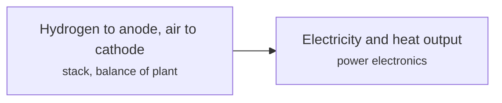

**Key equipment:** fuel cell stack, balance of plant, power electronics, hydrogen tank (mobile).

**Performance:**
- fuel cell trucks in China: 15000 vehicles; almost 15,000 in 2024, up 40% on 2023; China FCEV stock still short of its 50,000 target for 2025. [source](https://iea.blob.core.windows.net/assets/a6c466dd-b6f0-44bd-a60a-6940eccfb1c3/GlobalHydrogenReview2025.pdf)

**Costs:**
- HD PEM fuel cell system cost, 275 kWnet Class 8 long-haul truck: 168 USD/kWnet (2016$); 2023-status next-generation laboratory technology on direct hydrogen at 50,000 systems/yr, 2016$; about USD 160/kWnet at 100,000 units/yr; Monte Carlo 90% confidence range USD 142-195/kW; 2022 status was USD 179/kWnet; DOE targets USD 140/kWnet (2025), 80 (2030) and 60 (ultimate). [source](https://www.hydrogen.energy.gov/docs/hydrogenprogramlibraries/pdfs/review24/24004-hd-fuel-cell-system-cost-2023.pdf)
- stack share of HD fuel cell system cost: 63 % of system cost; stack is circa 63% of the USD 168/kWnet 2023 system cost at 50,000 systems/yr, i.e. roughly USD 105/kWnet; catalyst is more than half the stack cost at high production volume. [source](https://www.hydrogen.energy.gov/docs/hydrogenprogramlibraries/pdfs/review24/24004-hd-fuel-cell-system-cost-2023.pdf)

TRL source: [IEA ETP Clean Energy Technology Guide, dataset of 24 July 2026, latest assessment (IEA 1-11 scale): 'Polymer electrolyte membrane hydrogen fuel cell for FCEVs' 9 (2025); 'Solid oxide fuel cell' 9 (2025)](https://www.iea.org/data-and-statistics/data-tools/etp-clean-energy-technology-guide)

**Missing inputs:**
- named plants or projects with capacity and year (reference_plants): The sources read name no specific plant. Web-checked 2026-10-28; HD fuel-cell system cost already recorded from DOE records in Wave 1. Where: Licensor and operator press releases for the suppliers listed (open). Next: Add one or two plants with country, capacity and start-up year.
- process steps and equipment are general engineering practice, not taken from one source (process): The sources read describe the principle but not a full step-by-step flow. Where: Licensor process descriptions and textbooks (open); [Open process-description authority (secondary): Wikipedia article 'Fuel cell'. Cross-check the card's process_steps against it, then cite it in sources with note 'secondary'.](https://en.wikipedia.org/wiki/Fuel_cell) (open). Next: Verify the card's process_steps against the attached authority page, then cite it and delete this gap. Check the steps against a licensor description and name it.

Sources: [1](https://iea.blob.core.windows.net/assets/a6c466dd-b6f0-44bd-a60a-6940eccfb1c3/GlobalHydrogenReview2025.pdf), [2](https://www.hydrogen.energy.gov/docs/hydrogenprogramlibraries/pdfs/review24/24004-hd-fuel-cell-system-cost-2023.pdf). Last reviewed 2026-10-28.

## Hydrogen compressors (diaphragm, ionic, reciprocating)
<a id="h2-compressors"></a>

Hydrogen is compressed with diaphragm compressors at lower flows and oil-free high-pressure piston compressors at higher flows. Burckhardt says its non-lubricated designs compress hydrogen up to 900 bar as a booster for trailer filling and refuelling stations. IEA rates hydrogen turbo compressors, which suit pipelines, at TRL 6.

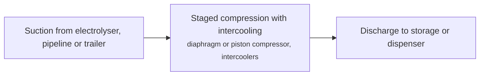

**Key equipment:** diaphragm compressor, oil-free piston compressor, ionic liquid piston compressor, intercoolers, turbo compressor (pipeline scale).

**Performance:**
- discharge pressure as booster: up to 900 bar; Burckhardt claim (non-lubricated). [source](https://www.compressortech2.com/news/Burckhardt-to-develop-hydrogen-compressor-systems/8015862.article)

TRL source: [IEA ETP Clean Energy Technology Guide, dataset of 24 July 2026, latest assessment (IEA 1-11 scale): 'Hydrogen turbo compressors' 6 (2025)](https://www.iea.org/data-and-statistics/data-tools/etp-clean-energy-technology-guide)

**Missing inputs:**
- compressor cost and specific energy (costs): The article gives none; the doe-hfto corpus records (checked 2026-10-28) give no hydrogen compressor capital cost or specific energy in kWh/kg either. Web-checked 2026-10-28; the only compressor cost found (FuelCell air compressor) was rejected as a different component in Wave 1. Where: DOE hydrogen compression targets (catalog: doe-hfto, open). Next: Add cost and kWh/kg.
- named plants or projects with capacity and year (reference_plants): The sources read name no specific plant. Web-checked 2026-10-28; ubiquitous equipment. Where: Licensor and operator press releases for the suppliers listed (open). Next: Add one or two plants with country, capacity and start-up year.
- process steps and equipment are general engineering practice, not taken from one source (process): The sources read describe the principle but not a full step-by-step flow. Where: Licensor process descriptions and textbooks (open); [Open process-description authority (secondary): Wikipedia article 'Hydrogen compressor'. Cross-check the card's process_steps against it, then cite it in sources with note 'secondary'.](https://en.wikipedia.org/wiki/Hydrogen_compressor) (open). Next: Verify the card's process_steps against the attached authority page, then cite it and delete this gap. Check the steps against a licensor description and name it.

Sources: [1](https://www.compressortech2.com/news/Burckhardt-to-develop-hydrogen-compressor-systems/8015862.article). Last reviewed 2026-10-28.

## Hydrogen for refinery and ammonia feedstock
<a id="h2-refinery-ammonia-feedstock"></a>

Refineries (hydrotreating, hydrocracking) and ammonia plants are the largest hydrogen users. Refining used more than 43 Mt of hydrogen in 2024, 45% made on site from unabated fossil fuels and 35% as by-product; low-emissions hydrogen in refining was only about 250 kt. Southeast Asian refining used 1.3 Mtpa in 2024.

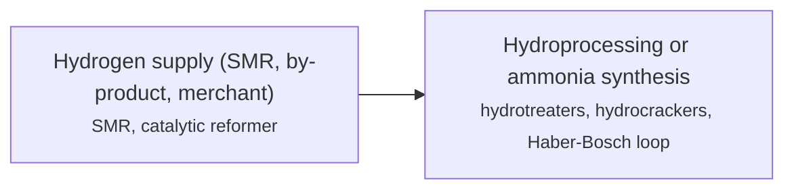

**Key equipment:** steam methane reformer, hydrogen network, hydrotreaters and hydrocrackers, ammonia synthesis loop.

**Performance:**
- hydrogen demand in oil refining, 2024: 43 Mt; second largest after industry; growth only about 0.5 Mt. [source](https://iea.blob.core.windows.net/assets/a6c466dd-b6f0-44bd-a60a-6940eccfb1c3/GlobalHydrogenReview2025.pdf)
- hydrogen demand in Southeast Asian refining, 2024: 1.3 Mtpa; region has about 5.5 Mbpd refining capacity in 30 refineries. [source](https://iea.blob.core.windows.net/assets/a6c466dd-b6f0-44bd-a60a-6940eccfb1c3/GlobalHydrogenReview2025.pdf)

**Costs:**
- levelised cost of hydrogen, unabated natural gas reforming: 0.8-4.6 USD/kg H2 (2024$); 2024 regional cost range, reflecting natural gas prices of USD 1.7-25/MBtu; figure values in USD (2024). [source](https://iea.blob.core.windows.net/assets/a6c466dd-b6f0-44bd-a60a-6940eccfb1c3/GlobalHydrogenReview2025.pdf)
- levelised cost of hydrogen, unabated natural gas reforming, STEPS 2030 projection: 0.7-3.7 USD/kg H2 (2024$); Stated Policies Scenario 2030, in USD (2024); larger drop at the high end as gas prices decline, partly offset by rising CO2 prices. [source](https://iea.blob.core.windows.net/assets/a6c466dd-b6f0-44bd-a60a-6940eccfb1c3/GlobalHydrogenReview2025.pdf)
- levelised cost of hydrogen, natural gas with CCUS, 2022 gas-price episode: 2 USD/kg H2 (2024$); in the 2022 gas-price crisis, LCOH from unabated natural gas was just above USD 1/kg (nearly USD 2/kg with CCUS) in gas-producing regions and up to close to USD 9/kg in importing regions; figure values in USD (2024). [source](https://iea.blob.core.windows.net/assets/a6c466dd-b6f0-44bd-a60a-6940eccfb1c3/GlobalHydrogenReview2025.pdf)
- levelised cost of hydrogen, renewable electrolytic, STEPS 2030 projection: 2-4 USD/kg H2 (2024$); Stated Policies Scenario 2030, in USD (2024): lower end close to under USD 2/kg in China; USD 3-4/kg in Australia, Chile, Brazil, the Middle East and the United States. [source](https://iea.blob.core.windows.net/assets/a6c466dd-b6f0-44bd-a60a-6940eccfb1c3/GlobalHydrogenReview2025.pdf)

TRL source: [IEA ETP Clean Energy Technology Guide, dataset of 24 July 2026, latest assessment (IEA 1-11 scale): 'Haber-bosch process using electrolytic hydrogen' 8 (2025)](https://www.iea.org/data-and-statistics/data-tools/etp-clean-energy-technology-guide)

**Missing inputs:**
- named plants or projects with capacity and year (reference_plants): The sources read name no specific plant. Wave 1 recorded 2024 LCOH ranges; plant references are the conventional SMR fleet already cited. Where: Licensor and operator press releases for the suppliers listed (open). Next: Add one or two plants with country, capacity and start-up year.
- process steps and equipment are general engineering practice, not taken from one source (process): The sources read describe the principle but not a full step-by-step flow. Where: Licensor process descriptions and textbooks (open). Next: Check the steps against a licensor description and name it.

Sources: [1](https://iea.blob.core.windows.net/assets/a6c466dd-b6f0-44bd-a60a-6940eccfb1c3/GlobalHydrogenReview2025.pdf). Last reviewed 2026-10-28.

## Hydrogen refuelling stations
<a id="h2-refuelling-stations"></a>

Stations take delivered or on-site hydrogen, compress and cool it, and dispense it at 350 or 700 bar to fuel cell vehicles. IEA counted about 1,300 stations at the end of 2024, 15% more than 2023. China had more than 500 (up 30%) and Europe more than 300. Station counts fell in the US, and Austria's only operator, OMV, announced closure of all stations by September 2025.

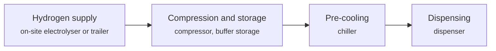

**Key equipment:** compressor, high-pressure buffer storage, pre-cooler, dispenser.

**Performance:**
- hydrogen refuelling stations worldwide at end 2024: 1300 stations; around 1,300, 15% more than end 2023. [source](https://iea.blob.core.windows.net/assets/a6c466dd-b6f0-44bd-a60a-6940eccfb1c3/GlobalHydrogenReview2025.pdf)

**Costs:**
- station capital equipment cost per unit dispensing capacity: 1200-3000 USD/(kg/day) (2016$); 111 new fueling stations awarded by the California Energy Commission in 2020; capacity 770-1,620 kg/day, all 700-bar light-duty; uninstalled equipment capital cost (combined awarded grant and match funding), adjusted to 2016 dollars using Chemical Engineering Plant Cost Indices; equivalent to USD 300-890/(kg/day) per dispenser. [source](https://www.hydrogen.energy.gov/docs/hydrogenprogramlibraries/pdfs/21002-hydrogen-fueling-station-cost.pdf)
- average station total capital cost: 1.9e+06 USD per station (2016$); mean and median total capital cost across the 111 California-awarded stations; average capacity 1,240 kg/day, median 1,500 kg/day; uninstalled equipment capital cost in 2016 dollars. [source](https://www.hydrogen.energy.gov/docs/hydrogenprogramlibraries/pdfs/21002-hydrogen-fueling-station-cost.pdf)

**Missing inputs:**
- named plants or projects with capacity and year (reference_plants): The sources read name no specific plant. California CEC station counts and 2016 cost basis already recorded from Wave 1. Where: Licensor and operator press releases for the suppliers listed (open). Next: Add one or two plants with country, capacity and start-up year.
- TRL with a cited source (trl): The IEA ETP Clean Energy Technology Guide has no matching entry. no open TRL table found (IEA ETP guide checked 2026-10-28). Where: IEA ETP Clean Energy Technology Guide (collected): search for the technology name (catalog: iea-reports, open). Next: Find a TRL table that lists this technology, or leave maturity resting on the evidence on the card.
- process steps and equipment are general engineering practice, not taken from one source (process): The sources read describe the principle but not a full step-by-step flow. Where: Licensor process descriptions and textbooks (open); [Open process-description authority (secondary): Wikipedia article 'Hydrogen station'. Cross-check the card's process_steps against it, then cite it in sources with note 'secondary'.](https://en.wikipedia.org/wiki/Hydrogen_station) (open). Next: Verify the card's process_steps against the attached authority page, then cite it and delete this gap. Check the steps against a licensor description and name it.

Sources: [1](https://iea.blob.core.windows.net/assets/a6c466dd-b6f0-44bd-a60a-6940eccfb1c3/GlobalHydrogenReview2025.pdf), [2](https://www.hydrogen.energy.gov/docs/hydrogenprogramlibraries/pdfs/21002-hydrogen-fueling-station-cost.pdf). Last reviewed 2026-10-28.

## Liquid hydrogen
<a id="h2-liquid-hydrogen"></a>

Hydrogen is cooled to about -253 °C in a liquefier using precooling and a hydrogen or helium refrigeration cycle, with ortho-para conversion catalysts so the liquid does not boil off from conversion heat. The liquid is stored and shipped in vacuum-insulated tanks and regasified at the user.

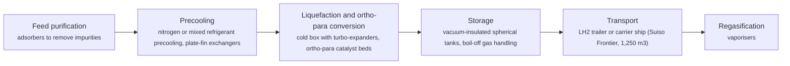

**Key equipment:** hydrogen liquefier cold box, precooling system, turbo-expanders and compressors, ortho-para converters, vacuum-insulated storage, LH2 carrier or trailers.

**Performance:**
- storage temperature: -253 °C; Suiso Frontier cargo tank. [source](https://www.hydrogenenergysupplychain.com/supply-chain/the-suiso-frontier/)
- carrier cargo tank volume (Suiso Frontier): 1250 m3; Kawasaki Heavy Industries, 116 m ship, completed 2020. [source](https://www.hydrogenenergysupplychain.com/supply-chain/the-suiso-frontier/)
- liquefaction energy, current industrial liquefiers: 10-20 kWh/kg H2; DOE record 19001; theoretical minimum 2.88 kWh/kg (20 bar inlet). [source](https://www.hydrogen.energy.gov/pdfs/19001_hydrogen_liquefaction_costs.pdf)
- largest US liquefier capacity: 70 t H2/day; DOE record 19001; smallest about 6 t/day. [source](https://www.hydrogen.energy.gov/pdfs/19001_hydrogen_liquefaction_costs.pdf)
- US installed liquefaction capacity: 304-794 t H2/day; DOE record 24003, May 2024; low = operating (14 plants of 5-32 t/day), high = existing plus announced. [source](https://www.hydrogen.energy.gov/docs/hydrogenprogramlibraries/pdfs/24003-hydrogen-liquefaction-capacity-united-states.pdf)

**Costs:**
- levelized liquefaction cost, 27 t/day liquefier: 2.75 USD/kg H2 (2016$); DOE HDSAM model incl. electricity; capital share about USD 1.40/kg; the record also quotes USD 2.75/kg for a 2018$ California case, so the dollar year is uncertain. [source](https://www.hydrogen.energy.gov/pdfs/19001_hydrogen_liquefaction_costs.pdf)
- liquefier capital cost, 27 t/day: 104 million USD (2018$); DOE record 19001 Table 2; full facility with production and terminal USD 160 million. [source](https://www.hydrogen.energy.gov/pdfs/19001_hydrogen_liquefaction_costs.pdf)

**Reference plants:**
- Hydrogen Energy Supply Chain (HESC), Suiso Frontier, AU: 1,250 m3 LH2 tank, loaded at Port of Hastings for Kobe; ship completed 2020; pilot voyage Australia to Japan. [source](https://www.hydrogenenergysupplychain.com/supply-chain/the-suiso-frontier/)

TRL source: [IEA ETP Clean Energy Technology Guide, dataset of 24 July 2026, 2025 assessment (IEA 1-11 scale): 'Hydrogen liquefaction' 9; 'Liquefied hydrogen tanker' 7](https://www.iea.org/data-and-statistics/data-tools/etp-clean-energy-technology-guide)

**Missing inputs:**
- boil-off rate in storage and shipping (performance): DOE record 19001 counts boil-off as a cost but gives no rate; no other doe-hfto record in the corpus (checked 2026-10-28) publishes a %/day boil-off rate either. Web-checked 2026-10-28; HDSAM counts boil-off as a cost line without a published percentage (checked Wave 1). Where: DOE Hydrogen Program Records on delivery (HDSAM) (catalog: doe-hfto, open); HESC / Kawasaki publications on the Suiso Frontier voyage (open). Next: Add boil-off rate (% per day) for tanks and ships with source.

Sources: [1](https://www.hydrogenenergysupplychain.com/supply-chain/the-suiso-frontier/), [2](https://www.hydrogen.energy.gov/pdfs/19001_hydrogen_liquefaction_costs.pdf). Last reviewed 2026-10-28.

## PEM electrolysis
<a id="h2-pem-electrolysis"></a>

A solid polymer membrane carries protons from anode to cathode. Water is split at an iridium-based anode into oxygen, protons and electrons; protons cross the membrane and combine with electrons at a platinum-based cathode to form hydrogen. DOE gives 70 to 90 °C operation. The compact cell runs at high current density and follows load quickly.

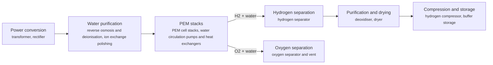

**Key equipment:** transformer and rectifier, PEM stacks, water purification, gas separators, deoxidiser and dryer, hydrogen compressor.

**Performance:**
- operating temperature: 70-90 °C; DOE description of PEM electrolysers. [source](https://www.energy.gov/eere/fuelcells/hydrogen-production-electrolysis)
- stack current density (status): 2 A/cm2; H2NEW PEM stack status, slide 13. [source](https://www.energy.gov/sites/default/files/2023-02/h2iqhour-01262023.pdf)
- system electricity use (status, beginning of life): 55 kWh/kg H2; DOE status; stack 51 kWh/kg; DOE ultimate target system 46. [source](https://www.energy.gov/sites/default/files/2024-12/hydrogen-shot-water-electrolysis-technology-assessment.pdf)
- stack lifetime (status): 40000 h; DOE status table; ultimate target 80,000 h; DOE record 24005 (May 2024) also assumes a 40,000 hr stack lifetime and replacement interval, resolving the conflicting 60,000 h figure from the 2023 H2NEW webinar. [source](https://www.energy.gov/sites/default/files/2024-12/hydrogen-shot-water-electrolysis-technology-assessment.pdf)

**Costs:**
- PEM stack capital cost (status; DOE ultimate target 100): 350 USD/kW (2023$); H2NEW PEM stack status, slide 13; stack only, not the full system. [source](https://www.energy.gov/sites/default/files/2023-02/h2iqhour-01262023.pdf)
- uninstalled system capital cost (status): 700-1100 USD/kW (2020$); DOE H2A-Lite current status, 50 t/day plant, stack plus balance of plant; installed about 2x (1,400-2,200). [source](https://www.energy.gov/sites/default/files/2024-12/hydrogen-shot-water-electrolysis-technology-assessment.pdf)
- levelized cost of hydrogen, hybrid wind-PV power: 4.4-6 USD/kg H2 (2022$); DOE record 24005; 74% capacity factor, 3.3 cents/kWh; low at USD 1,500/kW and high at 2,500/kW installed capex (baseline 2,000 gives 5.20). [source](https://www.hydrogen.energy.gov/docs/hydrogenprogramlibraries/pdfs/24005-clean-hydrogen-production-cost-pem-electrolyzer.pdf)
- levelized cost of hydrogen, average US grid power: 6.8-8.2 USD/kg H2 (2022$); DOE record 24005; 97% capacity factor, 8.3 cents/kWh; installed capex USD 1,500-2,500/kW. [source](https://www.hydrogen.energy.gov/docs/hydrogenprogramlibraries/pdfs/24005-clean-hydrogen-production-cost-pem-electrolyzer.pdf)
- water electrolysis capex, global average (2024): 2000-2600 USD/kWe (2024$); IEA; includes electrolyser system, electrical, gas treatment, balance of plant and EPC, excludes power assets; STEPS 2030 1,400-1,820; not split by electrolyser type. [source](https://iea.blob.core.windows.net/assets/15673ab3-a86a-4434-bff4-490bb42d3563/GlobalHydrogenReview2025AssumptionsAnnex.pdf)
- water electrolysis capex, China (2024): 600-1200 USD/kWe (2024$); IEA, same scope; STEPS 2030 450-900. [source](https://iea.blob.core.windows.net/assets/15673ab3-a86a-4434-bff4-490bb42d3563/GlobalHydrogenReview2025AssumptionsAnnex.pdf)

**Reference plants:**
- REFHYNE, Shell Energy and Chemicals Park Rheinland, DE: 10 MW PEM, described by Shell as Europe's largest PEM electrolyser at start-up; operating. [source](https://www.shell.com/news-and-insights/our-stories/green-hydrogen-project-goes-live-in-germany.html)

TRL source: [IEA ETP Clean Energy Technology Guide, dataset of 24 July 2026, 2025 assessment (IEA 1-11 scale): 'Polymer electrolyte membrane electrolyser' 9](https://www.iea.org/data-and-statistics/data-tools/etp-clean-energy-technology-guide)

Sources: [1](https://www.energy.gov/eere/fuelcells/hydrogen-production-electrolysis), [2](https://www.energy.gov/sites/default/files/2023-02/h2iqhour-01262023.pdf), [3](https://www.energy.gov/sites/default/files/2024-12/hydrogen-shot-water-electrolysis-technology-assessment.pdf), [4](https://www.hydrogen.energy.gov/docs/hydrogenprogramlibraries/pdfs/24005-clean-hydrogen-production-cost-pem-electrolyzer.pdf), [5](https://iea.blob.core.windows.net/assets/15673ab3-a86a-4434-bff4-490bb42d3563/GlobalHydrogenReview2025AssumptionsAnnex.pdf). Last reviewed 2026-10-28.

## Partial oxidation and gasification
<a id="h2-gasification-pox"></a>

Coal, petroleum coke, heavy oil or gas is partly burned with oxygen at high temperature to make syngas, which is shifted to hydrogen and purified. NETL's coal case uses a dry-feed, oxygen-blown entrained-flow slagging gasifier at about 1,427 degC, sour shift, MDEA acid gas removal, and PSA giving 99.9% hydrogen. Capture can be added; NSTA reports POX with methanation at 96 to 97% capture.

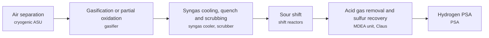

**Key equipment:** air separation unit, gasifier, syngas cooler, shift reactors, acid gas removal, sulfur recovery, PSA.

**Performance:**
- hydrogen purity from PSA, NETL case: 99.9 %; coal gasification without capture. [source](https://netl.doe.gov/research/carbon-management/energy-systems/gasification/gasifipedia/technologies-hydrogen/without-carbon)
- CO2 capture efficiency, POX + methanation: 96-97 %; NSTA blue hydrogen review. [source](https://www.nstauthority.co.uk/media/8605/blue-hydrogen-technology-review.pdf)
- feed gas energy conversion, POX + methanation: 76.6 % LHV; NSTA; overall incl. power import 73.2%. [source](https://www.nstauthority.co.uk/media/8605/blue-hydrogen-technology-review.pdf)

**Costs:**
- Levelized cost of hydrogen, coal gasification without CO2 capture (Case 4): 2.58 USD/kg H2 (2018$); DOE/NETL-2022/3241 Case 4, Shell gasifier coal gasification plant without capture, 659,947 kg H2/day, 80% capacity factor; LCOH excluding T&S (no capture, so no T&S cost); report states cost results are in 2018 dollars, Dec 2018 cost base. [source](https://netl.doe.gov/projects/files/ComparisonofCommercialStateofArtFossilBasedHydrogenProductionTechnologies_041222.pdf)
- Levelized cost of hydrogen, coal gasification with CO2 capture (Case 5): 2.92-3.09 USD/kg H2 (2018$); Case 5 Shell gasifier with two-stage Selexol CO2 capture (92.5%), 660,004 kg H2/day, Dec 2018 cost base; low = LCOH excluding T&S ($2.92), high = including T&S ($3.09); 2018 dollars. [source](https://netl.doe.gov/projects/files/ComparisonofCommercialStateofArtFossilBasedHydrogenProductionTechnologies_041222.pdf)
- Total plant cost of coal gasification hydrogen plant without capture (Case 4): 4264 USD per (kg H2/day) of capacity (2018$); Case 4 total plant cost $4,264 per kg H2/day of plant capacity (plant 659,947 kg H2/day), total overnight cost $5,243 and total as-spent cost $5,853 per kg H2/day; Dec 2018 cost base, 2018 dollars. [source](https://netl.doe.gov/projects/files/ComparisonofCommercialStateofArtFossilBasedHydrogenProductionTechnologies_041222.pdf)
- Total overnight cost of coal gasification hydrogen plant with capture (Case 5): 6044 USD per (kg H2/day) of capacity (2018$); Case 5 total overnight cost $6,044 per kg H2/day of plant capacity (plant 660,004 kg H2/day), total plant cost $4,901 and total as-spent cost $6,747 per kg H2/day; Dec 2018 cost base, 2018 dollars. [source](https://netl.doe.gov/projects/files/ComparisonofCommercialStateofArtFossilBasedHydrogenProductionTechnologies_041222.pdf)

TRL source: [IEA ETP Clean Energy Technology Guide, dataset of 24 July 2026, latest assessment (IEA 1-11 scale): 'Coal gasification - partial capture rates' 9 (2025); 'Coal gasification - high capture rates' 5 (2025)](https://www.iea.org/data-and-statistics/data-tools/etp-clean-energy-technology-guide)

**Missing inputs:**
- named plants or projects with capacity and year (reference_plants): The sources read name no specific plant. NETL Case 4/5 plants (coal gasification, 660,000 kg/day) already recorded from Wave 1 mining. Where: Licensor and operator press releases for the suppliers listed (open). Next: Add one or two plants with country, capacity and start-up year.
- process steps and equipment are general engineering practice, not taken from one source (process): The sources read describe the principle but not a full step-by-step flow. Where: Licensor process descriptions and textbooks (open); [Open process-description authority (secondary): Wikipedia article 'Partial oxidation'. Cross-check the card's process_steps against it, then cite it in sources with note 'secondary'.](https://en.wikipedia.org/wiki/Partial_oxidation) (open). Next: Verify the card's process_steps against the attached authority page, then cite it and delete this gap. Check the steps against a licensor description and name it.

Sources: [1](https://netl.doe.gov/research/carbon-management/energy-systems/gasification/gasifipedia/technologies-hydrogen/without-carbon), [2](https://www.nstauthority.co.uk/media/8605/blue-hydrogen-technology-review.pdf), [3](https://netl.doe.gov/projects/files/ComparisonofCommercialStateofArtFossilBasedHydrogenProductionTechnologies_041222.pdf). Last reviewed 2026-10-28.

## Steam methane reforming
<a id="h2-smr"></a>

Natural gas is desulfurised and reacted with steam over a nickel catalyst in externally fired tubes to make syngas. Water-gas shift converts most of the CO to more hydrogen and CO2, and pressure swing adsorption purifies the hydrogen. Without capture the CO2 is vented, partly in the shifted process gas and partly in the reformer flue gas. Blue hydrogen versions capture the process CO2, the flue gas CO2, or both.

```mermaid
flowchart LR
    FEED["Feed gas desulfurisation<br/><small>hydrodesulfurisation reactor, zinc oxide guard beds</small>"]
    PRE["Pre-reforming (optional)<br/><small>adiabatic pre-reformer</small>"]
    REF["Steam reforming<br/><small>fired tubular reformer with catalyst tubes, convection section and waste heat boiler, flue gas stack</small>"]
    WGS["Water-gas shift<br/><small>high- and low-temperature shift reactors, process gas coolers</small>"]
    AGR["Process CO2 removal (capture option)<br/><small>MDEA absorber and stripper or VSA</small>"]
    PSA["Hydrogen purification<br/><small>pressure swing adsorption unit</small>"]
    FGC["Flue gas CO2 capture (option)<br/><small>post-combustion amine unit (e.g. Cansolv)</small>"]
    CO2["CO2 compression and drying<br/><small>CO2 compressor, dehydration unit</small>"]
    FEED --> PRE
    PRE --> REF
    REF -->|syngas| WGS
    REF -->|flue gas (capture option)| FGC
    WGS --> AGR
    AGR -->|hydrogen-rich gas| PSA
    AGR -->|CO2| CO2
    FGC --> CO2
```

**Key equipment:** desulfurisation reactors, tubular steam reformer furnace, waste heat boiler, shift reactors, PSA unit, amine or VSA CO2 removal (blue), CO2 compressor (blue).

**Performance:**
- plant hydrogen output (NETL reference case): 483000 kg H2/day; NETL SMR case design capacity. [source](https://www.netl.doe.gov/projects/files/ComparisonofCommercialStateofArtFossilBasedHydrogenProductionTechnologies_041222.pdf)

**Costs:**
- levelized cost of hydrogen, SMR without capture: 1.06 USD/kg H2 (2018$); NETL 2022; natural gas USD 4.42/MMBtu, 90% capacity factor, CO2 transport and storage at USD 10/t where included. [source](https://www.netl.doe.gov/projects/files/ComparisonofCommercialStateofArtFossilBasedHydrogenProductionTechnologies_041222.pdf)
- levelized cost of hydrogen, SMR with 96.2% CO2 capture: 1.54-1.64 USD/kg H2 (2018$); NETL 2022; natural gas USD 4.42/MMBtu, 90% capacity factor, CO2 transport and storage at USD 10/t where included; low excludes and high includes CO2 transport and storage. [source](https://www.netl.doe.gov/projects/files/ComparisonofCommercialStateofArtFossilBasedHydrogenProductionTechnologies_041222.pdf)
- total plant cost, SMR without capture: 554 USD per kg H2/day capacity (2018$); NETL; 1,394 with 96.2% capture. [source](https://www.netl.doe.gov/projects/files/ComparisonofCommercialStateofArtFossilBasedHydrogenProductionTechnologies_041222.pdf)
- reforming capex, without and with CCUS: 720-1420 USD/kW H2 (2024$); IEA assumption; low without CCUS (76% LHV efficiency), high with CCUS at 95% capture (69% LHV). [source](https://iea.blob.core.windows.net/assets/15673ab3-a86a-4434-bff4-490bb42d3563/GlobalHydrogenReview2025AssumptionsAnnex.pdf)

**Reference plants:**
- Air Products Port Arthur SMR CO2 capture (Valero refinery site), US: about 1 Mt/yr CO2 captured by vacuum swing adsorption from SMR process gas, used for enhanced oil recovery; capture began 2013 (first SMR; second planned months later). [source](https://www.energy.gov/fe/articles/breakthrough-large-scale-industrial-project-begins-carbon)

TRL source: [IEA ETP Clean Energy Technology Guide, dataset of 24 July 2026, 2025 assessment (IEA 1-11 scale): 'Steam reforming - partial capture' 9; 'Steam reforming - high capture rates' 6](https://www.iea.org/data-and-statistics/data-tools/etp-clean-energy-technology-guide)

Sources: [1](https://www.netl.doe.gov/projects/files/ComparisonofCommercialStateofArtFossilBasedHydrogenProductionTechnologies_041222.pdf), [2](https://www.energy.gov/fe/articles/breakthrough-large-scale-industrial-project-begins-carbon), [3](https://iea.blob.core.windows.net/assets/15673ab3-a86a-4434-bff4-490bb42d3563/GlobalHydrogenReview2025AssumptionsAnnex.pdf). Last reviewed 2026-10-24.

## Ammonia as hydrogen carrier and ammonia cracking
<a id="h2-ammonia-cracking"></a>

Hydrogen is shipped as liquid ammonia, which is easy to store and already traded worldwide. At the destination, ammonia is heated over a catalyst and decomposed into hydrogen and nitrogen in an endothermic reaction, then hydrogen is purified and residual ammonia removed. Part of the product or ammonia is burned to supply reaction heat.

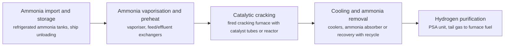

**Key equipment:** refrigerated ammonia storage, vaporiser, cracking furnace or reactor, ammonia recovery, PSA unit.

**Performance:**
- hydrogen purity (KBR H2ACT): 99.97 %; vendor claim; ammonia slip below 0.1 ppmv; KBR also claims 90% efficiency without stating the basis. [source](https://kbr.foleon.com/technology/h2-act-unlocking-the-global-hydrogen-economy-through-ammonia-cracking/)

**Reference plants:**
- SUSO ammonia cracking project, Ulsan, KR: 10 t/day hydrogen from 72 t/day ammonia (KBR H2ACT); moving to EPC, target start-up 2028. [source](https://kbr.foleon.com/technology/h2-act-unlocking-the-global-hydrogen-economy-through-ammonia-cracking/)

TRL source: [IEA ETP Clean Energy Technology Guide, dataset of 24 July 2026, 2025 assessment (IEA 1-11 scale): 'Ammonia cracking - reformer' 7; 'Ammonia cracking - catalytic membrane' 4](https://www.iea.org/data-and-statistics/data-tools/etp-clean-energy-technology-guide)

**Missing inputs:**
- capital cost and levelized or unit cost, with dollar year and basis (costs): No open source read so far gives costs for this technology; the doe-hfto corpus (liquefaction, delivery, fueling-station, fuel-cell and electrolysis records, checked 2026-10-28) gives no ammonia-cracking economics. Web-checked 2026-10-28; cracking economics remain in DOE/IEA annex material (GHR 2025 recorded). Where: DOE Hydrogen Program Records and H2A analyses (catalog: doe-hfto, open); [IEA Global Hydrogen Review 2025 Assumptions Annex (collected): capex and efficiency by pathway](https://iea.blob.core.windows.net/assets/15673ab3-a86a-4434-bff4-490bb42d3563/GlobalHydrogenReview2025AssumptionsAnnex.pdf) (catalog: iea-reports, open); OSTI.GOV full-text reports from DOE labs (NETL, NREL, PNNL): search the technology name plus 'techno-economic' (catalog: osti, blocked). Next: Look for an open techno-economic study; record each figure with metric, range, unit, dollar year, basis and source.

Sources: [1](https://kbr.foleon.com/technology/h2-act-unlocking-the-global-hydrogen-economy-through-ammonia-cracking/). Last reviewed 2026-10-28.

## Ammonia as marine fuel
<a id="h2-ammonia-marine-fuel"></a>

Ammonia burns in dual-fuel engines on ships. IEA reports that 4-stroke ammonia engines are commercially available for smaller vessels, 2-stroke engines for large ships are not yet commercial, and more than 30 ships are on order with deliveries from late 2025. IMO amended the IGC Code in December 2024 to permit ammonia cargo as a marine fuel, in force July 2026. IEA rates ammonia-fuelled ship engines at TRL 6.

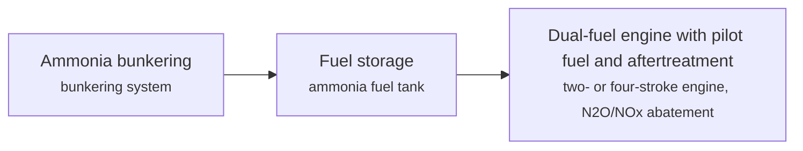

**Key equipment:** ammonia fuel tank, fuel supply system, dual-fuel engine, safety and leak systems.

**Performance:**
- ammonia as marine fuel - world-first operations and trials: 4.4 tonnes of liquid ammonia used in the first bunker operation and 10-day propulsion/manoeuvrability trials (Fortescue Green Pioneer, Singapore, Mar-May 2024, with diesel and HVO); Fortescue Green Pioneer carried out the world's first ammonia marine bunker operation in Singapore (announced 15 Mar 2024) and completed 10 days of trials (23 Apr - 2 May 2024) using 6.4 m3 (4.4 t) of liquid ammonia with diesel/HVO; MAN Energy Solutions ran the first ammonia test engine at its Copenhagen research centre in July 2023; Green Pioneer demonstrated in the UK from March 2025. [source](https://www.energyconnects.com/news/gas-lng/2024/march/singapore-port-announces-world-s-first-successful-use-of-ammonia-as-a-marine-fuel)

**Reference plants:**
- Anhui, first vessel on ammonia only (200 kW engine), maiden voyage June 2025, CN: ; . [source](https://iea.blob.core.windows.net/assets/a6c466dd-b6f0-44bd-a60a-6940eccfb1c3/GlobalHydrogenReview2025.pdf)
- Sakigake tug, Tokyo Bay, 95% ammonia co-firing trial March 2025, JP: ; . [source](https://iea.blob.core.windows.net/assets/a6c466dd-b6f0-44bd-a60a-6940eccfb1c3/GlobalHydrogenReview2025.pdf)

TRL source: [IEA ETP Clean Energy Technology Guide, dataset of 24 July 2026, latest assessment (IEA 1-11 scale): 'Ammonia-fuelled ship engine' 6 (2025); 'Ammonia (bunkering)' 9 (2025)](https://www.iea.org/data-and-statistics/data-tools/etp-clean-energy-technology-guide)

**Missing inputs:**
- fuel cost versus LNG, methanol and fuel oil (costs): None extracted. Web-checked 2026-10-28; green-ammonia bunker prices are quote-only. Where: IEA GHR shipping section (catalog: iea-reports, open). Next: Add cost comparisons.

Sources: [1](https://iea.blob.core.windows.net/assets/a6c466dd-b6f0-44bd-a60a-6940eccfb1c3/GlobalHydrogenReview2025.pdf), [2](https://www.energyconnects.com/news/gas-lng/2024/march/singapore-port-announces-world-s-first-successful-use-of-ammonia-as-a-marine-fuel), [3](https://en.wikipedia.org/wiki/Ammonia). Last reviewed 2026-10-28.

## Cellulosic ethanol
<a id="h2-cellulosic-ethanol"></a>

Agricultural residues are pretreated, enzymatically hydrolysed and fermented to ethanol. Clariant's sunliquid plant at Podari, Romania produced its first commercial cellulosic ethanol in June 2022 from about 250,000 t of local agricultural residues, with output about 50,000 t contracted to Shell.


**Key equipment:** pretreatment reactor, hydrolysis tanks, fermenters, distillation.

**Performance:**
- Podari plant feedstock: 250000 t/yr agricultural residues; article gives about 50,000 t output; no annual rate stated. [source](https://www.digitalrefining.com/news/1006992,clariant-produces-first-commercial-sunliquid-cellulosic-ethanol.html)

**Reference plants:**
- Clariant sunliquid, Podari, RO: about 50,000 t ethanol; . [source](https://www.digitalrefining.com/news/1006992,clariant-produces-first-commercial-sunliquid-cellulosic-ethanol.html)

TRL source: [IEA ETP Clean Energy Technology Guide dataset (July 2026), entry 'Lignocellulosic biomass fermentation' (TRL 9 in 2025; 8 in 2020-2023)](https://www.iea.org/data-and-statistics/data-tools/etp-clean-energy-technology-guide)

**Missing inputs:**
- capital and production cost (costs): None in the article. Web-checked 2026-10-28; TRL closed in Wave 1 (ETP guide); production costs sit in NREL/DOE TEAs. Where: IEA Bioenergy Task 39 (open). Next: Add cost.
- process steps and equipment are general engineering practice, not taken from one source (process): The sources read describe the principle but not a full step-by-step flow. Where: Licensor process descriptions and textbooks (open); [Open process-description authority (secondary): Wikipedia article 'Cellulosic ethanol'. Cross-check the card's process_steps against it, then cite it in sources with note 'secondary'.](https://en.wikipedia.org/wiki/Cellulosic_ethanol) (open). Next: Verify the card's process_steps against the attached authority page, then cite it and delete this gap. Check the steps against a licensor description and name it.

Sources: [1](https://www.digitalrefining.com/news/1006992,clariant-produces-first-commercial-sunliquid-cellulosic-ethanol.html), [2](https://www.iea.org/data-and-statistics/data-tools/etp-clean-energy-technology-guide). Last reviewed 2026-10-28.

## E-methane (synthetic natural gas)
<a id="h2-e-methane"></a>

Hydrogen and CO2 react in a methanation reactor (Sabatier) to make methane that can enter the gas grid. Tokyo Gas began a trial in 2022 at its Yokohama research centre with a Hitachi Zosen methanation unit, first at 12.5 Nm3/h, then 400 Nm3/h in the late 2020s and 20,000 Nm3/h overseas in 2030. A 6.3 MW synthetic methane plant in Germany received RFNBO certificates.

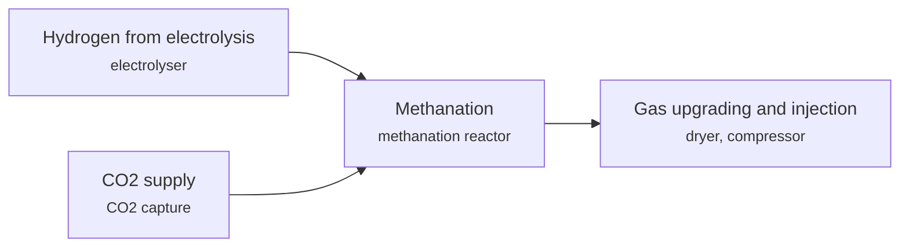

**Key equipment:** electrolyser, methanation reactor, CO2 supply, gas conditioning.

**Performance:**
- Tokyo Gas trial capacity, first phase: 12.5 Nm3/h; scale-up to 400 Nm3/h late 2020s, 20,000 Nm3/h overseas 2030. [source](https://pgjonline.com/news/2022/june/tokyo-gas-begins-synthetic-methane-trial-using-green-hydrogen)

**Reference plants:**
- Audi e-gas plant, Werlte, Lower Saxony, Germany, DE: 6 MW power-to-methane plant using renewable electricity, water and CO2 from a nearby biogas plant; opened June 2013, the world's largest power-to-gas facility at the time; operating. [source](https://www.carsales.com.au/editorial/details/audi-e-gas-stabilises-german-power-grid-52657)

TRL source: [IEA ETP Clean Energy Technology Guide dataset (July 2026), entry 'Chemical methanation' (TRL 7 in 2025; 6 in 2020-2021); category 'Hydrogen > Sythetic fuels production', value chain Hydrogen (Hydrogen-based fuels production)](https://www.iea.org/data-and-statistics/data-tools/etp-clean-energy-technology-guide)

**Missing inputs:**
- capital cost and operating or unit cost, with dollar year and basis (costs): No open source read so far gives costs for this technology. Web-checked 2026-10-28; e-methane costs sit in the same e-fuel ranges as the FT card. Where: arXiv and open-access journals: techno-economic or review papers (MDPI is blocked by its CDN; use the manual inbox) (catalog: arxiv, open); Licensor and EPC studies; paid cost databases are catalog-only (paid); OSTI.GOV full-text reports from DOE labs: search the technology name plus 'techno-economic' (catalog: osti, blocked). Next: Look for an open techno-economic study; record each figure with metric, range, unit, dollar year, basis and source.
- process steps and equipment are general engineering practice, not taken from one source (process): The sources read describe the principle but not a full step-by-step flow. Where: Licensor process descriptions and textbooks (open); [Open process-description authority (secondary): Wikipedia article 'Methanation'. Cross-check the card's process_steps against it, then cite it in sources with note 'secondary'.](https://en.wikipedia.org/wiki/Methanation) (open). Next: Verify the card's process_steps against the attached authority page, then cite it and delete this gap. Check the steps against a licensor description and name it.

Sources: [1](https://pgjonline.com/news/2022/june/tokyo-gas-begins-synthetic-methane-trial-using-green-hydrogen), [2](https://iea.blob.core.windows.net/assets/a6c466dd-b6f0-44bd-a60a-6940eccfb1c3/GlobalHydrogenReview2025.pdf). Last reviewed 2026-10-28.

## E-methanol and bio-methanol
<a id="h2-e-methanol"></a>

Methanol is made from green hydrogen and biogenic or captured CO2 (e-methanol), or from biomass (bio-methanol). European Energy's Kassø plant in Denmark has three Siemens Energy electrolysers totalling 52.5 MW, uses biogenic CO2 from a local biogas plant, and produced its first e-methanol in March 2025 from the first of two methanol lines. Target output is 42,000 t.

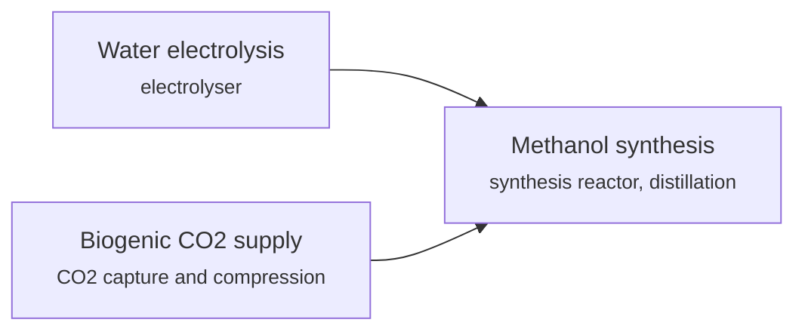

**Key equipment:** electrolyser, CO2 supply, methanol synthesis reactor, distillation.

**Performance:**
- Kassø e-methanol capacity: 42000 t; article gives no time unit; electrolysers 52.5 MW. [source](https://hydrocarbonprocessing.com/news/2025/03/european-energy-produces-first-emethanol-at-kassoe/)

**Costs:**
- renewable e-methanol production cost (Chinese feasibility study): 4167-10250 CNY per tonne (about USD 580-1,430/t at 7.15 CNY/USD), 2-4 times the market rate of grey methanol (2024$); dollar year not stated (study published 2024/25); Chinese feasibility assessment of renewable e-methanol: production costs of 4,167-10,250 CNY/tonne, two to four times grey-methanol market rates; cost dominated by hydrogen production. [source](https://www.scribd.com/document/784160566/Feasibility-study-of-renewable-e-methanol-production-A-substitution-pathway-from-blue-to-green)

**Reference plants:**
- European Energy Kassø, Denmark, DK: 42,000 t e-methanol; 52.5 MW electrolysis; first e-methanol March 2025; full ramp-up expected Q2 2025. [source](https://hydrocarbonprocessing.com/news/2025/03/european-energy-produces-first-emethanol-at-kassoe/)

TRL source: [IEA ETP Clean Energy Technology Guide, dataset of 24 July 2026, latest assessment (IEA 1-11 scale): 'Direct CO₂-to-methanol synthesis' 8 (2025); 'Methanol production using biomass and waste gasification' 8 (2025)](https://www.iea.org/data-and-statistics/data-tools/etp-clean-energy-technology-guide)

**Missing inputs:**
- process steps and equipment are general engineering practice, not taken from one source (process): The sources read describe the principle but not a full step-by-step flow. Where: Licensor process descriptions and textbooks (open); [Open process-description authority (secondary): Wikipedia article 'Methanol fuel'. Cross-check the card's process_steps against it, then cite it in sources with note 'secondary'.](https://en.wikipedia.org/wiki/Methanol_fuel) (open). Next: Verify the card's process_steps against the attached authority page, then cite it and delete this gap. Check the steps against a licensor description and name it.

Sources: [1](https://hydrocarbonprocessing.com/news/2025/03/european-energy-produces-first-emethanol-at-kassoe/). Last reviewed 2026-10-28.

## Fischer-Tropsch SAF and e-fuels (biomass or CO2 plus H2)
<a id="h2-ft-saf-efuels"></a>

Syngas from biomass gasification, or from hydrogen and CO2 via reverse water-gas shift, is converted to hydrocarbons in Fischer-Tropsch synthesis and upgraded to jet and diesel. FT-SPK was approved under ASTM D7566 Annex A1 in 2009 with a 50% blend limit. INERATEC's 2.5 ktpa plant in Germany began commercial operation in June 2025 and Infinium's 23 ktpa Roadrunner plant in the US began construction in May 2025.

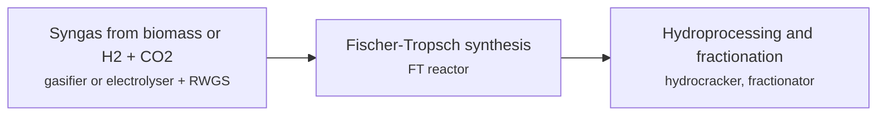

**Key equipment:** gasifier or electrolyser, RWGS reactor, FT reactor, hydroprocessing unit, fractionation.

**Performance:**
- INERATEC plant capacity: 2.5 ktpa; synthetic fuels and wax from chlor-alkali by-product hydrogen and biogenic CO2; commercial operation June 2025. [source](https://iea.blob.core.windows.net/assets/a6c466dd-b6f0-44bd-a60a-6940eccfb1c3/GlobalHydrogenReview2025.pdf)
- Infinium Roadrunner planned capacity: 23 ktpa; under construction from May 2025. [source](https://iea.blob.core.windows.net/assets/a6c466dd-b6f0-44bd-a60a-6940eccfb1c3/GlobalHydrogenReview2025.pdf)

**Costs:**
- synthetic fuel (e-fuel/FT) production cost per litre: 1.9-8.7 USD per litre (2023 assessment range; market commentary 2026 cites about USD 3-7/litre today) (2023$); 2023 research assessment: synthetic-fuel production costs range USD 1.90-8.70 per litre depending on technology and renewable electricity price; FT-synfuels global study (Feb 2023): large volumes available at about EUR 110/MWh (USD 203/bbl); dollar years as dated in the sources. [source](https://www.researchgate.net/post/What_do_we_know_about_the_costs_of_synthetic_fuels_in_road_transport)

**Reference plants:**
- INERATEC, Germany, DE: 2.5 ktpa; . [source](https://iea.blob.core.windows.net/assets/a6c466dd-b6f0-44bd-a60a-6940eccfb1c3/GlobalHydrogenReview2025.pdf)

TRL source: [IEA ETP Clean Energy Technology Guide, dataset of 24 July 2026, latest assessment (IEA 1-11 scale): 'CO₂-to-liquids (integrated RWGS + fischer–tropsch process)' 7 (2025); 'Gasification and Fischer-Tropsch' 7 (2025)](https://www.iea.org/data-and-statistics/data-tools/etp-clean-energy-technology-guide)

**Missing inputs:**
- process steps and equipment are general engineering practice, not taken from one source (process): The sources read describe the principle but not a full step-by-step flow. Where: Licensor process descriptions and textbooks (open); [Open process-description authority (secondary): Wikipedia article 'Synthetic fuel'. Cross-check the card's process_steps against it, then cite it in sources with note 'secondary'.](https://en.wikipedia.org/wiki/Synthetic_fuel) (open). Next: Verify the card's process_steps against the attached authority page, then cite it and delete this gap. Check the steps against a licensor description and name it.

Sources: [1](https://www.energy.gov/sites/default/files/2022-09/beto-saf-gc-roadmap-report-sept-2022.pdf), [2](https://iea.blob.core.windows.net/assets/a6c466dd-b6f0-44bd-a60a-6940eccfb1c3/GlobalHydrogenReview2025.pdf). Last reviewed 2026-10-28.

## Gas-heated reforming
<a id="h2-gas-heated-reforming"></a>

A gas-heated reformer uses the hot syngas leaving an autothermal reformer (ATR) to heat the steam-reforming reaction, so most of the heat needed comes from the process rather than a fired furnace. The GHR+ATR combination makes syngas for hydrogen with one concentrated CO2 stream that can be captured at 95% or more. IEA rates ATR with a gas-heated reformer at TRL 5.

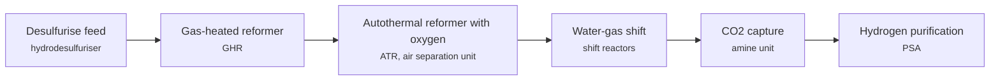

**Key equipment:** gas-heated reformer, autothermal reformer, air separation unit, shift reactors, CO2 capture unit, PSA.

**Performance:**
- CO2 capture efficiency, GHR+ATR(+PSA): 95-97 %; carbon captured over carbon in feed; NSTA report. [source](https://www.nstauthority.co.uk/media/8605/blue-hydrogen-technology-review.pdf)
- feed gas energy conversion to hydrogen: 80.6 % LHV; GHR+ATR+PSA; overall incl. power import 76.1%. [source](https://www.nstauthority.co.uk/media/8605/blue-hydrogen-technology-review.pdf)
- net power import: 8.8 MJ/kg H2; GHR+ATR+PSA. [source](https://www.nstauthority.co.uk/media/8605/blue-hydrogen-technology-review.pdf)
- CO2 captured: 8.4 kg CO2/kg H2; same case. [source](https://www.nstauthority.co.uk/media/8605/blue-hydrogen-technology-review.pdf)

**Reference plants:**
- bp H2Teesside (JM LCH licence), GB: 1.2 GW hydrogen production targeted by 2030, over 10% of the UK 10 GW target; licensing and engineering agreement signed; UK Track-1 Capture Project, East Coast Cluster Phase 2. [source](https://matthey.com/media/2023/bp-selects-johnson-matthey-s-lch-technology-for-its-first-low-carbon-hydrogen-project)
- H2H Saltend (Equinor-led, JM LCH selected), GB: large-scale low-carbon hydrogen for Saltend Chemicals Park, Hull; JM announced as technology provider, March 2023. [source](https://matthey.com/johnson-matthey-chosen-for-h2h-saltend-low-carbon-hydrogen-project)

TRL source: [IEA ETP Clean Energy Technology Guide, dataset of 24 July 2026, latest assessment (IEA 1-11 scale): 'Autothermal reforming - gas heated reformer' 5 (2025)](https://www.iea.org/data-and-statistics/data-tools/etp-clean-energy-technology-guide)

**Missing inputs:**
- capital cost and operating or unit cost, with dollar year and basis (costs): No open source read so far gives costs for this technology. Web-checked 2026-10-28; licensor quotes only. Where: arXiv and open-access journals: techno-economic or review papers (MDPI is blocked by its CDN; use the manual inbox) (catalog: arxiv, open); Licensor and EPC studies; paid cost databases are catalog-only (paid); OSTI.GOV full-text reports from DOE labs: search the technology name plus 'techno-economic' (catalog: osti, blocked). Next: Look for an open techno-economic study; record each figure with metric, range, unit, dollar year, basis and source.
- operating plants with capacity and start-up year (the two named projects are pre-FID/FEED stage) (reference_plants): No operating GHR+ATR plant is named in sources read; bp H2Teesside and H2H Saltend are projects. Web-checked 2026-10-28: the card names pre-FID projects correctly; no operating GHR plant found open. Where: Licensor and operator press releases for the suppliers listed (open). Next: Add an operating plant with country, capacity and start-up year once one reaches operation.
- process steps and equipment are general engineering practice, not taken from one source (process): The sources read describe the principle but not a full step-by-step flow. Where: Licensor process descriptions and textbooks (open). Next: Check the steps against a licensor description and name it.

Sources: [1](https://www.nstauthority.co.uk/media/8605/blue-hydrogen-technology-review.pdf), [2](https://matthey.com/products-and-markets/energy/ccs-enabled-blue-hydrogen), [3](https://matthey.com/media/2023/bp-selects-johnson-matthey-s-lch-technology-for-its-first-low-carbon-hydrogen-project). Last reviewed 2026-10-28.

## Green and blue ammonia
<a id="h2-green-blue-ammonia"></a>

Hydrogen and nitrogen are compressed and reacted over an iron catalyst in a Haber-Bosch synthesis loop. Green ammonia takes hydrogen from electrolysis on renewable power and nitrogen from an air separation unit; blue ammonia uses reforming with CO2 capture, where the CO2 is already separated in the process.

```mermaid
flowchart LR
    H2["Hydrogen supply<br/><small>electrolysers (green) or ATR/SMR with capture (blue), hydrogen buffer storage</small>"]
    ASU["Nitrogen supply<br/><small>air separation unit</small>"]
    SYN["Synthesis gas compression<br/><small>syngas compressor</small>"]
    LOOP["Ammonia synthesis loop<br/><small>ammonia converter, loop heat recovery, refrigeration and ammonia separator</small>"]
    STO["Ammonia storage and export<br/><small>refrigerated ammonia tanks, jetty loading</small>"]
    H2 --> SYN
    ASU --> SYN
    SYN --> LOOP
    LOOP --> STO
```

**Key equipment:** electrolysers or reformer with capture, air separation unit, syngas compressor, ammonia converter, refrigeration, ammonia storage.

**Performance:**
- hydrogen production (NEOM): 600 t H2/day; NEOM Green Hydrogen Project. [source](https://acwapower.com/en/what-we-do/projects/neom-green-hydrogen-project/)
- ammonia production (NEOM): 1.2e+06 t NH3/yr; NEOM Green Hydrogen Project, up to. [source](https://acwapower.com/en/what-we-do/projects/neom-green-hydrogen-project/)

**Reference plants:**
- NEOM Green Hydrogen Project, SA: 3.9 to 4 GW solar and wind, 600 t/day hydrogen, up to 1.2 Mt/yr ammonia; thyssenkrupp electrolysis, Air Products air separation; USD 9,046 million; renewables due mid-2026, commissioning and first product 2027. [source](https://acwapower.com/en/what-we-do/projects/neom-green-hydrogen-project/)

TRL source: [IEA ETP Clean Energy Technology Guide, dataset of 24 July 2026, 2025 assessment (IEA 1-11 scale): 'Haber-bosch process using electrolytic hydrogen' 8](https://www.iea.org/data-and-statistics/data-tools/etp-clean-energy-technology-guide)

**Missing inputs:**
- capital cost and levelized or unit cost, with dollar year and basis (costs): No open source read so far gives costs for this technology; the doe-hfto corpus (checked 2026-10-28) covers electrolysis, liquefaction, delivery and fuel-cell costs only, with no ammonia synthesis economics. Web-checked 2026-10-28; GHR 2025 ammonia energy intensities recorded in Wave 1; capex vendor-quoted. Where: DOE Hydrogen Program Records and H2A analyses (catalog: doe-hfto, open); [IEA Global Hydrogen Review 2025 Assumptions Annex (collected): capex and efficiency by pathway](https://iea.blob.core.windows.net/assets/15673ab3-a86a-4434-bff4-490bb42d3563/GlobalHydrogenReview2025AssumptionsAnnex.pdf) (catalog: iea-reports, open); OSTI.GOV full-text reports from DOE labs (NETL, NREL, PNNL): search the technology name plus 'techno-economic' (catalog: osti, blocked). Next: Look for an open techno-economic study; record each figure with metric, range, unit, dollar year, basis and source.

Sources: [1](https://acwapower.com/en/what-we-do/projects/neom-green-hydrogen-project/), [2](https://ammoniaenergy.org/articles/thyssenkrupp-to-install-2-plus-gw-of-electrolysers-for-neom). Last reviewed 2026-10-28.

## Hydrogen direct reduction of iron
<a id="h2-dri"></a>

Iron ore pellets are reduced to sponge iron by hydrogen instead of natural gas, then melted in an electric arc furnace. HYBRIT's Luleå pilot made more than 5,000 t of sponge iron with 98 to 99% metallisation between 2018 and 2024. IEA rates DRI based on 100% electrolytic hydrogen at TRL 6.

```mermaid
flowchart LR
    PEL["Ore pellets<br/><small>pellet plant</small>"]
    RED["Hydrogen reduction in shaft furnace<br/><small>shaft furnace, hydrogen heater</small>"]
    EAF["Electric arc furnace melting<br/><small>EAF</small>"]
    PEL --> RED
    RED --> EAF
```

**Key equipment:** electrolyser, hydrogen storage, shaft furnace, gas heater, electric arc furnace.

**Performance:**
- sponge iron produced in HYBRIT pilot: 5000 t; 2018 to 2024; metallisation 98 to 99%. [source](https://www.ssab.com/en/news/2024/08/hybrit-six-years-of-research-paves-the-way-for-fossilfree-iron-and-steel-production-on-an-industrial)
- cost gap of H2 DRI versus blast furnace: 50-140 %; IEA GHR 2025: 20 to 80% versus unabated natural-gas DRI; upfront cost 40 to 140% higher than gas DRI at commercial scale. [source](https://iea.blob.core.windows.net/assets/a6c466dd-b6f0-44bd-a60a-6940eccfb1c3/GlobalHydrogenReview2025.pdf)

**Reference plants:**
- HYBRIT pilot, Luleå, SE: more than 5,000 t sponge iron in total; . [source](https://www.ssab.com/en/news/2024/08/hybrit-six-years-of-research-paves-the-way-for-fossilfree-iron-and-steel-production-on-an-industrial)
- Stegra Boden hydrogen-DRI steel plant, Sweden, SE: integrated green hydrogen, iron and steel plant; about USD 7 bn raised; on track for startup in 2026 with about 2.5 Mt/yr initial capacity scaling toward 5 Mt/yr by 2030; EUR 975 m completion round launched Oct 2025; construction. [source](https://www.gasworld.com/story/stegra-launches-e975m-funding-round-to-complete-hydrogen-based-steel-plant/2243666.article)

TRL source: [IEA ETP Clean Energy Technology Guide, dataset of 24 July 2026, latest assessment (IEA 1-11 scale): 'DRI production based on 100% electrolytic hydrogen' 6 (2025)](https://www.iea.org/data-and-statistics/data-tools/etp-clean-energy-technology-guide)

**Missing inputs:**
- capital cost and operating or unit cost, with dollar year and basis (costs): No open source read so far gives costs for this technology. Web-checked 2026-10-28: Stegra funding (about USD 7 bn) recorded in reference_plants; per-tonne DRI economics not published. Where: arXiv and open-access journals: techno-economic or review papers (MDPI is blocked by its CDN; use the manual inbox) (catalog: arxiv, open); Licensor and EPC studies; paid cost databases are catalog-only (paid); OSTI.GOV full-text reports from DOE labs: search the technology name plus 'techno-economic' (catalog: osti, blocked). Next: Look for an open techno-economic study; record each figure with metric, range, unit, dollar year, basis and source.
- process steps and equipment are general engineering practice, not taken from one source (process): The sources read describe the principle but not a full step-by-step flow. Where: Licensor process descriptions and textbooks (open); [Open process-description authority (secondary): Wikipedia article 'Direct reduced iron'. Cross-check the card's process_steps against it, then cite it in sources with note 'secondary'.](https://en.wikipedia.org/wiki/Direct_reduced_iron) (open). Next: Verify the card's process_steps against the attached authority page, then cite it and delete this gap. Check the steps against a licensor description and name it.

Sources: [1](https://www.ssab.com/en/news/2024/08/hybrit-six-years-of-research-paves-the-way-for-fossilfree-iron-and-steel-production-on-an-industrial), [2](https://iea.blob.core.windows.net/assets/a6c466dd-b6f0-44bd-a60a-6940eccfb1c3/GlobalHydrogenReview2025.pdf), [3](https://www.gasworld.com/story/stegra-launches-e975m-funding-round-to-complete-hydrogen-based-steel-plant/2243666.article). Last reviewed 2026-10-28.

## Hydrogen storage in salt caverns
<a id="h2-salt-cavern-storage"></a>

Caverns are dissolved in deep salt formations by solution mining, then filled with compressed hydrogen. Salt is nearly impermeable to hydrogen and creeps to seal fractures, so caverns can be cycled many times. A cushion gas stays in the cavern to keep the walls stable, and withdrawn gas is dried before use.

```mermaid
flowchart LR
    MINE["Cavern creation<br/><small>solution mining wells, brine disposal</small>"]
    CMP["Injection compression<br/><small>hydrogen compressors, coolers</small>"]
    CAV["Cavern storage<br/><small>salt cavern with cushion gas, wellhead and safety valves</small>"]
    WD["Withdrawal treatment<br/><small>pressure letdown, dehydration unit</small>"]
    USE["Delivery to users<br/><small>pipeline to power plant or industry</small>"]
    MINE --> CMP
    CMP --> CAV
    CAV --> WD
    WD --> USE
```

**Key equipment:** solution mining and brine handling, hydrogen compressors, cavern wells and completions, dehydration unit, metering.

**Performance:**
- storage capacity, two caverns (ACES Delta phase one): 300 GWh; two solution-mined caverns about 220 ft wide and 1,200 ft tall, tops 3,500 to 4,100 ft deep. [source](https://www.powermag.com/aces-deltas-giant-utah-salt-cavern-hydrogen-storage-project-gets-504m-conditional-doe-loan-guarantee/)

**Costs:**
- levelized cost of hydrogen storage, salt cavern (Red Lake, AZ case study): 2.2971 USD/kg H2 (2022$); single-cavern case study at Red Lake, AZ: 15.5 million ft3 cavern, 3.4 kton working gas (80% working gas, 0.8 kton hydrogen cushion gas); Lord et al. (2014) cost inputs with H2 cushion gas at USD 5/kg, electricity USD 0.128/kWh, 10% discount rate, 40-year well life, 0.8 capacity factor; abstract gives about USD 2.3/kg for salt caverns with large-scale storage capacity; dollar year not stated. [source](https://arxiv.org/pdf/2209.03239v1)
- total capital cost, single salt cavern (Red Lake, AZ case study): 51 million USD (2022$); cushion gas 4.2 + geologic site preparation 36.7 + compressor 9.4 + well 1.2 million USD; site preparation (mining and leaching) is the major cost for salt caverns; dollar year not stated. [source](https://arxiv.org/pdf/2209.03239v1)

**Reference plants:**
- ACES Delta, Utah, US: 220 MW electrolysis, up to 100 t/day hydrogen, 300 GWh in two caverns, feeding the 840 MW Intermountain Power combined cycle; USD 504.4 million conditional DOE loan guarantee, April 2022. [source](https://www.powermag.com/aces-deltas-giant-utah-salt-cavern-hydrogen-storage-project-gets-504m-conditional-doe-loan-guarantee/)

TRL source: [IEA ETP Clean Energy Technology Guide, dataset of 24 July 2026, 2025 assessment (IEA 1-11 scale): 'Salt cavern storage' 9; 'Fast-cycling salt cavern storage' 6](https://www.iea.org/data-and-statistics/data-tools/etp-clean-energy-technology-guide)

Sources: [1](https://www.powermag.com/aces-deltas-giant-utah-salt-cavern-hydrogen-storage-project-gets-504m-conditional-doe-loan-guarantee/), [2](https://arxiv.org/pdf/2209.03239v1). Last reviewed 2026-10-28.

## Liquid organic hydrogen carriers (MCH, DBT)
<a id="h2-lohc"></a>

Hydrogen is chemically bound to a liquid carrier, such as toluene to make methylcyclohexane (MCH), by catalytic hydrogenation. The MCH is a stable liquid at ambient conditions and moves in ordinary chemical tankers and tanks. At the destination, catalytic dehydrogenation releases the hydrogen and the toluene returns for reuse.

```mermaid
flowchart LR
    HYD["Hydrogenation at export site<br/><small>hydrogenation reactor, heat recovery</small>"]
    SHIP["Storage and shipping of MCH<br/><small>atmospheric tanks, chemical tanker</small>"]
    DEH["Dehydrogenation at import site<br/><small>dehydrogenation reactor with heat supply, separator</small>"]
    PUR["Hydrogen purification<br/><small>PSA or membrane</small>"]
    RET["Toluene return<br/><small>toluene tanks, return shipment</small>"]
    HYD --> SHIP
    SHIP --> DEH
    DEH -->|hydrogen| PUR
    DEH -->|toluene| RET
    RET --> HYD
```

**Key equipment:** hydrogenation reactor, dehydrogenation reactor and fired or electric heater, ambient storage tanks, hydrogen purification.

**Performance:**
- demonstration supply chain capacity: 210 t H2/yr; Brunei to Kawasaki AHEAD demonstration (NEDO), maximum capacity. [source](https://aperc.or.jp/presentations/apec_energy_transition_symposium_series/file/01/2-3_Mr_Yuji_Chishima_Chiyoda_Corp_231011_IEEJ_APERC-Chiyoda_SPERA_Presentation.pdf)

**Reference plants:**
- AHEAD Brunei to Kawasaki hydrogen supply chain, BN: up to 210 t/yr hydrogen as MCH; demonstration completed December 2020. [source](https://aperc.or.jp/presentations/apec_energy_transition_symposium_series/file/01/2-3_Mr_Yuji_Chishima_Chiyoda_Corp_231011_IEEJ_APERC-Chiyoda_SPERA_Presentation.pdf)

TRL source: [IEA ETP Clean Energy Technology Guide, dataset of 24 July 2026, 2025 assessment (IEA 1-11 scale): 'Liquid organic hydrogen carriers' 7](https://www.iea.org/data-and-statistics/data-tools/etp-clean-energy-technology-guide)

**Missing inputs:**
- capital cost and levelized or unit cost, with dollar year and basis (costs): No open source read so far gives costs for this technology; the doe-hfto corpus (checked 2026-10-28) does not cover LOHC carriers. Web-checked 2026-10-28; LOHC economics not published open (checked Wave 1). Where: DOE Hydrogen Program Records and H2A analyses (catalog: doe-hfto, open); [IEA Global Hydrogen Review 2025 Assumptions Annex (collected): capex and efficiency by pathway](https://iea.blob.core.windows.net/assets/15673ab3-a86a-4434-bff4-490bb42d3563/GlobalHydrogenReview2025AssumptionsAnnex.pdf) (catalog: iea-reports, open); OSTI.GOV full-text reports from DOE labs (NETL, NREL, PNNL): search the technology name plus 'techno-economic' (catalog: osti, blocked). Next: Look for an open techno-economic study; record each figure with metric, range, unit, dollar year, basis and source.

Sources: [1](https://aperc.or.jp/presentations/apec_energy_transition_symposium_series/file/01/2-3_Mr_Yuji_Chishima_Chiyoda_Corp_231011_IEEJ_APERC-Chiyoda_SPERA_Presentation.pdf). Last reviewed 2026-10-28.

## Methane pyrolysis (turquoise hydrogen)
<a id="h2-methane-pyrolysis"></a>

Methane is split into hydrogen and solid carbon without oxygen, using plasma, molten metal or salt, or a catalyst bed. No CO2 is formed in the reaction, and the carbon leaves as a solid such as carbon black that can be sold or stored. Monolith's plasma process runs at about 1650 °C.

```mermaid
flowchart LR
    FEED["Natural gas pretreatment<br/><small>desulfurisation, preheater</small>"]
    RX["Pyrolysis reactor<br/><small>plasma torch reactor, molten media reactor or catalytic bed</small>"]
    SEP["Carbon separation<br/><small>cyclones and bag filters, carbon cooling and handling</small>"]
    C["Carbon product<br/><small>pelletiser and storage silos</small>"]
    PUR["Hydrogen purification<br/><small>PSA unit, tail gas recycle</small>"]
    FEED --> RX
    RX --> SEP
    SEP -->|hydrogen + unconverted methane| PUR
    SEP -->|solid carbon| C
```

**Key equipment:** pyrolysis reactor (plasma, molten metal or catalytic), solids separation, carbon handling and pelletising, PSA unit.

**Performance:**
- plasma reactor temperature (Monolith): 1650 °C; Monolith plasma process. [source](https://digitalrefining.com/article/1002720/turquoise-hydrogen-production-by-methane-pyrolysis)

**Reference plants:**
- Monolith Olive Creek 1, Nebraska, US: about 14,000 t/yr carbon black and about 2,500 t/yr hydrogen; commissioned 2020; Olive Creek 2 planned at about 194,000 t/yr carbon black and 40,000 t/yr hydrogen. [source](https://digitalrefining.com/article/1002720/turquoise-hydrogen-production-by-methane-pyrolysis)
- BASF methane pyrolysis pilot, Ludwigshafen, DE: pilot; under construction from 2019 per the article. [source](https://digitalrefining.com/article/1002720/turquoise-hydrogen-production-by-methane-pyrolysis)

TRL source: [IEA ETP Clean Energy Technology Guide, dataset of 24 July 2026, 2025 assessment (IEA 1-11 scale): 'Thermal plasma decomposition (methane)' 8; 'Catalytic decomposition (methane)' 7; 'Non-thermal decomposition (methane)' 5; 'Thermal non-catalytic decomposition (methane)' 4](https://www.iea.org/data-and-statistics/data-tools/etp-clean-energy-technology-guide)

**Missing inputs:**
- capital cost and levelized or unit cost, with dollar year and basis (costs): No open source read so far gives costs for this technology; rechecked 2026-10-28 across the collected doe-hfto records and the IEA Global Hydrogen Review 2025 report, Assumptions Annex and ETP Guide dataset - none gives a methane pyrolysis capex or levelized cost figure. Web-checked 2026-10-28; turquoise-hydrogen economics remain vendor-estimated (checked Wave 1). Where: DOE Hydrogen Program Records and H2A analyses (catalog: doe-hfto, open); [IEA Global Hydrogen Review 2025 Assumptions Annex (collected): capex and efficiency by pathway](https://iea.blob.core.windows.net/assets/15673ab3-a86a-4434-bff4-490bb42d3563/GlobalHydrogenReview2025AssumptionsAnnex.pdf) (catalog: iea-reports, open); OSTI.GOV full-text reports from DOE labs (NETL, NREL, PNNL): search the technology name plus 'techno-economic' (catalog: osti, blocked). Next: Look for an open techno-economic study; record each figure with metric, range, unit, dollar year, basis and source.

Sources: [1](https://digitalrefining.com/article/1002720/turquoise-hydrogen-production-by-methane-pyrolysis). Last reviewed 2026-10-28.

## Reverse water-gas shift for e-fuels
<a id="h2-rwgs"></a>

Reverse water-gas shift (CO2 + H2 -> CO + H2O) turns CO2 into the CO needed for syngas. Topsoe's electrified RWGS reactor ran in the FrontFuel SynFuels project in Denmark from November 2024 (12 kg/h CO2) and is planned for a 2.5 ktpa synthetic fuels plant at Leuna, Germany from 2027. IEA rates CO2-to-methanol via RWGS at TRL 6 and RWGS+FT at TRL 7.

```mermaid
flowchart LR
    IN["CO2 and hydrogen feed<br/><small>compressors</small>"]
    RX["Electrically heated RWGS reactor<br/><small>RWGS reactor</small>"]
    SYN["Syngas to FT or methanol synthesis"]
    IN --> RX
    RX --> SYN
```

**Key equipment:** electrified RWGS reactor, feed compressors, heat recovery.

**Performance:**
- FrontFuel SynFuels CO2 throughput: 12 kg/h; started November 2024 with Topsoe electrified RWGS. [source](https://iea.blob.core.windows.net/assets/a6c466dd-b6f0-44bd-a60a-6940eccfb1c3/GlobalHydrogenReview2025.pdf)

**Reference plants:**
- FrontFuel SynFuels, Denmark (12 kg/h CO2), DK: ; . [source](https://iea.blob.core.windows.net/assets/a6c466dd-b6f0-44bd-a60a-6940eccfb1c3/GlobalHydrogenReview2025.pdf)

TRL source: [IEA ETP Clean Energy Technology Guide, dataset of 24 July 2026, latest assessment (IEA 1-11 scale): 'CO₂-to-methanol via reverse water-gas shift' 6 (2025); 'CO₂-to-liquids (integrated RWGS + fischer–tropsch process)' 7 (2025)](https://www.iea.org/data-and-statistics/data-tools/etp-clean-energy-technology-guide)

**Missing inputs:**
- CO2 conversion and energy per kg CO (performance): None given. Web-checked 2026-10-28; RWGS figures in journal papers not captured. Where: Topsoe technical papers (catalog: topsoe, open). Next: Add them.
- capital cost and operating or unit cost, with dollar year and basis (costs): No open source read so far gives costs for this technology. Web-checked 2026-10-28; no open figures. Where: arXiv and open-access journals: techno-economic or review papers (MDPI is blocked by its CDN; use the manual inbox) (catalog: arxiv, open); Licensor and EPC studies; paid cost databases are catalog-only (paid); OSTI.GOV full-text reports from DOE labs: search the technology name plus 'techno-economic' (catalog: osti, blocked). Next: Look for an open techno-economic study; record each figure with metric, range, unit, dollar year, basis and source.
- process steps and equipment are general engineering practice, not taken from one source (process): The sources read describe the principle but not a full step-by-step flow. Where: Licensor process descriptions and textbooks (open). Next: Check the steps against a licensor description and name it.

Sources: [1](https://iea.blob.core.windows.net/assets/a6c466dd-b6f0-44bd-a60a-6940eccfb1c3/GlobalHydrogenReview2025.pdf). Last reviewed 2026-10-28.

## Solid oxide electrolysis
<a id="h2-soec"></a>

A ceramic electrolyte conducts oxide ions at high temperature (650 to 850 °C according to DOE). Steam is fed to the cathode where it splits into hydrogen and oxide ions, which cross the ceramic and form oxygen at the anode. Part of the energy comes as heat, so electricity use per kilogram is lower than in low-temperature electrolysis, especially when steam comes from process heat.

```mermaid
flowchart LR
    WAT["Water treatment and steam raising<br/><small>deionisation, steam generator (waste heat or electric)</small>"]
    HX["Feed preheating<br/><small>recuperative heat exchangers, electric trim heaters</small>"]
    STK["SOEC stacks<br/><small>solid oxide cell stacks in hot boxes, sweep air system</small>"]
    OX["Oxygen side<br/><small>sweep air outlet and heat recovery</small>"]
    COND["Hydrogen cooling and steam condensation<br/><small>condenser, knock-out drum, recycle of part of the hydrogen</small>"]
    PUR["Drying and compression<br/><small>dryer, hydrogen compressor</small>"]
    WAT --> HX
    HX --> STK
    STK -->|H2 + steam| COND
    STK -->|O2-enriched air| OX
    COND --> PUR
```

**Key equipment:** steam generator, high-temperature recuperators, SOEC stack modules, condenser, dryer, hydrogen compressor, power electronics.

**Performance:**
- operating temperature: 650-850 °C; DOE description of solid oxide electrolysers. [source](https://www.energy.gov/eere/fuelcells/hydrogen-production-electrolysis)
- system electrical energy use (2022 status): 38 kWh/kg H2; H2NEW SOEC 2022 status, slide 36; stack 34 kWh/kg; total including heat 47 kWh/kg. [source](https://www.energy.gov/sites/default/files/2023-02/h2iqhour-01262023.pdf)
- stack lifetime (2022 status): 20000 h; H2NEW SOEC 2022 status, slide 36. [source](https://www.energy.gov/sites/default/files/2023-02/h2iqhour-01262023.pdf)
- system energy use including heat (status): 47 kWh/kg H2; DOE status for oxide-ion SOEC; electrical stack 34 kWh/kg; target 42 including heat. [source](https://www.energy.gov/sites/default/files/2024-12/hydrogen-shot-water-electrolysis-technology-assessment.pdf)

**Costs:**
- uninstalled system capital cost (status): 2000-2500 USD/kW (2020$); Idaho National Laboratory estimate quoted by DOE for oxide-ion SOEC, giving 7.00-8.00 USD/kg H2 on grid power with gas for heat; DOE ultimate target 200. [source](https://www.energy.gov/sites/default/files/2024-12/hydrogen-shot-water-electrolysis-technology-assessment.pdf)

**Reference plants:**
- Topsoe SOEC manufacturing plant, Herning, DK: initially 500 MW of electrolysers per year; first offtakers First Ammonia (Texas) and Forestal (e-methanol, Spain); inaugurated November 2025. [source](https://www.chemengonline.com/topsoe-inaugurates-soec-electrolyzer-manufacturing-facility-in-denmark)

TRL source: [IEA ETP Clean Energy Technology Guide, dataset of 24 July 2026, 2025 assessment (IEA 1-11 scale): 'Solid oxide electrolyser cell' 8](https://www.iea.org/data-and-statistics/data-tools/etp-clean-energy-technology-guide)

Sources: [1](https://www.energy.gov/eere/fuelcells/hydrogen-production-electrolysis), [2](https://www.energy.gov/sites/default/files/2023-02/h2iqhour-01262023.pdf), [3](https://www.chemengonline.com/topsoe-inaugurates-soec-electrolyzer-manufacturing-facility-in-denmark), [4](https://www.energy.gov/sites/default/files/2024-12/hydrogen-shot-water-electrolysis-technology-assessment.pdf). Last reviewed 2026-10-24.

## AEM electrolysis
<a id="h2-aem-electrolysis"></a>

An anion exchange membrane carries hydroxide ions between electrodes in a dilute alkaline or pure-water environment. It aims to combine the cheap, platinum-free materials of alkaline electrolysis with the compact, pressurised design of PEM. DOE gives 50 to 80 °C operation.

```mermaid
flowchart LR
    PWR["Power conversion<br/><small>transformer, rectifier</small>"]
    WAT["Water treatment<br/><small>deionisation, dilute electrolyte make-up</small>"]
    STK["AEM stacks<br/><small>many AEM stacks around a common balance of plant</small>"]
    SEP["Gas separation<br/><small>hydrogen and oxygen separators</small>"]
    PUR["Purification<br/><small>optional chiller (99.95%), optional dryer (99.999%)</small>"]
    PWR --> WAT
    WAT --> STK
    STK --> SEP
    SEP --> PUR
```

**Key equipment:** AEM stacks, power electronics, gas separators, chiller and dryer options, water treatment.

**Performance:**
- operating temperature: 50-80 °C; DOE description of AEM electrolysers. [source](https://www.energy.gov/eere/fuelcells/hydrogen-production-electrolysis)
- system power consumption: 51.3 kWh/kg H2; Enapter AEM Nexus 1000, all utilities inside battery limits, 99.5% purity configuration. [source](https://handbook.enapter.com/electrolyser/aem_nexus/downloads/Enapter_Datasheet_AEM-Nexus-1000.pdf)
- hydrogen output per unit: 18.2 kg H2/h; Enapter AEM Nexus 1000 (202 Nm3/h) at 933 kW nominal, up to 31 barg outlet. [source](https://handbook.enapter.com/electrolyser/aem_nexus/downloads/Enapter_Datasheet_AEM-Nexus-1000.pdf)

**Costs:**
- AEM stack capital cost, preliminary manufactured estimate: 200 USD/kW (2024$); Preliminary DOE estimate of AEM stack manufactured cost at about 20 MW/yr production volume, with potential to be even less expensive at about 300 MW/yr; stack only, excludes balance of plant; dollar year not stated. [source](https://www.energy.gov/sites/default/files/2024-12/hydrogen-shot-water-electrolysis-technology-assessment.pdf)

TRL source: [IEA ETP Clean Energy Technology Guide, dataset of 24 July 2026, 2025 assessment (IEA 1-11 scale): 'Anion exchange membrane electrolyser' 7](https://www.iea.org/data-and-statistics/data-tools/etp-clean-energy-technology-guide)

**Missing inputs:**
- named operating or planned plants with capacity and status (reference_plants): No plant was named in the sources read. Web-checked 2026-10-28; Enapter reference installations exist but no verifiable named plant page added. Where: IEA Hydrogen Production and Infrastructure Projects Database (free registration) (catalog: iea-hydrogen-db, registration); Press releases from the suppliers listed on the card (open). Next: Add one to three reference plants with country, capacity, status and source.

Sources: [1](https://www.energy.gov/eere/fuelcells/hydrogen-production-electrolysis), [2](https://handbook.enapter.com/electrolyser/aem_nexus/downloads/Enapter_Datasheet_AEM-Nexus-1000.pdf), [3](https://www.energy.gov/sites/default/files/2024-12/hydrogen-shot-water-electrolysis-technology-assessment.pdf). Last reviewed 2026-10-28.

## Autothermal reforming with CO2 capture (blue hydrogen)
<a id="h2-atr-ccs"></a>

Natural gas is partly combusted with oxygen from an air separation unit inside the reformer, which supplies the heat for steam reforming in the same vessel. Because there is no large fired furnace, almost all CO2 ends up in the high-pressure shifted syngas, where a solvent unit removes it at high capture rates. A small fired heater remains for preheating.

```mermaid
flowchart LR
    ASU["Oxygen supply<br/><small>air separation unit</small>"]
    FEED["Feed preheat and desulfurisation<br/><small>fired heater, hydrodesulfurisation and ZnO beds, pre-reformer</small>"]
    ATR["Autothermal reforming<br/><small>refractory-lined ATR reactor with burner and catalyst bed, waste heat boiler</small>"]
    WGS["Water-gas shift<br/><small>shift reactors, process gas coolers</small>"]
    AGR["CO2 removal<br/><small>MDEA absorber and stripper</small>"]
    PSA["Hydrogen purification<br/><small>pressure swing adsorption unit</small>"]
    CO2["CO2 compression and drying<br/><small>CO2 compressor, dehydration unit</small>"]
    ASU --> ATR
    FEED --> ATR
    ATR --> WGS
    WGS --> AGR
    AGR -->|hydrogen-rich gas| PSA
    AGR -->|CO2| CO2
```

**Key equipment:** air separation unit, ATR reactor, fired heater, shift reactors, MDEA CO2 removal, PSA unit, CO2 compressor.

**Performance:**
- CO2 capture rate (NETL reference case): 94.5 %; NETL ATR case. [source](https://www.netl.doe.gov/projects/files/ComparisonofCommercialStateofArtFossilBasedHydrogenProductionTechnologies_041222.pdf)
- plant hydrogen output (NETL reference case): 660000 kg H2/day; NETL ATR case design capacity. [source](https://www.netl.doe.gov/projects/files/ComparisonofCommercialStateofArtFossilBasedHydrogenProductionTechnologies_041222.pdf)

**Costs:**
- levelized cost of hydrogen, ATR with 94.5% capture: 1.51-1.59 USD/kg H2 (2018$); NETL 2022; natural gas USD 4.42/MMBtu, 90% capacity factor, CO2 transport and storage at USD 10/t where included; low excludes and high includes CO2 transport and storage. [source](https://www.netl.doe.gov/projects/files/ComparisonofCommercialStateofArtFossilBasedHydrogenProductionTechnologies_041222.pdf)
- total plant cost, ATR with 94.5% capture: 1092 USD per kg H2/day capacity (2018$); NETL. [source](https://www.netl.doe.gov/projects/files/ComparisonofCommercialStateofArtFossilBasedHydrogenProductionTechnologies_041222.pdf)

**Reference plants:**
- Blue Point Complex (CF Industries / JERA / Mitsui JV), Louisiana, US: 1.4 Mtpa low-emissions ammonia via autothermal reforming; about 2 Mtpa CO2 captured (about 95% of plant emissions); USD 4 billion FID April 2025 (JV holding CF Industries 40%, JERA 35%, Mitsui 25%); operations expected 2029; CO2 to the Pelican Sequestration Hub; ATR technology licensor not named in the report. [source](https://iea.blob.core.windows.net/assets/a6c466dd-b6f0-44bd-a60a-6940eccfb1c3/GlobalHydrogenReview2025.pdf)
- Air Products Net-Zero Hydrogen Complex, Alberta, CA: ATR-CCUS blue hydrogen complex; ATR-CCUS project at FID (GHR Chapter 5: 'a second ATR-CCUS project in Canada has reached FID'); commissioning delayed from a planned 2024 start to late 2027 or early 2028, capital costs almost tripled from USD 1.2 to 3.3 billion; ATR technology licensor not named in the report. [source](https://iea.blob.core.windows.net/assets/a6c466dd-b6f0-44bd-a60a-6940eccfb1c3/GlobalHydrogenReview2025.pdf)

TRL source: [IEA ETP Clean Energy Technology Guide, dataset of 24 July 2026, 2025 assessment (IEA 1-11 scale): 'Autothermal reforming - single reformer' 5; 'Autothermal reforming - gas heated reformer' 5](https://www.iea.org/data-and-statistics/data-tools/etp-clean-energy-technology-guide)

**Missing inputs:**
- named operating or planned plants with capacity and status (reference_plants): No plant was named in the sources read. Already closed in Wave 1 (Blue Point and Air Products Alberta from GHR 2025). Where: IEA Hydrogen Production and Infrastructure Projects Database (free registration) (catalog: iea-hydrogen-db, registration); Press releases from the suppliers listed on the card (open). Next: Add one to three reference plants with country, capacity, status and source.

Sources: [1](https://www.netl.doe.gov/projects/files/ComparisonofCommercialStateofArtFossilBasedHydrogenProductionTechnologies_041222.pdf), [2](https://www.wfmz.com/news/area/lehighvalley/air-products-scraps-plans-for-massive-clean-energy-complex/article_3d8eac87-46cf-4b46-a0fe-cbaad5d21d7f.html), [3](https://iea.blob.core.windows.net/assets/a6c466dd-b6f0-44bd-a60a-6940eccfb1c3/GlobalHydrogenReview2025.pdf). Last reviewed 2026-10-28.

## Biomass gasification to hydrogen
<a id="h2-biomass-gasification"></a>

Biomass is gasified, the syngas is cleaned and shifted, and hydrogen is separated. NREL's independent review modelled a first plant of 500 dry t/day and an nth plant of 2,000 dry t/day. IEA lists biomass-waste gasification without CCUS at TRL 6 and with CCUS at TRL 5.

```mermaid
flowchart LR
    PRE["Biomass drying and feeding<br/><small>dryer, feeder</small>"]
    GAS["Gasification<br/><small>gasifier</small>"]
    CLN["Gas clean-up and tar reforming<br/><small>tar reformer, scrubber</small>"]
    SH["Shift and hydrogen separation<br/><small>shift reactors, PSA</small>"]
    PRE --> GAS
    GAS --> CLN
    CLN --> SH
```

**Key equipment:** gasifier, tar reformer, gas clean-up, shift reactors, PSA.

**Performance:**
- hydrogen yield per dry tonne of biomass: 72-75 kg H2/dt; NREL review: first plant 72, nth plant 75. [source](https://www.energy.gov/eere/fuelcells/articles/hydrogen-production-cost-estimate-using-biomass-gasification-independent)
- gross efficiency: 48.8-50.8 % LHV; first plant 48.8%, nth plant 50.8%. [source](https://www.energy.gov/eere/fuelcells/articles/hydrogen-production-cost-estimate-using-biomass-gasification-independent)

**Costs:**
- levelised hydrogen cost: 2.8-5.4 USD/kg (2009$); 2009 dollars; nth plant 2,000 dtpd USD 2.80, first plant 500 dtpd USD 5.40; panel financing raises these to 3.80 and 7.70; report has internal inconsistencies. [source](https://www.energy.gov/eere/fuelcells/articles/hydrogen-production-cost-estimate-using-biomass-gasification-independent)

TRL source: [IEA ETP Clean Energy Technology Guide, dataset of 24 July 2026, latest assessment (IEA 1-11 scale): 'Biomass-waste gasification without CCUS' 6 (2025); 'Biomass-waste gasification with CCUS' 5 (2025)](https://www.iea.org/data-and-statistics/data-tools/etp-clean-energy-technology-guide)

**Missing inputs:**
- operating biomass-to-hydrogen plants (reference_plants): IEA says output is marginal; no plant is named in sources read. Web-checked 2026-10-28; no named operating BTH plant found open. Where: IEA Bioenergy Task 33 gasification database (open). Next: Add one or two operating plants.
- process steps and equipment are general engineering practice, not taken from one source (process): The sources read describe the principle but not a full step-by-step flow. Where: Licensor process descriptions and textbooks (open); [Open process-description authority (secondary): Wikipedia article 'Biomass gasification'. Cross-check the card's process_steps against it, then cite it in sources with note 'secondary'.](https://en.wikipedia.org/wiki/Biomass_gasification) (open). Next: Verify the card's process_steps against the attached authority page, then cite it and delete this gap. Check the steps against a licensor description and name it.

Sources: [1](https://www.energy.gov/eere/fuelcells/articles/hydrogen-production-cost-estimate-using-biomass-gasification-independent), [2](https://iea.blob.core.windows.net/assets/a6c466dd-b6f0-44bd-a60a-6940eccfb1c3/GlobalHydrogenReview2025.pdf). Last reviewed 2026-10-28.

## Co-electrolysis of CO2 and water
<a id="h2-co-electrolysis"></a>

A solid oxide cell electrolyses steam and CO2 together at high temperature to give syngas (H2 plus CO) directly, which feeds Fischer-Tropsch or methanol synthesis. IEA rates CO2 and H2O co-electrolysis at TRL 6, above the register's lab label.

```mermaid
flowchart LR
    FEED["Steam and CO2 feed<br/><small>steam generator, CO2 supply</small>"]
    SOEC["High-temperature co-electrolysis<br/><small>solid oxide electrolyser</small>"]
    SYN["Syngas to synthesis<br/><small>compressor</small>"]
    FEED --> SOEC
    SOEC --> SYN
```

**Key equipment:** solid oxide electrolyser stacks, steam generator, heat recovery.

TRL source: [IEA ETP Clean Energy Technology Guide, dataset of 24 July 2026, latest assessment (IEA 1-11 scale): 'CO2 and h2o co-electrolysis' 6 (2025)](https://www.iea.org/data-and-statistics/data-tools/etp-clean-energy-technology-guide)

**Missing inputs:**
- power use per kg syngas and stack lifetime (performance): No source read gives them. Web-checked 2026-10-28; SOEC co-electrolysis figures in DOE/IEA annexes not open. Where: Topsoe and Sunfire technical papers (catalog: topsoe, open). Next: Add performance data.
- capital cost and operating or unit cost, with dollar year and basis (costs): No open source read so far gives costs for this technology. Web-checked 2026-10-28; no open figures. Where: arXiv and open-access journals: techno-economic or review papers (MDPI is blocked by its CDN; use the manual inbox) (catalog: arxiv, open); Licensor and EPC studies; paid cost databases are catalog-only (paid); OSTI.GOV full-text reports from DOE labs: search the technology name plus 'techno-economic' (catalog: osti, blocked). Next: Look for an open techno-economic study; record each figure with metric, range, unit, dollar year, basis and source.
- named plants or projects with capacity and year (reference_plants): The sources read name no specific plant. Web-checked 2026-10-28; no verifiable named plant added. Where: Licensor and operator press releases for the suppliers listed (open). Next: Add one or two plants with country, capacity and start-up year.
- process steps and equipment are general engineering practice, not taken from one source (process): The sources read describe the principle but not a full step-by-step flow. Where: Licensor process descriptions and textbooks (open). Next: Check the steps against a licensor description and name it.

Sources: [1](https://iea.blob.core.windows.net/assets/a6c466dd-b6f0-44bd-a60a-6940eccfb1c3/GlobalHydrogenReview2025.pdf). Last reviewed 2026-10-28.

## Natural (geologic) hydrogen
<a id="h2-natural-hydrogen"></a>

Hydrogen occurs naturally in the subsurface, produced by water-rock reactions or radiolysis, or can be stimulated in place. The only commercial production to date is Bourakebougou in Mali at 5 tpa. In June 2025 Gold H2 reported a bio-stimulated trial in a depleted California oil well giving gas with 40% hydrogen.

```mermaid
flowchart LR
    EXP["Surface and subsurface exploration<br/><small>seismic, soil gas surveys</small>"]
    APP["Appraisal drilling<br/><small>wells</small>"]
    PRD["Production and gas clean-up<br/><small>separators, purification</small>"]
    EXP --> APP
    APP --> PRD
```

**Key equipment:** exploration tools, wells, gas purification.

**Performance:**
- commercial production at Bourakebougou, Mali: 5 tpa; IEA: equivalent to about 100 barrels of oil per year. [source](https://iea.blob.core.windows.net/assets/a6c466dd-b6f0-44bd-a60a-6940eccfb1c3/GlobalHydrogenReview2025.pdf)

**Costs:**
- natural (geologic) hydrogen production cost estimates: 0.5-1 USD per kg H2 (estimated; no commercial production yet) (2024$); IEAGHG insight paper 2024-IP05 (Natural Hydrogen): estimates of USD 0.5-1.0/kg production cost; MIT symposium material cites about USD 1/kg with high-cost cases 2-8 USD/kg; estimates only - no commercial natural-hydrogen production exists. [source](https://publications.ieaghg.org/insightpapers/2024-IP05%20Natural%20Hydrogen.pdf)

**Reference plants:**
- Bourakebougou field, Mali, ML: 5 tpa; . [source](https://iea.blob.core.windows.net/assets/a6c466dd-b6f0-44bd-a60a-6940eccfb1c3/GlobalHydrogenReview2025.pdf)

TRL source: [IEA ETP Clean Energy Technology Guide, dataset of 24 July 2026, latest assessment (IEA 1-11 scale): 'Natural hydrogen extraction' 5 (2025); 'Mineralogical reactions' 3 (2025)](https://www.iea.org/data-and-statistics/data-tools/etp-clean-energy-technology-guide)

**Missing inputs:**
- process steps and equipment are general engineering practice, not taken from one source (process): The sources read describe the principle but not a full step-by-step flow. Where: Licensor process descriptions and textbooks (open). Next: Check the steps against a licensor description and name it.

Sources: [1](https://iea.blob.core.windows.net/assets/a6c466dd-b6f0-44bd-a60a-6940eccfb1c3/GlobalHydrogenReview2025.pdf). Last reviewed 2026-10-28.

## Pyrolysis oil and hydrothermal liquefaction
<a id="h2-pyrolysis-htl"></a>

Fast pyrolysis heats biomass to about 500 degC with short residence time to give up to 65 wt% liquid; hydrothermal liquefaction (HTL) converts wet feeds in water at about 250 to 370 degC and 4 to 20 MPa to a bio-crude. Both oils are oxygen-rich and need upgrading by hydrodeoxygenation or co-processing. ETIP rates pyrolysis at TRL 8, HTL pilots at TRL 5.

```mermaid
flowchart LR
    FEED["Biomass preparation (drying for pyrolysis; slurry for HTL)<br/><small>dryer, slurry pump</small>"]
    RX["Fast pyrolysis reactor or HTL reactor<br/><small>pyrolyser, HTL reactor</small>"]
    UPG["Upgrading or co-processing<br/><small>hydrotreater, FCC</small>"]
    FEED --> RX
    RX --> UPG
```

**Key equipment:** pyrolysis reactor, HTL reactor and slurry pumps, oil separation, hydrotreater.

**Performance:**
- liquid yield from fast pyrolysis (dry basis): up to 65 wt%; at about 500 degC; bio-oil has about half the energy content of fuel oil, 35 to 40% oxygen, pH below 2. [source](https://etipbioenergy.eu/value-chains/conversion-technologies/advanced-technologies/pvc3-transport-fuels-via-pyrolytic-and-thermolytic-conversion)

TRL source: [IEA ETP Clean Energy Technology Guide, dataset of 24 July 2026, latest assessment (IEA 1-11 scale): 'Biomass pyrolysis' 7 (2025); 'Hydrothermal liquefaction and upgrading of biomass' 6 (2025)](https://www.iea.org/data-and-statistics/data-tools/etp-clean-energy-technology-guide)

**Missing inputs:**
- commercial-scale operating capacity (reference_plants): ETIP names plant sizes of 10,000 to 50,000 t bio-oil/yr without status. Web-checked 2026-10-28; no verifiable named commercial HTL plant found. Where: Ensyn, Steeper and Licella press releases (open). Next: Add current operating status.
- capital cost and operating or unit cost, with dollar year and basis (costs): No open source read so far gives costs for this technology. Web-checked 2026-10-28; no open figures. Where: arXiv and open-access journals: techno-economic or review papers (MDPI is blocked by its CDN; use the manual inbox) (catalog: arxiv, open); Licensor and EPC studies; paid cost databases are catalog-only (paid); OSTI.GOV full-text reports from DOE labs: search the technology name plus 'techno-economic' (catalog: osti, blocked). Next: Look for an open techno-economic study; record each figure with metric, range, unit, dollar year, basis and source.
- process steps and equipment are general engineering practice, not taken from one source (process): The sources read describe the principle but not a full step-by-step flow. Where: Licensor process descriptions and textbooks (open); [Open process-description authority (secondary): Wikipedia article 'Hydrothermal liquefaction'. Cross-check the card's process_steps against it, then cite it in sources with note 'secondary'.](https://en.wikipedia.org/wiki/Hydrothermal_liquefaction) (open). Next: Verify the card's process_steps against the attached authority page, then cite it and delete this gap. Check the steps against a licensor description and name it.

Sources: [1](https://etipbioenergy.eu/value-chains/conversion-technologies/advanced-technologies/pvc3-transport-fuels-via-pyrolytic-and-thermolytic-conversion). Last reviewed 2026-10-28.

## Algal fuels
<a id="h2-algal-fuels"></a>

Microalgae are grown in ponds or fixed-film systems and converted to bio-crude or fuel. DOE's 2021 review said algal biofuels are not economically viable, with a best-case minimum fuel selling price of USD 3.50 to 4 per gge. A 2015 raceway-pond baseline of 8.5 g/m2/day gave USD 18.60/gge; the Algaewheel target is 36 g/m2/day and under USD 2.50/gge.

```mermaid
flowchart LR
    GRW["Cultivation<br/><small>raceway ponds or Algaewheel</small>"]
    HRV["Harvesting and dewatering<br/><small>harvesting, dewatering</small>"]
    CNV["Conversion to bio-crude (e.g. HTL) and upgrading<br/><small>conversion reactor, hydrotreater</small>"]
    GRW --> HRV
    HRV --> CNV
```

**Key equipment:** cultivation ponds or fixed-film systems, harvesting, conversion reactor.

**Performance:**
- biomass productivity, 2015 DOE state of the art raceway ponds: 8.5 g/m2/day; about 900 gal/acre-yr. [source](https://www.energy.gov/sites/default/files/2021-04/beto-17-peer-review-2021-algae-schideman.pdf)
- pilot winter productivity: 16-18 g/m2/day; annual pilot target 20. [source](https://www.energy.gov/sites/default/files/2021-04/beto-17-peer-review-2021-algae-schideman.pdf)

**Costs:**
- minimum fuel selling price: 2.46-18.6 USD/gge; 2015 state of the art USD 18.60; 2022 DOE projection USD 4.72 at 25 g/m2/day; end-of-project estimate USD 2.46 at 36 g/m2/day; year of dollars not stated. [source](https://www.energy.gov/sites/default/files/2021-04/beto-17-peer-review-2021-algae-schideman.pdf)

**Missing inputs:**
- TRL (trl): No IEA entry for algal fuels. IEA ETP Guide (July 2026) has no matching entry (searched algal, algae, microalgae, biofuel, hydrothermal liquefaction); 2026-10-28 no open TRL source found (IEA ETP guide checked 2026-10-28; no algae entry). Where: IEA ETP Clean Energy Technology Guide (collected): search for the technology name (catalog: iea-reports, open). Next: Find a TRL.
- named plants or projects with capacity and year (reference_plants): The sources read name no specific plant. Web-checked 2026-10-28; algal-fuel pilot pages unverifiable. Where: Licensor and operator press releases for the suppliers listed (open). Next: Add one or two plants with country, capacity and start-up year.
- process steps and equipment are general engineering practice, not taken from one source (process): The sources read describe the principle but not a full step-by-step flow. Where: Licensor process descriptions and textbooks (open). Next: Check the steps against a licensor description and name it.

Sources: [1](https://www.energy.gov/sites/default/files/2021-04/beto-17-peer-review-2021-algae-schideman.pdf). Last reviewed 2026-10-28.

## Photocatalytic and thermochemical water splitting
<a id="h2-solar-water-splitting"></a>

Sunlight splits water directly: photocatalytic and photoelectrochemical devices use photons, while solar thermochemical cycles use concentrated heat (for example a metal-oxide cycle with doped ceria). IEA rates photon-based direct solar water splitting at TRL 5 and solar or nuclear thermochemical water splitting at TRL 4. Pilots include Sparc Hydrogen (photocatalytic, Australia), SunHydrogen (a pilot of about 15 PEC panels) and CSIRO's beam-down reactor.

```mermaid
flowchart LR
    IN["Concentrated sunlight or photon absorption<br/><small>reactor, heliostats or panels</small>"]
    REAC["Water-splitting reaction<br/><small>photocatalyst, photoelectrode or ceria</small>"]
    SEP["Gas separation<br/><small>gas separation</small>"]
    IN --> REAC
    REAC --> SEP
```

**Key equipment:** photocatalytic or PEC reactor, heliostat field (thermochemical), gas separation.

**Performance:**
- solar-to-hydrogen efficiencies by route: 9-24.4 % STH: photocatalytic panel-type record above 9% (Nature, 2023); coupled PV-electrolysis demonstrations 19.3-24.4% (TU Ilmenau; University of Tokyo 2015); photocatalytic (one-step) water-splitting panels reached more than 9% STH (Nature 2023 record); practical panel photocatalysis typically runs near 1%; PV-coupled electrolysis demonstrations reached 19.3% (TU Ilmenau) and 24.4% under natural sunlight (Univ. of Tokyo, 2015). [source](https://openalex.org/works/w4313483816)

**Reference plants:**
- SunHydrogen PEC pilot (planned >25 m2, about 15 panels of 1.92 m2), US: ; . [source](https://iea.blob.core.windows.net/assets/a6c466dd-b6f0-44bd-a60a-6940eccfb1c3/GlobalHydrogenReview2025.pdf)
- Sparc Hydrogen photocatalytic pilot, commissioning from mid-2025, AU: ; . [source](https://iea.blob.core.windows.net/assets/a6c466dd-b6f0-44bd-a60a-6940eccfb1c3/GlobalHydrogenReview2025.pdf)

TRL source: [IEA ETP Clean Energy Technology Guide, dataset of 24 July 2026, latest assessment (IEA 1-11 scale): 'Photon-based direct solar water splitting' 5 (2025); 'Solar thermochemical' 4 (2025); 'Nuclear thermochemical' 4 (2025)](https://www.iea.org/data-and-statistics/data-tools/etp-clean-energy-technology-guide)

**Missing inputs:**
- capital cost and operating or unit cost, with dollar year and basis (costs): No open source read so far gives costs for this technology. Web-checked 2026-10-28; no open figures. Where: arXiv and open-access journals: techno-economic or review papers (MDPI is blocked by its CDN; use the manual inbox) (catalog: arxiv, open); Licensor and EPC studies; paid cost databases are catalog-only (paid); OSTI.GOV full-text reports from DOE labs: search the technology name plus 'techno-economic' (catalog: osti, blocked). Next: Look for an open techno-economic study; record each figure with metric, range, unit, dollar year, basis and source.
- process steps and equipment are general engineering practice, not taken from one source (process): The sources read describe the principle but not a full step-by-step flow. Where: Licensor process descriptions and textbooks (open); [Open process-description authority (secondary): Wikipedia article 'Photocatalytic water splitting'. Cross-check the card's process_steps against it, then cite it in sources with note 'secondary'.](https://en.wikipedia.org/wiki/Photocatalytic_water_splitting) (open). Next: Verify the card's process_steps against the attached authority page, then cite it and delete this gap. Check the steps against a licensor description and name it.

Sources: [1](https://iea.blob.core.windows.net/assets/a6c466dd-b6f0-44bd-a60a-6940eccfb1c3/GlobalHydrogenReview2025.pdf). Last reviewed 2026-10-28.
