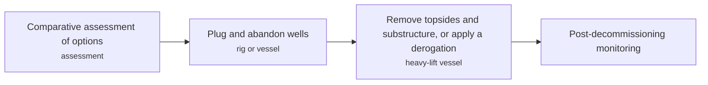
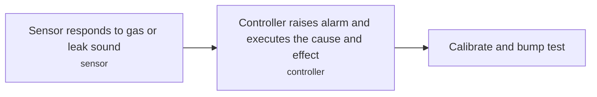
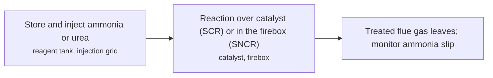
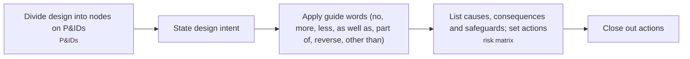

# HSE technology options

4 technologies, from commercial to lab stage. Generated from catalog/technologies/; every figure links to its source.

| Technology | Category | Maturity | TRL | Suppliers | Cost figures |
| --- | --- | --- | --- | --- | --- |
| [Decommissioning and well abandonment](#hse-decommissioning-abandonment) | Health, safety and environment | commercial |  |  | UKCS total decommissioning expenditure: 44.5 GBP billion |
| [Gas and flame detection](#hse-gas-flame-detection) | Health, safety and environment | commercial |  | J-W Instruments (catalytic combustion sensors (founded 1928)) |  |
| [NOx control (SCR, SNCR, low-NOx burners)](#hse-nox-control) | Health, safety and environment | commercial |  | IHI Corporation (first large-scale SCR installation (1978)); Engelhard Corporation (ammonia SCR patent (1957)) |  |
| [Process hazard analysis (HAZOP, LOPA, QRA)](#hse-pha-hazop-lopa-qra) | Health, safety and environment | commercial |  |  |  |

## Decommissioning and well abandonment

Options for a disused offshore installation include full removal, leaving the substructure intact, topping and toppling. OSPAR Decision 98/3 generally prohibits leaving installations in place, with narrow derogations.

**Key equipment:** heavy-lift vessels, cutting tools, plugging materials.

**Performance:**
- North Sea oil and gas installations: 1350 count (about); stated. [source](https://www.frontiersin.org/journals/marine-science/articles/10.3389/fmars.2024.1264892/pdf)
- UKCS platforms that may qualify for derogation: 12 %; stated. [source](https://www.frontiersin.org/journals/marine-science/articles/10.3389/fmars.2024.1264892/pdf)

**Costs:**
- UKCS total decommissioning expenditure: 44.5 GBP billion; total as stated; cost year not stated. [source](https://www.frontiersin.org/journals/marine-science/articles/10.3389/fmars.2024.1264892/pdf)

**Missing inputs:**
- well P&A methods and standards (NORSOK D-010, Oil & Gas UK) (process): Not covered by the paper. Where: NORSOK D-010 and OEUK guidelines (open). Next: Link to the thermite and bismuth P&A card and add the steps.
- Southeast Asia decommissioning rules (Malaysia, Indonesia, Thailand) (other): Only the North Sea review was read. Where: PETRONAS, SKK Migas and Thai DMF decommissioning guidance (open). Next: Add regional rules.
- named plants or projects with capacity and year (reference_plants): The sources read name no specific plant. Where: Licensor and operator press releases for the suppliers listed (open). Next: Add one or two plants with country, capacity and start-up year.
- TRL with a cited source (trl): The IEA ETP Clean Energy Technology Guide has no matching entry. IEA ETP Guide (July 2026) has no matching entry (searched 'decommissioning', 'well abandonment', 'plug and abandonment', 'P&A'); 2026-10-28 Where: IEA ETP Clean Energy Technology Guide (collected): search for the technology name (catalog: iea-reports, open). Next: Find a TRL table that lists this technology, or leave maturity resting on the evidence on the card.

Sources: [1](https://www.frontiersin.org/journals/marine-science/articles/10.3389/fmars.2024.1264892/pdf). Last reviewed 2026-10-28.

## Gas and flame detection

Catalytic bead, infrared, electrochemical and ultrasonic sensors detect flammable and toxic gas; ultrasonic detectors hear leaks from pressurised gas.

**Key equipment:** catalytic bead, IR point and open-path sensors, electrochemical cell, ultrasonic leak detector.

**Performance:**
- fixed detector calibration interval: 3-12 months; quarterly to annual, stated. [source](https://en.wikipedia.org/wiki/Gas_detector)
- ultrasonic leak sound band: 25-10000 kHz; 25 kHz to 10 MHz stated. [source](https://en.wikipedia.org/wiki/Gas_detector)

**Missing inputs:**
- flame detector types and coverage (performance): Not on the page. Where: Vendor and FM Global guidance (open). Next: Add UV/IR flame detector data.
- capital cost and operating or unit cost, with dollar year and basis (costs): No open source read so far gives costs for this technology. Where: arXiv and open-access journals: techno-economic or review papers (MDPI is blocked by its CDN; use the manual inbox) (catalog: arxiv, open); Licensor and EPC studies; paid cost databases are catalog-only (paid); OSTI.GOV full-text reports from DOE labs: search the technology name plus 'techno-economic' (catalog: osti, blocked). Next: Look for an open techno-economic study; record each figure with metric, range, unit, dollar year, basis and source.
- named plants or projects with capacity and year (reference_plants): The sources read name no specific plant. Where: Licensor and operator press releases for the suppliers listed (open). Next: Add one or two plants with country, capacity and start-up year.
- TRL with a cited source (trl): The IEA ETP Clean Energy Technology Guide has no matching entry. Where: IEA ETP Clean Energy Technology Guide (collected): search for the technology name (catalog: iea-reports, open). Next: Find a TRL table that lists this technology, or leave maturity resting on the evidence on the card.
- process steps and equipment are general engineering practice, not taken from one source (process): The sources read describe the principle but not a full step-by-step flow. Where: Licensor process descriptions and textbooks (open). Next: Check the steps against a licensor description and name it.

Sources: [1](https://en.wikipedia.org/wiki/Gas_detector). Last reviewed 2026-10-25.

## NOx control (SCR, SNCR, low-NOx burners)

SCR injects ammonia or urea over a catalyst; SNCR injects it into the hot firebox without catalyst.

**Key equipment:** catalyst modules, ammonia or urea system, injection grid.

**Performance:**
- SCR NOx removal: 70-95 %; utility, industrial and waste boilers. [source](https://en.wikipedia.org/wiki/Selective_catalytic_reduction)
- SCR ideal temperature window: 357-447 degC; 630 to 720 K. [source](https://en.wikipedia.org/wiki/Selective_catalytic_reduction)
- SNCR temperature window: 760-1090 degC; stated operating window. [source](https://en.wikipedia.org/wiki/Selective_non-catalytic_reduction)
- SCR catalyst life in gas-fired plants: up to 80000 hours (up to); stated. [source](https://en.wikipedia.org/wiki/Selective_catalytic_reduction)

**Missing inputs:**
- SCR and SNCR capital and operating costs (costs): None on the pages. Where: US EPA control cost manual (open). Next: Add costs with dollar year.
- named plants or projects with capacity and year (reference_plants): The sources read name no specific plant. Where: Licensor and operator press releases for the suppliers listed (open). Next: Add one or two plants with country, capacity and start-up year.
- TRL with a cited source (trl): The IEA ETP Clean Energy Technology Guide has no matching entry. IEA ETP Guide (July 2026) has no matching entry (searched 'NOx', 'SCR', 'SNCR', 'selective catalytic reduction', 'low-NOx'); 2026-10-28 Where: IEA ETP Clean Energy Technology Guide (collected): search for the technology name (catalog: iea-reports, open). Next: Find a TRL table that lists this technology, or leave maturity resting on the evidence on the card.
- process steps and equipment are general engineering practice, not taken from one source (process): The sources read describe the principle but not a full step-by-step flow. Where: Licensor process descriptions and textbooks (open). Next: Check the steps against a licensor description and name it.

Sources: [1](https://en.wikipedia.org/wiki/Selective_catalytic_reduction), [2](https://en.wikipedia.org/wiki/Selective_non-catalytic_reduction). Last reviewed 2026-10-28.

## Process hazard analysis (HAZOP, LOPA, QRA)

HAZOP is a structured team examination of a design that applies guide words to process parameters to find deviations, causes, consequences and safeguards. Probabilistic risk assessment adds quantified likelihood and consequence.

**Key equipment:** P&IDs, HAZOP worksheets, fault and event tree software.

**Performance:**
- minimum recommended HAZOP team: 5-20 people (up to 20 on large projects); stated. [source](https://en.wikipedia.org/wiki/Hazard_and_operability_study)

**Missing inputs:**
- LOPA method and QRA in process industries (other): No page for LOPA was read. Where: CCPS LOPA guidance (paid); IEC 61882 (open). Next: Add LOPA steps and QRA criteria.
- capital cost and operating or unit cost, with dollar year and basis (costs): No open source read so far gives costs for this technology. Where: arXiv and open-access journals: techno-economic or review papers (MDPI is blocked by its CDN; use the manual inbox) (catalog: arxiv, open); Licensor and EPC studies; paid cost databases are catalog-only (paid); OSTI.GOV full-text reports from DOE labs: search the technology name plus 'techno-economic' (catalog: osti, blocked). Next: Look for an open techno-economic study; record each figure with metric, range, unit, dollar year, basis and source.
- named plants or projects with capacity and year (reference_plants): The sources read name no specific plant. Where: Licensor and operator press releases for the suppliers listed (open). Next: Add one or two plants with country, capacity and start-up year.
- TRL with a cited source (trl): The IEA ETP Clean Energy Technology Guide has no matching entry. Where: IEA ETP Clean Energy Technology Guide (collected): search for the technology name (catalog: iea-reports, open). Next: Find a TRL table that lists this technology, or leave maturity resting on the evidence on the card.
- process steps and equipment are general engineering practice, not taken from one source (process): The sources read describe the principle but not a full step-by-step flow. Where: Licensor process descriptions and textbooks (open). Next: Check the steps against a licensor description and name it.

Sources: [1](https://en.wikipedia.org/wiki/Hazard_and_operability_study), [2](https://en.wikipedia.org/wiki/Probabilistic_risk_assessment). Last reviewed 2026-10-25.
