# IDC technology options

17 technologies, from commercial to lab stage. Generated from catalog/technologies/; every figure links to its source.

| Technology | Category | Maturity | TRL | Suppliers | Cost figures |
| --- | --- | --- | --- | --- | --- |
| [AI-training and inference load profiles](#idc-ai-load-profiles) | Siting and demand | commercial |  | NVIDIA (accelerator platforms that set rack power envelopes); Vertiv (power and cooling built around accelerated rack densities); Schneider Electric (data centre physical infrastructure for AI halls) | IT equipment cost per kW of AI capacity: 21188 USD per kW of IT capacity (2026$) |
| [Air cooling (CRAH/CRAC, hot/cold aisle containment)](#idc-air-cooling) | Cooling | commercial |  | Vertiv (Liebert CRAH/CRAC and in-row cooling); Schneider Electric (Uniflair and room cooling); Rittal (rack and room cooling); Stulz (precision air conditioning) |  |
| [Behind-the-meter gas generation for data centres](#idc-behind-the-meter-gas) | Power supply | commercial | 9 | GE Vernova (gas turbines for data centres: TM2500 mobile (about 14-day install), LM6000, LM2500XPRESS, 7HA.03 (430 MW)); Caterpillar (10 MW-class gas gensets; USD 725 million large-engine capacity expansion); Solar Turbines (Caterpillar) (medium gas turbines for industrial and campus power) |  |
| [Data centre UPS systems (double-conversion, lithium, modular)](#idc-ups-systems) | Power distribution | commercial | 9 | Vertiv (Liebert EXL S1 (100-1200 kW, scalable in parallel), Liebert GXT/ITA edge UPS); Schneider Electric (Galaxy VX/VL large UPS for data centres); Eaton (93PM modular UPS and grid-interactive UPS programmes) | equipment cost, three-phase data-centre UPS: 800 USD per kW |
| [Data centre energy and water benchmarking (PUE/WUE)](#idc-energy-water-benchmarking) | Siting and demand | commercial |  | Uptime Institute (survey benchmark and PUE guidance); Schneider Electric (EcoStruxure metering and reporting); Vertiv (power and thermal telemetry) |  |
| [Data centre grid interaction (demand response and frequency services)](#idc-grid-interaction) | Grid interaction | commercial | 8-9 | Enel X (demand response and frequency services for data centres (Digital Realty, Microsoft programmes)); GridBeyond (demand-side response for data centres with zero downtime); Vertiv (grid-interactive UPS whitepaper and sizing guidance) |  |
| [Data centre siting and power procurement](#idc-siting-power-procurement) | Siting and demand | commercial | 9 | GE Vernova (onsite and BTM generation configurations (25 MW to 3 GW)); AirTrunk (hyperscale campuses across APAC including the 700 MW+ Malaysia platform); Equinix (colocation + interconnection with long-term clean-power contracting) |  |
| [Free cooling and economisers](#idc-free-cooling-economisers) | Cooling | commercial |  | Vertiv (Liebert DSE free-cooling system (50-165 kW)); Schneider Electric (Uniflair free-cooling units); Munters (evaporative and indirect cooling) |  |
| [Medium-voltage switchgear and busway in the data hall](#idc-mv-switchgear-busway) | Power distribution | commercial |  | ABB (medium-voltage switchgear, including SF6-free 6-24 kV); Starline Power (busway (Track, Series-S, high-power ranges)); Schneider Electric (MV switchgear and busway for data centres); Eaton (MV distribution and busway) |  |
| [On-site solar plus battery storage for data centres](#idc-onsite-solar-storage) | Power supply | commercial | 9 | Sungrow (solar inverters and battery storage); CATL (LFP battery cells and containers); Tesla Energy (Megapack battery storage); Fluence (grid-scale battery storage) | installed cost, battery storage in a PV+battery hybrid: 709 USD per kWh (2023$) |
| [Rack power distribution (PDU, 48 V DC and 415 V AC architectures)](#idc-rack-power-distribution) | Power distribution | commercial |  | Server Technology (rack PDUs including 415 V and -48 V DC ranges); Vertiv (rack PDUs and power management); Raritan (Legrand) (intelligent rack PDUs); Schneider Electric (rack PDUs and metering) |  |
| [Ten-year data centre power and modular gas generation retrospective (2016–2026)](#idc-datacentre-power-and-modular-gas-ten-year-retrospective) | Data centre and modular power | commercial |  |  | Price — up-front utility works (substations) capex, 1 GW AI data centre model: 164 USD MILLION (2026$) Price — annual energy cost, 1 GW AI data centre model: 594 USD MILLION PER YEAR (2026$) Price — up-front network infrastructure capex, 1 GW AI data centre model: 4925 USD MILLION (2026$) Price — modelled electricity price input, 1 GW AI data centre: 0.0834 USD PER KWH (2024$) Price — up-front capital expenditure, 1 GW AI data centre model: 37883 USD MILLION (2026$) Price — annualised total cost of ownership, 1 GW AI data centre model: 7-12 USD BILLION PER YEAR (RANGE REFLECTS 3- TO 7-YEAR IT LIFESPAN) (2026$) Price — share of respondents whose most recent major outage cost more than USD 100,000: 57 % OF RESPONDENTS Price — share of respondents whose most recent impactful outage cost more than USD 1 million: 20 % OF RESPONDENTS Price — total installed cost, 35 kW rich-burn CHP: 4250 USD/KW (2020$) Price — total installed cost, 4.5 MW lean-burn CHP: 2000 USD/KW (2020$) Price — total installed SCR cost, 500 kW to 4.5 MW: 130-375 USD/KW (2020$) Price — non-fuel O&M cost: 1.3-3 USD CENTS/KWH (2020$) Price — SCR installed cost at 500 kW lean-burn CHP: 375 USD/KW (2020$) Price — Projected contribution to Pennsylvania state GDP: 1.6e+10 USD (2024$) Price — Projected state and federal tax revenue: 3e+09 USD million (as printed) (2024$) Price — Philanthropic commitment over five years: 1e+06 USD (2024$) Price — Construction permit fee: 400 USD (2025$) Price — Publication fee: 250 USD (2025$) Price — NSPS regulations fee: 900 USD (2025$) Price — Amazon investment in Pennsylvania data centres: 2e+10 USD (2025$) Price — Constellation new investment: 4.3e+09 USD million (as printed) (2026$) Price — Estimated annual fuel savings across installed capacity: 3e+08 USD million (as printed) (2025$) Price — Expected ratepayer benefits from Georgia Power uprate agreement: 9e+08 USD million (as printed) (2026$) Price — Brookfield financing framework for Bloom AI power projects: 5e+09-2.5e+10 USD million (as printed) (2026$) Price — Brookfield AI Infrastructure Fund target: 1e+11 USD million (as printed) (2025$) Price — Brookfield capital already invested in digital infrastructure and clean power: 1e+11 USD million (as printed) (2026$) Price — Mankato plant expansion project cost: 2.4e+07 USD (2026$) Price — Caterpillar sales and revenues: 6.48e+10 USD (2024$) Price — Shreveport transformer plant expansion investment: 3.45e+07 USD (2026$) Price — NTT Group annual R&D investment: 3e+09 USD million (as printed) (2026$) Price — Brookfield assets under management: 1e+12 USD (2026$) Price — all-in capital cost, gas-fired reciprocating engine for BTM data centre (~2.5 MW class): 1700-2000 USD/KW (2026$) Price — recip engine EPC / installed plant cost, grade A-C median: 1292-4149 USD/KW (2026$) Price — recip engine package plus balance of plant, median: 1450-1550 USD/KW (2026$) Price — recip engine package price, owner-reported: 1000 USD/KW (2026$) Price — capacity-weighted average construction cost, internal combustion engine installed 2024: 1522 USD/KW (2024$) Price — CAPEX, internal combustion engine, UK data-centre on-site power: 390000 GBP/MW Price — indicative CAPEX, reciprocating gas engine plant for data centre: 700000-1.2e+06 USD/MW (2025$) Price — implied installed cost, Meta El Paso modular engine plant (analyst arithmetic): 1290 USD/KW (2026$) Price — combustion turbine, aeroderivative, base overnight cost: 1294 USD/KW (2021$) (2021$) Price — combustion turbine, industrial frame, base overnight cost: 785 USD/KW (2021$) (2021$) Price — combined-cycle single shaft, base overnight cost: 1201 USD/KW (2021$) (2021$) Price — combustion turbine, aeroderivative, total overnight cost: 1428 USD/KW (2022$) (2022$) Price — combined-cycle single shaft, total overnight cost: 1330 USD/KW (2022$) (2022$) Price — aeroderivative simple-cycle plant, overnight cost: 1606 USD/KW (2023$) (2023$) Price — H-class simple-cycle plant, overnight cost: 836 USD/KW (2023$) (2023$) Price — 2x2x1 combined-cycle plant, overnight cost: 868 USD/KW (2023$) (2023$) Price — gas peaking plant, total capital cost: 700-1150 USD/KW (2024$) Price — gas combined-cycle plant, total capital cost: 850-1300 USD/KW (2024$) Price — gas peaking plant, total capital cost: 1150-1450 USD/KW (2025$) Price — gas combined-cycle plant, total capital cost: 1200-1600 USD/KW (2025$) Price — CCGT projects with 2026 and 2027 completion: 1116-1427 USD/KW (2026$) Price — newest combined-cycle plant proposals: 2500 USD/KW (2026$) Price — new combined-cycle plant capital cost: 2.3e+09-2.5e+09 USD PER GW (2026$) Price — installed cost, behind-the-meter gas turbine plant: 1.2e+06-2.5e+06 USD/MW (2026$) Price — total estimated cost of McCloud generation facilities: 4.998e+08 USD (2026$) Price — cash construction cost including 10% contingency: 4.73e+08 USD (2026$) Price — allowance for funds used during construction: 2.68e+07 USD (2026$) Price — EPE capital cost estimate including interconnection and AFUDC: 5.518e+08 USD/kW (as printed) (2026$) Price — capital cost per kW, McCloud: 1609 USD/KW (2026$) Price — generic combustion turbine capital cost, EPE 2025 IRP: 1264 USD/KW (2025$) Price — recently approved Entergy Texas gas plants, capital cost per kW: 1764-2122 USD/KW (2025$) Price — fixed operations and maintenance, McCloud: 59 USD/KW-YEAR (2026$) Price — estimated fuel cost, McCloud: 41.75 USD/MWH (2026$) Price — heat rate, McCloud: 12000 BTU/KWH Price — HD Hyundai engine supply for Corban data centre (derived $/kW): 680 USD/KW (2026$) Price — HD Hyundai / Corban disclosed deal value: 6.76e+08 USD (2026$) Price — Alphabet acquisition of Intersect Power: 4.75e+09 USD (2025$) Price — Amazon purchase of Talen Cumulus campus: 6.5e+08 USD (2024$) Price — equipment price, gas turbines of GE 7HA.03 simple-cycle plant: 409 USD/KW (2025$) (2025$) Price — installed cost, Rest of RTO frame turbine plant: 1674 USD/KW (NOMINAL 2028$) (2028$) Price — combustion turbine cost increase since 2022 PJM CONE study: 225-409 USD/KW (2025$) (2025$) Price — scope adder, equipment to package: 20 PERCENT Price — scope adder, package to package plus balance of plant: 300-550 USD/KW (2026$) Price — scope adder, package plus BOP to installed plant: 900 USD/KW (2026$) Price — major owner-furnished equipment share, EIA H-class simple-cycle case: 27.4-46 PERCENT OF OVERNIGHT COST Price — named escalation index used by HTR for generation cost normalisation: 3.4 PERCENT (2025 TO 2026 FACTOR 1.034) Price — central AC UPS content per kW of IT load: 1200 USD/KW OF IT LOAD (2026$) Price — solid-state transformer, 800 V DC: 1000-1500 USD/KW OF IT LOAD (2026$) Price — 800 V DC sidecar / power rack: 500 USD/KW OF IT LOAD (2026$) Price — rack battery backup: 200 USD/KW OF IT LOAD (2026$) Price — total data-centre electrical content across 800 V DC transition: 3600-4800 USD/KW OF IT LOAD (2026$) Price — utility-scale battery storage power-related cost: 372 USD/KW (2024$) (2024$) Price — capacity-weighted average construction cost, battery storage installed 2024: 1469 USD/KW (2024$) Price — levelised cost of storage, utility-scale standalone 100 MW 4-hour, unsubsidised: 95-129 USD/MWH (2025$) Price — levelised cost of storage, C&I standalone 1 MW 2-hour, unsubsidised: 506-860 USD/MWH (2025$) Price — levelised cost of storage, utility-scale standalone 100 MW 4-hour, unsubsidised: 156-222 USD/MWH (2024$) Price — generator step-up transformer, 38 MVA, 2026 equipment price: 51 USD/KVA (2025$) Price — medium-voltage switchgear, 15 kV metal-clad lineups: 540000-770000 USD (2024$) Price — electrical equipment added per kW for 15-20 MW block: 90-110 USD/KW (2026$) Price — behind-the-meter gas generation for data centres: 100-165 USD/MWH (2026$) Price — grid-connected alternative for data centres: 90-95 USD/MWH (2026$) Price — on-site electricity cost, analyst range: 100-165 USD/MWH (2026$) Price — Microsoft / Constellation Crane PPA implied price: 98-115 USD/MWH (2024$) Price — Amazon / Talen Susquehanna PPA implied flat-equivalent price: 82-94 USD/MWH (2025$) Price — Meta / Constellation Clinton PPA implied price: 70 USD/MWH (2025$) Price — Pennsylvania average industrial retail price, September 2025: 91.2 USD/MWH (2025$) Price — Texas average industrial retail price, September 2025: 67.5 USD/MWH (2025$) Price — PJM Western Hub wholesale price, 2025: 58.51 USD/MWH (2025$) Price — PJM capacity auction clearing price, 2027/28 delivery year: 333.44 USD/MW-DAY (2025$) |
| [Utility feed and on-site substation for data centres](#idc-utility-feed-substation) | Power supply | commercial |  | ABB (medium- and high-voltage switchgear, transformers); Hitachi Energy (transformers and substation equipment); Siemens Energy (substation and grid connection equipment) | utility works and substation cost, 1 GW AI campus: 164000 USD per MW of interconnection capacity (2026$) |
| [Direct-to-chip liquid cooling (cold plates and CDUs)](#idc-direct-to-chip-liquid-cooling) | Cooling | demonstration | 7-8 | Vertiv (CoolChip CDU 70/121/600/1350/2300 (direct-to-chip and RDHx)); CoolIT Systems (cold plates and rack CDUs); Boyd (liquid cooling loops and cold plates); Motivair (CDUs and facility chillers for high-density cooling); Rittal (LCP rack cooling units) | installed cost, direct-to-chip cooling: 6000-9500 USD per kW of IT load (2025$) |
| [Rear-door heat exchangers](#idc-rear-door-heat-exchangers) | Cooling | demonstration |  | Vertiv (rear-door heat exchangers); nVent (rear-door heat exchangers); Rittal (rear-door cooling units) | installed cost, rear-door heat exchanger: 1800-3200 USD per kW of cooling capacity (2026$) |
| [SMR and fuel-cell power purchase for data centres](#idc-smr-fuel-cell-ppa) | Power supply | demonstration | 6-9 | Kairos Power (KP-FHR advanced reactors under master plant development agreements); Bloom Energy (solid-oxide fuel cells for on-site data centre power); Oklo (Aurora fast microreactor PPAs); Westinghouse Electric Company (eVinci microreactor programme) |  |
| [Immersion cooling](#idc-immersion-cooling) | Cooling | pilot |  | Submer (immersion cooling systems); GRC (Green Revolution Cooling) (immersion cooling systems); LiquidStack (immersion and direct-to-chip cooling); Asperitas (immersion cooling) | installed capital cost, single-phase immersion: 4500-6800 USD per kW of IT load (2026$) |

## AI-training and inference load profiles

AI workloads change the shape of a data centre's electrical load rather than only its size: training runs hold a large, sustained, synchronised draw across thousands of accelerators for hours, while inference is bursty and follows user traffic. Both run on accelerated servers whose share of the load is growing several times faster than conventional servers, so the design load is set by a rack density that air cooling cannot reach.

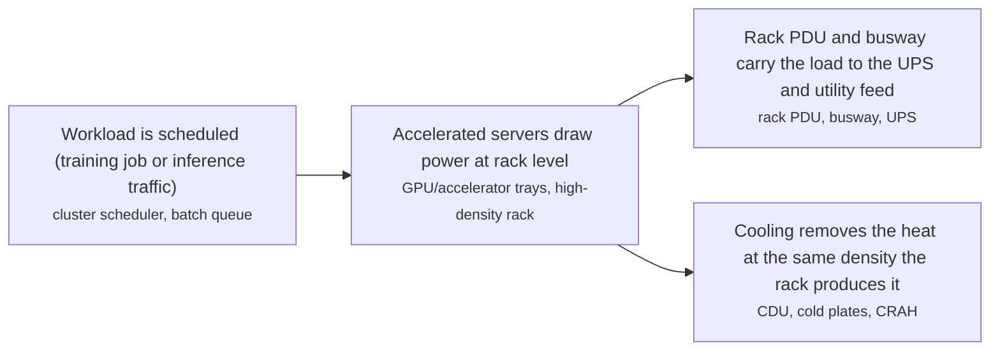

**Key equipment:** accelerated servers and GPU trays, high-density racks (20 kW and above), rack PDUs rated for AI rack currents, liquid cooling distribution units.

**Performance:**
- global data centre electricity consumption, 2024: 415 TWh; IEA: around 1.5 percent of global electricity consumption in 2024.. [source](https://www.iea.org/reports/energy-and-ai/executive-summary)
- global data centre electricity consumption, 2030 base case: 945 TWh; IEA base case: more than doubles to around 945 TWh by 2030, slightly more than Japan's total electricity consumption today; AI is the most important driver of the growth.. [source](https://www.iea.org/reports/energy-and-ai/executive-summary)
- growth rate of data centre electricity consumption: 12-15 % per year; IEA: around 12 percent per year since 2017 (more than four times the growth of total electricity demand), accelerating to around 15 percent per year over 2024-2030.. [source](https://www.iea.org/reports/energy-and-ai/energy-demand-from-ai)
- share of data centre electricity used by server equipment: 60 % of data centre electricity; IEA split: servers around 60 percent, storage around 5 percent, networking up to 5 percent, cooling about 7 percent for efficient hyperscale centres rising above 30 percent for less efficient enterprise centres.. [source](https://www.iea.org/reports/energy-and-ai/energy-demand-from-ai)
- growth rate of accelerated-server electricity use against conventional servers: 9-30 % per year; IEA: accelerated servers grow around 30 percent annually against 9 percent per year for conventional servers, and supply almost half of the net increase in data centre electricity use to 2030.. [source](https://www.iea.org/reports/energy-and-ai/energy-demand-from-ai)
- inference share of data-centre electricity demand: 40 % of demand; McKinsey puts AI inference above 40% and training just under 30% of 2025 data-centre demand (82.3 GW total).. [source](https://www.mckinsey.com/featured-insights/charts/the-future-of-ai-workloads)

**Costs:**
- IT equipment cost per kW of AI capacity: 21188 USD per kW of IT capacity (2026$); $21.2bn per 1 GW = $21,188/kW of IT capacity; IT equipment is 55.9% of campus capex, with GPU servers plus networking separate at $4.9bn. Cost, not a measured load profile.. [source](https://epoch.ai/data-insights/ai-datacenter-cost-breakdown)

**Missing inputs:**
- measured IT load per rack (kW) by accelerator generation (costs): An IT-equipment cost per kW is recorded; the card still needs a measured load figure, since its gap text had been corrupted to a reason code. Where: Interconnection study costs and utility upgrade charges. Next: Leave open until a source states this metric and scope.
- TRL with a cited source (trl): No TRL table was read for this topic; the register records it as commercial without a source. Where: IEA Energy Technology Guide. Next: Add a TRL reference or leave maturity resting on the evidence on the card.

Sources: [1](https://www.iea.org/reports/energy-and-ai/executive-summary), [2](https://www.iea.org/reports/energy-and-ai/energy-demand-from-ai). Last reviewed 2026-11-17.

## Air cooling (CRAH/CRAC, hot/cold aisle containment)

Air cooling moves heat from the rack to a room coil and then to outdoor air or a chilled-water loop. Containment separates the cold supply from the hot return so the coil sees the rack outlet temperature instead of a mixed room average. The architecture stops being practical somewhere around 20 kW per rack, which is where liquid cooling enters.

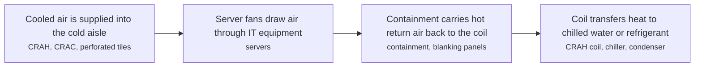

**Key equipment:** CRAH and CRAC units, hot/cold aisle containment and blanking, chilled-water plant or DX condensers, airflow management.

**Performance:**
- practical air-cooling limit per rack: 20 kW per rack; Vertiv article on rear-door heat exchangers: the practical limit for air cooling is around 20 kW per rack, which is where rear-door and other liquid approaches start.. [source](https://www.vertiv.com/en-asia/insights/articles/educational-articles/how-rear-door-heat-exchangers-rdhx-support-high-density-rack-cooling)
- installed share of racks below 10 kW, 2024 to 2025: 38-47 % of installed racks; Vertiv figure on installed racks: racks below 10 kW fell from 47 percent in 2024 to 38 percent in 2025; 10-20 kW rose from 27 to 30 percent and 20-30 kW from 24 to 28 percent, so air-cooled densities are shrinking as a share.. [source](https://www.vertiv.com/en-asia/insights/articles/educational-articles/how-rear-door-heat-exchangers-rdhx-support-high-density-rack-cooling)
- unit cooling capacity, Vertiv Liebert DSE free-cooling system: 50-165 kW; Liebert DSE product page: 50-165 kW standard range, with packaged units around 250-400 kW; water-free operation.. [source](https://www.vertiv.com/en-us/products-catalog/thermal-management/room-cooling/liebert-dse-free-cooling-system-50-165kw)

**Missing inputs:**
- cost per kW of installed CRAH capacity, with dollar year and basis (costs): No source read prices CRAH units or aisle containment. Where: Cooling vendor budget quotes; Data-centre fit-out tender schedules. Next: Add a cost per kW from a vendor quote or fit-out tender.
- TRL with a cited source (trl): No TRL table was read. Where: IEA Energy Technology Guide. Next: Add a TRL reference.

Sources: [1](https://www.vertiv.com/en-asia/insights/articles/educational-articles/how-rear-door-heat-exchangers-rdhx-support-high-density-rack-cooling), [2](https://www.vertiv.com/en-us/products-catalog/thermal-management/room-cooling/liebert-dse-free-cooling-system-50-165kw). Last reviewed 2026-11-14.

## Behind-the-meter gas generation for data centres

Data centres site gas turbines or large reciprocating gensets on their own side of the meter to escape multi-year grid-interconnection queues and hedge power-price volatility. GE Vernova markets configurations from a 20-30 MW aeroderivative unit up to 3 GW campuses, with mobile TM2500 units installable in about 14 days and heavy-duty 7HA.03 units at 430 MW; the Chevron/Engine No.1/GE Vernova 'power foundry' programme targets 4 GW of co-located capacity by 2027. Caterpillar restarted 10 MW-class genset production and is investing USD 725 million to expand large-engine capacity for data-centre demand.

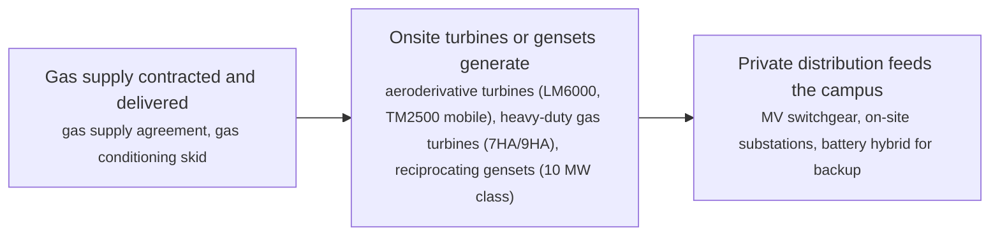

**Key equipment:** aeroderivative gas turbines (LM6000, TM2500), heavy-duty gas turbines (7HA.03, 430 MW class), reciprocating gas gensets (10 MW class), on-site MV distribution and substations, gas-engine genset with paralleling controls, UPS and flywheel bridging, BESS for peak shaving, load banks for commissioning, waste-heat absorption chiller (CCHP), 2x100% redundant gas distribution, Tier III/IV redundancy architecture.

**Performance:**
- deployment time, mobile aeroderivative units (TM2500): 14 days; installable in about 14 days per the vendor; fast-start aeros restore power within five minutes. [source](https://www.gevernova.com/gas-power/industries/data-centers)
- campus scale range served: 25-3000 MW; 'whether your data center needs 25 MW of power or 3 GW' (vendor); 7HA.03 at 430 MW; Chevron/Engine No.1 programme targeting 4 GW by 2027. [source](https://www.gevernova.com/gas-power/industries/data-centers)
- US data centres building own generation: 46-56 projects (GW); about 46 projects with about 56 GW planned self-generation; about 90% of BTM announcements made in 2025 alone (industry research tracker). [source](https://www.jaredwatkins.com/research/datacenters/behind-meter-power)
- fleet heat rate, simple-cycle gas turbines: 10000 Btu/kWh; US simple-cycle fleet average about 10,000 Btu/kWh against 7,146 Btu/kWh for combined cycle - the benchmark for BTM simple-cycle data-centre plants.. [source](https://www.eia.gov/todayinenergy/detail.php?id=52158)

TRL source: [Commercial gas-turbine technology deployed at scale (7F fleet about 175 GW installed) — TRL 9, read 2026-11-12](https://www.gevernova.com/gas-power/industries/data-centers)

**Missing inputs:**
- installed cost per kW for BTM gas capacity, with dollar year (costs): Vendor pages carry no prices. Where: EIA/industry cost studies; disclosed project filings (open). Next: Add cost figures with dollar year and basis.

Sources: [1](https://www.gevernova.com/gas-power/industries/data-centers), [2](https://www.chevron.com/newsroom/2025/q1/power-solutions-for-us-data-centers), [3](https://www.wartsila.com/energy/engine-power-plant-solutions/flexible-baseload-power-plants/data-center-power-solutions), [4](https://www.jenbacher.com/en/energy-solutions/industries/data-center/), [5](https://download.se.com/files?amp%3Bp_enDocType=White+Paper&p_Doc_Ref=SPD_286_EN), [6](https://www.cummins.com/sites/default/files/2024-08/t035-Gas-Power-Plant-application-manual.pdf), [7](https://uptimeinstitute.com/tiers). Last reviewed 2026-11-24.

## Data centre UPS systems (double-conversion, lithium, modular)

The UPS is the data centre's ride-through bridge: double-conversion units condition and back up the entire IT load, sized per hall and paralleled to hundreds of MW across a campus. The Vertiv Liebert EXL S1 spans 100-1200 kW per unit in the industry's smallest footprint and scales in parallel up to multi-MW systems; lithium-ion battery cabinets cut weight and footprint versus VRLA, and grid-interactive UPS fleets now also sell frequency response back to the grid (see idc-grid-interaction).

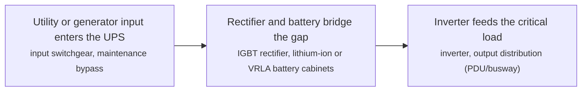

**Key equipment:** double-conversion UPS units (100-1200 kW class), lithium-ion battery cabinets, bypass and paralleling switchgear.

**Performance:**
- unit power range, Vertiv Liebert EXL S1: 100-1200 kW; 100-1200 kW per unit, transformer-free high-density design; scalable in parallel for medium-to-large data centres. [source](https://www.vertiv.com/en-emea/campaigns/liebert-exl-s1)
- parallel system capacity, EXL S1 fleet: 9.6 MW; scalable from a few hundred kW up to about 9.6 MW via parallel deployment, suitable for a 20 MW data-centre design (vendor system sizing). [source](https://www.vertiv.com/48ed43/globalassets/products/critical-power/uninterruptible-power-supplies-ups/liebert-exl-s1-brochure-sl-706452.pdf)
- UPS efficiency, double conversion and ECO mode: 96-99 %; Above 96% in double conversion and above 99% in ECO mode.. [source](https://www.vertiv.com/en-us/products-catalog/critical-power/uninterruptible-power-supplies-ups/liebert-exm-)

**Costs:**
- equipment cost, three-phase data-centre UPS: 800 USD per kW; About $0.8M/MW for UPS equipment only, excluding installation and batteries; the source does not state a dollar year and expressly disclaims turnkey use; dollar year not stated. [source](https://datacenterscope.com/power/data-center-ups-cost)

TRL source: [Mature commercial product line shipping since 2017 — TRL 9, read 2026-11-12](https://www.vertiv.com/en-emea/campaigns/liebert-exl-s1)

**Missing inputs:**
- installed cost per kW (equipment cost is now recorded) (costs): Equipment cost is recorded ($800/kW, undated); installation and battery costs were not found. Where: Uptime Institute / industry surveys (open). Next: Leave open until a source states this metric and scope.

Sources: [1](https://www.vertiv.com/en-emea/campaigns/liebert-exl-s1), [2](https://www.vertiv.com/48ed43/globalassets/products/critical-power/uninterruptible-power-supplies-ups/liebert-exl-s1-brochure-sl-706452.pdf). Last reviewed 2026-11-17.

## Data centre energy and water benchmarking (PUE/WUE)

Power usage effectiveness divides total facility power by IT power; water usage effectiveness divides water consumption by IT energy. Both are ratio metrics, so they say nothing about how much work the IT load does, and PUE in particular is dominated by climate, age and cooling architecture rather than by operator skill. The IEA notes cooling is about 7 percent of electricity in an efficient hyperscale centre but above 30 percent in a less efficient enterprise one, which is exactly the spread PUE is meant to expose.

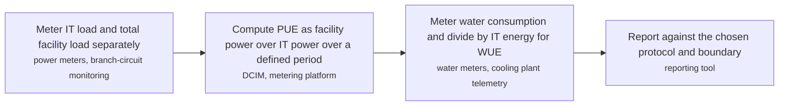

**Key equipment:** revenue-grade power meters on IT and facility feeders, water meters on makeup and blowdown, DCIM or metering platform with defined boundaries.

**Performance:**
- weighted average PUE, survey respondents, 2025: 1.54 ratio; Uptime Institute 2025 survey: respondents' annual PUE had a weighted average of 1.54, and average PUE has hovered above 1.5 for years.. [source](https://datacenter.uptimeinstitute.com/rs/711-RIA-145/images/2025.Annual.Survey.Report.pdf)
- average PUE, facilities commissioned within about five years: 1.48 ratio; Uptime Institute 2025 survey: facilities commissioned from around early 2020 achieved an average PUE of 1.48.. [source](https://datacenter.uptimeinstitute.com/rs/711-RIA-145/images/2025.Annual.Survey.Report.pdf)
- average PUE, facilities of 20 MW and above: 1.44 ratio; Uptime Institute 2025 survey: larger data centres of 20 MW and above averaged 1.44 globally; facilities in high latitudes in North America and Europe have PUEs of 1.3 or better.. [source](https://datacenter.uptimeinstitute.com/rs/711-RIA-145/images/2025.Annual.Survey.Report.pdf)
- cooling share of data centre electricity: 7-30 % of data centre electricity; IEA: cooling is about 7 percent for efficient hyperscale centres and over 30 percent for less efficient enterprise centres.. [source](https://www.iea.org/reports/energy-and-ai/energy-demand-from-ai)
- water usage effectiveness benchmark: 1.8 L/kWh; 1.8 L/kWh cited as the cross-industry average WUE.. [source](https://www.datacenterknowledge.com/cooling/a-guide-to-data-center-water-usage-effectiveness-wue-and-best-practices)

**Missing inputs:**
- cost of metering and benchmarking instrumentation per MW of IT load (costs): No source read prices metering and DCIM at data-centre scale. Where: Metering and DCIM vendor quotes. Next: Add a metering cost per MW from a vendor or project quote.
- TRL with a cited source (trl): No TRL table was read; measurement practice is mature but no source read states a level. Where: IEA Energy Technology Guide. Next: Add a TRL reference.

Sources: [1](https://datacenter.uptimeinstitute.com/rs/711-RIA-145/images/2025.Annual.Survey.Report.pdf), [2](https://www.iea.org/reports/energy-and-ai/energy-demand-from-ai). Last reviewed 2026-11-17.

## Data centre grid interaction (demand response and frequency services)

The data centre's own UPS fleet doubles as a grid asset: when frequency dips below nominal, inverters draw from batteries instead of the grid for seconds to minutes — no IT impact — and the operator sells that as frequency response. Enel X's Digital Realty deployment in Ireland responds in under half a second; Microsoft is rolling out UPS battery-sharing worldwide and pushed for the UK's Dynamic Containment scheme to open to data centres after Ireland led; UK NESO programmes now listed for data centres include Demand Flexibility Service, Dynamic Containment, Dynamic Moderation, Dynamic Regulation and Static FFR. Battery-cycling degradation is the principal trade-off.

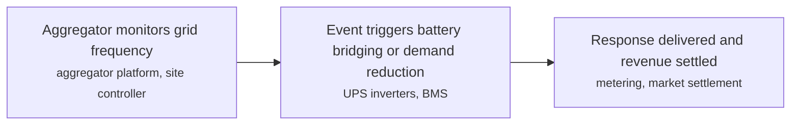

**Key equipment:** UPS fleets as distributed frequency-response assets, aggregator platform and site controllers, battery-management and degradation monitoring.

**Performance:**
- UPS fleet frequency-response trigger time, Enel X Digital Realty Ireland: 0.5 seconds; responds in under half a second when grid frequency drops below 50 Hz; the data centre draws on batteries instead of the grid. [source](https://www.enelx.com/ie/en/resources/customer-success/digital-realty-case-study)
- battery degradation under frequency-response cycling: 0.0359 % of life per day; Computed from an actual annual frequency curve for a Li-ion BESS on frequency-regulation duty.. [source](https://link.springer.com/article/10.1186/s41601-018-0076-2)

TRL source: [Commercial deployments operating in Ireland for years — TRL 8-9, read via search summary 2026-11-12](https://www.enelx.com/ie/en/resources/customer-success/digital-realty-case-study)

**Missing inputs:**
- revenue per MW-year for data-centre frequency services, with dollar year (costs): Market revenues vary by scheme and auction. Where: NESO auction results; aggregator disclosures (open). Next: Add revenue ranges per scheme.

Sources: [1](https://www.enelx.com/ie/en/resources/customer-success/digital-realty-case-study), [2](https://www.datacenterdynamics.com/en/news/microsoft-to-roll-out-data-center-battery-sharing-worldwide), [3](https://www.enelx.com/uk/en/question-and-answer). Last reviewed 2026-11-17.

## Data centre siting and power procurement

Siting is the data centre's first and most binding engineering decision: power availability, price and time-to-energisation outrank almost everything else, followed by water, fibre and latency. The 2025 boom in behind-the-meter generation (about 46 projects, about 56 GW self-planned, ~90% announced in 2025) exists because grid interconnection queues cannot keep pace; operators therefore choose between grid feed, behind-the-meter gas, PPAs for advanced nuclear or fuel cells, and hybrids — and in Southeast Asia the Johor-Cyberjaya corridor has become the fastest-growing supply region, with AirTrunk's Malaysia platform alone expanding past 700 MW.

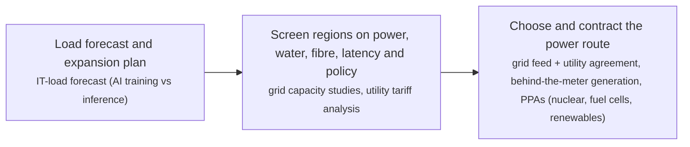

**Key equipment:** grid interconnection and substations, behind-the-meter generation options, long-term PPA structures.

**Performance:**
- self-generation boom, US data centres: 46-56 projects (GW); about 46 projects with about 56 GW of planned self-built capacity; about 90% of behind-the-meter announcements made in 2025 alone — evidence that grid interconnection is the binding constraint. [source](https://www.jaredwatkins.com/research/datacenters/behind-meter-power)
- AirTrunk Malaysia platform expansion: 700 MW; AirTrunk expanding its Malaysia platform (Johor and Cyberjaya) to more than 700 MW — the anchor hyperscale supply for the SEA AI corridor. [source](https://airtrunk.com/)
- interconnection queue duration: 5 years; Median request-to-commercial-operation time for projects built in 2023 was nearly five years.. [source](https://emp.lbl.gov/publications/queued-2024-edition-characteristics)

TRL source: [Established commercial practice across every major market — TRL 9, read via search summary 2026-11-12](https://www.jaredwatkins.com/research/datacenters/behind-meter-power)

**Missing inputs:**
- power cost benchmarks per route (grid, BTM, PPA) in USD/MWh with dollar year (costs): Route pricing is commercial and market-specific. Where: datacenterHawk, Uptime Institute market reports (open). Next: Add benchmark ranges with dollar year.

Sources: [1](https://www.jaredwatkins.com/research/datacenters/behind-meter-power), [2](https://airtrunk.com/). Last reviewed 2026-11-17.

## Free cooling and economisers

An economiser uses outdoor conditions to do the cooling work instead of a compressor. Air-side designs bring outside air in; water-side designs cool the loop with a dry cooler or cooling tower; packaged units combine both. The saving is proportional to annual hours below the switch-over temperature, so the same equipment saves far more in a high-latitude climate than in the tropics - which is exactly the PUE spread the Uptime survey reports.

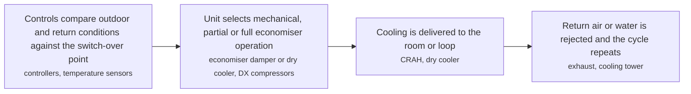

**Key equipment:** packaged free-cooling units, air-side economiser dampers and filters, dry coolers and fluid coolers, switch-over controls.

**Performance:**
- unit capacity, Vertiv Liebert DSE free-cooling system: 50-165 kW; Liebert DSE product page: 50-165 kW standard range with packaged units around 250-400 kW; the unit is water-free, avoiding the makeup water a chilled-water plant needs.. [source](https://www.vertiv.com/en-us/products-catalog/thermal-management/room-cooling/liebert-dse-free-cooling-system-50-165kw)
- PUE advantage of high-latitude sites: 1.3-1.54 ratio; Uptime Institute 2025 survey: facilities in high latitudes in North America and Europe have PUEs of 1.3 or better, against a weighted average of 1.54 across respondents; climate, not only design, drives the spread.. [source](https://datacenter.uptimeinstitute.com/rs/711-RIA-145/images/2025.Annual.Survey.Report.pdf)
- annual economiser hours: 5100 hours/year; 5,100 expected free-cooling hours for ASHRAE climate zone 5B; a cited measurement shows 47.5-67.2% cooling-energy savings from air-side economisers.. [source](https://dcatlas.io/en/learn/dc-fundamentals/cooling-systems/free-cooling-economization)

**Missing inputs:**
- capital cost per kW and the saving against mechanical cooling, with dollar year (costs): No source read prices free-cooling units or their saving. Where: Vendor quotes and payback studies. Next: Add a cost and saving from a vendor quote or study.
- TRL with a cited source (trl): No TRL table was read. Where: IEA Energy Technology Guide. Next: Add a TRL reference.

Sources: [1](https://www.vertiv.com/en-us/products-catalog/thermal-management/room-cooling/liebert-dse-free-cooling-system-50-165kw), [2](https://datacenter.uptimeinstitute.com/rs/711-RIA-145/images/2025.Annual.Survey.Report.pdf). Last reviewed 2026-11-17.

## Medium-voltage switchgear and busway in the data hall

MV switchgear is the switching and protection layer between the site transformers and the data hall; busway replaces fixed cable runs with a tap-off busbar so power can be taken off anywhere along a row and racks added without re-cabling. Busway matters at AI densities because the tap-off positions, not the cable schedule, define where a rack can go.

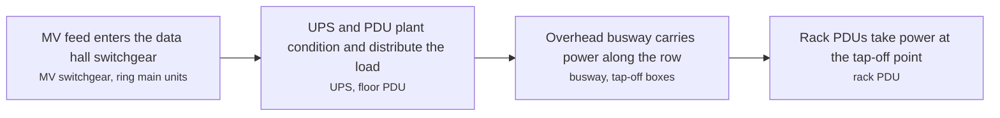

**Key equipment:** MV switchgear and ring main units (1-52 kV IEC class), busway with tap-off units and metering, floor PDUs, rack PDUs.

**Performance:**
- ABB medium-voltage switchgear voltage class: 1-52 kV; ABB medium-voltage switchgear overview: 1-52 kV IEC range, air-insulated versus gas-insulated designs, and SF6-free variants offered at 6-24 kV.. [source](https://new.abb.com/medium-voltage/switchgear)
- Starline busway current rating, Track range: 40-1250 A; Starline product page: Track 40-1250 A, Series-S 100-1200 A, and high-power busway 630-6000 A, with metering options.. [source](https://www.starlinepower.com/products/busway)

**Missing inputs:**
- cost per MV bay and per metre of busway, with dollar year and basis (costs): Neither vendor page read gives prices. Where: Electrical distributor price books; Data-centre fit-out tender schedules. Next: Add budget prices from a distributor price book or tender.
- TRL with a cited source (trl): No TRL table was read. Where: IEA Energy Technology Guide. Next: Add a TRL reference.

Sources: [1](https://new.abb.com/medium-voltage/switchgear), [2](https://www.starlinepower.com/products/busway). Last reviewed 2026-11-14.

## On-site solar plus battery storage for data centres

Solar plus storage behind the meter changes the profile of a campus's grid draw without changing the load: the array produces while the sun is up, the battery shifts that energy to evening peaks and can also provide demand response. It is not a substitute for utility capacity, because a data centre load runs continuously and a solar array's capacity factor is a fraction of its nameplate - which is why the IEA sees renewables meeting only about half of the additional demand, with gas and coal behind them.

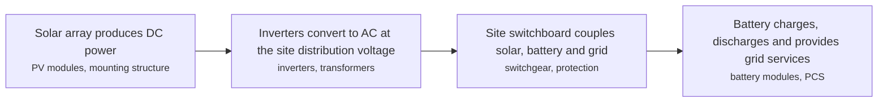

**Key equipment:** PV modules and mounting, string and central inverters, battery energy storage (LFP), power conversion system, site protection and metering.

**Performance:**
- share of additional data centre demand met by renewables over five years: 50 %; IEA: over five years renewables meet nearly half of the additional data centre demand, followed by gas and coal; solar and wind are the renewable sources in that mix.. [source](https://www.iea.org/reports/energy-and-ai/energy-supply-for-ai)
- solar PV capacity factor: 23 %; US utility-scale PV averaged a 23% annual capacity factor in 2024.. [source](https://www.eia.gov/electricity/monthly/epm_table_grapher.php?t=table_6_07_b)

**Costs:**
- installed cost, battery storage in a PV+battery hybrid: 709 USD per kWh (2023$); LBNL Utility-Scale Solar 2023: batteries are 51% of hybrid installed cost at about $709/kWh. The PV $/MW component is not separately stated on the page read.. [source](https://emp.lbl.gov/sites/default/files/emp-files/utility_scale_solar_2023_edition_slides.pdf)

**Reference plants:**
- GW Ranch campus (Amazon, developed by Pacifico Energy), United States: 750 MWac solar plus 1.8 GW battery storage, behind the meter; announced 2026; first power targeted Q1 2027. [source](https://www.pacificoenergy.com/gw-ranch)

TRL source: [IEA ETP Clean Energy Technology Guide public dataset, row 'Crystalline silicon PV and Lithium-ion storage battery' TRL 2025 - both constituents are TRL 9 rows; the card is their combination; read 2026-11-16](https://www.iea.org/files/57136415-72b6-4548-9deb-f81fc9a6048d/IEACleanTechGuidepublicdataset.csv)

**Missing inputs:**
- cost per MW of solar (the battery figure is now recorded) (costs): Battery cost is recorded ($709/kWh, 2023); a separate PV $/MW for a campus deployment was not on the page. Where: IEA and LBNL cost benchmarks; Project finance disclosures. Next: Leave open until a source states this metric and scope.

Sources: [1](https://www.iea.org/reports/energy-and-ai/energy-supply-for-ai). Last reviewed 2026-11-17.

## Rack power distribution (PDU, 48 V DC and 415 V AC architectures)

The rack PDU is where distribution voltage becomes equipment power, and it is also the finest-grained metering point in the building. Architectures differ at that boundary: 415 V AC three-phase racks reduce current per rack for a given power, while 48 V DC distribution moves rectification to the row and avoids a conversion stage per server.

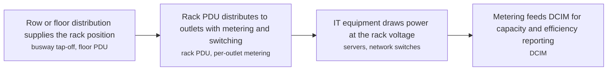

**Key equipment:** rack PDUs (basic, metered, switched, per-outlet sensing), 415 V three-phase rack PDUs, 48 V DC rack power shelves, outlet-level metering.

**Performance:**
- rack PDU power rating: 16.2 kW; PDU3EVNR6G60A rated 16.2 kW at 208 V three-phase, 60 A, monitored per outlet.. [source](https://www.mouser.com/datasheet/2/87/pdu3evnr6g60a-3243643.pdf)

**Missing inputs:**
- cost per rack PDU by metering level, with dollar year and basis (costs): No source read gives rack PDU prices. Where: Distributor price books. Next: Add budget prices from a distributor price book.
- TRL with a cited source (trl): No TRL table was read. Where: IEA Energy Technology Guide. Next: Add a TRL reference.

Sources: [1](https://www.servertech.com/products). Last reviewed 2026-11-17.

## Ten-year data centre power and modular gas generation retrospective (2016–2026)

A ten-year retrospective of data-centre power plants, gas engines and small modular generation, assembled from dated project, technology, vendor and cost evidence with sources and dollar years where published.

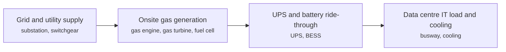

**Key equipment:** gas engines, gensets, UPS, BESS, fuel cells, switchgear, busway.

**Performance:**
- Operational history — IEA reports transmission build time and grid-component lead times: no range recorded; New transmission lines can take four to eight years in advanced economies; wait times for transformers and cables have doubled in the past three years; gas turbine deliveries now face lead times of several years, potentially delaying commissioning beyond 2030.. [source](https://www.iea.org/reports/energy-and-ai/executive-summary)
- Operational history — Singapore DC-CFA2 makes green-energy and grid-linked siting a condition of new capacity: no range recorded; IMDA and EDB launched DC-CFA2 on 1 December 2025 for at least 200 MW of new capacity; applicants must use green energy pathways, and future scalability is said to depend on regional renewable electricity imports and ASEAN grid interconnection initiatives; Singapore runs a biomethane sandbox.. [source](https://www.nortonrosefulbright.com/en/insights/publications/2026/08/singapore-s-green-data-centre-roadmap-and-dc-cfa2-driving-sustainable-ai-ready-infrastructure)
- Reliability — planned data centre projects at risk of delay from grid constraints: 20 % OF PLANNED PROJECTS; IEA Energy and AI (2025) executive summary: unless risks are addressed, around 20% of planned data centre projects could be at risk of delays; long and complex grid connection queues. [source](https://www.iea.org/reports/energy-and-ai/executive-summary)
- Operational history — Google and Kairos Power sign 500 MW multi-plant advanced nuclear PPA: no range recorded; Announced 14 October 2024: first corporate agreement in the US for multiple deployments of a single advanced reactor design; first deployment by 2030; plants sited in relevant service territories to supply Google data centres; Kairos founded 2016; NRC issued a construction permit for the Hermes demonstration reactor in 2023, the first non-water-cooled reactor approved for construction in the US in. [source](https://www.kairospower.com/updates/google-and-kairos-power-partner-to-deploy-500-mw-of-clean-electricity-generation)
- Operational history — IEA projects first SMRs online around 2030 and tech-sector SMR financing above 20 GW: no range recorded; IEA Energy and AI (2025): first SMRs come online around 2030; technology companies have plans to finance more than 20 GW of SMRs; natural gas expands by 175 TWh to meet data centre demand, notably in the United States.. [source](https://www.iea.org/reports/energy-and-ai/executive-summary)
- Reliability — GE Vernova stated reliability for data-centre gas turbine fleet: 99.9 %; Vendor claim on GE Vernova data-centre page; no measurement basis or period given. [source](https://www.gevernova.com/gas-power/industries/data-centers)
- Operational history — Digital Realty joins EirGrid DS3 dynamic frequency balancing with nine Dublin data centres: no range recorded; Enel X case study: when grid frequency drops below 50 Hz, Digital Realty's nine highly connected Irish data centres draw power from their batteries, reducing grid demand almost instantaneously; the collaboration is stated to avoid over 24,000 tonnes of CO2 emissions. No date is given on the page.. [source](https://www.enelx.com/ie/en/resources/customer-success/digital-realty-case-study)
- Reliability — UPS failure as root cause of major power-related outages: 39 % OF POWER-RELATED OUTAGE RESPONDENTS; Uptime Institute Data Center Resiliency Survey 2026, Figure 10 (n=129): UPS failure 39%, utility transfer switch failure 34%, generator failure 28%, PDU failure 19%, A/B transfer switch failure 16%, controls failure 8%, single-corded IT failure 16%. [source](https://datacenter.uptimeinstitute.com/rs/711-RIA-145/images/2026.AnnualOutageAnalysis.pdf)
- Reliability — lithium-ion UPS batteries as contributing factor in data-centre fires: no range recorded; Uptime Institute Annual outage analysis 2026: frequency of major fires at data centres has increased gradually in recent years, with lithium-ion batteries in UPS systems a clear contributing factor; report cautions the rise may partly reflect rapid build-out of new facilities. [source](https://datacenter.uptimeinstitute.com/rs/711-RIA-145/images/2026.AnnualOutageAnalysis.pdf)
- Operational history — Uptime reports equipment shortage driving substitute and second-user gensets: no range recorded; Annual outage analysis 2026: extremely high demand has created a global shortage of generators, transformers, switchgear, UPS systems and other subsystems; some owners buy second-user equipment or source substitute components from suppliers without a proven data centre track record, which the report says has contributed to several failures. Operators are adapting investment toward automation and c. [source](https://datacenter.uptimeinstitute.com/rs/711-RIA-145/images/2026.AnnualOutageAnalysis.pdf)
- Reliability — generator failure as root cause of major power-related outages: 28 % OF POWER-RELATED OUTAGE RESPONDENTS; Uptime Institute Data Center Resiliency Survey 2026, Figure 10 (n=129); UPS failure 39% and utility transfer switch failure 34% ranked above generator failure. [source](https://datacenter.uptimeinstitute.com/rs/711-RIA-145/images/2026.AnnualOutageAnalysis.pdf)
- Reliability — grid failure effects on on-site standby power: no range recorded; Uptime Institute Annual outage analysis 2026: grid failures should not cause a data centre outage assuming on-site primary power, but can affect availability of on-site power through a failed power switchover or disruptions to diesel supply triggered by the grid failure. [source](https://datacenter.uptimeinstitute.com/rs/711-RIA-145/images/2026.AnnualOutageAnalysis.pdf)
- Operational history — Singapore Green Data Centre Roadmap 2024 sets near-term capacity and efficiency targets: no range recorded; IMDA launched the roadmap in June 2024, targeting at least 300 MW of new data centre capacity in the near term; DC-CFA2 from December 2025 requires PUE of 1.25 or better at 100% IT load, Green Mark for DC Platinum 2024, IT equipment meeting SS 715:2025, and at least 50% of new capacity powered by eligible green energy pathways.. [source](https://www.nortonrosefulbright.com/en/insights/publications/2026/08/singapore-s-green-data-centre-roadmap-and-dc-cfa2-driving-sustainable-ai-ready-infrastructure)
- Reliability — cooling as primary cause of most recent impactful data centre outage: 14 % OF RESPONDENTS; Uptime Institute Global Data Center Survey 2025, Figure 4 (n=96): power 45%, cooling 14%, IT systems 11%, network 9%, fire suppression 6%, fire 5%, colocation 4%, unknown 2%, third-party 2%, information security 1% (figures rounded). [source](https://datacenter.uptimeinstitute.com/rs/711-RIA-145/images/2026.AnnualOutageAnalysis.pdf)
- Operational history — Uptime identifies higher voltages and on-site storage as emerging rack-power risks: no range recorded; Annual outage analysis 2026: in the years ahead operators face higher rack densities, higher voltages, lower grid reliability and increased on-site energy storage; these challenges may add to outage risk and highlight the need for policies, training and on-site expertise.. [source](https://datacenter.uptimeinstitute.com/rs/711-RIA-145/images/2026.AnnualOutageAnalysis.pdf)
- Reliability — PDU failure as root cause of major power-related outages: 19 % OF POWER-RELATED OUTAGE RESPONDENTS; Uptime Institute Data Center Resiliency Survey 2026, Figure 10 (n=129): PDU failure 19%, single-corded IT device failure 16%; report notes PDU, transfer switching and single-corded IT outages increased significantly versus the early-2025 survey. [source](https://datacenter.uptimeinstitute.com/rs/711-RIA-145/images/2026.AnnualOutageAnalysis.pdf)
- Operational history — Uptime reports a shift toward distributed resiliency and Tier III for AI sites: no range recorded; Annual outage analysis 2026: distributed resiliency — spreading active workloads across several locations — reduces single-site failure impact but increases synchronisation cost and complexity; some AI training sites were built at speed with crypto-mining-style low-resiliency designs, while more recent evidence suggests a trend toward higher facility resiliency such as Tier III.. [source](https://datacenter.uptimeinstitute.com/rs/711-RIA-145/images/2026.AnnualOutageAnalysis.pdf)
- Reliability — operators reporting an impactful outage in the past three years: 50 % OF OPERATORS; Uptime Institute Global Data Center Survey 2025 (n=754), reported in Annual outage analysis 2026: series 74% (2020), 69% (2021), 60% (2022), 55% (2023), 53% (2024), 50% (2025); lowest since 2020. [source](https://datacenter.uptimeinstitute.com/rs/711-RIA-145/images/2026.AnnualOutageAnalysis.pdf)
- Reliability — outage classified serious or severe: 10 % OF OUTAGES; Uptime Institute Annual outage analysis 2026: proportion of serious/severe incidents 10% in 2025 versus 9% in 2024; fifth consecutive year of declining per-site outage frequency, but pace of improvement slowed. [source](https://datacenter.uptimeinstitute.com/rs/711-RIA-145/images/2026.AnnualOutageAnalysis.pdf)
- Operational history — IEA publishes 2024 fuel mix for electricity physically consumed by data centres: no range recorded; IEA Energy and AI (2025), Energy supply for AI: generation supplying data centres grows from 460 TWh in 2024 to over 1,000 TWh in 2030 and 1,300 TWh in 2035 (Base Case). 2024 mix: coal about 30% (largest), renewables about 27%, natural gas 26%, nuclear 15%. Renewables grow at an annual average 22% between 2024 and 2030 and meet nearly 50% of growth; some capacity is financed through PPAs with tech. [source](https://www.iea.org/reports/energy-and-ai/energy-supply-for-ai)
- Operational history — IEA projects the first SMRs entering the data-centre supply mix after 2030: no range recorded; IEA Energy supply for AI: after 2030 SMRs enter the mix; hyperscalers are key corporate backers; in the United States technology companies have plans to finance more than 20 GW of SMRs. CO2 from data-centre electricity generation peaks around 320 Mt CO2 by 2030 then declines to around 300 Mt by 2035 in the Base Case.. [source](https://www.iea.org/reports/energy-and-ai/energy-supply-for-ai)
- Operational history — Singapore requires at least 50% green-energy pathways for DC-CFA2 capacity: no range recorded; DC-CFA2 launched 1 December 2025 requires selected applicants to power at least 50% of new capacity through eligible green energy pathways: biomethane, low-carbon ammonia, low-carbon hydrogen, novel fuel cells with carbon capture and storage, or vertical building-integrated/building-applied photovoltaics.. [source](https://www.nortonrosefulbright.com/en/insights/publications/2026/08/singapore-s-green-data-centre-roadmap-and-dc-cfa2-driving-sustainable-ai-ready-infrastructure)
- Operational history — IEA quantifies AI data centre scale and local concentration: no range recorded; IEA Energy and AI (2025): a typical AI-focused data centre consumes as much electricity as 100,000 households and the largest under construction will consume 20 times as much; global investment in data centres nearly doubled since 2022 to half a trillion dollars in 2024; an AI-focused data centre is 10 times more capital-intensive than an aluminium smelter, making curtailment very costly; 50% of U. [source](https://www.iea.org/reports/energy-and-ai/executive-summary)
- Operational history — Uptime flags AI resiliency as an open question: no range recorded; Annual outage analysis 2026: very large AI training and hyperscale sites are not yet a focus because most only recently came into operation; AI training facilities repeatedly stop and start model runs to address IT component failures; major power or cooling failures could prove expensive due to lost work even if end users are unaffected; there have been near-miss incidents that could have caused m. [source](https://datacenter.uptimeinstitute.com/rs/711-RIA-145/images/2026.AnnualOutageAnalysis.pdf)
- Reliability — operators saying most recent major outage cost more than USD 100,000: 57 % OF SURVEY RESPONDENTS; Uptime Institute 2025 annual survey, reported in Annual outage analysis 2026: 57% say most recent major outage cost more than $100,000; one in five (20%) say more than $1 million for the second year in a row; dollar year not stated. [source](https://datacenter.uptimeinstitute.com/rs/711-RIA-145/images/2026.AnnualOutageAnalysis.pdf)
- Operational history — IEA sets out flexibility options and their cost constraint: no range recorded; IEA Energy and AI (2025): grid connection queues are long and complex; an AI-focused data centre is 10 times more capital-intensive than an aluminium smelter so curtailing operations to provide flexibility is very costly; many data centres operate with spare server capacity, and regulators could incentivise use of that capacity or of backup generation and storage; grid operators could incentivise . [source](https://www.iea.org/reports/energy-and-ai/executive-summary)
- Operational history — IEA sensitivity cases show queue-driven fuel mix differences: no range recorded; IEA Energy supply for AI: in the Lift-Off Case global electricity generation for data centres approaches 2,000 TWh by 2035, 45% above Base Case, but long grid connection queues mean most additional growth beyond 2030 is met by fossil fuels; in that case nearly 50% of additional generation to 2030 comes from fossil fuels.. [source](https://www.iea.org/reports/energy-and-ai/energy-supply-for-ai)
- Operational history — Enel X and Digital Realty use UPS batteries for EirGrid frequency response: no range recorded; Under EirGrid's DS3 programme, Digital Realty's nine Irish data centres draw on batteries when frequency falls below 50 Hz, turning idle backup into a grid-balancing asset; no date stated on the page.. [source](https://www.enelx.com/ie/en/resources/customer-success/digital-realty-case-study)
- Reliability — near-miss grid incidents linked to large data centres: no range recorded; Uptime Institute Annual outage analysis 2026: there have already been some near-miss incidents that could have resulted in major grid outages; mitigation measures are being introduced but systemic failure likelihood appears to have increased in recent years. [source](https://datacenter.uptimeinstitute.com/rs/711-RIA-145/images/2026.AnnualOutageAnalysis.pdf)
- Operational history — Uptime publishes the eighth Annual Outage Analysis: no range recorded; Keynote Report 201, May 2026, authors Douglas Donnellan, Andy Lawrence and Rose Weinschenk. It draws on the Data Center Resiliency Survey 2026 (Feb-Mar 2026, >450 operator and 500 vendor respondents), the Global Data Center Survey 2025 (Q2 2025, >800 operators) and public outage reports from 2025 and Q1 2026.. [source](https://datacenter.uptimeinstitute.com/rs/711-RIA-145/images/2026.AnnualOutageAnalysis.pdf)
- Operational history — Outage frequency declines for the fifth consecutive year but gains slow: no range recorded; Annual outage analysis 2026: per-site outage frequency is declining for the fifth consecutive year, but the pace of improvement has slowed and around one in 10 respondents still say their last outage had serious or severe impacts; failures increasingly involve complex interactions, external connectivity and grid constraints rather than a single point of failure.. [source](https://datacenter.uptimeinstitute.com/rs/711-RIA-145/images/2026.AnnualOutageAnalysis.pdf)
- Reliability — publicly reported outages tracked by Uptime, 2016: 27 COUNT; Uptime Institute Annual outage analysis 2026, Table 3: publicly reported outages tracked 2016-2025; counts are reports, not necessarily the underlying number of outages. [source](https://datacenter.uptimeinstitute.com/rs/711-RIA-145/images/2026.AnnualOutageAnalysis.pdf)
- Reliability — publicly reported outages tracked by Uptime, 2017: 57 COUNT; Uptime Institute Annual outage analysis 2026, Table 3. [source](https://datacenter.uptimeinstitute.com/rs/711-RIA-145/images/2026.AnnualOutageAnalysis.pdf)
- Reliability — publicly reported outages tracked by Uptime, 2018: 71 COUNT; Uptime Institute Annual outage analysis 2026, Table 3. [source](https://datacenter.uptimeinstitute.com/rs/711-RIA-145/images/2026.AnnualOutageAnalysis.pdf)
- Reliability — publicly reported outages tracked by Uptime, 2019: 165 COUNT; Uptime Institute Annual outage analysis 2026, Table 3. [source](https://datacenter.uptimeinstitute.com/rs/711-RIA-145/images/2026.AnnualOutageAnalysis.pdf)
- Reliability — publicly reported outages tracked by Uptime, 2020: 118 COUNT; Uptime Institute Annual outage analysis 2026, Table 3. [source](https://datacenter.uptimeinstitute.com/rs/711-RIA-145/images/2026.AnnualOutageAnalysis.pdf)
- Reliability — publicly reported outages tracked by Uptime, 2021: 109 COUNT; Uptime Institute Annual outage analysis 2026, Table 3. [source](https://datacenter.uptimeinstitute.com/rs/711-RIA-145/images/2026.AnnualOutageAnalysis.pdf)
- Reliability — publicly reported outages tracked by Uptime, 2022: 111 COUNT; Uptime Institute Annual outage analysis 2026, Table 3. [source](https://datacenter.uptimeinstitute.com/rs/711-RIA-145/images/2026.AnnualOutageAnalysis.pdf)
- Reliability — publicly reported outages tracked by Uptime, 2023: 110 COUNT; Uptime Institute Annual outage analysis 2026, Table 3. [source](https://datacenter.uptimeinstitute.com/rs/711-RIA-145/images/2026.AnnualOutageAnalysis.pdf)
- Reliability — publicly reported outages tracked by Uptime, 2024: 119 COUNT; Uptime Institute Annual outage analysis 2026, Table 3. [source](https://datacenter.uptimeinstitute.com/rs/711-RIA-145/images/2026.AnnualOutageAnalysis.pdf)
- Reliability — publicly reported outages tracked by Uptime, 2025: 122 COUNT; Uptime Institute Annual outage analysis 2026, Table 3; 10-year total 1,009. [source](https://datacenter.uptimeinstitute.com/rs/711-RIA-145/images/2026.AnnualOutageAnalysis.pdf)
- Reliability — power as primary cause of most recent impactful data centre outage, 2025: 45 % OF RESPONDENTS; Uptime Institute Global Data Center Survey 2025, Figure 4 (n=96); down from 54% in 2024, reversing an upward trend observed since 2020. [source](https://datacenter.uptimeinstitute.com/rs/711-RIA-145/images/2026.AnnualOutageAnalysis.pdf)
- Reliability — severity of publicly reported outages classified severe, 2025: 7 % OF PUBLIC OUTAGE REPORTS; Uptime Institute Annual outage analysis 2026, Figure 3 (n=122); down five percentage points from 2024, while Category 4 (serious) rose eight points. [source](https://datacenter.uptimeinstitute.com/rs/711-RIA-145/images/2026.AnnualOutageAnalysis.pdf)
- Reliability — human error as a contributor to most recent impactful outage: 92 % OF RESPONDENTS; Uptime Institute Data Center Resiliency Survey 2026 (n=220): 92% say human error was at least a minor contributor; Uptime treats human error as a contributing factor, not a primary cause. [source](https://datacenter.uptimeinstitute.com/rs/711-RIA-145/images/2026.AnnualOutageAnalysis.pdf)
- Reliability — publicly reported outages resolved within 12 hours: 55 % OF INCIDENTS; Uptime Institute Annual outage analysis 2026, Figure 15: a majority of public incidents are resolved within 12 hours, but the share lasting more than 48 hours increased for the second consecutive year, partly linked to fibre and subsea cable damage. [source](https://datacenter.uptimeinstitute.com/rs/711-RIA-145/images/2026.AnnualOutageAnalysis.pdf)
- Reliability — impactful outages judged avoidable with better management, processes or configuration: 87 % OF AFFECTED RESPONDENTS; Uptime Institute Global Data Center Survey 2025 (n=98), reported in Annual outage analysis 2026; up seven percentage points from 2024. [source](https://datacenter.uptimeinstitute.com/rs/711-RIA-145/images/2026.AnnualOutageAnalysis.pdf)
- Reliability — operators saying public cloud is not resilient enough for any mission-critical workloads: 24 % OF RESPONDENTS; Uptime Institute Data Center Resiliency Survey 2026, Figure 8 (n=372); up six percentage points year-over-year; 12% say all workloads, 28% most, 36% only some. [source](https://datacenter.uptimeinstitute.com/rs/711-RIA-145/images/2026.AnnualOutageAnalysis.pdf)
- Operational history — J624 peaking plant commissioned in Manchester: no range recorded; Forsa Energy: 9 x J624, 40.5 MW electrical, natural gas, fast-start grid security for Great Britain. [source](https://www.jenbacher.com/en/gas-engines/)
- Operational history — J416 municipal CHP commissioned in Dettenhausen: no range recorded; 1 x J416, 999 kW electrical and 1,232 kW thermal, natural gas. [source](https://www.jenbacher.com/en/gas-engines/)
- Reliability — Type 6 engines delivered since 1989: 7000 ENGINES (MORE THAN); vendor product page states >7,000 Type 6 engines delivered since 1989, with J624 since 2007. [source](https://www.jenbacher.com/en/gas-engines/type-6/)
- Operational history — Launch of Ready for H2 portfolio including 100% hydrogen Type 4: no range recorded; INNIO press release dated 21 July 2021: Type 4 engines of roughly 500-900 kW available on 100% hydrogen or natural-gas/hydrogen mixtures; all other engine types offered from 2022 at up to 25 vol% hydrogen in pipeline gas. [source](https://www.innio.com/en/news-media/press-releases/innio-jenbacher-gas-engines-ready-for-hydrogen)
- Operational history — NorthC data centre dual-gas plant commissioned: no range recorded; Eindhoven, Netherlands: 6 x J420, 6 MWe, dual gas (natural gas and hydrogen) with a stated plan for hydrogen use. [source](https://www.jenbacher.com/en/gas-engines/)
- Operational history — Biogas CHP commissioned at Holzheim: no range recorded; 2 x J420, 4.48 MWe and 4.52 MWth, biogas. [source](https://www.jenbacher.com/en/gas-engines/)
- Reliability — Type 4 production lineage: 2002 YEAR FIRST IN SERVICE; Clarke Energy states Type 4 engines have demonstrated consistent performance since 2002. [source](https://www.clarke-energy.com/us/gas-engines/jenbacher-type-4-gas-engine)
- Operational history — J920 balance-of-plant documentation lists SCR and oxidation catalyst: no range recorded; The current product page lists SCR & oxidation catalyst, exhaust heat exchanger, gas train, silencer, radiators and control solutions as BOP elements; power unit can be exchanged as one assembly to cut maintenance downtime. [source](https://www.jenbacher.com/en/gas-engines/type-9/j920-flextra/)
- Operational history — 31SG efficiency-optimised variant documented: no range recorded; Current vendor page distinguishes standard (51.5/51.6%), efficiency-optimised (52.0/52.1%) and power-optimised (50.2/50.4%) 31SG configurations. [source](https://www.wartsila.com/energy/solutions/engine-power-plants/wartsila-31sg-gas-engine)
- Operational history — Bremen coal-to-gas CHP delivered: no range recorded; Vendor customer story: mid-2022 delivery to swb Erzeugung, Bremen; stated CO2 reduction up to 75%. [source](https://www.wartsila.com/energy/solutions/engine-power-plants/wartsila-31sg-gas-engine)
- Reliability — number of starts without degradation: no range recorded; 50SG page states no start cost, limitations or degradation in number of starts; no quantified start count published. [source](https://www.wartsila.com/energy/solutions/engine-power-plants/wartsila-50sg-gas-engine)
- Operational history — Launch at E-world energy, Essen: no range recorded; Press release dated 10 February 2026; exhibit 10-12 February 2026, booth 6H106 Hall 6; plants described as H2-ready and suitable for biomethane and biogas. [source](https://www.mtu-solutions.com/na/en/pressreleases/2026/Rolls-Royce-launches-modular-gas-engine-power-plants.html)
- Reliability — installed mtu gas genset capacity cited by vendor: 17 GW (MORE THAN); Rolls-Royce Power Systems states more than 17 GW of installed capacity among utilities and data-centre customers. [source](https://www.mtu-solutions.com/na/en/pressreleases/2026/Rolls-Royce-launches-modular-gas-engine-power-plants.html)
- Reliability — UK capacity market gas gensets: 500 GENSETS (AROUND); release states around 500 mtu gas gensets now in use supporting the UK grid since the UK capacity market began in 2014. [source](https://www.mtu-solutions.com/na/en/pressreleases/2026/Rolls-Royce-launches-modular-gas-engine-power-plants.html)
- Operational history — Solutions Center for integrated energy solutions opened in Brno: no range recorded; MWM news dated 27 October 2026: new centre for planning and implementation of customised decentralised energy solutions. [source](https://www.mwm.net/mwm-chp-gas-engines-gensets-cogeneration/)
- Operational history — CCHP gas-engine application note published: no range recorded; MWM news dated 14 September 2026 on gas-engine-driven combined cooling, heat and power. [source](https://www.mwm.net/mwm-chp-gas-engines-gensets-cogeneration/)
- Reliability — MWM gas engines and gensets delivered in past 15 years: 10.2 GW (MORE THAN); stated on the TCG 2032 MPP page as cumulative deliveries over the past 15 years. [source](https://www.mwm.net/en/distributed-power-plants/tcg-2032-modular-power-plant-mpp/)
- Operational history — First onboard microprocessor-based genset control: no range recorded; Cummins states it pioneered the first onboard microprocessor-based generator set control in the early 1990s and has designed paralleling solutions since the 1960s; year is a midpoint of the stated decade, not an exact date. [source](https://www.cummins.com/en-na/generators/generator-set-controls)
- Reliability — HSK78G major overhaul interval: 80000 HOURS; Cummins states the HSK78 series offers the industry's longest major overhaul service cycle of 80,000 hours. [source](https://www.cummins.com/en-na/generators/cogeneration)
- Reliability — genset control deployed base: 100000 UNITS (HUNDREDS OF THOUSANDS IN SERVICE); Cummins states hundreds of thousands of PowerCommand controls in service globally; recorded as an order-of-magnitude figure, not an exact count. [source](https://www.cummins.com/en-na/generators/generator-set-controls)
- Operational history — World's first 1 MW hydrogen conversion at HanseWerk Natur: no range recorded; INNIO and HanseWerk Natur demonstrated variable hydrogen/natural-gas mixes including 100% hydrogen on a 1 MW engine; the Jenbacher hydrogen page says the plant supplied 30 residential units plus a kindergarten, sports field and leisure centre in Hamburg-Othmarschen. [source](https://www.innio.com/en/news-media/press-releases/innio-jenbacher-gas-engines-ready-for-hydrogen)
- Operational history — Earlier 150 kW pilot on 100% hydrogen: no range recorded; INNIO states the first Jenbacher 150 kW pilot engine ran on 100% hydrogen at a demonstration plant in northern Germany 'twenty years ago' relative to the July 2021 release; year is derived from that wording. [source](https://www.innio.com/en/news-media/press-releases/innio-jenbacher-gas-engines-ready-for-hydrogen)
- Operational history — Ready for H2 portfolio launch: no range recorded; Announced 21 July 2021; INNIO cited 30+ years of renewable/hydrogen-rich fuel experience and more than 53,000 delivered gas engines at that time. [source](https://www.innio.com/en/news-media/press-releases/innio-jenbacher-gas-engines-ready-for-hydrogen)
- Reliability — INNIO hydrogen-rich fuel projects: 90 PROJECTS ACROSS 28 COUNTRIES; 2021 press release: about 90 hydrogen-rich fuel projects across 28 countries, engines running on up to 70 vol% hydrogen, yielding more than 250 MW. [source](https://www.innio.com/en/news-media/press-releases/innio-jenbacher-gas-engines-ready-for-hydrogen)
- Operational history — 30 vol% hydrogen CHP demonstration completed: no range recorded; Yanmar and Daigas Energy tested an EP400G at the Carbon Neutral Research Hub ANNEX Torishima site, Osaka, January-June 2024; stable operation with low NOx comparable to municipal gas was achieved by retrofitting hydrogen supply equipment. [source](https://www.yanmar.com/global/energy/news/2024/07/05/139269.html)
- Operational history — Synthetic-methane micro-CHP demonstration unit delivered: no range recorded; 35 kW unit delivered 14 September 2022 to Tokyo Gas Yokohama Techno Station; fuel-system components modified for lower calorific value and NOx met Yokohama City ordinance limits. [source](https://www.yanmar.com/us/news/2022/11/16/116492.html)
- Reliability — NOx from oxygen-rich exhaust: 5 PPM (LESS THAN); Capstone technology page: 'Oxygen Rich Exhaust - Less than 5ppm NOx' without catalyst. [source](https://www.capstoneenergyplus.com/products/technology)
- Reliability — noise at 10 m: 65 DB; Capstone technology page: quiet operation 65 dB at 10 meters. [source](https://www.capstoneenergyplus.com/products/technology)
- Operational history — DOE fact sheet published: no range recorded; DOE/EE-2764, August 2023; cost table compiled from multiple sources and reported in 2020 US$. [source](https://betterbuildingssolutioncenter.energy.gov/sites/default/files/attachments/CHP_Reciprocating_Engines.pdf)
- Reliability — minimum availability in DOE Packaged CHP eCatalog: 92 %; fact sheet states minimum availability 92%, noting it can be higher in practice; availability defined as running or available to run. [source](https://betterbuildingssolutioncenter.energy.gov/sites/default/files/attachments/CHP_Reciprocating_Engines.pdf)
- Reliability — US sites with reciprocating engine CHP: 2700 SITES (OVER); 58% of all US CHP sites; aggregate installed capacity nearly 2.9 GW, over 82% gas-fuelled; DOE database June 2022. [source](https://betterbuildingssolutioncenter.energy.gov/sites/default/files/attachments/CHP_Reciprocating_Engines.pdf)
- Reliability — share of reciprocating CHP systems under 1 MW: 75 %; DOE Combined Heat and Power Installation Database, June 2022, as cited in fact sheet. [source](https://betterbuildingssolutioncenter.energy.gov/sites/default/files/attachments/CHP_Reciprocating_Engines.pdf)
- Operational history — 100% hydrogen Jenbacher container tour offered: no range recorded; Containerised solutions page links to a tour of an integrated Jenbacher container designed for 100% hydrogen operation. [source](https://www.jenbacher.com/en/energy-solutions/containerized-solutions/)
- Operational history — ISO 8528-13:2026 published: no range recorded; New project approved 2022-10-31; DIS ballot 2024-12-13; FDIS 2025-07-15; published 2026-03-20. [source](https://www.iso.org/standard/85962.html)
- Operational history — ISO 8528-1:2018 confirmed then opened for revision: no range recorded; ISO page states last reviewed and confirmed in 2023, with stage 90.92 (to be revised) and a WD study under way. [source](https://www.iso.org/standard/68539.html)
- Operational history — ISO 8528-5:2025 published: no range recorded; Edition 6 published 2025-05-01, replacing withdrawn ISO 8528-5:2022; project approved 2022-10-31. [source](https://www.iso.org/standard/85960.html)
- Operational history — NorthC dual-gas data-centre CHP commissioned: no range recorded; 6 x J420, 6 MWe, dual gas including hydrogen pathway at Eindhoven; vendor case study. [source](https://www.jenbacher.com/en/gas-engines/)
- Operational history — Rolls-Royce modular plants launched for renewable gap filling and data centres: no range recorded; February 2026 release describes backup for wind/solar fluctuations and bridging power until grid or nuclear connection, after which gensets switch to backup. [source](https://www.mtu-solutions.com/na/en/pressreleases/2026/Rolls-Royce-launches-modular-gas-engine-power-plants.html)
- Operational history — TMI Unit 1 purchased by Constellation's predecessor: no range recorded; Constellation purchased TMI Unit 1 in 1999. [source](https://www.constellationenergy.com/news/2024/Constellation-to-Launch-Crane-Clean-Energy-Center-Restoring-Jobs-and-Carbon-Free-Power-to-The-Grid.html)
- Operational history — Unit shut down for economic reasons: no range recorded; Shut down 20 September 2019; 'prematurely shuttered due to poor economics'. [source](https://www.constellationenergy.com/news/2024/Constellation-to-Launch-Crane-Clean-Energy-Center-Restoring-Jobs-and-Carbon-Free-Power-to-The-Grid.html)
- Operational history — 20-year PPA signed with Microsoft / Crane Clean Energy Center announced: no range recorded; Announced 20 September 2024; Microsoft to buy energy to match PJM data-centre load; largest PPA Constellation has signed. [source](https://www.microsoft.com/en-us/microsoft-cloud/blog/2024/09/20/accelerating-the-addition-of-carbon-free-energy-an-update-on-progress)
- Operational history — Expected return to service: no range recorded; CCEC expected online in 2028, subject to NRC safety and environmental review and state/local permits. [source](https://www.constellationenergy.com/news/2024/Constellation-to-Launch-Crane-Clean-Energy-Center-Restoring-Jobs-and-Carbon-Free-Power-to-The-Grid.html)
- Operational history — License renewal target: no range recorded; Constellation to pursue renewed licence extending operation 'to at least 2054'. [source](https://www.constellationenergy.com/news/2024/Constellation-to-Launch-Crane-Clean-Energy-Center-Restoring-Jobs-and-Carbon-Free-Power-to-The-Grid.html)
- Reliability — Time at maximum capacity in last year of operation: 96.3 %; Constellation: 'In its last year of operation, the plant was producing electricity at maximum capacity 96.3 percent of the time'. [source](https://www.constellationenergy.com/news/2024/Constellation-to-Launch-Crane-Clean-Energy-Center-Restoring-Jobs-and-Carbon-Free-Power-to-The-Grid.html)
- Operational history — PPA announced via SEC Form 8-K (Item 7.01 Regulation FD): no range recorded; In January 2026 Vistra announced 20-year PPAs with Meta for 2,609 MW of carbon-free power and capacity from PJM nuclear plants. [source](https://www.sec.gov/Archives/edgar/data/1692819/000119312526008508/d20785d8k.htm)
- Operational history — Partial delivery of operating energy and capacity: no range recorded; Delivery on a portion of operating energy and capacity expected in late 2026. [source](https://www.sec.gov/Archives/edgar/data/1692819/000119312526008508/d20785d8k.htm)
- Operational history — Full delivery of operating energy and capacity: no range recorded; Full operating delivery expected by year-end 2027. [source](https://www.sec.gov/Archives/edgar/data/1692819/000119312526008508/d20785d8k.htm)
- Operational history — First uprate delivery: no range recorded; Portion of uprate energy and capacity expected by 2031. [source](https://www.sec.gov/Archives/edgar/data/1692819/000119312526008508/d20785d8k.htm)
- Operational history — Full uprate delivery: no range recorded; Full uprate delivery expected by year-end 2034; capex commences 2026 and extends through 2034, less than 20% of aggregate spend projected by end-2028. [source](https://www.sec.gov/Archives/edgar/data/1692819/000119312526008508/d20785d8k.htm)
- Reliability — Incremental Adjusted Free Cash Flow before Growth accretion from operating energy and capacity: 8 %; Lower end of ~8%–10% range stated by Vistra in 8-K at full PPA delivery, assuming 2026 Adjusted FCF guidance; not a physical reliability metric but a contractual cash-flow figure. [source](https://www.sec.gov/Archives/edgar/data/1692819/000119312526008508/d20785d8k.htm)
- Reliability — Incremental Adjusted Free Cash Flow before Growth accretion from uprates: 5 %; Lower end of ~5%–7% range stated by Vistra in 8-K at full PPA delivery. [source](https://www.sec.gov/Archives/edgar/data/1692819/000119312526008508/d20785d8k.htm)
- Operational history — Colossus supercluster activated: no range recorded; Site at 3231 Paul R. Lowry Road, Frank C. Pidgeon Industrial Park; ~8 MW initial grid connection; gas turbines deployed as interim/supplemental generation; operations started 1 September 2024 per University of Memphis. [source](https://www.memphistn.gov/wp-content/uploads/2026/09/PZ-xAI-impacts-on-air-quality-in-Southwest-Memphis_Memphis-City-Council.pdf)
- Operational history — Permit application filed: no range recorded; Initial filing received 3 January 2025 with revisions 7 January, 5 February and 7 March; Shelby County Health Department construction permit 01156-01PC. [source](https://downloads.regulations.gov/EPA-HQ-OAR-2024-0419-0095/attachment_5.pdf)

**Costs:**
- Price — up-front utility works (substations) capex, 1 GW AI data centre model: 164 USD MILLION (2026$); Epoch AI, published 14 May 2026; USD, dollar year not stated on page; stylised model, not a specific facility; substation unit costs from MISO transmission cost guide. [source](https://epoch.ai/data-insights/ai-datacenter-cost-breakdown)
- Price — annual energy cost, 1 GW AI data centre model: 594 USD MILLION PER YEAR (2026$); Epoch AI published 14 May 2026; USD dollar year not stated on page; electricity price input 8.34 cents/kWh from EIA 2024 state-level industrial prices weighted by data centre project counts, with PUE 1.14 and 71% utilisation. [source](https://epoch.ai/data-insights/ai-datacenter-cost-breakdown)
- Price — up-front network infrastructure capex, 1 GW AI data centre model: 4925 USD MILLION (2026$); Epoch AI published 14 May 2026; USD dollar year not stated on page; servers and network infrastructure costs derived from number of servers implied by IT power and GB200 NVL72 power density, with public SemiAnalysis estimates. [source](https://epoch.ai/data-insights/ai-datacenter-cost-breakdown)
- Price — modelled electricity price input, 1 GW AI data centre: 0.0834 USD PER KWH (2024$); Epoch AI model weights EIA state-level industrial electrical costs in 2024 by data centre project counts from Aterio, giving 8.34 cents/kWh; page published 14 May 2026. [source](https://epoch.ai/data-insights/ai-datacenter-cost-breakdown)
- Price — up-front capital expenditure, 1 GW AI data centre model: 37883 USD MILLION (2026$); Epoch AI published 14 May 2026; USD dollar year not stated on page. Breakdown: servers 21,188; facility 11,433; network infrastructure 4,925; land 172; utility works 164 (USD million). Stylised model, not a specific facility.. [source](https://epoch.ai/data-insights/ai-datacenter-cost-breakdown)
- Price — annualised total cost of ownership, 1 GW AI data centre model: 7-12 USD BILLION PER YEAR (RANGE REFLECTS 3- TO 7-YEAR IT LIFESPAN) (2026$); Epoch AI published 14 May 2026; USD dollar year not stated on page. 5-year IT / 14-year facility lifespans give about $8.5 billion per year ($8.5 million/MW); servers are 60% of TCO; a 3-year IT lifespan gives about $12 billion and 7 years about $7 billion. [source](https://epoch.ai/data-insights/ai-datacenter-cost-breakdown)
- Price — share of respondents whose most recent major outage cost more than USD 100,000: 57 % OF RESPONDENTS; Uptime Institute 2025 annual survey cited in Annual outage analysis 2026; cost threshold USD, dollar year not stated. [source](https://datacenter.uptimeinstitute.com/rs/711-RIA-145/images/2026.AnnualOutageAnalysis.pdf)
- Price — share of respondents whose most recent impactful outage cost more than USD 1 million: 20 % OF RESPONDENTS; Uptime Institute Annual outage analysis 2026: one in five for the second consecutive year; cost threshold USD, dollar year not stated. [source](https://datacenter.uptimeinstitute.com/rs/711-RIA-145/images/2026.AnnualOutageAnalysis.pdf)
- Price — total installed cost, 35 kW rich-burn CHP: 4250 USD/KW (2020$); DOE fact sheet Table 4; costs compiled from multiple sources and reported in 2020 US$; equipment plus installation. [source](https://betterbuildingssolutioncenter.energy.gov/sites/default/files/attachments/CHP_Reciprocating_Engines.pdf)
- Price — total installed cost, 4.5 MW lean-burn CHP: 2000 USD/KW (2020$); DOE fact sheet Table 4; 2020 US$; hot-water thermal recovery basis. [source](https://betterbuildingssolutioncenter.energy.gov/sites/default/files/attachments/CHP_Reciprocating_Engines.pdf)
- Price — total installed SCR cost, 500 kW to 4.5 MW: 130-375 USD/KW (2020$); DOE fact sheet Table 4; 375 USD/kW at 500 kW falling to 130 USD/kW at 4.5 MW, 2020 US$. [source](https://betterbuildingssolutioncenter.energy.gov/sites/default/files/attachments/CHP_Reciprocating_Engines.pdf)
- Price — non-fuel O&M cost: 1.3-3 USD CENTS/KWH (2020$); DOE fact sheet Table 4; 3.0 cents/kWh at 35 kW down to 1.3 cents/kWh at 4.5 MW; O&M cost basis shown in 2020 US$ table. [source](https://betterbuildingssolutioncenter.energy.gov/sites/default/files/attachments/CHP_Reciprocating_Engines.pdf)
- Price — SCR installed cost at 500 kW lean-burn CHP: 375 USD/KW (2020$); DOE Table 4; 2020 US$, additional to total installed cost. [source](https://betterbuildingssolutioncenter.energy.gov/sites/default/files/attachments/CHP_Reciprocating_Engines.pdf)
- Price — Projected contribution to Pennsylvania state GDP: 1.6e+10 USD (2024$); USD, dollar year not stated; figure reported in 20 September 2024 press release citing Brattle Group study for PA Building & Construction Trades Council. [source](https://www.constellationenergy.com/news/2024/Constellation-to-Launch-Crane-Clean-Energy-Center-Restoring-Jobs-and-Carbon-Free-Power-to-The-Grid.html)
- Price — Projected state and federal tax revenue: 3e+09 USD million (as printed) (2024$); USD, dollar year not stated; 'more than $3 billion', 20 September 2024 press release. [source](https://www.constellationenergy.com/news/2024/Constellation-to-Launch-Crane-Clean-Energy-Center-Restoring-Jobs-and-Carbon-Free-Power-to-The-Grid.html)
- Price — Philanthropic commitment over five years: 1e+06 USD (2024$); USD, dollar year not stated; Constellation commitment announced 20 September 2024. [source](https://www.constellationenergy.com/news/2024/Constellation-to-Launch-Crane-Clean-Energy-Center-Restoring-Jobs-and-Carbon-Free-Power-to-The-Grid.html)
- Price — Construction permit fee: 400 USD (2025$); USD, dollar year not stated; Shelby County permit evaluation fee table dated February 2025. [source](https://downloads.regulations.gov/EPA-HQ-OAR-2024-0419-0095/attachment_5.pdf)
- Price — Publication fee: 250 USD (2025$); USD, dollar year not stated; Shelby County permit evaluation fee table. [source](https://downloads.regulations.gov/EPA-HQ-OAR-2024-0419-0095/attachment_5.pdf)
- Price — NSPS regulations fee: 900 USD (2025$); USD, dollar year not stated; total fees USD 1,550 in permit evaluation. [source](https://downloads.regulations.gov/EPA-HQ-OAR-2024-0419-0095/attachment_5.pdf)
- Price — Amazon investment in Pennsylvania data centres: 2e+10 USD (2025$); USD, dollar year not stated; quoted by AWS VP in World Nuclear News article dated 12 June 2025 as 'largest private sector investment in state history'. [source](https://www.world-nuclear-news.org/articles/new-supply-agreement-expands-talen-amazon-partnership)
- Price — Constellation new investment: 4.3e+09 USD million (as printed) (2026$); USD, dollar year not stated; 'more than $4.3 billion of new investment' announced 6 October 2026. [source](https://www.constellationenergy.com/news/2026/10/google-and-constellation-announce-landmark-agreement-to-bring-890-mw-of-new-nuclear-capacity-to-pjm-grid.html)
- Price — Estimated annual fuel savings across installed capacity: 3e+08 USD million (as printed) (2025$); USD, dollar year not stated; INNIO estimate of 'over USD 300 million annually' across 2.3 GW, stated in 21 October 2025 release. [source](https://www.innio.com/en/news-media/press-releases/innio-secures-largest-order-in-company-history-with-voltagrid-delivering-power-generation-for-one-of-the-worlds-largest-data-centers)
- Price — Expected ratepayer benefits from Georgia Power uprate agreement: 9e+08 USD million (as printed) (2026$); USD, dollar year not stated; 'approximately $900 million in ratepayer benefits' per Google's blog of 6 October 2026. [source](https://blog.google/company-news/why-were-backing-americas-existing-nuclear-plants/)
- Price — Brookfield financing framework for Bloom AI power projects: 5e+09-2.5e+10 USD million (as printed) (2026$); dollar year not stated; announced 30 June 2026, increased from previously announced USD 5 billion since October 2025; a financing framework, not an equipment price. [source](https://www.bloomenergy.com/news/brookfield-and-bloom-energy-expand-ai-infrastructure-partnership/)
- Price — Brookfield AI Infrastructure Fund target: 1e+11 USD million (as printed) (2025$); dollar year not stated; fund launched November 2025 with a target to deploy USD 100 billion. [source](https://www.bloomenergy.com/news/brookfield-and-bloom-energy-expand-ai-infrastructure-partnership/)
- Price — Brookfield capital already invested in digital infrastructure and clean power: 1e+11 USD million (as printed) (2026$); dollar year not stated; stated as over USD 100 billion in the 30 June 2026 release. [source](https://www.bloomenergy.com/news/brookfield-and-bloom-energy-expand-ai-infrastructure-partnership/)
- Price — Mankato plant expansion project cost: 2.4e+07 USD (2026$); dollar year not stated; expansion completed July 2026 at Mankato, Minnesota; capital investment, not equipment price. [source](https://www.mtugenset.com/new/new-8-139.html)
- Price — Caterpillar sales and revenues: 6.48e+10 USD (2024$); explicitly stated as 2024 sales and revenues in the 18 November 2025 press release. [source](https://www.caterpillar.com/en/news/corporate-press-releases/h/vertiv-caterpillar-collaboration.html)
- Price — Shreveport transformer plant expansion investment: 3.45e+07 USD (2026$); dollar year not stated; investment announced 10 November 2026. [source](https://www.gevernova.com/news/press-releases/ge-vernova-invest-345-million-shreveport-facility-expansion-meet-growing-grid)
- Price — NTT Group annual R&D investment: 3e+09 USD million (as printed) (2026$); dollar year not stated; 'over USD 3 billion each year in R&D' as stated in the 5 November 2026 release; company R&D, not a contract price. [source](https://www.bloomenergy.com/news/ntt-data-announces-agreement-with-bloom-energy-for-900-mw-of-onsite-power-generation-across-multiple-data-center-projects/)
- Price — Brookfield assets under management: 1e+12 USD (2026$); dollar year not stated; 'more than USD 1 trillion in assets under management' in the 30 June 2026 release. [source](https://www.bloomenergy.com/news/brookfield-and-bloom-energy-expand-ai-infrastructure-partnership/)
- Price — all-in capital cost, gas-fired reciprocating engine for BTM data centre (~2.5 MW class): 1700-2000 USD/KW (2026$); Analyst benchmark (RaboResearch). ~2.5MW-class natural gas recip engines for BTM island-capable installations; range includes genset plus inside-fence BOP, switchgear/paralleling controls, enclosure/acoustics, civil/EPC/commissioning and standard permitting; excludes fuel and major offsite utility upgrades. Stated as USD 1,700-2,000 per kW.. [source](https://r.jina.ai/https://www.rabobank.com/knowledge/d011524694-the-sprint-data-centers-are-building-a-parallel-energy-system-in-the-us)
- Price — recip engine EPC / installed plant cost, grade A-C median: 1292-4149 USD/KW (2026$); Analyst white paper, 8 grade A-C data points; low = 366 MW modular plant, high = utility plant with interconnection; 36-55 MW plants reported at $3,700-4,100/kW. Figures normalised to 2026 US$ using BLS PPI for turbines/turbine generator sets (2025 to 2026 x1.034).. [source](https://r.jina.ai/https://www.hypertechresearch.com/assets/papers/HTR-WP-001-behind-the-meter-power-costs.pdf)
- Price — recip engine package plus balance of plant, median: 1450-1550 USD/KW (2026$); Analyst white paper, 2 grade A-C observations; PKG+BOP adds civil works, gas supply, on-site electrical interconnection and installation.. [source](https://r.jina.ai/https://www.hypertechresearch.com/assets/papers/HTR-WP-001-behind-the-meter-power-costs.pdf)
- Price — recip engine package price, owner-reported: 1000 USD/KW (2026$); Single owner figure, grade B/C, package scope (enclosure, controls, emissions equipment); lead time 18-36 months.. [source](https://r.jina.ai/https://www.hypertechresearch.com/assets/papers/HTR-WP-001-behind-the-meter-power-costs.pdf)
- Price — capacity-weighted average construction cost, internal combustion engine installed 2024: 1522 USD/KW (2024$); US EIA Form EIA-860 actual installed cost, natural-gas internal combustion engines; 362 MW at new plants plus 86 MW at existing plants; excludes government grants, tax benefits and incentives. Separate all-prime-mover ICE figure is $1,490/kW.. [source](https://www.eia.gov/electricity/generatorcosts)
- Price — CAPEX, internal combustion engine, UK data-centre on-site power: 390000 GBP/MW; Consultant study for Wales & West Utilities and SGN, dated 02 October 2025: 'CAPEX cost for internal combustion engines is around GBP 390,000 per MW (excluding works)'. CAPEX spread over ten years in the cost comparison; excludes enabling works.. [source](https://r.jina.ai/https://www.wwutilities.co.uk/media/avzby1ow/data-centre-energy-demand-study-v2.pdf)
- Price — indicative CAPEX, reciprocating gas engine plant for data centre: 700000-1.2e+06 USD/MW (2025$); EPC contractor planning range (USP&E, 24 July 2025), 'planning figures, not quotes'; low-NOx with SCR and oxidation catalyst; 6-18 month lead time. Not a contracted price.. [source](https://uspeglobal.com/articles/gas-turbine-power-plants-for-data-centers/)
- Price — implied installed cost, Meta El Paso modular engine plant (analyst arithmetic): 1290 USD/KW (2026$); Nodus Partners divides disclosed $473m by 366 MW; analyst estimate, not a contract price. The underlying regulatory filing gives a different all-in $/kW (see McCloud item).. [source](https://nodus.equipment/insights/behind-the-meter-power)
- Price — combustion turbine, aeroderivative, base overnight cost: 1294 USD/KW (2021$) (2021$); EIA AEO2022, 105 MW, 2-year lead time, before regional cost factors, interest excluded. [source](https://r.jina.ai/https://www.eia.gov/outlooks/aeo/assumptions/pdf/table_8.2.pdf)
- Price — combustion turbine, industrial frame, base overnight cost: 785 USD/KW (2021$) (2021$); EIA AEO2022, 237 MW, 2-year lead time, before regional multipliers. [source](https://r.jina.ai/https://www.eia.gov/outlooks/aeo/assumptions/pdf/table_8.2.pdf)
- Price — combined-cycle single shaft, base overnight cost: 1201 USD/KW (2021$) (2021$); EIA AEO2022, 418 MW, 3-year lead time. [source](https://r.jina.ai/https://www.eia.gov/outlooks/aeo/assumptions/pdf/table_8.2.pdf)
- Price — combustion turbine, aeroderivative, total overnight cost: 1428 USD/KW (2022$) (2022$); EIA AEO2023, 105 MW, 2-year lead time, costs represent plants coming online in 2023. [source](https://r.jina.ai/https://www.eia.gov/outlooks/aeo/assumptions/pdf/elec_cost_perf.pdf)
- Price — combined-cycle single shaft, total overnight cost: 1330 USD/KW (2022$) (2022$); EIA AEO2023, 418 MW, 3-year lead time. [source](https://r.jina.ai/https://www.eia.gov/outlooks/aeo/assumptions/pdf/elec_cost_perf.pdf)
- Price — aeroderivative simple-cycle plant, overnight cost: 1606 USD/KW (2023$) (2023$); EIA January 2024 Sargent & Lundy report, Case 3, 4 x ~54 MW gross aeroderivatives, 211 MW net at 60F/60% RH; owner costs and one-mile interconnection included, financing excluded. [source](https://secondwatt.com/resources/gas-turbine-cost-per-kw)
- Price — H-class simple-cycle plant, overnight cost: 836 USD/KW (2023$) (2023$); EIA January 2024 report, Case 4, 419 MW net; same land/interconnection assumptions spread over roughly twice the output of the aero case. [source](https://secondwatt.com/resources/gas-turbine-cost-per-kw)
- Price — 2x2x1 combined-cycle plant, overnight cost: 868 USD/KW (2023$) (2023$); EIA January 2024 report, Case 5, 1,227 MW net; heat rate 6,266 Btu/kWh versus 9,142 for H-class simple cycle. [source](https://secondwatt.com/resources/gas-turbine-cost-per-kw)
- Price — gas peaking plant, total capital cost: 700-1150 USD/KW (2024$); Lazard LCOE+ v17.0 (June 2024), new build, 240-50 MW net facility output; fuel price assumption $3.45/MMBtu. [source](https://r.jina.ai/https://www.lazard.com/media/gjyffoqd/lazards-lcoeplus-june-2024.pdf)
- Price — gas combined-cycle plant, total capital cost: 850-1300 USD/KW (2024$); Lazard LCOE+ v17.0 (June 2024), new build, 550 MW net. [source](https://r.jina.ai/https://www.lazard.com/media/gjyffoqd/lazards-lcoeplus-june-2024.pdf)
- Price — gas peaking plant, total capital cost: 1150-1450 USD/KW (2025$); Lazard LCOE+ v18.0 (June 2025), new build, 550-175 MW net; separately states illustrative high case $2,400-2,600/kW based on recently observed CCGT market quotes. [source](https://r.jina.ai/https://www.lazard.com/media/5tlbhyla/lazards-lcoeplus-june-2025-_vf.pdf)
- Price — gas combined-cycle plant, total capital cost: 1200-1600 USD/KW (2025$); Lazard LCOE+ v18.0, new build, 1,225-750 MW net; Lazard notes a 10-year high LCOE and turbine shortages. [source](https://r.jina.ai/https://www.lazard.com/media/5tlbhyla/lazards-lcoeplus-june-2025-_vf.pdf)
- Price — CCGT projects with 2026 and 2027 completion: 1116-1427 USD/KW (2026$); GridLab/EFG/Halcyon white paper, regression dataset from IRP and CPCN filings; recent CCGT projects routinely $2,000/kW or more. [source](https://r.jina.ai/https://gridlab.org/wp-content/uploads/2025/09/GridLab_Gas-Turbine-Costs-Report-1.pdf)
- Price — newest combined-cycle plant proposals: 2500 USD/KW (2026$); IEEFA analyst report: 'at least $2,500 per kilowatt installed, or $2.5 billion for a 1,000 MW unit', generally excluding financing and new pipeline costs; roughly triple early-2020s cost. [source](https://r.jina.ai/https://ieefa.org/sites/default/files/2026-04/The%20Misguided%20Stampede%20To%20Build%20Gas%20Power%20Plants_April%202026.pdf)
- Price — new combined-cycle plant capital cost: 2.3e+09-2.5e+09 USD PER GW (2026$); RaboResearch, citing S&P Global Market Intelligence; capital costs 'roughly USD 2.3b to USD 2.5b per GW'. [source](https://r.jina.ai/https://www.rabobank.com/knowledge/d011524694-the-sprint-data-centers-are-building-a-parallel-energy-system-in-the-us)
- Price — installed cost, behind-the-meter gas turbine plant: 1.2e+06-2.5e+06 USD/MW (2026$); EPC vendor (USP&E) all-in installed range depending on configuration, site conditions and equipment source; vendor planning figure. [source](https://uspeglobal.com/articles/ai-data-center-power-requirements/)
- Price — total estimated cost of McCloud generation facilities: 4.998e+08 USD (2026$); PUC Proposal for Decision Finding of Fact 17: approximately $499.8m comprising $473m cash construction cost (including 10% contingency) plus $26.8m allowance for funds used during construction. Generation only; excludes transmission interconnection.. [source](https://r.jina.ai/https://interchange.puc.texas.gov/Documents/59076_176_1686197.PDF)
- Price — cash construction cost including 10% contingency: 4.73e+08 USD (2026$); PUC filing, generation facilities only; Meta bears all costs during a bridge period of up to five years. [source](https://r.jina.ai/https://interchange.puc.texas.gov/Documents/59076_176_1686197.PDF)
- Price — allowance for funds used during construction: 2.68e+07 USD (2026$); PUC Finding of Fact 17. [source](https://r.jina.ai/https://interchange.puc.texas.gov/Documents/59076_176_1686197.PDF)
- Price — EPE capital cost estimate including interconnection and AFUDC: 5.518e+08 USD/kW (as printed) (2026$); PUC record citing City of El Paso witness Scott Norwood; also stated as $1,609/kW. PFD does not reconcile this with the $499.8m figure.. [source](https://r.jina.ai/https://interchange.puc.texas.gov/Documents/59076_176_1686197.PDF)
- Price — capital cost per kW, McCloud: 1609 USD/KW (2026$); EPE estimate, 20-year service life; intervenors compare against generic combustion turbine. [source](https://r.jina.ai/https://interchange.puc.texas.gov/Documents/59076_176_1686197.PDF)
- Price — generic combustion turbine capital cost, EPE 2025 IRP: 1264 USD/KW (2025$); City witness Norwood Table 3; longer 30-year life, lower fixed O&M and lower heat rate than McCloud. EPE argues IRP values are outdated.. [source](https://r.jina.ai/https://interchange.puc.texas.gov/Documents/59076_176_1686197.PDF)
- Price — recently approved Entergy Texas gas plants, capital cost per kW: 1764-2122 USD/KW (2025$); EPE cites Docket 56693 Order on Rehearing (9 Dec 2025) to argue McCloud compares favourably. [source](https://r.jina.ai/https://interchange.puc.texas.gov/Documents/59076_176_1686197.PDF)
- Price — fixed operations and maintenance, McCloud: 59 USD/KW-YEAR (2026$); Intervenor cost comparison; generic combustion turbine fixed O&M is $24/kW-year. [source](https://r.jina.ai/https://interchange.puc.texas.gov/Documents/59076_176_1686197.PDF)
- Price — estimated fuel cost, McCloud: 41.75 USD/MWH (2026$); PUC record; EPE existing Rio Grande Unit 9 and Montana Power Station units estimated at $26.75/MWh. [source](https://r.jina.ai/https://interchange.puc.texas.gov/Documents/59076_176_1686197.PDF)
- Price — heat rate, McCloud: 12000 BTU/KWH; PUC record; generic combustion turbine heat rate 10,564 Btu/kWh. [source](https://r.jina.ai/https://interchange.puc.texas.gov/Documents/59076_176_1686197.PDF)
- Price — HD Hyundai engine supply for Corban data centre (derived $/kW): 680 USD/KW (2026$); Analyst note: $676m for 1 GW, 'likely for engine supply rather than a complete plant'. Not a complete-plant price.. [source](https://nodus.equipment/insights/behind-the-meter-power)
- Price — HD Hyundai / Corban disclosed deal value: 6.76e+08 USD (2026$); Reported by Nodus Partners from company announcements; August 2026. [source](https://nodus.equipment/insights/behind-the-meter-power)
- Price — Alphabet acquisition of Intersect Power: 4.75e+09 USD (2025$); Asset transaction; announced December 2025 and closed March 2026 per RaboResearch; includes co-located data-centre and power campus in Haskell County, Texas. [source](https://r.jina.ai/https://www.rabobank.com/knowledge/d011524694-the-sprint-data-centers-are-building-a-parallel-energy-system-in-the-us)
- Price — Amazon purchase of Talen Cumulus campus: 6.5e+08 USD (2024$); Asset transaction reported by Open Factory: 960 MW site next to the 2.5 GW Susquehanna station, 4 March 2024, with a 10-year PPA. [source](https://open-factory.com/articles/nuclear-ppas-price-signal)
- Price — equipment price, gas turbines of GE 7HA.03 simple-cycle plant: 409 USD/KW (2025$) (2025$); Brattle and Sargent & Lundy 2025 PJM CONE report, quoted by SecondWatt; owner-furnished equipment with freight to site. [source](https://secondwatt.com/resources/gas-turbine-cost-per-kw)
- Price — installed cost, Rest of RTO frame turbine plant: 1674 USD/KW (NOMINAL 2028$) (2028$); 2025 PJM CONE study; overnight cost $1,361/kW; installed adds 23.0% of capital carrying costs. [source](https://secondwatt.com/resources/gas-turbine-cost-per-kw)
- Price — combustion turbine cost increase since 2022 PJM CONE study: 225-409 USD/KW (2025$) (2025$); SecondWatt quoting PJM study: rose from $225/kW to $409/kW, an 81% real increase; 37% real increase since August 2024 ($298/kW). [source](https://secondwatt.com/resources/gas-turbine-cost-per-kw)
- Price — scope adder, equipment to package: 20 PERCENT; HTR: recipient equipment at about $820/kW (grade D analyst) against owner package figure of $1,000/kW. [source](https://r.jina.ai/https://www.hypertechresearch.com/assets/papers/HTR-WP-001-behind-the-meter-power-costs.pdf)
- Price — scope adder, package to package plus balance of plant: 300-550 USD/KW (2026$); HTR: two owners reporting both levels on the same call; +25% to +55%. [source](https://r.jina.ai/https://www.hypertechresearch.com/assets/papers/HTR-WP-001-behind-the-meter-power-costs.pdf)
- Price — scope adder, package plus BOP to installed plant: 900 USD/KW (2026$); HTR: owner $1,550/kW against a 2026 utility plan at $2,460/kW, about +59%. [source](https://r.jina.ai/https://www.hypertechresearch.com/assets/papers/HTR-WP-001-behind-the-meter-power-costs.pdf)
- Price — major owner-furnished equipment share, EIA H-class simple-cycle case: 27.4-46 PERCENT OF OVERNIGHT COST; EIA January 2024 report Table 4-1 as decomposed by SecondWatt: $132.8m of $350.088m; range across four EIA 2024 gas cases. [source](https://secondwatt.com/resources/gas-turbine-cost-per-kw)
- Price — named escalation index used by HTR for generation cost normalisation: 3.4 PERCENT (2025 TO 2026 FACTOR 1.034); BLS producer price index for turbines and turbine generator sets, annual average; transformers use power and distribution transformer index; generators use motors and generators index. No currency conversion or generic escalation applied in this library entry.. [source](https://r.jina.ai/https://www.hypertechresearch.com/assets/papers/HTR-WP-001-behind-the-meter-power-costs.pdf)
- Price — central AC UPS content per kW of IT load: 1200 USD/KW OF IT LOAD (2026$); HTR Table 8, analyst grade D estimate being replaced by 800 V DC architecture; comparator only. [source](https://r.jina.ai/https://www.hypertechresearch.com/assets/papers/HTR-WP-001-behind-the-meter-power-costs.pdf)
- Price — solid-state transformer, 800 V DC: 1000-1500 USD/KW OF IT LOAD (2026$); HTR Table 8, analyst grade D; small units cost 5-10x a conventional transformer. [source](https://r.jina.ai/https://www.hypertechresearch.com/assets/papers/HTR-WP-001-behind-the-meter-power-costs.pdf)
- Price — 800 V DC sidecar / power rack: 500 USD/KW OF IT LOAD (2026$); HTR Table 8, analyst grade D. [source](https://r.jina.ai/https://www.hypertechresearch.com/assets/papers/HTR-WP-001-behind-the-meter-power-costs.pdf)
- Price — rack battery backup: 200 USD/KW OF IT LOAD (2026$); HTR Table 8, analyst grade D; replaces most central UPS content. [source](https://r.jina.ai/https://www.hypertechresearch.com/assets/papers/HTR-WP-001-behind-the-meter-power-costs.pdf)
- Price — total data-centre electrical content across 800 V DC transition: 3600-4800 USD/KW OF IT LOAD (2026$); HTR Table 8, analyst grade D; stated as roughly flat across the transition. [source](https://r.jina.ai/https://www.hypertechresearch.com/assets/papers/HTR-WP-001-behind-the-meter-power-costs.pdf)
- Price — utility-scale battery storage power-related cost: 372 USD/KW (2024$) (2024$); National laboratory estimate quoted by HTR; full four-hour system about $880-940/kW. [source](https://r.jina.ai/https://www.hypertechresearch.com/assets/papers/HTR-WP-001-behind-the-meter-power-costs.pdf)
- Price — capacity-weighted average construction cost, battery storage installed 2024: 1469 USD/KW (2024$); EIA Form EIA-860 actual installed cost; 10,195 MW at new plants and 904 MW at existing plants. [source](https://www.eia.gov/electricity/generatorcosts)
- Price — levelised cost of storage, utility-scale standalone 100 MW 4-hour, unsubsidised: 95-129 USD/MWH (2025$); Lazard LCOS v10.0; capital costs include storage module, balance of system, power conversion equipment and EPC; 20% debt / 80% equity. [source](https://r.jina.ai/https://www.lazard.com/media/5tlbhyla/lazards-lcoeplus-june-2025-_vf.pdf)
- Price — levelised cost of storage, C&I standalone 1 MW 2-hour, unsubsidised: 506-860 USD/MWH (2025$); Lazard LCOS v10.0, behind-the-meter storage case. [source](https://r.jina.ai/https://www.lazard.com/media/5tlbhyla/lazards-lcoeplus-june-2025-_vf.pdf)
- Price — levelised cost of storage, utility-scale standalone 100 MW 4-hour, unsubsidised: 156-222 USD/MWH (2024$); Lazard LCOS v9.0, June 2024. [source](https://r.jina.ai/https://www.lazard.com/media/gjyffoqd/lazards-lcoeplus-june-2024.pdf)
- Price — generator step-up transformer, 38 MVA, 2026 equipment price: 51 USD/KVA (2025$); HTR Table 7, utility board award 2025, grade A; 24-month lead time. [source](https://r.jina.ai/https://www.hypertechresearch.com/assets/papers/HTR-WP-001-behind-the-meter-power-costs.pdf)
- Price — medium-voltage switchgear, 15 kV metal-clad lineups: 540000-770000 USD (2024$); HTR: awards in 2024 with 13-month lead; prices up about 50% since 2021. [source](https://r.jina.ai/https://www.hypertechresearch.com/assets/papers/HTR-WP-001-behind-the-meter-power-costs.pdf)
- Price — electrical equipment added per kW for 15-20 MW block: 90-110 USD/KW (2026$); HTR: 25 MVA step-up transformer at about $51/kVA (about $1.3m) plus 15 kV lineup ($0.5-0.8m). [source](https://r.jina.ai/https://www.hypertechresearch.com/assets/papers/HTR-WP-001-behind-the-meter-power-costs.pdf)
- Price — behind-the-meter gas generation for data centres: 100-165 USD/MWH (2026$); RaboResearch estimate depending on overbuild assumptions, bridge duration and gas price; versus $90-95/MWh grid alternatives. [source](https://r.jina.ai/https://www.rabobank.com/knowledge/d011524694-the-sprint-data-centers-are-building-a-parallel-energy-system-in-the-us)
- Price — grid-connected alternative for data centres: 90-95 USD/MWH (2026$); RaboResearch estimate. [source](https://r.jina.ai/https://www.rabobank.com/knowledge/d011524694-the-sprint-data-centers-are-building-a-parallel-energy-system-in-the-us)
- Price — on-site electricity cost, analyst range: 100-165 USD/MWH (2026$); Nodus Partners analyst note; grid supply $90-95/MWh; a $40/MWh premium on a 25 MW facility is stated as about $8.8m/year. [source](https://nodus.equipment/insights/behind-the-meter-power)
- Price — Microsoft / Constellation Crane PPA implied price: 98-115 USD/MWH (2024$); Analyst estimates reported by Open Factory: Jefferies ~$112/MWh, Bloomberg Intelligence $100/MWh, Morgan Stanley and Jefferies range $98-115; underlying deal price not disclosed. [source](https://open-factory.com/articles/nuclear-ppas-price-signal)
- Price — Amazon / Talen Susquehanna PPA implied flat-equivalent price: 82-94 USD/MWH (2025$); Open Factory arithmetic on disclosed ~$18bn notional over 17 years at 94.6% capacity factor; $82 high ramp, $94 low ramp; contract covers energy and capacity. [source](https://open-factory.com/articles/nuclear-ppas-price-signal)
- Price — Meta / Constellation Clinton PPA implied price: 70 USD/MWH (2025$); Jefferies estimate reported by Open Factory; virtual PPA for clean energy attributes, 1,121 MW, 20 years from June 2027. [source](https://open-factory.com/articles/nuclear-ppas-price-signal)
- Price — Pennsylvania average industrial retail price, September 2025: 91.2 USD/MWH (2025$); EIA-861M as compiled by Open Factory; delivered price including distribution, transmission and capacity. [source](https://open-factory.com/articles/nuclear-ppas-price-signal)
- Price — Texas average industrial retail price, September 2025: 67.5 USD/MWH (2025$); EIA-861M as compiled by Open Factory. [source](https://open-factory.com/articles/nuclear-ppas-price-signal)
- Price — PJM Western Hub wholesale price, 2025: 58.51 USD/MWH (2025$); EIA STEO December 2025 as compiled by Open Factory; PJM West 2024 $40.75, 2026 forecast $63.69. [source](https://open-factory.com/articles/nuclear-ppas-price-signal)
- Price — PJM capacity auction clearing price, 2027/28 delivery year: 333.44 USD/MW-DAY (2025$); December 2025 auction; cap reached; auction short by 6,623 MW; two years earlier the same auction cleared at $28.92/MW-day. [source](https://r.jina.ai/https://www.rabobank.com/knowledge/d011524694-the-sprint-data-centers-are-building-a-parallel-energy-system-in-the-us)

**Missing inputs:**
- dated installed $/kW and PPA prices with dollar year (costs): Most public pages do not publish dated plant-level costs. Where: Operator releases, EPC contract announcements and regulatory rate cases (open). Next: Search dated announcements for each named project.

Sources: [1](https://epoch.ai/data-insights/ai-datacenter-cost-breakdown), [2](https://www.iea.org/reports/energy-and-ai/executive-summary), [3](https://www.nortonrosefulbright.com/en/insights/publications/2026/08/singapore-s-green-data-centre-roadmap-and-dc-cfa2-driving-sustainable-ai-ready-infrastructure), [4](https://datacenter.uptimeinstitute.com/rs/711-RIA-145/images/2026.AnnualOutageAnalysis.pdf), [5](https://www.gevernova.com/gas-power/industries/data-centers), [6](https://www.kairospower.com/updates/google-and-kairos-power-partner-to-deploy-500-mw-of-clean-electricity-generation), [7](https://patents.google.com/patent/CN112567588B/en), [8](https://www.enelx.com/ie/en/resources/customer-success/digital-realty-case-study), [9](https://patents.google.com/xhr/query?url=q%3Ddata%2Bcenter%2Bpower%2Bdistribution), [10](https://www.iea.org/reports/energy-and-ai/energy-supply-for-ai), [11](https://patents.google.com/patent/US11611219B2/en), [12](https://www.jenbacher.com/en/gas-engines/), [13](https://www.iso.org/standard/68539.html), [14](https://www.iso.org/standard/85962.html), [15](https://patents.google.com/patent/US20250207550A1/en), [16](https://www.clarke-energy.com/us/gas-engines/jenbacher-type-4-gas-engine), [17](https://www.innio.com/en/news-media/press-releases/innio-jenbacher-gas-engines-ready-for-hydrogen), [18](https://patents.google.com/patent/WO2023227450A1/en), [19](https://patents.google.com/patent/CA3255249A1/en), [20](https://www.wartsila.com/energy/solutions/engine-power-plants/wartsila-31sg-gas-engine), [21](https://www.mtu-solutions.com/na/en/pressreleases/2026/Rolls-Royce-launches-modular-gas-engine-power-plants.html), [22](https://www.mwm.net/en/distributed-power-plants/tcg-2032-modular-power-plant-mpp/), [23](https://www.mwm.net/en/services/new-mwm-tcg-3016-engines-and-retrofit-kits-for-hydrogen-operation/), [24](https://www.mwm.net/mwm-chp-gas-engines-gensets-cogeneration/), [25](https://www.cummins.com/en-na/generators/cogeneration), [26](https://www.cummins.com/en-na/generators/generator-set-controls), [27](https://www.jenbacher.com/en/energy-solutions/energy-sources/hydrogen/), [28](https://www.wartsila.com/energy/sustainable-fuels/future-proofing-flexible-wartsila-engine-power-plants-for-decarbonised-energy-systems), [29](https://www.yanmar.com/global/energy/news/2024/07/05/139269.html), [30](https://www.yanmar.com/us/news/2022/11/16/116492.html), [31](https://engine.kubota.com/en/products/product_pdf/215_pdf_1.pdf), [32](https://engine.kubota.com/products/detail?id=99&ln=en), [33](https://www.capstoneenergyplus.com/products/), [34](https://www.capstoneenergyplus.com/products/capstone-microturbines/c1000s), [35](https://www.capstoneenergyplus.com/products/technology), [36](https://www.iso.org/standard/25140.html), [37](https://betterbuildingssolutioncenter.energy.gov/sites/default/files/attachments/CHP_Reciprocating_Engines.pdf), [38](https://www.iso.org/standard/85960.html), [39](https://www.constellationenergy.com/news/2024/Constellation-to-Launch-Crane-Clean-Energy-Center-Restoring-Jobs-and-Carbon-Free-Power-to-The-Grid.html), [40](https://www.microsoft.com/en-us/microsoft-cloud/blog/2024/09/20/accelerating-the-addition-of-carbon-free-energy-an-update-on-progress). Last reviewed 2026-11-25.

## Utility feed and on-site substation for data centres

A hyperscale campus is a utility-scale load: the feed is taken at transmission or high distribution voltage and transformed on site, because the alternative is carrying tens of megawatts at utilisation voltage. The binding constraint is less often transformer capacity than the interconnection queue and the local network's ability to absorb a step load, which the IEA flags as a first-order constraint in its high-growth case.

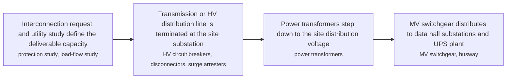

**Key equipment:** HV circuit breakers and disconnectors, power transformers, MV switchgear, protection and control (IEC 61850), metering at the point of supply.

**Performance:**
- global electricity generation to supply data centres, 2024: 460 TWh; IEA: global electricity generation to supply data centres grows from 460 TWh in 2024 to over 1000 TWh in 2030 and 1300 TWh in 2035 in the base case; data centres rise from about 1 percent of global electricity generation today to 3 percent in 2030.. [source](https://www.iea.org/reports/energy-and-ai/energy-supply-for-ai)
- share of additional data centre demand met by renewables over five years: 50 %; IEA: over five years renewables meet nearly half of the additional demand, followed by gas and coal.. [source](https://www.iea.org/reports/energy-and-ai/energy-supply-for-ai)

**Costs:**
- utility works and substation cost, 1 GW AI campus: 164000 USD per MW of interconnection capacity (2026$); Epoch AI campus capex model: $164M per 1 GW facility for utility works and substations ($164/kW). A per-MVA figure needs a transformer rating assumption, which the model does not state.. [source](https://epoch.ai/data-insights/ai-datacenter-cost-breakdown)

**Reference plants:**
- Lancium Abilene AI campus substations, United States: 200 MW at 138 kV plus 1 GW at 345 kV; substations energised Dec 2025 and Mar 2026. [source](https://www.mortenson.com/projects/abilene-data-center-development)

**Missing inputs:**
- TRL with a cited source (trl): No TRL table was read. Where: IEA Energy Technology Guide. Next: Add a TRL reference.

Sources: [1](https://www.iea.org/reports/energy-and-ai/energy-supply-for-ai), [2](https://new.abb.com/medium-voltage/switchgear). Last reviewed 2026-11-16.

## Direct-to-chip liquid cooling (cold plates and CDUs)

Cold plates mounted on CPUs and GPUs carry coolant to a coolant distribution unit (CDU) that rejects the heat to facility water or room air, decoupling the server loop from the building loop. Air cooling tops out around 40 to 60 kW per rack with containment; liquid cooling carries AI-class racks of 80 kW to 120 kW and beyond. The Vertiv CoolChip family spans 70 kW to 2.3 MW per unit with liquid-to-air and liquid-to-liquid exchangers, redundant pumps, integrated filtration and leak detection.

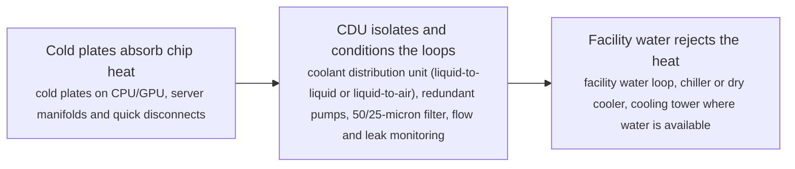

**Key equipment:** cold plates and server manifolds, coolant distribution unit (CDU), facility water loop and heat rejection, leak detection and coolant quality management.

**Performance:**
- CDU capacity range, Vertiv CoolChip family: 70-2300 kW per unit; CDU 70 at 11 C approach temperature differential (liquid-to-air) up to CDU 2300 at 4 C ATD (liquid-to-liquid, in-row). [source](https://www.vertiv.com/en-in/products-catalog/thermal-management/high-density-solutions/vertiv-coolchip-cdu)
- smallest liquid-to-air model capacity: 70 kW; CDU 70: liquid-to-air, in-row, works without facility water so liquid-cooled servers can sit in an existing air-cooled hall. [source](https://www.vertiv.com/en-in/products-catalog/thermal-management/high-density-solutions/vertiv-coolchip-cdu)
- in-rack liquid-to-liquid model capacity: 121 kW; CDU 121: 4U in-rack, liquid-to-liquid at 4 C ATD, 174 x 445 x 868 mm. [source](https://www.vertiv.com/en-in/products-catalog/thermal-management/high-density-solutions/vertiv-coolchip-cdu)
- PUE delta versus air-cooled baseline: 0.04 PUE points; Metered PUE fell from 1.38 all-air to 1.34 at 74.9% direct-to-chip liquid cooling in a 1-2 MW hall with 50 high-density racks.. [source](https://www.vertiv.com/en-us/about/news-and-events/articles/blog-posts/quantifying-data-center-pue-when-introducing-liquid-cooling)

**Costs:**
- installed cost, direct-to-chip cooling: 6000-9500 USD per kW of IT load (2025$); Cold plates, CDU and manifolds, facility side excluded; a $2,500-4,500/kW premium over air, with in-rack CDU ASP $15,000-30,000 per unit. Per kW of IT load, not per kW of cooling capacity. Vendor/analyst figures.. [source](https://energy-solutions.co/articles/sub/data-center-cooling-liquid-immersion-vs-air)

TRL source: [Production product family shipping for AI deployments (vendor catalogue) — indicative TRL 7-8, library's own judgement, read 2026-11-12](https://www.vertiv.com/en-in/products-catalog/thermal-management/high-density-solutions/vertiv-coolchip-cdu)

**Missing inputs:**
- cost per kW of cooling capacity (per kW of IT load is now recorded) (costs): Costs are recorded per kW of IT load; a per-kW-of-cooling-capacity figure would need the design delta-T, which no source pairs with a price. Where: Uptime Institute and industry cost surveys; vendor budgetary quotes (open). Next: Leave open until a source states this metric and scope.

Sources: [1](https://www.vertiv.com/en-in/products-catalog/thermal-management/high-density-solutions/vertiv-coolchip-cdu), [2](https://www.vertiv.com/en-emea/about/news-and-events/news-releases/2026/vertiv-expands-liquid-cooling-portfolio-in-emea-to-accelerate-ai-ready-data-centre-deployments). Last reviewed 2026-11-17.

## Rear-door heat exchangers

A rear-door heat exchanger replaces the rack's rear door with a liquid coil. Server fans push exhaust air through the coil, so heat leaves in water rather than in room air. Passive units rely entirely on server fans; active units add variable-speed fans. The coil handles the rack's heat at its own density, which is why the door approach reaches densities room air cooling cannot.

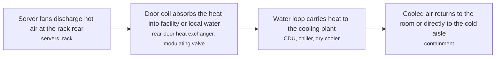

**Key equipment:** passive rear-door coils, active rear-door units with variable-speed fans, modulating valves and return-water temperature control, CDU or facility water loop.

**Performance:**
- supported rack density, rear-door heat exchanger: 20-80 kW per rack; Vertiv article: rear-door heat exchangers support rack densities from 20 to 80 kW, against a practical air-cooling limit of around 20 kW.. [source](https://www.vertiv.com/en-asia/insights/articles/educational-articles/how-rear-door-heat-exchangers-rdhx-support-high-density-rack-cooling)
- cooling capacity per rear door: 44-78 kW/door; 78 kW at 14 C water and 24 C air, falling to 44 kW at 24 C water and 27 C air; 12 fans and a 200 kPa water-side drop at 6 m3/h.. [source](https://www.nvent.com/sites/default/files/dam//schroff-spec-n00647-rdhxpro-en.pdf)

**Costs:**
- installed cost, rear-door heat exchanger: 1800-3200 USD per kW of cooling capacity (2026$); 'Advanced air' category including distribution; vendor-site figure, order-of-magnitude only.. [source](https://energy-solutions.co/articles/sub/data-center-cooling-liquid-immersion-vs-air)

**Missing inputs:**
- cost per rear-door unit by capacity (costs): The cost is recorded per kW of cooling; a per-unit price by model size was not found. Where: Vendor budget quotes. Next: Leave open until a source states this metric and scope.
- TRL with a cited source (trl): No TRL table was read; the register records it as demonstration without a source. Where: IEA Energy Technology Guide. Next: Add a TRL reference.

Sources: [1](https://www.vertiv.com/en-asia/insights/articles/educational-articles/how-rear-door-heat-exchangers-rdhx-support-high-density-rack-cooling). Last reviewed 2026-11-17.

## SMR and fuel-cell power purchase for data centres

Hyperscalers contract firm clean power at the plant level rather than only grid certificates. Two families lead: advanced reactors sold under long PPAs (Google and Kairos Power's master plant development agreement for up to 500 MW of fluoride-salt-cooled high-temperature reactors, first unit by 2030 and the fleet by 2035, sited in territories serving Google data centres) and on-site solid-oxide fuel cells (Equinix and Bloom Energy's decade-long partnership now above 100 MW across about 19 data centres, running on natural gas today with a hydrogen roadmap). Both convert power procurement from a utility question into a contract-structure question.

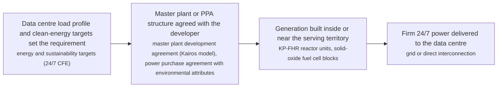

**Key equipment:** advanced reactor units (KP-FHR and peers), solid-oxide fuel cell blocks (Bloom Energy), interconnection and power path.

**Performance:**
- contracted advanced-nuclear capacity, Google-Kairos fleet: 500 MW; up to 500 MW by 2035 under a master plant development agreement signed 14 October 2024; first deployment targeted by 2030. [source](https://www.kairospower.com/updates/google-and-kairos-power-partner-to-deploy-500-mw-of-clean-electricity-generation)
- fuel-cell capacity deployed for Equinix: 100 MW; more than 100 MW of Bloom solid-oxide fuel cells across about 19 Equinix data centres, under a partnership running since 2015 and expanded in 2025. [source](https://www.theregister.com/off-prem/2025/08/14/equinix-signs-nuke-deals-to-power-its-datacenters/)

**Reference plants:**
- Google-Kairos Power SMR offtake, United States: up to 500 MW; agreement 2024; first SMR 2030, fleet by 2035. [source](https://blog.google/company-news/outreach-and-initiatives/sustainability/google-kairos-power-nuclear-energy-agreement)

TRL source: [Fuel cells commercial (TRL 9, operating at Equinix since 2015); advanced reactors at licensing/first-build (TRL 6-7) — read 2026-11-12](https://www.kairospower.com/updates/google-and-kairos-power-partner-to-deploy-500-mw-of-clean-electricity-generation)

**Missing inputs:**
- PPA price ranges for SMR and fuel-cell power, with dollar year (costs): PPA prices are commercially confidential. Where: Disclosure filings and rate-case documents where public (open). Next: Add price ranges where disclosed.

Sources: [1](https://www.kairospower.com/updates/google-and-kairos-power-partner-to-deploy-500-mw-of-clean-electricity-generation), [2](https://www.theregister.com/off-prem/2025/08/14/equinix-signs-nuke-deals-to-power-its-datacenters/). Last reviewed 2026-11-16.

## Immersion cooling

Immersion cooling puts the server, or a sealed chassis, into a dielectric bath, so heat leaves by direct contact with liquid instead of air. Single-phase systems circulate the fluid to an external heat exchanger; two-phase systems let the fluid boil and condense on a coil. Because the whole board is wetted, density is limited by the tank and fluid rather than by a cold plate's coverage, but service procedures and fluid compatibility change completely.

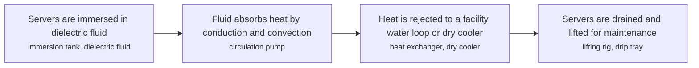

**Key equipment:** immersion tanks, dielectric fluids, fluid circulation and heat exchangers, server lifting and drainage equipment.

**Performance:**
- liquid-cooled infrastructure deployed by one vendor: 500 MW; Submer home page: 500 MW+ liquid-cooled infrastructure deployed and 8 GW+ deployment-ready capacity, with 3 global R&D labs. Vendor-reported aggregate; no per-tank capacity given.. [source](https://submer.com)
- cooling capacity per immersion tank: 100 kW/tank; 100 kW per two-phase tank with PUE below 1.08 - manufacturer figure.. [source](https://www.deltapowersolutions.com/en/mcis/data-center-immersion-cooling-two-phase.php)

**Costs:**
- installed capital cost, single-phase immersion: 4500-6800 USD per kW of IT load (2026$); Tanks, fluid, pumping and heat rejection; vendor-site figures (capital intensity $3,500-6,500/kW), order-of-magnitude only.. [source](https://energy-solutions.co/articles/sub/data-center-cooling-liquid-immersion-vs-air)

**Missing inputs:**
- fluid top-up cost (capital is now recorded) (costs): Installed capital is recorded ($4,500-6,800/kW IT, vendor figures); the annual fluid top-up cost was not found. Where: Vendor budget quotes. Next: Leave open until a source states this metric and scope.
- TRL with a cited source (trl): No TRL table was read. Where: IEA Energy Technology Guide. Next: Add a TRL reference.

Sources: [1](https://submer.com). Last reviewed 2026-11-17.
