# IDC technology options

16 technologies, from commercial to lab stage. Generated from catalog/technologies/; every figure links to its source.

| Technology | Category | Maturity | TRL | Suppliers | Cost figures |
| --- | --- | --- | --- | --- | --- |
| [AI-training and inference load profiles](#idc-ai-load-profiles) | Siting and demand | commercial |  | NVIDIA (accelerator platforms that set rack power envelopes); Vertiv (power and cooling built around accelerated rack densities); Schneider Electric (data centre physical infrastructure for AI halls) |  |
| [Air cooling (CRAH/CRAC, hot/cold aisle containment)](#idc-air-cooling) | Cooling | commercial |  | Vertiv (Liebert CRAH/CRAC and in-row cooling); Schneider Electric (Uniflair and room cooling); Rittal (rack and room cooling); Stulz (precision air conditioning) |  |
| [Behind-the-meter gas generation for data centres](#idc-behind-the-meter-gas) | Power supply | commercial | 9 | GE Vernova (gas turbines for data centres: TM2500 mobile (about 14-day install), LM6000, LM2500XPRESS, 7HA.03 (430 MW)); Caterpillar (10 MW-class gas gensets; USD 725 million large-engine capacity expansion); Solar Turbines (Caterpillar) (medium gas turbines for industrial and campus power) |  |
| [Data centre UPS systems (double-conversion, lithium, modular)](#idc-ups-systems) | Power distribution | commercial | 9 | Vertiv (Liebert EXL S1 (100-1200 kW, scalable in parallel), Liebert GXT/ITA edge UPS); Schneider Electric (Galaxy VX/VL large UPS for data centres); Eaton (93PM modular UPS and grid-interactive UPS programmes) |  |
| [Data centre energy and water benchmarking (PUE/WUE)](#idc-energy-water-benchmarking) | Siting and demand | commercial |  | Uptime Institute (survey benchmark and PUE guidance); Schneider Electric (EcoStruxure metering and reporting); Vertiv (power and thermal telemetry) |  |
| [Data centre grid interaction (demand response and frequency services)](#idc-grid-interaction) | Grid interaction | commercial | 8-9 | Enel X (demand response and frequency services for data centres (Digital Realty, Microsoft programmes)); GridBeyond (demand-side response for data centres with zero downtime); Vertiv (grid-interactive UPS whitepaper and sizing guidance) |  |
| [Data centre siting and power procurement](#idc-siting-power-procurement) | Siting and demand | commercial | 9 | GE Vernova (onsite and BTM generation configurations (25 MW to 3 GW)); AirTrunk (hyperscale campuses across APAC including the 700 MW+ Malaysia platform); Equinix (colocation + interconnection with long-term clean-power contracting) |  |
| [Free cooling and economisers](#idc-free-cooling-economisers) | Cooling | commercial |  | Vertiv (Liebert DSE free-cooling system (50-165 kW)); Schneider Electric (Uniflair free-cooling units); Munters (evaporative and indirect cooling) |  |
| [Medium-voltage switchgear and busway in the data hall](#idc-mv-switchgear-busway) | Power distribution | commercial |  | ABB (medium-voltage switchgear, including SF6-free 6-24 kV); Starline Power (busway (Track, Series-S, high-power ranges)); Schneider Electric (MV switchgear and busway for data centres); Eaton (MV distribution and busway) |  |
| [On-site solar plus battery storage for data centres](#idc-onsite-solar-storage) | Power supply | commercial |  | Sungrow (solar inverters and battery storage); CATL (LFP battery cells and containers); Tesla Energy (Megapack battery storage); Fluence (grid-scale battery storage) |  |
| [Rack power distribution (PDU, 48 V DC and 415 V AC architectures)](#idc-rack-power-distribution) | Power distribution | commercial |  | Server Technology (rack PDUs including 415 V and -48 V DC ranges); Vertiv (rack PDUs and power management); Raritan (Legrand) (intelligent rack PDUs); Schneider Electric (rack PDUs and metering) |  |
| [Utility feed and on-site substation for data centres](#idc-utility-feed-substation) | Power supply | commercial |  | ABB (medium- and high-voltage switchgear, transformers); Hitachi Energy (transformers and substation equipment); Siemens Energy (substation and grid connection equipment) |  |
| [Direct-to-chip liquid cooling (cold plates and CDUs)](#idc-direct-to-chip-liquid-cooling) | Cooling | demonstration | 7-8 | Vertiv (CoolChip CDU 70/121/600/1350/2300 (direct-to-chip and RDHx)); CoolIT Systems (cold plates and rack CDUs); Boyd (liquid cooling loops and cold plates); Motivair (CDUs and facility chillers for high-density cooling); Rittal (LCP rack cooling units) |  |
| [Rear-door heat exchangers](#idc-rear-door-heat-exchangers) | Cooling | demonstration |  | Vertiv (rear-door heat exchangers); nVent (rear-door heat exchangers); Rittal (rear-door cooling units) |  |
| [SMR and fuel-cell power purchase for data centres](#idc-smr-fuel-cell-ppa) | Power supply | demonstration | 6-9 | Kairos Power (KP-FHR advanced reactors under master plant development agreements); Bloom Energy (solid-oxide fuel cells for on-site data centre power); Oklo (Aurora fast microreactor PPAs); Westinghouse Electric Company (eVinci microreactor programme) |  |
| [Immersion cooling](#idc-immersion-cooling) | Cooling | pilot |  | Submer (immersion cooling systems); GRC (Green Revolution Cooling) (immersion cooling systems); LiquidStack (immersion and direct-to-chip cooling); Asperitas (immersion cooling) |  |

## AI-training and inference load profiles

AI workloads change the shape of a data centre's electrical load rather than only its size: training runs hold a large, sustained, synchronised draw across thousands of accelerators for hours, while inference is bursty and follows user traffic. Both run on accelerated servers whose share of the load is growing several times faster than conventional servers, so the design load is set by a rack density that air cooling cannot reach.

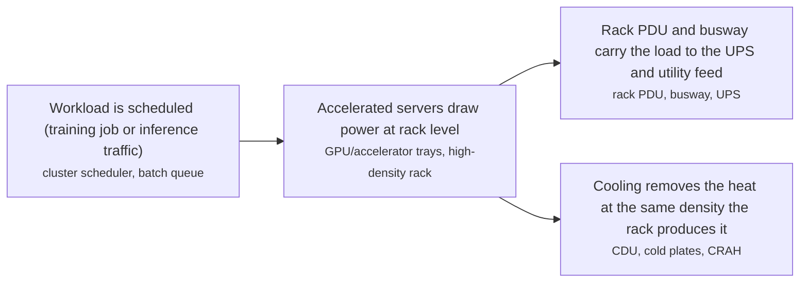

**Key equipment:** accelerated servers and GPU trays, high-density racks (20 kW and above), rack PDUs rated for AI rack currents, liquid cooling distribution units.

**Performance:**
- global data centre electricity consumption, 2024: 415 TWh; IEA: around 1.5 percent of global electricity consumption in 2024.. [source](https://www.iea.org/reports/energy-and-ai/executive-summary)
- global data centre electricity consumption, 2030 base case: 945 TWh; IEA base case: more than doubles to around 945 TWh by 2030, slightly more than Japan's total electricity consumption today; AI is the most important driver of the growth.. [source](https://www.iea.org/reports/energy-and-ai/executive-summary)
- growth rate of data centre electricity consumption: 12-15 % per year; IEA: around 12 percent per year since 2017 (more than four times the growth of total electricity demand), accelerating to around 15 percent per year over 2024-2030.. [source](https://www.iea.org/reports/energy-and-ai/energy-demand-from-ai)
- share of data centre electricity used by server equipment: 60 % of data centre electricity; IEA split: servers around 60 percent, storage around 5 percent, networking up to 5 percent, cooling about 7 percent for efficient hyperscale centres rising above 30 percent for less efficient enterprise centres.. [source](https://www.iea.org/reports/energy-and-ai/energy-demand-from-ai)
- growth rate of accelerated-server electricity use against conventional servers: 9-30 % per year; IEA: accelerated servers grow around 30 percent annually against 9 percent per year for conventional servers, and supply almost half of the net increase in data centre electricity use to 2030.. [source](https://www.iea.org/reports/energy-and-ai/energy-demand-from-ai)

**Missing inputs:**
- training versus inference share of data centre electricity demand, with a cited source (performance): The IEA Energy and AI pages read state data-centre-level demand and segment shares but give no training-versus-inference split. Where: Hyperscaler sustainability or energy reports that disclose workload mix; Peer-reviewed measurements of inference versus training energy. Next: Add a sourced split, or record that no open source disaggregates it.
- not_in_sources_read (costs): No source read prices AI load profiles; the subject is a demand characteristic rather than a purchasable technology. Where: Interconnection study costs and utility upgrade charges. Next: Record the cost of the demand it drives (rack power, cooling, interconnection) on the linked cards instead.
- TRL with a cited source (trl): No TRL table was read for this topic; the register records it as commercial without a source. Where: IEA Energy Technology Guide. Next: Add a TRL reference or leave maturity resting on the evidence on the card.

Sources: [1](https://www.iea.org/reports/energy-and-ai/executive-summary), [2](https://www.iea.org/reports/energy-and-ai/energy-demand-from-ai). Last reviewed 2026-11-14.

## Air cooling (CRAH/CRAC, hot/cold aisle containment)

Air cooling moves heat from the rack to a room coil and then to outdoor air or a chilled-water loop. Containment separates the cold supply from the hot return so the coil sees the rack outlet temperature instead of a mixed room average. The architecture stops being practical somewhere around 20 kW per rack, which is where liquid cooling enters.

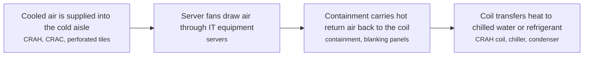

**Key equipment:** CRAH and CRAC units, hot/cold aisle containment and blanking, chilled-water plant or DX condensers, airflow management.

**Performance:**
- practical air-cooling limit per rack: 20 kW per rack; Vertiv article on rear-door heat exchangers: the practical limit for air cooling is around 20 kW per rack, which is where rear-door and other liquid approaches start.. [source](https://www.vertiv.com/en-asia/insights/articles/educational-articles/how-rear-door-heat-exchangers-rdhx-support-high-density-rack-cooling)
- installed share of racks below 10 kW, 2024 to 2025: 38-47 % of installed racks; Vertiv figure on installed racks: racks below 10 kW fell from 47 percent in 2024 to 38 percent in 2025; 10-20 kW rose from 27 to 30 percent and 20-30 kW from 24 to 28 percent, so air-cooled densities are shrinking as a share.. [source](https://www.vertiv.com/en-asia/insights/articles/educational-articles/how-rear-door-heat-exchangers-rdhx-support-high-density-rack-cooling)
- unit cooling capacity, Vertiv Liebert DSE free-cooling system: 50-165 kW; Liebert DSE product page: 50-165 kW standard range, with packaged units around 250-400 kW; water-free operation.. [source](https://www.vertiv.com/en-us/products-catalog/thermal-management/room-cooling/liebert-dse-free-cooling-system-50-165kw)

**Missing inputs:**
- cost per kW of installed CRAH capacity, with dollar year and basis (costs): No source read prices CRAH units or aisle containment. Where: Cooling vendor budget quotes; Data-centre fit-out tender schedules. Next: Add a cost per kW from a vendor quote or fit-out tender.
- TRL with a cited source (trl): No TRL table was read. Where: IEA Energy Technology Guide. Next: Add a TRL reference.

Sources: [1](https://www.vertiv.com/en-asia/insights/articles/educational-articles/how-rear-door-heat-exchangers-rdhx-support-high-density-rack-cooling), [2](https://www.vertiv.com/en-us/products-catalog/thermal-management/room-cooling/liebert-dse-free-cooling-system-50-165kw). Last reviewed 2026-11-14.

## Behind-the-meter gas generation for data centres

Data centres site gas turbines or large reciprocating gensets on their own side of the meter to escape multi-year grid-interconnection queues and hedge power-price volatility. GE Vernova markets configurations from a 20-30 MW aeroderivative unit up to 3 GW campuses, with mobile TM2500 units installable in about 14 days and heavy-duty 7HA.03 units at 430 MW; the Chevron/Engine No.1/GE Vernova 'power foundry' programme targets 4 GW of co-located capacity by 2027. Caterpillar restarted 10 MW-class genset production and is investing USD 725 million to expand large-engine capacity for data-centre demand.

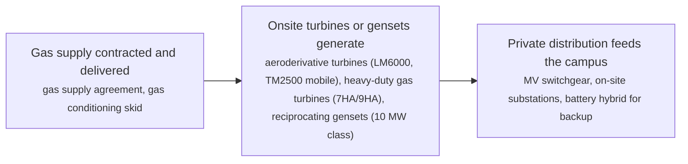

**Key equipment:** aeroderivative gas turbines (LM6000, TM2500), heavy-duty gas turbines (7HA.03, 430 MW class), reciprocating gas gensets (10 MW class), on-site MV distribution and substations.

**Performance:**
- deployment time, mobile aeroderivative units (TM2500): 14 days; installable in about 14 days per the vendor; fast-start aeros restore power within five minutes. [source](https://www.gevernova.com/gas-power/industries/data-centers)
- campus scale range served: 25-3000 MW; 'whether your data center needs 25 MW of power or 3 GW' (vendor); 7HA.03 at 430 MW; Chevron/Engine No.1 programme targeting 4 GW by 2027. [source](https://www.gevernova.com/gas-power/industries/data-centers)
- US data centres building own generation: 46-56 projects (GW); about 46 projects with about 56 GW planned self-generation; about 90% of BTM announcements made in 2025 alone (industry research tracker). [source](https://www.jaredwatkins.com/research/datacenters/behind-meter-power)

TRL source: [Commercial gas-turbine technology deployed at scale (7F fleet about 175 GW installed) — TRL 9, read 2026-11-12](https://www.gevernova.com/gas-power/industries/data-centers)

**Missing inputs:**
- installed cost per kW for BTM gas capacity, with dollar year (costs): Vendor pages carry no prices. Where: EIA/industry cost studies; disclosed project filings (open). Next: Add cost figures with dollar year and basis.
- fleet efficiency (heat rate) for BTM configurations (performance): Not stated on the pages read. Where: GE Vernova turbine spec sheets (GER-3567 etc.) (open). Next: Add heat rates per turbine class.

Sources: [1](https://www.gevernova.com/gas-power/industries/data-centers), [2](https://www.chevron.com/newsroom/2025/q1/power-solutions-for-us-data-centers). Last reviewed 2026-11-12.

## Data centre UPS systems (double-conversion, lithium, modular)

The UPS is the data centre's ride-through bridge: double-conversion units condition and back up the entire IT load, sized per hall and paralleled to hundreds of MW across a campus. The Vertiv Liebert EXL S1 spans 100-1200 kW per unit in the industry's smallest footprint and scales in parallel up to multi-MW systems; lithium-ion battery cabinets cut weight and footprint versus VRLA, and grid-interactive UPS fleets now also sell frequency response back to the grid (see idc-grid-interaction).

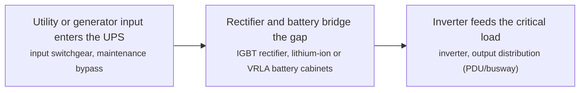

**Key equipment:** double-conversion UPS units (100-1200 kW class), lithium-ion battery cabinets, bypass and paralleling switchgear.

**Performance:**
- unit power range, Vertiv Liebert EXL S1: 100-1200 kW; 100-1200 kW per unit, transformer-free high-density design; scalable in parallel for medium-to-large data centres. [source](https://www.vertiv.com/en-emea/campaigns/liebert-exl-s1)
- parallel system capacity, EXL S1 fleet: 9.6 MW; scalable from a few hundred kW up to about 9.6 MW via parallel deployment, suitable for a 20 MW data-centre design (vendor system sizing). [source](https://www.vertiv.com/48ed43/globalassets/products/critical-power/uninterruptible-power-supplies-ups/liebert-exl-s1-brochure-sl-706452.pdf)

TRL source: [Mature commercial product line shipping since 2017 — TRL 9, read 2026-11-12](https://www.vertiv.com/en-emea/campaigns/liebert-exl-s1)

**Missing inputs:**
- installed cost per kW of UPS capacity, with dollar year (costs): Vendor pages carry no prices. Where: Uptime Institute / industry surveys (open). Next: Add cost figures with dollar year and basis.
- efficiency in double-conversion and ECOnversion modes (performance): Not stated on the pages read. Where: Vertiv EXL S1 datasheet efficiency tables (open). Next: Add efficiency figures per mode.

Sources: [1](https://www.vertiv.com/en-emea/campaigns/liebert-exl-s1), [2](https://www.vertiv.com/48ed43/globalassets/products/critical-power/uninterruptible-power-supplies-ups/liebert-exl-s1-brochure-sl-706452.pdf). Last reviewed 2026-11-14.

## Data centre energy and water benchmarking (PUE/WUE)

Power usage effectiveness divides total facility power by IT power; water usage effectiveness divides water consumption by IT energy. Both are ratio metrics, so they say nothing about how much work the IT load does, and PUE in particular is dominated by climate, age and cooling architecture rather than by operator skill. The IEA notes cooling is about 7 percent of electricity in an efficient hyperscale centre but above 30 percent in a less efficient enterprise one, which is exactly the spread PUE is meant to expose.

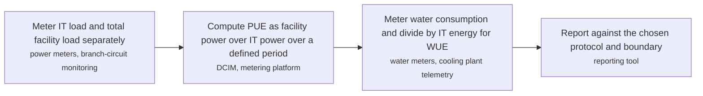

**Key equipment:** revenue-grade power meters on IT and facility feeders, water meters on makeup and blowdown, DCIM or metering platform with defined boundaries.

**Performance:**
- weighted average PUE, survey respondents, 2025: 1.54 ratio; Uptime Institute 2025 survey: respondents' annual PUE had a weighted average of 1.54, and average PUE has hovered above 1.5 for years.. [source](https://datacenter.uptimeinstitute.com/rs/711-RIA-145/images/2025.Annual.Survey.Report.pdf)
- average PUE, facilities commissioned within about five years: 1.48 ratio; Uptime Institute 2025 survey: facilities commissioned from around early 2020 achieved an average PUE of 1.48.. [source](https://datacenter.uptimeinstitute.com/rs/711-RIA-145/images/2025.Annual.Survey.Report.pdf)
- average PUE, facilities of 20 MW and above: 1.44 ratio; Uptime Institute 2025 survey: larger data centres of 20 MW and above averaged 1.44 globally; facilities in high latitudes in North America and Europe have PUEs of 1.3 or better.. [source](https://datacenter.uptimeinstitute.com/rs/711-RIA-145/images/2025.Annual.Survey.Report.pdf)
- cooling share of data centre electricity: 7-30 % of data centre electricity; IEA: cooling is about 7 percent for efficient hyperscale centres and over 30 percent for less efficient enterprise centres.. [source](https://www.iea.org/reports/energy-and-ai/energy-demand-from-ai)

**Missing inputs:**
- water usage effectiveness (WUE) benchmark, in litres per kWh of IT energy (performance): The Uptime report read gives PUE figures but no WUE value in its text; no other source read states one. Where: Uptime Institute WUE reporting guidance; Operator sustainability reports disclosing WUE. Next: Add a sourced WUE benchmark with its boundary and cooling type.
- cost of metering and benchmarking instrumentation per MW of IT load (costs): No source read prices metering and DCIM at data-centre scale. Where: Metering and DCIM vendor quotes. Next: Add a metering cost per MW from a vendor or project quote.
- TRL with a cited source (trl): No TRL table was read; measurement practice is mature but no source read states a level. Where: IEA Energy Technology Guide. Next: Add a TRL reference.

Sources: [1](https://datacenter.uptimeinstitute.com/rs/711-RIA-145/images/2025.Annual.Survey.Report.pdf), [2](https://www.iea.org/reports/energy-and-ai/energy-demand-from-ai). Last reviewed 2026-11-14.

## Data centre grid interaction (demand response and frequency services)

The data centre's own UPS fleet doubles as a grid asset: when frequency dips below nominal, inverters draw from batteries instead of the grid for seconds to minutes — no IT impact — and the operator sells that as frequency response. Enel X's Digital Realty deployment in Ireland responds in under half a second; Microsoft is rolling out UPS battery-sharing worldwide and pushed for the UK's Dynamic Containment scheme to open to data centres after Ireland led; UK NESO programmes now listed for data centres include Demand Flexibility Service, Dynamic Containment, Dynamic Moderation, Dynamic Regulation and Static FFR. Battery-cycling degradation is the principal trade-off.

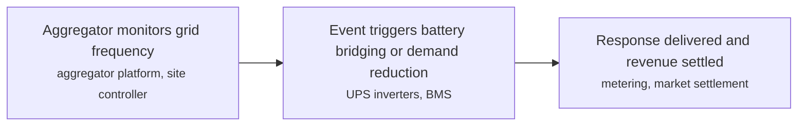

**Key equipment:** UPS fleets as distributed frequency-response assets, aggregator platform and site controllers, battery-management and degradation monitoring.

**Performance:**
- UPS fleet frequency-response trigger time, Enel X Digital Realty Ireland: 0.5 seconds; responds in under half a second when grid frequency drops below 50 Hz; the data centre draws on batteries instead of the grid. [source](https://www.enelx.com/ie/en/resources/customer-success/digital-realty-case-study)

TRL source: [Commercial deployments operating in Ireland for years — TRL 8-9, read via search summary 2026-11-12](https://www.enelx.com/ie/en/resources/customer-success/digital-realty-case-study)

**Missing inputs:**
- revenue per MW-year for data-centre frequency services, with dollar year (costs): Market revenues vary by scheme and auction. Where: NESO auction results; aggregator disclosures (open). Next: Add revenue ranges per scheme.
- battery degradation rates under frequency-response cycling (performance): Not stated on the pages read. Where: Eaton/Microsoft whitepaper; NERC 2025 grid-interactive UPS survey (open). Next: Add degradation data with basis.

Sources: [1](https://www.enelx.com/ie/en/resources/customer-success/digital-realty-case-study), [2](https://www.datacenterdynamics.com/en/news/microsoft-to-roll-out-data-center-battery-sharing-worldwide), [3](https://www.enelx.com/uk/en/question-and-answer). Last reviewed 2026-11-14.

## Data centre siting and power procurement

Siting is the data centre's first and most binding engineering decision: power availability, price and time-to-energisation outrank almost everything else, followed by water, fibre and latency. The 2025 boom in behind-the-meter generation (about 46 projects, about 56 GW self-planned, ~90% announced in 2025) exists because grid interconnection queues cannot keep pace; operators therefore choose between grid feed, behind-the-meter gas, PPAs for advanced nuclear or fuel cells, and hybrids — and in Southeast Asia the Johor-Cyberjaya corridor has become the fastest-growing supply region, with AirTrunk's Malaysia platform alone expanding past 700 MW.

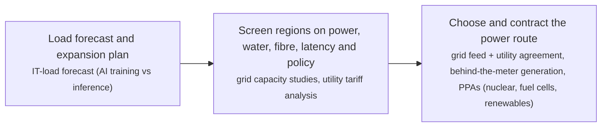

**Key equipment:** grid interconnection and substations, behind-the-meter generation options, long-term PPA structures.

**Performance:**
- self-generation boom, US data centres: 46-56 projects (GW); about 46 projects with about 56 GW of planned self-built capacity; about 90% of behind-the-meter announcements made in 2025 alone — evidence that grid interconnection is the binding constraint. [source](https://www.jaredwatkins.com/research/datacenters/behind-meter-power)
- AirTrunk Malaysia platform expansion: 700 MW; AirTrunk expanding its Malaysia platform (Johor and Cyberjaya) to more than 700 MW — the anchor hyperscale supply for the SEA AI corridor. [source](https://airtrunk.com/)

TRL source: [Established commercial practice across every major market — TRL 9, read via search summary 2026-11-12](https://www.jaredwatkins.com/research/datacenters/behind-meter-power)

**Missing inputs:**
- power cost benchmarks per route (grid, BTM, PPA) in USD/MWh with dollar year (costs): Route pricing is commercial and market-specific. Where: datacenterHawk, Uptime Institute market reports (open). Next: Add benchmark ranges with dollar year.
- interconnection queue times by grid operator (performance): Queue data is published per operator but not yet collected. Where: Lawrence Berkeley NAB interconnection-queue data (open). Next: Add queue-time ranges per major grid.

Sources: [1](https://www.jaredwatkins.com/research/datacenters/behind-meter-power), [2](https://airtrunk.com/). Last reviewed 2026-11-14.

## Free cooling and economisers

An economiser uses outdoor conditions to do the cooling work instead of a compressor. Air-side designs bring outside air in; water-side designs cool the loop with a dry cooler or cooling tower; packaged units combine both. The saving is proportional to annual hours below the switch-over temperature, so the same equipment saves far more in a high-latitude climate than in the tropics - which is exactly the PUE spread the Uptime survey reports.

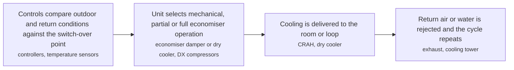

**Key equipment:** packaged free-cooling units, air-side economiser dampers and filters, dry coolers and fluid coolers, switch-over controls.

**Performance:**
- unit capacity, Vertiv Liebert DSE free-cooling system: 50-165 kW; Liebert DSE product page: 50-165 kW standard range with packaged units around 250-400 kW; the unit is water-free, avoiding the makeup water a chilled-water plant needs.. [source](https://www.vertiv.com/en-us/products-catalog/thermal-management/room-cooling/liebert-dse-free-cooling-system-50-165kw)
- PUE advantage of high-latitude sites: 1.3-1.54 ratio; Uptime Institute 2025 survey: facilities in high latitudes in North America and Europe have PUEs of 1.3 or better, against a weighted average of 1.54 across respondents; climate, not only design, drives the spread.. [source](https://datacenter.uptimeinstitute.com/rs/711-RIA-145/images/2025.Annual.Survey.Report.pdf)

**Missing inputs:**
- annual hours of economiser operation and kW saved per site climate (performance): Neither source read gives operating hours or saved kW by climate for a specific unit. Where: Cooling vendor selection software output; Site weather data with switch-over temperature. Next: Add a site-specific economiser hours analysis.
- capital cost per kW and the saving against mechanical cooling, with dollar year (costs): No source read prices free-cooling units or their saving. Where: Vendor quotes and payback studies. Next: Add a cost and saving from a vendor quote or study.
- TRL with a cited source (trl): No TRL table was read. Where: IEA Energy Technology Guide. Next: Add a TRL reference.

Sources: [1](https://www.vertiv.com/en-us/products-catalog/thermal-management/room-cooling/liebert-dse-free-cooling-system-50-165kw), [2](https://datacenter.uptimeinstitute.com/rs/711-RIA-145/images/2025.Annual.Survey.Report.pdf). Last reviewed 2026-11-14.

## Medium-voltage switchgear and busway in the data hall

MV switchgear is the switching and protection layer between the site transformers and the data hall; busway replaces fixed cable runs with a tap-off busbar so power can be taken off anywhere along a row and racks added without re-cabling. Busway matters at AI densities because the tap-off positions, not the cable schedule, define where a rack can go.

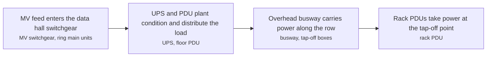

**Key equipment:** MV switchgear and ring main units (1-52 kV IEC class), busway with tap-off units and metering, floor PDUs, rack PDUs.

**Performance:**
- ABB medium-voltage switchgear voltage class: 1-52 kV; ABB medium-voltage switchgear overview: 1-52 kV IEC range, air-insulated versus gas-insulated designs, and SF6-free variants offered at 6-24 kV.. [source](https://new.abb.com/medium-voltage/switchgear)
- Starline busway current rating, Track range: 40-1250 A; Starline product page: Track 40-1250 A, Series-S 100-1200 A, and high-power busway 630-6000 A, with metering options.. [source](https://www.starlinepower.com/products/busway)

**Missing inputs:**
- cost per MV bay and per metre of busway, with dollar year and basis (costs): Neither vendor page read gives prices. Where: Electrical distributor price books; Data-centre fit-out tender schedules. Next: Add budget prices from a distributor price book or tender.
- TRL with a cited source (trl): No TRL table was read. Where: IEA Energy Technology Guide. Next: Add a TRL reference.

Sources: [1](https://new.abb.com/medium-voltage/switchgear), [2](https://www.starlinepower.com/products/busway). Last reviewed 2026-11-14.

## On-site solar plus battery storage for data centres

Solar plus storage behind the meter changes the profile of a campus's grid draw without changing the load: the array produces while the sun is up, the battery shifts that energy to evening peaks and can also provide demand response. It is not a substitute for utility capacity, because a data centre load runs continuously and a solar array's capacity factor is a fraction of its nameplate - which is why the IEA sees renewables meeting only about half of the additional demand, with gas and coal behind them.

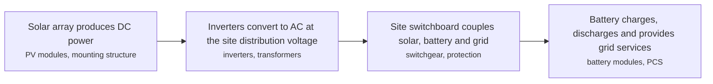

**Key equipment:** PV modules and mounting, string and central inverters, battery energy storage (LFP), power conversion system, site protection and metering.

**Performance:**
- share of additional data centre demand met by renewables over five years: 50 %; IEA: over five years renewables meet nearly half of the additional data centre demand, followed by gas and coal; solar and wind are the renewable sources in that mix.. [source](https://www.iea.org/reports/energy-and-ai/energy-supply-for-ai)

**Missing inputs:**
- capacity factor achieved by on-site solar at a data centre and usable battery cycles per year (performance): The IEA page read gives the aggregate renewable share of added demand but no data-centre-specific capacity factor or cycle count. Where: Operator sustainability reports with on-site generation data. Next: Add capacity factor and annual cycles from an operating project.
- cost per MW of solar and per kWh of battery installed, with dollar year (costs): No source read prices on-site solar or storage. Where: IEA and LBNL cost benchmarks; Project finance disclosures. Next: Add installed costs from a project disclosure.
- named data centres with on-site solar and storage, with capacity and country (reference_plants): No named project was read. Where: Operator press releases. Next: Add named projects with capacity and source.
- TRL with a cited source (trl): No TRL table was read. Where: IEA Energy Technology Guide. Next: Add a TRL reference.

Sources: [1](https://www.iea.org/reports/energy-and-ai/energy-supply-for-ai). Last reviewed 2026-11-14.

## Rack power distribution (PDU, 48 V DC and 415 V AC architectures)

The rack PDU is where distribution voltage becomes equipment power, and it is also the finest-grained metering point in the building. Architectures differ at that boundary: 415 V AC three-phase racks reduce current per rack for a given power, while 48 V DC distribution moves rectification to the row and avoids a conversion stage per server.

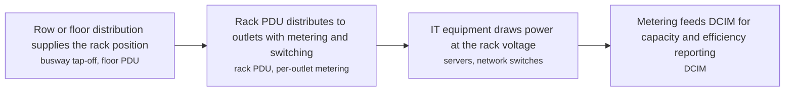

**Key equipment:** rack PDUs (basic, metered, switched, per-outlet sensing), 415 V three-phase rack PDUs, 48 V DC rack power shelves, outlet-level metering.

**Missing inputs:**
- power and current rating per rack PDU model family (kW and A per cabinet) (performance): The Server Technology page read lists product families and voltage variants but no per-cabinet kW or A ratings. Where: Server Technology and Vertiv rack PDU datasheets. Next: Read a datasheet for each family and record the ratings.
- cost per rack PDU by metering level, with dollar year and basis (costs): No source read gives rack PDU prices. Where: Distributor price books. Next: Add budget prices from a distributor price book.
- TRL with a cited source (trl): No TRL table was read. Where: IEA Energy Technology Guide. Next: Add a TRL reference.

Sources: [1](https://www.servertech.com/products). Last reviewed 2026-11-14.

## Utility feed and on-site substation for data centres

A hyperscale campus is a utility-scale load: the feed is taken at transmission or high distribution voltage and transformed on site, because the alternative is carrying tens of megawatts at utilisation voltage. The binding constraint is less often transformer capacity than the interconnection queue and the local network's ability to absorb a step load, which the IEA flags as a first-order constraint in its high-growth case.

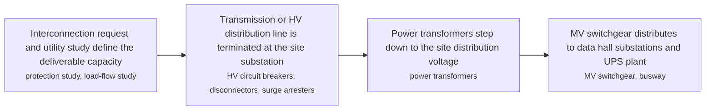

**Key equipment:** HV circuit breakers and disconnectors, power transformers, MV switchgear, protection and control (IEC 61850), metering at the point of supply.

**Performance:**
- global electricity generation to supply data centres, 2024: 460 TWh; IEA: global electricity generation to supply data centres grows from 460 TWh in 2024 to over 1000 TWh in 2030 and 1300 TWh in 2035 in the base case; data centres rise from about 1 percent of global electricity generation today to 3 percent in 2030.. [source](https://www.iea.org/reports/energy-and-ai/energy-supply-for-ai)
- share of additional data centre demand met by renewables over five years: 50 %; IEA: over five years renewables meet nearly half of the additional demand, followed by gas and coal.. [source](https://www.iea.org/reports/energy-and-ai/energy-supply-for-ai)

**Missing inputs:**
- cost per MW of interconnection and on-site substation capacity, with dollar year and basis (costs): No source read gives a per-MW interconnect or substation cost; utility upgrade charges are project-specific. Where: Utility interconnection study cost allocations; EPC substation contract awards. Next: Add a per-MW cost from a published interconnection study or project disclosure.
- named data-centre substation projects with voltage, capacity and country (reference_plants): No named interconnection project was read in the sources used. Where: Utility interconnection queue filings and utility press releases. Next: Add two or three named projects with voltage, MW and source.
- TRL with a cited source (trl): No TRL table was read. Where: IEA Energy Technology Guide. Next: Add a TRL reference.

Sources: [1](https://www.iea.org/reports/energy-and-ai/energy-supply-for-ai), [2](https://new.abb.com/medium-voltage/switchgear). Last reviewed 2026-11-14.

## Direct-to-chip liquid cooling (cold plates and CDUs)

Cold plates mounted on CPUs and GPUs carry coolant to a coolant distribution unit (CDU) that rejects the heat to facility water or room air, decoupling the server loop from the building loop. Air cooling tops out around 40 to 60 kW per rack with containment; liquid cooling carries AI-class racks of 80 kW to 120 kW and beyond. The Vertiv CoolChip family spans 70 kW to 2.3 MW per unit with liquid-to-air and liquid-to-liquid exchangers, redundant pumps, integrated filtration and leak detection.

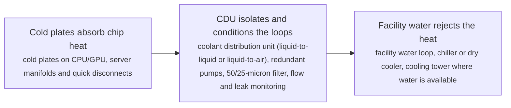

**Key equipment:** cold plates and server manifolds, coolant distribution unit (CDU), facility water loop and heat rejection, leak detection and coolant quality management.

**Performance:**
- CDU capacity range, Vertiv CoolChip family: 70-2300 kW per unit; CDU 70 at 11 C approach temperature differential (liquid-to-air) up to CDU 2300 at 4 C ATD (liquid-to-liquid, in-row). [source](https://www.vertiv.com/en-in/products-catalog/thermal-management/high-density-solutions/vertiv-coolchip-cdu)
- smallest liquid-to-air model capacity: 70 kW; CDU 70: liquid-to-air, in-row, works without facility water so liquid-cooled servers can sit in an existing air-cooled hall. [source](https://www.vertiv.com/en-in/products-catalog/thermal-management/high-density-solutions/vertiv-coolchip-cdu)
- in-rack liquid-to-liquid model capacity: 121 kW; CDU 121: 4U in-rack, liquid-to-liquid at 4 C ATD, 174 x 445 x 868 mm. [source](https://www.vertiv.com/en-in/products-catalog/thermal-management/high-density-solutions/vertiv-coolchip-cdu)

TRL source: [Production product family shipping for AI deployments (vendor catalogue) — indicative TRL 7-8, library's own judgement, read 2026-11-12](https://www.vertiv.com/en-in/products-catalog/thermal-management/high-density-solutions/vertiv-coolchip-cdu)

**Missing inputs:**
- installed cost per kW of cooling capacity, with dollar year (costs): Vendor pages do not publish CDU prices. Where: Uptime Institute and industry cost surveys; vendor budgetary quotes (open). Next: Add cost figures with dollar year and basis.
- PUE delta versus air-cooled baseline at a given rack density (performance): Not stated on the pages read. Where: Uptime Institute / vendor case studies (open). Next: Add measured PUE deltas with basis.

Sources: [1](https://www.vertiv.com/en-in/products-catalog/thermal-management/high-density-solutions/vertiv-coolchip-cdu), [2](https://www.vertiv.com/en-emea/about/news-and-events/news-releases/2026/vertiv-expands-liquid-cooling-portfolio-in-emea-to-accelerate-ai-ready-data-centre-deployments). Last reviewed 2026-11-12.

## Rear-door heat exchangers

A rear-door heat exchanger replaces the rack's rear door with a liquid coil. Server fans push exhaust air through the coil, so heat leaves in water rather than in room air. Passive units rely entirely on server fans; active units add variable-speed fans. The coil handles the rack's heat at its own density, which is why the door approach reaches densities room air cooling cannot.

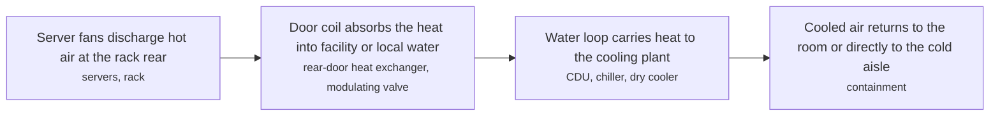

**Key equipment:** passive rear-door coils, active rear-door units with variable-speed fans, modulating valves and return-water temperature control, CDU or facility water loop.

**Performance:**
- supported rack density, rear-door heat exchanger: 20-80 kW per rack; Vertiv article: rear-door heat exchangers support rack densities from 20 to 80 kW, against a practical air-cooling limit of around 20 kW.. [source](https://www.vertiv.com/en-asia/insights/articles/educational-articles/how-rear-door-heat-exchangers-rdhx-support-high-density-rack-cooling)

**Missing inputs:**
- cooling capacity per door in kW and the air-side pressure drop (performance): The article read gives the supported rack-density range but no per-door kW capacity or pressure drop. Where: Vertiv and nVent rear-door heat exchanger datasheets. Next: Read a datasheet and record capacity and pressure drop.
- cost per rear-door unit by capacity, with dollar year and basis (costs): No source read prices rear-door units. Where: Vendor budget quotes. Next: Add a unit price from a vendor quote.
- TRL with a cited source (trl): No TRL table was read; the register records it as demonstration without a source. Where: IEA Energy Technology Guide. Next: Add a TRL reference.

Sources: [1](https://www.vertiv.com/en-asia/insights/articles/educational-articles/how-rear-door-heat-exchangers-rdhx-support-high-density-rack-cooling). Last reviewed 2026-11-14.

## SMR and fuel-cell power purchase for data centres

Hyperscalers contract firm clean power at the plant level rather than only grid certificates. Two families lead: advanced reactors sold under long PPAs (Google and Kairos Power's master plant development agreement for up to 500 MW of fluoride-salt-cooled high-temperature reactors, first unit by 2030 and the fleet by 2035, sited in territories serving Google data centres) and on-site solid-oxide fuel cells (Equinix and Bloom Energy's decade-long partnership now above 100 MW across about 19 data centres, running on natural gas today with a hydrogen roadmap). Both convert power procurement from a utility question into a contract-structure question.

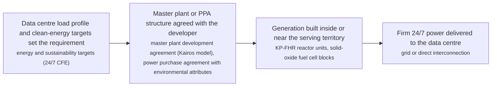

**Key equipment:** advanced reactor units (KP-FHR and peers), solid-oxide fuel cell blocks (Bloom Energy), interconnection and power path.

**Performance:**
- contracted advanced-nuclear capacity, Google-Kairos fleet: 500 MW; up to 500 MW by 2035 under a master plant development agreement signed 14 October 2024; first deployment targeted by 2030. [source](https://www.kairospower.com/updates/google-and-kairos-power-partner-to-deploy-500-mw-of-clean-electricity-generation)
- fuel-cell capacity deployed for Equinix: 100 MW; more than 100 MW of Bloom solid-oxide fuel cells across about 19 Equinix data centres, under a partnership running since 2015 and expanded in 2025. [source](https://www.theregister.com/off-prem/2025/08/14/equinix-signs-nuke-deals-to-power-its-datacenters/)

TRL source: [Fuel cells commercial (TRL 9, operating at Equinix since 2015); advanced reactors at licensing/first-build (TRL 6-7) — read 2026-11-12](https://www.kairospower.com/updates/google-and-kairos-power-partner-to-deploy-500-mw-of-clean-electricity-generation)

**Missing inputs:**
- PPA price ranges for SMR and fuel-cell power, with dollar year (costs): PPA prices are commercially confidential. Where: Disclosure filings and rate-case documents where public (open). Next: Add price ranges where disclosed.
- first Hermes unit start-up date and Oklo Aurora Aurora-Inn dates (reference_plants): Dates move with licensing progress. Where: kairospower.com and oklo.com newsroom (open). Next: Re-check dates each quarter.

Sources: [1](https://www.kairospower.com/updates/google-and-kairos-power-partner-to-deploy-500-mw-of-clean-electricity-generation), [2](https://www.theregister.com/off-prem/2025/08/14/equinix-signs-nuke-deals-to-power-its-datacenters/). Last reviewed 2026-11-12.

## Immersion cooling

Immersion cooling puts the server, or a sealed chassis, into a dielectric bath, so heat leaves by direct contact with liquid instead of air. Single-phase systems circulate the fluid to an external heat exchanger; two-phase systems let the fluid boil and condense on a coil. Because the whole board is wetted, density is limited by the tank and fluid rather than by a cold plate's coverage, but service procedures and fluid compatibility change completely.

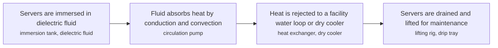

**Key equipment:** immersion tanks, dielectric fluids, fluid circulation and heat exchangers, server lifting and drainage equipment.

**Performance:**
- liquid-cooled infrastructure deployed by one vendor: 500 MW; Submer home page: 500 MW+ liquid-cooled infrastructure deployed and 8 GW+ deployment-ready capacity, with 3 global R&D labs. Vendor-reported aggregate; no per-tank capacity given.. [source](https://submer.com)

**Missing inputs:**
- cooling capacity per tank in kW and achievable PUE (performance): The vendor page read gives aggregate deployed capacity and a deployment-ready figure but no per-tank kW capacity or PUE. Where: GRC, LiquidStack and Submer datasheets and case studies. Next: Read a product datasheet and a published deployment case with capacities.
- capital cost per kW of immersion capacity and fluid top-up cost, with dollar year (costs): No source read prices immersion systems or fluid. Where: Vendor budget quotes. Next: Add capital and fluid cost from a vendor quote.
- TRL with a cited source (trl): No TRL table was read. Where: IEA Energy Technology Guide. Next: Add a TRL reference.

Sources: [1](https://submer.com). Last reviewed 2026-11-14.
