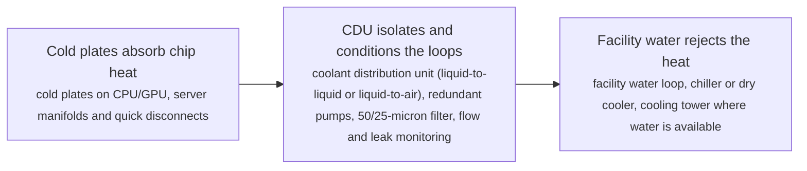
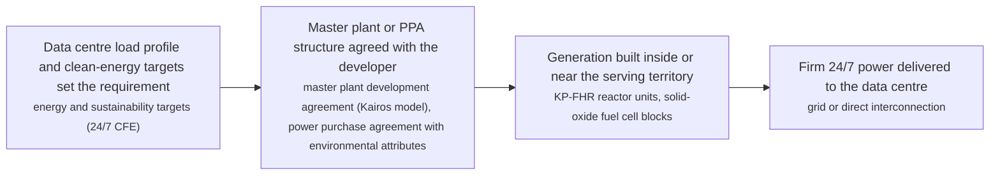

# IDC technology options

2 technologies, from commercial to lab stage. Generated from catalog/technologies/; every figure links to its source.

| Technology | Category | Maturity | TRL | Suppliers | Cost figures |
| --- | --- | --- | --- | --- | --- |
| [Direct-to-chip liquid cooling (cold plates and CDUs)](#idc-direct-to-chip-liquid-cooling) | Cooling | demonstration | 7-8 | Vertiv (CoolChip CDU 70/121/600/1350/2300 (direct-to-chip and RDHx)); CoolIT Systems (cold plates and rack CDUs); Boyd (liquid cooling loops and cold plates); Motivair (CDUs and facility chillers for high-density cooling); Rittal (LCP rack cooling units) |  |
| [SMR and fuel-cell power purchase for data centres](#idc-smr-fuel-cell-ppa) | Power supply | demonstration | 6-9 | Kairos Power (KP-FHR advanced reactors under master plant development agreements); Bloom Energy (solid-oxide fuel cells for on-site data centre power); Oklo (Aurora fast microreactor PPAs); Westinghouse Electric Company (eVinci microreactor programme) |  |

## Direct-to-chip liquid cooling (cold plates and CDUs)

Cold plates mounted on CPUs and GPUs carry coolant to a coolant distribution unit (CDU) that rejects the heat to facility water or room air, decoupling the server loop from the building loop. Air cooling tops out around 40 to 60 kW per rack with containment; liquid cooling carries AI-class racks of 80 kW to 120 kW and beyond. The Vertiv CoolChip family spans 70 kW to 2.3 MW per unit with liquid-to-air and liquid-to-liquid exchangers, redundant pumps, integrated filtration and leak detection.

**Key equipment:** cold plates and server manifolds, coolant distribution unit (CDU), facility water loop and heat rejection, leak detection and coolant quality management.

**Performance:**
- CDU capacity range, Vertiv CoolChip family: 70-2300 kW per unit; CDU 70 at 11 C approach temperature differential (liquid-to-air) up to CDU 2300 at 4 C ATD (liquid-to-liquid, in-row). [source](https://www.vertiv.com/en-in/products-catalog/thermal-management/high-density-solutions/vertiv-coolchip-cdu)
- smallest liquid-to-air model capacity: 70 kW; CDU 70: liquid-to-air, in-row, works without facility water so liquid-cooled servers can sit in an existing air-cooled hall. [source](https://www.vertiv.com/en-in/products-catalog/thermal-management/high-density-solutions/vertiv-coolchip-cdu)
- in-rack liquid-to-liquid model capacity: 121 kW; CDU 121: 4U in-rack, liquid-to-liquid at 4 C ATD, 174 x 445 x 868 mm. [source](https://www.vertiv.com/en-in/products-catalog/thermal-management/high-density-solutions/vertiv-coolchip-cdu)

TRL source: [Production product family shipping for AI deployments (vendor catalogue) — indicative TRL 7-8, library's own judgement, read 2026-11-12](https://www.vertiv.com/en-in/products-catalog/thermal-management/high-density-solutions/vertiv-coolchip-cdu)

**Missing inputs:**
- installed cost per kW of cooling capacity, with dollar year (costs): Vendor pages do not publish CDU prices. Where: Uptime Institute and industry cost surveys; vendor budgetary quotes (open). Next: Add cost figures with dollar year and basis.
- PUE delta versus air-cooled baseline at a given rack density (performance): Not stated on the pages read. Where: Uptime Institute / vendor case studies (open). Next: Add measured PUE deltas with basis.

Sources: [1](https://www.vertiv.com/en-in/products-catalog/thermal-management/high-density-solutions/vertiv-coolchip-cdu), [2](https://www.vertiv.com/en-emea/about/news-and-events/news-releases/2026/vertiv-expands-liquid-cooling-portfolio-in-emea-to-accelerate-ai-ready-data-centre-deployments). Last reviewed 2026-11-12.

## SMR and fuel-cell power purchase for data centres

Hyperscalers contract firm clean power at the plant level rather than only grid certificates. Two families lead: advanced reactors sold under long PPAs (Google and Kairos Power's master plant development agreement for up to 500 MW of fluoride-salt-cooled high-temperature reactors, first unit by 2030 and the fleet by 2035, sited in territories serving Google data centres) and on-site solid-oxide fuel cells (Equinix and Bloom Energy's decade-long partnership now above 100 MW across about 19 data centres, running on natural gas today with a hydrogen roadmap). Both convert power procurement from a utility question into a contract-structure question.

**Key equipment:** advanced reactor units (KP-FHR and peers), solid-oxide fuel cell blocks (Bloom Energy), interconnection and power path.

**Performance:**
- contracted advanced-nuclear capacity, Google-Kairos fleet: 500 MW; up to 500 MW by 2035 under a master plant development agreement signed 14 October 2024; first deployment targeted by 2030. [source](https://www.kairospower.com/updates/google-and-kairos-power-partner-to-deploy-500-mw-of-clean-electricity-generation)
- fuel-cell capacity deployed for Equinix: 100 MW; more than 100 MW of Bloom solid-oxide fuel cells across about 19 Equinix data centres, under a partnership running since 2015 and expanded in 2025. [source](https://www.theregister.com/off-prem/2025/08/14/equinix-signs-nuke-deals-to-power-its-datacenters/)

TRL source: [Fuel cells commercial (TRL 9, operating at Equinix since 2015); advanced reactors at licensing/first-build (TRL 6-7) — read 2026-11-12](https://www.kairospower.com/updates/google-and-kairos-power-partner-to-deploy-500-mw-of-clean-electricity-generation)

**Missing inputs:**
- PPA price ranges for SMR and fuel-cell power, with dollar year (costs): PPA prices are commercially confidential. Where: Disclosure filings and rate-case documents where public (open). Next: Add price ranges where disclosed.
- first Hermes unit start-up date and Oklo Aurora Aurora-Inn dates (reference_plants): Dates move with licensing progress. Where: kairospower.com and oklo.com newsroom (open). Next: Re-check dates each quarter.

Sources: [1](https://www.kairospower.com/updates/google-and-kairos-power-partner-to-deploy-500-mw-of-clean-electricity-generation), [2](https://www.theregister.com/off-prem/2025/08/14/equinix-signs-nuke-deals-to-power-its-datacenters/). Last reviewed 2026-11-12.
