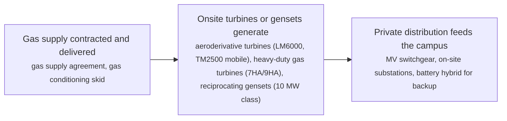
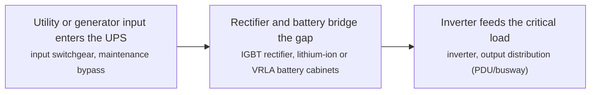
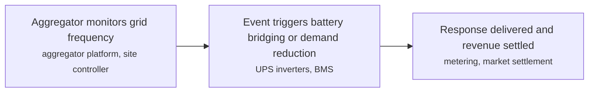
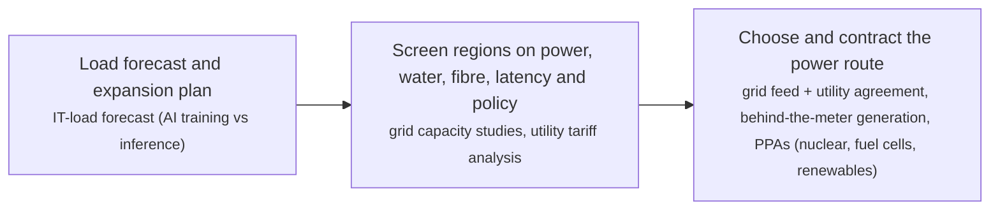
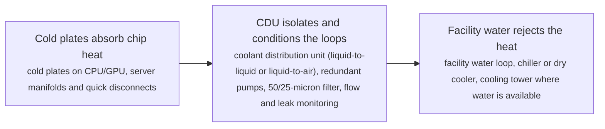
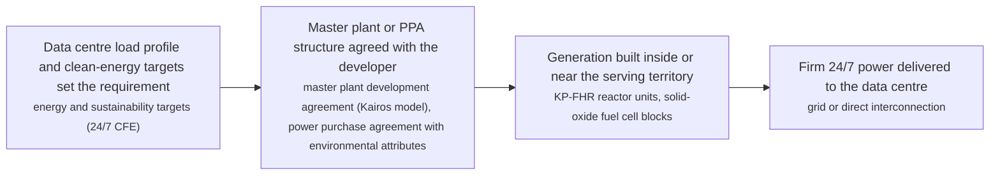

# IDC technology options

6 technologies, from commercial to lab stage. Generated from catalog/technologies/; every figure links to its source.

| Technology | Category | Maturity | TRL | Suppliers | Cost figures |
| --- | --- | --- | --- | --- | --- |
| [Behind-the-meter gas generation for data centres](#idc-behind-the-meter-gas) | Power supply | commercial | 9 | GE Vernova (gas turbines for data centres: TM2500 mobile (about 14-day install), LM6000, LM2500XPRESS, 7HA.03 (430 MW)); Caterpillar (10 MW-class gas gensets; USD 725 million large-engine capacity expansion); Solar Turbines (Caterpillar) (medium gas turbines for industrial and campus power) |  |
| [Data centre UPS systems (double-conversion, lithium, modular)](#idc-ups-systems) | Power distribution | commercial | 9 | Vertiv (Liebert EXL S1 (100-1200 kW, scalable in parallel), Liebert GXT/ITA edge UPS); Schneider Electric (Galaxy VX/VL large UPS for data centres); Eaton (93PM modular UPS and grid-interactive UPS programmes) |  |
| [Data centre grid interaction (demand response and frequency services)](#idc-grid-interaction) | Grid interaction | commercial | 8-9 | Enel X (demand response and frequency services for data centres (Digital Realty, Microsoft programmes)); GridBeyond (demand-side response for data centres with zero downtime); Vertiv (grid-interactive UPS whitepaper and sizing guidance) |  |
| [Data centre siting and power procurement](#idc-siting-power-procurement) | Siting and demand | commercial | 9 | GE Vernova (onsite and BTM generation configurations (25 MW to 3 GW)); AirTrunk (hyperscale campuses across APAC including the 700 MW+ Malaysia platform); Equinix (colocation + interconnection with long-term clean-power contracting) |  |
| [Direct-to-chip liquid cooling (cold plates and CDUs)](#idc-direct-to-chip-liquid-cooling) | Cooling | demonstration | 7-8 | Vertiv (CoolChip CDU 70/121/600/1350/2300 (direct-to-chip and RDHx)); CoolIT Systems (cold plates and rack CDUs); Boyd (liquid cooling loops and cold plates); Motivair (CDUs and facility chillers for high-density cooling); Rittal (LCP rack cooling units) |  |
| [SMR and fuel-cell power purchase for data centres](#idc-smr-fuel-cell-ppa) | Power supply | demonstration | 6-9 | Kairos Power (KP-FHR advanced reactors under master plant development agreements); Bloom Energy (solid-oxide fuel cells for on-site data centre power); Oklo (Aurora fast microreactor PPAs); Westinghouse Electric Company (eVinci microreactor programme) |  |

## Behind-the-meter gas generation for data centres

Data centres site gas turbines or large reciprocating gensets on their own side of the meter to escape multi-year grid-interconnection queues and hedge power-price volatility. GE Vernova markets configurations from a 20-30 MW aeroderivative unit up to 3 GW campuses, with mobile TM2500 units installable in about 14 days and heavy-duty 7HA.03 units at 430 MW; the Chevron/Engine No.1/GE Vernova 'power foundry' programme targets 4 GW of co-located capacity by 2027. Caterpillar restarted 10 MW-class genset production and is investing USD 725 million to expand large-engine capacity for data-centre demand.

**Key equipment:** aeroderivative gas turbines (LM6000, TM2500), heavy-duty gas turbines (7HA.03, 430 MW class), reciprocating gas gensets (10 MW class), on-site MV distribution and substations.

**Performance:**
- deployment time, mobile aeroderivative units (TM2500): 14 days; installable in about 14 days per the vendor; fast-start aeros restore power within five minutes. [source](https://www.gevernova.com/gas-power/industries/data-centers)
- campus scale range served: 25-3000 MW; 'whether your data center needs 25 MW of power or 3 GW' (vendor); 7HA.03 at 430 MW; Chevron/Engine No.1 programme targeting 4 GW by 2027. [source](https://www.gevernova.com/gas-power/industries/data-centers)
- US data centres building own generation: 46-56 projects (GW); about 46 projects with about 56 GW planned self-generation; about 90% of BTM announcements made in 2025 alone (industry research tracker). [source](https://www.jaredwatkins.com/research/datacenters/behind-meter-power)

TRL source: [Commercial gas-turbine technology deployed at scale (7F fleet about 175 GW installed) — TRL 9, read 2026-11-12](https://www.gevernova.com/gas-power/industries/data-centers)

**Missing inputs:**
- installed cost per kW for BTM gas capacity, with dollar year (costs): Vendor pages carry no prices. Where: EIA/industry cost studies; disclosed project filings (open). Next: Add cost figures with dollar year and basis.
- fleet efficiency (heat rate) for BTM configurations (performance): Not stated on the pages read. Where: GE Vernova turbine spec sheets (GER-3567 etc.) (open). Next: Add heat rates per turbine class.

Sources: [1](https://www.gevernova.com/gas-power/industries/data-centers), [2](https://www.chevron.com/newsroom/2025/q1/power-solutions-for-us-data-centers). Last reviewed 2026-11-12.

## Data centre UPS systems (double-conversion, lithium, modular)

The UPS is the data centre's ride-through bridge: double-conversion units condition and back up the entire IT load, sized per hall and paralleled to hundreds of MW across a campus. The Vertiv Liebert EXL S1 spans 100-1200 kW per unit in the industry's smallest footprint and scales in parallel up to multi-MW systems; lithium-ion battery cabinets cut weight and footprint versus VRLA, and grid-interactive UPS fleets now also sell frequency response back to the grid (see idc-grid-interaction).

**Key equipment:** double-conversion UPS units (100-1200 kW class), lithium-ion battery cabinets, bypass and paralleling switchgear.

**Performance:**
- unit power range, Vertiv Liebert EXL S1: 100-1200 kW; 100-1200 kW per unit, transformer-free high-density design; scalable in parallel for medium-to-large data centres. [source](https://www.vertiv.com/en-emea/campaigns/liebert-exl-s1)
- parallel system capacity, EXL S1 fleet: 9.6 MW; scalable from a few hundred kW up to about 9.6 MW via parallel deployment, suitable for a 20 MW data-centre design (vendor system sizing). [source](https://www.vertiv.com/48ed43/globalassets/products/critical-power/uninterruptible-power-supplies-ups/liebert-exl-s1-brochure-sl-706452.pdf)

TRL source: [Mature commercial product line shipping since 2017 — TRL 9, read 2026-11-12](https://www.vertiv.com/en-emea/campaigns/liebert-exl-s1)

**Missing inputs:**
- installed cost per kW of UPS capacity, with dollar year (costs): Vendor pages carry no prices. Where: Uptime Institute / industry surveys (open). Next: Add cost figures with dollar year and basis.
- efficiency in double-conversion and ECOnversion modes (performance): Not stated on the pages read. Where: Vertiv EXL S1 datasheet efficiency tables (open). Next: Add efficiency figures per mode.

Sources: [1](https://www.vertiv.com/en-emea/campaigns/liebert-exl-s1), [2](https://www.vertiv.com/48ed43/globalassets/products/critical-power/uninterruptible-power-supplies-ups/liebert-exl-s1-brochure-sl-706452.pdf). Last reviewed 2026-11-12.

## Data centre grid interaction (demand response and frequency services)

The data centre's own UPS fleet doubles as a grid asset: when frequency dips below nominal, inverters draw from batteries instead of the grid for seconds to minutes — no IT impact — and the operator sells that as frequency response. Enel X's Digital Realty deployment in Ireland responds in under half a second; Microsoft is rolling out UPS battery-sharing worldwide and pushed for the UK's Dynamic Containment scheme to open to data centres after Ireland led; UK NESO programmes now listed for data centres include Demand Flexibility Service, Dynamic Containment, Dynamic Moderation, Dynamic Regulation and Static FFR. Battery-cycling degradation is the principal trade-off.

**Key equipment:** UPS fleets as distributed frequency-response assets, aggregator platform and site controllers, battery-management and degradation monitoring.

**Performance:**
- UPS fleet frequency-response trigger time, Enel X Digital Realty Ireland: 0.5 seconds; responds in under half a second when grid frequency drops below 50 Hz; the data centre draws on batteries instead of the grid. [source](https://www.enelx.com/ie/en/resources/customer-success/digital-realty-case-study)

TRL source: [Commercial deployments operating in Ireland for years — TRL 8-9, read via search summary 2026-11-12](https://www.enelx.com/ie/en/resources/customer-success/digital-realty-case-study)

**Missing inputs:**
- revenue per MW-year for data-centre frequency services, with dollar year (costs): Market revenues vary by scheme and auction. Where: NESO auction results; aggregator disclosures (open). Next: Add revenue ranges per scheme.
- battery degradation rates under frequency-response cycling (performance): Not stated on the pages read. Where: Eaton/Microsoft whitepaper; NERC 2025 grid-interactive UPS survey (open). Next: Add degradation data with basis.

Sources: [1](https://www.enelx.com/ie/en/resources/customer-success/digital-realty-case-study), [2](https://www.datacenterdynamics.com/en/news/microsoft-to-roll-out-data-center-battery-sharing-worldwide), [3](https://www.enelx.com/uk/en/question-and-answer). Last reviewed 2026-11-12.

## Data centre siting and power procurement

Siting is the data centre's first and most binding engineering decision: power availability, price and time-to-energisation outrank almost everything else, followed by water, fibre and latency. The 2025 boom in behind-the-meter generation (about 46 projects, about 56 GW self-planned, ~90% announced in 2025) exists because grid interconnection queues cannot keep pace; operators therefore choose between grid feed, behind-the-meter gas, PPAs for advanced nuclear or fuel cells, and hybrids — and in Southeast Asia the Johor-Cyberjaya corridor has become the fastest-growing supply region, with AirTrunk's Malaysia platform alone expanding past 700 MW.

**Key equipment:** grid interconnection and substations, behind-the-meter generation options, long-term PPA structures.

**Performance:**
- self-generation boom, US data centres: 46-56 projects (GW); about 46 projects with about 56 GW of planned self-built capacity; about 90% of behind-the-meter announcements made in 2025 alone — evidence that grid interconnection is the binding constraint. [source](https://www.jaredwatkins.com/research/datacenters/behind-meter-power)
- AirTrunk Malaysia platform expansion: 700 MW; AirTrunk expanding its Malaysia platform (Johor and Cyberjaya) to more than 700 MW — the anchor hyperscale supply for the SEA AI corridor. [source](https://airtrunk.com/)

TRL source: [Established commercial practice across every major market — TRL 9, read via search summary 2026-11-12](https://www.jaredwatkins.com/research/datacenters/behind-meter-power)

**Missing inputs:**
- power cost benchmarks per route (grid, BTM, PPA) in USD/MWh with dollar year (costs): Route pricing is commercial and market-specific. Where: datacenterHawk, Uptime Institute market reports (open). Next: Add benchmark ranges with dollar year.
- interconnection queue times by grid operator (performance): Queue data is published per operator but not yet collected. Where: Lawrence Berkeley NAB interconnection-queue data (open). Next: Add queue-time ranges per major grid.

Sources: [1](https://www.jaredwatkins.com/research/datacenters/behind-meter-power), [2](https://airtrunk.com/). Last reviewed 2026-11-12.

## Direct-to-chip liquid cooling (cold plates and CDUs)

Cold plates mounted on CPUs and GPUs carry coolant to a coolant distribution unit (CDU) that rejects the heat to facility water or room air, decoupling the server loop from the building loop. Air cooling tops out around 40 to 60 kW per rack with containment; liquid cooling carries AI-class racks of 80 kW to 120 kW and beyond. The Vertiv CoolChip family spans 70 kW to 2.3 MW per unit with liquid-to-air and liquid-to-liquid exchangers, redundant pumps, integrated filtration and leak detection.

**Key equipment:** cold plates and server manifolds, coolant distribution unit (CDU), facility water loop and heat rejection, leak detection and coolant quality management.

**Performance:**
- CDU capacity range, Vertiv CoolChip family: 70-2300 kW per unit; CDU 70 at 11 C approach temperature differential (liquid-to-air) up to CDU 2300 at 4 C ATD (liquid-to-liquid, in-row). [source](https://www.vertiv.com/en-in/products-catalog/thermal-management/high-density-solutions/vertiv-coolchip-cdu)
- smallest liquid-to-air model capacity: 70 kW; CDU 70: liquid-to-air, in-row, works without facility water so liquid-cooled servers can sit in an existing air-cooled hall. [source](https://www.vertiv.com/en-in/products-catalog/thermal-management/high-density-solutions/vertiv-coolchip-cdu)
- in-rack liquid-to-liquid model capacity: 121 kW; CDU 121: 4U in-rack, liquid-to-liquid at 4 C ATD, 174 x 445 x 868 mm. [source](https://www.vertiv.com/en-in/products-catalog/thermal-management/high-density-solutions/vertiv-coolchip-cdu)

TRL source: [Production product family shipping for AI deployments (vendor catalogue) — indicative TRL 7-8, library's own judgement, read 2026-11-12](https://www.vertiv.com/en-in/products-catalog/thermal-management/high-density-solutions/vertiv-coolchip-cdu)

**Missing inputs:**
- installed cost per kW of cooling capacity, with dollar year (costs): Vendor pages do not publish CDU prices. Where: Uptime Institute and industry cost surveys; vendor budgetary quotes (open). Next: Add cost figures with dollar year and basis.
- PUE delta versus air-cooled baseline at a given rack density (performance): Not stated on the pages read. Where: Uptime Institute / vendor case studies (open). Next: Add measured PUE deltas with basis.

Sources: [1](https://www.vertiv.com/en-in/products-catalog/thermal-management/high-density-solutions/vertiv-coolchip-cdu), [2](https://www.vertiv.com/en-emea/about/news-and-events/news-releases/2026/vertiv-expands-liquid-cooling-portfolio-in-emea-to-accelerate-ai-ready-data-centre-deployments). Last reviewed 2026-11-12.

## SMR and fuel-cell power purchase for data centres

Hyperscalers contract firm clean power at the plant level rather than only grid certificates. Two families lead: advanced reactors sold under long PPAs (Google and Kairos Power's master plant development agreement for up to 500 MW of fluoride-salt-cooled high-temperature reactors, first unit by 2030 and the fleet by 2035, sited in territories serving Google data centres) and on-site solid-oxide fuel cells (Equinix and Bloom Energy's decade-long partnership now above 100 MW across about 19 data centres, running on natural gas today with a hydrogen roadmap). Both convert power procurement from a utility question into a contract-structure question.

**Key equipment:** advanced reactor units (KP-FHR and peers), solid-oxide fuel cell blocks (Bloom Energy), interconnection and power path.

**Performance:**
- contracted advanced-nuclear capacity, Google-Kairos fleet: 500 MW; up to 500 MW by 2035 under a master plant development agreement signed 14 October 2024; first deployment targeted by 2030. [source](https://www.kairospower.com/updates/google-and-kairos-power-partner-to-deploy-500-mw-of-clean-electricity-generation)
- fuel-cell capacity deployed for Equinix: 100 MW; more than 100 MW of Bloom solid-oxide fuel cells across about 19 Equinix data centres, under a partnership running since 2015 and expanded in 2025. [source](https://www.theregister.com/off-prem/2025/08/14/equinix-signs-nuke-deals-to-power-its-datacenters/)

TRL source: [Fuel cells commercial (TRL 9, operating at Equinix since 2015); advanced reactors at licensing/first-build (TRL 6-7) — read 2026-11-12](https://www.kairospower.com/updates/google-and-kairos-power-partner-to-deploy-500-mw-of-clean-electricity-generation)

**Missing inputs:**
- PPA price ranges for SMR and fuel-cell power, with dollar year (costs): PPA prices are commercially confidential. Where: Disclosure filings and rate-case documents where public (open). Next: Add price ranges where disclosed.
- first Hermes unit start-up date and Oklo Aurora Aurora-Inn dates (reference_plants): Dates move with licensing progress. Where: kairospower.com and oklo.com newsroom (open). Next: Re-check dates each quarter.

Sources: [1](https://www.kairospower.com/updates/google-and-kairos-power-partner-to-deploy-500-mw-of-clean-electricity-generation), [2](https://www.theregister.com/off-prem/2025/08/14/equinix-signs-nuke-deals-to-power-its-datacenters/). Last reviewed 2026-11-12.
