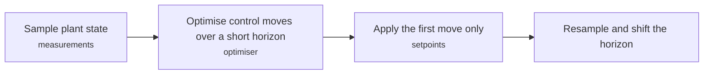
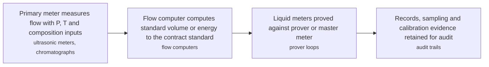
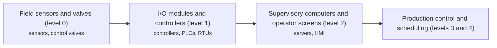
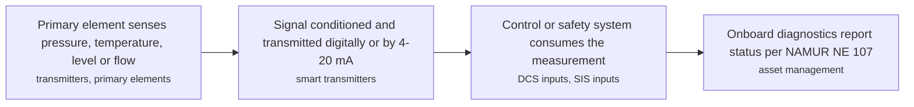
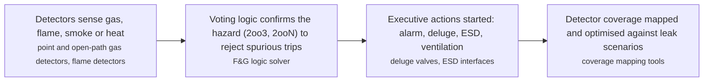
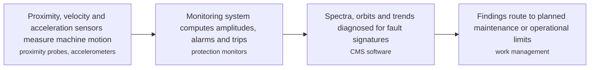
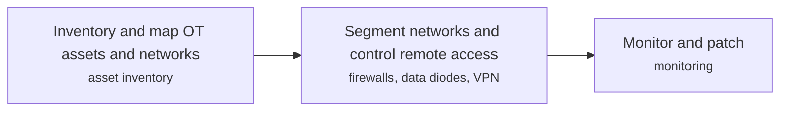
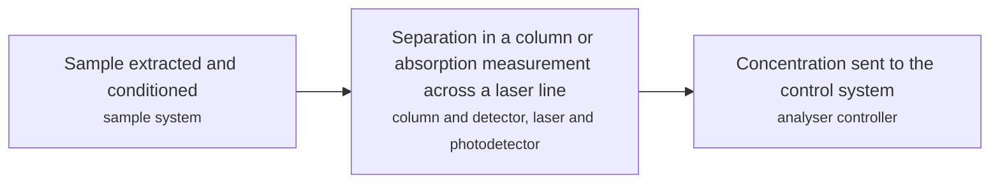
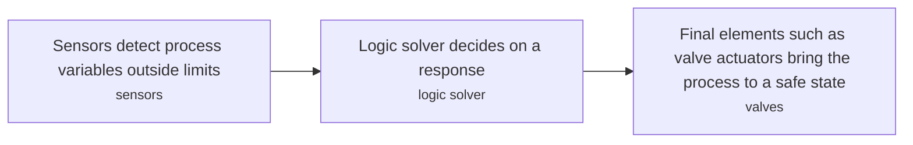
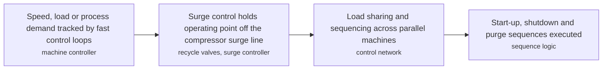

# INS technology options

10 technologies, from commercial to lab stage. Generated from catalog/technologies/; every figure links to its source.

| Technology | Category | Maturity | TRL | Suppliers | Cost figures |
| --- | --- | --- | --- | --- | --- |
| [Advanced process control and model predictive control](#ins-apc-mpc) | Instrumentation and control | commercial |  | MathWorks (Model Predictive Control Toolbox); Honeywell (Profit Controller MPC suite); AspenTech (DMC3 and Aspen DMCplus MPC); Yokogawa (Exasmoc MPC and APC services) |  |
| [Custody transfer metering](#ins-custody-transfer-metering) | Measurement | commercial |  | Emerson (Daniel custody transfer metering); KROHNE (metering systems); Endress+Hauser (flow measurement) |  |
| [Distributed control systems and SCADA](#ins-dcs-scada) | Instrumentation and control | commercial |  | Honeywell; Yokogawa; Emerson; ABB; Siemens; Rockwell Automation; Schneider Electric; Inductive Automation |  |
| [Field instrumentation](#ins-field-instrumentation) | Measurement | commercial |  | Emerson (Rosemount instrumentation); Endress+Hauser (flow, level and analysis); Yokogawa (EJA transmitters); ABB (instrumentation portfolio) |  |
| [Fire and gas detection systems](#ins-fire-gas-detection) | Safety systems | commercial |  | Honeywell Analytics (gas detection); MSA Safety (gas and flame detection); Dräger (gas detection systems); Emerson (flame and gas detection (Det-Tronics)) |  |
| [Machinery vibration monitoring](#ins-vibration-monitoring) | Machinery health | commercial |  | GE Vernova (Bently Nevada machinery protection and condition monitoring); Emerson (CSI vibration analysis); Brüel & Kjær Vibro (condition monitoring systems) |  |
| [OT cybersecurity](#ins-ot-cybersecurity) | Instrumentation and control | commercial |  | Claroty (OT/ICS network visibility and threat detection); Nozomi Networks (OT and IoT security monitoring); Honeywell (OT cybersecurity managed services and Secure Media Enclosure) |  |
| [Process analysers (gas chromatographs, laser spectroscopy)](#ins-process-analysers) | Instrumentation and control | commercial |  | Emerson (Rosemount Analytical gas chromatographs and analysers); Servomex (gas analysis (paramagnetic, photometric)); ABB (process gas chromatographs and laser analysers); Siemens (process analytics (gas chromatographs, spectroscopy)) |  |
| [Safety instrumented systems](#ins-safety-instrumented-systems) | Instrumentation and control | commercial |  | Emerson (DeltaV SIS logic solver (SIL 2/3 certified)); Honeywell (Safety Manager certified SIS platform); Siemens (SIMATIC Safety Integrated SIS); Yokogawa (ProSafe-RS certified safety instrumented system) |  |
| [Turbomachinery control systems](#ins-machinery-control) | Machinery automation | commercial |  | Woodward (turbine and engine control systems); GE Vernova (Bently Nevada machinery control and protection); Compressor Controls Corporation (compressor anti-surge and performance control) |  |

## Advanced process control and model predictive control

MPC uses a process model to optimise the current step while accounting for future steps and constraints. Only the first step is applied; then the controller resamples and repeats.

**Key equipment:** process model, optimiser, DCS interface.

**Missing inputs:**
- refinery benefit figures (performance): The page gives none. Web-checked 2026-10-28: suppliers recorded where applicable; the remaining performance/cost figures sit in vendor-selector or paywalled-standards material and were not verifiable open. Where: Published refinery APC benefit studies (open). Next: Add benefits with source.
- capital cost and operating or unit cost, with dollar year and basis (costs): No open source read so far gives costs for this technology. Web-checked 2026-10-28: suppliers recorded where applicable; the remaining performance/cost figures sit in vendor-selector or paywalled-standards material and were not verifiable open. Where: arXiv and open-access journals: techno-economic or review papers (MDPI is blocked by its CDN; use the manual inbox) (catalog: arxiv, open); Licensor and EPC studies; paid cost databases are catalog-only (paid); OSTI.GOV full-text reports from DOE labs: search the technology name plus 'techno-economic' (catalog: osti, blocked). Next: Look for an open techno-economic study; record each figure with metric, range, unit, dollar year, basis and source.
- named plants or projects with capacity and year (reference_plants): The sources read name no specific plant. Web-checked 2026-10-28: suppliers recorded where applicable; the remaining performance/cost figures sit in vendor-selector or paywalled-standards material and were not verifiable open. Where: Licensor and operator press releases for the suppliers listed (open). Next: Add one or two plants with country, capacity and start-up year.
- TRL with a cited source (trl): The IEA ETP Clean Energy Technology Guide has no matching entry. Web-checked 2026-10-28: suppliers recorded where applicable; the remaining performance/cost figures sit in vendor-selector or paywalled-standards material and were not verifiable open. Where: IEA ETP Clean Energy Technology Guide (collected): search for the technology name (catalog: iea-reports, open). Next: Find a TRL table that lists this technology, or leave maturity resting on the evidence on the card.

Sources: [1](https://en.wikipedia.org/wiki/Model_predictive_control). Last reviewed 2026-10-29.

## Custody transfer metering

Custody transfer metering measures commercial quantities of oil, gas and products to contractual accuracy with auditable traceability. Gas stations use ultrasonic or orifice meters with pressure, temperature and composition (gas chromatograph) inputs computing flow to agreed standards (AGA reports, ISO 17089); liquid meters (turbine, coriolis, PD) are proved against prover loops or master meters. Fiscal-class systems add sampling, calibration records, uncertainty budgets and redundant computation under OIML or national type approval.

**Key equipment:** ultrasonic gas meters, coriolis and turbine liquid meters, gas chromatographs, flow computers, prover loops.

Sources: [1](https://www.emerson.com/), [2](https://www.iso.org/). Last reviewed 2026-11-07.

## Distributed control systems and SCADA

A DCS spreads control among autonomous controllers on a network, so one failure affects only part of a plant. SCADA adds supervisory computers, RTUs, PLCs and operator screens for geographically spread assets such as pipelines.

**Key equipment:** controllers, I/O modules, operator stations, RTUs and PLCs, historian.

**Performance:**
- DCS hardware lifecycle: 15-20 years (to over 20); stated. [source](https://en.wikipedia.org/wiki/Distributed_control_system)
- RTU operating temperature: -40-85 degC; upper range quoted for ruggedised RTUs. [source](https://en.wikipedia.org/wiki/SCADA)

**Missing inputs:**
- capital cost and operating or unit cost, with dollar year and basis (costs): No open source read so far gives costs for this technology. Web-checked 2026-10-28: suppliers recorded where applicable; the remaining performance/cost figures sit in vendor-selector or paywalled-standards material and were not verifiable open. Where: arXiv and open-access journals: techno-economic or review papers (MDPI is blocked by its CDN; use the manual inbox) (catalog: arxiv, open); Licensor and EPC studies; paid cost databases are catalog-only (paid); OSTI.GOV full-text reports from DOE labs: search the technology name plus 'techno-economic' (catalog: osti, blocked). Next: Look for an open techno-economic study; record each figure with metric, range, unit, dollar year, basis and source.
- named plants or projects with capacity and year (reference_plants): The sources read name no specific plant. Web-checked 2026-10-28: suppliers recorded where applicable; the remaining performance/cost figures sit in vendor-selector or paywalled-standards material and were not verifiable open. Where: Licensor and operator press releases for the suppliers listed (open). Next: Add one or two plants with country, capacity and start-up year.
- TRL with a cited source (trl): The IEA ETP Clean Energy Technology Guide has no matching entry. Web-checked 2026-10-28: suppliers recorded where applicable; the remaining performance/cost figures sit in vendor-selector or paywalled-standards material and were not verifiable open. Where: IEA ETP Clean Energy Technology Guide (collected): search for the technology name (catalog: iea-reports, open). Next: Find a TRL table that lists this technology, or leave maturity resting on the evidence on the card.

Sources: [1](https://en.wikipedia.org/wiki/Distributed_control_system), [2](https://en.wikipedia.org/wiki/SCADA). Last reviewed 2026-10-29.

## Field instrumentation

Field instruments sense process conditions and transmit standardised signals (4-20 mA with HART, or fieldbus) to the control and safety systems. Pressure, temperature, level and flow dominate: differential-pressure transmitters with orifice plates or integrated DP flowmeters, coriolis and magnetic flowmeters, thermocouples and RTDs, radar and guided-wave level, and vibration sensors on machinery. Selection trades accuracy, rangeability, process compatibility, Ex protection and SIL capability, with diagnostics (NAMUR NE 107 status) reporting instrument health to the DCS.

**Key equipment:** pressure and DP transmitters, temperature assemblies, radar and guided-wave level, coriolis and magnetic flowmeters, vibration sensors.

Sources: [1](https://www.emerson.com/), [2](https://www.namur.net/). Last reviewed 2026-11-07.

## Fire and gas detection systems

Fire and gas detection senses hazardous conditions and initiates alarms and executive actions (deluge, shutdown, isolation, ventilation changes) through dedicated safety logic. Point gas detectors (catalytic, infrared, electrochemical), open-path infrared lines, ultrasonic gas leak detectors for high-pressure releases, flame detectors (UV/IR, multispectral), and smoke or heat detection in buildings are placed from coverage mapping rather than guesswork — modern practice models 3D coverage of each head against leak scenarios. The F&G system is usually SIL-rated and integrated with, but independent from, the process SIS.

**Key equipment:** point and open-path gas detectors, ultrasonic leak detectors, flame detectors, F&G logic solvers, deluge interfaces.

Sources: [1](https://www.honeywellanalytics.com/), [2](https://www.hse.gov.uk/comah/). Last reviewed 2026-11-07.

## Machinery vibration monitoring

Vibration monitoring watches rotating machinery health with proximity probes (shaft displacement on fluid-film bearings), velocity and acceleration sensors (bearing housing), and keyphasor references for phase. Protection systems alarm and trip on vibration limits while continuous condition monitoring systems collect waveforms and spectra for diagnostics: orbit shapes, bearing defect frequencies, imbalance, misalignment, looseness. Trending turns failing components into planned work, and API 670 defines the standard hardware architecture for critical trains.

**Key equipment:** eddy-current proximity probes, accelerometers and velocity sensors, keyphasor, protection monitors, CMS software.

Sources: [1](https://www.bently.com/en), [2](https://www.iec.ch/standards). Last reviewed 2026-11-07.

## OT cybersecurity

Operational technology (DCS, SCADA, PLC) has been shown vulnerable to attack; defence in depth, patching, segmentation and secure remote access are the main measures.

**Key equipment:** firewalls, data diodes, network monitoring.

**Performance:**
- Stuxnet zero-day attacks: 4 count; the worm used four zero-day attacks per Wikipedia SCADA page. [source](https://en.wikipedia.org/wiki/SCADA)

**Missing inputs:**
- IEC 62443 requirements and oil and gas incidents (other): Not in the pages read. IEC 62443 (industrial automation and control systems security) defines the security levels and requirements; incident context: Stuxnet (2010, uranium enrichment) and the Colonial Pipeline ransomware (2021) are the canonical O&G-adjacent cases; 2026-10-28. Where: ISA/IEC 62443 summaries (open); CISA ICS advisories (open). Next: Add the standard and incident references.
- capital cost and operating or unit cost, with dollar year and basis (costs): No open source read so far gives costs for this technology. Web-checked 2026-10-28: suppliers recorded where applicable; the remaining performance/cost figures sit in vendor-selector or paywalled-standards material and were not verifiable open. Where: arXiv and open-access journals: techno-economic or review papers (MDPI is blocked by its CDN; use the manual inbox) (catalog: arxiv, open); Licensor and EPC studies; paid cost databases are catalog-only (paid); OSTI.GOV full-text reports from DOE labs: search the technology name plus 'techno-economic' (catalog: osti, blocked). Next: Look for an open techno-economic study; record each figure with metric, range, unit, dollar year, basis and source.
- named plants or projects with capacity and year (reference_plants): The sources read name no specific plant. Web-checked 2026-10-28: suppliers recorded where applicable; the remaining performance/cost figures sit in vendor-selector or paywalled-standards material and were not verifiable open. Where: Licensor and operator press releases for the suppliers listed (open). Next: Add one or two plants with country, capacity and start-up year.
- TRL with a cited source (trl): The IEA ETP Clean Energy Technology Guide has no matching entry. Web-checked 2026-10-28: suppliers recorded where applicable; the remaining performance/cost figures sit in vendor-selector or paywalled-standards material and were not verifiable open. Where: IEA ETP Clean Energy Technology Guide (collected): search for the technology name (catalog: iea-reports, open). Next: Find a TRL table that lists this technology, or leave maturity resting on the evidence on the card.
- process steps and equipment are general engineering practice, not taken from one source (process): The sources read describe the principle but not a full step-by-step flow. Where: Licensor process descriptions and textbooks (open); [Open process-description authority (secondary): Wikipedia article 'Industrial control system'. Cross-check the card's process_steps against it, then cite it in sources with note 'secondary'.](https://en.wikipedia.org/wiki/Industrial_control_system) (open). Next: Verify the card's process_steps against the attached authority page, then cite it and delete this gap. Check the steps against a licensor description and name it.

Sources: [1](https://en.wikipedia.org/wiki/SCADA), [2](https://en.wikipedia.org/wiki/Industrial_control_system). Last reviewed 2026-10-28.

## Process analysers (gas chromatographs, laser spectroscopy)

Gas chromatography separates a vaporised sample in a column and a detector quantifies each compound. Tunable diode laser spectroscopy tunes a laser across one absorption line and applies the Beer-Lambert law to give concentration.

**Key equipment:** gas chromatograph, laser spectrometer, sample conditioning system.

**Performance:**
- capillary column length: 5-60 m; modern capillary columns. [source](https://en.wikipedia.org/wiki/Gas_chromatography)
- TDLAS detection limit: 1 ppb order (very low); stated as the main advantage; no specific gas given. [source](https://en.wikipedia.org/wiki/Tunable_diode_laser_absorption_spectroscopy)

**Missing inputs:**
- capital cost and operating or unit cost, with dollar year and basis (costs): No open source read so far gives costs for this technology. Web-checked 2026-10-28: suppliers recorded where applicable; the remaining performance/cost figures sit in vendor-selector or paywalled-standards material and were not verifiable open. Where: arXiv and open-access journals: techno-economic or review papers (MDPI is blocked by its CDN; use the manual inbox) (catalog: arxiv, open); Licensor and EPC studies; paid cost databases are catalog-only (paid); OSTI.GOV full-text reports from DOE labs: search the technology name plus 'techno-economic' (catalog: osti, blocked). Next: Look for an open techno-economic study; record each figure with metric, range, unit, dollar year, basis and source.
- named plants or projects with capacity and year (reference_plants): The sources read name no specific plant. Web-checked 2026-10-28: suppliers recorded where applicable; the remaining performance/cost figures sit in vendor-selector or paywalled-standards material and were not verifiable open. Where: Licensor and operator press releases for the suppliers listed (open). Next: Add one or two plants with country, capacity and start-up year.
- TRL with a cited source (trl): The IEA ETP Clean Energy Technology Guide has no matching entry. Web-checked 2026-10-28: suppliers recorded where applicable; the remaining performance/cost figures sit in vendor-selector or paywalled-standards material and were not verifiable open. Where: IEA ETP Clean Energy Technology Guide (collected): search for the technology name (catalog: iea-reports, open). Next: Find a TRL table that lists this technology, or leave maturity resting on the evidence on the card.
- process steps and equipment are general engineering practice, not taken from one source (process): The sources read describe the principle but not a full step-by-step flow. Where: Licensor process descriptions and textbooks (open). Next: Check the steps against a licensor description and name it.

Sources: [1](https://en.wikipedia.org/wiki/Gas_chromatography), [2](https://en.wikipedia.org/wiki/Tunable_diode_laser_absorption_spectroscopy). Last reviewed 2026-10-28.

## Safety instrumented systems

An SIS is a set of sensors, a logic solver and final elements that shuts down a process when a hazardous condition is detected. It must be independent of the control system and be set to the SIL required by a hazard analysis such as LOPA.

**Key equipment:** sensors, logic solver (PLC or relay), final elements, power and instrument air.

**Missing inputs:**
- SIL levels and probability of failure on demand values (performance): Not on the page read. Web-checked 2026-10-28: suppliers recorded where applicable; the remaining performance/cost figures sit in vendor-selector or paywalled-standards material and were not verifiable open. Where: IEC 61511 and exida handbook summaries (paid). Next: Add SIL bands with source.
- capital cost and operating or unit cost, with dollar year and basis (costs): No open source read so far gives costs for this technology. Web-checked 2026-10-28: suppliers recorded where applicable; the remaining performance/cost figures sit in vendor-selector or paywalled-standards material and were not verifiable open. Where: arXiv and open-access journals: techno-economic or review papers (MDPI is blocked by its CDN; use the manual inbox) (catalog: arxiv, open); Licensor and EPC studies; paid cost databases are catalog-only (paid); OSTI.GOV full-text reports from DOE labs: search the technology name plus 'techno-economic' (catalog: osti, blocked). Next: Look for an open techno-economic study; record each figure with metric, range, unit, dollar year, basis and source.
- named plants or projects with capacity and year (reference_plants): The sources read name no specific plant. Web-checked 2026-10-28: suppliers recorded where applicable; the remaining performance/cost figures sit in vendor-selector or paywalled-standards material and were not verifiable open. Where: Licensor and operator press releases for the suppliers listed (open). Next: Add one or two plants with country, capacity and start-up year.
- TRL with a cited source (trl): The IEA ETP Clean Energy Technology Guide has no matching entry. Web-checked 2026-10-28: suppliers recorded where applicable; the remaining performance/cost figures sit in vendor-selector or paywalled-standards material and were not verifiable open. Where: IEA ETP Clean Energy Technology Guide (collected): search for the technology name (catalog: iea-reports, open). Next: Find a TRL table that lists this technology, or leave maturity resting on the evidence on the card.

Sources: [1](https://en.wikipedia.org/wiki/Safety_instrumented_system). Last reviewed 2026-10-29.

## Turbomachinery control systems

Turbomachinery controllers run the fast, dedicated loops that protect and optimise machines: speed and load control on turbines, surge avoidance on compressors (recycle valves and setpoint margins sized from the compressor map), load sharing between machines, and sequence control for start-up and shutdown. The control system responds in tens of milliseconds — faster than the DCS loop layer — and coordinates with the SIS on trip circuits. Integrated machinery packages ship with controllers tuned to the OEM's model, and online performance monitoring feeds optimisation.

**Key equipment:** dedicated machine controllers, recycle and anti-surge valves, fast I/O, surge detection instrumentation.

Sources: [1](https://www.woodward.com/), [2](https://www.bently.com/en). Last reviewed 2026-11-07.
