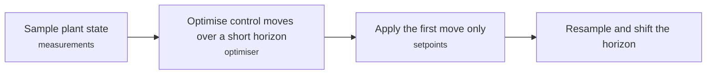
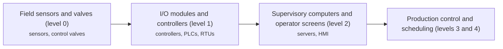
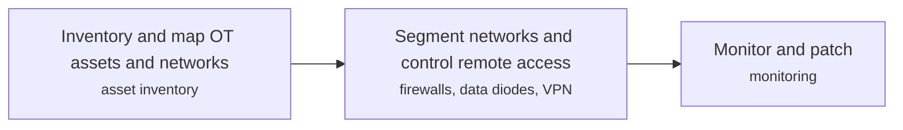
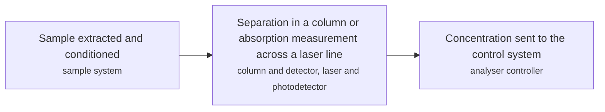
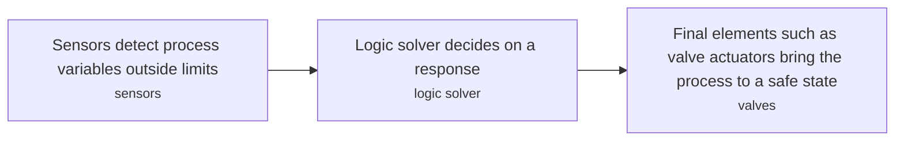

# INS technology options

5 technologies, from commercial to lab stage. Generated from catalog/technologies/; every figure links to its source.

| Technology | Category | Maturity | TRL | Suppliers | Cost figures |
| --- | --- | --- | --- | --- | --- |
| [Advanced process control and model predictive control](#ins-apc-mpc) | Instrumentation and control | commercial |  | MathWorks (Model Predictive Control Toolbox) |  |
| [Distributed control systems and SCADA](#ins-dcs-scada) | Instrumentation and control | commercial |  | Honeywell; Yokogawa; Emerson; ABB; Siemens; Rockwell Automation; Schneider Electric; Inductive Automation |  |
| [OT cybersecurity](#ins-ot-cybersecurity) | Instrumentation and control | commercial |  |  |  |
| [Process analysers (gas chromatographs, laser spectroscopy)](#ins-process-analysers) | Instrumentation and control | commercial |  |  |  |
| [Safety instrumented systems](#ins-safety-instrumented-systems) | Instrumentation and control | commercial |  |  |  |

## Advanced process control and model predictive control

MPC uses a process model to optimise the current step while accounting for future steps and constraints. Only the first step is applied; then the controller resamples and repeats.

**Key equipment:** process model, optimiser, DCS interface.

**Missing inputs:**
- refinery APC vendors (suppliers): The page names only MathWorks and open-source tools. Where: Vendor pages for APC suites (open). Next: Add suppliers from vendor pages, with the product each supplies.
- refinery benefit figures (performance): The page gives none. Where: Published refinery APC benefit studies (open). Next: Add benefits with source.
- capital cost and operating or unit cost, with dollar year and basis (costs): No open source read so far gives costs for this technology. Where: arXiv and open-access journals: techno-economic or review papers (MDPI is blocked by its CDN; use the manual inbox) (catalog: arxiv, open); Licensor and EPC studies; paid cost databases are catalog-only (paid); OSTI.GOV full-text reports from DOE labs: search the technology name plus 'techno-economic' (catalog: osti, blocked). Next: Look for an open techno-economic study; record each figure with metric, range, unit, dollar year, basis and source.
- named plants or projects with capacity and year (reference_plants): The sources read name no specific plant. Where: Licensor and operator press releases for the suppliers listed (open). Next: Add one or two plants with country, capacity and start-up year.
- TRL with a cited source (trl): The IEA ETP Clean Energy Technology Guide has no matching entry. Where: IEA ETP Clean Energy Technology Guide (collected): search for the technology name (catalog: iea-reports, open). Next: Find a TRL table that lists this technology, or leave maturity resting on the evidence on the card.
- process steps and equipment are general engineering practice, not taken from one source (process): The sources read describe the principle but not a full step-by-step flow. Where: Licensor process descriptions and textbooks (open). Next: Check the steps against a licensor description and name it.

Sources: [1](https://en.wikipedia.org/wiki/Model_predictive_control). Last reviewed 2026-10-25.

## Distributed control systems and SCADA

A DCS spreads control among autonomous controllers on a network, so one failure affects only part of a plant. SCADA adds supervisory computers, RTUs, PLCs and operator screens for geographically spread assets such as pipelines.

**Key equipment:** controllers, I/O modules, operator stations, RTUs and PLCs, historian.

**Performance:**
- DCS hardware lifecycle: 15-20 years (to over 20); stated. [source](https://en.wikipedia.org/wiki/Distributed_control_system)
- RTU operating temperature: -40-85 degC; upper range quoted for ruggedised RTUs. [source](https://en.wikipedia.org/wiki/SCADA)

**Missing inputs:**
- oil and gas pipeline SCADA architectures and performance (performance): Not detailed on the pages read. Where: API 1164 and vendor pipeline SCADA pages (open). Next: Add examples with source.
- capital cost and operating or unit cost, with dollar year and basis (costs): No open source read so far gives costs for this technology. Where: arXiv and open-access journals: techno-economic or review papers (MDPI is blocked by its CDN; use the manual inbox) (catalog: arxiv, open); Licensor and EPC studies; paid cost databases are catalog-only (paid); OSTI.GOV full-text reports from DOE labs: search the technology name plus 'techno-economic' (catalog: osti, blocked). Next: Look for an open techno-economic study; record each figure with metric, range, unit, dollar year, basis and source.
- named plants or projects with capacity and year (reference_plants): The sources read name no specific plant. Where: Licensor and operator press releases for the suppliers listed (open). Next: Add one or two plants with country, capacity and start-up year.
- TRL with a cited source (trl): The IEA ETP Clean Energy Technology Guide has no matching entry. Where: IEA ETP Clean Energy Technology Guide (collected): search for the technology name (catalog: iea-reports, open). Next: Find a TRL table that lists this technology, or leave maturity resting on the evidence on the card.
- process steps and equipment are general engineering practice, not taken from one source (process): The sources read describe the principle but not a full step-by-step flow. Where: Licensor process descriptions and textbooks (open). Next: Check the steps against a licensor description and name it.

Sources: [1](https://en.wikipedia.org/wiki/Distributed_control_system), [2](https://en.wikipedia.org/wiki/SCADA). Last reviewed 2026-10-25.

## OT cybersecurity

Operational technology (DCS, SCADA, PLC) has been shown vulnerable to attack; defence in depth, patching, segmentation and secure remote access are the main measures.

**Key equipment:** firewalls, data diodes, network monitoring.

**Performance:**
- Stuxnet zero-day attacks: 4 count; the worm used four zero-day attacks per Wikipedia SCADA page. [source](https://en.wikipedia.org/wiki/SCADA)

**Missing inputs:**
- IEC 62443 requirements and oil and gas incidents (other): Not in the pages read. Where: ISA/IEC 62443 summaries (open); CISA ICS advisories (open). Next: Add the standard and incident references.
- OT security vendors (suppliers): The sources read name no suppliers for this technology. Where: Vendor pages (open). Next: Add suppliers from vendor pages, with the product each supplies.
- capital cost and operating or unit cost, with dollar year and basis (costs): No open source read so far gives costs for this technology. Where: arXiv and open-access journals: techno-economic or review papers (MDPI is blocked by its CDN; use the manual inbox) (catalog: arxiv, open); Licensor and EPC studies; paid cost databases are catalog-only (paid); OSTI.GOV full-text reports from DOE labs: search the technology name plus 'techno-economic' (catalog: osti, blocked). Next: Look for an open techno-economic study; record each figure with metric, range, unit, dollar year, basis and source.
- named plants or projects with capacity and year (reference_plants): The sources read name no specific plant. Where: Licensor and operator press releases for the suppliers listed (open). Next: Add one or two plants with country, capacity and start-up year.
- TRL with a cited source (trl): The IEA ETP Clean Energy Technology Guide has no matching entry. Where: IEA ETP Clean Energy Technology Guide (collected): search for the technology name (catalog: iea-reports, open). Next: Find a TRL table that lists this technology, or leave maturity resting on the evidence on the card.
- process steps and equipment are general engineering practice, not taken from one source (process): The sources read describe the principle but not a full step-by-step flow. Where: Licensor process descriptions and textbooks (open). Next: Check the steps against a licensor description and name it.

Sources: [1](https://en.wikipedia.org/wiki/SCADA), [2](https://en.wikipedia.org/wiki/Industrial_control_system). Last reviewed 2026-10-25.

## Process analysers (gas chromatographs, laser spectroscopy)

Gas chromatography separates a vaporised sample in a column and a detector quantifies each compound. Tunable diode laser spectroscopy tunes a laser across one absorption line and applies the Beer-Lambert law to give concentration.

**Key equipment:** gas chromatograph, laser spectrometer, sample conditioning system.

**Performance:**
- capillary column length: 5-60 m; modern capillary columns. [source](https://en.wikipedia.org/wiki/Gas_chromatography)
- TDLAS detection limit: 1 ppb order (very low); stated as the main advantage; no specific gas given. [source](https://en.wikipedia.org/wiki/Tunable_diode_laser_absorption_spectroscopy)

**Missing inputs:**
- process analyser makers (suppliers): The sources read name no suppliers for this technology. Where: Vendor pages for online GC and TDL analysers (open). Next: Add suppliers from vendor pages, with the product each supplies.
- capital cost and operating or unit cost, with dollar year and basis (costs): No open source read so far gives costs for this technology. Where: arXiv and open-access journals: techno-economic or review papers (MDPI is blocked by its CDN; use the manual inbox) (catalog: arxiv, open); Licensor and EPC studies; paid cost databases are catalog-only (paid); OSTI.GOV full-text reports from DOE labs: search the technology name plus 'techno-economic' (catalog: osti, blocked). Next: Look for an open techno-economic study; record each figure with metric, range, unit, dollar year, basis and source.
- named plants or projects with capacity and year (reference_plants): The sources read name no specific plant. Where: Licensor and operator press releases for the suppliers listed (open). Next: Add one or two plants with country, capacity and start-up year.
- TRL with a cited source (trl): The IEA ETP Clean Energy Technology Guide has no matching entry. Where: IEA ETP Clean Energy Technology Guide (collected): search for the technology name (catalog: iea-reports, open). Next: Find a TRL table that lists this technology, or leave maturity resting on the evidence on the card.
- process steps and equipment are general engineering practice, not taken from one source (process): The sources read describe the principle but not a full step-by-step flow. Where: Licensor process descriptions and textbooks (open). Next: Check the steps against a licensor description and name it.

Sources: [1](https://en.wikipedia.org/wiki/Gas_chromatography), [2](https://en.wikipedia.org/wiki/Tunable_diode_laser_absorption_spectroscopy). Last reviewed 2026-10-25.

## Safety instrumented systems

An SIS is a set of sensors, a logic solver and final elements that shuts down a process when a hazardous condition is detected. It must be independent of the control system and be set to the SIL required by a hazard analysis such as LOPA.

**Key equipment:** sensors, logic solver (PLC or relay), final elements, power and instrument air.

**Missing inputs:**
- SIS logic solver vendors (certified) (suppliers): The sources read name no suppliers for this technology. Where: exida certified products list (open). Next: Add suppliers from vendor pages, with the product each supplies.
- SIL levels and probability of failure on demand values (performance): Not on the page read. Where: IEC 61511 and exida handbook summaries (paid). Next: Add SIL bands with source.
- capital cost and operating or unit cost, with dollar year and basis (costs): No open source read so far gives costs for this technology. Where: arXiv and open-access journals: techno-economic or review papers (MDPI is blocked by its CDN; use the manual inbox) (catalog: arxiv, open); Licensor and EPC studies; paid cost databases are catalog-only (paid); OSTI.GOV full-text reports from DOE labs: search the technology name plus 'techno-economic' (catalog: osti, blocked). Next: Look for an open techno-economic study; record each figure with metric, range, unit, dollar year, basis and source.
- named plants or projects with capacity and year (reference_plants): The sources read name no specific plant. Where: Licensor and operator press releases for the suppliers listed (open). Next: Add one or two plants with country, capacity and start-up year.
- TRL with a cited source (trl): The IEA ETP Clean Energy Technology Guide has no matching entry. Where: IEA ETP Clean Energy Technology Guide (collected): search for the technology name (catalog: iea-reports, open). Next: Find a TRL table that lists this technology, or leave maturity resting on the evidence on the card.
- process steps and equipment are general engineering practice, not taken from one source (process): The sources read describe the principle but not a full step-by-step flow. Where: Licensor process descriptions and textbooks (open). Next: Check the steps against a licensor description and name it.

Sources: [1](https://en.wikipedia.org/wiki/Safety_instrumented_system). Last reviewed 2026-10-25.
