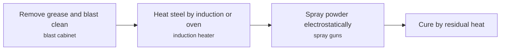
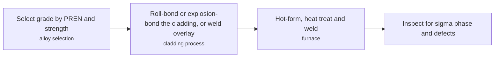
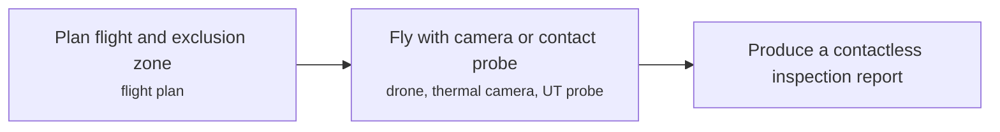
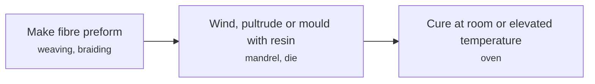
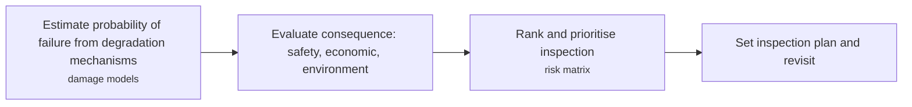

# MAT technology options

6 technologies, from commercial to lab stage. Generated from catalog/technologies/; every figure links to its source.

| Technology | Category | Maturity | TRL | Suppliers | Cost figures |
| --- | --- | --- | --- | --- | --- |
| [Coatings and linings](#mat-coatings-linings) | Materials and integrity | commercial |  | Sherwin-Williams (Valspar); Jotun Powder Coatings; 3M; Axalta Coating Systems; AkzoNobel; BASF |  |
| [Corrosion-resistant alloys and clad pipe](#mat-cra-clad-pipe) | Materials and integrity | commercial |  | Alleima (duplex tube (named in the Wikipedia reference)) |  |
| [Drones and robotics for inspection](#mat-drones-robotics-inspection) | Materials and integrity | commercial |  | Terra Drone Indonesia (visual and thermal flare stack inspection); Avestec Technologies (SKYRON tethered UT robot) |  |
| [Non-destructive testing (UT, PAUT, radiography, eddy current)](#mat-ndt) | Materials and integrity | commercial |  |  |  |
| [Non-metallic and composite equipment](#mat-nonmetallic-composite) | Materials and integrity | commercial |  |  |  |
| [Risk-based inspection and integrity management](#mat-rbi-integrity) | Materials and integrity | commercial |  |  |  |

## Coatings and linings

Fusion-bonded epoxy is a thermoset powder applied to hot blast-cleaned steel; it melts and cross-links to protect pipe from corrosion. It is a stand-alone coating or the primer in multi-layer polyolefin systems.

**Key equipment:** blast equipment, induction heater, powder spray system.

**Performance:**
- application temperature: 180-250 degC; melt and application range. [source](https://en.wikipedia.org/wiki/Fusion_bonded_epoxy_coating)
- stand-alone coating thickness: 250-500 um; standard thickness; others may be specified. [source](https://en.wikipedia.org/wiki/Fusion_bonded_epoxy_coating)

**Missing inputs:**
- disbondment resistance and service temperature class (performance): Not in the page read. Where: ISO 21809 and CSA Z245.20 summaries (open). Next: Add service limits.
- capital cost and operating or unit cost, with dollar year and basis (costs): No open source read so far gives costs for this technology. Where: arXiv and open-access journals: techno-economic or review papers (MDPI is blocked by its CDN; use the manual inbox) (catalog: arxiv, open); Licensor and EPC studies; paid cost databases are catalog-only (paid); OSTI.GOV full-text reports from DOE labs: search the technology name plus 'techno-economic' (catalog: osti, blocked). Next: Look for an open techno-economic study; record each figure with metric, range, unit, dollar year, basis and source.
- named plants or projects with capacity and year (reference_plants): The sources read name no specific plant. Where: Licensor and operator press releases for the suppliers listed (open). Next: Add one or two plants with country, capacity and start-up year.
- TRL with a cited source (trl): The IEA ETP Clean Energy Technology Guide has no matching entry. Where: IEA ETP Clean Energy Technology Guide (collected): search for the technology name (catalog: iea-reports, open). Next: Find a TRL table that lists this technology, or leave maturity resting on the evidence on the card.
- process steps and equipment are general engineering practice, not taken from one source (process): The sources read describe the principle but not a full step-by-step flow. Where: Licensor process descriptions and textbooks (open). Next: Check the steps against a licensor description and name it.

Sources: [1](https://en.wikipedia.org/wiki/Fusion_bonded_epoxy_coating). Last reviewed 2026-10-25.

## Corrosion-resistant alloys and clad pipe

Duplex stainless steels combine high chromium and nitrogen with lower nickel, giving chloride resistance and about twice the yield strength of austenitic grades. Cladding bonds a corrosion-resistant layer to a carbon steel base.

**Key equipment:** duplex and super-duplex pipe, clad plate and pipe, weld overlay.

**Performance:**
- duplex minimum 0.2% proof strength (22%Cr): 450 MPa; minimum stated; austenitic 304 is about 280 MPa. [source](https://en.wikipedia.org/wiki/Duplex_stainless_steel)
- super-duplex PREN: 38-45 PREN; PREN = %Cr + 3.3 %Mo + 16 %N. [source](https://en.wikipedia.org/wiki/Duplex_stainless_steel)
- embrittlement temperature range: 280-500 degC; especially near 475 degC. [source](https://en.wikipedia.org/wiki/Duplex_stainless_steel)

**Missing inputs:**
- nickel alloy and CRA-lined pipe data (API 5LD, NORSOK M-001) (performance): Not on the pages read. Where: API 5LD and NORSOK summaries (open). Next: Add data with source.
- CRA pipe makers (suppliers): The sources read name no suppliers for this technology. Where: Producer pages (open). Next: Add suppliers from vendor pages, with the product each supplies.
- capital cost and operating or unit cost, with dollar year and basis (costs): No open source read so far gives costs for this technology. Where: arXiv and open-access journals: techno-economic or review papers (MDPI is blocked by its CDN; use the manual inbox) (catalog: arxiv, open); Licensor and EPC studies; paid cost databases are catalog-only (paid); OSTI.GOV full-text reports from DOE labs: search the technology name plus 'techno-economic' (catalog: osti, blocked). Next: Look for an open techno-economic study; record each figure with metric, range, unit, dollar year, basis and source.
- named plants or projects with capacity and year (reference_plants): The sources read name no specific plant. Where: Licensor and operator press releases for the suppliers listed (open). Next: Add one or two plants with country, capacity and start-up year.
- TRL with a cited source (trl): The IEA ETP Clean Energy Technology Guide has no matching entry. Where: IEA ETP Clean Energy Technology Guide (collected): search for the technology name (catalog: iea-reports, open). Next: Find a TRL table that lists this technology, or leave maturity resting on the evidence on the card.
- process steps and equipment are general engineering practice, not taken from one source (process): The sources read describe the principle but not a full step-by-step flow. Where: Licensor process descriptions and textbooks (open). Next: Check the steps against a licensor description and name it.

Sources: [1](https://en.wikipedia.org/wiki/Duplex_stainless_steel), [2](https://en.wikipedia.org/wiki/Cladding_(metalworking)). Last reviewed 2026-10-25.

## Drones and robotics for inspection

Multirotor drones with RGB and thermal cameras inspect flare stacks and tanks from a distance; tethered flying robots touch the surface to take ultrasonic thickness readings.

**Key equipment:** multirotor drone, radiometric thermal camera, tethered UT robot.

**Performance:**
- flare stack UT readings per flight: 27 readings in 8 min; vendor case study. [source](https://www.wevolver.com/article/flying-robot-inspects-tanks-pipes-and-flare-stacks)
- tank UT readings per flight: 155 readings in 45 min; vendor case study. [source](https://www.wevolver.com/article/flying-robot-inspects-tanks-pipes-and-flare-stacks)
- tether length: 100 m; vendor spec. [source](https://www.wevolver.com/article/flying-robot-inspects-tanks-pipes-and-flare-stacks)

**Reference plants:**
- Chevron Duri field flare stacks (Rokan PSC, Sumatra), ID: ; drone inspection reported. [source](https://www.thedronegirl.com/2021/05/19/chevron-terra-drone-indonesia/amp/)

**Missing inputs:**
- independent comparison with rope access (performance): Only vendor and news sources read. Where: Operator case studies (open). Next: Add independent data.
- capital cost and operating or unit cost, with dollar year and basis (costs): No open source read so far gives costs for this technology. Where: arXiv and open-access journals: techno-economic or review papers (MDPI is blocked by its CDN; use the manual inbox) (catalog: arxiv, open); Licensor and EPC studies; paid cost databases are catalog-only (paid); OSTI.GOV full-text reports from DOE labs: search the technology name plus 'techno-economic' (catalog: osti, blocked). Next: Look for an open techno-economic study; record each figure with metric, range, unit, dollar year, basis and source.
- TRL with a cited source (trl): The IEA ETP Clean Energy Technology Guide has no matching entry. Where: IEA ETP Clean Energy Technology Guide (collected): search for the technology name (catalog: iea-reports, open). Next: Find a TRL table that lists this technology, or leave maturity resting on the evidence on the card.
- process steps and equipment are general engineering practice, not taken from one source (process): The sources read describe the principle but not a full step-by-step flow. Where: Licensor process descriptions and textbooks (open). Next: Check the steps against a licensor description and name it.

Sources: [1](https://www.thedronegirl.com/2021/05/19/chevron-terra-drone-indonesia/amp/), [2](https://www.wevolver.com/article/flying-robot-inspects-tanks-pipes-and-flare-stacks). Last reviewed 2026-10-25.

## Non-destructive testing (UT, PAUT, radiography, eddy current)

NDT evaluates a component without damaging it. Ultrasonic testing reflects sound off flaws; phased array adds beam steering; radiography uses penetrating radiation; eddy current tests surfaces and welds.

**Key equipment:** ultrasonic probes, phased array instrument, X-ray or gamma source, eddy current probes.

**Missing inputs:**
- NDT instrument makers (suppliers): The sources read name no suppliers for this technology. Where: Vendor pages for PAUT and UT (open). Next: Add suppliers from vendor pages, with the product each supplies.
- probability of detection figures (performance): The page points to ASTM E2862 and MIL-HDBK-1823A but gives no values. Where: ASTM E2862 summary (open). Next: Add values if open.
- capital cost and operating or unit cost, with dollar year and basis (costs): No open source read so far gives costs for this technology. Where: arXiv and open-access journals: techno-economic or review papers (MDPI is blocked by its CDN; use the manual inbox) (catalog: arxiv, open); Licensor and EPC studies; paid cost databases are catalog-only (paid); OSTI.GOV full-text reports from DOE labs: search the technology name plus 'techno-economic' (catalog: osti, blocked). Next: Look for an open techno-economic study; record each figure with metric, range, unit, dollar year, basis and source.
- named plants or projects with capacity and year (reference_plants): The sources read name no specific plant. Where: Licensor and operator press releases for the suppliers listed (open). Next: Add one or two plants with country, capacity and start-up year.
- TRL with a cited source (trl): The IEA ETP Clean Energy Technology Guide has no matching entry. Where: IEA ETP Clean Energy Technology Guide (collected): search for the technology name (catalog: iea-reports, open). Next: Find a TRL table that lists this technology, or leave maturity resting on the evidence on the card.
- process steps and equipment are general engineering practice, not taken from one source (process): The sources read describe the principle but not a full step-by-step flow. Where: Licensor process descriptions and textbooks (open). Next: Check the steps against a licensor description and name it.

Sources: [1](https://en.wikipedia.org/wiki/Nondestructive_testing). Last reviewed 2026-10-25.

## Non-metallic and composite equipment

Fibre-reinforced plastics pair glass, carbon or aramid fibres with epoxy, vinyl ester or polyester matrices, made by pultrusion, filament winding or moulding.

**Key equipment:** pultruded pipes and profiles, filament-wound pipe and tanks.

**Missing inputs:**
- FRP pipe and tank makers (suppliers): The sources read name no suppliers for this technology. Where: Vendor pages (open). Next: Add suppliers from vendor pages, with the product each supplies.
- pressure and temperature ratings (API 15 series, ISO 14692) (performance): Not on the page. Where: API 15 and ISO 14692 summaries (open). Next: Add ratings.
- capital cost and operating or unit cost, with dollar year and basis (costs): No open source read so far gives costs for this technology. Where: arXiv and open-access journals: techno-economic or review papers (MDPI is blocked by its CDN; use the manual inbox) (catalog: arxiv, open); Licensor and EPC studies; paid cost databases are catalog-only (paid); OSTI.GOV full-text reports from DOE labs: search the technology name plus 'techno-economic' (catalog: osti, blocked). Next: Look for an open techno-economic study; record each figure with metric, range, unit, dollar year, basis and source.
- named plants or projects with capacity and year (reference_plants): The sources read name no specific plant. Where: Licensor and operator press releases for the suppliers listed (open). Next: Add one or two plants with country, capacity and start-up year.
- TRL with a cited source (trl): The IEA ETP Clean Energy Technology Guide has no matching entry. Where: IEA ETP Clean Energy Technology Guide (collected): search for the technology name (catalog: iea-reports, open). Next: Find a TRL table that lists this technology, or leave maturity resting on the evidence on the card.
- process steps and equipment are general engineering practice, not taken from one source (process): The sources read describe the principle but not a full step-by-step flow. Where: Licensor process descriptions and textbooks (open). Next: Check the steps against a licensor description and name it.

Sources: [1](https://en.wikipedia.org/wiki/Fibre-reinforced_plastic). Last reviewed 2026-10-25.

## Risk-based inspection and integrity management

RBI ranks equipment by probability of failure (from degradation mechanisms) and consequence so inspection effort goes where risk is highest.

**Key equipment:** RBI software, inspection records.

**Missing inputs:**
- RBI software vendors (suppliers): The sources read name no suppliers for this technology. Where: Vendor pages (open). Next: Add suppliers from vendor pages, with the product each supplies.
- documented savings from RBI programmes (performance): None on the page. Where: API 580 and 581 summaries (open). Next: Add examples.
- capital cost and operating or unit cost, with dollar year and basis (costs): No open source read so far gives costs for this technology. Where: arXiv and open-access journals: techno-economic or review papers (MDPI is blocked by its CDN; use the manual inbox) (catalog: arxiv, open); Licensor and EPC studies; paid cost databases are catalog-only (paid); OSTI.GOV full-text reports from DOE labs: search the technology name plus 'techno-economic' (catalog: osti, blocked). Next: Look for an open techno-economic study; record each figure with metric, range, unit, dollar year, basis and source.
- named plants or projects with capacity and year (reference_plants): The sources read name no specific plant. Where: Licensor and operator press releases for the suppliers listed (open). Next: Add one or two plants with country, capacity and start-up year.
- TRL with a cited source (trl): The IEA ETP Clean Energy Technology Guide has no matching entry. Where: IEA ETP Clean Energy Technology Guide (collected): search for the technology name (catalog: iea-reports, open). Next: Find a TRL table that lists this technology, or leave maturity resting on the evidence on the card.
- process steps and equipment are general engineering practice, not taken from one source (process): The sources read describe the principle but not a full step-by-step flow. Where: Licensor process descriptions and textbooks (open). Next: Check the steps against a licensor description and name it.

Sources: [1](https://en.wikipedia.org/wiki/Risk-based_inspection). Last reviewed 2026-10-25.
