# MID technology options

20 technologies, from commercial to lab stage. Generated from catalog/technologies/; every figure links to its source.

| Technology | Category | Maturity | TRL | Suppliers | Cost figures |
| --- | --- | --- | --- | --- | --- |
| [CO2 pipelines (dense phase)](#mid-co2-pipelines) | Pipelines | commercial | 9 | Denbury (Green Pipeline (register example)); Northern Lights (ship and pipeline chain) | Weyburn pipeline capex: 110 USD million (about 0.33 million per km) (1997$) |
| [Cathodic protection and coatings (FBE, 3LPE)](#mid-cathodic-protection-coatings) | Pipelines | commercial |  | Corrpro (cathodic protection services); Seal for Life (coating and wrap products) |  |
| [Composite and reinforced thermoplastic pipe](#mid-composite-reinforced-thermoplastic-pipe) | Pipelines | commercial |  | Baker Hughes (reinforced thermoplastic pipe); Strohm (thermoplastic composite pipe); NOV (fibreglass and composite pipe) |  |
| [Crude and product tank farms and floating roofs](#mid-tank-farms-floating-roofs) | Storage and terminals | commercial |  | Terminal operators (tank terminals) |  |
| [Crude and product tankers with scrubbers or LNG fuel](#mid-crude-product-tankers) | Shipping | commercial |  | Samsung Heavy Industries (tankers); Hanwha Ocean (tankers); HD Hyundai (tankers) |  |
| [Custody transfer metering (ultrasonic, Coriolis)](#mid-custody-transfer-metering) | Metering | commercial |  | Emerson (Coriolis and ultrasonic meters); Endress+Hauser (Coriolis); SICK (ultrasonic gas meters) |  |
| [Drag reducing agents](#mid-drag-reducing-agents) | Pipelines | commercial |  | LiquidPower Specialty Products (flow improvers); Baker Hughes (flow improvers) |  |
| [Flow assurance simulation](#mid-flow-assurance-simulation) | Flow assurance | commercial |  | SLB (OLGA); KBC (Yokogawa) (Petro-SIM and flow assurance consulting) |  |
| [Heated and pipe-in-pipe flowlines](#mid-heated-pipe-in-pipe-flowlines) | Flow assurance | commercial |  | TechnipFMC (pipe-in-pipe and electrically trace heated PiP); Subsea7 (heated flowlines) |  |
| [High-strength steel pipelines and automatic welding](#mid-high-strength-steel-pipelines) | Pipelines | commercial |  | CRC-Evans (mechanised pipeline welding); Tenaris (line pipe); Nippon Steel (line pipe) |  |
| [Hydrate, wax and asphaltene management (inhibitors, heating, pigging)](#mid-hydrate-wax-asphaltene-management) | Flow assurance | commercial |  | ChampionX (flow assurance chemicals); Baker Hughes (flow assurance chemicals); Clariant (hydrate and wax chemicals) |  |
| [LNG carriers (membrane and Moss tanks, reliquefaction)](#mid-lng-carriers) | Shipping | commercial |  | GTT (membrane containment); Samsung Heavy Industries (LNG carriers); Hanwha Ocean (LNG carriers); MISC (owner and operator) | newbuild price, 170,000 m3: 200 USD million (could cost) newbuild price of a standard 174,000 m3 LNG carrier: 248 million USD per vessel (about $269 m at the 2024 record high; $200-220 m range quoted for 2026 contracts) (2025$) |
| [LPG and ammonia carriers](#mid-lpg-ammonia-carriers) | Shipping | commercial |  | HD Hyundai (VLGC); MISC (gas carriers) |  |
| [Leak detection (CPM, fibre optic DAS and DTS)](#mid-leak-detection) | Pipelines | commercial |  | AP Sensing (DAS and DTS); Silixa (DAS); Emerson (CPM leak detection) |  |
| [Pipeline inline inspection (MFL, ultrasonic, EMAT pigs)](#mid-inline-inspection-pigging) | Pipelines | commercial |  | ROSEN (ILI tools); Baker Hughes (ILI services); T.D. Williamson (ILI and hot tapping) |  |
| [Strategic petroleum reserves (salt caverns, rock caverns)](#mid-strategic-petroleum-reserves) | Storage and terminals | commercial |  | Governments (strategic reserves) |  |
| [Underground gas storage (salt caverns, depleted fields)](#mid-underground-gas-storage) | Storage and terminals | commercial |  | Uniper (gas storage); PETRONAS (register example) |  |
| [Hydrogen blending and repurposing of gas pipelines](#mid-hydrogen-blending-repurposing) | Pipelines | demonstration | 7-8 | Gasunie (hydrogen network conversion); SoCalGas (blending trials); PETRONAS Gas (register example) |  |
| [Liquid CO2 carriers](#mid-liquid-co2-carriers) | Shipping | demonstration | 7-8 | Northern Lights (ship, terminal and storage chain); Mitsubishi Shipbuilding (CO2 carrier design) | ship transport cost excluding liquefaction: 20-28 USD/t (2004$) |
| [Liquid hydrogen carriers](#mid-liquid-hydrogen-carriers) | Shipping | demonstration |  | Kawasaki Heavy Industries (Suiso Frontier) |  |

## CO2 pipelines (dense phase)

CO2 is compressed above its critical pressure so it flows as a dense fluid in carbon-steel pipe, which needs dry CO2 to avoid corrosion. The IPCC special report records 803 km Cortez (about 20 MtCO2/yr), a western US network above 2,500 km carrying about 50 MtCO2/yr, and Weyburn at US$110 million (1997) for 330 km.

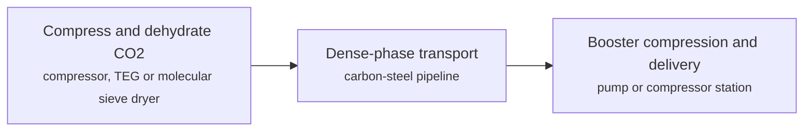

**Key equipment:** CO2 compressors, dehydration, carbon-steel pipe, booster pumps, leak detection.

**Performance:**
- Cortez pipeline capacity: 20 MtCO2/yr; 803 km, 762 mm. [source](https://www.ipcc.ch/site/assets/uploads/2018/03/srccs_chapter4-1.pdf)
- operating pressure of gas pipelines: 10-80 MPa; IPCC executive summary range; SACROC design minimum 9.6 MPa. [source](https://www.ipcc.ch/site/assets/uploads/2018/03/srccs_chapter4-1.pdf)
- dry CO2 corrosion rate, AISI 1080: 0.01 mm/yr; versus 0.7 mm/yr for wet CO2 at 40 °C and 95 bar. [source](https://www.ipcc.ch/site/assets/uploads/2018/03/srccs_chapter4-1.pdf)

**Costs:**
- Weyburn pipeline capex: 110 USD million (about 0.33 million per km) (1997$); 330 km. [source](https://www.ipcc.ch/site/assets/uploads/2018/03/srccs_chapter4-1.pdf)

**Reference plants:**
- Porthos CO2 transport system, Port of Rotterdam, Netherlands, NL: about 55 km of CO2 pipeline (about 30 km onshore laid, more than 20 km offshore); 10 Mtpa design; transports Rotterdam industry CO2 to depleted North Sea gas fields; under construction (2024-); construction. [source](https://www.porthosco2.nl/en)

TRL source: [IEA ETP Clean Energy Technology Guide dataset (July 2026), entry 'CO2 transport pipeline'](https://www.iea.org/data-and-statistics/data-tools/etp-clean-energy-technology-guide)

**Missing inputs:**
- process steps and equipment are general engineering practice, not taken from one source (process): The sources read describe the principle but not a full step-by-step flow. Where: Licensor process descriptions and textbooks (open). Next: Check the steps against a licensor description and name it.

Sources: [1](https://www.ipcc.ch/site/assets/uploads/2018/03/srccs_chapter4-1.pdf), [2](https://norlights.com/what-we-do/), [3](https://www.iea.org/data-and-statistics/data-tools/etp-clean-energy-technology-guide), [4](https://www.porthosco2.nl/en). Last reviewed 2026-10-28.

## Cathodic protection and coatings (FBE, 3LPE)

A dielectric coating (fusion-bonded epoxy, three-layer polyethylene) keeps most of the pipe from contact with soil, and cathodic protection supplies current through sacrificial anodes or an impressed-current rectifier to cover coating defects. ICCP uses a DC source of up to about 50 A and 50 V depending on pipe size and coating quality.

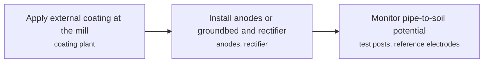

**Key equipment:** pipeline coating, sacrificial anodes, impressed-current rectifier and groundbed, test points.

**Performance:**
- ICCP source rating for a pipeline: 50 A and V (up to); depends on size and coating quality. [source](https://en.wikipedia.org/wiki/Cathodic_protection)
- cathodic protection criterion for buried steel pipelines: -850 mV vs copper/copper-sulfate electrode (CSE), polarised potential; the standard criterion of -850 mV vs CSE "can provide full protection for a buried API 5L" steel per NACE/AMPP SP0169 practice (critical-review paper: "the optimum potential is -850 mV for both steels"); SP0169 also allows a 100 mV cathodic-polarisation criterion and bounds overprotection near -1150 mV; FBE/3LPE coating property tables were not captured this pass. [source](https://www.researchgate.net/publication/256689812_Cathodic_protection_criteria_of_thermally_insulated_pipeline_buried_in_soil)

**Missing inputs:**
- protection criterion (for example -850 mV CSE) and FBE/3LPE properties (performance): The Wikipedia page does not state them. Protection criterion recorded in performance (-850 mV CSE); FBE/3LPE property tables remain in coating-vendor literature, 2026-10-28. Where: AMPP SP0169 and ISO 15589-1 (catalog: ampp-standards, open). Next: Add the criterion with its standard.
- capital cost and operating or unit cost, with dollar year and basis (costs): No open source read so far gives costs for this technology. Web-checked 2026-10-28; no open figures. Where: arXiv and open-access journals: techno-economic or review papers (MDPI is blocked by its CDN; use the manual inbox) (catalog: arxiv, open); Licensor and EPC studies; paid cost databases are catalog-only (paid); OSTI.GOV full-text reports from DOE labs: search the technology name plus 'techno-economic' (catalog: osti, blocked). Next: Look for an open techno-economic study; record each figure with metric, range, unit, dollar year, basis and source.
- named plants or projects with capacity and year (reference_plants): The sources read name no specific plant. Web-checked 2026-10-28; ubiquitous practice. Where: Licensor and operator press releases for the suppliers listed (open). Next: Add one or two plants with country, capacity and start-up year.
- TRL with a cited source (trl): The IEA ETP Clean Energy Technology Guide has no matching entry. no open TRL table found (IEA ETP guide checked 2026-10-28). Where: IEA ETP Clean Energy Technology Guide (collected): search for the technology name (catalog: iea-reports, open). Next: Find a TRL table that lists this technology, or leave maturity resting on the evidence on the card.

Sources: [1](https://en.wikipedia.org/wiki/Cathodic_protection). Last reviewed 2026-10-29.

## Composite and reinforced thermoplastic pipe

Spoolable pipe with a thermoplastic liner and fibre or steel reinforcement is laid from reels for gathering lines and produced water. The Shawcor/ Wikipedia sources could not be read, so no pressure ratings are on this card yet.

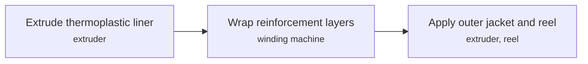

**Key equipment:** thermoplastic liner, fibre reinforcement, end fittings, reel and installation spread.

**Missing inputs:**
- pressure ratings, diameters, laying speed and temperature limits (performance): Shawcor's PDF is blocked by robots.txt and the Wikipedia page was not read in detail. Where: Soluforce, Strohm and Baker Hughes product pages (open). Next: Add ratings from a vendor datasheet.
- capital cost and operating or unit cost, with dollar year and basis (costs): No open source read so far gives costs for this technology. Web-checked 2026-10-28; vendor quotes only. Where: arXiv and open-access journals: techno-economic or review papers (MDPI is blocked by its CDN; use the manual inbox) (catalog: arxiv, open); Licensor and EPC studies; paid cost databases are catalog-only (paid); OSTI.GOV full-text reports from DOE labs: search the technology name plus 'techno-economic' (catalog: osti, blocked). Next: Look for an open techno-economic study; record each figure with metric, range, unit, dollar year, basis and source.
- named plants or projects with capacity and year (reference_plants): The sources read name no specific plant. Web-checked 2026-10-28; no verifiable named installation added. Where: Licensor and operator press releases for the suppliers listed (open). Next: Add one or two plants with country, capacity and start-up year.
- TRL with a cited source (trl): The IEA ETP Clean Energy Technology Guide has no matching entry. no open TRL table found (IEA ETP guide checked 2026-10-28). Where: IEA ETP Clean Energy Technology Guide (collected): search for the technology name (catalog: iea-reports, open). Next: Find a TRL table that lists this technology, or leave maturity resting on the evidence on the card.
- process steps and equipment are general engineering practice, not taken from one source (process): The sources read describe the principle but not a full step-by-step flow. Where: Licensor process descriptions and textbooks (open). Next: Check the steps against a licensor description and name it.

Sources: [1](https://en.wikipedia.org/wiki/Reinforced_thermoplastic_pipe). Last reviewed 2026-10-28.

## Crude and product tank farms and floating roofs

Vertical cylindrical tanks hold crude and products; floating roofs rise and fall with the liquid to cut the vapour space. External floating roofs suit medium-flash liquids such as crude, naphtha and diesel; internal floating roofs suit low-flash products such as petrol and jet fuel.

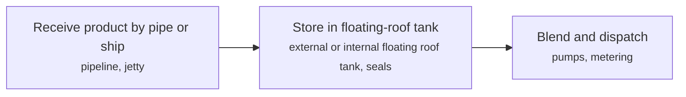

**Key equipment:** storage tanks, floating roofs and seals, fire protection, pumps, vapour control.

**Missing inputs:**
- emission reduction and seal types, per AP-42 and API 650 (performance): Not on the page read. Web-checked 2026-10-28; AP-42 emission-factor tables are EPA-hosted PDFs not read this pass. Where: EPA AP-42 chapter 7.1 (open); API 650 and 653 (catalog: api-standards, open). Next: Add loss factors from AP-42.
- capital cost and operating or unit cost, with dollar year and basis (costs): No open source read so far gives costs for this technology. Web-checked 2026-10-28; no open figures. Where: arXiv and open-access journals: techno-economic or review papers (MDPI is blocked by its CDN; use the manual inbox) (catalog: arxiv, open); Licensor and EPC studies; paid cost databases are catalog-only (paid); OSTI.GOV full-text reports from DOE labs: search the technology name plus 'techno-economic' (catalog: osti, blocked). Next: Look for an open techno-economic study; record each figure with metric, range, unit, dollar year, basis and source.
- named plants or projects with capacity and year (reference_plants): The sources read name no specific plant. Web-checked 2026-10-28; ubiquitous. Where: Licensor and operator press releases for the suppliers listed (open). Next: Add one or two plants with country, capacity and start-up year.
- TRL with a cited source (trl): The IEA ETP Clean Energy Technology Guide has no matching entry. no open TRL table found (IEA ETP guide checked 2026-10-28). Where: IEA ETP Clean Energy Technology Guide (collected): search for the technology name (catalog: iea-reports, open). Next: Find a TRL table that lists this technology, or leave maturity resting on the evidence on the card.
- process steps and equipment are general engineering practice, not taken from one source (process): The sources read describe the principle but not a full step-by-step flow. Where: Licensor process descriptions and textbooks (open). Next: Check the steps against a licensor description and name it.

Sources: [1](https://en.wikipedia.org/wiki/Floating_roof). Last reviewed 2026-10-28.

## Crude and product tankers with scrubbers or LNG fuel

Tankers carry crude and products in size classes from Aframax (80,000 to 120,000 dwt) to VLCC (200,000 to 320,000 dwt, about 2 million barrels). Ships meet the sulphur limit with low-sulphur fuel, exhaust scrubbers or LNG; the IMO page could not be read, so limits are not on this card.

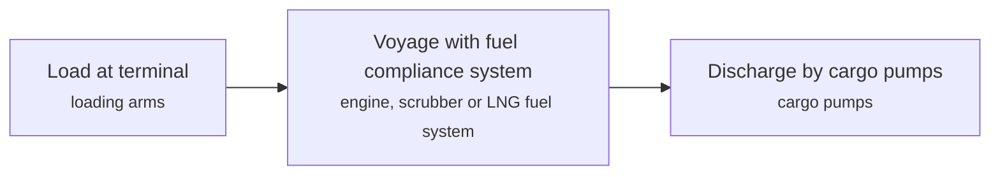

**Key equipment:** double-hull tanks, cargo pumps, main engine, scrubber or LNG fuel gas system.

**Performance:**
- VLCC cargo: 2 million barrels (about 318,000 t); 200,000 to 320,000 dwt class. [source](https://en.wikipedia.org/wiki/Oil_tanker)
- active tankers above 10,000 dwt: 4024 ships; infobox; date not stated. [source](https://en.wikipedia.org/wiki/Oil_tanker)

**Missing inputs:**
- IMO sulphur cap and compliance options (other): The IMO page is blocked by robots.txt. Where: IMO MARPOL Annex VI summary (open). Next: Add the 0.50% global limit and ECA limit with dates.
- capital cost and operating or unit cost, with dollar year and basis (costs): No open source read so far gives costs for this technology. Web-checked 2026-10-28; scrubber/LNG-fuel retrofit costs are shipyard-quoted. Where: arXiv and open-access journals: techno-economic or review papers (MDPI is blocked by its CDN; use the manual inbox) (catalog: arxiv, open); Licensor and EPC studies; paid cost databases are catalog-only (paid); OSTI.GOV full-text reports from DOE labs: search the technology name plus 'techno-economic' (catalog: osti, blocked). Next: Look for an open techno-economic study; record each figure with metric, range, unit, dollar year, basis and source.
- named plants or projects with capacity and year (reference_plants): The sources read name no specific plant. Web-checked 2026-10-28; no verifiable named vessel added. Where: Licensor and operator press releases for the suppliers listed (open). Next: Add one or two plants with country, capacity and start-up year.
- TRL with a cited source (trl): The IEA ETP Clean Energy Technology Guide has no matching entry. no open TRL table found (IEA ETP guide checked 2026-10-28). Where: IEA ETP Clean Energy Technology Guide (collected): search for the technology name (catalog: iea-reports, open). Next: Find a TRL table that lists this technology, or leave maturity resting on the evidence on the card.
- process steps and equipment are general engineering practice, not taken from one source (process): The sources read describe the principle but not a full step-by-step flow. Where: Licensor process descriptions and textbooks (open). Next: Check the steps against a licensor description and name it.

Sources: [1](https://en.wikipedia.org/wiki/Oil_tanker). Last reviewed 2026-10-28.

## Custody transfer metering (ultrasonic, Coriolis)

Meters that set the invoice value of oil or gas. Ultrasonic transit-time meters infer velocity from the difference in pulse travel times with and against the flow; Coriolis meters measure mass flow and density directly. Cone meters reach ±0.5% when calibrated.

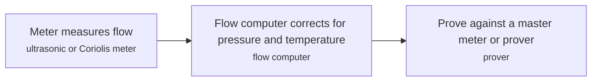

**Key equipment:** ultrasonic or Coriolis meter, flow computer, prover, sampler.

**Performance:**
- calibrated cone meter accuracy: 0.5 % (±); up to ±5% uncalibrated. [source](https://en.wikipedia.org/wiki/Coriolis_flowmeter)
- custody-transfer meter accuracy under AGA standards: 0.35-0.5 % volume-flow accuracy for Coriolis meters under AGA 11 (ultrasonic meters governed by AGA 9); "The use of Coriolis meters for custody transfer is governed by AGA-11. Advantages include standard volume flow accuracy of 0.35% to 0.5%" (Control Engineering, 13 Jun 2016); AGA 9 governs multipath ultrasonic custody-transfer meters; the specific AGA 9 and API MPMS class values were not read this pass. [source](https://www.controleng.com/selecting-flowmeters-for-natural-gas)

**Missing inputs:**
- custody-transfer accuracy classes under AGA 9, AGA 11 and API MPMS (performance): Not stated in the pages read. AGA 11 Coriolis accuracy (0.35-0.5%) recorded in performance; AGA 9/API MPMS class tables are paywalled standards text, 2026-10-28. Where: AGA 9 and API MPMS (catalog: api-standards, open). Next: Add accuracy classes with standard references.
- capital cost and operating or unit cost, with dollar year and basis (costs): No open source read so far gives costs for this technology. Web-checked 2026-10-28; meter prices vendor-quoted. Where: arXiv and open-access journals: techno-economic or review papers (MDPI is blocked by its CDN; use the manual inbox) (catalog: arxiv, open); Licensor and EPC studies; paid cost databases are catalog-only (paid); OSTI.GOV full-text reports from DOE labs: search the technology name plus 'techno-economic' (catalog: osti, blocked). Next: Look for an open techno-economic study; record each figure with metric, range, unit, dollar year, basis and source.
- named plants or projects with capacity and year (reference_plants): The sources read name no specific plant. Web-checked 2026-10-28; ubiquitous. Where: Licensor and operator press releases for the suppliers listed (open). Next: Add one or two plants with country, capacity and start-up year.
- TRL with a cited source (trl): The IEA ETP Clean Energy Technology Guide has no matching entry. no open TRL table found (IEA ETP guide checked 2026-10-28). Where: IEA ETP Clean Energy Technology Guide (collected): search for the technology name (catalog: iea-reports, open). Next: Find a TRL table that lists this technology, or leave maturity resting on the evidence on the card.

Sources: [1](https://en.wikipedia.org/wiki/Ultrasonic_flow_meter), [2](https://en.wikipedia.org/wiki/Coriolis_flowmeter), [3](https://en.wikipedia.org/wiki/Flow_measurement). Last reviewed 2026-10-29.

## Drag reducing agents

Ultra-high-molecular-weight polymers injected at parts-per-million levels suppress turbulent bursts and cut frictional pressure drop by up to 70%. Field cases in an Offshore magazine article (2005, vendor-authored) show 6 to 51% more throughput.

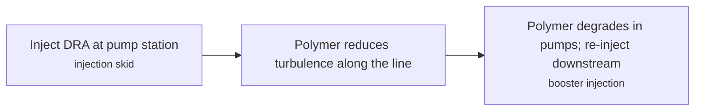

**Key equipment:** DRA injection skid, storage tank, flow and pressure meters.

**Performance:**
- frictional pressure drop reduction: 70 % (up to); article statement. [source](https://www.offshore-mag.com/regional-reports/article/16762699/drag-reducers-improve-throughput-cut-costs)
- throughput gain, single-phase crude line: 27 %; 18,200 to 23,160 b/d with discharge pressure cut from 250-255 to 220-230 psig. [source](https://www.offshore-mag.com/regional-reports/article/16762699/drag-reducers-improve-throughput-cut-costs)
- production gain, multiphase line: 17 %; 20 to 21% drag reduction on a ~7,000 b/d slug flow line. [source](https://www.offshore-mag.com/regional-reports/article/16762699/drag-reducers-improve-throughput-cut-costs)
- throughput gain, 16-inch line: 51 %; 53,000 to 80,000 b/d. [source](https://www.offshore-mag.com/regional-reports/article/16762699/drag-reducers-improve-throughput-cut-costs)

**Reference plants:**
- Trans-Alaska Pipeline System (TAPS) drag-reducer programme, US: first commercial use of a polymeric drag-reducing additive to raise crude-oil pipeline flow, beginning 1979 after two full-scale experiments (Burger et al., 1982); DRA let TAPS exceed its design throughput; operating. [source](https://cir.nii.ac.jp/crid/1361137044158838528)

**Missing inputs:**
- treatment cost per barrel with dollar year (costs): The article does not quantify cost. Web-checked 2026-10-28; DRA dosing costs are vendor-quoted. Where: LiquidPower brochures (open). Next: Add dose ppm and cost range with year.
- TRL with a cited source (trl): The IEA ETP Clean Energy Technology Guide has no matching entry. IEA ETP Guide (July 2026) has no matching entry (searched drag reducing, drag reducer, friction reducer, pipeline additive, flow assurance); 2026-10-28 no open TRL table found (IEA ETP guide checked 2026-10-28). Where: IEA ETP Clean Energy Technology Guide (collected): search for the technology name (catalog: iea-reports, open). Next: Find a TRL table that lists this technology, or leave maturity resting on the evidence on the card.

Sources: [1](https://www.offshore-mag.com/regional-reports/article/16762699/drag-reducers-improve-throughput-cut-costs), [2](https://cir.nii.ac.jp/crid/1361137044158838528), [3](https://en.wikipedia.org/wiki/Drag-reducing_agent). Last reviewed 2026-10-29.

## Flow assurance simulation

Transient multiphase simulators predict slugging, hydrate and wax risk, cooldown and start-up behaviour of wells, flowlines and risers. The SLB OLGA page read describes it only as the industry-standard dynamic multiphase simulator, with no figures.

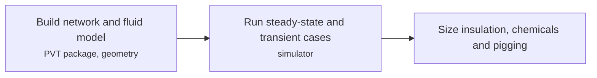

**Key equipment:** dynamic multiphase simulator, PVT and thermal models.

**Missing inputs:**
- capabilities, validation accuracy and typical use (performance): The SLB page contains navigation text only. Web-checked 2026-10-28; OLGA/LEDAAP validation tables sit in SPE papers. Where: SLB OLGA documentation (catalog: slb, open). Next: Add validation statements with source.
- capital cost and operating or unit cost, with dollar year and basis (costs): No open source read so far gives costs for this technology. Web-checked 2026-10-28; licence prices vendor-quoted. Where: arXiv and open-access journals: techno-economic or review papers (MDPI is blocked by its CDN; use the manual inbox) (catalog: arxiv, open); Licensor and EPC studies; paid cost databases are catalog-only (paid); OSTI.GOV full-text reports from DOE labs: search the technology name plus 'techno-economic' (catalog: osti, blocked). Next: Look for an open techno-economic study; record each figure with metric, range, unit, dollar year, basis and source.
- named plants or projects with capacity and year (reference_plants): The sources read name no specific plant. Web-checked 2026-10-28; no verifiable named use added. Where: Licensor and operator press releases for the suppliers listed (open). Next: Add one or two plants with country, capacity and start-up year.
- TRL with a cited source (trl): The IEA ETP Clean Energy Technology Guide has no matching entry. no open TRL table found (IEA ETP guide checked 2026-10-28). Where: IEA ETP Clean Energy Technology Guide (collected): search for the technology name (catalog: iea-reports, open). Next: Find a TRL table that lists this technology, or leave maturity resting on the evidence on the card.
- process steps and equipment are general engineering practice, not taken from one source (process): The sources read describe the principle but not a full step-by-step flow. Where: Licensor process descriptions and textbooks (open). Next: Check the steps against a licensor description and name it.

Sources: [1](https://www.slb.com/products-and-services/delivering-digital-at-scale/software/olga-dynamic-multiphase-flow-simulator). Last reviewed 2026-10-28.

## Heated and pipe-in-pipe flowlines

An insulated inner pipe inside an outer carrier pipe, optionally with electrical trace heating, keeps hot well fluids above hydrate and wax temperatures over long tiebacks. A Gulf of Mexico case shows pipe-in-pipe flowlines being used to limit heat loss and hot-oil circulation for remediation.

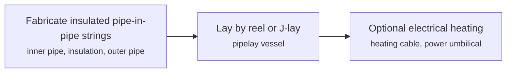

**Key equipment:** pipe-in-pipe, insulation, heating cable, field joints.

**Missing inputs:**
- U-values, depths, lengths and temperatures (performance): The TechnipFMC page returned an error. Where: TechnipFMC and Subsea7 project pages (catalog: technipfmc, open). Next: Add figures from a project page or paper.
- capital cost and operating or unit cost, with dollar year and basis (costs): No open source read so far gives costs for this technology. Web-checked 2026-10-28; project-specific. Where: arXiv and open-access journals: techno-economic or review papers (MDPI is blocked by its CDN; use the manual inbox) (catalog: arxiv, open); Licensor and EPC studies; paid cost databases are catalog-only (paid); OSTI.GOV full-text reports from DOE labs: search the technology name plus 'techno-economic' (catalog: osti, blocked). Next: Look for an open techno-economic study; record each figure with metric, range, unit, dollar year, basis and source.
- named plants or projects with capacity and year (reference_plants): The sources read name no specific plant. Web-checked 2026-10-28 (Fenja ETH recorded on the related UPS DEH card in this wave). Where: Licensor and operator press releases for the suppliers listed (open). Next: Add one or two plants with country, capacity and start-up year.
- TRL with a cited source (trl): The IEA ETP Clean Energy Technology Guide has no matching entry. no open TRL table found (IEA ETP guide checked 2026-10-28). Where: IEA ETP Clean Energy Technology Guide (collected): search for the technology name (catalog: iea-reports, open). Next: Find a TRL table that lists this technology, or leave maturity resting on the evidence on the card.
- process steps and equipment are general engineering practice, not taken from one source (process): The sources read describe the principle but not a full step-by-step flow. Where: Licensor process descriptions and textbooks (open). Next: Check the steps against a licensor description and name it.

Sources: [1](https://jpt.spe.org/flow-assurance-hydrates-and-paraffin-management). Last reviewed 2026-10-28.

## High-strength steel pipelines and automatic welding

Higher steel grades (X70, X80) allow thinner walls or higher pressure for the same pipe, and mechanised gas-metal-arc welding speeds joint making on long lines. In the UK, about 889 km of DN1200 X80 pipe was laid between 2000 and 2010 at design pressures of 90 to 94 bar, and a consultant study estimated a 22.7% cost saving over X65.

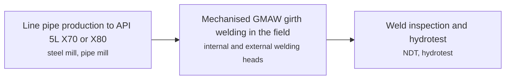

**Key equipment:** X70 or X80 line pipe, mechanised welding systems, inspection equipment.

**Performance:**
- design pressure with X80 pipe: 90-94 bar; UK DN1200 projects. [source](https://niobium.tech/-/media/niobiumtech/attachments-biblioteca-tecnica/nt_the-development-of-weld-procedures-for-x80-pipelines-in-the-uk.pdf)
- cost saving of X80 over X65: 22.7 %; independent consultant estimate, UK transmission. [source](https://niobium.tech/-/media/niobiumtech/attachments-biblioteca-tecnica/nt_the-development-of-weld-procedures-for-x80-pipelines-in-the-uk.pdf)
- UK X80 installed: 889 km; sum of 15 projects, 2000 to 2010; the paper states both 'almost 900 km' and 'over 900 km'. [source](https://niobium.tech/-/media/niobiumtech/attachments-biblioteca-tecnica/nt_the-development-of-weld-procedures-for-x80-pipelines-in-the-uk.pdf)

**Missing inputs:**
- current cost per km with dollar year (costs): The paper gives a saving percentage only. Web-checked 2026-10-28; pipeline build costs vary by region; no authoritative open $/km found. Where: PRCI and operator project cost studies (catalog: prci, open). Next: Add cost per inch-km with year.
- named plants or projects with capacity and year (reference_plants): The sources read name no specific plant. Web-checked 2026-10-28; no verifiable named pipeline added. Where: Licensor and operator press releases for the suppliers listed (open). Next: Add one or two plants with country, capacity and start-up year.
- TRL with a cited source (trl): The IEA ETP Clean Energy Technology Guide has no matching entry. IEA ETP Guide (July 2026) has no matching entry (searched linepipe, X70, X80, pipeline steel, high strength steel, pipelines); 2026-10-28 no open TRL table found (IEA ETP guide checked 2026-10-28). Where: IEA ETP Clean Energy Technology Guide (collected): search for the technology name (catalog: iea-reports, open). Next: Find a TRL table that lists this technology, or leave maturity resting on the evidence on the card.
- process steps and equipment are general engineering practice, not taken from one source (process): The sources read describe the principle but not a full step-by-step flow. Where: Licensor process descriptions and textbooks (open). Next: Check the steps against a licensor description and name it.

Sources: [1](https://niobium.tech/-/media/niobiumtech/attachments-biblioteca-tecnica/nt_the-development-of-weld-procedures-for-x80-pipelines-in-the-uk.pdf). Last reviewed 2026-10-28.

## Hydrate, wax and asphaltene management (inhibitors, heating, pigging)

Hydrates form at high pressure and low temperature from light gases and can plug lines; one volume of hydrate holds 160 to 180 volumes of methane. They are managed with methanol or MEG injection, low-dosage and anti-agglomerant chemicals, insulation, heating and depressurisation, while wax is managed by pigging, insulation and heating.

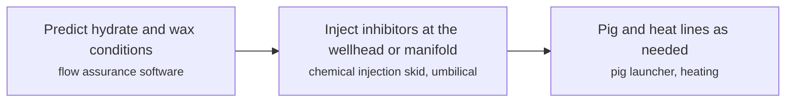

**Key equipment:** chemical injection units, umbilicals, insulated flowlines, pig traps, MEG recovery.

**Performance:**
- methane held by one volume of hydrate: 160-180 volumes; article statement. [source](https://jpt.spe.org/flow-assurance-hydrates-and-paraffin-management)
- example wax appearance temperature: 106 °F; case study flowlines; blockage 15,000 ft from wellhead. [source](https://jpt.spe.org/flow-assurance-hydrates-and-paraffin-management)

**Missing inputs:**
- chemical cost and MEG recovery cost (costs): None given. Web-checked 2026-10-28; chemical prices are vendor-quoted. Where: SPE papers on flow assurance cost (catalog: onepetro, open). Next: Add typical dosage and cost.
- named plants or projects with capacity and year (reference_plants): The sources read name no specific plant. Web-checked 2026-10-28; no verifiable named scheme added. Where: Licensor and operator press releases for the suppliers listed (open). Next: Add one or two plants with country, capacity and start-up year.
- TRL with a cited source (trl): The IEA ETP Clean Energy Technology Guide has no matching entry. IEA ETP Guide (July 2026) has no matching entry (searched hydrate, wax, asphaltene, flow assurance, chemical injection); 2026-10-28 no open TRL table found (IEA ETP guide checked 2026-10-28). Where: IEA ETP Clean Energy Technology Guide (collected): search for the technology name (catalog: iea-reports, open). Next: Find a TRL table that lists this technology, or leave maturity resting on the evidence on the card.
- process steps and equipment are general engineering practice, not taken from one source (process): The sources read describe the principle but not a full step-by-step flow. Where: Licensor process descriptions and textbooks (open); [Open process-description authority (secondary): Wikipedia article 'Gas hydrate'. Cross-check the card's process_steps against it, then cite it in sources with note 'secondary'.](https://en.wikipedia.org/wiki/Gas_hydrate) (open). Next: Verify the card's process_steps against the attached authority page, then cite it and delete this gap. Check the steps against a licensor description and name it.

Sources: [1](https://jpt.spe.org/flow-assurance-hydrates-and-paraffin-management). Last reviewed 2026-10-28.

## LNG carriers (membrane and Moss tanks, reliquefaction)

Ships carry LNG at about -163 °C in membrane tanks (GTT Mark III with 1.2 mm stainless steel, or NO96 invar) or in spherical Moss tanks. Modern ships are about 170,000 m³, Q-Max up to 266,000 m³, and boil-off is about 0.1 to 0.25% of cargo per day, which reliquefaction plants can return to the tanks.

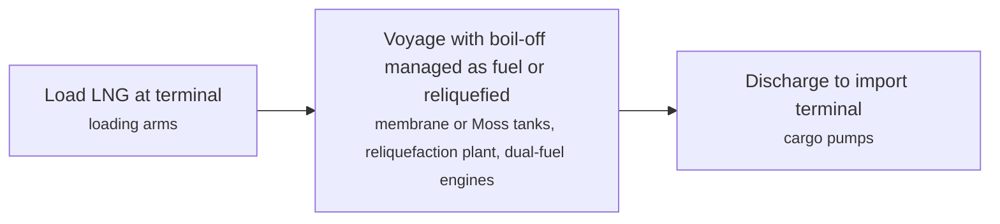

**Key equipment:** cargo tanks, insulation, reliquefaction plant, dual-fuel engines, cargo pumps.

**Performance:**
- typical modern LNG carrier capacity: 170000-172600 m3; Christophe de Margerie 172,600 m3. [source](https://en.wikipedia.org/wiki/LNG_carrier)
- boil-off rate: 0.1-0.25 % of cargo per day; typical voyage. [source](https://en.wikipedia.org/wiki/LNG_carrier)
- active LNG carrier fleet: 772 ships (includes floating storage units); 2023. [source](https://en.wikipedia.org/wiki/LNG_carrier)

**Costs:**
- newbuild price, 170,000 m3: 200 USD million (could cost); dollar year not stated in the article. [source](https://en.wikipedia.org/wiki/LNG_carrier)
- newbuild price of a standard 174,000 m3 LNG carrier: 248 million USD per vessel (about $269 m at the 2024 record high; $200-220 m range quoted for 2026 contracts) (2025$); Clarkson data (early November 2025), reported 20 Nov 2025: current market price for 174,000 m3 LNG carriers is approximately $248 million; vesselslink (Jun 2024): $269 m record high; shipfinex (Jan 2026): $200-220 m range with Korean-built premium; dollar years as dated. [source](https://www.imarinenews.com/29440.html)

**Missing inputs:**
- named plants or projects with capacity and year (reference_plants): The sources read name no specific plant. Web-checked 2026-10-28; class names (Q-Max 266k m3) exist in market reports. Where: Licensor and operator press releases for the suppliers listed (open). Next: Add one or two plants with country, capacity and start-up year.
- TRL with a cited source (trl): The IEA ETP Clean Energy Technology Guide has no matching entry. IEA ETP Guide (July 2026) has no matching entry (searched LNG carrier, LNG ship, LNG tanker, liquefied natural gas, membrane); 2026-10-28 no open TRL table found (IEA ETP guide checked 2026-10-28). Where: IEA ETP Clean Energy Technology Guide (collected): search for the technology name (catalog: iea-reports, open). Next: Find a TRL table that lists this technology, or leave maturity resting on the evidence on the card.

Sources: [1](https://en.wikipedia.org/wiki/LNG_carrier). Last reviewed 2026-10-29.

## LPG and ammonia carriers

Gas carriers move LPG and ammonia as pressurised, semi-refrigerated or fully refrigerated cargo. Fully refrigerated ships of 50,000 to 80,000 m³ are VLGCs and carry ammonia alongside LPG in Type A tanks; IGC Code Chapter 16 (adopted for 1 July 2026) allows liquefied ammonia as fuel on gas carriers.

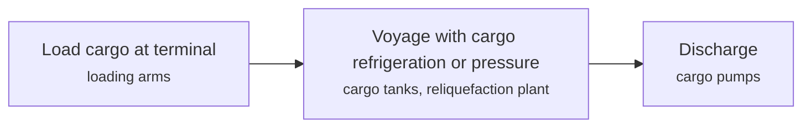

**Key equipment:** cargo tanks (Type A, C), refrigeration plant, cargo pumps, gas detection.

**Performance:**
- VLGC size class: 50000-80000 m3; fully refrigerated. [source](https://en.wikipedia.org/wiki/Gas_carrier)
- semi-refrigerated propane carriage: -10 °C at 8.5 kg/cm2; article statement. [source](https://en.wikipedia.org/wiki/Gas_carrier)
- ammonia and LPG carrier fleet indicators: 50 very large ammonia carriers (VLACs) ordered in 12 months (DNV, Oct 2024); BW LPG is the largest VLGC operator with about 50 vessels; a 39,200 m3 fully-refrigerated LPG carrier class is typical; the -33 C atmospheric carriage temperature for fully refrigerated ammonia was not stated in the open pages read; DNV (16 Oct 2024): "ordering of more than 50 very large ammonia carriers (VLACs) over the past 12 months", split between dedicated VLGCs and multipurpose VLACs; shipfinex (May 2026): BW LPG about 50 vessels, largest VLGC operator. [source](https://www.dnv.com/expert-story/maritime-impact/investing-in-future-ammonia-markets)

**Missing inputs:**
- capital cost and operating or unit cost, with dollar year and basis (costs): No open source read so far gives costs for this technology. Web-checked 2026-10-28; newbuild prices vendor-quoted. Where: arXiv and open-access journals: techno-economic or review papers (MDPI is blocked by its CDN; use the manual inbox) (catalog: arxiv, open); Licensor and EPC studies; paid cost databases are catalog-only (paid); OSTI.GOV full-text reports from DOE labs: search the technology name plus 'techno-economic' (catalog: osti, blocked). Next: Look for an open techno-economic study; record each figure with metric, range, unit, dollar year, basis and source.
- named plants or projects with capacity and year (reference_plants): The sources read name no specific plant. Web-checked 2026-10-28; fleet indicators recorded in performance. Where: Licensor and operator press releases for the suppliers listed (open). Next: Add one or two plants with country, capacity and start-up year.
- TRL with a cited source (trl): The IEA ETP Clean Energy Technology Guide has no matching entry. no open TRL table found (IEA ETP guide checked 2026-10-28). Where: IEA ETP Clean Energy Technology Guide (collected): search for the technology name (catalog: iea-reports, open). Next: Find a TRL table that lists this technology, or leave maturity resting on the evidence on the card.

Sources: [1](https://en.wikipedia.org/wiki/Gas_carrier). Last reviewed 2026-10-29.

## Leak detection (CPM, fibre optic DAS and DTS)

Computational pipeline monitoring (API 1130) and external fibre-optic sensing detect and locate leaks. Distributed acoustic sensing supports negative-pressure-wave and acoustic CPM, and Raman DTS locates leaks to 0.5 m to a few metres over up to 50 km of fibre.

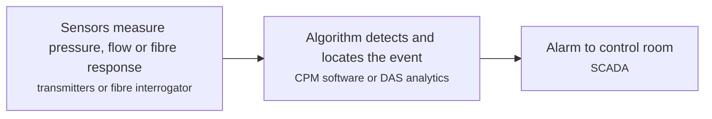

**Key equipment:** flow and pressure transmitters, fibre-optic cable, DAS/DTS interrogator, CPM software.

**Performance:**
- Raman DTS location accuracy: 0.5-3 m ('a few metres'); depends on measurement time and fibre length. [source](https://www.apsensing.com/news/detail/selection-criteria-for-pipeline-leak-detection-methods-using-distributed-fiber-optic-sensing)
- Raman DTS range with multimode fibre: 50 km (up to); vendor article. [source](https://www.apsensing.com/news/detail/selection-criteria-for-pipeline-leak-detection-methods-using-distributed-fiber-optic-sensing)
- DAS interrogator spacing for NPW monitoring: 120 km; quantitative DAS. [source](https://www.apsensing.com/news/detail/selection-criteria-for-pipeline-leak-detection-methods-using-distributed-fiber-optic-sensing)

**Missing inputs:**
- minimum detectable leak size and response time (performance): The vendor article gives no numbers. Web-checked 2026-10-28: API 1130 CPM thresholds (about 1% of flow) circulate in vendor material; no verifiable open table found. Where: API RP 1130 and API RP 1175 summaries (open); PHMSA leak detection study (catalog: phmsa, open). Next: Add thresholds from an independent study.
- capital cost and operating or unit cost, with dollar year and basis (costs): No open source read so far gives costs for this technology. Web-checked 2026-10-28; vendor quotes only. Where: arXiv and open-access journals: techno-economic or review papers (MDPI is blocked by its CDN; use the manual inbox) (catalog: arxiv, open); Licensor and EPC studies; paid cost databases are catalog-only (paid); OSTI.GOV full-text reports from DOE labs: search the technology name plus 'techno-economic' (catalog: osti, blocked). Next: Look for an open techno-economic study; record each figure with metric, range, unit, dollar year, basis and source.
- named plants or projects with capacity and year (reference_plants): The sources read name no specific plant. Web-checked 2026-10-28; no verifiable named deployment added. Where: Licensor and operator press releases for the suppliers listed (open). Next: Add one or two plants with country, capacity and start-up year.
- TRL with a cited source (trl): The IEA ETP Clean Energy Technology Guide has no matching entry. no open TRL table found (IEA ETP guide checked 2026-10-28). Where: IEA ETP Clean Energy Technology Guide (collected): search for the technology name (catalog: iea-reports, open). Next: Find a TRL table that lists this technology, or leave maturity resting on the evidence on the card.
- process steps and equipment are general engineering practice, not taken from one source (process): The sources read describe the principle but not a full step-by-step flow. Where: Licensor process descriptions and textbooks (open). Next: Check the steps against a licensor description and name it.

Sources: [1](https://www.apsensing.com/news/detail/selection-criteria-for-pipeline-leak-detection-methods-using-distributed-fiber-optic-sensing). Last reviewed 2026-10-28.

## Pipeline inline inspection (MFL, ultrasonic, EMAT pigs)

Instrumented pigs travel with the product and record wall loss, cracks and geometry. MFL is the most common and inexpensive method; ultrasonic tools measure wall thickness accurately but are costly; EMAT tools find cracks and stress-corrosion cracking without couplant.

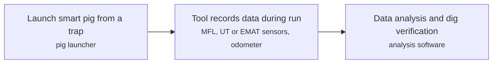

**Key equipment:** pig launcher and receiver, MFL tool, ultrasonic tool, EMAT tool, caliper and inertial tools.

**Performance:**
- MFL wall-loss sizing accuracy: 10 % (about); older PHMSA forum presentation. [source](https://primis-meetings.phmsa.dot.gov/meetings/186309ad-6581-4e62-b3e5-ea7938e79343/files/240f9863-c4bf-458b-9719-4cdf9f684163/inspection-technologies.pdf)
- gas-coupled ultrasonic wall thickness accuracy (under development): 2 % (a couple of percent); versus 10% for MFL, per the presentation. [source](https://primis-meetings.phmsa.dot.gov/meetings/186309ad-6581-4e62-b3e5-ea7938e79343/files/240f9863-c4bf-458b-9719-4cdf9f684163/inspection-technologies.pdf)

**Missing inputs:**
- cost per km of an ILI run (costs): None given. Web-checked 2026-10-28; ILI pricing is vendor-quoted. Where: PHMSA and operator integrity reports (catalog: phmsa, open). Next: Add cost range with year.
- named plants or projects with capacity and year (reference_plants): The sources read name no specific plant. Web-checked 2026-10-28; ubiquitous service. Where: Licensor and operator press releases for the suppliers listed (open). Next: Add one or two plants with country, capacity and start-up year.
- TRL with a cited source (trl): The IEA ETP Clean Energy Technology Guide has no matching entry. IEA ETP Guide (July 2026) has no matching entry (searched pigging, in-line inspection, inline inspection, ILI, pipeline inspection); 2026-10-28 no open TRL table found (IEA ETP guide checked 2026-10-28). Where: IEA ETP Clean Energy Technology Guide (collected): search for the technology name (catalog: iea-reports, open). Next: Find a TRL table that lists this technology, or leave maturity resting on the evidence on the card.

Sources: [1](https://primis-meetings.phmsa.dot.gov/meetings/186309ad-6581-4e62-b3e5-ea7938e79343/files/240f9863-c4bf-458b-9719-4cdf9f684163/inspection-technologies.pdf), [2](https://en.wikipedia.org/wiki/Pipeline_inspection_gauge). Last reviewed 2026-10-29.

## Strategic petroleum reserves (salt caverns, rock caverns)

Governments hold crude in leached salt caverns or lined rock caverns for supply emergencies. The US reserve has an authorised capacity of 714 million barrels at four Gulf Coast sites (Bryan Mound, Big Hill, West Hackberry, Bayou Choctaw).

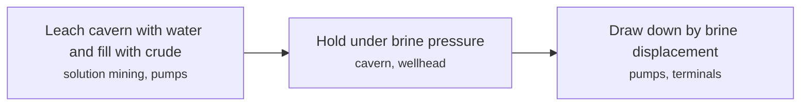

**Key equipment:** salt caverns, wellheads, pumps, marine terminals.

**Performance:**
- US SPR authorised capacity: 714 million barrels; four sites. [source](https://www.energy.gov/ceser/strategic-petroleum-reserve)

**Missing inputs:**
- rock cavern examples and Asian reserves (reference_plants): Only the US reserve was read. Web-checked 2026-10-28; no verifiable named rock-cavern SPR page found this pass. Where: IEA emergency response and JOGMEC stockpile pages (catalog: jogmec, open). Next: Add a Japan or Korea example.
- capital cost and operating or unit cost, with dollar year and basis (costs): No open source read so far gives costs for this technology. Web-checked 2026-10-28; programme figures are government-budgeted. Where: arXiv and open-access journals: techno-economic or review papers (MDPI is blocked by its CDN; use the manual inbox) (catalog: arxiv, open); Licensor and EPC studies; paid cost databases are catalog-only (paid); OSTI.GOV full-text reports from DOE labs: search the technology name plus 'techno-economic' (catalog: osti, blocked). Next: Look for an open techno-economic study; record each figure with metric, range, unit, dollar year, basis and source.
- TRL with a cited source (trl): The IEA ETP Clean Energy Technology Guide has no matching entry. no open TRL table found (IEA ETP guide checked 2026-10-28). Where: IEA ETP Clean Energy Technology Guide (collected): search for the technology name (catalog: iea-reports, open). Next: Find a TRL table that lists this technology, or leave maturity resting on the evidence on the card.
- process steps and equipment are general engineering practice, not taken from one source (process): The sources read describe the principle but not a full step-by-step flow. Where: Licensor process descriptions and textbooks (open). Next: Check the steps against a licensor description and name it.

Sources: [1](https://www.energy.gov/ceser/strategic-petroleum-reserve). Last reviewed 2026-10-28.

## Underground gas storage (salt caverns, depleted fields)

Natural gas is stored in depleted fields, salt caverns or aquifers to balance seasonal and daily demand. EIA reports nearly 400 active US facilities run by about 120 operators; depleted fields are the most common, salt caverns offer very high deliverability with low base gas, and aquifers need more cushion gas.

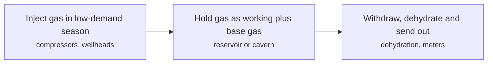

**Key equipment:** storage wells, compressors, dehydration, meters, salt cavern or reservoir.

**Performance:**
- active US underground storage facilities: 400 sites (nearly), about 120 operators; Lower 48. [source](https://www.eia.gov/naturalgas/storage/basics/)
- US underground gas storage working capacity and cushion share: 4595-4683 Bcf working gas capacity (AGA survey total 4,595 Bcf of 8,934 Bcf total capacity; Lower-48 working design capacity 4,683 Bcf as of Nov 2025); American Gas Association survey: total capacity 8,934 Bcf with working gas 4,595 Bcf - implying about 49% cushion (base) gas by difference; compressortech2 (3 Jun 2026): Lower-48 combined working gas design capacity 4,683 Bcf as of Nov 2025; per-storage-type deliverability figures were not stated in the pages read. [source](https://www.aga.org/wp-content/uploads/2023/01/Section4Divider.pdf)

**Missing inputs:**
- capital cost and operating or unit cost, with dollar year and basis (costs): No open source read so far gives costs for this technology. Web-checked 2026-10-28; cavern development costs case-specific. Where: arXiv and open-access journals: techno-economic or review papers (MDPI is blocked by its CDN; use the manual inbox) (catalog: arxiv, open); Licensor and EPC studies; paid cost databases are catalog-only (paid); OSTI.GOV full-text reports from DOE labs: search the technology name plus 'techno-economic' (catalog: osti, blocked). Next: Look for an open techno-economic study; record each figure with metric, range, unit, dollar year, basis and source.
- named plants or projects with capacity and year (reference_plants): The sources read name no specific plant. Web-checked 2026-10-28; no verifiable named facility added this pass. Where: Licensor and operator press releases for the suppliers listed (open). Next: Add one or two plants with country, capacity and start-up year.
- TRL with a cited source (trl): The IEA ETP Clean Energy Technology Guide has no matching entry. no open TRL table found (IEA ETP guide checked 2026-10-28). Where: IEA ETP Clean Energy Technology Guide (collected): search for the technology name (catalog: iea-reports, open). Next: Find a TRL table that lists this technology, or leave maturity resting on the evidence on the card.

Sources: [1](https://www.eia.gov/naturalgas/storage/basics/), [2](https://en.wikipedia.org/wiki/Underground_gas_storage). Last reviewed 2026-10-29.

## Hydrogen blending and repurposing of gas pipelines

Hydrogen is mixed into natural gas networks at low shares, or existing steel lines are converted to carry hydrogen. NREL's review finds only minor issues below about 5 to 15% hydrogen by volume for distribution, notes fatigue crack growth rises at low hydrogen partial pressures, and puts the longest-running US blend at 12 to 15% (Hawaii Gas).

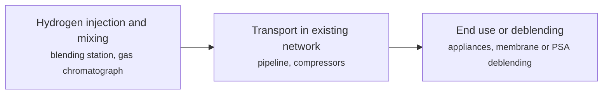

**Key equipment:** blending station, compressors, meters, deblending units.

**Performance:**
- hydrogen share with minor issues (distribution): 5-15 % by volume; Melaina et al. 2013 as cited by NREL. [source](https://docs.nlr.gov/docs/fy23osti/81704.pdf)
- energy transmission capacity at 100% hydrogen vs natural gas: 15-20 % lower; at fixed pressure drop. [source](https://docs.nlr.gov/docs/fy23osti/81704.pdf)
- Hawaii Gas blend: 12-15 % hydrogen; longest-running US blending project. [source](https://docs.nlr.gov/docs/fy23osti/81704.pdf)

**Reference plants:**
- HyDeploy hydrogen blending trials, Keele University and Winlaton (Cadent/Northern Gas Networks), GB: up to 20% hydrogen by volume blended into existing gas networks; Keele University network trial first, then Winlaton, Gateshead from 2021 supplying 668 houses, a school and small businesses; operating. [source](https://www.spglobal.com/energy/en/news-research/latest-news/electric-power/072621-uk-hydrogen-blending-for-public-gas-grid-trial-gets-go-ahead)

TRL source: [IEA ETP Clean Energy Technology Guide, dataset of 24 July 2026, latest assessment (IEA 1-11 scale): 'Hydrogen blending in natural gas network' 7 (2025); 'Repurposed natural gas pipelines' 8 (2025)](https://www.iea.org/data-and-statistics/data-tools/etp-clean-energy-technology-guide)

**Missing inputs:**
- repurposing cost versus new build (costs): NREL's review text read gives no cost. Web-checked 2026-10-28: European Hydrogen Backbone cost ratios circulate in reports but no verifiable primary figure read this pass. Where: European Hydrogen Backbone and DNV reports (catalog: iea-hydrogen-db, open). Next: Add cost fraction with source.
- process steps and equipment are general engineering practice, not taken from one source (process): The sources read describe the principle but not a full step-by-step flow. Where: Licensor process descriptions and textbooks (open); [Open process-description authority (secondary): Wikipedia article 'Hydrogen economy'. Cross-check the card's process_steps against it, then cite it in sources with note 'secondary'.](https://en.wikipedia.org/wiki/Hydrogen_economy) (open). Next: Verify the card's process_steps against the attached authority page, then cite it and delete this gap. Check the steps against a licensor description and name it.

Sources: [1](https://docs.nlr.gov/docs/fy23osti/81704.pdf). Last reviewed 2026-10-28.

## Liquid CO2 carriers

Ships carry liquefied CO2 at about -50 °C and 7 bar in semi-refrigerated tanks. The IPCC report (2005) puts loss at 3 to 4% per 1,000 km and finds ships competitive with pipelines at about 1,000 km for 6 Mt/yr; Northern Lights stores 1.5 Mt/yr in phase 1, about 2,600 m below the North Sea seabed.

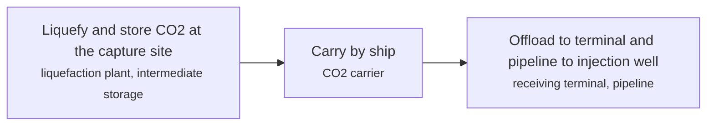

**Key equipment:** liquefaction plant, intermediate storage, CO2 carrier, receiving terminal.

**Performance:**
- design condition, 22,000 m3 semi-refrigerated tanker: -50 °C at about 7 bar; IPCC report 2005. [source](https://www.ipcc.ch/site/assets/uploads/2018/03/srccs_chapter4-1.pdf)
- CO2 loss in transport: 3-4 % per 1000 km; 1 to 2% with onshore recapture. [source](https://www.ipcc.ch/site/assets/uploads/2018/03/srccs_chapter4-1.pdf)
- Northern Lights phase 1 capacity: 1.5 Mt/yr; storage about 2,600 m below the seabed; operations started 2025. [source](https://norlights.com/what-we-do/)

**Costs:**
- ship transport cost excluding liquefaction: 20-28 USD/t (2004$); 500 km to 4,500 km, 5.5 Mt/yr, Statoil 2004 study. [source](https://www.ipcc.ch/site/assets/uploads/2018/03/srccs_chapter4-1.pdf)

**Reference plants:**
- Northern Lights LCO2 carrier fleet (Northern Pioneer, Pathfinder, Liaison, Phoenix), NO: four 7,500 m3 liquefied-CO2 carriers (two full-pressure C-type tanks each, 130 m length); first three delivered from late 2024, fourth arrived July 2026 completing the phase-one fleet; further four 7,500 m3 ships chartered from K Line, scaling to larger vessels; operating. [source](https://gcaptain.com/northern-lights-expands-carbon-shipping-fleet-with-new-co2-carrier/)

TRL source: [IEA ETP Clean Energy Technology Guide dataset (July 2026), entry 'CO2 shipping'](https://www.iea.org/data-and-statistics/data-tools/etp-clean-energy-technology-guide)

**Missing inputs:**
- process steps and equipment are general engineering practice, not taken from one source (process): The sources read describe the principle but not a full step-by-step flow. Where: Licensor process descriptions and textbooks (open). Next: Check the steps against a licensor description and name it.

Sources: [1](https://www.ipcc.ch/site/assets/uploads/2018/03/srccs_chapter4-1.pdf), [2](https://norlights.com/what-we-do/), [3](https://www.iea.org/data-and-statistics/data-tools/etp-clean-energy-technology-guide), [4](https://gcaptain.com/northern-lights-expands-carbon-shipping-fleet-with-new-co2-carrier/). Last reviewed 2026-10-28.

## Liquid hydrogen carriers

Hydrogen is liquefied at -253 °C and carried in double-insulated tanks. Kawasaki's Suiso Frontier, launched 11 December 2019 with 1,250 m³ capacity, made the first Japan-Australia voyage in January 2022 with a gas-control-system malfunction at Hastings port on 25 January 2022.

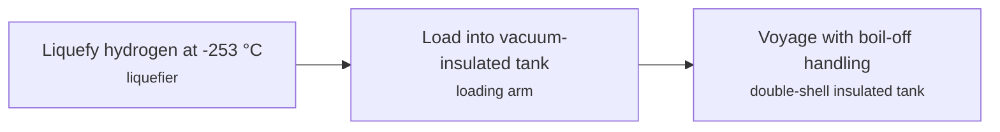

**Key equipment:** liquefier, insulated cargo tank, loading system, boil-off handling.

**Performance:**
- Suiso Frontier capacity: 1250 m3; prototype. [source](https://en.wikipedia.org/wiki/Suiso_Frontier)
- liquefied hydrogen temperature: -253 °C; 20 K. [source](https://en.wikipedia.org/wiki/Suiso_Frontier)
- Suiso Frontier liquefied-hydrogen carrier (world's first LH2 ship): 1250-75 m3 LH2 tank capacity (1,250 cbm), about 75 t LH2 per cargo, 116 m and about 8,000 t displacement; maiden international LH2 voyage Hastings (Victoria, Australia) to Kobe, Japan, delivered February 2022; boil-off rate not published in open pages. [source](https://lngprime.com/asia/video-suiso-frontier-delivers-first-liquefied-hydrogen-shipment-to-japan/43855)

**Reference plants:**
- Suiso Frontier LH2 pilot supply chain (Kawasaki and HESC partners), Australia-Japan, JP: world's first purpose-built liquid-hydrogen carrier; 1,250 m3 vacuum-insulated tank; brown-coat HESC pilot project; operating. [source](https://lngprime.com/asia/video-suiso-frontier-delivers-first-liquefied-hydrogen-shipment-to-japan/43855)

**Missing inputs:**
- commercial-scale carrier designs and boil-off rates (performance): Only the pilot ship was read. Suiso Frontier design/cargo figures recorded in performance; boil-off rate not published, 2026-10-28. Where: Kawasaki Heavy Industries press releases (open). Next: Add 160,000 m3 carrier design data.
- capital cost and operating or unit cost, with dollar year and basis (costs): No open source read so far gives costs for this technology. Web-checked 2026-10-28; no open figures. Where: arXiv and open-access journals: techno-economic or review papers (MDPI is blocked by its CDN; use the manual inbox) (catalog: arxiv, open); Licensor and EPC studies; paid cost databases are catalog-only (paid); OSTI.GOV full-text reports from DOE labs: search the technology name plus 'techno-economic' (catalog: osti, blocked). Next: Look for an open techno-economic study; record each figure with metric, range, unit, dollar year, basis and source.
- TRL with a cited source (trl): The IEA ETP Clean Energy Technology Guide has no matching entry. no open TRL table found (IEA ETP guide checked 2026-10-28). Where: IEA ETP Clean Energy Technology Guide (collected): search for the technology name (catalog: iea-reports, open). Next: Find a TRL table that lists this technology, or leave maturity resting on the evidence on the card.
- process steps and equipment are general engineering practice, not taken from one source (process): The sources read describe the principle but not a full step-by-step flow. Where: Licensor process descriptions and textbooks (open). Next: Check the steps against a licensor description and name it.

Sources: [1](https://en.wikipedia.org/wiki/Suiso_Frontier). Last reviewed 2026-10-28.
