# PCH technology options

28 technologies, from commercial to lab stage. Generated from catalog/technologies/; every figure links to its source.

| Technology | Category | Maturity | TRL | Suppliers | Cost figures |
| --- | --- | --- | --- | --- | --- |
| [Acetic acid (methanol carbonylation)](#pch-acetic-acid) | Intermediates / acetyls | commercial |  | BP (Cativa); Celanese (register examples) |  |
| [Ammonia and urea](#pch-ammonia-urea) | Intermediates / fertiliser | commercial | 8 | Stamicarbon (urea stripping and N=3 concepts); Topsoe (register examples); KBR (register examples); thyssenkrupp Uhde (register examples); Casale (register examples) |  |
| [Aromatics complexes (paraxylene, benzene)](#pch-aromatics-complex) | Aromatics | commercial |  | Honeywell UOP (CCR Platforming, Parex, Isomar, Tatoray, Sulfolane); Axens (aromatics (register examples)) |  |
| [Bio-based chemicals (bio-ethylene, bio-PE, PLA)](#pch-bio-based-chemicals) | Circular chemicals / bio-based | commercial | 9 | Braskem (Green PE); NatureWorks (PLA (register examples; not verified)); TotalEnergies Corbion (PLA (register examples; not verified)) |  |
| [Butadiene extraction and on-purpose butadiene](#pch-butadiene) | Intermediates / C4 | commercial |  | Lummus Technology (butadiene extraction (BASF process); CATADIENE); BASF (NMP extraction process) |  |
| [Engineering plastics (polycarbonate, nylon)](#pch-engineering-plastics) | Polymers / engineering | commercial |  | SABIC (register examples); Covestro (polycarbonate, recyclate compounding in Shanghai) |  |
| [Ethylene oxide and glycols](#pch-ethylene-oxide-glycols) | Intermediates / EO-EG | commercial |  | Shell (OMEGA, EO catalysts); Dow (METEOR (register examples)); Scientific Design (register examples) |  |
| [Linear alpha olefins](#pch-linear-alpha-olefins) | Intermediates / LAO | commercial |  | SABIC and Linde (alpha-SABLIN); Axens (AlphaButol (register examples)) |  |
| [Mechanical recycling of plastics](#pch-mechanical-recycling) | Circular chemicals / recycling | commercial |  |  |  |
| [Metathesis (OCT)](#pch-olefins-metathesis) | Olefins / propylene | commercial |  | Lummus Technology (OCT) |  |
| [Methanol-to-olefins (MTO, DMTO)](#pch-methanol-to-olefins) | Olefins / methanol route | commercial |  | DICP / SYN Energy Technology (DMTO); Honeywell UOP (MTO) |  |
| [PET and polyester](#pch-pet-polyester) | Polymers / polyesters | commercial |  | thyssenkrupp Uhde Inventa-Fischer (MTR process); Sulzer (register examples) |  |
| [PHA bioplastics](#pch-pha-bioplastics) | Circular chemicals / bio-based | commercial |  | Danimer Scientific (Nodax PHA); CJ (register examples) |  |
| [PVC (suspension) and chlor-alkali](#pch-pvc-chlor-alkali) | Polymers / chlorine chain | commercial |  | thyssenkrupp nucera (BM, BiTAC and NaCl-ODC electrolysers); Ineos (register examples) |  |
| [Paraxylene adsorption and crystallisation](#pch-paraxylene-adsorption) | Aromatics / separation | commercial |  | Honeywell UOP (Parex, MX Sorbex, ED Sulfolane); Axens (Eluxyl) |  |
| [Phenol and acetone (cumene)](#pch-phenol-acetone) | Intermediates / phenolics | commercial |  | Technip Energies (Badger) (cumene technology); KBR (register examples); Lummus (register examples) |  |
| [Polyethylene (gas phase, slurry, solution)](#pch-polyethylene) | Polymers | commercial |  | Univation (Dow) (UNIPOL PE); LyondellBasell; Ineos; Chevron Phillips Chemical; Borealis (Borstar) |  |
| [Polypropylene (gas phase, bulk)](#pch-polypropylene) | Polymers | commercial |  | Grace (UNIPOL PP); LyondellBasell (Spheripol); Ineos (Innovene PP) |  |
| [Propane dehydrogenation (Oleflex, CATOFIN)](#pch-propane-dehydrogenation) | Olefins / on-purpose propylene | commercial |  | Honeywell UOP (Oleflex); Lummus Technology (CATOFIN) |  |
| [Propylene oxide (HPPO, PO/SM)](#pch-propylene-oxide) | Intermediates / PO | commercial |  | Evonik and thyssenkrupp Uhde (HPPO); Dow and BASF (HPPO (register examples)); LyondellBasell (PO/SM (register examples)) |  |
| [Steam cracking (naphtha, ethane, LPG)](#pch-steam-cracking) | Olefins / thermal cracking | commercial | 9 | Lummus Technology; Technip Energies; Linde Engineering; KBR |  |
| [Toluene disproportionation and transalkylation](#pch-toluene-disproportionation) | Aromatics | commercial |  | Honeywell UOP (Tatoray); ExxonMobil (register examples) |  |
| [Depolymerisation of PET (glycolysis, enzymatic)](#pch-pet-depolymerisation) | Circular chemicals | demonstration | 8 | Carbios (C-ZYME enzymatic process); Loop Industries; Indorama Ventures (host site and offtake) |  |
| [Electric steam cracking](#pch-electric-steam-cracking) | Olefins / electrified thermal cracking | demonstration | 6 | Linde Engineering (furnace design and EPC); BASF (demonstration operator); SABIC |  |
| [Electrification of process heat (e-boilers, heat pumps)](#pch-electrified-process-heat) | Low-carbon chemicals / heat | demonstration | 6-9 | GIG Karasek (BASF 50 MW heat pump); BASF, SABIC, Linde (electric steam-cracker furnace demo) |  |
| [Oxidative coupling of methane](#pch-oxidative-coupling-methane) | Olefins / gas-to-olefins | demonstration |  | Siluria Technologies (OCM demonstration (company later acquired; ownership not covered by the source)); Lummus Technology (register examples); Linde (partner named in Siluria release) |  |
| [Plastics pyrolysis (chemical recycling)](#pch-plastics-pyrolysis) | Circular chemicals | demonstration | 9 | Plastic Energy (TAC (TACOIL)); Agilyx; Mura Technology; BASF (ChemCycling) |  |
| [Solvent-based purification of plastics](#pch-solvent-based-plastics-purification) | Circular chemicals / recycling | demonstration |  | PureCycle Technologies (Ironton plant (P&G-licensed process)); Fraunhofer (CreaSolv (register examples)) |  |

## Acetic acid (methanol carbonylation)
<a id="pch-acetic-acid"></a>

Methanol reacts with carbon monoxide in the presence of an iodide promoter and a rhodium (Monsanto) or iridium (Cativa) catalyst. Iridium lets the reaction run with less water, which needs fewer drying columns, gives fewer by-products such as propionic acid and suppresses the water-gas shift. The two processes can share the same plant.

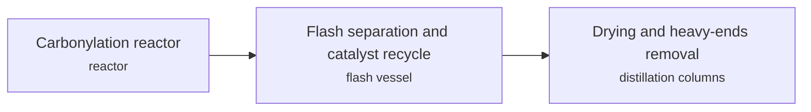

**Key equipment:** carbonylation reactor, flash vessel, light-ends and drying columns.

**Missing inputs:**
- conditions, yields and plant capacities (performance): The secondary source gives no numbers. Where: BP Cativa licensing page (open). Next: Add primary data.
- capital cost and operating or unit cost, with dollar year and basis (costs): No open source read so far gives costs for this technology. Where: arXiv and open-access journals: techno-economic or review papers (MDPI is blocked by its CDN; use the manual inbox) (catalog: arxiv, open); Licensor and EPC studies; paid cost databases are catalog-only (paid); OSTI.GOV full-text reports from DOE labs: search the technology name plus 'techno-economic' (catalog: osti, blocked). Next: Look for an open techno-economic study; record each figure with metric, range, unit, dollar year, basis and source.
- named plants or projects with capacity and year (reference_plants): The sources read name no specific plant. Where: Licensor and operator press releases for the suppliers listed (open). Next: Add one or two plants with country, capacity and start-up year.
- TRL with a cited source (trl): The IEA ETP Clean Energy Technology Guide has no matching entry. Where: IEA ETP Clean Energy Technology Guide (collected): search for the technology name (catalog: iea-reports, open). Next: Find a TRL table that lists this technology, or leave maturity resting on the evidence on the card.
- process steps and equipment are general engineering practice, not taken from one source (process): The sources read describe the principle but not a full step-by-step flow. Where: Licensor process descriptions and textbooks (open). Next: Check the steps against a licensor description and name it.

Sources: [1](https://en.wikipedia.org/wiki/Cativa_process). Last reviewed 2026-10-25.

## Ammonia and urea
<a id="pch-ammonia-urea"></a>

Natural gas or other feed is reformed to hydrogen, nitrogen is added and ammonia is made over iron catalyst in a Haber-Bosch loop; ammonia and CO2 then react in a urea synthesis reactor. Stamicarbon's CO2 stripping process cut steam use from 1,600 to 1,800 kg/t urea in conventional plants to about 800 kg/t, and its N=3 pool-condenser concept runs at 400 t/d in Geleen and 2,100 t/d at Bontang, Indonesia.


**Key equipment:** reformers, synthesis converter, urea reactor, CO2 stripper, carbamate condenser, granulator.

**Performance:**
- steam per tonne urea, conventional versus CO2 stripping: 800-1800 kg/t urea; conventional 1,600 to 1,800; N=2 stripping about 800 at 25 bar; N=3 596 to 610 MP steam. [source](https://www.fertilizer.org/wp-content/uploads/2023/01/2000_ifa_neworleans_jonckers.pdf)
- CO2 compressor power in N=3 concept: 100 kWh/t urea; paper. [source](https://www.fertilizer.org/wp-content/uploads/2023/01/2000_ifa_neworleans_jonckers.pdf)

**Reference plants:**
- Stamicarbon N=3 process, Bontang, Indonesia, ID: 2,100 t/d; . [source](https://www.fertilizer.org/wp-content/uploads/2023/01/2000_ifa_neworleans_jonckers.pdf)
- Stamicarbon N=3 process, Geleen, NL: 400 t/d; . [source](https://www.fertilizer.org/wp-content/uploads/2023/01/2000_ifa_neworleans_jonckers.pdf)

TRL source: [IEA ETP Clean Energy Technology Guide, dataset of 24 July 2026, latest assessment (IEA 1-11 scale): 'Haber-bosch process using electrolytic hydrogen' 8 (2025)](https://www.iea.org/data-and-statistics/data-tools/etp-clean-energy-technology-guide)

**Missing inputs:**
- ammonia plant energy intensity GJ per tonne (performance): The IEA ammonia roadmap page returned no content. Where: IEA Ammonia Technology Roadmap (catalog: iea-reports, open); IFA energy efficiency reports (open). Next: Add GJ/t figures.
- capital cost and operating or unit cost, with dollar year and basis (costs): No open source read so far gives costs for this technology. Where: arXiv and open-access journals: techno-economic or review papers (MDPI is blocked by its CDN; use the manual inbox) (catalog: arxiv, open); Licensor and EPC studies; paid cost databases are catalog-only (paid); OSTI.GOV full-text reports from DOE labs: search the technology name plus 'techno-economic' (catalog: osti, blocked). Next: Look for an open techno-economic study; record each figure with metric, range, unit, dollar year, basis and source.
- process steps and equipment are general engineering practice, not taken from one source (process): The sources read describe the principle but not a full step-by-step flow. Where: Licensor process descriptions and textbooks (open). Next: Check the steps against a licensor description and name it.

Sources: [1](https://www.fertilizer.org/wp-content/uploads/2023/01/2000_ifa_neworleans_jonckers.pdf). Last reviewed 2026-10-25.

## Aromatics complexes (paraxylene, benzene)
<a id="pch-aromatics-complex"></a>

A naphtha reformer makes aromatics, which are extracted and fractionated; paraxylene is recovered by adsorption (Parex), the other xylenes are isomerised (Isomar) and toluene is converted to xylenes and benzene (Tatoray). Hengyi's Brunei complex adds an LD Parex unit recovering 2.3 Mtpa of paraxylene, taking total paraxylene capacity above 3.8 Mtpa.

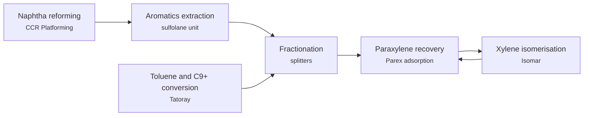

**Key equipment:** CCR reformer, sulfolane extraction, Parex adsorption chamber, Isomar reactor, Tatoray reactor, fractionation.

**Performance:**
- LD Parex paraxylene recovery at Hengyi Brunei: 2.3 Mtpa; total paraxylene capacity above 3.8 Mtpa after Phase 2. [source](https://www.ogj.com/refining-processing/petrochemicals/article/14198324/hengyi-lets-contract-for-aromatics-expansion-at-brunei-complex)

**Reference plants:**
- Hengyi Industries aromatics expansion, Pulau Muara Besar, BN: 2.3 Mtpa Parex; total PX above 3.8 Mtpa; Phase 2 commissioning scheduled for 2022 in the article. [source](https://www.ogj.com/refining-processing/petrochemicals/article/14198324/hengyi-lets-contract-for-aromatics-expansion-at-brunei-complex)

**Missing inputs:**
- energy use and overall PX yield per tonne naphtha (performance): Only a UOP claim of doubling PX yield. Where: UOP aromatics brochures (catalog: honeywell-uop, open). Next: Add yields.
- capital cost and operating or unit cost, with dollar year and basis (costs): No open source read so far gives costs for this technology. Where: arXiv and open-access journals: techno-economic or review papers (MDPI is blocked by its CDN; use the manual inbox) (catalog: arxiv, open); Licensor and EPC studies; paid cost databases are catalog-only (paid); OSTI.GOV full-text reports from DOE labs: search the technology name plus 'techno-economic' (catalog: osti, blocked). Next: Look for an open techno-economic study; record each figure with metric, range, unit, dollar year, basis and source.
- TRL with a cited source (trl): The IEA ETP Clean Energy Technology Guide has no matching entry. Where: IEA ETP Clean Energy Technology Guide (collected): search for the technology name (catalog: iea-reports, open). Next: Find a TRL table that lists this technology, or leave maturity resting on the evidence on the card.
- process steps and equipment are general engineering practice, not taken from one source (process): The sources read describe the principle but not a full step-by-step flow. Where: Licensor process descriptions and textbooks (open). Next: Check the steps against a licensor description and name it.

Sources: [1](https://www.ogj.com/refining-processing/petrochemicals/article/14198324/hengyi-lets-contract-for-aromatics-expansion-at-brunei-complex). Last reviewed 2026-10-25.

## Bio-based chemicals (bio-ethylene, bio-PE, PLA)
<a id="pch-bio-based-chemicals"></a>

Sugarcane ethanol is dehydrated to ethylene and polymerised to polyethylene identical to fossil PE (Braskem Green PE, Triunfo, 200,000 t/yr since 2010); lactic acid from sugars is polymerised to PLA. IEA rates ethylene production by fermentation at TRL 9.

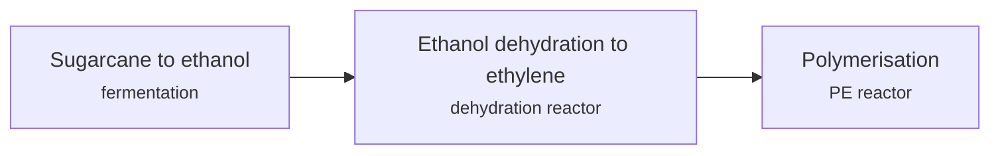

**Key equipment:** fermentation, ethanol dehydration reactor, PE reactor.

**Performance:**
- Braskem Green PE capacity: 200000 t/yr; Triunfo, Brazil, since 2010. [source](https://en.wikipedia.org/wiki/Renewable_polyethylene)
- CO2 sequestered per tonne Green PE: 2.15 t CO2/t; general figure for Green PE, not Braskem-specific. [source](https://en.wikipedia.org/wiki/Renewable_polyethylene)

**Reference plants:**
- Braskem Green PE, Triunfo, BR: 200,000 t/yr; . [source](https://en.wikipedia.org/wiki/Renewable_polyethylene)

TRL source: [IEA ETP Clean Energy Technology Guide, dataset of 24 July 2026, latest assessment (IEA 1-11 scale): 'Ethylene production using fermentation' 9 (2025)](https://www.iea.org/data-and-statistics/data-tools/etp-clean-energy-technology-guide)

**Missing inputs:**
- PLA plants and costs (reference_plants): Only Braskem covered. Where: NatureWorks and TotalEnergies Corbion pages (open). Next: Add PLA plants.
- capital cost and operating or unit cost, with dollar year and basis (costs): No open source read so far gives costs for this technology. Where: arXiv and open-access journals: techno-economic or review papers (MDPI is blocked by its CDN; use the manual inbox) (catalog: arxiv, open); Licensor and EPC studies; paid cost databases are catalog-only (paid); OSTI.GOV full-text reports from DOE labs: search the technology name plus 'techno-economic' (catalog: osti, blocked). Next: Look for an open techno-economic study; record each figure with metric, range, unit, dollar year, basis and source.
- process steps and equipment are general engineering practice, not taken from one source (process): The sources read describe the principle but not a full step-by-step flow. Where: Licensor process descriptions and textbooks (open). Next: Check the steps against a licensor description and name it.

Sources: [1](https://en.wikipedia.org/wiki/Renewable_polyethylene). Last reviewed 2026-10-25.

## Butadiene extraction and on-purpose butadiene
<a id="pch-butadiene"></a>

Butadiene is extracted from steam-cracker crude C4 with N-methylpyrrolidone (NMP) solvent; on-purpose routes dehydrogenate n-butane (CATADIENE) or butenes. Lummus has licensed the BASF extraction process since 1990, with 38 plants over 4 Mtpa, recovering more than 99% of the butadiene at 99.7 wt% purity.

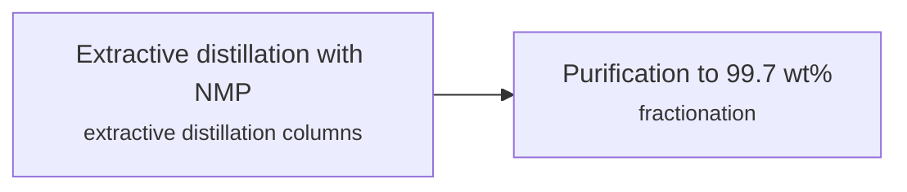

**Key equipment:** extractive distillation columns, solvent regeneration, fractionation.

**Performance:**
- butadiene recovery: 99 %; more than 99% of feed 1,3-butadiene; product 99.7 wt%. [source](https://www.lummustechnology.com/getmedia/b9694881-4803-41ff-8e0a-06f5afc17992/2020-09-15-butadiene-extraction-technology-tech-sheet.pdf)
- installed licensed capacity: 4 Mtpa; 38 plants worldwide. [source](https://www.lummustechnology.com/getmedia/b9694881-4803-41ff-8e0a-06f5afc17992/2020-09-15-butadiene-extraction-technology-tech-sheet.pdf)

**Missing inputs:**
- CATADIENE and other on-purpose routes (process): Only the extraction sheet was read. Where: Lummus CATADIENE page (catalog: lummus, open). Next: Add dehydrogenation data.
- capital cost and operating or unit cost, with dollar year and basis (costs): No open source read so far gives costs for this technology. Where: arXiv and open-access journals: techno-economic or review papers (MDPI is blocked by its CDN; use the manual inbox) (catalog: arxiv, open); Licensor and EPC studies; paid cost databases are catalog-only (paid); OSTI.GOV full-text reports from DOE labs: search the technology name plus 'techno-economic' (catalog: osti, blocked). Next: Look for an open techno-economic study; record each figure with metric, range, unit, dollar year, basis and source.
- named plants or projects with capacity and year (reference_plants): The sources read name no specific plant. Where: Licensor and operator press releases for the suppliers listed (open). Next: Add one or two plants with country, capacity and start-up year.
- TRL with a cited source (trl): The IEA ETP Clean Energy Technology Guide has no matching entry. Where: IEA ETP Clean Energy Technology Guide (collected): search for the technology name (catalog: iea-reports, open). Next: Find a TRL table that lists this technology, or leave maturity resting on the evidence on the card.

Sources: [1](https://www.lummustechnology.com/getmedia/b9694881-4803-41ff-8e0a-06f5afc17992/2020-09-15-butadiene-extraction-technology-tech-sheet.pdf). Last reviewed 2026-10-25.

## Engineering plastics (polycarbonate, nylon)
<a id="pch-engineering-plastics"></a>

Polycarbonate is made from bisphenol A and phosgene (interfacial) or diphenyl carbonate (melt), and nylons from diamines and diacids or lactams. The sources found so far give company activity only: Covestro started a recyclate compounding plant at its Shanghai site in October 2023 (capacity not stated in the page read).

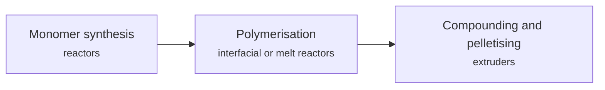

**Key equipment:** polymerisation reactors, extruders, pelletisers.

**Missing inputs:**
- process descriptions, capacities and energy use for polycarbonate and nylon (performance): Search results were patents and a paywalled news item. Where: Covestro and SABIC technical pages (catalog: sabic-licensing, open); IHS Process Economics Program (paid) (paid). Next: Add a licensor or review source.
- capital cost and operating or unit cost, with dollar year and basis (costs): No open source read so far gives costs for this technology. Where: arXiv and open-access journals: techno-economic or review papers (MDPI is blocked by its CDN; use the manual inbox) (catalog: arxiv, open); Licensor and EPC studies; paid cost databases are catalog-only (paid); OSTI.GOV full-text reports from DOE labs: search the technology name plus 'techno-economic' (catalog: osti, blocked). Next: Look for an open techno-economic study; record each figure with metric, range, unit, dollar year, basis and source.
- named plants or projects with capacity and year (reference_plants): The sources read name no specific plant. Where: Licensor and operator press releases for the suppliers listed (open). Next: Add one or two plants with country, capacity and start-up year.
- TRL with a cited source (trl): The IEA ETP Clean Energy Technology Guide has no matching entry. Where: IEA ETP Clean Energy Technology Guide (collected): search for the technology name (catalog: iea-reports, open). Next: Find a TRL table that lists this technology, or leave maturity resting on the evidence on the card.
- process steps and equipment are general engineering practice, not taken from one source (process): The sources read describe the principle but not a full step-by-step flow. Where: Licensor process descriptions and textbooks (open). Next: Check the steps against a licensor description and name it.

Sources: [1](https://www.plasteurope.com/news/detail.asp?id=253846). Last reviewed 2026-10-25.

## Ethylene oxide and glycols
<a id="pch-ethylene-oxide-glycols"></a>

Ethylene is oxidised with oxygen over a silver catalyst to ethylene oxide, which is hydrated to ethylene glycols. High-selectivity catalysts reached 90% or more start-of-cycle selectivity, and a two-step catalytic route via ethylene carbonate (Shell OMEGA) gives more than 99% MEG against 90 to 92% for thermal hydration.

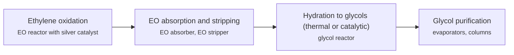

**Key equipment:** EO reactor, CO2 removal system, EO absorber and stripper, glycol reactor, glycol columns.

**Performance:**
- EO catalyst selectivity, high-selectivity types: 86-90 %; start of cycle: early HS at least 86%, later HS 90% or more; HP averaged about 87% in one plant. [source](https://catalysts.shell.com/hubfs/Content%20Library/SCT%20-%20Enhancements%20in%20EOEG%20Manufacturing%20Technology.pdf)
- MEG yield, catalytic two-step versus thermal: 90-99 %; thermal 90 to 92%; catalytic more than 99%. [source](https://catalysts.shell.com/hubfs/Content%20Library/SCT%20-%20Enhancements%20in%20EOEG%20Manufacturing%20Technology.pdf)

**Missing inputs:**
- OMEGA plants (reference_plants): Not in this paper. Where: Shell OMEGA page (catalog: shell-catalysts, open). Next: Add plants.
- capital cost and operating or unit cost, with dollar year and basis (costs): No open source read so far gives costs for this technology. Where: arXiv and open-access journals: techno-economic or review papers (MDPI is blocked by its CDN; use the manual inbox) (catalog: arxiv, open); Licensor and EPC studies; paid cost databases are catalog-only (paid); OSTI.GOV full-text reports from DOE labs: search the technology name plus 'techno-economic' (catalog: osti, blocked). Next: Look for an open techno-economic study; record each figure with metric, range, unit, dollar year, basis and source.
- TRL with a cited source (trl): The IEA ETP Clean Energy Technology Guide has no matching entry. Where: IEA ETP Clean Energy Technology Guide (collected): search for the technology name (catalog: iea-reports, open). Next: Find a TRL table that lists this technology, or leave maturity resting on the evidence on the card.
- process steps and equipment are general engineering practice, not taken from one source (process): The sources read describe the principle but not a full step-by-step flow. Where: Licensor process descriptions and textbooks (open). Next: Check the steps against a licensor description and name it.

Sources: [1](https://catalysts.shell.com/hubfs/Content%20Library/SCT%20-%20Enhancements%20in%20EOEG%20Manufacturing%20Technology.pdf). Last reviewed 2026-10-25.

## Linear alpha olefins
<a id="pch-linear-alpha-olefins"></a>

Ethylene is oligomerised to a range of linear alpha olefins (butene-1, hexene-1, octene-1 up to heavy cuts). SABIC and Linde's alpha-SABLIN is a one-stage homogeneous process; the Jubail plant was contracted in 2004, designed for 150,000 t/yr, and commercialised by 30 November 2009.

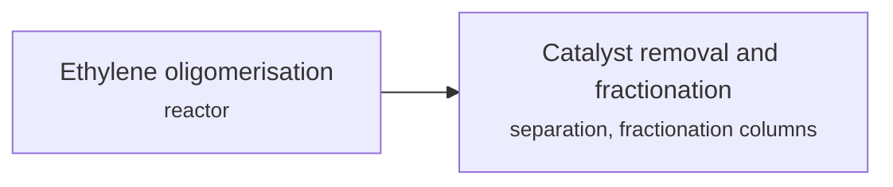

**Key equipment:** oligomerisation reactor, catalyst deactivation and removal, fractionation columns.

**Performance:**
- Jubail LAO plant design capacity: 150000 t/yr; Jubail United Petrochemical Co.. [source](https://www.chemicalprocessing.com/processing-equipment/reaction-synthesis/news/11357729/sabic-linde-group-successfully-commercialize-linear-alpha-olefins-chemical-processing)

**Reference plants:**
- Jubail United alpha-SABLIN LAO plant, SA: 150,000 t/yr; . [source](https://www.chemicalprocessing.com/processing-equipment/reaction-synthesis/news/11357729/sabic-linde-group-successfully-commercialize-linear-alpha-olefins-chemical-processing)

**Missing inputs:**
- product distribution and selectivity (performance): Not in the article. Where: Linde alpha-SABLIN brochure (catalog: linde-engineering, open). Next: Add distribution.
- capital cost and operating or unit cost, with dollar year and basis (costs): No open source read so far gives costs for this technology. Where: arXiv and open-access journals: techno-economic or review papers (MDPI is blocked by its CDN; use the manual inbox) (catalog: arxiv, open); Licensor and EPC studies; paid cost databases are catalog-only (paid); OSTI.GOV full-text reports from DOE labs: search the technology name plus 'techno-economic' (catalog: osti, blocked). Next: Look for an open techno-economic study; record each figure with metric, range, unit, dollar year, basis and source.
- TRL with a cited source (trl): The IEA ETP Clean Energy Technology Guide has no matching entry. Where: IEA ETP Clean Energy Technology Guide (collected): search for the technology name (catalog: iea-reports, open). Next: Find a TRL table that lists this technology, or leave maturity resting on the evidence on the card.
- process steps and equipment are general engineering practice, not taken from one source (process): The sources read describe the principle but not a full step-by-step flow. Where: Licensor process descriptions and textbooks (open). Next: Check the steps against a licensor description and name it.

Sources: [1](https://www.chemicalprocessing.com/processing-equipment/reaction-synthesis/news/11357729/sabic-linde-group-successfully-commercialize-linear-alpha-olefins-chemical-processing). Last reviewed 2026-10-25.

## Mechanical recycling of plastics
<a id="pch-mechanical-recycling"></a>

Plastic waste is sorted (NIR, laser, X-ray), milled, washed, floated, dried and remelted. Heat and shear shorten polymer chains, so quality often limits recyclate to lower-value uses; only PET is approved for food-contact mechanically recycled post-consumer waste in the EU (Regulation 282/2008). In 2018, 32.5% of European post-consumer plastic waste was collected for recycling.


**Key equipment:** sorting equipment, mill, wash line, extruder with melt filter.

**Performance:**
- European post-consumer plastic waste collected for recycling, 2018: 32.5 %; country rates 20 to 45%. [source](https://docs.european-bioplastics.org/publications/bp/EUBP_BP_Mechanical_recycling.pdf)

**Missing inputs:**
- yields and recyclate quality limits (performance): The paper gives no yields. Where: Plastics Recyclers Europe reports (open). Next: Add yield data.
- capital cost and operating or unit cost, with dollar year and basis (costs): No open source read so far gives costs for this technology. Where: arXiv and open-access journals: techno-economic or review papers (MDPI is blocked by its CDN; use the manual inbox) (catalog: arxiv, open); Licensor and EPC studies; paid cost databases are catalog-only (paid); OSTI.GOV full-text reports from DOE labs: search the technology name plus 'techno-economic' (catalog: osti, blocked). Next: Look for an open techno-economic study; record each figure with metric, range, unit, dollar year, basis and source.
- named plants or projects with capacity and year (reference_plants): The sources read name no specific plant. Where: Licensor and operator press releases for the suppliers listed (open). Next: Add one or two plants with country, capacity and start-up year.
- TRL with a cited source (trl): The IEA ETP Clean Energy Technology Guide has no matching entry. Where: IEA ETP Clean Energy Technology Guide (collected): search for the technology name (catalog: iea-reports, open). Next: Find a TRL table that lists this technology, or leave maturity resting on the evidence on the card.
- process steps and equipment are general engineering practice, not taken from one source (process): The sources read describe the principle but not a full step-by-step flow. Where: Licensor process descriptions and textbooks (open). Next: Check the steps against a licensor description and name it.

Sources: [1](https://docs.european-bioplastics.org/publications/bp/EUBP_BP_Mechanical_recycling.pdf). Last reviewed 2026-10-25.

## Metathesis (OCT)
<a id="pch-olefins-metathesis"></a>

Ethylene and butenes (or other C4/C5 olefin streams) are reacted over a metathesis catalyst to make propylene. Lummus's olefins conversion technology (OCT) takes feeds from dilute ethylene to polymer-grade ethylene and from steam-cracker, MTBE-raffinate or FCC C4 streams, and gives polymer-grade propylene at about 94 to 95% selectivity.

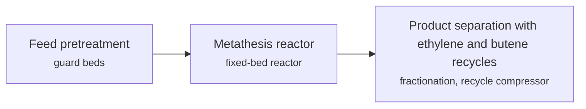

**Key equipment:** metathesis reactor, guard beds, fractionation columns, recycle compressor.

**Performance:**
- propylene selectivity: 94-95 %; olefin utilisation typically 90 to 97%. [source](https://www.lummustechnology.com/getmedia/5ad83600-79c7-4e47-a6b3-ad0faaf12406/2020-10-15-olefins-conversion-tech-sheet.pdf)
- steam cracker ethylene output when integrated with OCT: 115 % of nameplate; propylene-to-ethylene ratio can be raised above 1.0. [source](https://www.lummustechnology.com/getmedia/5ad83600-79c7-4e47-a6b3-ad0faaf12406/2020-10-15-olefins-conversion-tech-sheet.pdf)

**Missing inputs:**
- licensed unit count and operating plants (reference_plants): The sheet does not list them. Where: Lummus references page (catalog: lummus, open). Next: Add licensed capacity.
- capital cost and operating or unit cost, with dollar year and basis (costs): No open source read so far gives costs for this technology. Where: arXiv and open-access journals: techno-economic or review papers (MDPI is blocked by its CDN; use the manual inbox) (catalog: arxiv, open); Licensor and EPC studies; paid cost databases are catalog-only (paid); OSTI.GOV full-text reports from DOE labs: search the technology name plus 'techno-economic' (catalog: osti, blocked). Next: Look for an open techno-economic study; record each figure with metric, range, unit, dollar year, basis and source.
- TRL with a cited source (trl): The IEA ETP Clean Energy Technology Guide has no matching entry. Where: IEA ETP Clean Energy Technology Guide (collected): search for the technology name (catalog: iea-reports, open). Next: Find a TRL table that lists this technology, or leave maturity resting on the evidence on the card.
- process steps and equipment are general engineering practice, not taken from one source (process): The sources read describe the principle but not a full step-by-step flow. Where: Licensor process descriptions and textbooks (open). Next: Check the steps against a licensor description and name it.

Sources: [1](https://www.lummustechnology.com/getmedia/5ad83600-79c7-4e47-a6b3-ad0faaf12406/2020-10-15-olefins-conversion-tech-sheet.pdf). Last reviewed 2026-10-25.

## Methanol-to-olefins (MTO, DMTO)
<a id="pch-methanol-to-olefins"></a>

Methanol vapour is converted over a SAPO-34 molecular sieve catalyst in a fluidized-bed reactor into ethylene and propylene. The catalyst coke is burned off in a regenerator, and the product gas is quenched, compressed and separated. DMTO-II adds a second reactor that cracks C4 and heavier by-products over a dual-function catalyst to raise olefin yield; DMTO-III raises selectivity further without recycling C4+.

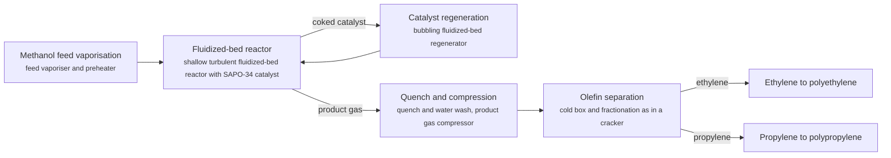

**Key equipment:** methanol vaporiser, fluidized-bed reactor and regenerator, quench tower, product gas compressor, olefin fractionation train.

**Performance:**
- ethylene plus propylene selectivity, demonstration unit: 79 %; DICP; DMTO-III 85-90%. [source](https://www.engineering.org.cn/engi/EN/10.1016/j.eng.2020.12.001)
- methanol consumption per tonne of light olefins, original process: 2.97 t methanol/t olefins; DICP; 2.85 with newer catalyst, about 2.64 for DMTO-III. [source](https://www.engineering.org.cn/engi/EN/10.1016/j.eng.2020.12.001)
- DMTO units licensed (to end-2019): 26 units; 14 started up; licensed olefins capacity 14 Mt/yr, 7.67 Mt/yr in the 14 started units. [source](https://www.engineering.org.cn/engi/EN/10.1016/j.eng.2020.12.001)

**Reference plants:**
- Shenhua Baotou coal-to-olefins plant, CN: 1.8 Mt/yr methanol feed, 600,000 t/yr polyethylene and polypropylene (first commercial DMTO); started 8 August 2010. [source](https://www.engineering.org.cn/engi/EN/10.1016/j.eng.2020.12.001)

**Missing inputs:**
- TRL with a cited source (trl): The IEA guide has no MTO entry; the installed base (26 licences) supports 'commercial'. Where: IEA ETP Clean Energy Technology Guide (collected): search for the technology name (catalog: iea-reports, open). Next: Find a TRL table that lists methanol-to-olefins.
- capital cost and production cost, with dollar year and basis (costs): No open source read so far gives costs for this technology; petrochemical unit costs are mostly in paid sources. Where: Open techno-economic papers on arXiv and open-access journals (MDPI is blocked by its CDN; use the manual inbox) (catalog: arxiv, open); IEA reports on petrochemicals (check the iea-reports corpus first) (catalog: iea-reports, open); Paid cost databases and licensor studies (consultancies, IHS/S&P, Nexant): catalog-only until the owner provides access (catalog: nexant-chemsystems, paid). Next: Look for an open techno-economic study; record each figure with metric, range, unit, dollar year, basis and source.
- CO2 intensity of coal-based and green-methanol MTO (performance): The DMTO paper read gives selectivity and methanol use, not carbon intensity. Where: IEA reports on chemicals and China coal chemistry (iea-reports corpus) (catalog: iea-reports, open); Open life-cycle assessments of coal-to-olefins (catalog: arxiv, open). Next: Add t CO2 per tonne of olefins with the methanol source stated.

Sources: [1](https://www.engineering.org.cn/engi/EN/10.1016/j.eng.2020.12.001). Last reviewed 2026-10-24.

## PET and polyester
<a id="pch-pet-polyester"></a>

Terephthalic acid or dimethyl terephthalate is reacted with ethylene glycol to make PET by continuous melt polycondensation. thyssenkrupp Uhde Inventa-Fischer's Melt-To-Resin (MTR) process uses a two-reactor design (ESPREE and DISCAGE) and skips the separate solid-state step; a 324,000 t/yr plant for KÖKSAN in Turkey is planned for 2028.

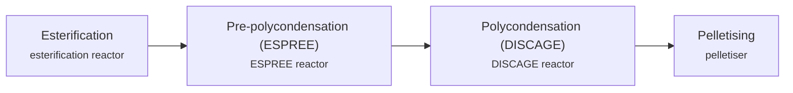

**Key equipment:** esterification reactor, ESPREE reactor, DISCAGE reactor, vacuum system, pelletiser.

**Performance:**
- KÖKSAN plant capacity: 324000 t/yr PET resin; about 888 t/d (calculated); commissioning planned 2028. [source](https://hydrocarbonprocessing.com/news/2026/04/thyssenkrupp-uhde-to-build-a-low-emission-polyester-plant-for-koksan-in-turkey/)
- energy-related carbon footprint reduction claimed for MTR: 30 % (up to); fuel and electrical energy; vendor claim. [source](https://hydrocarbonprocessing.com/news/2026/04/thyssenkrupp-uhde-to-build-a-low-emission-polyester-plant-for-koksan-in-turkey/)

**Missing inputs:**
- operating MTR plants (reference_plants): Only a planned plant read. Where: Uhde Inventa-Fischer references (catalog: thyssenkrupp-uhde, open). Next: Add operating references.
- capital cost and operating or unit cost, with dollar year and basis (costs): No open source read so far gives costs for this technology. Where: arXiv and open-access journals: techno-economic or review papers (MDPI is blocked by its CDN; use the manual inbox) (catalog: arxiv, open); Licensor and EPC studies; paid cost databases are catalog-only (paid); OSTI.GOV full-text reports from DOE labs: search the technology name plus 'techno-economic' (catalog: osti, blocked). Next: Look for an open techno-economic study; record each figure with metric, range, unit, dollar year, basis and source.
- TRL with a cited source (trl): The IEA ETP Clean Energy Technology Guide has no matching entry. Where: IEA ETP Clean Energy Technology Guide (collected): search for the technology name (catalog: iea-reports, open). Next: Find a TRL table that lists this technology, or leave maturity resting on the evidence on the card.
- process steps and equipment are general engineering practice, not taken from one source (process): The sources read describe the principle but not a full step-by-step flow. Where: Licensor process descriptions and textbooks (open). Next: Check the steps against a licensor description and name it.

Sources: [1](https://hydrocarbonprocessing.com/news/2026/04/thyssenkrupp-uhde-to-build-a-low-emission-polyester-plant-for-koksan-in-turkey/). Last reviewed 2026-10-25.

## PHA bioplastics
<a id="pch-pha-bioplastics"></a>

Polyhydroxyalkanoates are polyesters made by fermentation of plant oils or sugars with microbes. Danimer Scientific's Kentucky facility reached a run rate of 20 million pounds per year of Nodax PHA resins after debottlenecking in 2021.

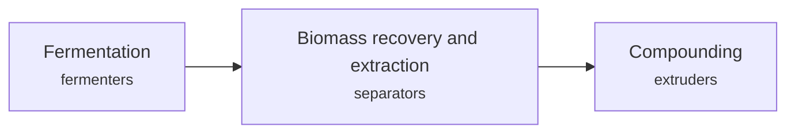

**Key equipment:** fermenters, extraction train, compounding extruders.

**Performance:**
- Danimer Kentucky run-rate capacity: 20 million lb/yr; Nodax resins, June 2021. [source](https://renewable-carbon.eu/news/?p=91819)

**Missing inputs:**
- production cost versus PE and PP (costs): Not in the release. Where: Danimer SEC filings (open). Next: Add costs.
- named plants or projects with capacity and year (reference_plants): The sources read name no specific plant. Where: Licensor and operator press releases for the suppliers listed (open). Next: Add one or two plants with country, capacity and start-up year.
- TRL with a cited source (trl): The IEA ETP Clean Energy Technology Guide has no matching entry. Where: IEA ETP Clean Energy Technology Guide (collected): search for the technology name (catalog: iea-reports, open). Next: Find a TRL table that lists this technology, or leave maturity resting on the evidence on the card.
- process steps and equipment are general engineering practice, not taken from one source (process): The sources read describe the principle but not a full step-by-step flow. Where: Licensor process descriptions and textbooks (open). Next: Check the steps against a licensor description and name it.

Sources: [1](https://renewable-carbon.eu/news/?p=91819). Last reviewed 2026-10-25.

## PVC (suspension) and chlor-alkali
<a id="pch-pvc-chlor-alkali"></a>

Chlor-alkali electrolysis makes chlorine, caustic soda and hydrogen from brine. Chlorine and ethylene give EDC by direct chlorination and oxychlorination; cracking EDC at about 480 degC gives vinyl chloride monomer, which is polymerised in suspension to PVC. thyssenkrupp nucera quotes less than 1,960 kWh per tonne NaOH for its membrane cells at 6 kA/m2.

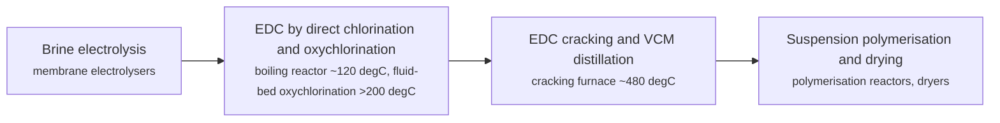

**Key equipment:** membrane electrolysers, direct chlorination reactor, oxychlorination reactor, EDC cracking furnace, PVC polymerisation reactors.

**Performance:**
- electrolysis energy, membrane cell: up to 1960 kWh per t NaOH; at 6 kA/m2; ODC cuts energy by up to 25%. [source](https://www.thyssenkrupp-nucera.com/chlor-alkali-solutions/)
- ethylene and chlorine per tonne VCM: 459-575 kg; ethylene 459 kg, chlorine 575 kg per 1,000 kg VCM (licensor expected figures). [source](https://cdn.ihsmarkit.com/www/pdf/0920/2020-09-18_VC_PC_Brochure_White-Paper2_IHS.pdf)
- steam per tonne PVC powder: up to 700 kg; 435 kg combined with VCM plant. [source](https://cdn.ihsmarkit.com/www/pdf/0920/2020-09-18_VC_PC_Brochure_White-Paper2_IHS.pdf)

**Missing inputs:**
- global PVC capacity today and acetylene route share in China (performance): The brochure gives 2010 capacity only. Where: IHS or OECD chemicals reports (open). Next: Add current capacity.
- capital cost and operating or unit cost, with dollar year and basis (costs): No open source read so far gives costs for this technology. Where: arXiv and open-access journals: techno-economic or review papers (MDPI is blocked by its CDN; use the manual inbox) (catalog: arxiv, open); Licensor and EPC studies; paid cost databases are catalog-only (paid); OSTI.GOV full-text reports from DOE labs: search the technology name plus 'techno-economic' (catalog: osti, blocked). Next: Look for an open techno-economic study; record each figure with metric, range, unit, dollar year, basis and source.
- named plants or projects with capacity and year (reference_plants): The sources read name no specific plant. Where: Licensor and operator press releases for the suppliers listed (open). Next: Add one or two plants with country, capacity and start-up year.
- TRL with a cited source (trl): The IEA ETP Clean Energy Technology Guide has no matching entry. Where: IEA ETP Clean Energy Technology Guide (collected): search for the technology name (catalog: iea-reports, open). Next: Find a TRL table that lists this technology, or leave maturity resting on the evidence on the card.
- process steps and equipment are general engineering practice, not taken from one source (process): The sources read describe the principle but not a full step-by-step flow. Where: Licensor process descriptions and textbooks (open). Next: Check the steps against a licensor description and name it.

Sources: [1](https://www.thyssenkrupp-nucera.com/chlor-alkali-solutions/), [2](https://cdn.ihsmarkit.com/www/pdf/0920/2020-09-18_VC_PC_Brochure_White-Paper2_IHS.pdf). Last reviewed 2026-10-25.

## Paraxylene adsorption and crystallisation
<a id="pch-paraxylene-adsorption"></a>

Mixed xylenes from reformate and transalkylation are fed to a simulated-moving-bed adsorption unit. A rotary valve moves feed, desorbent and product ports along beds of selective adsorbent so that, in effect, a counter-current moving bed is created without moving solids; paraxylene is adsorbed and then desorbed, and the desorbent is recovered by distillation. The raffinate is isomerised and recycled to extinction.

```mermaid
flowchart LR
    REF["Xylene supply from reformer and transalkylation<br/><small>CCR reformate splitter, xylene column</small>"]
    SMB["Simulated moving bed adsorption<br/><small>adsorbent chambers, rotary valve, desorbent circulation</small>"]
    EXT["Extract fractionation<br/><small>extract column, desorbent recovery</small>"]
    PX["High-purity paraxylene<br/><small>product tank</small>"]
    RAF["Raffinate to isomerisation<br/><small>raffinate column, xylene isomerisation reactor</small>"]
    XCOL["Recycle to xylene column<br/><small>xylene column</small>"]
    REF --> SMB
    SMB -->|extract (paraxylene + desorbent)| EXT
    SMB -->|raffinate| RAF
    EXT --> PX
    RAF --> XCOL
    XCOL --> SMB
```

**Key equipment:** adsorbent chambers with rotary valve, extract and raffinate columns, xylene isomerisation reactor, xylene column.

**Performance:**
- Parex licensed capacity range per unit: 21000-1.6e+06 t/yr paraxylene; Honeywell UOP: over 100 units licensed since commercialisation in 1971. [source](https://uop.com/en/industry-solutions/petrochemicals/aromatics-recovery)

**Missing inputs:**
- named paraxylene complexes with capacity (reference_plants): The UOP page read gives the licence count and size range but names no plant. Where: Hengli Dalian, PETRONAS Pengerang and Chinese PX project announcements (Honeywell UOP news releases) (catalog: honeywell-uop, open). Next: Add one or two complexes with paraxylene capacity and start-up year.
- paraxylene purity and recovery percentages (performance): The UOP page says 'proven high purity' and recovery without figures. Where: UOP Parex process brochure (catalog: honeywell-uop, open). Next: Add purity and recovery with source.
- TRL with a cited source (trl): No IEA entry for conventional paraxylene separation. Where: IEA ETP Clean Energy Technology Guide (collected): search for the technology name (catalog: iea-reports, open). Next: Find a TRL table that lists it, or rely on the 1971 commercial start.
- capital cost and production cost, with dollar year and basis (costs): No open source read so far gives costs for this technology; petrochemical unit costs are mostly in paid sources. Where: Open techno-economic papers on arXiv and open-access journals (MDPI is blocked by its CDN; use the manual inbox) (catalog: arxiv, open); IEA reports on petrochemicals (check the iea-reports corpus first) (catalog: iea-reports, open); Paid cost databases and licensor studies (consultancies, IHS/S&P, Nexant): catalog-only until the owner provides access (catalog: nexant-chemsystems, paid). Next: Look for an open techno-economic study; record each figure with metric, range, unit, dollar year, basis and source.

Sources: [1](https://uop.com/en/industry-solutions/petrochemicals/aromatics-recovery). Last reviewed 2026-10-24.

## Phenol and acetone (cumene)
<a id="pch-phenol-acetone"></a>

Benzene is alkylated with propylene to cumene over a zeolite catalyst, cumene is oxidised to cumene hydroperoxide and cleaved to phenol and acetone. Technip Energies Badger cumene technology, with ExxonMobil catalysts, has been licensed 36 times since 1996 and single trains reach 750 kt/yr cumene.

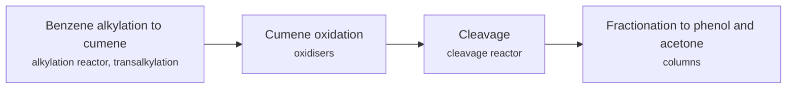

**Key equipment:** alkylation reactor, oxidisers, cleavage reactor, distillation columns.

**Performance:**
- single-train cumene capacity: 750 kt/yr; Technip Energies brochure. [source](https://www.ten.com/sites/energies/files/2025-01/phenolics_brochure.pdf)
- cumene licences since 1996: 36 licences; Technip Energies Badger. [source](https://www.ten.com/sites/energies/files/2025-01/phenolics_brochure.pdf)

**Missing inputs:**
- phenol yield and energy use (performance): None in the brochure. Where: Lummus and KBR phenol sheets (open). Next: Add numbers.
- capital cost and operating or unit cost, with dollar year and basis (costs): No open source read so far gives costs for this technology. Where: arXiv and open-access journals: techno-economic or review papers (MDPI is blocked by its CDN; use the manual inbox) (catalog: arxiv, open); Licensor and EPC studies; paid cost databases are catalog-only (paid); OSTI.GOV full-text reports from DOE labs: search the technology name plus 'techno-economic' (catalog: osti, blocked). Next: Look for an open techno-economic study; record each figure with metric, range, unit, dollar year, basis and source.
- named plants or projects with capacity and year (reference_plants): The sources read name no specific plant. Where: Licensor and operator press releases for the suppliers listed (open). Next: Add one or two plants with country, capacity and start-up year.
- TRL with a cited source (trl): The IEA ETP Clean Energy Technology Guide has no matching entry. Where: IEA ETP Clean Energy Technology Guide (collected): search for the technology name (catalog: iea-reports, open). Next: Find a TRL table that lists this technology, or leave maturity resting on the evidence on the card.
- process steps and equipment are general engineering practice, not taken from one source (process): The sources read describe the principle but not a full step-by-step flow. Where: Licensor process descriptions and textbooks (open). Next: Check the steps against a licensor description and name it.

Sources: [1](https://www.ten.com/sites/energies/files/2025-01/phenolics_brochure.pdf). Last reviewed 2026-10-25.

## Polyethylene (gas phase, slurry, solution)
<a id="pch-polyethylene"></a>

Ethylene, with a comonomer such as butene or hexene for LLDPE and HDPE copolymers, is polymerised on a supported catalyst in a gas-phase fluidized-bed, slurry-loop or solution reactor. The resin leaves the reactor as powder or pellets after degassing to remove monomer, and is extruded with additives. The process route and catalyst (Ziegler-Natta, chromium or metallocene) set the grade range.

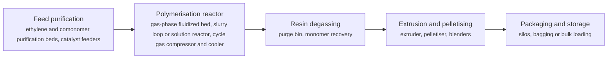

**Key equipment:** feed purification, polymerisation reactor and cycle gas system, degassing bin, extruder and pelletiser, silos.

**Performance:**
- UNIPOL PE single-line design capacity: 800000 t/yr; Univation (announced May 2025), up from 650,000 t/yr nameplate. [source](https://hydrocarbonprocessing.com/news/2025/05/univation-technologies-announces-world-scale-800-000-tpy-design-capacity-for-unipol-pe-process-technology/)

**Missing inputs:**
- named polyethylene plants with capacity (reference_plants): The article read gives the design capacity but no plant. Where: Licensor and operator news (Univation, LyondellBasell, Ineos) (catalog: hydrocarbon-processing, open). Next: Add one or two plants with capacity and start-up year.
- TRL with a cited source (trl): No IEA entry for conventional PE. Where: IEA ETP Clean Energy Technology Guide (collected): search for the technology name (catalog: iea-reports, open). Next: Find a TRL table, or rely on decades of commercial operation.
- capital cost and production cost, with dollar year and basis (costs): No open source read so far gives costs for this technology; petrochemical unit costs are mostly in paid sources. Where: Open techno-economic papers on arXiv and open-access journals (MDPI is blocked by its CDN; use the manual inbox) (catalog: arxiv, open); IEA reports on petrochemicals (check the iea-reports corpus first) (catalog: iea-reports, open); Paid cost databases and licensor studies (consultancies, IHS/S&P, Nexant): catalog-only until the owner provides access (catalog: nexant-chemsystems, paid). Next: Look for an open techno-economic study; record each figure with metric, range, unit, dollar year, basis and source.
- energy and CO2 per tonne of polyethylene (polymerisation only and including ethylene) (performance): None of the sources read gives it. Where: Open techno-economic papers on arXiv and open-access journals (MDPI is blocked by its CDN; use the manual inbox) (catalog: arxiv, open); IEA reports on petrochemicals (check the iea-reports corpus first) (catalog: iea-reports, open). Next: Add energy use and CO2 with system boundary stated.

Sources: [1](https://hydrocarbonprocessing.com/news/2025/05/univation-technologies-announces-world-scale-800-000-tpy-design-capacity-for-unipol-pe-process-technology/). Last reviewed 2026-10-24.

## Polypropylene (gas phase, bulk)
<a id="pch-polypropylene"></a>

Propylene, with ethylene or other comonomers for copolymers, is polymerised over a supported Ziegler-Natta or metallocene catalyst in a gas-phase reactor or in liquid propylene (bulk loop) reactors. After the reactor the powder is degassed, mixed with additives and pelletised. Impact copolymers use a second reactor to add a rubber phase.

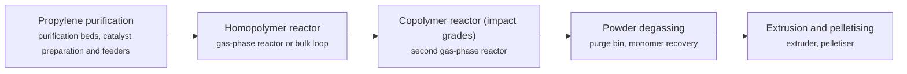

**Key equipment:** purification beds, reactor(s) and cycle gas system, degassing bin, extruder and pelletiser, silos.

**Performance:**
- UNIPOL PP licensed reactor lines: 100 lines; Grace: over 100 licensed in more than 25 countries and 76 operating in 2023. [source](https://grace.com/insights/unipol--pp-technology--leading-the-way-in-innovation-and-growth/)
- largest single UNIPOL PP line designed: 650000 t/yr; Grace: basic engineering package completed for a licensee in 2023. [source](https://grace.com/insights/unipol--pp-technology--leading-the-way-in-innovation-and-growth/)

**Missing inputs:**
- named polypropylene plants with capacity (reference_plants): The Grace article gives fleet figures only. Where: Licensor and operator news (catalog: grace-catalysts, open). Next: Add one or two plants.
- TRL with a cited source (trl): No IEA entry for conventional PP. Where: IEA ETP Clean Energy Technology Guide (collected): search for the technology name (catalog: iea-reports, open). Next: Find a TRL table, or rely on commercial operation.
- capital cost and production cost, with dollar year and basis (costs): No open source read so far gives costs for this technology; petrochemical unit costs are mostly in paid sources. Where: Open techno-economic papers on arXiv and open-access journals (MDPI is blocked by its CDN; use the manual inbox) (catalog: arxiv, open); IEA reports on petrochemicals (check the iea-reports corpus first) (catalog: iea-reports, open); Paid cost databases and licensor studies (consultancies, IHS/S&P, Nexant): catalog-only until the owner provides access (catalog: nexant-chemsystems, paid). Next: Look for an open techno-economic study; record each figure with metric, range, unit, dollar year, basis and source.
- energy and CO2 per tonne of polypropylene (performance): None of the sources read gives it. Where: Open techno-economic papers on arXiv and open-access journals (MDPI is blocked by its CDN; use the manual inbox) (catalog: arxiv, open); IEA reports on petrochemicals (check the iea-reports corpus first) (catalog: iea-reports, open). Next: Add with system boundary stated.

Sources: [1](https://grace.com/insights/unipol--pp-technology--leading-the-way-in-innovation-and-growth/). Last reviewed 2026-10-24.

## Propane dehydrogenation (Oleflex, CATOFIN)
<a id="pch-propane-dehydrogenation"></a>

Propane is heated and passed over a dehydrogenation catalyst, which removes hydrogen to form propylene. The reaction is endothermic and equilibrium-limited, so conversion per pass is partial; unconverted propane is separated and recycled. In UOP's Oleflex process the platinum catalyst is circulated continuously through a regenerator; Lummus CATOFIN uses fixed beds that cycle between reaction and regeneration.

```mermaid
flowchart LR
    FD["Propane feed treating and preheat<br/><small>feed treating, feed/effluent exchanger</small>"]
    RX["Dehydrogenation reactors<br/><small>Oleflex moving-bed reactors with interheaters, or CATOFIN cyclic fixed beds</small>"]
    REG["Catalyst regeneration<br/><small>continuous catalyst regenerator (Oleflex) / air regeneration cycle (CATOFIN)</small>"]
    SEP["Product recovery<br/><small>effluent compressor, cold box, hydrogen separation</small>"]
    DEP["Propane-propylene splitter<br/><small>propylene splitter column</small>"]
    PRP["Propylene product"]
    H2["Hydrogen by-product"]
    FD --> RX
    RX -->|reactor effluent| SEP
    RX -->|spent catalyst (Oleflex)| REG
    REG --> RX
    SEP -->|propane/propylene| DEP
    SEP -->|hydrogen| H2
    DEP -->|polymer-grade propylene| PRP
    DEP -->|recycle propane| FD
```

**Key equipment:** reactor section, catalyst regenerator, effluent compressor, cold box, propane-propylene splitter.

**Performance:**
- global Oleflex propylene capacity: 7.9 Mt/yr; Honeywell, as of November 2020; 68 of the last 92 dehydrogenation projects worldwide since 2011 used UOP technology. [source](https://www.honeywell.com/us/en/news/press-releases/2020/11/oriental-energy-expands-use-of-honeywell-technology)
- capacity of each of Oriental Energy's three earlier Oleflex units: 660000 t/yr propylene; Honeywell release. [source](https://www.honeywell.com/us/en/news/press-releases/2020/11/oriental-energy-expands-use-of-honeywell-technology)

**Reference plants:**
- Oriental Energy, Maoming, Guangdong (fourth Oleflex unit), CN: three earlier units of 660,000 t/yr each; capacity of the new unit not stated; start scheduled 2022 (as of November 2020). [source](https://www.honeywell.com/us/en/news/press-releases/2020/11/oriental-energy-expands-use-of-honeywell-technology)

**Missing inputs:**
- TRL with a cited source (trl): The IEA guide has no PDH entry; the card is commercial on the basis of the 7.9 Mt/yr installed base. Where: IEA ETP Clean Energy Technology Guide (collected): search for the technology name (catalog: iea-reports, open); Licensor statements of commercial references (catalog: honeywell-uop, open). Next: Find a TRL table that lists on-purpose propylene, or leave the commercial claim resting on the installed capacity.
- capital cost and production cost, with dollar year and basis (costs): No open source read so far gives costs for this technology; petrochemical unit costs are mostly in paid sources. Where: Open techno-economic papers on arXiv and open-access journals (MDPI is blocked by its CDN; use the manual inbox) (catalog: arxiv, open); IEA reports on petrochemicals (check the iea-reports corpus first) (catalog: iea-reports, open); Paid cost databases and licensor studies (consultancies, IHS/S&P, Nexant): catalog-only until the owner provides access (catalog: nexant-chemsystems, paid). Next: Look for an open techno-economic study; record each figure with metric, range, unit, dollar year, basis and source.
- propylene yield, selectivity and energy use per tonne of propylene (performance): The release read gives capacity only. Where: UOP and Lummus process brochures (catalog: honeywell-uop, open); Open techno-economic papers on PDH (catalog: arxiv, open). Next: Add yield, selectivity and energy use with basis and source.

Sources: [1](https://www.honeywell.com/us/en/news/press-releases/2020/11/oriental-energy-expands-use-of-honeywell-technology). Last reviewed 2026-10-24.

## Propylene oxide (HPPO, PO/SM)
<a id="pch-propylene-oxide"></a>

In the HPPO route hydrogen peroxide oxidises propylene to propylene oxide over a titanium silicalite (TS-1) catalyst with water as the only co-product, avoiding the styrene or tert-butanol co-products of PO/SM and PO/TBA routes. Evonik and thyssenkrupp Uhde developed it from 2000; the first plant at Ulsan, Korea (SKC) started in 2008 at 100,000 t/yr and expanded to 130,000 t/yr.

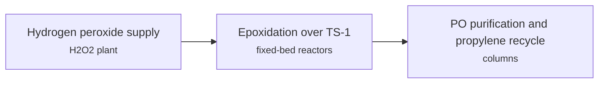

**Key equipment:** H2O2 supply, epoxidation reactors, distillation columns, propylene recycle.

**Performance:**
- Ulsan HPPO plant capacity: 100000-130000 t/yr PO; 100,000 at start, expanded to 130,000. [source](https://www.evonik.com/en/company/businesslines/ao/highlights/hp-plus-technologies/hppo-technology.html)

**Reference plants:**
- SKC Ulsan HPPO plant, KR: 130,000 t/yr PO; . [source](https://www.evonik.com/en/company/businesslines/ao/highlights/hp-plus-technologies/hppo-technology.html)
- MOL Group Tiszaújváros HPPO (under construction when read), HU: 200,000 t/yr; . [source](https://www.evonik.com/en/company/businesslines/ao/highlights/hp-plus-technologies/hppo-technology.html)

**Missing inputs:**
- yield, wastewater and energy savings (performance): Qualitative only. Where: Digital Refining article on third-generation HPPO (catalog: ptq-digital-refining, open). Next: Add quantified savings.
- capital cost and operating or unit cost, with dollar year and basis (costs): No open source read so far gives costs for this technology. Where: arXiv and open-access journals: techno-economic or review papers (MDPI is blocked by its CDN; use the manual inbox) (catalog: arxiv, open); Licensor and EPC studies; paid cost databases are catalog-only (paid); OSTI.GOV full-text reports from DOE labs: search the technology name plus 'techno-economic' (catalog: osti, blocked). Next: Look for an open techno-economic study; record each figure with metric, range, unit, dollar year, basis and source.
- TRL with a cited source (trl): The IEA ETP Clean Energy Technology Guide has no matching entry. Where: IEA ETP Clean Energy Technology Guide (collected): search for the technology name (catalog: iea-reports, open). Next: Find a TRL table that lists this technology, or leave maturity resting on the evidence on the card.
- process steps and equipment are general engineering practice, not taken from one source (process): The sources read describe the principle but not a full step-by-step flow. Where: Licensor process descriptions and textbooks (open). Next: Check the steps against a licensor description and name it.

Sources: [1](https://www.evonik.com/en/company/businesslines/ao/highlights/hp-plus-technologies/hppo-technology.html). Last reviewed 2026-10-25.

## Steam cracking (naphtha, ethane, LPG)
<a id="pch-steam-cracking"></a>

Hydrocarbon feed is diluted with steam and passed through coils in gas-fired furnaces at about 800 to 850 °C for a fraction of a second, which breaks it into ethylene, propylene and other olefins. The effluent is quenched to stop reactions, compressed, and separated by cryogenic distillation. Ethane gives mostly ethylene; naphtha gives a wider product slate including propylene, butadiene and aromatics.

```mermaid
flowchart LR
    FUR["Cracking furnace<br/><small>fired radiant coils, steam dilution, convection section</small>"]
    QUE["Quench<br/><small>transfer line exchangers, primary fractionator and quench water tower</small>"]
    CMP["Cracked gas compression and treating<br/><small>multi-stage cracked gas compressor, caustic or amine acid gas removal, dryers</small>"]
    SEP["Cryogenic separation<br/><small>cold box, demethaniser, deethaniser, depropaniser, ethylene and propylene fractionators</small>"]
    ETH["Ethylene product"]
    PRO["Propylene product"]
    BYP["By-products to butadiene and aromatics units"]
    FUR --> QUE
    QUE --> CMP
    CMP --> SEP
    SEP -->|ethylene| ETH
    SEP -->|propylene| PRO
    SEP -->|C4s, pyrolysis gasoline| BYP
```

**Key equipment:** cracking furnaces, transfer line exchangers, quench towers, cracked gas compressor, cold box, ethylene and propylene fractionators, refrigeration compressors.

**Performance:**
- furnace operating temperature: 800-850 °C; ChemEngineering 2025 review. [source](https://run.unl.pt/bitstream/10362/186917/1/ChemEngineering-09-00055-v2.pdf)
- residence time in the coil: 0.1-0.5 s; ChemEngineering 2025 review. [source](https://run.unl.pt/bitstream/10362/186917/1/ChemEngineering-09-00055-v2.pdf)
- steam dilution: 0.3-1 kg steam per kg hydrocarbon; ChemEngineering 2025 review. [source](https://run.unl.pt/bitstream/10362/186917/1/ChemEngineering-09-00055-v2.pdf)
- energy use of the cracking furnace: 6.5 GJ/t high-value chemicals; ChemEngineering 2025 review; cryogenic separation 2 GJ/t, fractionation and compression 1.5 GJ/t. [source](https://run.unl.pt/bitstream/10362/186917/1/ChemEngineering-09-00055-v2.pdf)
- CO2 emissions: 1.8-2 t CO2/t ethylene; ChemEngineering 2025 review; global steam crackers emit about 180-200 Mt CO2/yr. [source](https://run.unl.pt/bitstream/10362/186917/1/ChemEngineering-09-00055-v2.pdf)
- ethylene yield from naphtha: 30 wt%; ChemEngineering 2025 review, short residence time and high severity. [source](https://run.unl.pt/bitstream/10362/186917/1/ChemEngineering-09-00055-v2.pdf)

TRL source: [IEA ETP Clean Energy Technology Guide, dataset of 24 July 2026, 2025 assessment (IEA 1-11 scale): 'High value chemicals production using naphtha catalytic cracking' 9](https://www.iea.org/data-and-statistics/data-tools/etp-clean-energy-technology-guide)

**Missing inputs:**
- capital cost and production cost, with dollar year and basis (costs): No open source read so far gives costs for this technology; petrochemical unit costs are mostly in paid sources. Where: Open techno-economic papers on arXiv and open-access journals (MDPI is blocked by its CDN; use the manual inbox) (catalog: arxiv, open); IEA reports on petrochemicals (check the iea-reports corpus first) (catalog: iea-reports, open); Paid cost databases and licensor studies (consultancies, IHS/S&P, Nexant): catalog-only until the owner provides access (catalog: nexant-chemsystems, paid). Next: Look for an open techno-economic study; record each figure with metric, range, unit, dollar year, basis and source.
- named crackers with capacity (reference_plants): The sources read name no specific cracker. Where: Licensor and operator press releases for the suppliers listed (catalog: lummus, open); PETRONAS Pengerang and Hengli Dalian complexes (see crude-to-chemicals card) (open). Next: Add one or two crackers with country, ethylene capacity and start-up year.

Sources: [1](https://run.unl.pt/bitstream/10362/186917/1/ChemEngineering-09-00055-v2.pdf). Last reviewed 2026-10-24.

## Toluene disproportionation and transalkylation
<a id="pch-toluene-disproportionation"></a>

Toluene and heavier aromatics (C9+) are converted over a zeolite catalyst to benzene and mixed xylenes. UOP's Tatoray unit at Hengyi Brunei produces high-purity benzene and mixed xylenes feeding the paraxylene loop.

```mermaid
flowchart LR
    FEED["Toluene and C9+ aromatics feed<br/><small>feed heater</small>"]
    RX["Transalkylation reactor<br/><small>fixed-bed reactor</small>"]
    SEP["Separation of benzene and xylenes<br/><small>stripper, fractionators</small>"]
    FEED --> RX
    RX --> SEP
```

**Key equipment:** reactor, stripper, fractionators, hydrogen recycle.

**Reference plants:**
- Hengyi Brunei Tatoray unit, BN: ; . [source](https://www.ogj.com/refining-processing/petrochemicals/article/14198324/hengyi-lets-contract-for-aromatics-expansion-at-brunei-complex)

**Missing inputs:**
- conversion per pass, hydrogen consumption, xylene yield (performance): None in the article. Where: UOP Tatoray datasheet (catalog: honeywell-uop, open). Next: Add figures.
- capital cost and operating or unit cost, with dollar year and basis (costs): No open source read so far gives costs for this technology. Where: arXiv and open-access journals: techno-economic or review papers (MDPI is blocked by its CDN; use the manual inbox) (catalog: arxiv, open); Licensor and EPC studies; paid cost databases are catalog-only (paid); OSTI.GOV full-text reports from DOE labs: search the technology name plus 'techno-economic' (catalog: osti, blocked). Next: Look for an open techno-economic study; record each figure with metric, range, unit, dollar year, basis and source.
- TRL with a cited source (trl): The IEA ETP Clean Energy Technology Guide has no matching entry. Where: IEA ETP Clean Energy Technology Guide (collected): search for the technology name (catalog: iea-reports, open). Next: Find a TRL table that lists this technology, or leave maturity resting on the evidence on the card.
- process steps and equipment are general engineering practice, not taken from one source (process): The sources read describe the principle but not a full step-by-step flow. Where: Licensor process descriptions and textbooks (open). Next: Check the steps against a licensor description and name it.

Sources: [1](https://www.ogj.com/refining-processing/petrochemicals/article/14198324/hengyi-lets-contract-for-aromatics-expansion-at-brunei-complex). Last reviewed 2026-10-25.

## Depolymerisation of PET (glycolysis, enzymatic)
<a id="pch-pet-depolymerisation"></a>

PET waste is broken back into its monomers or short fragments so that it can be purified and repolymerised into virgin-quality PET. Chemical routes such as glycolysis use glycol and heat; enzymatic routes use an engineered enzyme in water at moderate temperature. Carbios describes its C-ZYME process as solvent-free.

```mermaid
flowchart LR
    PRE["Pretreatment<br/><small>sorting, shredding, washing</small>"]
    DEP["Depolymerisation<br/><small>enzymatic reactor or glycolysis reactor</small>"]
    PUR["Monomer purification<br/><small>filtration and crystallisation, distillation</small>"]
    POL["Repolymerisation to PET<br/><small>PET polymerisation line (at the host site)</small>"]
    PRE --> DEP
    DEP --> PUR
    PUR --> POL
```

**Key equipment:** pretreatment line, depolymerisation reactors, purification section, polymerisation line.

**Performance:**
- Longlaville plant design capacity: 50000 t/yr post-consumer PET waste; Carbios, on Indorama Ventures' site; EUR 230 million. [source](https://www.packaging-gateway.com/projects/carbios-pet-biorecycling-plant-longlaville-france/)

**Reference plants:**
- Carbios Longlaville plant, Meurthe-et-Moselle, FR: 50,000 t/yr PET waste, EUR 230 million; ground-breaking April 2024; 6-9 month delay from funding uncertainty; construction to resume late 2025; full operation anticipated 2027 (as of December 2025). [source](https://www.packaging-gateway.com/projects/carbios-pet-biorecycling-plant-longlaville-france/)

TRL source: [IEA ETP Clean Energy Technology Guide, dataset of 24 July 2026, 2025 assessment (IEA 1-11 scale): 'Recycling via chemical depolymerisation for PET' 8](https://www.iea.org/data-and-statistics/data-tools/etp-clean-energy-technology-guide)

**Missing inputs:**
- Longlaville construction and start-up progress (status): Plant status is as of December 2025. Where: Carbios news releases and annual reports (open). Next: Re-check after 2026 and update the plant status.
- capital cost and production cost, with dollar year and basis (costs): No open source read so far gives costs for this technology; petrochemical unit costs are mostly in paid sources. Where: Open techno-economic papers on arXiv and open-access journals (MDPI is blocked by its CDN; use the manual inbox) (catalog: arxiv, open); IEA reports on petrochemicals (check the iea-reports corpus first) (catalog: iea-reports, open); Paid cost databases and licensor studies (consultancies, IHS/S&P, Nexant): catalog-only until the owner provides access (catalog: nexant-chemsystems, paid). Next: Look for an open techno-economic study; record each figure with metric, range, unit, dollar year, basis and source.
- monomer yield and energy use (performance): The article read gives capacity only. Where: Carbios technical publications; open reviews of PET recycling (catalog: arxiv, open). Next: Add yield and energy per tonne PET.

Sources: [1](https://www.packaging-gateway.com/projects/carbios-pet-biorecycling-plant-longlaville-france/). Last reviewed 2026-10-24.

## Electric steam cracking
<a id="pch-electric-steam-cracking"></a>

The gas-fired radiant coils of a steam cracker are replaced by coils heated with electricity, so the furnace itself emits no combustion CO2. The rest of the plant (quench, compression, cryogenic separation) is unchanged, which makes the route a retrofit option for existing crackers if renewable power and grid capacity are available.

```mermaid
flowchart LR
    PWR["Renewable power supply<br/><small>transformers and power electronics, grid connection</small>"]
    FUR["Electrically heated cracking furnace<br/><small>electrically heated radiant coils, steam dilution</small>"]
    QUE["Quench and compression<br/><small>transfer line exchangers, cracked gas compressor</small>"]
    SEP["Cryogenic separation<br/><small>cold box, olefin fractionators</small>"]
    PWR --> FUR
    FUR --> QUE
    QUE --> SEP
```

**Key equipment:** electrically heated furnace coils, power supply and transformers, quench system, cracked gas compressor, cold box.

**Performance:**
- CO2 reduction potential versus conventional cracking: 90 %; BASF, SABIC and Linde claim at least 90% with renewable power (potential, not measured). [source](https://www.basf.com/global/en/media/news-releases/2024/04/p-24-177.html)
- demonstration furnaces: feed rate and power: 4 t hydrocarbon feed/h; two furnaces totalling 6 MW input. [source](https://www.basf.com/global/en/media/news-releases/2024/04/p-24-177.html)

**Reference plants:**
- BASF Ludwigshafen electric cracking demonstration (BASF, SABIC, Linde), DE: two furnaces, about 4 t/h feed, 6 MW renewable power; inaugurated 17 April 2024. [source](https://www.basf.com/global/en/media/news-releases/2024/04/p-24-177.html)

TRL source: [IEA ETP Clean Energy Technology Guide, dataset of 24 July 2026, 2025 assessment (IEA 1-11 scale): 'High value chemicals production using steam cracker electrification' 6](https://www.iea.org/data-and-statistics/data-tools/etp-clean-energy-technology-guide)

**Missing inputs:**
- capital cost and production cost, with dollar year and basis (costs): No open source read so far gives costs for this technology; petrochemical unit costs are mostly in paid sources. Where: Open techno-economic papers on arXiv and open-access journals (MDPI is blocked by its CDN; use the manual inbox) (catalog: arxiv, open); IEA reports on petrochemicals (check the iea-reports corpus first) (catalog: iea-reports, open); Paid cost databases and licensor studies (consultancies, IHS/S&P, Nexant): catalog-only until the owner provides access (catalog: nexant-chemsystems, paid). Next: Look for an open techno-economic study; record each figure with metric, range, unit, dollar year, basis and source.
- measured results from the demonstration (CO2, energy, run length) (performance): Only the 2024 start-up announcement was read. Where: BASF and Linde publications after 2024 (catalog: basf-catalysts, open). Next: Check for measured results and any commercial-scale announcement; update the card.

Sources: [1](https://www.basf.com/global/en/media/news-releases/2024/04/p-24-177.html). Last reviewed 2026-10-24.

## Electrification of process heat (e-boilers, heat pumps)
<a id="pch-electrified-process-heat"></a>

Steam and furnace heat are produced from electricity with electrode boilers, industrial heat pumps and electric furnaces. BASF is building a 50 MW heat pump at Ludwigshafen (GIG Karasek) delivering 500,000 t/yr of steam, saving up to 100,000 t CO2e/yr, online mid-2027; BASF, SABIC and Linde started an electric steam-cracker furnace demonstration in April 2024. IEA rates large-scale heat pumps at TRL 9 and steam cracker electrification at TRL 6.

```mermaid
flowchart LR
    PWR["Renewable power<br/><small>transformers</small>"]
    HT["Heat pump, e-boiler or electric furnace<br/><small>heat pump, electrode boiler, electric furnace</small>"]
    STM["Steam or process heat to site<br/><small>steam network</small>"]
    PWR --> HT
    HT --> STM
```

**Key equipment:** industrial heat pump, electrode boiler, electric furnace, transformers.

**Performance:**
- BASF heat pump thermal output: 50 MW; 500,000 t/yr steam, just over 3% of Ludwigshafen steam demand; up to 98% lower emissions for formic acid steam. [source](https://www.thechemicalengineer.com/news/basf-begins-installation-of-industrial-heat-pump-to-deliver-net-zero-steam-at-ludwigshafen/)
- electric cracker demo power: 6 MW; target 90% lower emissions; about 4 t/h feed. [source](https://www.thechemicalengineer.com/news/world-first-electric-steam-cracker-demo-starts-operations-in-push-to-slash-emissions-by-90/)

TRL source: [IEA ETP Clean Energy Technology Guide, dataset of 24 July 2026, latest assessment (IEA 1-11 scale): 'Large-scale heat pump (low temperature heating)' 9 (2025); 'High value chemicals production using steam cracker electrification' 6 (2025)](https://www.iea.org/data-and-statistics/data-tools/etp-clean-energy-technology-guide)

**Missing inputs:**
- capital cost and steam cost versus gas boilers (costs): Not in the articles. Where: IEA industrial heat reports (catalog: iea-reports, open). Next: Add costs.
- named plants or projects with capacity and year (reference_plants): The sources read name no specific plant. Where: Licensor and operator press releases for the suppliers listed (open). Next: Add one or two plants with country, capacity and start-up year.
- process steps and equipment are general engineering practice, not taken from one source (process): The sources read describe the principle but not a full step-by-step flow. Where: Licensor process descriptions and textbooks (open). Next: Check the steps against a licensor description and name it.

Sources: [1](https://www.thechemicalengineer.com/news/basf-begins-installation-of-industrial-heat-pump-to-deliver-net-zero-steam-at-ludwigshafen/), [2](https://www.thechemicalengineer.com/news/world-first-electric-steam-cracker-demo-starts-operations-in-push-to-slash-emissions-by-90/). Last reviewed 2026-10-25.

## Oxidative coupling of methane
<a id="pch-oxidative-coupling-methane"></a>

Methane and oxygen react over a catalyst to give ethylene directly, avoiding steam cracking of ethane or naphtha. Siluria started a demonstration plant at La Porte, Texas, co-located with Braskem America, in about December 2014, and said initial campaigns replicated pilot-scale performance; commercial plants were then planned for 2017 to 2018.

```mermaid
flowchart LR
    FEED["Methane and oxygen feed<br/><small>air separation</small>"]
    RX["OCM reactor<br/><small>OCM reactor</small>"]
    SEP["Ethylene recovery and recycle<br/><small>separation train</small>"]
    FEED --> RX
    RX --> SEP
```

**Key equipment:** OCM reactor, oxygen supply, ethylene recovery, recycle compressors.

**Reference plants:**
- Siluria OCM demonstration plant, La Porte, Texas, US: ; . [source](https://digitalrefining.com/news/1003450/siluria-technologies-starts-up-first-demonstration-plant-to-convert-natural-gas-to-ethylene)

**Missing inputs:**
- what happened after the 2014 demonstration (status): The source is from 2015. Where: Lummus and Siluria later announcements (open). Next: Check current status.
- key performance figures (energy use, yields, capture or conversion rate) (performance): No source read so far gives performance figures. Where: Supplier datasheets and brochures for the companies listed on the card (open); arXiv and open-access journals: techno-economic or review papers (MDPI is blocked by its CDN; use the manual inbox) (catalog: arxiv, open); OSTI.GOV full-text reports from DOE labs: search the technology name plus 'techno-economic' (catalog: osti, blocked). Next: Add the figures that matter for comparing options, each with its basis and source.
- capital cost and operating or unit cost, with dollar year and basis (costs): No open source read so far gives costs for this technology. Where: arXiv and open-access journals: techno-economic or review papers (MDPI is blocked by its CDN; use the manual inbox) (catalog: arxiv, open); Licensor and EPC studies; paid cost databases are catalog-only (paid); OSTI.GOV full-text reports from DOE labs: search the technology name plus 'techno-economic' (catalog: osti, blocked). Next: Look for an open techno-economic study; record each figure with metric, range, unit, dollar year, basis and source.
- TRL with a cited source (trl): The IEA ETP Clean Energy Technology Guide has no matching entry. Where: IEA ETP Clean Energy Technology Guide (collected): search for the technology name (catalog: iea-reports, open). Next: Find a TRL table that lists this technology, or leave maturity resting on the evidence on the card.
- process steps and equipment are general engineering practice, not taken from one source (process): The sources read describe the principle but not a full step-by-step flow. Where: Licensor process descriptions and textbooks (open). Next: Check the steps against a licensor description and name it.

Sources: [1](https://digitalrefining.com/news/1003450/siluria-technologies-starts-up-first-demonstration-plant-to-convert-natural-gas-to-ethylene). Last reviewed 2026-10-25.

## Plastics pyrolysis (chemical recycling)
<a id="pch-plastics-pyrolysis"></a>

Mixed post-consumer plastic waste, mainly polyolefins, is heated without oxygen so that the polymers crack into a hydrocarbon oil (called TACOIL by Plastic Energy), gas and char. The oil is cleaned and used as feed to steam crackers, where it displaces fossil naphtha and can be counted as recycled content through mass balance.

```mermaid
flowchart LR
    SORT["Waste sorting and shredding<br/><small>sorting lines, shredder, washing and drying</small>"]
    PYR["Pyrolysis reactor<br/><small>heated reactor under inert atmosphere</small>"]
    CON["Condensation and treating<br/><small>condensers, oil cleaning and dechlorination</small>"]
    OIL["Pyrolysis oil to steam cracker"]
    GAS["Gas used as process fuel"]
    CHAR["Char disposal or use"]
    SORT --> PYR
    PYR -->|vapours| CON
    PYR -->|char| CHAR
    CON -->|pyrolysis oil| OIL
    CON -->|non-condensable gas| GAS
```

**Key equipment:** sorting and washing line, pyrolysis reactor, condensers, oil treating, storage.

**Performance:**
- planned Seville plant capacity: 33000 t/yr post-consumer plastic waste; Plastic Energy and TotalEnergies, expected operational early 2025 (as of January 2022). [source](https://www.businesswire.com/news/home/20220110006139/en/Plastic-Energy-and-TotalEnergies-Sign-an-Agreement-for-an-Advanced-Recycling-Project-in-Spain)

**Reference plants:**
- Plastic Energy and TotalEnergies advanced recycling plant, Seville, ES: 33,000 t/yr plastic waste; expected operational early 2025 per January 2022 release; actual start not checked. [source](https://www.businesswire.com/news/home/20220110006139/en/Plastic-Energy-and-TotalEnergies-Sign-an-Agreement-for-an-Advanced-Recycling-Project-in-Spain)

TRL source: [IEA Clean Energy Technology Guide 2025: 'Pyrolysis recycling' TRL 9](https://www.iea.org/data-and-statistics/data-tools/etp-clean-energy-technology-guide)

**Missing inputs:**
- actual start-up of the Seville plant (reference_plants): Only the 2022 announcement was read. Where: Plastic Energy and TotalEnergies news after 2022 (open). Next: Check start-up and update the plant status.
- oil yield (% of plastic input) and energy use (performance): The release read gives capacity only. Where: Open reviews of pyrolysis yields (arXiv, open-access journals) (catalog: arxiv, open). Next: Add yield and energy per tonne with the waste mix stated.
- capital cost and production cost, with dollar year and basis (costs): No open source read so far gives costs for this technology; petrochemical unit costs are mostly in paid sources. Where: Open techno-economic papers on arXiv and open-access journals (MDPI is blocked by its CDN; use the manual inbox) (catalog: arxiv, open); IEA reports on petrochemicals (check the iea-reports corpus first) (catalog: iea-reports, open); Paid cost databases and licensor studies (consultancies, IHS/S&P, Nexant): catalog-only until the owner provides access (catalog: nexant-chemsystems, paid). Next: Look for an open techno-economic study; record each figure with metric, range, unit, dollar year, basis and source.

Sources: [1](https://www.businesswire.com/news/home/20220110006139/en/Plastic-Energy-and-TotalEnergies-Sign-an-Agreement-for-an-Advanced-Recycling-Project-in-Spain), [2](https://www.iea.org/data-and-statistics/data-tools/etp-clean-energy-technology-guide). Last reviewed 2026-10-24.

## Solvent-based purification of plastics
<a id="pch-solvent-based-plastics-purification"></a>

Polymer waste is dissolved in a solvent, filtered or extracted to remove colour, odour and additives, and the polymer is recovered as near-virgin resin. PureCycle's Ironton, Ohio plant uses a process licensed from Procter & Gamble for polypropylene and made first pellets in June 2023; planned capacity is 107 million pounds a year of recycled resin.

```mermaid
flowchart LR
    FEED["Sorted polypropylene waste<br/><small>shredder</small>"]
    DIS["Dissolution in solvent and purification<br/><small>extraction vessels, filters</small>"]
    REC["Polymer recovery and pelletising<br/><small>separator, extruder</small>"]
    FEED --> DIS
    DIS --> REC
```

**Key equipment:** dissolution vessels, purification columns or filters, solvent recovery, extruder.

**Performance:**
- Ironton planned capacity: 107 million lb/yr; ultra-pure recycled resin. [source](https://renewable-carbon.eu/news/?p=128691)
- energy and CO2 versus virgin polypropylene (company projection): 79 % less energy; 35% fewer carbon emissions; PureCycle projection. [source](https://renewable-carbon.eu/news/?p=128691)

**Reference plants:**
- PureCycle Ironton, Ohio, US: 107 million lb/yr (projected); first commercial-scale pellets June 2023. [source](https://renewable-carbon.eu/news/?p=128691)

**Missing inputs:**
- operating rate since 2023 (status): Source is from first pellets. Where: PureCycle SEC filings (open). Next: Check ramp-up.
- capital cost and operating or unit cost, with dollar year and basis (costs): No open source read so far gives costs for this technology. Where: arXiv and open-access journals: techno-economic or review papers (MDPI is blocked by its CDN; use the manual inbox) (catalog: arxiv, open); Licensor and EPC studies; paid cost databases are catalog-only (paid); OSTI.GOV full-text reports from DOE labs: search the technology name plus 'techno-economic' (catalog: osti, blocked). Next: Look for an open techno-economic study; record each figure with metric, range, unit, dollar year, basis and source.
- TRL with a cited source (trl): The IEA ETP Clean Energy Technology Guide has no matching entry. Where: IEA ETP Clean Energy Technology Guide (collected): search for the technology name (catalog: iea-reports, open). Next: Find a TRL table that lists this technology, or leave maturity resting on the evidence on the card.
- process steps and equipment are general engineering practice, not taken from one source (process): The sources read describe the principle but not a full step-by-step flow. Where: Licensor process descriptions and textbooks (open). Next: Check the steps against a licensor description and name it.

Sources: [1](https://renewable-carbon.eu/news/?p=128691). Last reviewed 2026-10-25.
