# PCH technology options

28 technologies, from commercial to lab stage. Generated from catalog/technologies/; every figure links to its source.

| Technology | Category | Maturity | TRL | Suppliers | Cost figures |
| --- | --- | --- | --- | --- | --- |
| [Acetic acid (methanol carbonylation)](#pch-acetic-acid) | Intermediates / acetyls | commercial |  | BP (Cativa); Celanese (register examples) | capital cost of a world-scale acetic acid plant (named datapoint): 600 USD per tonne/yr of capacity (USD 300 m for 500,000 t/yr) (2000$) |
| [Ammonia and urea](#pch-ammonia-urea) | Intermediates / fertiliser | commercial | 8 | Stamicarbon (urea stripping and N=3 concepts); Topsoe (register examples); KBR (register examples); thyssenkrupp Uhde (register examples); Casale (register examples) | ammonia plant capital cost, natural gas reforming: 1390-2415 USD/(t NH3/yr) (2024$)<br>ammonia plant capital cost, natural gas reforming with CCUS: 1640-2855 USD/(t NH3/yr) (2024$)<br>ammonia plant capital cost, coal gasification with CCUS: 3190-5540 USD/(t NH3/yr) (2024$)<br>ammonia production cost, natural gas based: 110-340 USD/t NH3<br>ammonia plant capex, gas SMR reference plant: 1675 USD million per 875 kt/yr plant (2021$)<br>urea market price benchmark: 420 USD/t (2026$)<br>US natural gas price, Henry Hub: 2.96 USD/mmbtu (2026$)<br>urea plant capital cost: 42.9 USD million for 460 kt/yr plant (2024$) |
| [Aromatics complexes (paraxylene, benzene)](#pch-aromatics-complex) | Aromatics | commercial |  | Honeywell UOP (CCR Platforming, Parex, Isomar, Tatoray, Sulfolane); Axens (aromatics (register examples)) |  |
| [Bio-based chemicals (bio-ethylene, bio-PE, PLA)](#pch-bio-based-chemicals) | Circular chemicals / bio-based | commercial | 9 | Braskem (Green PE); NatureWorks (PLA (register examples; not verified)); TotalEnergies Corbion (PLA (register examples; not verified)) |  |
| [Butadiene extraction and on-purpose butadiene](#pch-butadiene) | Intermediates / C4 | commercial |  | Lummus Technology (butadiene extraction (BASF process); CATADIENE); BASF (NMP extraction process) |  |
| [Engineering plastics (polycarbonate, nylon)](#pch-engineering-plastics) | Polymers / engineering | commercial |  | SABIC (register examples); Covestro (polycarbonate, recyclate compounding in Shanghai) |  |
| [Ethylene oxide and glycols](#pch-ethylene-oxide-glycols) | Intermediates / EO-EG | commercial |  | Shell (OMEGA, EO catalysts); Dow (METEOR (register examples)); Scientific Design (register examples) |  |
| [Linear alpha olefins](#pch-linear-alpha-olefins) | Intermediates / LAO | commercial |  | SABIC and Linde (alpha-SABLIN); Axens (AlphaButol (register examples)) |  |
| [Mechanical recycling of plastics](#pch-mechanical-recycling) | Circular chemicals / recycling | commercial |  |  |  |
| [Metathesis (OCT)](#pch-olefins-metathesis) | Olefins / propylene | commercial |  | Lummus Technology (OCT) |  |
| [Methanol-to-olefins (MTO, DMTO)](#pch-methanol-to-olefins) | Olefins / methanol route | commercial |  | DICP / SYN Energy Technology (DMTO); Honeywell UOP (MTO) |  |
| [PET and polyester](#pch-pet-polyester) | Polymers / polyesters | commercial |  | thyssenkrupp Uhde Inventa-Fischer (MTR process); Sulzer (register examples) |  |
| [PHA bioplastics](#pch-pha-bioplastics) | Circular chemicals / bio-based | commercial |  | Danimer Scientific (Nodax PHA); CJ (register examples) |  |
| [PVC (suspension) and chlor-alkali](#pch-pvc-chlor-alkali) | Polymers / chlorine chain | commercial |  | thyssenkrupp nucera (BM, BiTAC and NaCl-ODC electrolysers); Ineos (register examples) |  |
| [Paraxylene adsorption and crystallisation](#pch-paraxylene-adsorption) | Aromatics / separation | commercial |  | Honeywell UOP (Parex, MX Sorbex, ED Sulfolane); Axens (Eluxyl) |  |
| [Phenol and acetone (cumene)](#pch-phenol-acetone) | Intermediates / phenolics | commercial |  | Technip Energies (Badger) (cumene technology); KBR (register examples); Lummus (register examples) |  |
| [Polyethylene (gas phase, slurry, solution)](#pch-polyethylene) | Polymers | commercial |  | Univation (Dow) (UNIPOL PE); LyondellBasell; Ineos; Chevron Phillips Chemical; Borealis (Borstar) |  |
| [Polypropylene (gas phase, bulk)](#pch-polypropylene) | Polymers | commercial |  | Grace (UNIPOL PP); LyondellBasell (Spheripol); Ineos (Innovene PP) |  |
| [Propane dehydrogenation (Oleflex, CATOFIN)](#pch-propane-dehydrogenation) | Olefins / on-purpose propylene | commercial |  | Honeywell UOP (Oleflex); Lummus Technology (CATOFIN) |  |
| [Propylene oxide (HPPO, PO/SM)](#pch-propylene-oxide) | Intermediates / PO | commercial |  | Evonik and thyssenkrupp Uhde (HPPO); Dow and BASF (HPPO (register examples)); LyondellBasell (PO/SM (register examples)) |  |
| [Steam cracking (naphtha, ethane, LPG)](#pch-steam-cracking) | Olefins / thermal cracking | commercial | 9 | Lummus Technology; Technip Energies; Linde Engineering; KBR |  |
| [Toluene disproportionation and transalkylation](#pch-toluene-disproportionation) | Aromatics | commercial |  | Honeywell UOP (Tatoray); ExxonMobil (register examples) |  |
| [Depolymerisation of PET (glycolysis, enzymatic)](#pch-pet-depolymerisation) | Circular chemicals | demonstration | 8 | Carbios (C-ZYME enzymatic process); Loop Industries; Indorama Ventures (host site and offtake) |  |
| [Electric steam cracking](#pch-electric-steam-cracking) | Olefins / electrified thermal cracking | demonstration | 6 | Linde Engineering (furnace design and EPC); BASF (demonstration operator); SABIC |  |
| [Electrification of process heat (e-boilers, heat pumps)](#pch-electrified-process-heat) | Low-carbon chemicals / heat | demonstration | 6-9 | GIG Karasek (BASF 50 MW heat pump); BASF, SABIC, Linde (electric steam-cracker furnace demo) |  |
| [Oxidative coupling of methane](#pch-oxidative-coupling-methane) | Olefins / gas-to-olefins | demonstration |  | Siluria Technologies (OCM demonstration; company bought by McDermott in 2019 and its IP went to Lummus Technology in the 2020 Lummus spin-off); Lummus Technology (register examples); Linde (partner named in Siluria release) |  |
| [Plastics pyrolysis (chemical recycling)](#pch-plastics-pyrolysis) | Circular chemicals | demonstration | 9 | Plastic Energy (TAC (TACOIL)); Agilyx; Mura Technology; BASF (ChemCycling) |  |
| [Solvent-based purification of plastics](#pch-solvent-based-plastics-purification) | Circular chemicals / recycling | demonstration |  | PureCycle Technologies (Ironton plant (P&G-licensed process)); Fraunhofer (CreaSolv (register examples)) |  |

## Acetic acid (methanol carbonylation)
<a id="pch-acetic-acid"></a>

Methanol reacts with carbon monoxide in the presence of an iodide promoter and a rhodium (Monsanto) or iridium (Cativa) catalyst. Iridium lets the reaction run with less water, which needs fewer drying columns, gives fewer by-products such as propionic acid and suppresses the water-gas shift. The two processes can share the same plant.

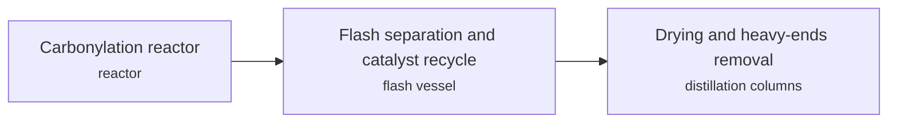

**Key equipment:** carbonylation reactor, flash vessel, light-ends and drying columns.

**Performance:**
- acetic acid selectivity on methanol, Cativa process: 99 % selectivity (methanol basis); Cativa carbonylation at 30-60 bar and 150-200 C over an iridium catalyst gives at least 99% selectivity on methanol.. [source](https://www.sciencedirect.com/science/article/abs/pii/S0920586100002637)

**Costs:**
- capital cost of a world-scale acetic acid plant (named datapoint): 600 USD per tonne/yr of capacity (USD 300 m for 500,000 t/yr) (2000$); derived from the Celanese Singapore plant launch report (about USD 300 m for 500,000 t/yr, 100 employees); dollar year not stated in the source (publication ~2000s); operating costs not stated in open sources. [source](https://www.researchgate.net/publication/294275655_Celanese_launches_acetic_acid_plant_in_Singapore)

**Reference plants:**
- Celanese Clear Lake acetic acid plant, Texas, US: 1.3 Mt/yr, with a planned expansion to about 2 Mt/yr announced March 2019 - among the world's largest acetic acid units (methanol carbonylation); operating. [source](https://www.bicmagazine.com/industry/refining-petrochem/march-19-celanese-looks-to-expand-clear-lake-acetic-acid-facility)
- Celanese acetic acid plant, Singapore, SG: 500,000 t/yr; plant cost about USD 300 million at launch; operating. [source](https://www.researchgate.net/publication/294275655_Celanese_launches_acetic_acid_plant_in_Singapore)

**Missing inputs:**
- TRL with a cited source (trl): The IEA ETP Clean Energy Technology Guide has no matching entry. no open TRL table found (IEA ETP guide checked 2026-10-28). Where: IEA ETP Clean Energy Technology Guide (collected): search for the technology name (catalog: iea-reports, open). Next: Find a TRL table that lists this technology, or leave maturity resting on the evidence on the card.

Sources: [1](https://en.wikipedia.org/wiki/Cativa_process), [2](https://patents.google.com/patent/WO2014004307A1/en). Last reviewed 2026-11-17.

## Ammonia and urea
<a id="pch-ammonia-urea"></a>

Natural gas or other feed is reformed to hydrogen, nitrogen is added and ammonia is made over iron catalyst in a Haber-Bosch loop; ammonia and CO2 then react in a urea synthesis reactor. Stamicarbon's CO2 stripping process cut steam use from 1,600 to 1,800 kg/t urea in conventional plants to about 800 kg/t, and its N=3 pool-condenser concept runs at 400 t/d in Geleen and 2,100 t/d at Bontang, Indonesia.


**Key equipment:** reformers, synthesis converter, urea reactor, CO2 stripper, carbamate condenser, granulator.

**Performance:**
- steam per tonne urea, conventional versus CO2 stripping: 800-1800 kg/t urea; conventional 1,600 to 1,800; N=2 stripping about 800 at 25 bar; N=3 596 to 610 MP steam. [source](https://www.fertilizer.org/wp-content/uploads/2023/01/2000_ifa_neworleans_jonckers.pdf)
- CO2 compressor power in N=3 concept: 100 kWh/t urea; paper. [source](https://www.fertilizer.org/wp-content/uploads/2023/01/2000_ifa_neworleans_jonckers.pdf)
- specific natural gas consumption, ammonia plant via natural gas reforming: 32-34 GJ/t NH3; annex table column 2024 (dollar year not stated, energy figures): 32 GJ/t NH3 unabated natural gas reforming (plus electricity 0.1 MWh/t); 34 GJ/t with CCUS at 95% capture (plus electricity 0.2 MWh/t); consumption includes feedstock and fuel. [source](https://iea.blob.core.windows.net/assets/15673ab3-a86a-4434-bff4-490bb42d3563/GlobalHydrogenReview2025AssumptionsAnnex.pdf)
- specific coal consumption, ammonia plant via coal gasification: 35-40 GJ/t NH3; annex table column 2024 (dollar year not stated, energy figures): 35 GJ/t NH3 unabated coal gasification (plus electricity 1.0 MWh/t); 40 GJ/t with CCUS at 95% capture (plus electricity 1.3 MWh/t). [source](https://iea.blob.core.windows.net/assets/15673ab3-a86a-4434-bff4-490bb42d3563/GlobalHydrogenReview2025AssumptionsAnnex.pdf)
- stoichiometric ammonia consumption per tonne urea: 0.567 t NH3/t urea; stoichiometric quantity for urea synthesis. [source](https://www.fertilizerseurope.com/wp-content/uploads/2019/08/Booklet_5_final.pdf)
- stoichiometric carbon dioxide consumption per tonne urea: 0.733 t CO2/t urea; stoichiometric quantity for urea synthesis. [source](https://www.fertilizerseurope.com/wp-content/uploads/2019/08/Booklet_5_final.pdf)
- steam consumption, urea plant: 570-800 kg/t urea; values per tonne of urea product across process and pressure levels (24 to 120 bar). [source](https://www.fertilizerseurope.com/wp-content/uploads/2019/08/Booklet_5_final.pdf)
- total energy consumption, new natural gas reforming ammonia plant: 29.3 GJ LHV/t NH3; best available technique; new reforming plants should not exceed 29.3 GJ(LHV)/t. [source](https://www.fertilizerseurope.com/wp-content/uploads/2019/08/Booklet_1_final.pdf)
- HP steam consumption, Stamicarbon urea process: 566 kg/t urea; less than 566 kg HP steam per tonne of urea. [source](https://www.stamicarbon.com/sites/default/files/2023-10/2023-09-Stami%20Urea%20Launch%20Brochure.pdf)
- global ammonia demand: 185-230 Mt NH3/yr; 185 Mt in 2020 rising to 230 Mt in 2050 under the IEA sustainable development scenario. [source](https://www.iea.org/files/6ee41bb9-8e81-4b64-8701-2acc064ff6e4/AmmoniaTechnologyRoadmap.pdf)
- share of ammonia used for nitrogen fertiliser: 70 %; just under 70% of ammonia is used for nitrogen fertiliser applications (2019/2020). [source](https://www.iea.org/files/6ee41bb9-8e81-4b64-8701-2acc064ff6e4/AmmoniaTechnologyRoadmap.pdf)
- share of ammonia demand taken by urea: 55 %; urea production accounts for around 55% of ammonia demand (2019). [source](https://www.iea.org/files/6ee41bb9-8e81-4b64-8701-2acc064ff6e4/AmmoniaTechnologyRoadmap.pdf)
- direct CO2 intensity, average ammonia plant: 2.4 t CO2/t NH3; around 2.4 t CO2 per tonne of ammonia produced, direct emissions. [source](https://www.iea.org/files/6ee41bb9-8e81-4b64-8701-2acc064ff6e4/AmmoniaTechnologyRoadmap.pdf)
- direct CO2 intensity by production route (best available technology): 0.1-3.2 t CO2/t NH3; SMR 1.8; ATR 1.6; coal 3.2; SMR with CCS 0.1; ATR with CCS 0.1; coal with CCS 0.2; electrolysis 0. [source](https://www.iea.org/files/6ee41bb9-8e81-4b64-8701-2acc064ff6e4/AmmoniaTechnologyRoadmap.pdf)
- energy intensity, average ammonia plant in 2020: 41-46 GJ/t NH3; 2020 average 46 GJ gross and 41 GJ net per tonne; best available SMR 32.4 GJ gross and 27.6 GJ net. [source](https://www.iea.org/files/6ee41bb9-8e81-4b64-8701-2acc064ff6e4/AmmoniaTechnologyRoadmap.pdf)
- North America ammonia production: 21-23 Mt NH3/yr; around 21 Mt today rising slightly to 23 Mt by 2050 under the sustainable development scenario. [source](https://www.iea.org/files/6ee41bb9-8e81-4b64-8701-2acc064ff6e4/AmmoniaTechnologyRoadmap.pdf)
- US nitrogen fertilizer production (national statistic): 1.38163e+07 t N/yr; FAOSTAT Fertilizers by Nutrient, nutrient nitrogen total, production, imputed flag I. [source](https://www.fao.org/faostat/en/#data/RFN)
- Canada nitrogen fertilizer production (national statistic): 3.5711e+06 t N/yr; FAOSTAT Fertilizers by Nutrient, nutrient nitrogen total, production, imputed flag I. [source](https://www.fao.org/faostat/en/#data/RFN)
- US ammonia imports for consumption: 1.9 Mt N/yr; Imports for consumption of anhydrous ammonia (HS 2814.10.0000), nitrogen content; 2025 estimate. [source](https://pubs.usgs.gov/periodicals/mcs2026/mcs2026-nitrogen.pdf)
- US ammonia exports: 1.1 Mt N/yr; Exports of anhydrous ammonia, nitrogen content; 2025 estimate. [source](https://pubs.usgs.gov/periodicals/mcs2026/mcs2026-nitrogen.pdf)
- US ammonia net import reliance: 5 %; Net import reliance as a percentage of apparent consumption; 2025 estimate. [source](https://pubs.usgs.gov/periodicals/mcs2026/mcs2026-nitrogen.pdf)
- US seaborne urea imports: 4.75 Mt/yr; Seaborne imports in the 2025-2026 fertiliser year (July-June), product weight; Argus citing US Census. [source](https://www.argusmedia.com/en/news-and-insights/latest-market-news/2844963-us-seaborne-urea-imports-flat-with-prior-year)
- Canada ammonia exports to the United States: 0.959 Mt/yr; Canadian exports to the USA in 2019, product weight. [source](https://fertilizercanada.ca/economic-impact-report-2020/global-use-and-export)

**Costs:**
- ammonia plant capital cost, natural gas reforming: 1390-2415 USD/(t NH3/yr) (2024$); installed cost including air separation unit; natural gas reforming. [source](https://iea.blob.core.windows.net/assets/15673ab3-a86a-4434-bff4-490bb42d3563/GlobalHydrogenReview2025AssumptionsAnnex.pdf)
- ammonia plant capital cost, natural gas reforming with CCUS: 1640-2855 USD/(t NH3/yr) (2024$); installed cost including air separation unit; natural gas reforming with CCUS. [source](https://iea.blob.core.windows.net/assets/15673ab3-a86a-4434-bff4-490bb42d3563/GlobalHydrogenReview2025AssumptionsAnnex.pdf)
- ammonia plant capital cost, coal gasification with CCUS: 3190-5540 USD/(t NH3/yr) (2024$); installed cost including air separation unit; coal gasification with CCUS. [source](https://iea.blob.core.windows.net/assets/15673ab3-a86a-4434-bff4-490bb42d3563/GlobalHydrogenReview2025AssumptionsAnnex.pdf)
- ammonia production cost, natural gas based: 110-340 USD/t NH3; natural gas at USD 2 to 10 per million Btu; IRENA Innovation Outlook: Ammonia 2022 citing Topsøe 2020; dollar year not stated. [source](https://www.irena.org/-/media/Files/IRENA/Agency/Publication/2022/May/IRENA_Innovation_Outlook_Ammonia_2022.pdf)
- ammonia plant capex, gas SMR reference plant: 1675 USD million per 875 kt/yr plant (2021$); core equipment for the 875 kt/yr reference-scale plant, including EPC; about 1,914 USD per tonne of annual capacity (derived). [source](https://www.iea.org/files/6ee41bb9-8e81-4b64-8701-2acc064ff6e4/AmmoniaTechnologyRoadmap.pdf)
- urea market price benchmark: 420 USD/t (2026$); prill spot f.o.b. Middle East, October 2026 — market benchmark, not a production cost. [source](https://thedocs.worldbank.org/en/doc/74e8be41ceb20fa0da750cda2f6b9e4e-0050012026/related/CMO-Pink-Sheet-November-2026.pdf)
- US natural gas price, Henry Hub: 2.96 USD/mmbtu (2026$); Henry Hub spot price, October 2026. [source](https://thedocs.worldbank.org/en/doc/74e8be41ceb20fa0da750cda2f6b9e4e-0050012026/related/CMO-Pink-Sheet-November-2026.pdf)
- urea plant capital cost: 42.9 USD million for 460 kt/yr plant (2024$); reference urea plant of 460,000 t/yr, about 93 USD per tonne of annual capacity (derived); price year not stated in the source text, 2024 publication underlying the 2025 thesis. [source](https://d-nb.info/1377345548/34)

**Reference plants:**
- Stamicarbon N=3 process, Bontang, Indonesia, ID: 2,100 t/d; . [source](https://www.fertilizer.org/wp-content/uploads/2023/01/2000_ifa_neworleans_jonckers.pdf)
- Stamicarbon N=3 process, Geleen, NL: 400 t/d; . [source](https://www.fertilizer.org/wp-content/uploads/2023/01/2000_ifa_neworleans_jonckers.pdf)
- CF Industries Donaldsonville Complex, US: nearly 8 Mt/yr nitrogen products; six world-scale ammonia plants and five urea plants; operating. [source](https://www.cfindustries.com/whoweare/locations/donaldsonville)
- Nutrien Geismar nitrogen complex, US: 0.6 Mt/yr ammonia; 0.4 Mt/yr urea; operating. [source](https://cdn.sanity.io/files/ixv7nalm/production/316f7c925cbaee5b88ca199f30a6ead9c3858a50.pdf)
- Nutrien Redwater nitrogen complex, CA: 1.0 Mt/yr ammonia; 0.7 Mt/yr urea; operating. [source](https://cdn.sanity.io/files/ixv7nalm/production/316f7c925cbaee5b88ca199f30a6ead9c3858a50.pdf)
- LSB Industries El Dorado nitrogen complex, US: 493,000 t/yr ammonia (1,350 t/d); operating. [source](https://www.sec.gov/Archives/edgar/data/60714/000119312526076810/lxu-20251231.htm)
- LSB Industries Pryor nitrogen complex, US: 246,000 t/yr ammonia (675 t/d); operating. [source](https://www.sec.gov/Archives/edgar/data/60714/000119312526076810/lxu-20251231.htm)
- Koch Fertilizer Enid nitrogen complex, US: two ammonia plants of 1,700 and 1,900 t/d; urea 4,000 t/d; operating. [source](https://applications.deq.ok.gov/permitspublic/storedpermits/9140.pdf)
- Beaumont New Ammonia (Woodside), Texas, US: 1.1 Mt/yr ammonia; operating (first ammonia December 2025). [source](https://www.woodside.com/what-we-do/growth-projects/beaumont-new-ammonia)

TRL source: [IEA ETP Clean Energy Technology Guide, dataset of 24 July 2026, latest assessment (IEA 1-11 scale): 'Haber-bosch process using electrolytic hydrogen' 8 (2025)](https://www.iea.org/data-and-statistics/data-tools/etp-clean-energy-technology-guide)

**Missing inputs:**
- independently corroborated urea-plant capital cost with an explicit dollar year (costs): One open 2025 thesis gives USD 42.9 million for a 460 kt/yr urea plant (about 93 USD/t-yr) but does not state a price year; no independent open second figure was found. Web-checked 2026-11-17. Where: arXiv and open-access journals: techno-economic or review papers (MDPI is blocked by its CDN; use the manual inbox) (catalog: arxiv, open); Licensor and EPC studies; paid cost databases are catalog-only (paid); OSTI.GOV full-text reports from DOE labs: search the technology name plus 'techno-economic' (catalog: osti, open). Next: Look for an open techno-economic study; record each figure with metric, range, unit, dollar year, basis and source.

Sources: [1](https://www.fertilizer.org/wp-content/uploads/2023/01/2000_ifa_neworleans_jonckers.pdf), [2](https://iea.blob.core.windows.net/assets/15673ab3-a86a-4434-bff4-490bb42d3563/GlobalHydrogenReview2025AssumptionsAnnex.pdf), [3](https://ucpcdn.thyssenkrupp.com/_binary/UCPthyssenkruppUhde/97ea5e98-9560-47d5-b249-ab95e0f4a083/brochure-urea_scr.pdf), [4](https://www.fertilizerseurope.com/wp-content/uploads/2019/08/Booklet_5_final.pdf), [5](https://www.fertilizerseurope.com/wp-content/uploads/2019/08/Booklet_1_final.pdf), [6](https://www.irena.org/-/media/Files/IRENA/Agency/Publication/2022/May/IRENA_Innovation_Outlook_Ammonia_2022.pdf), [7](https://www.stamicarbon.com/sites/default/files/2023-10/2023-09-Stami%20Urea%20Launch%20Brochure.pdf), [8](https://www.iea.org/files/6ee41bb9-8e81-4b64-8701-2acc064ff6e4/AmmoniaTechnologyRoadmap.pdf), [9](https://www.fao.org/faostat/en/#data/RFN), [10](https://thedocs.worldbank.org/en/doc/74e8be41ceb20fa0da750cda2f6b9e4e-0050012026/related/CMO-Pink-Sheet-November-2026.pdf), [11](https://www.epa.gov/system/files/other-files/2024-10/2023_data_summary_spreadsheets.zip), [12](https://d-nb.info/1377345548/34), [13](https://www.argusmedia.com/en/news-and-insights/latest-market-news/2844963-us-seaborne-urea-imports-flat-with-prior-year), [14](https://fertilizercanada.ca/economic-impact-report-2020/global-use-and-export). Last reviewed 2026-11-17.

## Aromatics complexes (paraxylene, benzene)
<a id="pch-aromatics-complex"></a>

A naphtha reformer makes aromatics, which are extracted and fractionated; paraxylene is recovered by adsorption (Parex), the other xylenes are isomerised (Isomar) and toluene is converted to xylenes and benzene (Tatoray). Hengyi's Brunei complex adds an LD Parex unit recovering 2.3 Mtpa of paraxylene, taking total paraxylene capacity above 3.8 Mtpa.

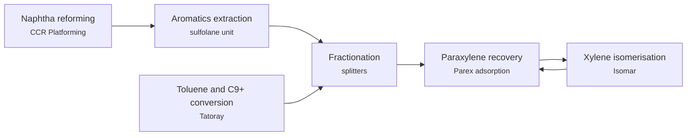

**Key equipment:** CCR reformer, sulfolane extraction, Parex adsorption chamber, Isomar reactor, Tatoray reactor, fractionation.

**Performance:**
- LD Parex paraxylene recovery at Hengyi Brunei: 2.3 Mtpa; total paraxylene capacity above 3.8 Mtpa after Phase 2. [source](https://www.ogj.com/refining-processing/petrochemicals/article/14198324/hengyi-lets-contract-for-aromatics-expansion-at-brunei-complex)
- para-xylene yield on crude oil for crude-to-aromatics plants: 5-20 % by weight of crude (typical complexes 5-10%; new crude-to-PX plants expected >20%); Nexant, Disruption in Aromatics (17 Jan 2019): "PX yields on crude oil by weight are typically from five to ten percent, but these new plants are expected to yield over 20 percent by converting heavy crude"; PX-per-tonne-naphtha and complex energy-use figures were not stated in open pages read. [source](https://www.nexanteca.com/sites/default/files/Nexant%20-%20Disruption%20in%20Aromatics%20-%20Blog%2017-Jan-2019.pdf)
- specific energy consumption, integrated aromatics complex: 7.73 GJ thermal per tonne aromatics; Modelled integrated complex: 7.73 GJ-th per tonne of aromatics plus 0.91 GJ/t of electricity. A PX yield per tonne of naphtha is not stated.. [source](https://www.sciencedirect.com/science/article/pii/S0959652622033042)

**Reference plants:**
- Hengyi Industries aromatics expansion, Pulau Muara Besar, BN: 2.3 Mtpa Parex; total PX above 3.8 Mtpa; Phase 2 commissioning scheduled for 2022 in the article. [source](https://www.ogj.com/refining-processing/petrochemicals/article/14198324/hengyi-lets-contract-for-aromatics-expansion-at-brunei-complex)

**Missing inputs:**
- capital cost and operating or unit cost, with dollar year and basis (costs): No open source read so far gives costs for this technology. Web-checked 2026-10-28; complex capex case-specific. Where: arXiv and open-access journals: techno-economic or review papers (MDPI is blocked by its CDN; use the manual inbox) (catalog: arxiv, open); Licensor and EPC studies; paid cost databases are catalog-only (paid); OSTI.GOV full-text reports from DOE labs: search the technology name plus 'techno-economic' (catalog: osti, open). Next: Look for an open techno-economic study; record each figure with metric, range, unit, dollar year, basis and source.
- TRL with a cited source (trl): The IEA ETP Clean Energy Technology Guide has no matching entry. no open TRL table found (IEA ETP guide checked 2026-10-28). Where: IEA ETP Clean Energy Technology Guide (collected): search for the technology name (catalog: iea-reports, open). Next: Find a TRL table that lists this technology, or leave maturity resting on the evidence on the card.

Sources: [1](https://www.ogj.com/refining-processing/petrochemicals/article/14198324/hengyi-lets-contract-for-aromatics-expansion-at-brunei-complex), [2](https://www.digitalrefining.com/qanda/394). Last reviewed 2026-11-17.

## Bio-based chemicals (bio-ethylene, bio-PE, PLA)
<a id="pch-bio-based-chemicals"></a>

Sugarcane ethanol is dehydrated to ethylene and polymerised to polyethylene identical to fossil PE (Braskem Green PE, Triunfo, 200,000 t/yr since 2010); lactic acid from sugars is polymerised to PLA. IEA rates ethylene production by fermentation at TRL 9.

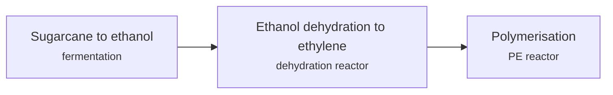

**Key equipment:** fermentation, ethanol dehydration reactor, PE reactor.

**Performance:**
- Braskem Green PE capacity: 200000 t/yr; Triunfo, Brazil, since 2010. [source](https://en.wikipedia.org/wiki/Renewable_polyethylene)
- CO2 sequestered per tonne Green PE: 2.15 t CO2/t; general figure for Green PE, not Braskem-specific. [source](https://en.wikipedia.org/wiki/Renewable_polyethylene)

**Reference plants:**
- Braskem Green PE, Triunfo, BR: 200,000 t/yr; . [source](https://en.wikipedia.org/wiki/Renewable_polyethylene)
- NatureWorks Ingeo PLA plant, Blair, Nebraska, US: nameplate 140,000 t/yr (300 million lb), world's first and largest PLA plant (doubled to full design capacity by 2009); operating. [source](https://cen.acs.org/articles/87/i28/NatureWorks-Ups-PLA-Capacity.html)
- NatureWorks Ingeo PLA plant, Rayong, Thailand, TH: 75,000 t/yr; construction milestone Feb 2023, production planned from 2025; construction. [source](https://www.chemengonline.com/natureworks-progresses-construction-of-pla-biopolymer-plant-in-thailand)

TRL source: [IEA ETP Clean Energy Technology Guide, dataset of 24 July 2026, latest assessment (IEA 1-11 scale): 'Ethylene production using fermentation' 9 (2025)](https://www.iea.org/data-and-statistics/data-tools/etp-clean-energy-technology-guide)

**Missing inputs:**
- capital cost and operating or unit cost, with dollar year and basis (costs): No open source read so far gives costs for this technology. Web-checked 2026-10-28; PLA plant capex not published in open pages. Where: arXiv and open-access journals: techno-economic or review papers (MDPI is blocked by its CDN; use the manual inbox) (catalog: arxiv, open); Licensor and EPC studies; paid cost databases are catalog-only (paid); OSTI.GOV full-text reports from DOE labs: search the technology name plus 'techno-economic' (catalog: osti, open). Next: Look for an open techno-economic study; record each figure with metric, range, unit, dollar year, basis and source.

Sources: [1](https://en.wikipedia.org/wiki/Renewable_polyethylene), [2](https://cen.acs.org/articles/87/i28/NatureWorks-Ups-PLA-Capacity.html), [3](https://www.ieabioenergy.com/wp-content/uploads/2020/02/Bio-based-chemicals-a-2020-update-final-200213.pdf). Last reviewed 2026-11-17.

## Butadiene extraction and on-purpose butadiene
<a id="pch-butadiene"></a>

Butadiene is extracted from steam-cracker crude C4 with N-methylpyrrolidone (NMP) solvent; on-purpose routes dehydrogenate n-butane (CATADIENE) or butenes. Lummus has licensed the BASF extraction process since 1990, with 38 plants over 4 Mtpa, recovering more than 99% of the butadiene at 99.7 wt% purity.

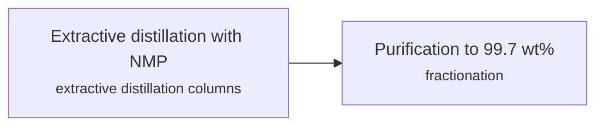

**Key equipment:** extractive distillation columns, solvent regeneration, fractionation.

**Performance:**
- butadiene recovery: 99 %; more than 99% of feed 1,3-butadiene; product 99.7 wt%. [source](https://www.lummustechnology.com/getmedia/b9694881-4803-41ff-8e0a-06f5afc17992/2020-09-15-butadiene-extraction-technology-tech-sheet.pdf)
- installed licensed capacity: 4 Mtpa; 38 plants worldwide. [source](https://www.lummustechnology.com/getmedia/b9694881-4803-41ff-8e0a-06f5afc17992/2020-09-15-butadiene-extraction-technology-tech-sheet.pdf)
- butadiene co-production share from steam cracking: 95 % of butadiene produced as a by-product of ethylene production; "Over 95% of butadiene is produced as a by-product of ethylene production from steam cracking" (White WC, Butadiene production process overview, 2007); on-purpose routes (dehydrogenation) supply the remainder. [source](https://europepmc.org/article/med/17324391)

**Reference plants:**
- KPIC butadiene extraction unit, Ulsan, South Korea (Lummus, BASF NMP process), KR: 146,000 t/yr butadiene via BASF BDE NMP extractive distillation, licensed by Lummus (award May 2021); construction. [source](https://www.european-rubber-journal.com/article/2071146/lummus-to-build-butadiene-plant-for-korea-s-kpic)

**Missing inputs:**
- capital cost and operating or unit cost, with dollar year and basis (costs): No open source read so far gives costs for this technology. Web-checked 2026-10-28; unit capex licensor-quoted. Where: arXiv and open-access journals: techno-economic or review papers (MDPI is blocked by its CDN; use the manual inbox) (catalog: arxiv, open); Licensor and EPC studies; paid cost databases are catalog-only (paid); OSTI.GOV full-text reports from DOE labs: search the technology name plus 'techno-economic' (catalog: osti, open). Next: Look for an open techno-economic study; record each figure with metric, range, unit, dollar year, basis and source.
- TRL with a cited source (trl): The IEA ETP Clean Energy Technology Guide has no matching entry. no open TRL table found (IEA ETP guide checked 2026-10-28). Where: IEA ETP Clean Energy Technology Guide (collected): search for the technology name (catalog: iea-reports, open). Next: Find a TRL table that lists this technology, or leave maturity resting on the evidence on the card.

Sources: [1](https://www.lummustechnology.com/getmedia/b9694881-4803-41ff-8e0a-06f5afc17992/2020-09-15-butadiene-extraction-technology-tech-sheet.pdf), [2](http://www.ugr.es/~tep028/pqi/descargas/Industria%20quimica%20organica/tema_3/butadieno_a04_431.pdf). Last reviewed 2026-11-16.

## Engineering plastics (polycarbonate, nylon)
<a id="pch-engineering-plastics"></a>

Polycarbonate is made from bisphenol A and phosgene (interfacial) or diphenyl carbonate (melt), and nylons from diamines and diacids or lactams. The sources found so far give company activity only: Covestro started a recyclate compounding plant at its Shanghai site in October 2023 (capacity not stated in the page read).

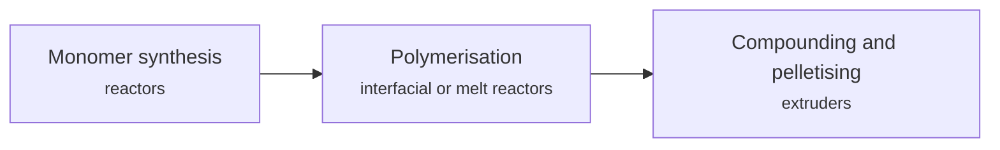

**Key equipment:** polymerisation reactors, extruders, pelletisers.

**Performance:**
- energy and CO2 per tonne of compounded polycarbonate: 18 GJ per tonne; About 18 GJ per tonne of compounded polycarbonate, giving about 1.1 t CO2 per tonne.. [source](https://www.pbl.nl/uploads/default/downloads/pbl-2021-decarbonisation-options-for-the-dutch-polycarbonate-industry-4580.pdf)

**Missing inputs:**
- capital cost and operating or unit cost, with dollar year and basis (costs): No open source read so far gives costs for this technology. Web-checked 2026-10-28; no open figures. Where: arXiv and open-access journals: techno-economic or review papers (MDPI is blocked by its CDN; use the manual inbox) (catalog: arxiv, open); Licensor and EPC studies; paid cost databases are catalog-only (paid); OSTI.GOV full-text reports from DOE labs: search the technology name plus 'techno-economic' (catalog: osti, open). Next: Look for an open techno-economic study; record each figure with metric, range, unit, dollar year, basis and source.
- named plants or projects with capacity and year (reference_plants): The sources read name no specific plant. Web-checked 2026-10-28; no verifiable named plant added. Where: Licensor and operator press releases for the suppliers listed (open). Next: Add one or two plants with country, capacity and start-up year.
- TRL with a cited source (trl): The IEA ETP Clean Energy Technology Guide has no matching entry. no open TRL table found (IEA ETP guide checked 2026-10-28). Where: IEA ETP Clean Energy Technology Guide (collected): search for the technology name (catalog: iea-reports, open). Next: Find a TRL table that lists this technology, or leave maturity resting on the evidence on the card.

Sources: [1](https://www.plasteurope.com/news/detail.asp?id=253846), [2](https://ucpcdn.thyssenkrupp.com/_binary/UCPthyssenkruppUhde/3d3787ee-2523-4555-8e81-a6bb9823d5c0/brochure_pa.pdf). Last reviewed 2026-11-17.

## Ethylene oxide and glycols
<a id="pch-ethylene-oxide-glycols"></a>

Ethylene is oxidised with oxygen over a silver catalyst to ethylene oxide, which is hydrated to ethylene glycols. High-selectivity catalysts reached 90% or more start-of-cycle selectivity, and a two-step catalytic route via ethylene carbonate (Shell OMEGA) gives more than 99% MEG against 90 to 92% for thermal hydration.

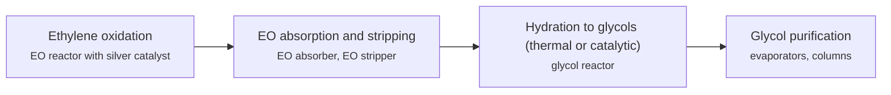

**Key equipment:** EO reactor, CO2 removal system, EO absorber and stripper, glycol reactor, glycol columns.

**Performance:**
- EO catalyst selectivity, high-selectivity types: 86-90 %; start of cycle: early HS at least 86%, later HS 90% or more; HP averaged about 87% in one plant. [source](https://catalysts.shell.com/hubfs/Content%20Library/SCT%20-%20Enhancements%20in%20EOEG%20Manufacturing%20Technology.pdf)
- MEG yield, catalytic two-step versus thermal: 90-99 %; thermal 90 to 92%; catalytic more than 99%. [source](https://catalysts.shell.com/hubfs/Content%20Library/SCT%20-%20Enhancements%20in%20EOEG%20Manufacturing%20Technology.pdf)

**Reference plants:**
- Shell monoethylene glycol plant, Jurong Island, Singapore (OMEGA process), SG: MEG via the OMEGA route (EO to ethylene carbonate, then catalytic hydrolysis) - the first fully catalytic EG process; supported by Shell's 2015 ethylene-unit upgrade on the island; operating. [source](https://chemanager-online.com/en/news/shell-upgrades-singapore-ethylene-production)

**Missing inputs:**
- capital cost and operating or unit cost, with dollar year and basis (costs): No open source read so far gives costs for this technology. Web-checked 2026-10-28; no open figures. Where: arXiv and open-access journals: techno-economic or review papers (MDPI is blocked by its CDN; use the manual inbox) (catalog: arxiv, open); Licensor and EPC studies; paid cost databases are catalog-only (paid); OSTI.GOV full-text reports from DOE labs: search the technology name plus 'techno-economic' (catalog: osti, open). Next: Look for an open techno-economic study; record each figure with metric, range, unit, dollar year, basis and source.
- TRL with a cited source (trl): The IEA ETP Clean Energy Technology Guide has no matching entry. no open TRL table found (IEA ETP guide checked 2026-10-28). Where: IEA ETP Clean Energy Technology Guide (collected): search for the technology name (catalog: iea-reports, open). Next: Find a TRL table that lists this technology, or leave maturity resting on the evidence on the card.

Sources: [1](https://catalysts.shell.com/hubfs/Content%20Library/SCT%20-%20Enhancements%20in%20EOEG%20Manufacturing%20Technology.pdf), [2](https://en.wikipedia.org/wiki/Ethylene_oxide). Last reviewed 2026-10-29.

## Linear alpha olefins
<a id="pch-linear-alpha-olefins"></a>

Ethylene is oligomerised to a range of linear alpha olefins (butene-1, hexene-1, octene-1 up to heavy cuts). SABIC and Linde's alpha-SABLIN is a one-stage homogeneous process; the Jubail plant was contracted in 2004, designed for 150,000 t/yr, and commercialised by 30 November 2009.

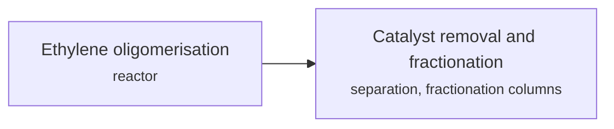

**Key equipment:** oligomerisation reactor, catalyst deactivation and removal, fractionation columns.

**Performance:**
- Jubail LAO plant design capacity: 150000 t/yr; Jubail United Petrochemical Co.. [source](https://www.chemicalprocessing.com/processing-equipment/reaction-synthesis/news/11357729/sabic-linde-group-successfully-commercialize-linear-alpha-olefins-chemical-processing)
- product distribution, Chevron Phillips LAO process: 41 wt% in the hexene-to-decene cut; Typical distribution by process (wt%): C4 14, C6-C10 41, C12-C14 19, C16-C18 12, C20+ 14. Shell and Ethyl distributions differ.. [source](https://ijeast.com/papers/83-86,Tesma204,IJEAST.pdf)

**Reference plants:**
- Jubail United alpha-SABLIN LAO plant, SA: 150,000 t/yr; . [source](https://www.chemicalprocessing.com/processing-equipment/reaction-synthesis/news/11357729/sabic-linde-group-successfully-commercialize-linear-alpha-olefins-chemical-processing)

**Missing inputs:**
- capital cost and operating or unit cost, with dollar year and basis (costs): No open source read so far gives costs for this technology. Web-checked 2026-10-28; licensor quotes only. Where: arXiv and open-access journals: techno-economic or review papers (MDPI is blocked by its CDN; use the manual inbox) (catalog: arxiv, open); Licensor and EPC studies; paid cost databases are catalog-only (paid); OSTI.GOV full-text reports from DOE labs: search the technology name plus 'techno-economic' (catalog: osti, open). Next: Look for an open techno-economic study; record each figure with metric, range, unit, dollar year, basis and source.
- TRL with a cited source (trl): The IEA ETP Clean Energy Technology Guide has no matching entry. no open TRL table found (IEA ETP guide checked 2026-10-28). Where: IEA ETP Clean Energy Technology Guide (collected): search for the technology name (catalog: iea-reports, open). Next: Find a TRL table that lists this technology, or leave maturity resting on the evidence on the card.

Sources: [1](https://www.chemicalprocessing.com/processing-equipment/reaction-synthesis/news/11357729/sabic-linde-group-successfully-commercialize-linear-alpha-olefins-chemical-processing), [2](https://cdn.ihs.com/www/pdf/CEH-Linear-Alpha-Olefins-sample-report-2010.pdf). Last reviewed 2026-11-17.

## Mechanical recycling of plastics
<a id="pch-mechanical-recycling"></a>

Plastic waste is sorted (NIR, laser, X-ray), milled, washed, floated, dried and remelted. Heat and shear shorten polymer chains, so quality often limits recyclate to lower-value uses; only PET is approved for food-contact mechanically recycled post-consumer waste in the EU (Regulation 282/2008). In 2018, 32.5% of European post-consumer plastic waste was collected for recycling.


**Key equipment:** sorting equipment, mill, wash line, extruder with melt filter.

**Performance:**
- European post-consumer plastic waste collected for recycling, 2018: 32.5 %; country rates 20 to 45%. [source](https://docs.european-bioplastics.org/publications/bp/EUBP_BP_Mechanical_recycling.pdf)
- overall material yield, mechanical recycling of mixed plastic waste: 53 % overall yield; Mechanical recycling yields 53% overall against 65% for physical recycling, with 25-37% of output going to refuse-derived fuel.. [source](https://publications.jrc.ec.europa.eu/repository/bitstream/JRC132067/JRC132067_01.pdf)

**Missing inputs:**
- capital cost and operating or unit cost, with dollar year and basis (costs): No open source read so far gives costs for this technology. Web-checked 2026-10-28; no open figures. Where: arXiv and open-access journals: techno-economic or review papers (MDPI is blocked by its CDN; use the manual inbox) (catalog: arxiv, open); Licensor and EPC studies; paid cost databases are catalog-only (paid); OSTI.GOV full-text reports from DOE labs: search the technology name plus 'techno-economic' (catalog: osti, open). Next: Look for an open techno-economic study; record each figure with metric, range, unit, dollar year, basis and source.
- named plants or projects with capacity and year (reference_plants): The sources read name no specific plant. Web-checked 2026-10-28; no verifiable named plant added this pass. Where: Licensor and operator press releases for the suppliers listed (open). Next: Add one or two plants with country, capacity and start-up year.
- TRL with a cited source (trl): The IEA ETP Clean Energy Technology Guide has no matching entry. no open TRL table found (IEA ETP guide checked 2026-10-28). Where: IEA ETP Clean Energy Technology Guide (collected): search for the technology name (catalog: iea-reports, open). Next: Find a TRL table that lists this technology, or leave maturity resting on the evidence on the card.

Sources: [1](https://docs.european-bioplastics.org/publications/bp/EUBP_BP_Mechanical_recycling.pdf), [2](https://en.wikipedia.org/wiki/Plastic_recycling). Last reviewed 2026-11-17.

## Metathesis (OCT)
<a id="pch-olefins-metathesis"></a>

Ethylene and butenes (or other C4/C5 olefin streams) are reacted over a metathesis catalyst to make propylene. Lummus's olefins conversion technology (OCT) takes feeds from dilute ethylene to polymer-grade ethylene and from steam-cracker, MTBE-raffinate or FCC C4 streams, and gives polymer-grade propylene at about 94 to 95% selectivity.

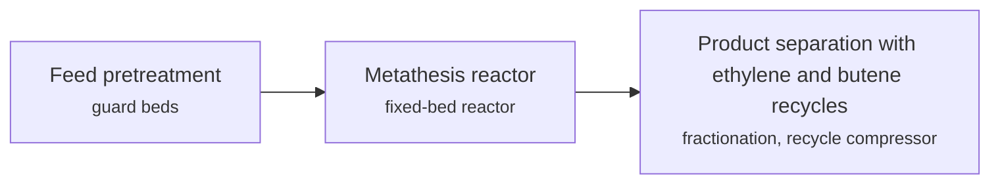

**Key equipment:** metathesis reactor, guard beds, fractionation columns, recycle compressor.

**Performance:**
- propylene selectivity: 94-95 %; olefin utilisation typically 90 to 97%. [source](https://www.lummustechnology.com/getmedia/5ad83600-79c7-4e47-a6b3-ad0faaf12406/2020-10-15-olefins-conversion-tech-sheet.pdf)
- steam cracker ethylene output when integrated with OCT: 115 % of nameplate; propylene-to-ethylene ratio can be raised above 1.0. [source](https://www.lummustechnology.com/getmedia/5ad83600-79c7-4e47-a6b3-ad0faaf12406/2020-10-15-olefins-conversion-tech-sheet.pdf)

**Missing inputs:**
- licensed unit count and operating plants (reference_plants): The sheet does not list them. Web-checked 2026-10-28: Lummus OCT described as a commercial metathesis technology (effective for excess ethylene / higher-value propylene) but no licensed-unit count published. Where: Lummus references page (catalog: lummus, open). Next: Add licensed capacity.
- capital cost and operating or unit cost, with dollar year and basis (costs): No open source read so far gives costs for this technology. Web-checked 2026-10-28; licensor quotes only. Where: arXiv and open-access journals: techno-economic or review papers (MDPI is blocked by its CDN; use the manual inbox) (catalog: arxiv, open); Licensor and EPC studies; paid cost databases are catalog-only (paid); OSTI.GOV full-text reports from DOE labs: search the technology name plus 'techno-economic' (catalog: osti, open). Next: Look for an open techno-economic study; record each figure with metric, range, unit, dollar year, basis and source.
- TRL with a cited source (trl): The IEA ETP Clean Energy Technology Guide has no matching entry. no open TRL table found (IEA ETP guide checked 2026-10-28). Where: IEA ETP Clean Energy Technology Guide (collected): search for the technology name (catalog: iea-reports, open). Next: Find a TRL table that lists this technology, or leave maturity resting on the evidence on the card.

Sources: [1](https://www.lummustechnology.com/getmedia/5ad83600-79c7-4e47-a6b3-ad0faaf12406/2020-10-15-olefins-conversion-tech-sheet.pdf), [2](https://portfolio-pplus.com/Technologies/Details/29). Last reviewed 2026-11-17.

## Methanol-to-olefins (MTO, DMTO)
<a id="pch-methanol-to-olefins"></a>

Methanol vapour is converted over a SAPO-34 molecular sieve catalyst in a fluidized-bed reactor into ethylene and propylene. The catalyst coke is burned off in a regenerator, and the product gas is quenched, compressed and separated. DMTO-II adds a second reactor that cracks C4 and heavier by-products over a dual-function catalyst to raise olefin yield; DMTO-III raises selectivity further without recycling C4+.

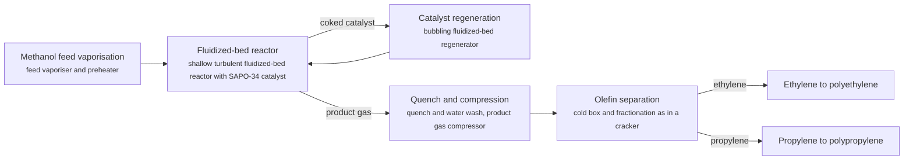

**Key equipment:** methanol vaporiser, fluidized-bed reactor and regenerator, quench tower, product gas compressor, olefin fractionation train.

**Performance:**
- ethylene plus propylene selectivity, demonstration unit: 79 %; DICP; DMTO-III 85-90%. [source](https://www.engineering.org.cn/engi/EN/10.1016/j.eng.2020.12.001)
- methanol consumption per tonne of light olefins, original process: 2.97 t methanol/t olefins; DICP; 2.85 with newer catalyst, about 2.64 for DMTO-III. [source](https://www.engineering.org.cn/engi/EN/10.1016/j.eng.2020.12.001)
- DMTO units licensed (to end-2019): 26 units; 14 started up; licensed olefins capacity 14 Mt/yr, 7.67 Mt/yr in the 14 started units. [source](https://www.engineering.org.cn/engi/EN/10.1016/j.eng.2020.12.001)
- DMTO methanol consumption per tonne of olefin; BMTO+CCS emissions case: 2.97 t methanol per t olefin (DMTO 72-h performance test); BMTO with CCS: minus 8.2 t CO2 per t ethylene; "The 72 hours' performance tests demonstrate that the production of 1 ton of olefin requires about 2.97 tons of methanol feed" (DMTO: A Sustainable Methanol-to-Olefins Technology, 2020); Inner Mongolia coal-to-olefin value-chain study (Dec 2024): combining CCS with biomethanol MTO gives CO2 emissions of minus 8.2 t per t ethylene (29.4% lower); the base coal-MTO CO2 intensity was not stated in the open pages read. [source](https://www.researchgate.net/publication/347481336_DMTO_A_Sustainable_Methanol-to-Olefins_Technology)
- CO2 intensity of the coal-methanol MTO route: 7.1-10 t CO2 per t olefins; The conventional coal-to-olefins route emits 7.1-10 t CO2 per t olefins; green-methanol and green-hydrogen variants are reported far lower.. [source](https://dmto.dicp.ac.cn/dnl12eng/2025-45.pdf)

**Reference plants:**
- Shenhua Baotou coal-to-olefins plant, CN: 1.8 Mt/yr methanol feed, 600,000 t/yr polyethylene and polypropylene (first commercial DMTO); started 8 August 2010. [source](https://www.engineering.org.cn/engi/EN/10.1016/j.eng.2020.12.001)

**Missing inputs:**
- TRL with a cited source (trl): The IEA guide has no MTO entry; the installed base (26 licences) supports 'commercial'. IEA ETP Guide (July 2026) has no matching entry (searched 'methanol-to-olefins', 'MTO', 'DMTO', 'olefins', 'propylene'); 2026-10-28 Where: IEA ETP Clean Energy Technology Guide (collected): search for the technology name (catalog: iea-reports, open). Next: Find a TRL table that lists methanol-to-olefins.
- capital cost and production cost, with dollar year and basis (costs): No open source read so far gives costs for this technology; petrochemical unit costs are mostly in paid sources. Where: Open techno-economic papers on arXiv and open-access journals (MDPI is blocked by its CDN; use the manual inbox) (catalog: arxiv, open); IEA reports on petrochemicals (check the iea-reports corpus first) (catalog: iea-reports, open); Paid cost databases and licensor studies (consultancies, IHS/S&P, Nexant): catalog-only until the owner provides access (catalog: nexant-chemsystems, paid). Next: Look for an open techno-economic study; record each figure with metric, range, unit, dollar year, basis and source.

Sources: [1](https://www.engineering.org.cn/engi/EN/10.1016/j.eng.2020.12.001). Last reviewed 2026-11-17.

## PET and polyester
<a id="pch-pet-polyester"></a>

Terephthalic acid or dimethyl terephthalate is reacted with ethylene glycol to make PET by continuous melt polycondensation. thyssenkrupp Uhde Inventa-Fischer's Melt-To-Resin (MTR) process uses a two-reactor design (ESPREE and DISCAGE) and skips the separate solid-state step; a 324,000 t/yr plant for KÖKSAN in Turkey is planned for 2028.

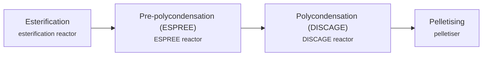

**Key equipment:** esterification reactor, ESPREE reactor, DISCAGE reactor, vacuum system, pelletiser.

**Performance:**
- KÖKSAN plant capacity: 324000 t/yr PET resin; about 888 t/d (calculated); commissioning planned 2028. [source](https://hydrocarbonprocessing.com/news/2026/04/thyssenkrupp-uhde-to-build-a-low-emission-polyester-plant-for-koksan-in-turkey/)
- energy-related carbon footprint reduction claimed for MTR: 30 % (up to); fuel and electrical energy; vendor claim. [source](https://hydrocarbonprocessing.com/news/2026/04/thyssenkrupp-uhde-to-build-a-low-emission-polyester-plant-for-koksan-in-turkey/)

**Missing inputs:**
- operating MTR plants (reference_plants): Only a planned plant read. Web-checked 2026-10-28; melt-to-resin (MTR) plant lists are trade directories without verifiable per-plant pages. Where: Uhde Inventa-Fischer references (catalog: thyssenkrupp-uhde, open). Next: Add operating references.
- capital cost and operating or unit cost, with dollar year and basis (costs): No open source read so far gives costs for this technology. Web-checked 2026-10-28; no open figures. Where: arXiv and open-access journals: techno-economic or review papers (MDPI is blocked by its CDN; use the manual inbox) (catalog: arxiv, open); Licensor and EPC studies; paid cost databases are catalog-only (paid); OSTI.GOV full-text reports from DOE labs: search the technology name plus 'techno-economic' (catalog: osti, open). Next: Look for an open techno-economic study; record each figure with metric, range, unit, dollar year, basis and source.
- TRL with a cited source (trl): The IEA ETP Clean Energy Technology Guide has no matching entry. no open TRL table found (IEA ETP guide checked 2026-10-28). Where: IEA ETP Clean Energy Technology Guide (collected): search for the technology name (catalog: iea-reports, open). Next: Find a TRL table that lists this technology, or leave maturity resting on the evidence on the card.

Sources: [1](https://hydrocarbonprocessing.com/news/2026/04/thyssenkrupp-uhde-to-build-a-low-emission-polyester-plant-for-koksan-in-turkey/), [2](https://en.wikipedia.org/wiki/Polyethylene_terephthalate). Last reviewed 2026-10-29.

## PHA bioplastics
<a id="pch-pha-bioplastics"></a>

Polyhydroxyalkanoates are polyesters made by fermentation of plant oils or sugars with microbes. Danimer Scientific's Kentucky facility reached a run rate of 20 million pounds per year of Nodax PHA resins after debottlenecking in 2021.

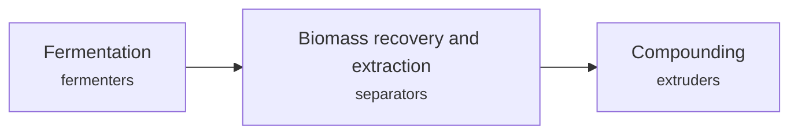

**Key equipment:** fermenters, extraction train, compounding extruders.

**Performance:**
- Danimer Kentucky run-rate capacity: 20 million lb/yr; Nodax resins, June 2021. [source](https://renewable-carbon.eu/news/?p=91819)

**Missing inputs:**
- production cost versus PE and PP (costs): Not in the release. Web-checked 2026-10-28; PHA-vs-polyolefin cost comparisons in open pages are review-paper estimates without verifiable basis. Where: Danimer SEC filings (open). Next: Add costs.
- named plants or projects with capacity and year (reference_plants): The sources read name no specific plant. Web-checked 2026-10-28; no verifiable named PHA plant page found this pass. Where: Licensor and operator press releases for the suppliers listed (open). Next: Add one or two plants with country, capacity and start-up year.
- TRL with a cited source (trl): The IEA ETP Clean Energy Technology Guide has no matching entry. IEA ETP Guide (July 2026) has no matching entry (searched 'PHA', 'polyhydroxyalkanoate', 'bioplastic', 'biodegradable'); 2026-10-28 no open TRL table found (IEA ETP guide checked 2026-10-28). Where: IEA ETP Clean Energy Technology Guide (collected): search for the technology name (catalog: iea-reports, open). Next: Find a TRL table that lists this technology, or leave maturity resting on the evidence on the card.

Sources: [1](https://renewable-carbon.eu/news/?p=91819), [2](https://www.eeer.org/journal/view.php?number=1649). Last reviewed 2026-11-17.

## PVC (suspension) and chlor-alkali
<a id="pch-pvc-chlor-alkali"></a>

Chlor-alkali electrolysis makes chlorine, caustic soda and hydrogen from brine. Chlorine and ethylene give EDC by direct chlorination and oxychlorination; cracking EDC at about 480 degC gives vinyl chloride monomer, which is polymerised in suspension to PVC. thyssenkrupp nucera quotes less than 1,960 kWh per tonne NaOH for its membrane cells at 6 kA/m2.

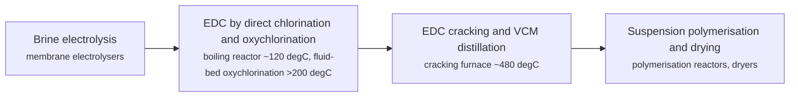

**Key equipment:** membrane electrolysers, direct chlorination reactor, oxychlorination reactor, EDC cracking furnace, PVC polymerisation reactors.

**Performance:**
- electrolysis energy, membrane cell: up to 1960 kWh per t NaOH; at 6 kA/m2; ODC cuts energy by up to 25%. [source](https://www.thyssenkrupp-nucera.com/chlor-alkali-solutions/)
- ethylene and chlorine per tonne VCM: 459-575 kg; ethylene 459 kg, chlorine 575 kg per 1,000 kg VCM (licensor expected figures). [source](https://cdn.ihsmarkit.com/www/pdf/0920/2020-09-18_VC_PC_Brochure_White-Paper2_IHS.pdf)
- steam per tonne PVC powder: up to 700 kg; 435 kg combined with VCM plant. [source](https://cdn.ihsmarkit.com/www/pdf/0920/2020-09-18_VC_PC_Brochure_White-Paper2_IHS.pdf)
- acetylene-route share of Chinese PVC production: 80 % of integrated Chinese PVC production; More than 80% of Chinese integrated PVC is carbide-based; China's capacity is close to 30 Mt against a global market of about 56 Mt.. [source](https://www.argusmedia.com/en/news-and-insights/latest-market-news/2808308-chinese-carbide-pvc-could-temper-us-exports-to-asia)

**Missing inputs:**
- capital cost and operating or unit cost, with dollar year and basis (costs): No open source read so far gives costs for this technology. Web-checked 2026-10-28; no open figures. Where: arXiv and open-access journals: techno-economic or review papers (MDPI is blocked by its CDN; use the manual inbox) (catalog: arxiv, open); Licensor and EPC studies; paid cost databases are catalog-only (paid); OSTI.GOV full-text reports from DOE labs: search the technology name plus 'techno-economic' (catalog: osti, open). Next: Look for an open techno-economic study; record each figure with metric, range, unit, dollar year, basis and source.
- named plants or projects with capacity and year (reference_plants): The sources read name no specific plant. Web-checked 2026-10-28; no verifiable named plant added. Where: Licensor and operator press releases for the suppliers listed (open). Next: Add one or two plants with country, capacity and start-up year.
- TRL with a cited source (trl): The IEA ETP Clean Energy Technology Guide has no matching entry. no open TRL table found (IEA ETP guide checked 2026-10-28). Where: IEA ETP Clean Energy Technology Guide (collected): search for the technology name (catalog: iea-reports, open). Next: Find a TRL table that lists this technology, or leave maturity resting on the evidence on the card.

Sources: [1](https://www.thyssenkrupp-nucera.com/chlor-alkali-solutions/), [2](https://cdn.ihsmarkit.com/www/pdf/0920/2020-09-18_VC_PC_Brochure_White-Paper2_IHS.pdf), [3](https://pvc.org/about-pvc/pvc-production). Last reviewed 2026-11-17.

## Paraxylene adsorption and crystallisation
<a id="pch-paraxylene-adsorption"></a>

Mixed xylenes from reformate and transalkylation are fed to a simulated-moving-bed adsorption unit. A rotary valve moves feed, desorbent and product ports along beds of selective adsorbent so that, in effect, a counter-current moving bed is created without moving solids; paraxylene is adsorbed and then desorbed, and the desorbent is recovered by distillation. The raffinate is isomerised and recycled to extinction.

```mermaid
flowchart LR
    REF["Xylene supply from reformer and transalkylation<br/><small>CCR reformate splitter, xylene column</small>"]
    SMB["Simulated moving bed adsorption<br/><small>adsorbent chambers, rotary valve, desorbent circulation</small>"]
    EXT["Extract fractionation<br/><small>extract column, desorbent recovery</small>"]
    PX["High-purity paraxylene<br/><small>product tank</small>"]
    RAF["Raffinate to isomerisation<br/><small>raffinate column, xylene isomerisation reactor</small>"]
    XCOL["Recycle to xylene column<br/><small>xylene column</small>"]
    REF --> SMB
    SMB -->|extract (paraxylene + desorbent)| EXT
    SMB -->|raffinate| RAF
    EXT --> PX
    RAF --> XCOL
    XCOL --> SMB
```

**Key equipment:** adsorbent chambers with rotary valve, extract and raffinate columns, xylene isomerisation reactor, xylene column.

**Performance:**
- Parex licensed capacity range per unit: 21000-1.6e+06 t/yr paraxylene; Honeywell UOP: over 100 units licensed since commercialisation in 1971. [source](https://uop.com/en/industry-solutions/petrochemicals/aromatics-recovery)
- UOP Parex simulated moving-bed para-xylene recovery and purity: 97-99.9 wt% single-pass recovery (>97) at product purity of 99.9 wt% or better; "UOP Parex units are designed to recover more than 97 wt % of the para-xylene from the feed in a single pass at a product purity of 99.9 wt % or better" (UOP Parex process description; publication year not stated, document read 2026-10-28). [source](https://it.scribd.com/doc/311325745/UOP-PAREX-PROCESS-docx)

**Missing inputs:**
- named paraxylene complexes with capacity (reference_plants): The UOP page read gives the licence count and size range but names no plant. Web-checked 2026-10-28; complex capacities sit in trade-press top-10 lists without verifiable per-plant pages this pass. Where: Hengli Dalian, PETRONAS Pengerang and Chinese PX project announcements (Honeywell UOP news releases) (catalog: honeywell-uop, open). Next: Add one or two complexes with paraxylene capacity and start-up year.
- TRL with a cited source (trl): No IEA entry for conventional paraxylene separation. IEA ETP Guide (July 2026) has no matching entry (searched 'paraxylene', 'para-xylene', 'xylene', 'simulated moving bed', 'Parex'); 2026-10-28 no open TRL table found (IEA ETP guide checked 2026-10-28). Where: IEA ETP Clean Energy Technology Guide (collected): search for the technology name (catalog: iea-reports, open). Next: Find a TRL table that lists it, or rely on the 1971 commercial start.
- capital cost and production cost, with dollar year and basis (costs): No open source read so far gives costs for this technology; petrochemical unit costs are mostly in paid sources. Where: Open techno-economic papers on arXiv and open-access journals (MDPI is blocked by its CDN; use the manual inbox) (catalog: arxiv, open); IEA reports on petrochemicals (check the iea-reports corpus first) (catalog: iea-reports, open); Paid cost databases and licensor studies (consultancies, IHS/S&P, Nexant): catalog-only until the owner provides access (catalog: nexant-chemsystems, paid). Next: Look for an open techno-economic study; record each figure with metric, range, unit, dollar year, basis and source.

Sources: [1](https://uop.com/en/industry-solutions/petrochemicals/aromatics-recovery). Last reviewed 2026-10-28.

## Phenol and acetone (cumene)
<a id="pch-phenol-acetone"></a>

Benzene is alkylated with propylene to cumene over a zeolite catalyst, cumene is oxidised to cumene hydroperoxide and cleaved to phenol and acetone. Technip Energies Badger cumene technology, with ExxonMobil catalysts, has been licensed 36 times since 1996 and single trains reach 750 kt/yr cumene.

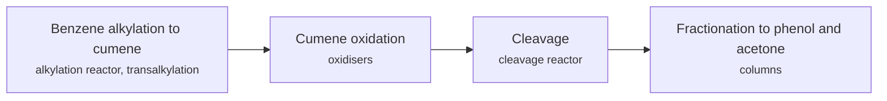

**Key equipment:** alkylation reactor, oxidisers, cleavage reactor, distillation columns.

**Performance:**
- single-train cumene capacity: 750 kt/yr; Technip Energies brochure. [source](https://www.ten.com/sites/energies/files/2025-01/phenolics_brochure.pdf)
- cumene licences since 1996: 36 licences; Technip Energies Badger. [source](https://www.ten.com/sites/energies/files/2025-01/phenolics_brochure.pdf)
- phenol yield, cumene hydroperoxide cleavage stage: 99.2-99.5 % phenol yield; Worked examples: 30,431 kg/h phenol at 99.5% yield with 18,770 kg/h acetone at 98.5%, and phenol tar 54.2 kg per tonne of phenol; a second example gives 99.2% and 59.2 kg/t tar.. [source](http://patentimages.storage.googleapis.com/pdfs/68d6292f46dfecc2357f/EP0670296B1.pdf)

**Missing inputs:**
- capital cost and operating or unit cost, with dollar year and basis (costs): No open source read so far gives costs for this technology. Web-checked 2026-10-28; licensor quotes only. Where: arXiv and open-access journals: techno-economic or review papers (MDPI is blocked by its CDN; use the manual inbox) (catalog: arxiv, open); Licensor and EPC studies; paid cost databases are catalog-only (paid); OSTI.GOV full-text reports from DOE labs: search the technology name plus 'techno-economic' (catalog: osti, open). Next: Look for an open techno-economic study; record each figure with metric, range, unit, dollar year, basis and source.
- named plants or projects with capacity and year (reference_plants): The sources read name no specific plant. Web-checked 2026-10-28; no verifiable named plant added. Where: Licensor and operator press releases for the suppliers listed (open). Next: Add one or two plants with country, capacity and start-up year.
- TRL with a cited source (trl): The IEA ETP Clean Energy Technology Guide has no matching entry. no open TRL table found (IEA ETP guide checked 2026-10-28). Where: IEA ETP Clean Energy Technology Guide (collected): search for the technology name (catalog: iea-reports, open). Next: Find a TRL table that lists this technology, or leave maturity resting on the evidence on the card.

Sources: [1](https://www.ten.com/sites/energies/files/2025-01/phenolics_brochure.pdf), [2](https://en.wikipedia.org/wiki/Cumene_process). Last reviewed 2026-11-17.

## Polyethylene (gas phase, slurry, solution)
<a id="pch-polyethylene"></a>

Ethylene, with a comonomer such as butene or hexene for LLDPE and HDPE copolymers, is polymerised on a supported catalyst in a gas-phase fluidized-bed, slurry-loop or solution reactor. The resin leaves the reactor as powder or pellets after degassing to remove monomer, and is extruded with additives. The process route and catalyst (Ziegler-Natta, chromium or metallocene) set the grade range.

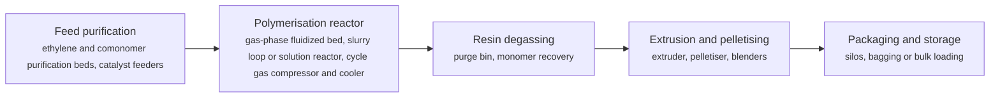

**Key equipment:** feed purification, polymerisation reactor and cycle gas system, degassing bin, extruder and pelletiser, silos.

**Performance:**
- UNIPOL PE single-line design capacity: 800000 t/yr; Univation (announced May 2025), up from 650,000 t/yr nameplate. [source](https://hydrocarbonprocessing.com/news/2025/05/univation-technologies-announces-world-scale-800-000-tpy-design-capacity-for-unipol-pe-process-technology/)
- cradle-to-gate CO2 for HDPE resin: 1320 kg CO2e per tonne; US average 1,320 kg CO2 per tonne of HDPE (down from 1,465 in 2010) and 73.8 GJ per tonne.. [source](https://plasticmakers.org/wp-content/uploads/2022/09/A-Decreasing-Footprint-LCI-HDPE-LDPE-LLDPE-PP-1.pdf)

**Missing inputs:**
- named polyethylene plants with capacity (reference_plants): The article read gives the design capacity but no plant. Web-checked 2026-10-28; no verifiable named PE plant page added this pass. Where: Licensor and operator news (Univation, LyondellBasell, Ineos) (catalog: hydrocarbon-processing, open). Next: Add one or two plants with capacity and start-up year.
- TRL with a cited source (trl): No IEA entry for conventional PE. IEA ETP Guide (July 2026) has no matching entry (searched 'polyethylene', 'polymerisation', 'gas-phase', 'slurry'); 2026-10-28 Where: IEA ETP Clean Energy Technology Guide (collected): search for the technology name (catalog: iea-reports, open). Next: Find a TRL table, or rely on decades of commercial operation.
- capital cost and production cost, with dollar year and basis (costs): No open source read so far gives costs for this technology; petrochemical unit costs are mostly in paid sources. Where: Open techno-economic papers on arXiv and open-access journals (MDPI is blocked by its CDN; use the manual inbox) (catalog: arxiv, open); IEA reports on petrochemicals (check the iea-reports corpus first) (catalog: iea-reports, open); Paid cost databases and licensor studies (consultancies, IHS/S&P, Nexant): catalog-only until the owner provides access (catalog: nexant-chemsystems, paid). Next: Look for an open techno-economic study; record each figure with metric, range, unit, dollar year, basis and source.

Sources: [1](https://hydrocarbonprocessing.com/news/2025/05/univation-technologies-announces-world-scale-800-000-tpy-design-capacity-for-unipol-pe-process-technology/). Last reviewed 2026-11-17.

## Polypropylene (gas phase, bulk)
<a id="pch-polypropylene"></a>

Propylene, with ethylene or other comonomers for copolymers, is polymerised over a supported Ziegler-Natta or metallocene catalyst in a gas-phase reactor or in liquid propylene (bulk loop) reactors. After the reactor the powder is degassed, mixed with additives and pelletised. Impact copolymers use a second reactor to add a rubber phase.

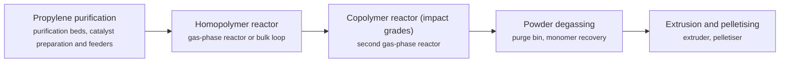

**Key equipment:** purification beds, reactor(s) and cycle gas system, degassing bin, extruder and pelletiser, silos.

**Performance:**
- UNIPOL PP licensed reactor lines: 100 lines; Grace: over 100 licensed in more than 25 countries and 76 operating in 2023. [source](https://grace.com/insights/unipol--pp-technology--leading-the-way-in-innovation-and-growth/)
- largest single UNIPOL PP line designed: 650000 t/yr; Grace: basic engineering package completed for a licensee in 2023. [source](https://grace.com/insights/unipol--pp-technology--leading-the-way-in-innovation-and-growth/)
- cradle-to-gate CO2 for polypropylene resin: 1272 kg CO2e per tonne; US average 1,272 kg CO2 per tonne of PP (down from 1,469 in 2010) and 75.5 GJ per tonne.. [source](https://plasticmakers.org/wp-content/uploads/2022/09/A-Decreasing-Footprint-LCI-HDPE-LDPE-LLDPE-PP-1.pdf)

**Reference plants:**
- HMC Polymers polypropylene plants, Map Ta Phut and Bangkok-region sites, Thailand (PTT/PCD joint venture), TH: more than 800,000 t/yr of PP (2018); Thailand's first and largest PP producer, passing 1 million tons cumulative-capacity milestone (2023); PP Line IV at Map Ta Phut adds 250 kt/yr; operating. [source](https://www.scmp.com/country-reports/country-reports/topics/thailand-business-report-december-2018/article/2175634/hmc)

**Missing inputs:**
- TRL with a cited source (trl): No IEA entry for conventional PP. IEA ETP Guide (July 2026) has no matching entry (searched 'polypropylene', 'PP', 'Spheripol', 'Innovene'); 2026-10-28 no open TRL table found (IEA ETP guide checked 2026-10-28). Where: IEA ETP Clean Energy Technology Guide (collected): search for the technology name (catalog: iea-reports, open). Next: Find a TRL table, or rely on commercial operation.
- capital cost and production cost, with dollar year and basis (costs): No open source read so far gives costs for this technology; petrochemical unit costs are mostly in paid sources. Where: Open techno-economic papers on arXiv and open-access journals (MDPI is blocked by its CDN; use the manual inbox) (catalog: arxiv, open); IEA reports on petrochemicals (check the iea-reports corpus first) (catalog: iea-reports, open); Paid cost databases and licensor studies (consultancies, IHS/S&P, Nexant): catalog-only until the owner provides access (catalog: nexant-chemsystems, paid). Next: Look for an open techno-economic study; record each figure with metric, range, unit, dollar year, basis and source.

Sources: [1](https://grace.com/insights/unipol--pp-technology--leading-the-way-in-innovation-and-growth/). Last reviewed 2026-11-17.

## Propane dehydrogenation (Oleflex, CATOFIN)
<a id="pch-propane-dehydrogenation"></a>

Propane is heated and passed over a dehydrogenation catalyst, which removes hydrogen to form propylene. The reaction is endothermic and equilibrium-limited, so conversion per pass is partial; unconverted propane is separated and recycled. In UOP's Oleflex process the platinum catalyst is circulated continuously through a regenerator; Lummus CATOFIN uses fixed beds that cycle between reaction and regeneration.

```mermaid
flowchart LR
    FD["Propane feed treating and preheat<br/><small>feed treating, feed/effluent exchanger</small>"]
    RX["Dehydrogenation reactors<br/><small>Oleflex moving-bed reactors with interheaters, or CATOFIN cyclic fixed beds</small>"]
    REG["Catalyst regeneration<br/><small>continuous catalyst regenerator (Oleflex) / air regeneration cycle (CATOFIN)</small>"]
    SEP["Product recovery<br/><small>effluent compressor, cold box, hydrogen separation</small>"]
    DEP["Propane-propylene splitter<br/><small>propylene splitter column</small>"]
    PRP["Propylene product"]
    H2["Hydrogen by-product"]
    FD --> RX
    RX -->|reactor effluent| SEP
    RX -->|spent catalyst (Oleflex)| REG
    REG --> RX
    SEP -->|propane/propylene| DEP
    SEP -->|hydrogen| H2
    DEP -->|polymer-grade propylene| PRP
    DEP -->|recycle propane| FD
```

**Key equipment:** reactor section, catalyst regenerator, effluent compressor, cold box, propane-propylene splitter.

**Performance:**
- global Oleflex propylene capacity: 7.9 Mt/yr; Honeywell, as of November 2020; 68 of the last 92 dehydrogenation projects worldwide since 2011 used UOP technology. [source](https://www.honeywell.com/us/en/news/press-releases/2020/11/oriental-energy-expands-use-of-honeywell-technology)
- capacity of each of Oriental Energy's three earlier Oleflex units: 660000 t/yr propylene; Honeywell release. [source](https://www.honeywell.com/us/en/news/press-releases/2020/11/oriental-energy-expands-use-of-honeywell-technology)
- per-pass propane conversion, CATOFIN and Oleflex: 40-50 % per pass (CATOFIN about 50; Oleflex about 40); "Propane/propylene conversions in CATOFIN and OLEFLEX are ~50% and ~40%, respectively" (open PDH technology review); selectivity and energy-per-tonne figures were not stated in the open pages read. [source](https://www.scribd.com/document/460716966/4244-Article-Text-12672-1-10-20180730)
- total energy requirement, propane dehydrogenation: 10.35 GJ per tonne propylene; PDH total energy 10.35 GJ per tonne of propylene (1.843 kWh/t electricity); 11.84 GJ per tonne of propane feed is also quoted. PDH selectivity about 90%.. [source](https://epocbelgium.be/sites/epoc/files/Propylene_FactSheet_ShortVersion_TaliehRajabloo.pdf)

**Reference plants:**
- Oriental Energy, Maoming, Guangdong (fourth Oleflex unit), CN: three earlier units of 660,000 t/yr each; capacity of the new unit not stated; start scheduled 2022 (as of November 2020). [source](https://www.honeywell.com/us/en/news/press-releases/2020/11/oriental-energy-expands-use-of-honeywell-technology)

**Missing inputs:**
- TRL with a cited source (trl): The IEA guide has no PDH entry; the card is commercial on the basis of the 7.9 Mt/yr installed base. IEA ETP Guide (July 2026) has no matching entry (searched 'propane dehydrogenation', 'PDH', 'dehydrogenation', 'Oleflex', 'CATOFIN', 'on-purpose propylene'); 2026-10-28 no open TRL table found (IEA ETP guide checked 2026-10-28). Where: IEA ETP Clean Energy Technology Guide (collected): search for the technology name (catalog: iea-reports, open); Licensor statements of commercial references (catalog: honeywell-uop, open). Next: Find a TRL table that lists on-purpose propylene, or leave the commercial claim resting on the installed capacity.
- capital cost and production cost, with dollar year and basis (costs): No open source read so far gives costs for this technology; petrochemical unit costs are mostly in paid sources. Where: Open techno-economic papers on arXiv and open-access journals (MDPI is blocked by its CDN; use the manual inbox) (catalog: arxiv, open); IEA reports on petrochemicals (check the iea-reports corpus first) (catalog: iea-reports, open); Paid cost databases and licensor studies (consultancies, IHS/S&P, Nexant): catalog-only until the owner provides access (catalog: nexant-chemsystems, paid). Next: Look for an open techno-economic study; record each figure with metric, range, unit, dollar year, basis and source.

Sources: [1](https://www.honeywell.com/us/en/news/press-releases/2020/11/oriental-energy-expands-use-of-honeywell-technology). Last reviewed 2026-11-17.

## Propylene oxide (HPPO, PO/SM)
<a id="pch-propylene-oxide"></a>

In the HPPO route hydrogen peroxide oxidises propylene to propylene oxide over a titanium silicalite (TS-1) catalyst with water as the only co-product, avoiding the styrene or tert-butanol co-products of PO/SM and PO/TBA routes. Evonik and thyssenkrupp Uhde developed it from 2000; the first plant at Ulsan, Korea (SKC) started in 2008 at 100,000 t/yr and expanded to 130,000 t/yr.

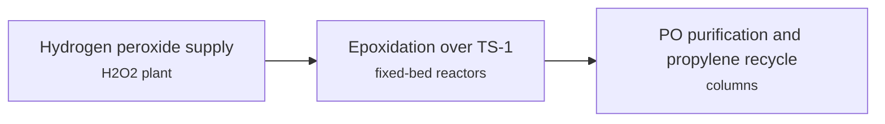

**Key equipment:** H2O2 supply, epoxidation reactors, distillation columns, propylene recycle.

**Performance:**
- Ulsan HPPO plant capacity: 100000-130000 t/yr PO; 100,000 at start, expanded to 130,000. [source](https://www.evonik.com/en/company/businesslines/ao/highlights/hp-plus-technologies/hppo-technology.html)
- HPPO co-product profile: 0 co-products other than water (none); "Through HPPO, propylene oxide can be synthesized directly from hydrogen peroxide without generating any co-products other than water" (Chemical Engineering, 5 Sep 2023, on the new Evonik-Uhde HPPO complex in China); the classic wastewater/energy savings percentages were not stated in the open pages read. [source](https://www.chemengonline.com/sustainable-production-of-propylene-oxide-begins-at-new-hppo-complex-in-china-using-evonik-uhde-technology)

**Reference plants:**
- SKC Ulsan HPPO plant, KR: 130,000 t/yr PO; . [source](https://www.evonik.com/en/company/businesslines/ao/highlights/hp-plus-technologies/hppo-technology.html)
- MOL Group Tiszaújváros HPPO (under construction when read), HU: 200,000 t/yr; . [source](https://www.evonik.com/en/company/businesslines/ao/highlights/hp-plus-technologies/hppo-technology.html)
- Evonik-Uhde HPPO complex, China, CN: new HPPO plant using Evonik-Uhde hydrogen-peroxide-to-propylene-oxide technology; capacity not stated in the open announcement; operating. [source](https://www.chemengonline.com/sustainable-production-of-propylene-oxide-begins-at-new-hppo-complex-in-china-using-evonik-uhde-technology)

**Missing inputs:**
- capital cost and operating or unit cost, with dollar year and basis (costs): No open source read so far gives costs for this technology. Web-checked 2026-10-28; licensor quotes only. Where: arXiv and open-access journals: techno-economic or review papers (MDPI is blocked by its CDN; use the manual inbox) (catalog: arxiv, open); Licensor and EPC studies; paid cost databases are catalog-only (paid); OSTI.GOV full-text reports from DOE labs: search the technology name plus 'techno-economic' (catalog: osti, open). Next: Look for an open techno-economic study; record each figure with metric, range, unit, dollar year, basis and source.
- TRL with a cited source (trl): The IEA ETP Clean Energy Technology Guide has no matching entry. no open TRL table found (IEA ETP guide checked 2026-10-28). Where: IEA ETP Clean Energy Technology Guide (collected): search for the technology name (catalog: iea-reports, open). Next: Find a TRL table that lists this technology, or leave maturity resting on the evidence on the card.

Sources: [1](https://www.evonik.com/en/company/businesslines/ao/highlights/hp-plus-technologies/hppo-technology.html), [2](https://www.chemengonline.com/sustainable-production-of-propylene-oxide-begins-at-new-hppo-complex-in-china-using-evonik-uhde-technology), [3](https://www.aidic.it/cet/10/21/096.pdf). Last reviewed 2026-11-17.

## Steam cracking (naphtha, ethane, LPG)
<a id="pch-steam-cracking"></a>

Hydrocarbon feed is diluted with steam and passed through coils in gas-fired furnaces at about 800 to 850 °C for a fraction of a second, which breaks it into ethylene, propylene and other olefins. The effluent is quenched to stop reactions, compressed, and separated by cryogenic distillation. Ethane gives mostly ethylene; naphtha gives a wider product slate including propylene, butadiene and aromatics.

```mermaid
flowchart LR
    FUR["Cracking furnace<br/><small>fired radiant coils, steam dilution, convection section</small>"]
    QUE["Quench<br/><small>transfer line exchangers, primary fractionator and quench water tower</small>"]
    CMP["Cracked gas compression and treating<br/><small>multi-stage cracked gas compressor, caustic or amine acid gas removal, dryers</small>"]
    SEP["Cryogenic separation<br/><small>cold box, demethaniser, deethaniser, depropaniser, ethylene and propylene fractionators</small>"]
    ETH["Ethylene product"]
    PRO["Propylene product"]
    BYP["By-products to butadiene and aromatics units"]
    FUR --> QUE
    QUE --> CMP
    CMP --> SEP
    SEP -->|ethylene| ETH
    SEP -->|propylene| PRO
    SEP -->|C4s, pyrolysis gasoline| BYP
```

**Key equipment:** cracking furnaces, transfer line exchangers, quench towers, cracked gas compressor, cold box, ethylene and propylene fractionators, refrigeration compressors.

**Performance:**
- furnace operating temperature: 800-850 °C; ChemEngineering 2025 review. [source](https://run.unl.pt/bitstream/10362/186917/1/ChemEngineering-09-00055-v2.pdf)
- residence time in the coil: 0.1-0.5 s; ChemEngineering 2025 review. [source](https://run.unl.pt/bitstream/10362/186917/1/ChemEngineering-09-00055-v2.pdf)
- steam dilution: 0.3-1 kg steam per kg hydrocarbon; ChemEngineering 2025 review. [source](https://run.unl.pt/bitstream/10362/186917/1/ChemEngineering-09-00055-v2.pdf)
- energy use of the cracking furnace: 6.5 GJ/t high-value chemicals; ChemEngineering 2025 review; cryogenic separation 2 GJ/t, fractionation and compression 1.5 GJ/t. [source](https://run.unl.pt/bitstream/10362/186917/1/ChemEngineering-09-00055-v2.pdf)
- CO2 emissions: 1.8-2 t CO2/t ethylene; ChemEngineering 2025 review; global steam crackers emit about 180-200 Mt CO2/yr. [source](https://run.unl.pt/bitstream/10362/186917/1/ChemEngineering-09-00055-v2.pdf)
- ethylene yield from naphtha: 30 wt%; ChemEngineering 2025 review, short residence time and high severity. [source](https://run.unl.pt/bitstream/10362/186917/1/ChemEngineering-09-00055-v2.pdf)

TRL source: [IEA ETP Clean Energy Technology Guide, dataset of 24 July 2026, 2025 assessment (IEA 1-11 scale): 'High value chemicals production using naphtha catalytic cracking' 9](https://www.iea.org/data-and-statistics/data-tools/etp-clean-energy-technology-guide)

**Missing inputs:**
- capital cost and production cost, with dollar year and basis (costs): No open source read so far gives costs for this technology; petrochemical unit costs are mostly in paid sources. Where: Open techno-economic papers on arXiv and open-access journals (MDPI is blocked by its CDN; use the manual inbox) (catalog: arxiv, open); IEA reports on petrochemicals (check the iea-reports corpus first) (catalog: iea-reports, open); Paid cost databases and licensor studies (consultancies, IHS/S&P, Nexant): catalog-only until the owner provides access (catalog: nexant-chemsystems, paid). Next: Look for an open techno-economic study; record each figure with metric, range, unit, dollar year, basis and source.
- named crackers with capacity (reference_plants): The sources read name no specific cracker. Web-checked 2026-10-28; cracker lists exist in trade press but no verifiable per-cracker page added this pass (e-cracking demo card carries the BASF/SABIC/Linde unit). Where: Licensor and operator press releases for the suppliers listed (catalog: lummus, open); PETRONAS Pengerang and Hengli Dalian complexes (see crude-to-chemicals card) (open). Next: Add one or two crackers with country, ethylene capacity and start-up year.

Sources: [1](https://run.unl.pt/bitstream/10362/186917/1/ChemEngineering-09-00055-v2.pdf). Last reviewed 2026-10-28.

## Toluene disproportionation and transalkylation
<a id="pch-toluene-disproportionation"></a>

Toluene and heavier aromatics (C9+) are converted over a zeolite catalyst to benzene and mixed xylenes. UOP's Tatoray unit at Hengyi Brunei produces high-purity benzene and mixed xylenes feeding the paraxylene loop.

```mermaid
flowchart LR
    FEED["Toluene and C9+ aromatics feed<br/><small>feed heater</small>"]
    RX["Transalkylation reactor<br/><small>fixed-bed reactor</small>"]
    SEP["Separation of benzene and xylenes<br/><small>stripper, fractionators</small>"]
    FEED --> RX
    RX --> SEP
```

**Key equipment:** reactor, stripper, fractionators, hydrogen recycle.

**Performance:**
- toluene conversion per pass: 46-48 % conversion per pass; Commercial test: 46-48% conversion with 90-93% selectivity and xylene/benzene molar ratio 2.5-3.0. Hydrogen consumption is not stated.. [source](https://www.researchgate.net/publication/298174881_Commercial_test_of_HLD-001_catalyst_for_toluene_disproportionation_and_transalkylation)

**Reference plants:**
- Hengyi Brunei Tatoray unit, BN: ; . [source](https://www.ogj.com/refining-processing/petrochemicals/article/14198324/hengyi-lets-contract-for-aromatics-expansion-at-brunei-complex)

**Missing inputs:**
- capital cost and operating or unit cost, with dollar year and basis (costs): No open source read so far gives costs for this technology. Web-checked 2026-10-28; licensor quotes only. Where: arXiv and open-access journals: techno-economic or review papers (MDPI is blocked by its CDN; use the manual inbox) (catalog: arxiv, open); Licensor and EPC studies; paid cost databases are catalog-only (paid); OSTI.GOV full-text reports from DOE labs: search the technology name plus 'techno-economic' (catalog: osti, open). Next: Look for an open techno-economic study; record each figure with metric, range, unit, dollar year, basis and source.
- TRL with a cited source (trl): The IEA ETP Clean Energy Technology Guide has no matching entry. no open TRL table found (IEA ETP guide checked 2026-10-28). Where: IEA ETP Clean Energy Technology Guide (collected): search for the technology name (catalog: iea-reports, open). Next: Find a TRL table that lists this technology, or leave maturity resting on the evidence on the card.

Sources: [1](https://www.ogj.com/refining-processing/petrochemicals/article/14198324/hengyi-lets-contract-for-aromatics-expansion-at-brunei-complex), [2](https://www.ogj.com/home/article/17218723/selective-toluene-disproportionation-process-proven-at-italian-refinery). Last reviewed 2026-11-17.

## Depolymerisation of PET (glycolysis, enzymatic)
<a id="pch-pet-depolymerisation"></a>

PET waste is broken back into its monomers or short fragments so that it can be purified and repolymerised into virgin-quality PET. Chemical routes such as glycolysis use glycol and heat; enzymatic routes use an engineered enzyme in water at moderate temperature. Carbios describes its C-ZYME process as solvent-free.

```mermaid
flowchart LR
    PRE["Pretreatment<br/><small>sorting, shredding, washing</small>"]
    DEP["Depolymerisation<br/><small>enzymatic reactor or glycolysis reactor</small>"]
    PUR["Monomer purification<br/><small>filtration and crystallisation, distillation</small>"]
    POL["Repolymerisation to PET<br/><small>PET polymerisation line (at the host site)</small>"]
    PRE --> DEP
    DEP --> PUR
    PUR --> POL
```

**Key equipment:** pretreatment line, depolymerisation reactors, purification section, polymerisation line.

**Performance:**
- Longlaville plant design capacity: 50000 t/yr post-consumer PET waste; Carbios, on Indorama Ventures' site; EUR 230 million. [source](https://www.packaging-gateway.com/projects/carbios-pet-biorecycling-plant-longlaville-france/)
- enzymatic PET depolymerisation extent (company-reported): 100 % of PET waste depolymerised (company claim); "CARBIOS depolymerizes 100% of PET based plastic waste with its enzymatic recycling process" (Carbios, 2 Dec 2015, company claim); C&EN (8 Feb 2020): the enzymes break PET down into monomers for virgin-quality plastic; an independently verified monomer-yield percentage and energy use were not available in open pages. [source](https://www.carbios.com/en/carbios-depolymerizes-100-of-pet-based-plastic-waste-with-its-enzymatic-recycling-process)
- enzymatic PET depolymerisation extent: 90 % PET depolymerised in 10 h; At least 90% depolymerisation to monomers in 10 hours at 16.7 g terephthalate per litre per hour.. [source](https://www.nature.com/articles/s41586-020-2149-4)

**Reference plants:**
- Carbios Longlaville plant, Meurthe-et-Moselle, FR: 50,000 t/yr PET waste, EUR 230 million; ground-breaking April 2024; construction suspended pending project financing; the financial close target of 30 September 2026 was missed and the start of production, previously expected H1 2028, is postponed; credit committee approvals obtained from the majority of lenders during summer 2026, a commercial agreement with a major beverage-industry player being finalised to raise pre-sales to about 60% of nominal capacity, and due diligence by export credit agencies and equity partners ongoing (as of 24 September 2026). [source](https://www.carbios.com/en/carbios-provides-an-update-on-the-financing-of-its-longlaville-plant-project/)

TRL source: [IEA ETP Clean Energy Technology Guide, dataset of 24 July 2026, 2025 assessment (IEA 1-11 scale): 'Recycling via chemical depolymerisation for PET' 8](https://www.iea.org/data-and-statistics/data-tools/etp-clean-energy-technology-guide)

**Missing inputs:**
- capital cost and production cost, with dollar year and basis (costs): No open source read so far gives costs for this technology; petrochemical unit costs are mostly in paid sources. Where: Open techno-economic papers on arXiv and open-access journals (MDPI is blocked by its CDN; use the manual inbox) (catalog: arxiv, open); IEA reports on petrochemicals (check the iea-reports corpus first) (catalog: iea-reports, open); Paid cost databases and licensor studies (consultancies, IHS/S&P, Nexant): catalog-only until the owner provides access (catalog: nexant-chemsystems, paid). Next: Look for an open techno-economic study; record each figure with metric, range, unit, dollar year, basis and source.

Sources: [1](https://www.packaging-gateway.com/projects/carbios-pet-biorecycling-plant-longlaville-france/), [2](https://www.carbios.com/en/carbios-provides-an-update-on-the-financing-of-its-longlaville-plant-project/), [3](https://www.carbios.com/en/carbios-reports-first-half-2026-results/), [4](https://www.carbios.com/en/carbios-depolymerizes-100-of-pet-based-plastic-waste-with-its-enzymatic-recycling-process). Last reviewed 2026-11-17.

## Electric steam cracking
<a id="pch-electric-steam-cracking"></a>

The gas-fired radiant coils of a steam cracker are replaced by coils heated with electricity, so the furnace itself emits no combustion CO2. The rest of the plant (quench, compression, cryogenic separation) is unchanged, which makes the route a retrofit option for existing crackers if renewable power and grid capacity are available.

```mermaid
flowchart LR
    PWR["Renewable power supply<br/><small>transformers and power electronics, grid connection</small>"]
    FUR["Electrically heated cracking furnace<br/><small>electrically heated radiant coils, steam dilution</small>"]
    QUE["Quench and compression<br/><small>transfer line exchangers, cracked gas compressor</small>"]
    SEP["Cryogenic separation<br/><small>cold box, olefin fractionators</small>"]
    PWR --> FUR
    FUR --> QUE
    QUE --> SEP
```

**Key equipment:** electrically heated furnace coils, power supply and transformers, quench system, cracked gas compressor, cold box.

**Performance:**
- CO2 reduction potential versus conventional cracking: 90 %; BASF, SABIC and Linde claim at least 90% with renewable power (potential, not measured). [source](https://www.basf.com/global/en/media/news-releases/2024/04/p-24-177.html)
- demonstration furnaces: feed rate and power: 4 t hydrocarbon feed/h; two furnaces totalling 6 MW input. [source](https://www.basf.com/global/en/media/news-releases/2024/04/p-24-177.html)

**Reference plants:**
- BASF Ludwigshafen electric cracking demonstration (BASF, SABIC, Linde), DE: two furnaces, about 4 t/h feed, 6 MW renewable power; inaugurated 17 April 2024; demonstration continuing, testing two heating concepts; the project won the ICIS Innovation Award 2024 (November 2024) and the Edison Award 2025 (May 2025); Linde is commercialising the technology under the Starbridge brand (as of September 2025). [source](https://www.basf.com/global/en/who-we-are/sustainability/publications/sustainability-news/archive/News_09-2025_eFurnace_Edison-AwardEN)

TRL source: [IEA ETP Clean Energy Technology Guide, dataset of 24 July 2026, 2025 assessment (IEA 1-11 scale): 'High value chemicals production using steam cracker electrification' 6](https://www.iea.org/data-and-statistics/data-tools/etp-clean-energy-technology-guide)

**Missing inputs:**
- capital cost and production cost, with dollar year and basis (costs): No open source read so far gives costs for this technology; petrochemical unit costs are mostly in paid sources. Where: Open techno-economic papers on arXiv and open-access journals (MDPI is blocked by its CDN; use the manual inbox) (catalog: arxiv, open); IEA reports on petrochemicals (check the iea-reports corpus first) (catalog: iea-reports, open); Paid cost databases and licensor studies (consultancies, IHS/S&P, Nexant): catalog-only until the owner provides access (catalog: nexant-chemsystems, paid). Next: Look for an open techno-economic study; record each figure with metric, range, unit, dollar year, basis and source.
- measured results from the demonstration (CO2 avoided, energy use, run length) (performance): BASF, SABIC and Linde publish only design targets (two 6 MW furnaces, about 4 t/h feed, 90-95% CO2-reduction potential); as of September 2025 the plant was still testing two heating concepts and no measured CO2, energy or run-length data had been released. Where: BASF and Linde publications after 2024; BASF sustainability news archive and annual reports (catalog: basf-catalysts, open); Linde Engineering Starbridge pages and success stories (catalog: linde-engineering, open). Next: Leave open until the demonstration publishes measured results.

Sources: [1](https://www.basf.com/global/en/media/news-releases/2024/04/p-24-177.html), [2](https://www.basf.com/global/en/who-we-are/sustainability/publications/sustainability-news/archive/News_09-2025_eFurnace_Edison-AwardEN). Last reviewed 2026-11-17.

## Electrification of process heat (e-boilers, heat pumps)
<a id="pch-electrified-process-heat"></a>

Steam and furnace heat are produced from electricity with electrode boilers, industrial heat pumps and electric furnaces. BASF is building a 50 MW heat pump at Ludwigshafen (GIG Karasek) delivering 500,000 t/yr of steam, saving up to 100,000 t CO2e/yr, online mid-2027; BASF, SABIC and Linde started an electric steam-cracker furnace demonstration in April 2024. IEA rates large-scale heat pumps at TRL 9 and steam cracker electrification at TRL 6.

```mermaid
flowchart LR
    PWR["Renewable power<br/><small>transformers</small>"]
    HT["Heat pump, e-boiler or electric furnace<br/><small>heat pump, electrode boiler, electric furnace</small>"]
    STM["Steam or process heat to site<br/><small>steam network</small>"]
    PWR --> HT
    HT --> STM
```

**Key equipment:** industrial heat pump, electrode boiler, electric furnace, transformers.

**Performance:**
- BASF heat pump thermal output: 50 MW; 500,000 t/yr steam, just over 3% of Ludwigshafen steam demand; up to 98% lower emissions for formic acid steam. [source](https://www.thechemicalengineer.com/news/basf-begins-installation-of-industrial-heat-pump-to-deliver-net-zero-steam-at-ludwigshafen/)
- electric cracker demo power: 6 MW; target 90% lower emissions; about 4 t/h feed. [source](https://www.thechemicalengineer.com/news/world-first-electric-steam-cracker-demo-starts-operations-in-push-to-slash-emissions-by-90/)

TRL source: [IEA ETP Clean Energy Technology Guide, dataset of 24 July 2026, latest assessment (IEA 1-11 scale): 'Large-scale heat pump (low temperature heating)' 9 (2025); 'High value chemicals production using steam cracker electrification' 6 (2025)](https://www.iea.org/data-and-statistics/data-tools/etp-clean-energy-technology-guide)

**Missing inputs:**
- capital cost and steam cost versus gas boilers (costs): Not in the articles. Web-checked 2026-10-28; e-boiler vs gas steam cost comparisons found only in vendor/consultancy material without verifiable figures. Where: IEA industrial heat reports (catalog: iea-reports, open). Next: Add costs.
- named plants or projects with capacity and year (reference_plants): The sources read name no specific plant. Web-checked 2026-10-28; no verifiable named chemical-site e-boiler installation with figures found. Where: Licensor and operator press releases for the suppliers listed (open). Next: Add one or two plants with country, capacity and start-up year.

Sources: [1](https://www.thechemicalengineer.com/news/basf-begins-installation-of-industrial-heat-pump-to-deliver-net-zero-steam-at-ludwigshafen/), [2](https://www.thechemicalengineer.com/news/world-first-electric-steam-cracker-demo-starts-operations-in-push-to-slash-emissions-by-90/), [3](https://www.linde-engineering.com/products-and-services/success-stories/2024/it-is-electrifying-stem-crackers-go-electric). Last reviewed 2026-11-17.

## Oxidative coupling of methane
<a id="pch-oxidative-coupling-methane"></a>

Methane and oxygen react over a catalyst to give ethylene directly, avoiding steam cracking of ethane or naphtha. Siluria started a demonstration plant at La Porte, Texas, co-located with Braskem America, in about December 2014, and said initial campaigns replicated pilot-scale performance; commercial plants were then planned for 2017 to 2018.

```mermaid
flowchart LR
    FEED["Methane and oxygen feed<br/><small>air separation</small>"]
    RX["OCM reactor<br/><small>OCM reactor</small>"]
    SEP["Ethylene recovery and recycle<br/><small>separation train</small>"]
    FEED --> RX
    RX --> SEP
```

**Key equipment:** OCM reactor, oxygen supply, ethylene recovery, recycle compressors.

**Performance:**
- C2 yield over the benchmark Mn-Na2WO4/SiO2 catalyst: 26.4 % C2 yield; At 750 C: C2 yield 26.4%, C2 selectivity 80%, CH4 conversion 33%, stable over 500 h. The review notes about 30% is the industrial threshold.. [source](https://www.osti.gov/servlets/purl/3011568)

**Reference plants:**
- Siluria OCM demonstration plant, La Porte, Texas, US: ; demonstration ran from early 2015 and completed 18 test campaigns in its first year (company release, 11 May 2016); no commercial OCM plant followed — Siluria was bought by McDermott in 2019, and McDermott's 2020 post-bankruptcy spin-off of Lummus Technology included Siluria's intellectual property and the La Porte demonstration plant (read 28 October 2026). [source](https://www.prnewswire.com/news-releases/siluria-announces-one-year-of-successful-operations-of-its-disruptive-ethylene-technology-300266816.html)

**Missing inputs:**
- capital cost and operating or unit cost, with dollar year and basis (costs): No open source read so far gives costs for this technology. Web-checked 2026-10-28; no open figures. Where: arXiv and open-access journals: techno-economic or review papers (MDPI is blocked by its CDN; use the manual inbox) (catalog: arxiv, open); Licensor and EPC studies; paid cost databases are catalog-only (paid); OSTI.GOV full-text reports from DOE labs: search the technology name plus 'techno-economic' (catalog: osti, open). Next: Look for an open techno-economic study; record each figure with metric, range, unit, dollar year, basis and source.
- TRL with a cited source (trl): The IEA ETP Clean Energy Technology Guide has no matching entry. no open TRL table found (IEA ETP guide checked 2026-10-28; status updated in Wave 2). Where: IEA ETP Clean Energy Technology Guide (collected): search for the technology name (catalog: iea-reports, open). Next: Find a TRL table that lists this technology, or leave maturity resting on the evidence on the card.

Sources: [1](https://digitalrefining.com/news/1003450/siluria-technologies-starts-up-first-demonstration-plant-to-convert-natural-gas-to-ethylene), [2](https://www.prnewswire.com/news-releases/siluria-announces-one-year-of-successful-operations-of-its-disruptive-ethylene-technology-300266816.html), [3](https://en.wikipedia.org/wiki/Siluria_Technologies), [4](https://www.osti.gov/servlets/purl/3011568). Last reviewed 2026-11-17.

## Plastics pyrolysis (chemical recycling)
<a id="pch-plastics-pyrolysis"></a>

Mixed post-consumer plastic waste, mainly polyolefins, is heated without oxygen so that the polymers crack into a hydrocarbon oil (called TACOIL by Plastic Energy), gas and char. The oil is cleaned and used as feed to steam crackers, where it displaces fossil naphtha and can be counted as recycled content through mass balance.

```mermaid
flowchart LR
    SORT["Waste sorting and shredding<br/><small>sorting lines, shredder, washing and drying</small>"]
    PYR["Pyrolysis reactor<br/><small>heated reactor under inert atmosphere</small>"]
    CON["Condensation and treating<br/><small>condensers, oil cleaning and dechlorination</small>"]
    OIL["Pyrolysis oil to steam cracker"]
    GAS["Gas used as process fuel"]
    CHAR["Char disposal or use"]
    SORT --> PYR
    PYR -->|vapours| CON
    PYR -->|char| CHAR
    CON -->|pyrolysis oil| OIL
    CON -->|non-condensable gas| GAS
```

**Key equipment:** sorting and washing line, pyrolysis reactor, condensers, oil treating, storage.

**Performance:**
- planned Seville plant capacity: 33000 t/yr post-consumer plastic waste; Plastic Energy and TotalEnergies, expected operational early 2025 (as of January 2022). [source](https://www.businesswire.com/news/home/20220110006139/en/Plastic-Energy-and-TotalEnergies-Sign-an-Agreement-for-an-Advanced-Recycling-Project-in-Spain)
- oil yield from pyrolysis of waste polyethylene: 86 wt% oil yield; Highest waxy-oil yield from waste PE about 86 wt%, from waste PP about 82 wt%, depending on reactor and temperature.. [source](https://www.sciencedirect.com/science/article/abs/pii/S0301479725041556)

**Reference plants:**
- Plastic Energy and TotalEnergies advanced recycling plant, Seville, ES: 33,000 t/yr plastic waste; no start-up of the new 33,000 t/yr plant was ever announced; Plastic Energy's own current plant list shows only the original Seville plant, operational since 2017; the company entered administration in England in May 2026, emerged in August 2026 with founder Carlos Monreal returning as CEO, and in September 2026 transferred its stake in the TEPEAR joint-venture plant at Grandpuits (15,000 t/yr, operational since March 2026) to TotalEnergies while retaining the Almeria and Seville plants (as of 11 September 2026). [source](https://www.letsrecycle.com/news/plastic-energy-transfers-stake-in-chemical-recycling-plant-amid-restructuring/)

TRL source: [IEA Clean Energy Technology Guide 2025: 'Pyrolysis recycling' TRL 9](https://www.iea.org/data-and-statistics/data-tools/etp-clean-energy-technology-guide)

**Missing inputs:**
- capital cost and production cost, with dollar year and basis (costs): No open source read so far gives costs for this technology; petrochemical unit costs are mostly in paid sources. Where: Open techno-economic papers on arXiv and open-access journals (MDPI is blocked by its CDN; use the manual inbox) (catalog: arxiv, open); IEA reports on petrochemicals (check the iea-reports corpus first) (catalog: iea-reports, open); Paid cost databases and licensor studies (consultancies, IHS/S&P, Nexant): catalog-only until the owner provides access (catalog: nexant-chemsystems, paid). Next: Look for an open techno-economic study; record each figure with metric, range, unit, dollar year, basis and source.

Sources: [1](https://www.businesswire.com/news/home/20220110006139/en/Plastic-Energy-and-TotalEnergies-Sign-an-Agreement-for-an-Advanced-Recycling-Project-in-Spain), [2](https://www.letsrecycle.com/news/plastic-energy-transfers-stake-in-chemical-recycling-plant-amid-restructuring/), [3](https://plasticenergy.com/operations/), [4](https://www.iea.org/data-and-statistics/data-tools/etp-clean-energy-technology-guide). Last reviewed 2026-11-17.

## Solvent-based purification of plastics
<a id="pch-solvent-based-plastics-purification"></a>

Polymer waste is dissolved in a solvent, filtered or extracted to remove colour, odour and additives, and the polymer is recovered as near-virgin resin. PureCycle's Ironton, Ohio plant uses a process licensed from Procter & Gamble for polypropylene and made first pellets in June 2023; planned capacity is 107 million pounds a year of recycled resin.

```mermaid
flowchart LR
    FEED["Sorted polypropylene waste<br/><small>shredder</small>"]
    DIS["Dissolution in solvent and purification<br/><small>extraction vessels, filters</small>"]
    REC["Polymer recovery and pelletising<br/><small>separator, extruder</small>"]
    FEED --> DIS
    DIS --> REC
```

**Key equipment:** dissolution vessels, purification columns or filters, solvent recovery, extruder.

**Performance:**
- Ironton planned capacity: 107 million lb/yr; ultra-pure recycled resin. [source](https://renewable-carbon.eu/news/?p=128691)
- energy and CO2 versus virgin polypropylene (company projection): 79 % less energy; 35% fewer carbon emissions; PureCycle projection. [source](https://renewable-carbon.eu/news/?p=128691)

**Reference plants:**
- PureCycle Ironton, Ohio, US: 107 million lb/yr (projected); first commercial-scale pellets June 2023; still ramping: PureFive output was 13.0 million lb in H1 2026 (4.5 million lb in Q2 2026, up from 3.4 million lb in Q2 2025), including an annual maintenance turnaround, and the plant is not yet certified by Leidos Engineering for full-scale commercial operations. [source](https://www.sec.gov/Archives/edgar/data/1830033/000183003326000026/pct-20260630.htm)

**Missing inputs:**
- capital cost and operating or unit cost, with dollar year and basis (costs): No open source read so far gives costs for this technology. Web-checked 2026-10-28; PureCycle project costs are investor-reported only. Where: arXiv and open-access journals: techno-economic or review papers (MDPI is blocked by its CDN; use the manual inbox) (catalog: arxiv, open); Licensor and EPC studies; paid cost databases are catalog-only (paid); OSTI.GOV full-text reports from DOE labs: search the technology name plus 'techno-economic' (catalog: osti, open). Next: Look for an open techno-economic study; record each figure with metric, range, unit, dollar year, basis and source.
- TRL with a cited source (trl): The IEA ETP Clean Energy Technology Guide has no matching entry. no open TRL table found (IEA ETP guide checked 2026-10-28; operating-rate status updated in Wave 2). Where: IEA ETP Clean Energy Technology Guide (collected): search for the technology name (catalog: iea-reports, open). Next: Find a TRL table that lists this technology, or leave maturity resting on the evidence on the card.

Sources: [1](https://renewable-carbon.eu/news/?p=128691), [2](https://www.sec.gov/Archives/edgar/data/1830033/000183003326000026/pct-20260630.htm), [3](https://www.purecycle.com/our-process). Last reviewed 2026-11-17.
