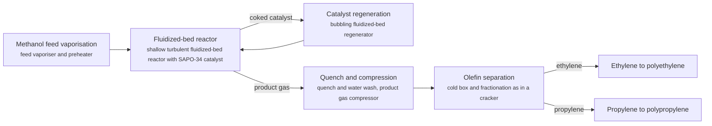
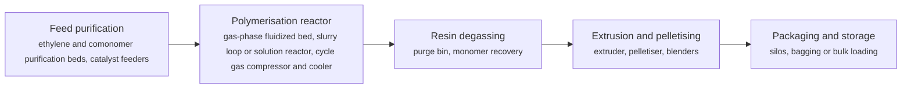
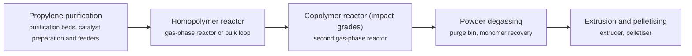
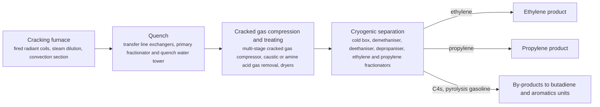
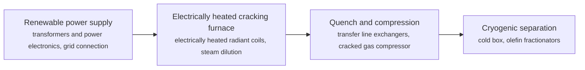
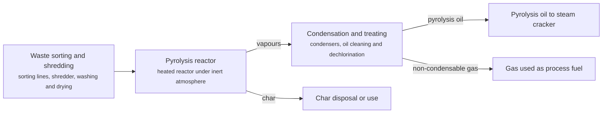

# PCH technology options

9 technologies, from commercial to lab stage. Generated from catalog/technologies/; every figure links to its source.

| Technology | Category | Maturity | TRL | Suppliers | Cost figures |
| --- | --- | --- | --- | --- | --- |
| [Methanol-to-olefins (MTO, DMTO)](#pch-methanol-to-olefins) | Olefins / methanol route | commercial |  | DICP / SYN Energy Technology (DMTO); Honeywell UOP (MTO) |  |
| [Paraxylene adsorption and crystallisation](#pch-paraxylene-adsorption) | Aromatics / separation | commercial |  | Honeywell UOP (Parex, MX Sorbex, ED Sulfolane); Axens (Eluxyl) |  |
| [Polyethylene (gas phase, slurry, solution)](#pch-polyethylene) | Polymers | commercial |  | Univation (Dow) (UNIPOL PE); LyondellBasell; Ineos; Chevron Phillips Chemical; Borealis (Borstar) |  |
| [Polypropylene (gas phase, bulk)](#pch-polypropylene) | Polymers | commercial |  | Grace (UNIPOL PP); LyondellBasell (Spheripol); Ineos (Innovene PP) |  |
| [Propane dehydrogenation (Oleflex, CATOFIN)](#pch-propane-dehydrogenation) | Olefins / on-purpose propylene | commercial |  | Honeywell UOP (Oleflex); Lummus Technology (CATOFIN) |  |
| [Steam cracking (naphtha, ethane, LPG)](#pch-steam-cracking) | Olefins / thermal cracking | commercial | 9 | Lummus Technology; Technip Energies; Linde Engineering; KBR |  |
| [Depolymerisation of PET (glycolysis, enzymatic)](#pch-pet-depolymerisation) | Circular chemicals | demonstration | 8 | Carbios (C-ZYME enzymatic process); Loop Industries; Indorama Ventures (host site and offtake) |  |
| [Electric steam cracking](#pch-electric-steam-cracking) | Olefins / electrified thermal cracking | demonstration | 6 | Linde Engineering (furnace design and EPC); BASF (demonstration operator); SABIC |  |
| [Plastics pyrolysis (chemical recycling)](#pch-plastics-pyrolysis) | Circular chemicals | demonstration | 9 | Plastic Energy (TAC (TACOIL)); Agilyx; Mura Technology; BASF (ChemCycling) |  |

## Methanol-to-olefins (MTO, DMTO)
<a id="pch-methanol-to-olefins"></a>

Methanol vapour is converted over a SAPO-34 molecular sieve catalyst in a fluidized-bed reactor into ethylene and propylene. The catalyst coke is burned off in a regenerator, and the product gas is quenched, compressed and separated. DMTO-II adds a second reactor that cracks C4 and heavier by-products over a dual-function catalyst to raise olefin yield; DMTO-III raises selectivity further without recycling C4+.



**Key equipment:** methanol vaporiser, fluidized-bed reactor and regenerator, quench tower, product gas compressor, olefin fractionation train.

**Performance:**
- ethylene plus propylene selectivity, demonstration unit: 79 %; DICP; DMTO-III 85-90%. [source](https://www.engineering.org.cn/engi/EN/10.1016/j.eng.2020.12.001)
- methanol consumption per tonne of light olefins, original process: 2.97 t methanol/t olefins; DICP; 2.85 with newer catalyst, about 2.64 for DMTO-III. [source](https://www.engineering.org.cn/engi/EN/10.1016/j.eng.2020.12.001)
- DMTO units licensed (to end-2019): 26 units; 14 started up; licensed olefins capacity 14 Mt/yr, 7.67 Mt/yr in the 14 started units. [source](https://www.engineering.org.cn/engi/EN/10.1016/j.eng.2020.12.001)

**Reference plants:**
- Shenhua Baotou coal-to-olefins plant, CN: 1.8 Mt/yr methanol feed, 600,000 t/yr polyethylene and polypropylene (first commercial DMTO); started 8 August 2010. [source](https://www.engineering.org.cn/engi/EN/10.1016/j.eng.2020.12.001)

**Missing inputs:**
- TRL with a cited source (trl): The IEA guide has no MTO entry; the installed base (26 licences) supports 'commercial'. Where: IEA ETP Clean Energy Technology Guide (collected): search for the technology name (catalog: iea-reports, open). Next: Find a TRL table that lists methanol-to-olefins.
- capital cost and production cost, with dollar year and basis (costs): No open source read so far gives costs for this technology; petrochemical unit costs are mostly in paid sources. Where: Open techno-economic papers on arXiv and open-access journals (MDPI is blocked by its CDN; use the manual inbox) (catalog: arxiv, open); IEA reports on petrochemicals (check the iea-reports corpus first) (catalog: iea-reports, open); Paid cost databases and licensor studies (consultancies, IHS/S&P, Nexant): catalog-only until the owner provides access (catalog: nexant-chemsystems, paid). Next: Look for an open techno-economic study; record each figure with metric, range, unit, dollar year, basis and source.
- CO2 intensity of coal-based and green-methanol MTO (performance): The DMTO paper read gives selectivity and methanol use, not carbon intensity. Where: IEA reports on chemicals and China coal chemistry (iea-reports corpus) (catalog: iea-reports, open); Open life-cycle assessments of coal-to-olefins (catalog: arxiv, open). Next: Add t CO2 per tonne of olefins with the methanol source stated.

Sources: [1](https://www.engineering.org.cn/engi/EN/10.1016/j.eng.2020.12.001). Last reviewed 2026-10-24.

## Paraxylene adsorption and crystallisation
<a id="pch-paraxylene-adsorption"></a>

Mixed xylenes from reformate and transalkylation are fed to a simulated-moving-bed adsorption unit. A rotary valve moves feed, desorbent and product ports along beds of selective adsorbent so that, in effect, a counter-current moving bed is created without moving solids; paraxylene is adsorbed and then desorbed, and the desorbent is recovered by distillation. The raffinate is isomerised and recycled to extinction.

```mermaid
flowchart LR
    REF["Xylene supply from reformer and transalkylation<br/><small>CCR reformate splitter, xylene column</small>"]
    SMB["Simulated moving bed adsorption<br/><small>adsorbent chambers, rotary valve, desorbent circulation</small>"]
    EXT["Extract fractionation<br/><small>extract column, desorbent recovery</small>"]
    PX["High-purity paraxylene<br/><small>product tank</small>"]
    RAF["Raffinate to isomerisation<br/><small>raffinate column, xylene isomerisation reactor</small>"]
    XCOL["Recycle to xylene column<br/><small>xylene column</small>"]
    REF --> SMB
    SMB -->|extract (paraxylene + desorbent)| EXT
    SMB -->|raffinate| RAF
    EXT --> PX
    RAF --> XCOL
    XCOL --> SMB
```

**Key equipment:** adsorbent chambers with rotary valve, extract and raffinate columns, xylene isomerisation reactor, xylene column.

**Performance:**
- Parex licensed capacity range per unit: 21000-1.6e+06 t/yr paraxylene; Honeywell UOP: over 100 units licensed since commercialisation in 1971. [source](https://uop.com/en/industry-solutions/petrochemicals/aromatics-recovery)

**Missing inputs:**
- named paraxylene complexes with capacity (reference_plants): The UOP page read gives the licence count and size range but names no plant. Where: Hengli Dalian, PETRONAS Pengerang and Chinese PX project announcements (Honeywell UOP news releases) (catalog: honeywell-uop, open). Next: Add one or two complexes with paraxylene capacity and start-up year.
- paraxylene purity and recovery percentages (performance): The UOP page says 'proven high purity' and recovery without figures. Where: UOP Parex process brochure (catalog: honeywell-uop, open). Next: Add purity and recovery with source.
- TRL with a cited source (trl): No IEA entry for conventional paraxylene separation. Where: IEA ETP Clean Energy Technology Guide (collected): search for the technology name (catalog: iea-reports, open). Next: Find a TRL table that lists it, or rely on the 1971 commercial start.
- capital cost and production cost, with dollar year and basis (costs): No open source read so far gives costs for this technology; petrochemical unit costs are mostly in paid sources. Where: Open techno-economic papers on arXiv and open-access journals (MDPI is blocked by its CDN; use the manual inbox) (catalog: arxiv, open); IEA reports on petrochemicals (check the iea-reports corpus first) (catalog: iea-reports, open); Paid cost databases and licensor studies (consultancies, IHS/S&P, Nexant): catalog-only until the owner provides access (catalog: nexant-chemsystems, paid). Next: Look for an open techno-economic study; record each figure with metric, range, unit, dollar year, basis and source.

Sources: [1](https://uop.com/en/industry-solutions/petrochemicals/aromatics-recovery). Last reviewed 2026-10-24.

## Polyethylene (gas phase, slurry, solution)
<a id="pch-polyethylene"></a>

Ethylene, with a comonomer such as butene or hexene for LLDPE and HDPE copolymers, is polymerised on a supported catalyst in a gas-phase fluidized-bed, slurry-loop or solution reactor. The resin leaves the reactor as powder or pellets after degassing to remove monomer, and is extruded with additives. The process route and catalyst (Ziegler-Natta, chromium or metallocene) set the grade range.



**Key equipment:** feed purification, polymerisation reactor and cycle gas system, degassing bin, extruder and pelletiser, silos.

**Performance:**
- UNIPOL PE single-line design capacity: 800000 t/yr; Univation (announced May 2025), up from 650,000 t/yr nameplate. [source](https://hydrocarbonprocessing.com/news/2025/05/univation-technologies-announces-world-scale-800-000-tpy-design-capacity-for-unipol-pe-process-technology/)

**Missing inputs:**
- named polyethylene plants with capacity (reference_plants): The article read gives the design capacity but no plant. Where: Licensor and operator news (Univation, LyondellBasell, Ineos) (catalog: hydrocarbon-processing, open). Next: Add one or two plants with capacity and start-up year.
- TRL with a cited source (trl): No IEA entry for conventional PE. Where: IEA ETP Clean Energy Technology Guide (collected): search for the technology name (catalog: iea-reports, open). Next: Find a TRL table, or rely on decades of commercial operation.
- capital cost and production cost, with dollar year and basis (costs): No open source read so far gives costs for this technology; petrochemical unit costs are mostly in paid sources. Where: Open techno-economic papers on arXiv and open-access journals (MDPI is blocked by its CDN; use the manual inbox) (catalog: arxiv, open); IEA reports on petrochemicals (check the iea-reports corpus first) (catalog: iea-reports, open); Paid cost databases and licensor studies (consultancies, IHS/S&P, Nexant): catalog-only until the owner provides access (catalog: nexant-chemsystems, paid). Next: Look for an open techno-economic study; record each figure with metric, range, unit, dollar year, basis and source.
- energy and CO2 per tonne of polyethylene (polymerisation only and including ethylene) (performance): None of the sources read gives it. Where: Open techno-economic papers on arXiv and open-access journals (MDPI is blocked by its CDN; use the manual inbox) (catalog: arxiv, open); IEA reports on petrochemicals (check the iea-reports corpus first) (catalog: iea-reports, open). Next: Add energy use and CO2 with system boundary stated.

Sources: [1](https://hydrocarbonprocessing.com/news/2025/05/univation-technologies-announces-world-scale-800-000-tpy-design-capacity-for-unipol-pe-process-technology/). Last reviewed 2026-10-24.

## Polypropylene (gas phase, bulk)
<a id="pch-polypropylene"></a>

Propylene, with ethylene or other comonomers for copolymers, is polymerised over a supported Ziegler-Natta or metallocene catalyst in a gas-phase reactor or in liquid propylene (bulk loop) reactors. After the reactor the powder is degassed, mixed with additives and pelletised. Impact copolymers use a second reactor to add a rubber phase.



**Key equipment:** purification beds, reactor(s) and cycle gas system, degassing bin, extruder and pelletiser, silos.

**Performance:**
- UNIPOL PP licensed reactor lines: 100 lines; Grace: over 100 licensed in more than 25 countries and 76 operating in 2023. [source](https://grace.com/insights/unipol--pp-technology--leading-the-way-in-innovation-and-growth/)
- largest single UNIPOL PP line designed: 650000 t/yr; Grace: basic engineering package completed for a licensee in 2023. [source](https://grace.com/insights/unipol--pp-technology--leading-the-way-in-innovation-and-growth/)

**Missing inputs:**
- named polypropylene plants with capacity (reference_plants): The Grace article gives fleet figures only. Where: Licensor and operator news (catalog: grace-catalysts, open). Next: Add one or two plants.
- TRL with a cited source (trl): No IEA entry for conventional PP. Where: IEA ETP Clean Energy Technology Guide (collected): search for the technology name (catalog: iea-reports, open). Next: Find a TRL table, or rely on commercial operation.
- capital cost and production cost, with dollar year and basis (costs): No open source read so far gives costs for this technology; petrochemical unit costs are mostly in paid sources. Where: Open techno-economic papers on arXiv and open-access journals (MDPI is blocked by its CDN; use the manual inbox) (catalog: arxiv, open); IEA reports on petrochemicals (check the iea-reports corpus first) (catalog: iea-reports, open); Paid cost databases and licensor studies (consultancies, IHS/S&P, Nexant): catalog-only until the owner provides access (catalog: nexant-chemsystems, paid). Next: Look for an open techno-economic study; record each figure with metric, range, unit, dollar year, basis and source.
- energy and CO2 per tonne of polypropylene (performance): None of the sources read gives it. Where: Open techno-economic papers on arXiv and open-access journals (MDPI is blocked by its CDN; use the manual inbox) (catalog: arxiv, open); IEA reports on petrochemicals (check the iea-reports corpus first) (catalog: iea-reports, open). Next: Add with system boundary stated.

Sources: [1](https://grace.com/insights/unipol--pp-technology--leading-the-way-in-innovation-and-growth/). Last reviewed 2026-10-24.

## Propane dehydrogenation (Oleflex, CATOFIN)
<a id="pch-propane-dehydrogenation"></a>

Propane is heated and passed over a dehydrogenation catalyst, which removes hydrogen to form propylene. The reaction is endothermic and equilibrium-limited, so conversion per pass is partial; unconverted propane is separated and recycled. In UOP's Oleflex process the platinum catalyst is circulated continuously through a regenerator; Lummus CATOFIN uses fixed beds that cycle between reaction and regeneration.

```mermaid
flowchart LR
    FD["Propane feed treating and preheat<br/><small>feed treating, feed/effluent exchanger</small>"]
    RX["Dehydrogenation reactors<br/><small>Oleflex moving-bed reactors with interheaters, or CATOFIN cyclic fixed beds</small>"]
    REG["Catalyst regeneration<br/><small>continuous catalyst regenerator (Oleflex) / air regeneration cycle (CATOFIN)</small>"]
    SEP["Product recovery<br/><small>effluent compressor, cold box, hydrogen separation</small>"]
    DEP["Propane-propylene splitter<br/><small>propylene splitter column</small>"]
    PRP["Propylene product"]
    H2["Hydrogen by-product"]
    FD --> RX
    RX -->|reactor effluent| SEP
    RX -->|spent catalyst (Oleflex)| REG
    REG --> RX
    SEP -->|propane/propylene| DEP
    SEP -->|hydrogen| H2
    DEP -->|polymer-grade propylene| PRP
    DEP -->|recycle propane| FD
```

**Key equipment:** reactor section, catalyst regenerator, effluent compressor, cold box, propane-propylene splitter.

**Performance:**
- global Oleflex propylene capacity: 7.9 Mt/yr; Honeywell, as of November 2020; 68 of the last 92 dehydrogenation projects worldwide since 2011 used UOP technology. [source](https://www.honeywell.com/us/en/news/press-releases/2020/11/oriental-energy-expands-use-of-honeywell-technology)
- capacity of each of Oriental Energy's three earlier Oleflex units: 660000 t/yr propylene; Honeywell release. [source](https://www.honeywell.com/us/en/news/press-releases/2020/11/oriental-energy-expands-use-of-honeywell-technology)

**Reference plants:**
- Oriental Energy, Maoming, Guangdong (fourth Oleflex unit), CN: three earlier units of 660,000 t/yr each; capacity of the new unit not stated; start scheduled 2022 (as of November 2020). [source](https://www.honeywell.com/us/en/news/press-releases/2020/11/oriental-energy-expands-use-of-honeywell-technology)

**Missing inputs:**
- TRL with a cited source (trl): The IEA guide has no PDH entry; the card is commercial on the basis of the 7.9 Mt/yr installed base. Where: IEA ETP Clean Energy Technology Guide (collected): search for the technology name (catalog: iea-reports, open); Licensor statements of commercial references (catalog: honeywell-uop, open). Next: Find a TRL table that lists on-purpose propylene, or leave the commercial claim resting on the installed capacity.
- capital cost and production cost, with dollar year and basis (costs): No open source read so far gives costs for this technology; petrochemical unit costs are mostly in paid sources. Where: Open techno-economic papers on arXiv and open-access journals (MDPI is blocked by its CDN; use the manual inbox) (catalog: arxiv, open); IEA reports on petrochemicals (check the iea-reports corpus first) (catalog: iea-reports, open); Paid cost databases and licensor studies (consultancies, IHS/S&P, Nexant): catalog-only until the owner provides access (catalog: nexant-chemsystems, paid). Next: Look for an open techno-economic study; record each figure with metric, range, unit, dollar year, basis and source.
- propylene yield, selectivity and energy use per tonne of propylene (performance): The release read gives capacity only. Where: UOP and Lummus process brochures (catalog: honeywell-uop, open); Open techno-economic papers on PDH (catalog: arxiv, open). Next: Add yield, selectivity and energy use with basis and source.

Sources: [1](https://www.honeywell.com/us/en/news/press-releases/2020/11/oriental-energy-expands-use-of-honeywell-technology). Last reviewed 2026-10-24.

## Steam cracking (naphtha, ethane, LPG)
<a id="pch-steam-cracking"></a>

Hydrocarbon feed is diluted with steam and passed through coils in gas-fired furnaces at about 800 to 850 °C for a fraction of a second, which breaks it into ethylene, propylene and other olefins. The effluent is quenched to stop reactions, compressed, and separated by cryogenic distillation. Ethane gives mostly ethylene; naphtha gives a wider product slate including propylene, butadiene and aromatics.



**Key equipment:** cracking furnaces, transfer line exchangers, quench towers, cracked gas compressor, cold box, ethylene and propylene fractionators, refrigeration compressors.

**Performance:**
- furnace operating temperature: 800-850 °C; ChemEngineering 2025 review. [source](https://run.unl.pt/bitstream/10362/186917/1/ChemEngineering-09-00055-v2.pdf)
- residence time in the coil: 0.1-0.5 s; ChemEngineering 2025 review. [source](https://run.unl.pt/bitstream/10362/186917/1/ChemEngineering-09-00055-v2.pdf)
- steam dilution: 0.3-1 kg steam per kg hydrocarbon; ChemEngineering 2025 review. [source](https://run.unl.pt/bitstream/10362/186917/1/ChemEngineering-09-00055-v2.pdf)
- energy use of the cracking furnace: 6.5 GJ/t high-value chemicals; ChemEngineering 2025 review; cryogenic separation 2 GJ/t, fractionation and compression 1.5 GJ/t. [source](https://run.unl.pt/bitstream/10362/186917/1/ChemEngineering-09-00055-v2.pdf)
- CO2 emissions: 1.8-2 t CO2/t ethylene; ChemEngineering 2025 review; global steam crackers emit about 180-200 Mt CO2/yr. [source](https://run.unl.pt/bitstream/10362/186917/1/ChemEngineering-09-00055-v2.pdf)
- ethylene yield from naphtha: 30 wt%; ChemEngineering 2025 review, short residence time and high severity. [source](https://run.unl.pt/bitstream/10362/186917/1/ChemEngineering-09-00055-v2.pdf)

TRL source: [IEA ETP Clean Energy Technology Guide, dataset of 24 July 2026, 2025 assessment (IEA 1-11 scale): 'High value chemicals production using naphtha catalytic cracking' 9](https://www.iea.org/data-and-statistics/data-tools/etp-clean-energy-technology-guide)

**Missing inputs:**
- capital cost and production cost, with dollar year and basis (costs): No open source read so far gives costs for this technology; petrochemical unit costs are mostly in paid sources. Where: Open techno-economic papers on arXiv and open-access journals (MDPI is blocked by its CDN; use the manual inbox) (catalog: arxiv, open); IEA reports on petrochemicals (check the iea-reports corpus first) (catalog: iea-reports, open); Paid cost databases and licensor studies (consultancies, IHS/S&P, Nexant): catalog-only until the owner provides access (catalog: nexant-chemsystems, paid). Next: Look for an open techno-economic study; record each figure with metric, range, unit, dollar year, basis and source.
- named crackers with capacity (reference_plants): The sources read name no specific cracker. Where: Licensor and operator press releases for the suppliers listed (catalog: lummus, open); PETRONAS Pengerang and Hengli Dalian complexes (see crude-to-chemicals card) (open). Next: Add one or two crackers with country, ethylene capacity and start-up year.

Sources: [1](https://run.unl.pt/bitstream/10362/186917/1/ChemEngineering-09-00055-v2.pdf). Last reviewed 2026-10-24.

## Depolymerisation of PET (glycolysis, enzymatic)
<a id="pch-pet-depolymerisation"></a>

PET waste is broken back into its monomers or short fragments so that it can be purified and repolymerised into virgin-quality PET. Chemical routes such as glycolysis use glycol and heat; enzymatic routes use an engineered enzyme in water at moderate temperature. Carbios describes its C-ZYME process as solvent-free.


**Key equipment:** pretreatment line, depolymerisation reactors, purification section, polymerisation line.

**Performance:**
- Longlaville plant design capacity: 50000 t/yr post-consumer PET waste; Carbios, on Indorama Ventures' site; EUR 230 million. [source](https://www.packaging-gateway.com/projects/carbios-pet-biorecycling-plant-longlaville-france/)

**Reference plants:**
- Carbios Longlaville plant, Meurthe-et-Moselle, FR: 50,000 t/yr PET waste, EUR 230 million; ground-breaking April 2024; 6-9 month delay from funding uncertainty; construction to resume late 2025; full operation anticipated 2027 (as of December 2025). [source](https://www.packaging-gateway.com/projects/carbios-pet-biorecycling-plant-longlaville-france/)

TRL source: [IEA ETP Clean Energy Technology Guide, dataset of 24 July 2026, 2025 assessment (IEA 1-11 scale): 'Recycling via chemical depolymerisation for PET' 8](https://www.iea.org/data-and-statistics/data-tools/etp-clean-energy-technology-guide)

**Missing inputs:**
- Longlaville construction and start-up progress (status): Plant status is as of December 2025. Where: Carbios news releases and annual reports (open). Next: Re-check after 2026 and update the plant status.
- capital cost and production cost, with dollar year and basis (costs): No open source read so far gives costs for this technology; petrochemical unit costs are mostly in paid sources. Where: Open techno-economic papers on arXiv and open-access journals (MDPI is blocked by its CDN; use the manual inbox) (catalog: arxiv, open); IEA reports on petrochemicals (check the iea-reports corpus first) (catalog: iea-reports, open); Paid cost databases and licensor studies (consultancies, IHS/S&P, Nexant): catalog-only until the owner provides access (catalog: nexant-chemsystems, paid). Next: Look for an open techno-economic study; record each figure with metric, range, unit, dollar year, basis and source.
- monomer yield and energy use (performance): The article read gives capacity only. Where: Carbios technical publications; open reviews of PET recycling (catalog: arxiv, open). Next: Add yield and energy per tonne PET.

Sources: [1](https://www.packaging-gateway.com/projects/carbios-pet-biorecycling-plant-longlaville-france/). Last reviewed 2026-10-24.

## Electric steam cracking
<a id="pch-electric-steam-cracking"></a>

The gas-fired radiant coils of a steam cracker are replaced by coils heated with electricity, so the furnace itself emits no combustion CO2. The rest of the plant (quench, compression, cryogenic separation) is unchanged, which makes the route a retrofit option for existing crackers if renewable power and grid capacity are available.



**Key equipment:** electrically heated furnace coils, power supply and transformers, quench system, cracked gas compressor, cold box.

**Performance:**
- CO2 reduction potential versus conventional cracking: 90 %; BASF, SABIC and Linde claim at least 90% with renewable power (potential, not measured). [source](https://www.basf.com/global/en/media/news-releases/2024/04/p-24-177.html)
- demonstration furnaces: feed rate and power: 4 t hydrocarbon feed/h; two furnaces totalling 6 MW input. [source](https://www.basf.com/global/en/media/news-releases/2024/04/p-24-177.html)

**Reference plants:**
- BASF Ludwigshafen electric cracking demonstration (BASF, SABIC, Linde), DE: two furnaces, about 4 t/h feed, 6 MW renewable power; inaugurated 17 April 2024. [source](https://www.basf.com/global/en/media/news-releases/2024/04/p-24-177.html)

TRL source: [IEA ETP Clean Energy Technology Guide, dataset of 24 July 2026, 2025 assessment (IEA 1-11 scale): 'High value chemicals production using steam cracker electrification' 6](https://www.iea.org/data-and-statistics/data-tools/etp-clean-energy-technology-guide)

**Missing inputs:**
- capital cost and production cost, with dollar year and basis (costs): No open source read so far gives costs for this technology; petrochemical unit costs are mostly in paid sources. Where: Open techno-economic papers on arXiv and open-access journals (MDPI is blocked by its CDN; use the manual inbox) (catalog: arxiv, open); IEA reports on petrochemicals (check the iea-reports corpus first) (catalog: iea-reports, open); Paid cost databases and licensor studies (consultancies, IHS/S&P, Nexant): catalog-only until the owner provides access (catalog: nexant-chemsystems, paid). Next: Look for an open techno-economic study; record each figure with metric, range, unit, dollar year, basis and source.
- measured results from the demonstration (CO2, energy, run length) (performance): Only the 2024 start-up announcement was read. Where: BASF and Linde publications after 2024 (catalog: basf-catalysts, open). Next: Check for measured results and any commercial-scale announcement; update the card.

Sources: [1](https://www.basf.com/global/en/media/news-releases/2024/04/p-24-177.html). Last reviewed 2026-10-24.

## Plastics pyrolysis (chemical recycling)
<a id="pch-plastics-pyrolysis"></a>

Mixed post-consumer plastic waste, mainly polyolefins, is heated without oxygen so that the polymers crack into a hydrocarbon oil (called TACOIL by Plastic Energy), gas and char. The oil is cleaned and used as feed to steam crackers, where it displaces fossil naphtha and can be counted as recycled content through mass balance.



**Key equipment:** sorting and washing line, pyrolysis reactor, condensers, oil treating, storage.

**Performance:**
- planned Seville plant capacity: 33000 t/yr post-consumer plastic waste; Plastic Energy and TotalEnergies, expected operational early 2025 (as of January 2022). [source](https://www.businesswire.com/news/home/20220110006139/en/Plastic-Energy-and-TotalEnergies-Sign-an-Agreement-for-an-Advanced-Recycling-Project-in-Spain)

**Reference plants:**
- Plastic Energy and TotalEnergies advanced recycling plant, Seville, ES: 33,000 t/yr plastic waste; expected operational early 2025 per January 2022 release; actual start not checked. [source](https://www.businesswire.com/news/home/20220110006139/en/Plastic-Energy-and-TotalEnergies-Sign-an-Agreement-for-an-Advanced-Recycling-Project-in-Spain)

TRL source: [IEA Clean Energy Technology Guide 2025: 'Pyrolysis recycling' TRL 9](https://www.iea.org/data-and-statistics/data-tools/etp-clean-energy-technology-guide)

**Missing inputs:**
- actual start-up of the Seville plant (reference_plants): Only the 2022 announcement was read. Where: Plastic Energy and TotalEnergies news after 2022 (open). Next: Check start-up and update the plant status.
- oil yield (% of plastic input) and energy use (performance): The release read gives capacity only. Where: Open reviews of pyrolysis yields (arXiv, open-access journals) (catalog: arxiv, open). Next: Add yield and energy per tonne with the waste mix stated.
- capital cost and production cost, with dollar year and basis (costs): No open source read so far gives costs for this technology; petrochemical unit costs are mostly in paid sources. Where: Open techno-economic papers on arXiv and open-access journals (MDPI is blocked by its CDN; use the manual inbox) (catalog: arxiv, open); IEA reports on petrochemicals (check the iea-reports corpus first) (catalog: iea-reports, open); Paid cost databases and licensor studies (consultancies, IHS/S&P, Nexant): catalog-only until the owner provides access (catalog: nexant-chemsystems, paid). Next: Look for an open techno-economic study; record each figure with metric, range, unit, dollar year, basis and source.

Sources: [1](https://www.businesswire.com/news/home/20220110006139/en/Plastic-Energy-and-TotalEnergies-Sign-an-Agreement-for-an-Advanced-Recycling-Project-in-Spain), [2](https://www.iea.org/data-and-statistics/data-tools/etp-clean-energy-technology-guide). Last reviewed 2026-10-24.
