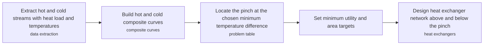
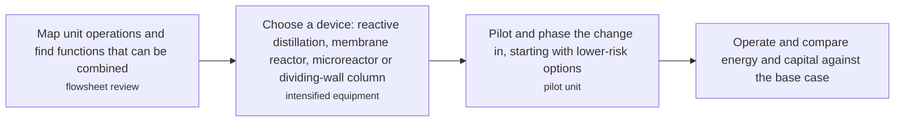
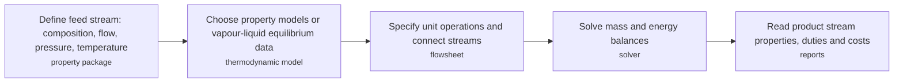

# PRC technology options

3 technologies, from commercial to lab stage. Generated from catalog/technologies/; every figure links to its source.

| Technology | Category | Maturity | TRL | Suppliers | Cost figures |
| --- | --- | --- | --- | --- | --- |
| [Pinch analysis and heat integration](#prc-pinch-analysis) | Process design and simulation | commercial |  | Pinchco (HeatIT (Excel-based)); Fives ProSim (Simulis Pinch (Excel)); CanmetENERGY (Integration); TLK-Energy (Pinch Analysis Tool (online)) |  |
| [Process intensification (rotating packed beds, dividing-wall columns, microreactors)](#prc-process-intensification) | Process design and simulation | commercial |  | Sulzer (dividing-wall columns and advanced column internals); Montz (structured packing and dividing-wall column internals) | capital cost reduction: 10-30 % payback period: 1-3 years |
| [Steady-state and dynamic process simulation](#prc-process-simulation) | Process design and simulation | commercial |  | AspenTech (Aspen HYSYS and Aspen Plus steady-state and dynamic simulation); Honeywell (UniSim Design process simulation); Siemens (PSE) (gPROMS high-fidelity process modelling); AVEVA (AVEVA PRO/II process simulation) |  |

## Pinch analysis and heat integration

Hot and cold process streams are plotted as heat load against temperature and combined into composite curves; the point of closest approach is the pinch. Targets for minimum hot and cold utility follow, and exchangers are placed above and below the pinch separately.

**Key equipment:** heat exchanger network, pinch software.

**Missing inputs:**
- typical energy savings reported by pinch studies (performance): The page read gives no savings figures. Web-checked 2026-10-28: suppliers recorded where applicable; remaining figures sit in vendor-selector, licensor or paywalled-standards material and were not verifiable open. Where: IEA, DOE industrial assessment centre and CanmetENERGY case studies (open). Next: Add savings with plant type and year from a case study.
- capital cost and operating or unit cost, with dollar year and basis (costs): No open source read so far gives costs for this technology. Web-checked 2026-10-28: suppliers recorded where applicable; remaining figures sit in vendor-selector, licensor or paywalled-standards material and were not verifiable open. Where: arXiv and open-access journals: techno-economic or review papers (MDPI is blocked by its CDN; use the manual inbox) (catalog: arxiv, open); Licensor and EPC studies; paid cost databases are catalog-only (paid); OSTI.GOV full-text reports from DOE labs: search the technology name plus 'techno-economic' (catalog: osti, blocked). Next: Look for an open techno-economic study; record each figure with metric, range, unit, dollar year, basis and source.
- named plants or projects with capacity and year (reference_plants): The sources read name no specific plant. Web-checked 2026-10-28: suppliers recorded where applicable; remaining figures sit in vendor-selector, licensor or paywalled-standards material and were not verifiable open. Where: Licensor and operator press releases for the suppliers listed (open). Next: Add one or two plants with country, capacity and start-up year.
- TRL with a cited source (trl): The IEA ETP Clean Energy Technology Guide has no matching entry. Web-checked 2026-10-28: suppliers recorded where applicable; remaining figures sit in vendor-selector, licensor or paywalled-standards material and were not verifiable open. Where: IEA ETP Clean Energy Technology Guide (collected): search for the technology name (catalog: iea-reports, open). Next: Find a TRL table that lists this technology, or leave maturity resting on the evidence on the card.
- process steps and equipment are general engineering practice, not taken from one source (process): The sources read describe the principle but not a full step-by-step flow. Where: Licensor process descriptions and textbooks (open). Next: Check the steps against a licensor description and name it.

Sources: [1](https://en.wikipedia.org/wiki/Pinch_analysis). Last reviewed 2026-10-28.

## Process intensification (rotating packed beds, dividing-wall columns, microreactors)

Intensification combines functions into compact multifunctional devices rather than tuning single unit operations. Examples include reactive distillation, membrane reactors, microreactors and dividing-wall columns.

**Key equipment:** reactive distillation column, membrane reactor, microreactor, dividing-wall column, rotating packed bed.

**Performance:**
- energy savings from intensification: 20-60 %; range stated by the Chemical Processing article; no baseline process given. [source](https://www.chemicalprocessing.com/voices/energy-saver/article/55303778/energy-saver-process-intensification-maximizes-output-minimizes-resources)
- microreactor channel size: 10-500 um; channel dimension quoted in the article. [source](https://www.chemicalprocessing.com/voices/energy-saver/article/55303778/energy-saver-process-intensification-maximizes-output-minimizes-resources)

**Costs:**
- capital cost reduction: 10-30 %; range stated in the article; no dollar amounts or year given. [source](https://www.chemicalprocessing.com/voices/energy-saver/article/55303778/energy-saver-process-intensification-maximizes-output-minimizes-resources)
- payback period: 1-3 years; range stated in the article; dollar year not stated. [source](https://www.chemicalprocessing.com/voices/energy-saver/article/55303778/energy-saver-process-intensification-maximizes-output-minimizes-resources)

**Reference plants:**
- Methyl acetate reactive distillation column replacing an eleven-step process: ; described, operator not named. [source](https://www.chemicalprocessing.com/voices/energy-saver/article/55303778/energy-saver-process-intensification-maximizes-output-minimizes-resources)

**Missing inputs:**
- dividing-wall column and rotating packed bed figures (performance): The Wikipedia pages for these were not found and the article gives no detail. Web-checked 2026-10-28: suppliers recorded where applicable; remaining figures sit in vendor-selector, licensor or paywalled-standards material and were not verifiable open. Where: Dividing-wall column studies in Chemical Engineering Progress (AIChE) (open); arXiv and open-access journals: techno-economic or review papers (MDPI is blocked by its CDN; use the manual inbox) (catalog: arxiv, open). Next: Add energy and capex figures for each device with source.
- TRL with a cited source (trl): The IEA ETP Clean Energy Technology Guide has no matching entry. Web-checked 2026-10-28: suppliers recorded where applicable; remaining figures sit in vendor-selector, licensor or paywalled-standards material and were not verifiable open. Where: IEA ETP Clean Energy Technology Guide (collected): search for the technology name (catalog: iea-reports, open). Next: Find a TRL table that lists this technology, or leave maturity resting on the evidence on the card.
- process steps and equipment are general engineering practice, not taken from one source (process): The sources read describe the principle but not a full step-by-step flow. Where: Licensor process descriptions and textbooks (open). Next: Check the steps against a licensor description and name it.

Sources: [1](https://www.chemicalprocessing.com/voices/energy-saver/article/55303778/energy-saver-process-intensification-maximizes-output-minimizes-resources). Last reviewed 2026-10-28.

## Steady-state and dynamic process simulation

Software represents a plant as unit operations joined by streams and solves the mass and energy balances to find a stable operating point. Steady-state models ignore time; dynamic models add accumulation terms and so can be used for operator training, control design and troubleshooting.

**Key equipment:** flowsheet simulator, thermodynamic property package, dynamic simulation engine, operator training simulator.

**Missing inputs:**
- key performance figures (energy use, yields, capture or conversion rate) (performance): No source read so far gives performance figures. Web-checked 2026-10-28: suppliers recorded where applicable; remaining figures sit in vendor-selector, licensor or paywalled-standards material and were not verifiable open. Where: Supplier datasheets and brochures for the companies listed on the card (open); arXiv and open-access journals: techno-economic or review papers (MDPI is blocked by its CDN; use the manual inbox) (catalog: arxiv, open); OSTI.GOV full-text reports from DOE labs: search the technology name plus 'techno-economic' (catalog: osti, blocked). Next: Add the figures that matter for comparing options, each with its basis and source.
- capital cost and operating or unit cost, with dollar year and basis (costs): No open source read so far gives costs for this technology. Web-checked 2026-10-28: suppliers recorded where applicable; remaining figures sit in vendor-selector, licensor or paywalled-standards material and were not verifiable open. Where: arXiv and open-access journals: techno-economic or review papers (MDPI is blocked by its CDN; use the manual inbox) (catalog: arxiv, open); Licensor and EPC studies; paid cost databases are catalog-only (paid); OSTI.GOV full-text reports from DOE labs: search the technology name plus 'techno-economic' (catalog: osti, blocked). Next: Look for an open techno-economic study; record each figure with metric, range, unit, dollar year, basis and source.
- named plants or projects with capacity and year (reference_plants): The sources read name no specific plant. Web-checked 2026-10-28: suppliers recorded where applicable; remaining figures sit in vendor-selector, licensor or paywalled-standards material and were not verifiable open. Where: Licensor and operator press releases for the suppliers listed (open). Next: Add one or two plants with country, capacity and start-up year.
- TRL with a cited source (trl): The IEA ETP Clean Energy Technology Guide has no matching entry. Web-checked 2026-10-28: suppliers recorded where applicable; remaining figures sit in vendor-selector, licensor or paywalled-standards material and were not verifiable open. Where: IEA ETP Clean Energy Technology Guide (collected): search for the technology name (catalog: iea-reports, open). Next: Find a TRL table that lists this technology, or leave maturity resting on the evidence on the card.
- process steps and equipment are general engineering practice, not taken from one source (process): The sources read describe the principle but not a full step-by-step flow. Where: Licensor process descriptions and textbooks (open). Next: Check the steps against a licensor description and name it.

Sources: [1](https://en.wikipedia.org/wiki/Process_simulation). Last reviewed 2026-10-28.
