# PWR technology options

39 technologies, from commercial to lab stage. Generated from catalog/technologies/; every figure links to its source.

| Technology | Category | Maturity | TRL | Suppliers | Cost figures |
| --- | --- | --- | --- | --- | --- |
| [Aeroderivative and industrial gas turbines](#pwr-aeroderivative-turbines) | Gas-fired power | commercial |  | Baker Hughes (LM6000, LM9000); GE Vernova (LM2500, LM2500XPRESS, LM6000); Solar Turbines (Titan, Taurus, Mars industrial turbines); Siemens Energy (SGT-A35, SGT-A65 aeroderivatives) |  |
| [Biomass and waste-to-energy](#pwr-biomass-waste-to-energy) | Biomass and waste | commercial | 9 | Hitachi Zosen Inova (now Kanadevia Inova) (waste-to-energy plants); Babcock & Wilcox (biomass and waste boilers) | capital cost of the Dubai Waste Management Centre waste-to-energy plant: 1 billion USD project cost (1.9 Mt/yr waste processing) (2023$) |
| [Cogeneration and combined heat and power](#pwr-cogeneration-chp) | Gas-fired power | commercial |  | Solar Turbines (Titan and Taurus CHP packages); Siemens Energy (industrial gas turbine CHP); Wärtsilä (engine CHP) | installed cost, gas-turbine CHP: 1248-3281 USD/kW (2013$) |
| [Combined cycle and HRSG](#pwr-combined-cycle-hrsg) | Gas-fired power | commercial |  | GE Vernova (HA combined-cycle plants); Siemens Energy (combined-cycle plants and HRSGs); Mitsubishi Heavy Industries (Mitsubishi Power) (GTCC plants) | total overnight cost, combined cycle single-shaft: 1086 USD/kW (2025$)<br>total overnight cost, combined cycle multi-shaft: 1032 USD/kW (2025$)<br>total overnight cost, combined cycle with 95% carbon capture: 2824 USD/kW (2025$) |
| [Concentrated solar power with storage](#pwr-concentrated-solar-power) | Solar | commercial | 9 | Abengoa (CSP plants); SolarReserve (tower plants (company later closed)); Cosin (CSP plants) | capital cost, base year: 7912 USD/kWe (2022$) |
| [Containerised hybrid power modules (solar, storage, gensets)](#pwr-containerised-hybrid-modules) | Modular power plants | commercial |  | Aggreko (hybrid power plants (relocatable solar + Y.Cube BESS + gensets) on rental or BOOM contracts); BoxPower (MegaBox, AutoBox and MiniBox containerised microgrids, 5 kW to 20 MW+); Bredenoord (Mobile Solar Plant (23 kWp fold-out) with Smart Power Bank battery and backup genset); SolarContainer (fold-out PV container, up to 140 kWp); PR Power (TRIME solar hybrid generators (15-24 kVA class), Australian rental and distribution) |  |
| [Crystalline silicon PV (PERC, TOPCon, HJT)](#pwr-crystalline-silicon-pv) | Solar | commercial | 9 | LONGi (HJT and back-contact modules); Jinko Solar (TOPCon modules); Trina Solar (TOPCon modules); JA Solar (modules) | overnight capital cost: 1.56 USD/Wac (2023$) |
| [Floating solar](#pwr-floating-solar) | Solar | commercial | 9 | Sungrow (floating PV systems); Ciel & Terre (Hydrelio floats) |  |
| [Flow batteries (vanadium, zinc-bromine)](#pwr-flow-batteries) | Electrochemical storage | commercial | 9 | Rongke Power (vanadium flow); Invinity Energy Systems (vanadium flow) |  |
| [Gas engines](#pwr-gas-engines) | Gas-fired power | commercial |  | Wärtsilä (31SG, 34SG, 50SG); INNIO Jenbacher (Jenbacher gas engines); MAN Energy Solutions (Everllence) (gas engines) |  |
| [Geothermal (flash and binary cycle)](#pwr-geothermal-flash-binary) | Geothermal | commercial | 9 | Ormat (binary and flash plants); Toshiba (geothermal steam turbines); Fuji Electric (geothermal steam turbines) | overnight capital cost, hydrothermal: 4759-6349 USD/kW |
| [Grid-forming inverters and synchronous condensers](#pwr-grid-forming-inverters) | Grid | commercial | 9 | SMA (grid-forming inverters); Siemens Energy (synchronous condensers) | Hornsdale grid-forming expansion cost: 71 million AUD (50 MW / 64.5 MWh expansion) |
| [HVDC transmission and interconnectors](#pwr-hvdc-transmission) | Grid | commercial | 9 | Hitachi Energy (HVDC Classic and HVDC Light); Siemens Energy (HVDC Plus); GE Vernova (HVDC) |  |
| [Heavy-duty gas turbines (H and J class)](#pwr-heavy-duty-gas-turbines) | Gas-fired power | commercial | 9 | GE Vernova (7HA, 9HA); Mitsubishi Heavy Industries (Mitsubishi Power) (M501/M701 J and JAC); Siemens Energy (HL class) |  |
| [Hydropower](#pwr-hydropower) | Hydro | commercial | 9 | Andritz (hydro turbines); Voith (hydro turbines); GE Vernova (hydro turbines) | overnight capital cost, new stream-reach: 6574-8611 USD/kW |
| [Large light-water reactors](#pwr-large-light-water-reactors) | Nuclear | commercial | 9 | Westinghouse (AP1000); EDF (EPR (Framatome)); KHNP (APR1400); CGN (Hualong One) | Barakah four-unit plant cost (financing basis) and build time: 4360 USD/kW derived (USD 24.4 bn for 5.6 GW); build time 12 years (2012-2024) (2016$) |
| [Lithium-ion battery energy storage](#pwr-lithium-ion-bess) | Electrochemical storage | commercial | 9 | CATL (LFP storage systems); BYD (storage systems); Tesla (Megapack); Fluence (integrated storage) |  |
| [Mobile gas turbine power plants](#pwr-mobile-gas-turbine-plants) | Modular power plants | commercial |  | GE Vernova (TM2500 mobile packages (DLE and SAC variants)); Siemens Energy (SGT-A45 TR mobile unit (launched 2017; no longer listed in the current portfolio)); PROENERGY (PE6000 50 MW fast-start package, LM6000-interchangeable); APR Energy (rental fleet of TM2500 variants and Mitsubishi FT8 units, 20-35 MW per unit) |  |
| [Modular ORC units for waste heat and small geothermal](#pwr-modular-orc-units) | Modular power plants | commercial |  | Climeon (HeatPower 300 (50-355 kW net) and HeatPower 150 marine modules); Enogia (10-180 kWe ORC modules, combinable above 1 MWe); Exergy (radial outflow turbine ORC plants, 100 kW to 50 MWe); Turboden (ORC units for geothermal, biomass and waste heat, 1-20 MWe class); Ormat (Ormat Energy Converter ORC units for geothermal and recovered heat); ElectraTherm (BITZER Group) (Power+ Generator waste heat ORC, up to 150 kWe) |  |
| [Modular reciprocating engine power plants](#pwr-modular-engine-plants) | Modular power plants | commercial |  | Wärtsilä (Modular Block (~6-10 MW per block) and Smart Power Generation plants); Rolls-Royce Power Systems (mtu) (modular gas engine power plants from 10/20/30 MW factory-tested blocks); Everllence (formerly MAN Energy Solutions) (modularised 51/60 series engine power plants); INNIO Jenbacher (containerised gensets, 249-4,507 kW per container); Cummins (Centum Force containerised gensets, 2.0-2.75 MW (50 Hz)) |  |
| [Offshore wind (fixed bottom)](#pwr-offshore-wind-fixed) | Wind | commercial | 9 | Ørsted (developer and operator); Siemens Gamesa (offshore turbines); Vestas (offshore turbines) |  |
| [Onshore wind](#pwr-onshore-wind) | Wind | commercial | 9 | Vestas (onshore turbines); Siemens Gamesa (onshore turbines); Goldwind (onshore turbines); Envision (onshore turbines) | global weighted-average utility-scale onshore wind cost: 1210 USD/kW installed (2018), average LCOE 0.056 USD/kWh (2018$) |
| [Powerships and power barges](#pwr-powerships-power-barges) | Modular power plants | commercial |  | Karpowership (Karadeniz Energy Group) (Powerships, Seal 34-40 MW to Khan 415-470 MW classes, plus LNG-to-power vessels); Power Barge Corporation (gas-turbine barges 30-300 MW, medium-speed-engine barges 80-200 MW, storage barges); Wärtsilä (floating power plants on Wärtsilä engine sets); Waller Marine (barge-mounted gas-turbine plants (2 x 171 MW at Tacoa, Venezuela); no live website found); BWSC (co-developer of an 80-180 MW medium-speed-engine power barge design with ABS approval in principle) |  |
| [Pumped hydro storage](#pwr-pumped-hydro-storage) | Mechanical storage | commercial | 9 | Andritz (pump-turbines); Voith (pump-turbines); GE Vernova (pump-turbines) | overnight capital cost, 10 h, closed loop: 3029-4501 USD/kW (2021$)<br>overnight capital cost, 10 h, one new reservoir: 1730-3250 USD/kW (2021$) |
| [Smart grids, microgrids and virtual power plants](#pwr-smart-grids-vpp) | Grid | commercial | 9 | Schneider Electric (microgrid and DERMS software); Siemens (grid software); AutoGrid (VPP software) |  |
| [Ammonia co-firing in coal boilers](#pwr-ammonia-coal-cofiring) | Gas-fired power | demonstration | 8 | IHI (ammonia co-firing burners); JERA (Hekinan demonstration) |  |
| [Compressed and liquid air energy storage](#pwr-compressed-liquid-air-storage) | Mechanical storage | demonstration | 7-9 | Hydrostor (advanced CAES); Highview Power (liquid air storage) |  |
| [Enhanced geothermal systems](#pwr-enhanced-geothermal) | Geothermal | demonstration | 6-7 | Fervo Energy (EGS projects); Eavor (closed-loop Eavor-Loop) | overnight capital cost, near-field EGS to deep EGS: 6535-13508 USD/kW |
| [Floating offshore wind](#pwr-floating-offshore-wind) | Wind | demonstration | 8 | Equinor (Hywind spar); Principle Power (WindFloat) | Hywind Tampen project cost: 488-550 million USD (about NOK 5 bn) (2020$) |
| [Gravity energy storage](#pwr-gravity-storage) | Mechanical storage | demonstration | 7 | Energy Vault (gravity storage (the company's site now describes battery projects)) |  |
| [Hydrogen-capable and ammonia-fired gas turbines](#pwr-hydrogen-ammonia-turbines) | Gas-fired power | demonstration | 5-9 | Mitsubishi Heavy Industries (Mitsubishi Power) (M501JAC hydrogen-ready); GE Vernova (7HA with up to 50% hydrogen); IHI (ammonia combustion) |  |
| [Microreactors (transportable nuclear)](#pwr-microreactors) | Modular power plants | demonstration |  | Westinghouse Electric Company (eVinci 5 MWe heat-pipe microreactor); BWX Technologies (BANR 75 MWt / 22 MWe HTGR; Project Pele 1-5 MWe transportable microreactor); Oklo (Aurora powerhouse, up to 75 MWe liquid-metal fast reactor); HolosGen (Holos Quad 3-13 MWe containerised modules); NANO Nuclear Energy (KRONOS MMR, ZEUS and LOKI designs) |  |
| [Small modular reactors](#pwr-small-modular-reactors) | Nuclear | demonstration | 7 | NuScale (VOYGR); GE Vernova Hitachi (BWRX-300); Rolls-Royce SMR (470 MWe design) |  |
| [Sodium-ion batteries](#pwr-sodium-ion-batteries) | Electrochemical storage | demonstration | 9 | CATL (Naxtra); HiNa (sodium-ion cells) |  |
| [Thermal energy storage (molten salt, sand, bricks)](#pwr-thermal-energy-storage) | Thermal storage | demonstration | 8 | Rondo Energy (heat battery); Polar Night Energy (sand battery); Kraftblock (granulate storage) |  |
| [Advanced reactors (high-temperature gas, molten salt)](#pwr-advanced-reactors) | Nuclear | pilot | 4-8 | X-energy (Xe-100); Kairos Power (molten-salt-cooled reactors); TerraPower (Natrium) |  |
| [Perovskite and tandem solar cells](#pwr-perovskite-tandem) | Solar | pilot | 6 | Oxford PV (perovskite-on-silicon tandem modules); LONGi (tandem cell research) |  |
| [Tidal and wave energy](#pwr-tidal-wave) | Ocean | pilot | 6 | Orbital Marine Power (O2 floating turbine); SIMEC Atlantis (MeyGen tidal stream) |  |
| [Fusion](#pwr-fusion) | Nuclear | lab | 3 | ITER (international tokamak, Cadarache); Commonwealth Fusion Systems (SPARC and ARC); Tokamak Energy (spherical tokamak) | ITER project cost (construction and operations, evolving): 15-22 billion EUR (estimates; EU share EUR 5.61 bn approved to 2027) |

## Aeroderivative and industrial gas turbines
<a id="pwr-aeroderivative-turbines"></a>

Gas turbines derived from jet engines (aeroderivatives) and light industrial frames in the 5 to 120 MW range. They start in minutes and suit peaking, islanded and mechanical-drive duty. Baker Hughes's LM6000PF+ makes 52.5 MWe at over 41% simple-cycle efficiency and reaches full power in 10 minutes or less; GE's LM2500XPRESS is a packaged 34 to 36 MW plant delivered as 10 modules.

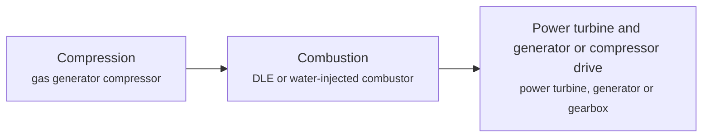

**Key equipment:** gas generator, power turbine, dry low-emission combustor, generator or driven compressor, package enclosure and inlet filtration.

**Performance:**
- LM6000PF+ output: 52.5-53.8 MW; 52.5 MWe at generator terminals; 53.8 MW mechanical drive. [source](https://www.bakerhughes.com/gas-turbines/aeroderivative-technology/lm6000pf)
- LM6000PF+ simple-cycle efficiency: 41-42 %; vendor spec table; 41 power generation, 42 mechanical drive. [source](https://www.bakerhughes.com/gas-turbines/aeroderivative-technology/lm6000pf)
- LM6000PF+ start to full power: 10 min (or less); start in under 5 minutes. [source](https://www.bakerhughes.com/gas-turbines/aeroderivative-technology/lm6000pf)
- LM2500XPRESS+ output (50 Hz, ISO, natural gas): 34.5-36.3 MW; G4 and G5 DLE UPT variants. [source](https://www.gevernova.com/gas-power/products/gas-turbines/lm2500)
- LM2500 hydrogen-blend operating experience: 5-95 % hydrogen by volume; about 2 million operating hours on hydrogen-blend fuels; headline capability up to 75% hydrogen. [source](https://www.gevernova.com/gas-power/products/gas-turbines/lm2500)

**Reference plants:**
- QPM Isaac Power Station aeroderivative units, Queensland, AU: two GE Vernova LM6000 aeroderivative gas turbines generating up to 112 MW; delivered 2025; construction. [source](https://www.turbomachinerymag.com/view/ge-vernova-delivers-two-lm6000-aeroderivatives-for-qpm-s-isaac-power-station)

**Missing inputs:**
- capital cost and operating or unit cost, with dollar year and basis (costs): No open source read so far gives costs for this technology. Web-checked 2026-10-28; OEM quotes only. Where: arXiv and open-access journals: techno-economic or review papers (MDPI is blocked by its CDN; use the manual inbox) (catalog: arxiv, open); Licensor and EPC studies; paid cost databases are catalog-only (paid); OSTI.GOV full-text reports from DOE labs: search the technology name plus 'techno-economic' (catalog: osti, blocked). Next: Look for an open techno-economic study; record each figure with metric, range, unit, dollar year, basis and source.
- TRL with a cited source (trl): The IEA ETP Clean Energy Technology Guide has no matching entry. no open TRL source found (IEA ETP guide checked 2026-10-28; no SETIS/DOE entry). Where: IEA ETP Clean Energy Technology Guide (collected): search for the technology name (catalog: iea-reports, open). Next: Find a TRL table that lists this technology, or leave maturity resting on the evidence on the card.
- process steps and equipment are general engineering practice, not taken from one source (process): The sources read describe the principle but not a full step-by-step flow. Where: Licensor process descriptions and textbooks (open). Next: Check the steps against a licensor description and name it.

Sources: [1](https://www.bakerhughes.com/gas-turbines/aeroderivative-technology/lm6000pf), [2](https://www.gevernova.com/gas-power/products/gas-turbines/lm2500), [3](https://www.epa.gov/system/files/documents/2024-04/tsd-efficient-generation-combustion-turbine-egus-april-2024.pdf), [4](https://www.turbomachinerymag.com/view/ge-vernova-delivers-two-lm6000-aeroderivatives-for-qpm-s-isaac-power-station). Last reviewed 2026-10-28.

## Biomass and waste-to-energy
<a id="pwr-biomass-waste-to-energy"></a>

Solid biomass or municipal waste is burned on a grate or in a fluidised bed to raise steam for a turbine, or gasified to a fuel gas. The IEA guide rates small-scale biomass gasification (bio-syngas) at TRL 9; no source read so far gives power-plant efficiency or cost.

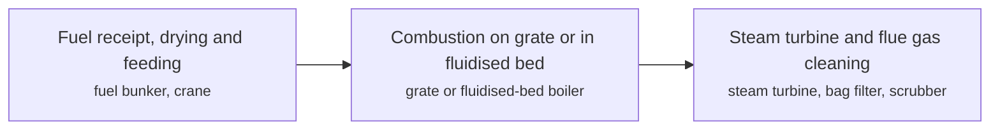

**Key equipment:** fuel handling, grate or fluidised-bed boiler, steam turbine, flue gas cleaning.

**Costs:**
- capital cost of the Dubai Waste Management Centre waste-to-energy plant: 1 billion USD project cost (1.9 Mt/yr waste processing) (2023$); dollar year not stated in the source (publication 2023); "Dubai opens $1bn waste-to-energy centre" covering 1.9 Mt/yr of waste. [source](https://www.agbi.com/energy/2023/07/dubai-waste-to-energy-plant-starts-transmitting-electricity)

**Reference plants:**
- Dubai Waste Management Centre (Warsan), United Arab Emirates, AE: world's largest waste-to-energy plant: processes 1.9 million tonnes of waste a year, powers about 135,000 homes; about USD 1 bn project; began transmitting electricity July 2023; operating. [source](https://www.agbi.com/energy/2023/07/dubai-waste-to-energy-plant-starts-transmitting-electricity)

TRL source: [IEA ETP Clean Energy Technology Guide, dataset of 24 July 2026, latest assessment (IEA 1-11 scale): 'Biomass gasification - small-scale (bio-syngas)' 9 (2025)](https://www.iea.org/data-and-statistics/data-tools/etp-clean-energy-technology-guide)

**Missing inputs:**
- electrical efficiency, throughput and plant examples (performance): Hitachi Zosen Inova's site redirected to Kanadevia Inova and was not read. Where: [Kanadevia Inova](https://kanadevia-inova.com/) (open). Next: Fetch the redirected site and add plant data.
- process steps and equipment are general engineering practice, not taken from one source (process): The sources read describe the principle but not a full step-by-step flow. Where: Licensor process descriptions and textbooks (open). Next: Check the steps against a licensor description and name it.

Sources: [1](https://www.iea.org/data-and-statistics/data-tools/etp-clean-energy-technology-guide), [2](https://www.agbi.com/energy/2023/07/dubai-waste-to-energy-plant-starts-transmitting-electricity). Last reviewed 2026-10-28.

## Cogeneration and combined heat and power
<a id="pwr-cogeneration-chp"></a>

A prime mover (gas turbine, reciprocating engine or boiler with steam turbine) makes electricity while its waste heat is recovered as steam or hot water for a process or building. US EPA reports total CHP efficiencies of 65 to 80% and sometimes close to 90%, against 50 to 55% for separate heat and grid power.

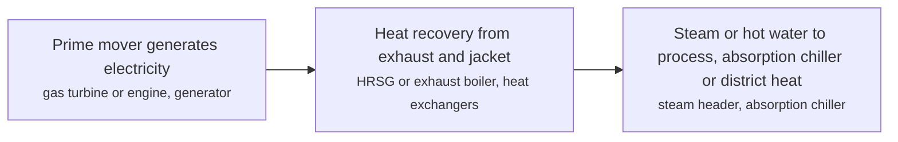

**Key equipment:** prime mover, heat recovery steam generator or exhaust boiler, generator, switchgear and grid interconnection, heat distribution.

**Performance:**
- total CHP efficiency: 65-80 % (some systems approach 90%); EPA CHP benefits page. [source](https://www.epa.gov/chp/chp-benefits)
- gas-turbine CHP electrical efficiency: 23.95-35.96 % HHV; five representative systems, 3.3 MW to 44.5 MW. [source](https://www.epa.gov/sites/default/files/2015-07/documents/catalog_of_chp_technologies_section_3._technology_characterization_-_combustion_turbines.pdf)
- gas-turbine CHP total efficiency: 65.7-70.5 % HHV; same five systems. [source](https://www.epa.gov/sites/default/files/2015-07/documents/catalog_of_chp_technologies_section_3._technology_characterization_-_combustion_turbines.pdf)
- separate heat and power efficiency: 50-55 %; reference case in the EPA page. [source](https://www.epa.gov/chp/chp-benefits)

**Costs:**
- installed cost, gas-turbine CHP: 1248-3281 USD/kW (2013$); 3 MW system $3,281; 45 MW system $1,248; costs fall with size. [source](https://www.epa.gov/sites/default/files/2015-07/documents/catalog_of_chp_technologies_section_3._technology_characterization_-_combustion_turbines.pdf)

**Missing inputs:**
- named plants or projects with capacity and year (reference_plants): The sources read name no specific plant. Web-checked 2026-10-28; no verifiable named CHP project page found in this pass. Where: Licensor and operator press releases for the suppliers listed (open). Next: Add one or two plants with country, capacity and start-up year.
- TRL with a cited source (trl): The IEA ETP Clean Energy Technology Guide has no matching entry. IEA ETP Guide (July 2026) has no matching entry for industrial/utility CHP (searched 'cogeneration', 'CHP', 'combined heat and power', 'trigeneration', 'quad-generation'; nearest rows 'Fuel cell micro-CHP for buildings', 'Trigeneration (CCHP)', 'Quad-generation (CCHP +)' are Buildings-category polygeneration); 2026-10-28 Where: IEA ETP Clean Energy Technology Guide (collected): search for the technology name (catalog: iea-reports, open). Next: Find a TRL table that lists this technology, or leave maturity resting on the evidence on the card.
- process steps and equipment are general engineering practice, not taken from one source (process): The sources read describe the principle but not a full step-by-step flow. Where: Licensor process descriptions and textbooks (open). Next: Check the steps against a licensor description and name it.

Sources: [1](https://www.epa.gov/sites/default/files/2015-07/documents/catalog_of_chp_technologies_section_3._technology_characterization_-_combustion_turbines.pdf), [2](https://www.epa.gov/chp/chp-benefits). Last reviewed 2026-10-28.

## Combined cycle and HRSG
<a id="pwr-combined-cycle-hrsg"></a>

A gas turbine exhausts at about 600 °C into a heat recovery steam generator (HRSG) that raises steam for a steam turbine, so the plant makes electricity from both cycles. Multi-pressure HRSGs with reheat give the highest efficiency; US EPA reports combined-cycle efficiencies routinely above 55% HHV and 57.1% to 57.9% for GE HA-class units.

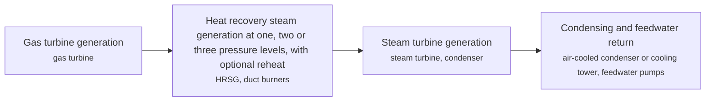

**Key equipment:** gas turbine, HRSG, steam turbine, condenser, feedwater system, SCR for NOx.

**Performance:**
- combined-cycle efficiency, utility scale: 55 % HHV (more than); EPA: routinely above 55%. [source](https://www.epa.gov/system/files/documents/2024-04/tsd-efficient-generation-combustion-turbine-egus-april-2024.pdf)
- net plant efficiency, GE HA 1 on 1: 56.1-57.9 % HHV; 7HA.01 56.1, 7HA.02 57.1, 7HA.03 57.6, 9HA.02 (2x) 57.9. [source](https://www.epa.gov/system/files/documents/2024-04/tsd-efficient-generation-combustion-turbine-egus-april-2024.pdf)
- steam-cycle efficiency by HRSG type: 20-30 %; about 20% two-pressure no reheat, 26% three-pressure, about 30% three-pressure with reheat. [source](https://www.epa.gov/system/files/documents/2024-04/tsd-efficient-generation-combustion-turbine-egus-april-2024.pdf)
- combined cycle at 1-on-1, M701JAC: 64 % LHV (more than); vendor claim. [source](https://power.mhi.com/products/gasturbines/lineup/m701j)

**Costs:**
- total overnight cost, combined cycle single-shaft: 1086 USD/kW (2025$); AEO2026 EMM Table 3 (2025$/kW): 627 MW unit, first available 2028, technological optimism factor 1.00; excludes regional multipliers, learning effects and interest during construction; current costs for plants coming online in 2026; based on Sargent & Lundy (Jan 2024) with about a 20% combined-cycle increase per the Brattle Group/S&L PJM new-entry study; Table 4 regional range 875-1,513 USD/kW (2025$), average 1,102. [source](https://www.eia.gov/outlooks/aeo/assumptions/pdf/EMM_Assumptions.pdf)
- total overnight cost, combined cycle multi-shaft: 1032 USD/kW (2025$); AEO2026 EMM Table 3 (2025$/kW): 1,227 MW unit, first available 2028, technological optimism factor 1.00; exclusions and S&L/PJM adjustment basis as for the single-shaft entry; Table 4 regional range 830-1,445 USD/kW (2025$), average 1,049. [source](https://www.eia.gov/outlooks/aeo/assumptions/pdf/EMM_Assumptions.pdf)
- total overnight cost, combined cycle with 95% carbon capture: 2824 USD/kW (2025$); AEO2026 EMM Table 3 (2025$/kW): 543 MW unit, first available 2029, base overnight cost 2,567 USD/kW times technological optimism factor 1.10; excludes regional multipliers, learning effects and interest during construction; Table 4 regional range 2,268-5,674 USD/kW (2025$), average 2,954. [source](https://www.eia.gov/outlooks/aeo/assumptions/pdf/EMM_Assumptions.pdf)

**Missing inputs:**
- named plants or projects with capacity and year (reference_plants): The sources read name no specific plant. Web-checked 2026-10-28; AEO2026 cost tables (already recorded) name classes, not plants; no single named reference added. Where: Licensor and operator press releases for the suppliers listed (open). Next: Add one or two plants with country, capacity and start-up year.
- TRL with a cited source (trl): The IEA ETP Clean Energy Technology Guide has no matching entry. Where: IEA ETP Clean Energy Technology Guide (collected): search for the technology name (catalog: iea-reports, open). Next: Find a TRL table that lists this technology, or leave maturity resting on the evidence on the card.
- process steps and equipment are general engineering practice, not taken from one source (process): The sources read describe the principle but not a full step-by-step flow. Where: Licensor process descriptions and textbooks (open). Next: Check the steps against a licensor description and name it.

Sources: [1](https://www.epa.gov/system/files/documents/2024-04/tsd-efficient-generation-combustion-turbine-egus-april-2024.pdf), [2](https://www.gevernova.com/gas-power/products/gas-turbines/7ha), [3](https://power.mhi.com/products/gasturbines/lineup/m701j), [4](https://www.eia.gov/outlooks/aeo/assumptions/pdf/EMM_Assumptions.pdf). Last reviewed 2026-10-28.

## Concentrated solar power with storage
<a id="pwr-concentrated-solar-power"></a>

Mirrors concentrate sunlight on a receiver; the heat is stored in molten salt and used to raise steam for a turbine, giving dispatchable solar. NREL's 2024 baseline is a 102 MWe molten-salt power tower with 10 hours of two-tank storage, costed at $7,912/kWe in the 2022 base year.

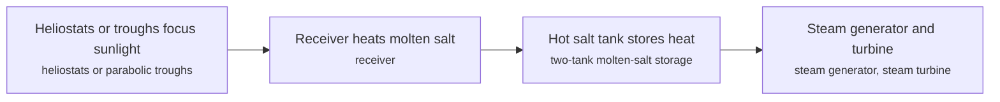

**Key equipment:** heliostat field, receiver, molten-salt tanks, steam generator, turbine.

**Performance:**
- capacity factor with 10 h storage, base year: 51.4-66.6 %; Abilene TX 51.4, Phoenix 64.7, Daggett CA 66.6. [source](https://atb.nrel.gov/electricity/2024/concentrating_solar_power)
- power cycle gross efficiency, 2022: 41.2 %; steam Rankine at 574 °C. [source](https://atb.nrel.gov/electricity/2024/concentrating_solar_power)
- fixed O&M: 74.6 USD/kW-yr (2022$); 2022. [source](https://atb.nrel.gov/electricity/2024/concentrating_solar_power)

**Costs:**
- capital cost, base year: 7912 USD/kWe (2022$); 2022 dollars. [source](https://atb.nrel.gov/electricity/2024/concentrating_solar_power)

**Reference plants:**
- Noor Ouarzazate solar complex, Morocco (MASEN), MA: about 510 MW of concentrated solar power (plus a 72 MW PV plant) across Noor I-III, including the Noor III molten-salt tower; about USD 2.5 bn; phases 2014-2018; world's largest CSP complex; operating. [source](https://documents.worldbank.org/en/publication/documents-reports/documentdetail/103151506335526236)

TRL source: [IEA ETP Clean Energy Technology Guide, dataset of 24 July 2026, latest assessment (IEA 1-11 scale): 'Solar tower' 9 (2025); 'Parabolic trough (solar)' 9 (2025)](https://www.iea.org/data-and-statistics/data-tools/etp-clean-energy-technology-guide)

**Missing inputs:**
- process steps and equipment are general engineering practice, not taken from one source (process): The sources read describe the principle but not a full step-by-step flow. Where: Licensor process descriptions and textbooks (open). Next: Check the steps against a licensor description and name it.

Sources: [1](https://atb.nrel.gov/electricity/2024/concentrating_solar_power). Last reviewed 2026-10-28.

## Containerised hybrid power modules (solar, storage, gensets)
<a id="pwr-containerised-hybrid-modules"></a>

Factory-integrated containers or skids combine solar PV, battery storage and diesel/gas gensets under one hybrid controller, so a remote site replaces part of its diesel generation within days to weeks of arrival. Aggreko delivers such plants as rental or build-own-operate contracts (relocatable solar farms plus its containerised Y.Cube batteries), BoxPower ships pre-engineered container microgrids from 5 kW to 20 MW, and fold-out PV containers such as SolarContainer's 140 kWp unit install in hours.

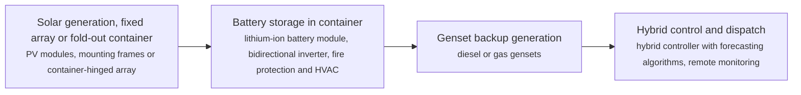

**Key equipment:** PV array or fold-out solar container, containerised battery energy storage, diesel or gas gensets, hybrid controller, microgrid switchgear.

**Performance:**
- Aggreko containerised battery ratings: 250-500 kW / kWh; 250 kW / 575 kWh and 500 kW / 250 kWh plug-and-play units, expandable down to 30/60 kVA small nodes; Y.Cube fits a standard 20 ft container. [source](https://www.aggreko.com/en-us/news/aggreko-launches-new-mid-sized-500-kw-250-kwh-and-250-kw-575-kwh-energy-storage-systems)
- Bisha mine, Eritrea: fuel savings: 12 %; 22 MW generation plus 7.5 MWp solar on 9 ha; about 10,000 litres of diesel saved per day; roughly 10,000 tonnes of CO2 avoided annually. [source](https://www.aggreko.com/en-sg/case-studies/mining/eritrea-solar-hybrid-mine-project)
- Aggreko hybrid plants savings claim: 5-20 %; savings from the first kWh on hybrid solar-storage-genset plants; contract durations 3-10+ years with no upfront capital. [source](https://www.aggreko.com/en-ae/solutions/power-plants/hybrid-power-plants)
- BoxPower product range: 5-20000 kW; 5 kW to 20 MW+ solar PV and 15 kWh to 6 MWh storage; MiniBox installs in a few hours with no foundation. [source](https://boxpower.io/products/solar-container/)
- SolarContainer fold-out PV array: 140 kWp; 140 kWp from 240 modules over about 720 square metres, assembly up to 5 hours; ISO container with CSC badge. [source](https://www.solarcontainer.one/english/product-information)

**Reference plants:**
- Bisha mine solar-hybrid plant, Eritrea: 22 MW gensets + 7.5 MWp solar; operating under Aggreko contract; over 12% fuel savings. [source](https://www.aggreko.com/en-sg/case-studies/mining/eritrea-solar-hybrid-mine-project)
- Porphyry gold mine hybrid plant (Northern Star), Australia: 4.4 MW solar + 2 MW battery; operating under a 10-year PPA; 1.91 million litres of fuel saved per year. [source](https://www.aggreko.com/en-pg/case-studies/mining/solar-power-remote-gold-mine-western-australia)

**Missing inputs:**
- module prices or contract rates in $/kW or $/kWh delivered, with dollar year (costs): Vendor pages sell services without publishing rates. Web-checked 2026-10-28; module prices are quote-only. Where: arXiv and open-access journals: hybrid solar-storage-diesel techno-economic studies for mines and islands (catalog: arxiv, open); IRENA reports on hybrid mini-grid costs (irena.org) (open). Next: Find an open cost figure; record it with metric, range, unit, dollar year, basis and source.
- TRL with a cited source (trl): The IEA ETP Clean Energy Technology Guide has no entry for hybrid container modules as such. no open TRL source found (IEA ETP guide checked 2026-10-28; no SETIS/DOE entry). Where: IEA ETP Clean Energy Technology Guide (collected): mini-grid and off-grid PV entries (catalog: iea-reports, open). Next: Find a TRL table entry or leave maturity resting on the evidence on the card.
- reference hybrid module deployment in Southeast Asia (reference_plants): Case studies read are in Eritrea and Australia. Web-checked 2026-10-28; Aggreko hybrid case studies found for Australia (Granny Smith) and Latin America, no verifiable named SEA module deployment. Where: Aggreko Asia-Pacific case studies and Indonesian or Philippine mine microgrid tenders (open). Next: Add a Southeast Asian reference with capacity and fuel savings.
- hybrid control sequence is generalised from vendor pages (process): The controller logic (solar first, battery smoothing, genset backup) is standard practice, not one named source. Where: Vendor white papers on hybrid controller algorithms (open). Next: Check the steps against a named vendor white paper.

Sources: [1](https://www.aggreko.com/en-ae/solutions/power-plants/hybrid-power-plants), [2](https://www.aggreko.com/en-us/news/aggreko-launches-new-mid-sized-500-kw-250-kwh-and-250-kw-575-kwh-energy-storage-systems), [3](https://www.aggreko.com/en-sg/case-studies/mining/eritrea-solar-hybrid-mine-project), [4](https://www.aggreko.com/en-pg/case-studies/mining/solar-power-remote-gold-mine-western-australia), [5](https://boxpower.io/products/solar-container/), [6](https://www.bredenoord.com/en/knowledge/mobile-solar-plant), [7](https://www.solarcontainer.one/english/product-information). Last reviewed 2026-10-28.

## Crystalline silicon PV (PERC, TOPCon, HJT)
<a id="pwr-crystalline-silicon-pv"></a>

Silicon wafers convert sunlight to DC electricity; the cell structure sets efficiency. PERC is the mature cell, TOPCon and heterojunction (HJT/SHJ) are the current upgrades. NREL's 2024 baseline models a 100 MWdc (74.6 MWac) one-axis tracked plant with bifacial modules and costs it at $1.56/WAC in 2023.

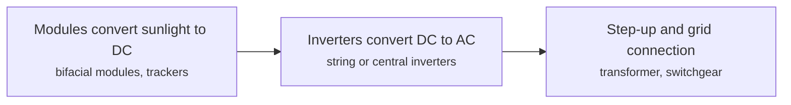

**Key equipment:** PV modules, single-axis trackers, inverters, step-up transformer.

**Performance:**
- capacity factor, AC, one-axis tracking, ILR 1.34: 21.4-34 %; 2021 first-year range from lowest to best solar resource class. [source](https://atb.nrel.gov/electricity/2024/utility-scale_pv)
- fixed O&M: 22 USD/kWac-yr (2023$); 2023. [source](https://atb.nrel.gov/electricity/2024/utility-scale_pv)

**Costs:**
- overnight capital cost: 1.56 USD/Wac (2023$); 2023 benchmark (Q1 2023), 100 MWdc one-axis tracking; the base year 2022 value is $1.43/Wac. [source](https://atb.nrel.gov/electricity/2024/utility-scale_pv)

**Reference plants:**
- Cirata floating solar PV plant, West Java, Indonesia, ID: 145 MW floating PV, the largest in Southeast Asia at commissioning (planned expansion to up to 500 MW); powers about 50,000 homes; operating. [source](https://taiyangnews.info/markets/floating-solar-expansion-in-southeast-asian-nations)
- Sunny Bangchak solar plant, Thailand, TH: 44 MW silicon PV, Southeast Asia's largest silicon photovoltaic plant at grid connection (27 Sep 2012); operating. [source](https://www.eco-business.com/news/southeast-asias-largest-solar-plant-in-thailand-gets-turned-on)

TRL source: [IEA ETP Clean Energy Technology Guide, dataset of 24 July 2026, latest assessment (IEA 1-11 scale): 'Crystalline silicon PV' 9 (2025)](https://www.iea.org/data-and-statistics/data-tools/etp-clean-energy-technology-guide)

**Missing inputs:**
- process steps and equipment are general engineering practice, not taken from one source (process): The sources read describe the principle but not a full step-by-step flow. Where: Licensor process descriptions and textbooks (open). Next: Check the steps against a licensor description and name it.

Sources: [1](https://atb.nrel.gov/electricity/2024/utility-scale_pv), [2](https://taiyangnews.info/markets/floating-solar-expansion-in-southeast-asian-nations). Last reviewed 2026-10-28.

## Floating solar
<a id="pwr-floating-solar"></a>

PV modules mounted on floats moored on reservoirs, lakes or near-shore water. The World Bank found floating PV grew from about 10 MW at end 2014 to 1.1 GW by September 2018, with a conservative global potential of 400 GW, a cooling-driven yield gain, and lifetime costs at par with land PV.

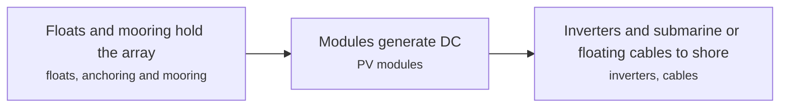

**Key equipment:** floats, mooring system, PV modules, inverters, cables.

**Performance:**
- global installed floating PV: 1.1 GW; September 2018 (report date 30 October 2018). [source](https://www.worldbank.org/en/topic/energy/publication/where-sun-meets-water)
- conservative global potential: 400 GW; World Bank estimate. [source](https://www.worldbank.org/en/topic/energy/publication/where-sun-meets-water)

**Reference plants:**
- Cirata floating solar PV plant, West Java, Indonesia, ID: 145 MW floating PV (Masdar/PLN), largest in Southeast Asia at its 2023 commissioning, planned expansion to 500 MW; operating. [source](https://taiyangnews.info/markets/floating-solar-expansion-in-southeast-asian-nations)

TRL source: [IEA ETP Clean Energy Technology Guide, dataset of 24 July 2026, latest assessment (IEA 1-11 scale): 'Floating solar PV' 9 (2025)](https://www.iea.org/data-and-statistics/data-tools/etp-clean-energy-technology-guide)

**Missing inputs:**
- current global capacity and yield gain percentage (performance): The World Bank report is from 2018. Web-checked 2026-10-28: World Bank/SERIS put global floating solar above 1.1 GW back in 2018 (pv-tech) with higher yield from water cooling, but neither a current (2025-26) global GW figure nor a verified yield-gain percentage was found in open pages. Where: IRENA and IEA PVPS floating PV statistics (catalog: irena, open). Next: Add a 2024 or 2025 capacity figure.
- capital cost and operating or unit cost, with dollar year and basis (costs): No open source read so far gives costs for this technology. Web-checked 2026-10-28; no open $/W or $/MWh figure found. Where: arXiv and open-access journals: techno-economic or review papers (MDPI is blocked by its CDN; use the manual inbox) (catalog: arxiv, open); Licensor and EPC studies; paid cost databases are catalog-only (paid); OSTI.GOV full-text reports from DOE labs: search the technology name plus 'techno-economic' (catalog: osti, blocked). Next: Look for an open techno-economic study; record each figure with metric, range, unit, dollar year, basis and source.
- process steps and equipment are general engineering practice, not taken from one source (process): The sources read describe the principle but not a full step-by-step flow. Where: Licensor process descriptions and textbooks (open). Next: Check the steps against a licensor description and name it.

Sources: [1](https://www.worldbank.org/en/topic/energy/publication/where-sun-meets-water). Last reviewed 2026-10-28.

## Flow batteries (vanadium, zinc-bromine)
<a id="pwr-flow-batteries"></a>

Energy is stored in liquid electrolytes in tanks and pumped through a cell stack, so power and energy are sized separately. Invinity reports over 11,000 MWh discharged since 2022 and cites a 1.5 GWh vanadium project at Laufenburg, Switzerland; duration, cycle life and efficiency were not quantified on its page.

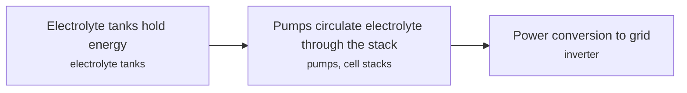

**Key equipment:** electrolyte tanks, cell stacks, pumps, power conversion.

**Performance:**
- energy discharged since 2022, Invinity fleet: 11000 MWh; vendor claim. [source](https://invinity.com/)

TRL source: [IEA ETP Clean Energy Technology Guide, dataset of 24 July 2026, latest assessment (IEA 1-11 scale): 'Redox flow storage battery' 9 (2025)](https://www.iea.org/data-and-statistics/data-tools/etp-clean-energy-technology-guide)

**Missing inputs:**
- Rongke Power Dalian project MW and MWh (reference_plants): The Wikipedia page for the Dalian station returned not found. Where: Rongke Power and Dalian Rongke announcements (open). Next: Add the Dalian MW, MWh and commissioning date.
- capital cost and operating or unit cost, with dollar year and basis (costs): No open source read so far gives costs for this technology. Web-checked 2026-10-28; system prices are quote-only. Where: arXiv and open-access journals: techno-economic or review papers (MDPI is blocked by its CDN; use the manual inbox) (catalog: arxiv, open); Licensor and EPC studies; paid cost databases are catalog-only (paid); OSTI.GOV full-text reports from DOE labs: search the technology name plus 'techno-economic' (catalog: osti, blocked). Next: Look for an open techno-economic study; record each figure with metric, range, unit, dollar year, basis and source.
- process steps and equipment are general engineering practice, not taken from one source (process): The sources read describe the principle but not a full step-by-step flow. Where: Licensor process descriptions and textbooks (open). Next: Check the steps against a licensor description and name it.

Sources: [1](https://invinity.com/). Last reviewed 2026-10-28.

## Gas engines
<a id="pwr-gas-engines"></a>

Spark-ignited or dual-fuel reciprocating engines in the 1 to 20 MW class generate power from natural gas or biogas. Wärtsilä's 50SG makes about 18.4 MW at 50.2% electrical efficiency, connects to the grid within 30 seconds and reaches full load in under 2 minutes in a fast start.

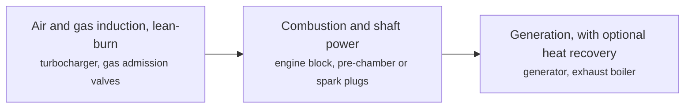

**Key equipment:** gas engine, generator, turbocharger, exhaust after-treatment, cooling system.

**Performance:**
- 18V50SG electrical efficiency (50 Hz): 50.2 %; output 18,434 kW; 5% tolerance on efficiency. [source](https://www.wartsila.com/energy/solutions/engine-power-plants/wartsila-50sg-gas-engine)
- 50SG start to grid connection: 30 s; fast start to full load under 2 minutes. [source](https://www.wartsila.com/energy/solutions/engine-power-plants/wartsila-50sg-gas-engine)
- engine plant simple-cycle efficiency: 50 % (or more); up to 54% in Flexicycle configuration. [source](https://www.wartsila.com/energy/engine-power-plant-solutions/flexible-baseload-power-plants)
- CHP efficiency, Wärtsilä 31SG: 90 %; vendor claim. [source](https://www.wartsila.com/energy/engine-power-plant-solutions/flexible-baseload-power-plants)
- minimum load, 50SG: 10 % at unit level; 1% at plant level with multiple engines. [source](https://www.wartsila.com/energy/solutions/engine-power-plants/wartsila-50sg-gas-engine)

**Reference plants:**
- PLTD Pesanggaran, Bali (PT Indonesia Power), ID: 200 MW, 12 x Wärtsilä 50DF multi-fuel engines; in operation; delivered 2015 and began on HFO, primarily LNG since July 2016 (largest engine-based power plant in Indonesia). [source](https://www.wartsila.com/energy/learn-more/references/utilities/pesanggaran-bali)

**Missing inputs:**
- capital cost and operating or unit cost, with dollar year and basis (costs): No open source read so far gives costs for this technology. Web-checked 2026-10-28; no open techno-economic study found. Where: arXiv and open-access journals: techno-economic or review papers (MDPI is blocked by its CDN; use the manual inbox) (catalog: arxiv, open); Licensor and EPC studies; paid cost databases are catalog-only (paid); OSTI.GOV full-text reports from DOE labs: search the technology name plus 'techno-economic' (catalog: osti, blocked). Next: Look for an open techno-economic study; record each figure with metric, range, unit, dollar year, basis and source.
- TRL with a cited source (trl): The IEA ETP Clean Energy Technology Guide has no matching entry. no open TRL source found (IEA ETP guide checked 2026-10-28; no SETIS/DOE entry). Where: IEA ETP Clean Energy Technology Guide (collected): search for the technology name (catalog: iea-reports, open). Next: Find a TRL table that lists this technology, or leave maturity resting on the evidence on the card.
- process steps and equipment are general engineering practice, not taken from one source (process): The sources read describe the principle but not a full step-by-step flow. Where: Licensor process descriptions and textbooks (open). Next: Check the steps against a licensor description and name it.

Sources: [1](https://www.wartsila.com/energy/solutions/engine-power-plants/wartsila-50sg-gas-engine), [2](https://www.wartsila.com/energy/engine-power-plant-solutions/flexible-baseload-power-plants), [3](https://www.wartsila.com/energy/learn-more/references/utilities/pesanggaran-bali). Last reviewed 2026-10-28.

## Geothermal (flash and binary cycle)
<a id="pwr-geothermal-flash-binary"></a>

Hot water or steam from wells drives a turbine directly (dry steam, flash at 200 °C and above) or heats a secondary fluid in an organic Rankine cycle (binary, 110 to under 200 °C). NREL's 2024 baseline sizes a hydrothermal flash plant at 40 MWe, 225 °C, 2.5 km, and a binary plant at 30 MWe, 175 °C, 1.5 km.

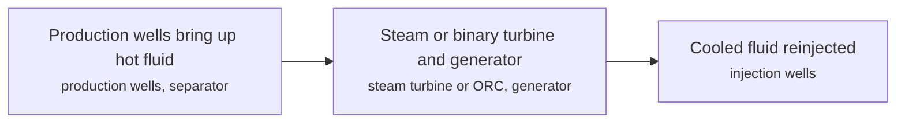

**Key equipment:** production and injection wells, separator, steam turbine or organic Rankine unit, condenser, generator.

**Performance:**
- flash plant representative size and resource: 40 MWe at 225 °C, 2.5 km; NREL ATB 2024 representative plant. [source](https://atb.nrel.gov/electricity/2024/geothermal)
- binary plant representative size and resource: 30 MWe at 175 °C, 1.5 km; NREL ATB 2024 representative plant. [source](https://atb.nrel.gov/electricity/2024/geothermal)

**Costs:**
- overnight capital cost, hydrothermal: 4759-6349 USD/kW; flash 4,759, binary 6,349; example values, dollar year not stated on the page (base year 2022). [source](https://atb.nrel.gov/electricity/2024/geothermal)

**Reference plants:**
- Hellisheidi geothermal power plant, Hengill, Iceland (ON Power), IS: 303 MWe plus 200-400 MWth hot-water supply; commissioned in five stages 2006-2011; Iceland's largest geothermal CHP plant; operating. [source](https://verkis.com/projects/energy/hellisheidi-power-plant)

TRL source: [IEA ETP Clean Energy Technology Guide, dataset of 24 July 2026, latest assessment (IEA 1-11 scale): 'Flash steam geothermal power plant (hot water)' 9 (2025); 'Organic rankine cycle (low temperature resources)' 9 (2025)](https://www.iea.org/data-and-statistics/data-tools/etp-clean-energy-technology-guide)

**Missing inputs:**
- process steps and equipment are general engineering practice, not taken from one source (process): The sources read describe the principle but not a full step-by-step flow. Where: Licensor process descriptions and textbooks (open). Next: Check the steps against a licensor description and name it.

Sources: [1](https://atb.nrel.gov/electricity/2024/geothermal). Last reviewed 2026-10-28.

## Grid-forming inverters and synchronous condensers
<a id="pwr-grid-forming-inverters"></a>

Grid-forming inverters set their own voltage and frequency, partly mimicking synchronous generators, whereas grid-following inverters need a stable grid to follow. Synchronous condensers add real inertia and short-circuit strength.

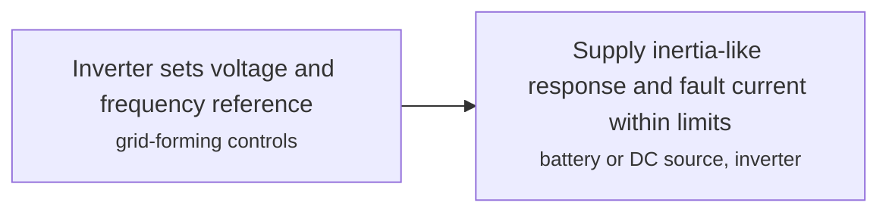

**Key equipment:** grid-forming inverter, battery storage, synchronous condenser, control software.

**Performance:**
- grid-following loss in Blue Cut Fire event, 2016: 1200 MW PV lost (largest single); inverters tripped on faults under 60 ms. [source](https://en.wikipedia.org/wiki/Grid-forming_inverter)
- Hornsdale Power Reserve grid-forming operation: 100-150 MW discharge (100 MW / 129 MWh at Nov 2017 commissioning; expanded by 50 MW / 64.5 MWh from 2020); world's first big battery, first 100 MW / 129 MWh completed November 2017 (hornsdalepowerreserve.com.au); AEMO approved Hornsdale's grid-forming inverters to deliver inertia services into the South Australian grid (Neoen). [source](https://hornsdalepowerreserve.com.au)

**Costs:**
- Hornsdale grid-forming expansion cost: 71 million AUD (50 MW / 64.5 MWh expansion); "The $71 million project will see the current 100 MW / 129 MWh battery expanded" (ARENA, 19 Nov 2019), demonstrating grid-scale batteries providing grid-forming services. [source](https://arena.gov.au/news/worlds-largest-scale-battery-set-to-get-even-bigger)

**Reference plants:**
- Hornsdale Power Reserve, South Australia (Neoen/Tesla), AU: 100 MW / 129 MWh lithium-ion big battery (Nov 2017) expanded by 50 MW / 64.5 MWh; first grid-forming-inverter inertia services approved by AEMO; operating. [source](https://hornsdalepowerreserve.com.au)

TRL source: [IEA ETP Clean Energy Technology Guide, dataset of 24 July 2026, latest assessment (IEA 1-11 scale): 'Battery storage system with grid-forming inverter' 9 (2025)](https://www.iea.org/data-and-statistics/data-tools/etp-clean-energy-technology-guide)

**Missing inputs:**
- process steps and equipment are general engineering practice, not taken from one source (process): The sources read describe the principle but not a full step-by-step flow. Where: Licensor process descriptions and textbooks (open). Next: Check the steps against a licensor description and name it.

Sources: [1](https://en.wikipedia.org/wiki/Grid-forming_inverter), [2](https://arena.gov.au/news/worlds-largest-scale-battery-set-to-get-even-bigger). Last reviewed 2026-10-28.

## HVDC transmission and interconnectors
<a id="pwr-hvdc-transmission"></a>

Converter stations change AC to DC for long-distance or subsea transmission with lower losses than AC lines. Line-commutated (LCC) converters suit bulk power and AC interconnections; voltage-source converters (VSC) are compact and suit offshore wind.

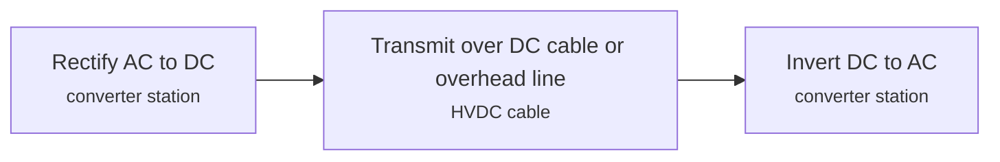

**Key equipment:** converter stations, HVDC cables or overhead lines, converter transformers, DC breakers (emerging).

**Performance:**
- world-record UHVDC voltage and capacity (Changji-Guquan, China): 1100-12 kV DC bipolar voltage (±1,100) and GW transmission capacity (12 GW over about 3,300 km); ±1,100 kV Changji (Xinjiang) to Guquan (Anhui) UHVDC link, 12,000 MW, world records in voltage, capacity and distance; full-voltage transmission began January 2019; loss-per-1,000-km figure not stated in the pages read. [source](https://www.jiludb.com/en/record/highest-voltage-power-transmission-project)

**Reference plants:**
- Changji-Guquan ±1,100 kV UHVDC link, China (SGCC), CN: ±1,100 kV, 12 GW, about 3,300 km from Xinjiang to Anhui; world's highest-voltage DC transmission; full-voltage operation January 2019; operating. [source](https://www.powermag.com/press-releases/abb-wins-orders-of-over-300-million-for-worlds-first-1100-kv-uhvdc-power-link-in-china)

TRL source: [IEA ETP Clean Energy Technology Guide, dataset of 24 July 2026, latest assessment (IEA 1-11 scale): 'HVDC power transmission' 9 (2025)](https://www.iea.org/data-and-statistics/data-tools/etp-clean-energy-technology-guide)

**Missing inputs:**
- capital cost and operating or unit cost, with dollar year and basis (costs): No open source read so far gives costs for this technology. Where: arXiv and open-access journals: techno-economic or review papers (MDPI is blocked by its CDN; use the manual inbox) (catalog: arxiv, open); Licensor and EPC studies; paid cost databases are catalog-only (paid); OSTI.GOV full-text reports from DOE labs: search the technology name plus 'techno-economic' (catalog: osti, blocked). Next: Look for an open techno-economic study; record each figure with metric, range, unit, dollar year, basis and source.
- process steps and equipment are general engineering practice, not taken from one source (process): The sources read describe the principle but not a full step-by-step flow. Where: Licensor process descriptions and textbooks (open). Next: Check the steps against a licensor description and name it.

Sources: [1](https://www.hitachienergy.com/products-and-solutions/hvdc). Last reviewed 2026-10-28.

## Heavy-duty gas turbines (H and J class)
<a id="pwr-heavy-duty-gas-turbines"></a>

Large frame gas turbines compress air, burn natural gas at firing temperatures above 1,400 °C and expand the gas through a turbine that drives the compressor and a generator. H- and J-class machines are the most efficient frames: GE Vernova's 7HA.03 is rated 430 MW net in 60 Hz service and Mitsubishi's M701J/JAC series exceeds 64% combined-cycle efficiency on a lower-heating-value basis.

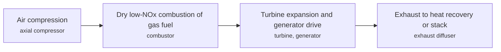

**Key equipment:** axial compressor, dry low-NOx combustor, turbine section, generator, inlet air filtration.

**Performance:**
- 7HA.03 output (60 Hz, simple cycle): 430 MW net; vendor page; simple-cycle range 290 to 430 MW across the 7HA family. [source](https://www.gevernova.com/gas-power/products/gas-turbines/7ha)
- 7HA net combined-cycle efficiency: 63-64 % (vendor basis not stated on page); vendor claim. [source](https://www.gevernova.com/gas-power/products/gas-turbines/7ha)
- 7HA.03 net plant efficiency, 1 on 1: 57.6 % HHV; EPA technical support document table. [source](https://www.epa.gov/system/files/documents/2024-04/tsd-efficient-generation-combustion-turbine-egus-april-2024.pdf)
- M701J/JAC combined-cycle efficiency: 64 % LHV (more than); vendor claim, 1-on-1 plant output 650 to 840 MW. [source](https://power.mhi.com/products/gasturbines/lineup/m701j)
- 7HA hot restart to full gas-turbine load: 10-21 min; 7HA.02 10 min, 7HA.03 21 min. [source](https://www.gevernova.com/gas-power/products/gas-turbines/7ha)
- hydrogen co-firing capability: 30-50 % hydrogen by volume; GE 7HA up to 50%; MHI says 30% demonstrated on M701J. [source](https://www.gevernova.com/gas-power/products/gas-turbines/7ha)

TRL source: [IEA ETP Clean Energy Technology Guide, dataset of 24 July 2026, latest assessment (IEA 1-11 scale): 'H₂ blending in natural gas turbine' 9 (2025)](https://www.iea.org/data-and-statistics/data-tools/etp-clean-energy-technology-guide)

**Missing inputs:**
- installed cost per kW with dollar year (costs): Open vendor pages give no cost; cost databases are commercial. Searched OSTI corpus (25 reports) for "gas turbine", "installed cost", "$/kW", "capital cost", "levelized"; not present; 2026-10-28 Where: Gas Turbine World handbook (paid) (paid); OSTI.GOV full-text reports from DOE labs: search the technology name plus 'techno-economic' (catalog: osti, blocked). Next: Add an open cost figure, for example from an EIA or NREL cost study.
- named plants or projects with capacity and year (reference_plants): The sources read name no specific plant. Web-checked 2026-10-28; H/J-class references exist in OEM case studies behind portal pages; no verifiable open page found (osti corpus checked 2026-10-28, abstracts only). Where: Licensor and operator press releases for the suppliers listed (open). Next: Add one or two plants with country, capacity and start-up year.
- process steps and equipment are general engineering practice, not taken from one source (process): The sources read describe the principle but not a full step-by-step flow. Where: Licensor process descriptions and textbooks (open). Next: Check the steps against a licensor description and name it.

Sources: [1](https://www.gevernova.com/gas-power/products/gas-turbines/7ha), [2](https://power.mhi.com/products/gasturbines/lineup/m701j), [3](https://www.epa.gov/system/files/documents/2024-04/tsd-efficient-generation-combustion-turbine-egus-april-2024.pdf). Last reviewed 2026-10-28.

## Hydropower
<a id="pwr-hydropower"></a>

Water driven through turbines at a dam or run-of-river site generates power; reservoirs add storage. NREL's 2024 baseline gives new-stream-reach development costs of $6,574 to $8,611/kW and non-powered-dam costs of $3,045 to $20,043/kW, with capacity factors of 0.33 to 0.67.

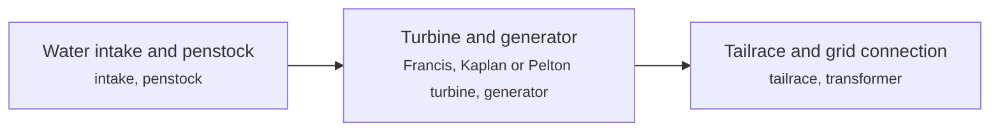

**Key equipment:** dam or weir, penstock, turbine, generator.

**Performance:**
- capacity factor, non-powered dams: 0.333-0.623 fraction; representative plants NPD 1 to 8. [source](https://atb.nrel.gov/electricity/2024/hydropower)
- capacity factor, new stream-reach: 0.624-0.665 fraction; NSD 1 to 4. [source](https://atb.nrel.gov/electricity/2024/hydropower)

**Costs:**
- overnight capital cost, new stream-reach: 6574-8611 USD/kW; base year; dollar year not stated on the page. [source](https://atb.nrel.gov/electricity/2024/hydropower)

**Reference plants:**
- Bakun Hydroelectric Plant, Sarawak, Malaysia (Sarawak Energy), MY: 2,400 MW turbine capacity (installed 2,520 MW per 2026 trade press); commissioned 2011; 205 m concrete-faced rockfill dam; firm energy about 1,771 MW; Southeast Asia's largest hydropower installation; operating. [source](https://www.sarawakenergy.com/bakun-hydroelectric-plant)

TRL source: [IEA ETP Clean Energy Technology Guide, dataset of 24 July 2026, latest assessment (IEA 1-11 scale): 'Hydropower' 9 (2025)](https://www.iea.org/data-and-statistics/data-tools/etp-clean-energy-technology-guide)

**Missing inputs:**
- dollar year for the ATB hydropower costs (costs): The page does not state the dollar year. Web-checked 2026-10-28: the ATB is published at atb.nrel.gov, which is network-blocked from this machine; dollar year to be confirmed from an NREL mirror. Where: NREL ATB documentation (catalog: nrel, open). Next: Confirm the dollar year and add it to the figure.
- process steps and equipment are general engineering practice, not taken from one source (process): The sources read describe the principle but not a full step-by-step flow. Where: Licensor process descriptions and textbooks (open). Next: Check the steps against a licensor description and name it.

Sources: [1](https://atb.nrel.gov/electricity/2024/hydropower), [2](https://www.sarawakenergy.com/bakun-hydroelectric-plant). Last reviewed 2026-10-28.

## Large light-water reactors
<a id="pwr-large-light-water-reactors"></a>

Pressurised and boiling water reactors above 300 MWe use water as coolant and moderator to raise steam for turbines. The World Nuclear Association lists 316 operable PWRs (306.2 GWe) and 60 BWRs (61.0 GWe), with licence extensions to 60 years and sometimes 80 years.

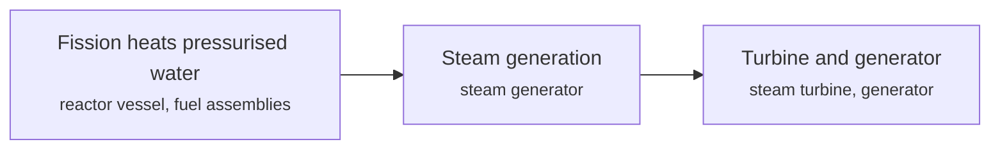

**Key equipment:** reactor pressure vessel, steam generators, primary pumps, containment, turbine generator.

**Performance:**
- operable PWRs worldwide: 316 reactors (306.2 GWe); WNA table, page dated 5 August 2026. [source](https://world-nuclear.org/information-library/nuclear-fuel-cycle/nuclear-power-reactors/nuclear-power-reactors)
- operable BWRs worldwide: 60 reactors (61.0 GWe); WNA table. [source](https://world-nuclear.org/information-library/nuclear-fuel-cycle/nuclear-power-reactors/nuclear-power-reactors)

**Costs:**
- Barakah four-unit plant cost (financing basis) and build time: 4360 USD/kW derived (USD 24.4 bn for 5.6 GW); build time 12 years (2012-2024) (2016$); derived: "The UAE's nuclear energy project has completed a $24.4bn [financing]... four 1,400 megawatt nuclear reactors" (Gulf Business, Oct 2016); 24.4e9 / 5.6e6 = 4,357 USD/kW. Financing-basis figure, not a settled overnight cost; construction ran 2012 to Unit-4 grid connection in March 2024. [source](https://gulfbusiness.com/en/2016/energy/uaes-nuclear-power-project-raises-24-4bn-financing)

**Reference plants:**
- Barakah Nuclear Energy Plant, UAE (ENEC/NAWAH), AE: four APR1400 units, 5.6 GW total, about 25% of UAE electricity; construction from 2012; Unit 4 grid-connected March 2024; ~40 TWh/yr; operating. [source](https://www.world-nuclear-news.org/articles/barakah-4-landmark-announced-as-world-nuclear-symp)

TRL source: [IEA ETP Clean Energy Technology Guide, dataset of 24 July 2026, latest assessment (IEA 1-11 scale): 'Generation III/III+ large reactors' 9 (2025)](https://www.iea.org/data-and-statistics/data-tools/etp-clean-energy-technology-guide)

**Missing inputs:**
- process steps and equipment are general engineering practice, not taken from one source (process): The sources read describe the principle but not a full step-by-step flow. Where: Licensor process descriptions and textbooks (open). Next: Check the steps against a licensor description and name it.

Sources: [1](https://world-nuclear.org/information-library/nuclear-fuel-cycle/nuclear-power-reactors/nuclear-power-reactors), [2](https://gulfbusiness.com/en/2016/energy/uaes-nuclear-power-project-raises-24-4bn-financing). Last reviewed 2026-10-28.

## Lithium-ion battery energy storage
<a id="pwr-lithium-ion-bess"></a>

Lithium-ion cells (mainly LFP for stationary use since 2022) store grid power for short durations. NREL's 2024 baseline uses an 85% round-trip efficiency, 15 year life with augmentation, and projects capex cuts for a 60 MW, 4-hour system of 18, 37 or 52% by 2035.

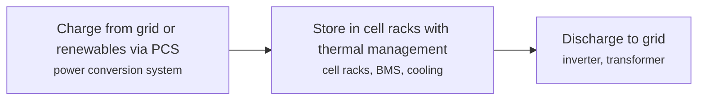

**Key equipment:** battery racks, battery management system, power conversion system, thermal management, fire protection.

**Performance:**
- round-trip efficiency: 85 %; NREL ATB 2024 assumption. [source](https://atb.nrel.gov/electricity/2024/utility-scale_battery_storage)
- design life: 15 years; with augmentation. [source](https://atb.nrel.gov/electricity/2024/utility-scale_battery_storage)
- capex reduction 2022 to 2035, 60 MW 4-hour: 18-52 % (conservative to advanced); moderate 37%. [source](https://atb.nrel.gov/electricity/2024/utility-scale_battery_storage)

**Reference plants:**
- Edwards & Sanborn Solar + Energy Storage project, Kern County, California (Terra-Gen), US: about USD 2 bn project: 875 MW solar PV with 3,287 MWh of lithium-ion battery storage (about 1,300 MW discharge); largest of its kind when completed; first phases from 2021, full operation 2023; operating. [source](https://centralcalifornia.org/solar-energy-project-extending-onto-edwards-air-force-base-becomes-kerns-largest-2)

TRL source: [IEA ETP Clean Energy Technology Guide, dataset of 24 July 2026, latest assessment (IEA 1-11 scale): 'Lithium-ion storage battery' 9 (2025)](https://www.iea.org/data-and-statistics/data-tools/etp-clean-energy-technology-guide)

**Missing inputs:**
- $/kWh and $/kW installed cost with dollar year (costs): The ATB page lists cost only in charts. Where: NREL ATB 2024 data download (catalog: nrel, open). Next: Add base-year system cost with dollar year.
- process steps and equipment are general engineering practice, not taken from one source (process): The sources read describe the principle but not a full step-by-step flow. Where: Licensor process descriptions and textbooks (open). Next: Check the steps against a licensor description and name it.

Sources: [1](https://atb.nrel.gov/electricity/2024/utility-scale_battery_storage). Last reviewed 2026-10-28.

## Mobile gas turbine power plants
<a id="pwr-mobile-gas-turbine-plants"></a>

Aeroderivative gas turbines (LM2500, Industrial Trent 60, FT8, LM6000) packaged on trailers or single-lift skids with generator, enclosure and auxiliaries, so a complete simple-cycle power plant ships by road, sea or air and reaches full load within days to weeks of arrival. Units are fleet-operated for rental bridge power (APR Energy) or sold as packages (GE Vernova TM2500, PROENERGY PE6000), typically 20 to 50 MW each and multipliable to hundreds of MW.

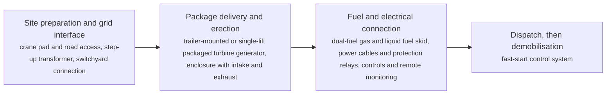

**Key equipment:** aeroderivative gas turbine, generator, trailer or skid package enclosure, step-up transformer, switchgear, dual-fuel system.

**Performance:**
- TM2500 net output at 50 Hz (ISO, natural gas): 34.5-34.6 MW; DLE variant 34.5 MW, SAC variant 34.6 MW net; headline rating up to 37 MW simple cycle. [source](https://www.gevernova.com/gas-power/products/gas-turbines/tm2500)
- TM2500 net efficiency, DLE, 50 Hz: 39.5 %; net LHV on natural gas; SAC variant 34.8%; page headline approximately 40%. [source](https://www.gevernova.com/gas-power/products/gas-turbines/tm2500)
- TM2500 installation time: 14-30 days; about 14 days to install; grid power within 30 days of contract signature; 5-minute start. [source](https://www.gevernova.com/gas-power/products/gas-turbines/tm2500)
- Siemens SGT-A45 TR mobile unit output: up to 44 MW; up to 44 MW, Industrial Trent 60 based, installed in less than two weeks, full power less than 9 minutes from start. [source](https://www.powermag.com/press-releases/siemens-new-44-megawatt-aeroderivative-gas-turbine-for-mobile-power-generation)
- PROENERGY PE6000 gross output: 50.2 MW; gross heat rate 8,800 Btu/kWh; 5-minute start; factory enclosure unloaded in a single lift; 35% hydrogen ready. [source](https://www.proenergyservices.com/solutions/manufactured-equipment/pe6000/)
- APR Energy deployment time: 30-90 days; 30 to 90 days average, some projects in 15 days; 20-35 MW ISO per unit; fleet over 1.1 GW. [source](https://web.archive.org/web/20260715202302/https://www.aprenergy.com/our-technology/gas-turbines/)

**Reference plants:**
- 38 TM2500 units across Algeria, Algeria: 38 units; operating; fleet of more than 350 units installed worldwide. [source](https://www.gevernova.com/gas-power/products/gas-turbines/tm2500)
- SAPN bridge power, South Australia, Australia: 276 MW; APR Energy rapid deployment reference. [source](https://web.archive.org/web/20260715202302/https://www.aprenergy.com/)
- GE TM2500 mobile power for remote Indonesia, ID: TM2500 mobile generators on two-trailer assemblies, more than 25 MW per unit, delivering electricity to Indonesia's remote areas (2016); operating. [source](https://jakartaglobe.id/context/ges-power-plant-wheels-delivers-electricity-indonesias-remote-areas)

**Missing inputs:**
- capital cost per kW and rental day rate, with dollar year and basis (costs): No open source read so far gives costs for mobile gas turbine packages. Web-checked 2026-10-28; rental day rates are quote-only (osti corpus checked, abstracts only). Where: arXiv and open-access journals: techno-economic studies of rental or mobile peaking capacity (catalog: arxiv, open); Vendor quotations and cost databases; paid sources are catalog-only (paid); OSTI.GOV reports; osti.gov is unreachable from this machine (catalog: osti, blocked). Next: Find an open techno-economic study; record each figure with metric, range, unit, dollar year, basis and source.
- deployment sequence is general engineering practice, not taken from one source (process): The vendor pages give timings but not a step-by-step deployment flow. Where: Vendor installation manuals or trade press deployment reports (open). Next: Check the steps against a named source.

Sources: [1](https://www.gevernova.com/gas-power/products/gas-turbines/tm2500), [2](https://www.proenergyservices.com/solutions/manufactured-equipment/pe6000/), [3](https://www.proenergyservices.com/solutions/manufactured-equipment/package/), [4](https://web.archive.org/web/20260715202302/https://www.aprenergy.com/our-technology/gas-turbines/), [5](https://www.powermag.com/press-releases/siemens-new-44-megawatt-aeroderivative-gas-turbine-for-mobile-power-generation), [6](https://www.siemens-energy.com/global/en/home/products-services/product-offerings/gas-turbines.html). Last reviewed 2026-10-28.

## Modular ORC units for waste heat and small geothermal
<a id="pwr-modular-orc-units"></a>

Organic Rankine Cycle modules in the tens of kW to multi-MW range convert heat sources from about 70 to 400 degrees C into electricity using a low-boiling working fluid in a skid- or container-mounted unit. Climeon's HeatPower 300 makes 50-355 kW net from heat as cool as 75 degrees C for ships; Enogia builds 10-180 kWe micro-modules; Exergy supplies plants from 100 kW to 50 MWe around its radial outflow turbine; Turboden and Ormat cover the multi-MW geothermal and industrial market with hundreds of plants installed.

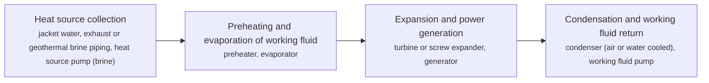

**Key equipment:** evaporator and preheater, expander or radial outflow turbine, generator, condenser, working fluid loop and skid enclosure.

**Performance:**
- Climeon HeatPower 300 net output: 50-355 kW; 50-355 kW net per unit from 1,000-4,500 kW thermal input; heat source as low as 75 degrees C; footprint 5.8 x 2.4 x 2.8 m. [source](https://climeon.com/heatpower-300-technology/)
- Enogia ORC module range: 10-180 kWe; 10, 20, 40, 100 and 180 kWe models; waste heat from 70 degrees C; two pipe connections and one cable. [source](https://www.enogia.com/orc)
- Exergy ORC plant range: 0.1-50 MWe; plants between 100 kW and 50 MWe from heat sources at 80-400 degrees C; radial outflow turbine up to 30 MW and Gemini turbine up to 60 MWe per unit. [source](https://exergyint.com/orc/)
- Turboden installed base: 470 plants; 470+ plants in more than 50 countries, over 1 GWe overall installed capacity; plant sizes grew from 1-2 MWe to 10-20 MWe. [source](https://www.turboden.com/)
- Ormat geothermal fleet: 3200 MW; more than 3,200 MW of geothermal capacity across more than 190 plants, described as modular and flexible. [source](https://www.ormat.com/en/renewables/geothermal/view/?ContentID=89)
- ElectraTherm Power+ Generator output: up to 150 kWe; up to 150 kWe currently available (250 kW in development) from heat sources at 70-150 degrees C. [source](https://electratherm.com/products/)

**Reference plants:**
- Virgin Voyages cruise ships, HeatPower 150, multi-country operation: 900 kW per vessel (six units); in service with Lloyd's Register class approval since 2020. [source](https://climeon.com/references/)
- Maersk Horsburgh retrofit, Denmark (operator): 150 kW; marine retrofit with ABS approval since 2022. [source](https://climeon.com/references/)
- Fervo Energy geothermal order, USA: 300 MWe (largest project named); Turboden homepage names a 300 MWe supply for Fervo Energy. [source](https://www.turboden.com/)

**Missing inputs:**
- installed cost per kW for a modular ORC unit, with dollar year and basis (costs): Vendor pages read do not publish prices. Web-checked 2026-10-28; unit prices are quote-only. Where: arXiv and open-access journals: ORC waste-heat techno-economic reviews (catalog: arxiv, open); IEA and IRENA renewable cost databases (open); MDPI Energies ORC reviews; www.mdpi.com is CDN-blocked, use the manual inbox (catalog: mdpi-energies, blocked). Next: Find an open cost figure; record it with metric, range, unit, dollar year, basis and source.
- TRL with a cited source (trl): The IEA ETP Clean Energy Technology Guide was not re-checked for ORC entries. no open TRL source found (IEA ETP guide checked 2026-10-28; no SETIS/DOE entry). Where: IEA ETP Clean Energy Technology Guide (collected): search for organic Rankine cycle (catalog: iea-reports, open). Next: Find a TRL table entry or leave maturity resting on the evidence on the card.
- modular ORC installation in Southeast Asia (reference_plants): References read are European and North American. Web-checked 2026-10-28 (Indonesian geothermal ORC search hit an MCP error; no verifiable named SEA ORC package found on open pages before the error). Where: Turboden and Exergy reference lists: Indonesian geothermal fields are their natural market (open). Next: Add a Southeast Asian (ideally Indonesian geothermal) reference with capacity and year.
- ORC cycle steps are textbook standard (process): The cycle description follows standard ORC engineering practice rather than one named source. Where: A licensor page or review paper describing the ORC process step by step (open). Next: Check the steps against a named source and cite it.

Sources: [1](https://climeon.com/heatpower-300-technology/), [2](https://climeon.com/references/), [3](https://www.enogia.com/orc), [4](https://exergyint.com/orc/), [5](https://exergyint.com/radial-outflow-turbine/), [6](https://www.turboden.com/), [7](https://www.ormat.com/en/renewables/geothermal/view/?ContentID=89), [8](https://electratherm.com/products/). Last reviewed 2026-10-28.

## Modular reciprocating engine power plants
<a id="pwr-modular-engine-plants"></a>

Power plants built from factory-fabricated modules: an engine, generator and auxiliaries are assembled and tested in a factory enclosure (a genset container or a multi-megawatt power block), shipped complete and bolted together on a prepared foundation, with no site welding. Wärtsilä's Modular Block takes one 34SG generating set per block, Rolls-Royce (mtu) offers factory-tested 10, 20 and 30 MW power blocks for plants of five to several hundred megawatts, and Everllence (formerly MAN Energy Solutions) modularises engine-specific systems for its 51/60 series plants.

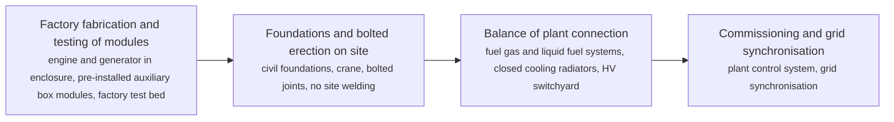

**Key equipment:** gas engine generating set, factory enclosure or power block, auxiliary box modules, cooling radiators, HV switchyard and transformer.

**Performance:**
- Wärtsilä Modular Block output per block: 6-10 MW; one Wärtsilä 34SG generating set per block, 12V/16V/20V configurations; blocks installed side by side. [source](https://www.wartsila.com/insights/article/towards-higher-efficiencies-with-wartsila-modular-block)
- Modular Block erection time: 5 weeks; assembly of a complete block excluding foundations in around five weeks; on-site installation cut from several months to a few weeks. [source](https://www.wartsila.com/insights/article/towards-higher-efficiencies-with-wartsila-modular-block)
- Engine power plant EPC build time: 10 months; notice to proceed to final handover for the 102 MW Dohazari plant in Bangladesh. [source](https://www.wartsila.com/docs/default-source/power-plants-documents/downloads/white-papers/general/wartsila-bwp-combustion-engine-power-plants.pdf)
- mtu modular plant power block sizes: 10-30 MW; factory-tested blocks of 10, 20 and 30 MW; plants grid-connected within 12 to 18 months of ordering. [source](https://www.mtu-solutions.com/na/en/pressreleases/2026/Rolls-Royce-launches-modular-gas-engine-power-plants.html)
- Everllence 51/60 series single-cycle efficiency: 51 % (or more); vendor claim for 200 MW+ baseload plants; combined cycle adds about 4.5 percentage points. [source](https://www.everllence.com/energy/solutions/thermal-power/baseload/)
- Jenbacher Type 6 container rating: 1634-4507 kW; containerised gensets on Type 6 engines, built from two or three pre-assembled modules; Type 2/3/4 containers 249-1,562 kW. [source](https://www.jenbacher.com/en/energy-solutions/containerized-solutions/)

**Reference plants:**
- Dohazari power plant, Bangladesh: 102 MW; delivered in 10 months from notice to proceed to handover. [source](https://www.wartsila.com/docs/default-source/power-plants-documents/downloads/white-papers/general/wartsila-bwp-combustion-engine-power-plants.pdf)
- Texas peaking plant for KPUB, USA: 124 MW; six MAN 18V51/60G engines with prefabricated assemblies; engine delivery 2026, operation 2027. [source](https://www.man-es.com/company/press-releases/press-details/2025/05/22/man-51-60g-engines-bound-for-texas-gas--power-plant)

**Missing inputs:**
- capital cost per kW for a modular engine plant versus a conventional build, with dollar year (costs): No open source read so far gives installed costs for modular engine plants. Where: arXiv and open-access journals: techno-economic studies of engine power plants (catalog: arxiv, open); Wärtsilä investor and annual reports may carry $/kW averages (open); OSTI.GOV reports; osti.gov is unreachable from this machine (catalog: osti, blocked). Next: Find an open installed-cost figure; record it with metric, range, unit, dollar year, basis and source.
- TRL with a cited source (trl): The IEA ETP Clean Energy Technology Guide was not re-checked for this entry. Where: IEA ETP Clean Energy Technology Guide (collected): search for reciprocating engine power plants (catalog: iea-reports, open). Next: Find a TRL table entry or leave maturity resting on the evidence on the card.
- deployment sequence is generalised from vendor descriptions (process): Wärtsilä's page describes the Modular Block assembly; the full flow is standard practice, not one named source. Where: Vendor EPC brochures or an engineering contractor's project description (open). Next: Check the steps against a named EPC or licensor description.

Sources: [1](https://www.wartsila.com/insights/article/towards-higher-efficiencies-with-wartsila-modular-block), [2](https://www.wartsila.com/media/news/13-06-2019-wartsila-launches-modular-solution-for-providing-ready-to-go-power-plants-3086905), [3](https://www.wartsila.com/docs/default-source/power-plants-documents/downloads/white-papers/general/wartsila-bwp-combustion-engine-power-plants.pdf), [4](https://www.mtu-solutions.com/na/en/pressreleases/2026/Rolls-Royce-launches-modular-gas-engine-power-plants.html), [5](https://www.everllence.com/energy/solutions/thermal-power/baseload/), [6](https://www.jenbacher.com/en/energy-solutions/containerized-solutions/). Last reviewed 2026-10-28.

## Offshore wind (fixed bottom)
<a id="pwr-offshore-wind-fixed"></a>

Large turbines on monopile or jacket foundations in water shallower than 60 m, connected by export cables or HVDC links. NREL's 2024 baseline representative turbine is rated 12 MW with a 216 m rotor and 137 m hub height; near-term costs are higher than earlier projections.

```mermaid
flowchart LR
    TURB["Turbine generates AC<br/><small>12 MW class turbine</small>"]
    ARR["Inter-array cables to an offshore substation<br/><small>inter-array cables, offshore substation</small>"]
    EXP["Export cable to shore, AC or HVDC<br/><small>export cable, HVDC converter</small>"]
    TURB --> ARR
    ARR --> EXP
```

**Key equipment:** turbine, monopile or jacket foundation, inter-array cables, offshore substation, export cable.

**Performance:**
- representative turbine rating: 12 MW; 216 m rotor, 137 m hub height, base year. [source](https://atb.nrel.gov/electricity/2024/offshore_wind)
- capex learning rate, fixed bottom: 6.3-11.2 % per doubling; conservative to advanced scenario. [source](https://atb.nrel.gov/electricity/2024/offshore_wind)

**Reference plants:**
- Hornsea 2 offshore wind farm, UK North Sea (Orsted), GB: 1.3 GW (165 turbines x 8 MW), world's largest offshore wind farm at full commissioning on 31 Aug 2022; powers about 1.4 million UK homes; operating. [source](https://offshorewind.biz/2022/08/31/worlds-largest-offshore-wind-farm-goes-into-operation)

TRL source: [IEA ETP Clean Energy Technology Guide, dataset of 24 July 2026, latest assessment (IEA 1-11 scale): 'Seabed fixed offshore wind turbine' 9 (2025)](https://www.iea.org/data-and-statistics/data-tools/etp-clean-energy-technology-guide)

**Missing inputs:**
- installed cost $/kW and capacity factor with dollar year (costs): The ATB page shows year-specific values only in interactive charts. Where: NREL ATB 2024 data download (catalog: nrel, open); IRENA Renewable Power Generation Costs (catalog: irena, open). Next: Download the ATB dataset and record the 2022 base cost with its dollar year.
- process steps and equipment are general engineering practice, not taken from one source (process): The sources read describe the principle but not a full step-by-step flow. Where: Licensor process descriptions and textbooks (open). Next: Check the steps against a licensor description and name it.

Sources: [1](https://atb.nrel.gov/electricity/2024/offshore_wind). Last reviewed 2026-10-28.

## Onshore wind
<a id="pwr-onshore-wind"></a>

Horizontal-axis turbines on land convert wind to electricity through a rotor, gearbox or direct-drive generator and a power converter. The IEA Clean Energy Technology Guide rates onshore wind TRL 9. The DOE market report page was not reachable, so figures on turbine size and cost are not yet on this card.

```mermaid
flowchart LR
    ROT["Rotor turns in the wind<br/><small>blades, hub</small>"]
    GEN["Generator and converter<br/><small>gearbox or direct drive, converter</small>"]
    GRID["Collection system and substation<br/><small>transformer, cables</small>"]
    ROT --> GEN
    GEN --> GRID
```

**Key equipment:** rotor, nacelle with generator, tower, converter, foundation.

**Costs:**
- global weighted-average utility-scale onshore wind cost: 1210 USD/kW installed (2018), average LCOE 0.056 USD/kWh (2018$); IRENA, Renewable Power Generation Costs in 2018: utility-scale onshore wind installed costs fell 13% to USD 1,210/kW in 2018 (2018 USD); weighted-average LCOE USD 0.056/kWh. [source](https://www.actu-environnement.com/media/pdf/news-33524-rapport.pdf)

TRL source: [IEA ETP Clean Energy Technology Guide, dataset of 24 July 2026, latest assessment (IEA 1-11 scale): 'Onshore wind' 9 (2025)](https://www.iea.org/data-and-statistics/data-tools/etp-clean-energy-technology-guide)

**Missing inputs:**
- turbine ratings, capacity factors and installed cost with dollar year (performance): The DOE land-based wind market report page returned an error and the NREL ATB land-based wind page is blocked by robots.txt. Where: [DOE Land-Based Wind Market Report](https://www.energy.gov/eere/wind/land-based-wind-market-reports-2025-edition) (open); IRENA Renewable Power Generation Costs (catalog: irena, open). Next: Fetch a reachable edition and add figures with their year.
- named plants or projects with capacity and year (reference_plants): The sources read name no specific plant. Web-checked 2026-10-28; ubiquitous technology, no single verifiable deployment added (Gobi/Mongolia farms exist but were not this pass). Where: Licensor and operator press releases for the suppliers listed (open). Next: Add one or two plants with country, capacity and start-up year.
- process steps and equipment are general engineering practice, not taken from one source (process): The sources read describe the principle but not a full step-by-step flow. Where: Licensor process descriptions and textbooks (open). Next: Check the steps against a licensor description and name it.

Sources: [1](https://www.iea.org/data-and-statistics/data-tools/etp-clean-energy-technology-guide), [2](https://www.actu-environnement.com/media/pdf/news-33524-rapport.pdf). Last reviewed 2026-10-28.

## Powerships and power barges
<a id="pwr-powerships-power-barges"></a>

A complete engine or gas-turbine power plant is installed on a ship hull or barge, moored at a port or prepared basin and connected to the onshore grid through a switchyard, so a country adds 30 to 470 MW of capacity in weeks without land acquisition or construction. Karpowership operates the largest fleet (45 powerships, 8,500 MW installed across 20+ countries); vendors such as Power Barge Corporation and Wärtsilä deliver barge-mounted plants from 30 MW gas-turbine barges to 180 MW medium-speed-engine barges, and an estimated 75 or more power barges operate worldwide.

```mermaid
flowchart LR
    PREP["Berth and basin preparation<br/><small>mooring dolphins or quay wall, dredged berth</small>"]
    MOOR["Arrival and mooring of the vessel<br/><small>powership hull or barge, mooring lines</small>"]
    CONNECT["Fuel and grid connection<br/><small>fuel receiving (HFO, distillate or LNG), export cable to onshore substation, step-up transformers</small>"]
    GENERATE["Generation and dispatch to the grid<br/><small>reciprocating engines or gas turbines, onboard generators and switchgear, plant control room</small>"]
    PREP --> MOOR
    MOOR --> CONNECT
    CONNECT --> GENERATE
```

**Key equipment:** self-propelled or towed power barge hull, reciprocating engines or gas turbines, onboard switchgear and export cable, fuel storage and transfer system, mooring system.

**Performance:**
- Karpowership fleet size and capacity: 8500 MW installed; 45 powerships, 8,500 MW installed, 20+ countries, 12 LNG vessels; expansion target 21,000 MW. [source](https://karpowership.com)
- Powership class capacity range: 34-470 MW; Seal class 34-40 MW up to Khan class 415-470 MW; intermediate Orca 200-260, Shark 110-240, Mermaid 70-80. [source](https://karpowership.com/powership-classes-and-fleet/)
- Powership deployment time: 30 days; vendor claim: commissioned in under 30 days; grid connection in weeks, not years. [source](https://karpowership.com/the-powership-solution/)
- Waller Marine Tacoa barges: 171 MW; two barges of 171 MW each, one GE 7FA dual-fuel turbine per barge, in a prepared basin at Tacoa, Venezuela. [source](https://www.marinelink.com/news/waller-marine-installs-floating-power-generation-barges-venezuela-338083)
- Power Barge Corporation product range: 30-300 MW; gas-turbine barges 30-300 MW (simple and combined cycle); medium-speed-engine barges 80-200 MW on gas, diesel, biodiesel or low-sulphur HFO. [source](https://powerbargecorp.com)
- Wärtsilä power barge for Jamaica: 50 MW; repeat order for a 50 MW barge with three Wärtsilä 18V46 generating sets. [source](https://www.wartsila.com/energy/engine-power-plant-solutions/engine-power-plant-products/applications/floating-power-plants)

**Reference plants:**
- Estrella del Mar II, Dominican Republic: ; Wärtsilä floating power plant reference. [source](https://www.wartsila.com/energy/engine-power-plant-solutions/engine-power-plant-products/applications/floating-power-plants)
- DR Bird I and II, Jamaica: 50 MW (new unit); Wärtsilä power barges; repeat order for a third 50 MW barge with three 18V46 sets. [source](https://www.wartsila.com/energy/engine-power-plant-solutions/engine-power-plant-products/applications/floating-power-plants)
- Tacoa floating power barges, supplying Caracas, Venezuela: 2 x 171 MW; installed by Waller Marine in a prepared basin. [source](https://www.marinelink.com/news/waller-marine-installs-floating-power-generation-barges-venezuela-338083)
- Karpowership Indonesia floating power plants with PAL Indonesia shipyard cooperation, ID: Karpowership Indonesia operates floating power plants; cooperation agreement with state shipbuilder PAL Indonesia to build power ships for Indonesia (2016); per-ship capacity not stated in the source; operating. [source](https://www.thejakartapost.com/news/2016/10/28/karpowership-pal-to-build-power-ships-to-light-up-indonesia)

**Missing inputs:**
- charter rate or levelised cost per MWh for a powership, with dollar year and basis (costs): Operator and packager pages read do not publish prices. Web-checked 2026-10-28; charter rates are contract-confidential. Where: arXiv and open-access journals: techno-economic studies of powership or barge-mounted generation (catalog: arxiv, open); Regulator filings, for example South Africa NERSA hearings on Karpowership tariffs (open). Next: Find an open cost figure; record it with metric, range, unit, dollar year, basis and source.
- operating powership or barge in Southeast Asia with capacity (reference_plants): Karpowership lists Indonesia among its operating countries, but the pages read give no Indonesian capacity or vessel name. Karpowership/PAL Indonesia reference added (2016); a verifiable per-ship MW figure for a SEA powership was not found, 2026-10-28. Where: Karpowership reference lists and Indonesian PLN procurement announcements (open). Next: Add a Southeast Asian reference with vessel name, capacity and years.
- connection sequence is generalised from vendor claims (process): Vendor pages state 'weeks, not years' but do not document the step-by-step connection process. Where: Port authority or regulator case documents for a specific powership project (open). Next: Check the steps against a named project document.

Sources: [1](https://karpowership.com), [2](https://karpowership.com/the-powership-solution/), [3](https://karpowership.com/powership-classes-and-fleet/), [4](https://karpowership.com/lng-to-power/), [5](https://www.marinelink.com/news/waller-marine-installs-floating-power-generation-barges-venezuela-338083), [6](https://powerbargecorp.com), [7](https://gcaptain.com/power-barge-corporation-announces-new-medium-speed-engine-power-barge-design), [8](https://www.wartsila.com/energy/engine-power-plant-solutions/engine-power-plant-products/applications/floating-power-plants), [9](https://en.wikipedia.org/wiki/Powership). Last reviewed 2026-10-28.

## Pumped hydro storage
<a id="pwr-pumped-hydro-storage"></a>

Water is pumped to an upper reservoir when power is cheap and released through turbines when needed. NREL's 2024 baseline uses 80% round-trip efficiency (literature range 70 to 87%) and 8, 10 or 12 hour durations; US capacity was about 23 GW in 2021.

```mermaid
flowchart LR
    PUMP["Pump water uphill<br/><small>reversible pump-turbine</small>"]
    UP["Store in upper reservoir<br/><small>reservoir</small>"]
    GEN["Release through turbine<br/><small>pump-turbine, generator</small>"]
    PUMP --> UP
    UP --> GEN
```

**Key equipment:** upper and lower reservoirs, reversible pump-turbine, tunnels and penstocks, motor-generator.

**Performance:**
- round-trip efficiency: 80 %; literature range 70 to 87%. [source](https://atb.nrel.gov/electricity/2024/pumped_storage_hydropower)
- US deployed capacity: 23 GW; 2021 base year. [source](https://atb.nrel.gov/electricity/2024/pumped_storage_hydropower)

**Costs:**
- overnight capital cost, 10 h, closed loop: 3029-4501 USD/kW (2021$); median by resource class 1 to 15. [source](https://atb.nrel.gov/electricity/2024/pumped_storage_hydropower)
- overnight capital cost, 10 h, one new reservoir: 1730-3250 USD/kW (2021$); median by resource class 1 to 5. [source](https://atb.nrel.gov/electricity/2024/pumped_storage_hydropower)

**Reference plants:**
- Fengning Pumped Storage Power Station, Hebei, China (Grid Corporation), CN: world's most powerful pumped storage station: 3,600 MW installed (12 units), designed to generate 6.61 billion kWh/yr; fully operational December 2024; operating. [source](https://english.news.cn/20241231/bfa9e1c920f34e0194978ad9706f8d0f/c.html)

TRL source: [IEA ETP Clean Energy Technology Guide, dataset of 24 July 2026, latest assessment (IEA 1-11 scale): 'Pumped storage' 9 (2025)](https://www.iea.org/data-and-statistics/data-tools/etp-clean-energy-technology-guide)

**Missing inputs:**
- process steps and equipment are general engineering practice, not taken from one source (process): The sources read describe the principle but not a full step-by-step flow. Where: Licensor process descriptions and textbooks (open). Next: Check the steps against a licensor description and name it.

Sources: [1](https://atb.nrel.gov/electricity/2024/pumped_storage_hydropower). Last reviewed 2026-10-28.

## Smart grids, microgrids and virtual power plants
<a id="pwr-smart-grids-vpp"></a>

Software and communications aggregate distributed solar, batteries, flexible loads and generators so they dispatch like one power plant and provide reserves within seconds to minutes. North American VPP capacity was estimated at 37.5 GW in 2025.

```mermaid
flowchart LR
    AGG["Aggregate distributed resources<br/><small>IoT gateways, aggregation platform</small>"]
    DISP["Dispatch to market or grid operator<br/><small>market interface, control software</small>"]
    AGG --> DISP
```

**Key equipment:** aggregation software, smart meters, gateways, communications.

**Performance:**
- North American VPP capacity: 37.5 GW; 2025. [source](https://en.wikipedia.org/wiki/Virtual_power_plant)
- AGL South Australia VPP: 25-37 MW solar and MW storage; 2025 programme size after AGL acquisition. [source](https://en.wikipedia.org/wiki/Virtual_power_plant)

TRL source: [IEA ETP Clean Energy Technology Guide, dataset of 24 July 2026, latest assessment (IEA 1-11 scale): 'Virtual power plants' 9 (2025)](https://www.iea.org/data-and-statistics/data-tools/etp-clean-energy-technology-guide)

**Missing inputs:**
- microgrid examples for oil and gas operations (performance): Wikipedia covers VPPs only. Web-checked 2026-10-28; O&G microgrid case studies are vendor-published without verifiable figures. Where: Operator microgrid case studies (open). Next: Add an oil and gas microgrid reference.
- capital cost and operating or unit cost, with dollar year and basis (costs): No open source read so far gives costs for this technology. Web-checked 2026-10-28; no open cost figures. Where: arXiv and open-access journals: techno-economic or review papers (MDPI is blocked by its CDN; use the manual inbox) (catalog: arxiv, open); Licensor and EPC studies; paid cost databases are catalog-only (paid); OSTI.GOV full-text reports from DOE labs: search the technology name plus 'techno-economic' (catalog: osti, blocked). Next: Look for an open techno-economic study; record each figure with metric, range, unit, dollar year, basis and source.
- named plants or projects with capacity and year (reference_plants): The sources read name no specific plant. Web-checked 2026-10-28; no verifiable named O&G microgrid with figures found. Where: Licensor and operator press releases for the suppliers listed (open). Next: Add one or two plants with country, capacity and start-up year.
- process steps and equipment are general engineering practice, not taken from one source (process): The sources read describe the principle but not a full step-by-step flow. Where: Licensor process descriptions and textbooks (open). Next: Check the steps against a licensor description and name it.

Sources: [1](https://en.wikipedia.org/wiki/Virtual_power_plant). Last reviewed 2026-10-28.

## Ammonia co-firing in coal boilers
<a id="pwr-ammonia-coal-cofiring"></a>

Ammonia is injected through burners into a pulverised-coal boiler to replace part of the coal. JERA and IHI ran 20% ammonia substitution (by heat) at the 1 GW Unit 4 of Hekinan, Japan, from 1 April to 26 June 2024 with NOx no higher than coal alone and SOx down 20%.

```mermaid
flowchart LR
    NH3["Ammonia receipt, storage and vaporisation<br/><small>ammonia tank, vaporiser</small>"]
    BURN["Ammonia burners alongside coal burners<br/><small>ammonia burner</small>"]
    BOIL["Boiler, steam turbine and flue gas treatment<br/><small>boiler, SCR, FGD</small>"]
    NH3 --> BURN
    BURN --> BOIL
```

**Key equipment:** ammonia storage and vaporiser, ammonia burners, boiler, flue gas treatment.

**Performance:**
- ammonia substitution ratio, heat basis: 20 %; Hekinan Unit 4, 1 GW rated output. [source](https://www.jera.co.jp/en/news/notice/20240626_1954)
- SOx change with 20% ammonia: -20 %; versus coal alone. [source](https://www.jera.co.jp/en/news/notice/20240626_1954)
- CO2 change with 20% ammonia: -20 %; IHI reports about 20% lower CO2; the JERA notice gives no CO2 figure. [source](https://www.ihi.co.jp/en/all_news/2024/resources_energy_environment/1200954_13691.html)

**Reference plants:**
- JERA Hekinan Thermal Power Station Unit 4 ammonia co-firing demonstration, Aichi, Japan (with IHI), JP: 1 GW coal unit; world's first large-scale demonstration of 20% (by heating value) fuel-ammonia substitution; three-month trial concluded June 2024 with positive results; pilot. [source](https://www.hydrocarbonprocessing.com/news/2024/06/jera-ends-ammonia-co-firing-trial-at-coal-power-station-with-positive-results)

TRL source: [IEA ETP Clean Energy Technology Guide, dataset of 24 July 2026, latest assessment (IEA 1-11 scale): 'Co-firing of ammonia in coal power plants' 8 (2025)](https://www.iea.org/data-and-statistics/data-tools/etp-clean-energy-technology-guide)

**Missing inputs:**
- fuel ammonia cost and conversion capex (costs): Press releases give no cost. Web-checked 2026-10-28; JERA/IHI published combustion results, not fuel-cost or capex figures. Where: NEDO and METI Green Innovation Fund documents (catalog: meti-japan, open). Next: Add cost per tonne of ammonia and retrofit capex with year.
- process steps and equipment are general engineering practice, not taken from one source (process): The sources read describe the principle but not a full step-by-step flow. Where: Licensor process descriptions and textbooks (open). Next: Check the steps against a licensor description and name it.

Sources: [1](https://www.jera.co.jp/en/news/notice/20240626_1954), [2](https://www.ihi.co.jp/en/all_news/2024/resources_energy_environment/1200954_13691.html), [3](https://www.hydrocarbonprocessing.com/news/2024/06/jera-ends-ammonia-co-firing-trial-at-coal-power-station-with-positive-results). Last reviewed 2026-10-28.

## Compressed and liquid air energy storage
<a id="pwr-compressed-liquid-air-storage"></a>

Air is compressed (CAES) into a cavern or vessel, or liquefied (LAES), and later expanded through a turbine; advanced designs store the compression heat to avoid burning gas. Hydrostor's Willow Rock project in California is 500 MW and 4,000 MWh (8+ hours) of advanced CAES with a 50+ year design life.

```mermaid
flowchart LR
    COMP["Compress air using surplus power, storing the heat<br/><small>compressors, thermal store</small>"]
    CAV["Store air in cavern or tank<br/><small>cavern</small>"]
    EXP["Expand air with stored heat through turbine<br/><small>expander, generator</small>"]
    COMP --> CAV
    CAV --> EXP
```

**Key equipment:** compressors, thermal store, air cavern or tank, expander and generator.

**Performance:**
- Willow Rock power: 500 MW; late-stage development. [source](https://www.hydrostor.ca/willow-rock/)
- Willow Rock energy: 4000 MWh; 8+ hours. [source](https://www.hydrostor.ca/willow-rock/)

**Reference plants:**
- Huntorf CAES (Germany, 1978) and McIntosh CAES (Alabama, USA, 1991), DE: Huntorf: world's first CAES plant, 290 MW (1978); McIntosh: 110 MW salt-cavern CAES storing air in a 19-million-cubic-foot cavern (1991); operating. [source](https://www.nytimes.com/1991/09/29/business/technology-using-compressed-air-to-store-up-electricity.html)

TRL source: [IEA ETP Clean Energy Technology Guide, dataset of 24 July 2026, latest assessment (IEA 1-11 scale): 'Compressed air energy storage' 9 (2025); 'Liquid air energy storage' 7 (2025)](https://www.iea.org/data-and-statistics/data-tools/etp-clean-energy-technology-guide)

**Missing inputs:**
- round-trip efficiency and Highview Carrington data (performance): Highview's site blocks automated reading and Hydrostor's page gives no efficiency. Where: [Highview Power project pages](https://highview-power.com/) (open). Next: Add efficiency and MWh for operating projects.
- capital cost and operating or unit cost, with dollar year and basis (costs): No open source read so far gives costs for this technology. Web-checked 2026-10-28; Huntorf/McIntosh capex not stated in open pages read. Where: arXiv and open-access journals: techno-economic or review papers (MDPI is blocked by its CDN; use the manual inbox) (catalog: arxiv, open); Licensor and EPC studies; paid cost databases are catalog-only (paid); OSTI.GOV full-text reports from DOE labs: search the technology name plus 'techno-economic' (catalog: osti, blocked). Next: Look for an open techno-economic study; record each figure with metric, range, unit, dollar year, basis and source.
- process steps and equipment are general engineering practice, not taken from one source (process): The sources read describe the principle but not a full step-by-step flow. Where: Licensor process descriptions and textbooks (open). Next: Check the steps against a licensor description and name it.

Sources: [1](https://www.hydrostor.ca/willow-rock/). Last reviewed 2026-10-28.

## Enhanced geothermal systems
<a id="pwr-enhanced-geothermal"></a>

Engineers create or enhance permeability in hot dry rock with hydraulic stimulation and horizontal drilling borrowed from oil and gas, so a circulating fluid can carry heat to a surface plant. NREL's 2024 baseline lists near-field EGS flash at 6,535 USD/kW and deep EGS binary at 13,508 USD/kW (dollar year not stated).

```mermaid
flowchart LR
    DRILL["Drill injector and producer wells into hot rock<br/><small>directional drilling</small>"]
    STIM["Stimulate fractures to link the wells<br/><small>hydraulic stimulation</small>"]
    CIRC["Circulate fluid and generate power<br/><small>surface plant, ORC or flash</small>"]
    DRILL --> STIM
    STIM --> CIRC
```

**Key equipment:** horizontal wells, stimulation equipment, surface power plant, downhole monitoring.

**Performance:**
- EGS plant size, moderate scenario: 40 MWe; advanced scenario 100 MWe. [source](https://atb.nrel.gov/electricity/2024/geothermal)

**Costs:**
- overnight capital cost, near-field EGS to deep EGS: 6535-13508 USD/kW; NF-EGS flash 6,535 to deep EGS binary 13,508; dollar year not stated (base year 2022). [source](https://atb.nrel.gov/electricity/2024/geothermal)

TRL source: [IEA ETP Clean Energy Technology Guide, dataset of 24 July 2026, latest assessment (IEA 1-11 scale): 'Enhanced geothermal systems' 7 (2025); 'Closed-loop geothermal systems' 6 (2025)](https://www.iea.org/data-and-statistics/data-tools/etp-clean-energy-technology-guide)

**Missing inputs:**
- Fervo Cape Station phases, MW and dates (reference_plants): Fervo's Cape Station page carried only a tagline. Where: [Fervo Energy newsroom](https://fervoenergy.com/newsroom) (open). Next: Add MW, start-up date and drilling-cost trend.
- process steps and equipment are general engineering practice, not taken from one source (process): The sources read describe the principle but not a full step-by-step flow. Where: Licensor process descriptions and textbooks (open). Next: Check the steps against a licensor description and name it.

Sources: [1](https://atb.nrel.gov/electricity/2024/geothermal). Last reviewed 2026-10-25.

## Floating offshore wind
<a id="pwr-floating-offshore-wind"></a>

Turbines on floating spar, semi-submersible or barge hulls moored in water deeper than 60 m. Equinor's Hywind Tampen has 11 turbines of 8.6 MW (94.6 MW) in 260 to 300 m of water and meets about 35% of the annual electricity demand of five Snorre and Gullfaks platforms.

```mermaid
flowchart LR
    FLT["Floating hull and mooring<br/><small>spar or semi-submersible, mooring lines</small>"]
    TURB["Turbine generates power<br/><small>wind turbine</small>"]
    CAB["Dynamic cables to platforms or shore<br/><small>dynamic cable</small>"]
    FLT --> TURB
    TURB --> CAB
```

**Key equipment:** floating hull, mooring and anchors, turbine, dynamic cable.

**Performance:**
- Hywind Tampen capacity: 94.6 MW; 11 turbines of 8.6 MW. [source](https://www.equinor.com/energy/hywind-tampen)
- Hywind Tampen share of platform demand: 35 % of annual electricity demand of Snorre A, B and Gullfaks A, B, C; higher in strong wind. [source](https://www.equinor.com/energy/hywind-tampen)
- demonstration floating project capex before 2030: 10000 USD/kW (may exceed); US demonstration-scale projects; dollar year not stated. [source](https://atb.nrel.gov/electricity/2024/offshore_wind)

**Costs:**
- Hywind Tampen project cost: 488-550 million USD (about NOK 5 bn) (2020$); dollar year not stated (2019-2020 estimates); "The Hywind Tampen investment will be close to NOK 5 billion ($488 million)" (Maritime Executive, Apr 2020); USD 550 m figure at FID (Oct 2019 reports); NOK 2.3 bn Enova grant support. [source](https://maritime-executive.com/article/wind-farm-to-power-offshore-platforms-gains-approval)

**Reference plants:**
- Hywind Tampen floating wind farm, North Sea (Equinor), NO: 88 MW, 11 floating turbines, world's largest floating wind farm; first power 13 Nov 2022; powers Snorre and Gullfaks oil and gas platforms; operating. [source](https://jpt.spe.org/equinor-announces-first-power-from-hywind-tampen-wind-farm)

TRL source: [IEA ETP Clean Energy Technology Guide, dataset of 24 July 2026, latest assessment (IEA 1-11 scale): 'Floating offshore wind turbine' 8 (2025)](https://www.iea.org/data-and-statistics/data-tools/etp-clean-energy-technology-guide)

**Missing inputs:**
- process steps and equipment are general engineering practice, not taken from one source (process): The sources read describe the principle but not a full step-by-step flow. Where: Licensor process descriptions and textbooks (open). Next: Check the steps against a licensor description and name it.

Sources: [1](https://www.equinor.com/energy/hywind-tampen), [2](https://atb.nrel.gov/electricity/2024/offshore_wind), [3](https://maritime-executive.com/article/wind-farm-to-power-offshore-platforms-gains-approval). Last reviewed 2026-10-28.

## Gravity energy storage
<a id="pwr-gravity-storage"></a>

Heavy blocks or masses are lifted when power is cheap and lowered to drive generators. The IEA guide rates gravity storage (excluding pumped hydro) at TRL 7. Energy Vault's current website describes only battery-based projects, so no gravity data could be sourced.

```mermaid
flowchart LR
    LIFT["Motor lifts masses<br/><small>crane or shaft hoist, motor</small>"]
    HOLD["Hold at height<br/><small>stacked blocks</small>"]
    LOWER["Lower masses to generate<br/><small>generator</small>"]
    LIFT --> HOLD
    HOLD --> LOWER
```

**Key equipment:** hoist, masses, motor-generator, control system.

TRL source: [IEA ETP Clean Energy Technology Guide, dataset of 24 July 2026, latest assessment (IEA 1-11 scale): 'Gravity-based storage (excluding pumped hydro)' 7 (2025)](https://www.iea.org/data-and-statistics/data-tools/etp-clean-energy-technology-guide)

**Missing inputs:**
- Rudong, China gravity project details (reference_plants): The Energy Vault page read does not mention gravity storage. Where: Energy Vault investor filings (open). Next: Add MWh, efficiency and status from a filing.
- key performance figures (energy use, yields, capture or conversion rate) (performance): No source read so far gives performance figures. Web-checked 2026-10-28; vendor round-trip claims only, no independent figures. Where: Supplier datasheets and brochures for the companies listed on the card (open); arXiv and open-access journals: techno-economic or review papers (MDPI is blocked by its CDN; use the manual inbox) (catalog: arxiv, open); OSTI.GOV full-text reports from DOE labs: search the technology name plus 'techno-economic' (catalog: osti, blocked). Next: Add the figures that matter for comparing options, each with its basis and source.
- capital cost and operating or unit cost, with dollar year and basis (costs): No open source read so far gives costs for this technology. Web-checked 2026-10-28; no open cost figures. Where: arXiv and open-access journals: techno-economic or review papers (MDPI is blocked by its CDN; use the manual inbox) (catalog: arxiv, open); Licensor and EPC studies; paid cost databases are catalog-only (paid); OSTI.GOV full-text reports from DOE labs: search the technology name plus 'techno-economic' (catalog: osti, blocked). Next: Look for an open techno-economic study; record each figure with metric, range, unit, dollar year, basis and source.
- process steps and equipment are general engineering practice, not taken from one source (process): The sources read describe the principle but not a full step-by-step flow. Where: Licensor process descriptions and textbooks (open). Next: Check the steps against a licensor description and name it.

Sources: [1](https://www.energyvault.com/). Last reviewed 2026-10-28.

## Hydrogen-capable and ammonia-fired gas turbines
<a id="pwr-hydrogen-ammonia-turbines"></a>

Gas turbines burn natural gas blended with hydrogen, and developers are working toward pure hydrogen and ammonia. Mitsubishi Power has run a 30% hydrogen blend on an M501JAC and supplied two M501JAC units (about 840 MW) to the Intermountain Power Project in Utah with a 100% hydrogen target by 2045; GE says its 7HA can burn up to 50% hydrogen.

```mermaid
flowchart LR
    H2["Hydrogen supply and blending with natural gas<br/><small>blending skid, storage</small>"]
    COMB["Combustion in a modified or multi-cluster combustor<br/><small>hydrogen-capable combustor</small>"]
    TURB["Turbine and generator<br/><small>gas turbine, generator</small>"]
    H2 --> COMB
    COMB --> TURB
```

**Key equipment:** hydrogen-capable combustor, fuel blending skid, gas turbine, hydrogen storage and supply.

**Performance:**
- hydrogen blend at IPP Renewed start-up: 30 % hydrogen with natural gas; two M501JAC, about 840 MW; 100% hydrogen target by 2045. [source](https://www.turbomachinerymag.com/view/mitsubishi-power-delivers-30-hydrogen-fuel-gas-turbines-to-ipp-renewed-project-in-utah)
- 7HA hydrogen capability: 50 % hydrogen (vendor claim); pathway stated to 100%. [source](https://www.gevernova.com/gas-power/products/gas-turbines/7ha)
- 30% hydrogen co-firing combustion results, JAC gas turbine at T-Point 2 (grid-connected validation): 30 % hydrogen by volume in the fuel (demonstrated); Mitsubishi Power, 30 Nov 2023: world's first operation of an advanced-class gas turbine with 30% hydrogen co-firing at the grid-connected T-Point 2 validation plant, Takasago; low NOx and stable combustion achieved (manufacturer-reported); a numeric NOx ppm value was not stated in the open release. [source](https://power.mhi.com/news/231130.html)

**Reference plants:**
- T-Point 2 validation plant with Takasago Hydrogen Park, Japan (Mitsubishi Power), JP: JAC advanced-class gas turbine validated in commercial configuration; world's first grid-connected 30% hydrogen co-firing demonstration (Nov 2023); Takasago Hydrogen Park supplies on-site hydrogen across the value chain; operating. [source](https://power.mhi.com/news/231130.html)

TRL source: [IEA ETP Clean Energy Technology Guide, dataset of 24 July 2026, latest assessment (IEA 1-11 scale): 'H₂ blending in natural gas turbine' 9 (2025); 'Pure h₂ gas turbine' 8 (2025); 'Co-firing of ammonia in gas turbines' 5 (2025)](https://www.iea.org/data-and-statistics/data-tools/etp-clean-energy-technology-guide)

**Missing inputs:**
- cost of hydrogen-ready turbine and conversion (costs): None of the pages read gives a cost. Web-checked 2026-10-28; OEM premium/conversion prices are quote-only. Where: Mitsubishi Power and GE Vernova project announcements (open). Next: Add conversion cost with a dollar year if a project disclosure exists.
- process steps and equipment are general engineering practice, not taken from one source (process): The sources read describe the principle but not a full step-by-step flow. Where: Licensor process descriptions and textbooks (open). Next: Check the steps against a licensor description and name it.

Sources: [1](https://www.turbomachinerymag.com/view/mitsubishi-power-delivers-30-hydrogen-fuel-gas-turbines-to-ipp-renewed-project-in-utah), [2](https://www.power-eng.com/hydrogen/mitsubishi-power-highlights-four-hydrogen-projects/), [3](https://www.turbomachinerymag.com/view/mitsubishi-power-executes-30-hydrogen-fuel-blend-in-jac-gas-turbine), [4](https://www.gevernova.com/gas-power/products/gas-turbines/7ha), [5](https://power.mhi.com/news/231130.html). Last reviewed 2026-10-28.

## Microreactors (transportable nuclear)
<a id="pwr-microreactors"></a>

Very small nuclear reactors, roughly 1 to 75 MWe, that are fabricated and fuelled in a factory, shipped complete in standard containers and installed on a small site, running for years without on-site refuelling. Designs use heat pipes (Westinghouse eVinci, 5 MWe), high-temperature gas cooling with TRISO fuel (BWXT BANR, 75 MWt) or liquid-metal fast cooling on HALEU (Oklo Aurora, up to 75 MWe). No commercial unit operates yet: the eVinci test reactor reached criticality in September 2026, and Oklo targets commercial operation at Idaho National Laboratory in 2028.

```mermaid
flowchart LR
    FAB["Factory fabrication and fuel loading<br/><small>reactor module, TRISO or metal fuel, conversion equipment (turbine generator or heat exchangers)</small>"]
    TRANSPORT["Container transport to site<br/><small>standard shipping containers, road, rail or barge transport</small>"]
    SITE["Site installation and activation<br/><small>small reinforced pad (under 2 acres for eVinci), heat sink or air cooling, grid or load connection</small>"]
    OPERATE["Multi-year operation, then core return<br/><small>autonomous control system, used-core shipping container</small>"]
    FAB --> TRANSPORT
    TRANSPORT --> SITE
    SITE --> OPERATE
```

**Key equipment:** microreactor core (heat-pipe, HTGR or fast), TRISO or HALEU metal fuel, power conversion unit, transport and used-fuel containers, autonomous control system.

**Performance:**
- Westinghouse eVinci output: 5 MWe; 5 MWe from a 15 MWth heat-pipe core; TRISO fuel at 19.75% enrichment; 8+ full-power years before refuelling; transportable in shipping containers by rail, barge and truck. [source](https://www.westinghousenuclear.com/energy-systems/evinci-microreactor)
- eVinci test reactor criticality: 663 degrees C; reached criticality at 663 degrees C on 3 September 2026 at NCERC, Nevada (DOE ARDP funded); peak core temperature 1,011 degrees C. [source](https://www.energy.gov/ne/articles/westinghouse-evinci-microreactor-achieves-criticality-milestone)
- BWXT BANR output: 75 MWt; 75 MWt (22 MWe) high-temperature gas reactor on TRISO fuel at 19.75% enrichment; selected for a Canadian transportable nuclear power plant at Belledune with service targeted in the early 2030s. [source](https://www.bwxt.com/sectors/nuclear-energy/smrs-microreactors/bwxt-advanced-nuclear-reactor-banr)
- Oklo Aurora maximum output: up to 75 MWe; liquid-metal-cooled, metal-fuelled fast reactor, maximum power level 75 MWe (NRC pre-application docket 99902095); first plant at Idaho National Laboratory forecast to begin commercial operations in 2028. [source](https://www.nrc.gov/facilities-safety/new-reactors/advanced-reactors/who-were-working-with/pre-application-activities/oklo-aurora-powerhouse)
- HolosGen Holos Quad output: 3-13 MWe; scalable 3-13 MWe from subcritical modules in ISO shipping containers; 3-5 MWe units airliftable; Quad Titan up to 81 MWe. [source](https://holosgen.com/)

**Missing inputs:**
- capital cost per kW and electricity price under a build-own-operate contract, with dollar year (costs): Developer pages do not publish prices; Oklo sells power rather than reactors but no figure was read. Where: arXiv and open-access journals: microreactor techno-economic analyses (catalog: arxiv, open); US DOE and Idaho National Laboratory cost studies; DOE sites reachable via energy.gov mirrors (open); OSTI.GOV reports; osti.gov is unreachable from this machine (catalog: osti, blocked). Next: Find an open techno-economic study; record each figure with metric, range, unit, dollar year, basis and source.
- TRL with a cited source (trl): The IEA ETP Clean Energy Technology Guide has no separate microreactor entry; SMR entries cover larger units. Where: IEA ETP Clean Energy Technology Guide (collected): check the SMR entry's scope (catalog: iea-reports, open). Next: Decide whether the IEA SMR entry covers microreactors, or leave maturity resting on the evidence on the card.
- licensing and deployment milestones are moving fast (status): Milestones read on 26 October 2026 (eVinci criticality, Oklo 2028 target, Belledune early 2030s) will age quickly. Checked Google News and Bing News for NRC, DOE and developer news on 2026-10-28; no licensing or deployment milestone after 26 October 2026 found for eVinci, Oklo Aurora or BWXT (an Environment+Energy Leader item dated 26 October 2026 reports DOE approval of the Oklo Aurora-INL safety analysis under the DOE pilot programme, within the same-day window already reviewed). Where: NRC and DOE news pages, developer newsrooms (open). Next: Re-check statuses quarterly and update this card.
- transport and installation sequence is generalised from vendor claims (process): Vendor pages state transportability but not a documented installation procedure. Where: NRIC DOME test-bed documentation and future eVinci deployment filings (open). Next: Check the steps against a named licensing or test-bed document.

Sources: [1](https://www.westinghousenuclear.com/energy-systems/evinci-microreactor), [2](https://info.westinghousenuclear.com/news/westinghouse-evinci-test-reactor-first-to-receive-approval-for-preliminary-safety-design-report), [3](https://www.energy.gov/ne/articles/westinghouse-evinci-microreactor-achieves-criticality-milestone), [4](https://www.bwxt.com/sectors/nuclear-energy/smrs-microreactors/bwxt-advanced-nuclear-reactor-banr), [5](https://www.bwxt.com/bwxts-banr-microreactor-chosen-for-canadian-transportable-nuclear-power-plant-project), [6](https://www.bwxt.com/sectors/defense-space/land), [7](https://www.nrc.gov/facilities-safety/new-reactors/advanced-reactors/who-were-working-with/pre-application-activities/oklo-aurora-powerhouse), [8](https://oklo.com/business-lines/power), [9](https://holosgen.com/), [10](https://www.nanonuclearenergy.com). Last reviewed 2026-10-28.

## Small modular reactors
<a id="pwr-small-modular-reactors"></a>

Reactors generally 300 MWe or less (microreactors under 20 MWe), built in factories and installed in modules. The World Nuclear Association page read names project Pele (1 to 10 MWe, TRISO fuel completed November 2025) but does not describe NuScale, BWRX-300 or Rolls-Royce SMR.

```mermaid
flowchart LR
    FAB["Factory fabrication of modules<br/><small>module factory</small>"]
    INST["Site installation and fuelling<br/><small>reactor module</small>"]
    OP["Steam or heat to turbine, process or desalination<br/><small>steam generator, turbine</small>"]
    FAB --> INST
    INST --> OP
```

**Key equipment:** reactor module, steam generator, containment, turbine.

**Reference plants:**
- Darlington BWRX-300, Ontario (OPG / GE Hitachi), CA: 300 MWe BWRX-300; OPG received construction approval April 2025 - first grid-scale SMR under construction in a G7 country; CAD 7.7 bn project; construction. [source](https://pro.smrbrief.com/projects/darlington-bwrx-300)

TRL source: [IEA ETP Clean Energy Technology Guide, dataset of 24 July 2026, latest assessment (IEA 1-11 scale): 'Water-cooled SMR' 7 (2025)](https://www.iea.org/data-and-statistics/data-tools/etp-clean-energy-technology-guide)

**Missing inputs:**
- key performance figures (energy use, yields, capture or conversion rate) (performance): No source read so far gives performance figures. Web-checked 2026-10-28; vendor design figures already on card; no independent operating data (no operating SMR yet in Western markets). Where: Supplier datasheets and brochures for the companies listed on the card (open); arXiv and open-access journals: techno-economic or review papers (MDPI is blocked by its CDN; use the manual inbox) (catalog: arxiv, open); OSTI.GOV full-text reports from DOE labs: search the technology name plus 'techno-economic' (catalog: osti, blocked). Next: Add the figures that matter for comparing options, each with its basis and source.
- capital cost and operating or unit cost, with dollar year and basis (costs): No open source read so far gives costs for this technology. Web-checked 2026-10-28: Darlington BWRX-300 project at CAD 7.7 bn recorded in reference_plants (four-unit programme); per-kW derived cost not stated in the source. Where: arXiv and open-access journals: techno-economic or review papers (MDPI is blocked by its CDN; use the manual inbox) (catalog: arxiv, open); Licensor and EPC studies; paid cost databases are catalog-only (paid); OSTI.GOV full-text reports from DOE labs: search the technology name plus 'techno-economic' (catalog: osti, blocked). Next: Look for an open techno-economic study; record each figure with metric, range, unit, dollar year, basis and source.
- process steps and equipment are general engineering practice, not taken from one source (process): The sources read describe the principle but not a full step-by-step flow. Where: Licensor process descriptions and textbooks (open). Next: Check the steps against a licensor description and name it.

Sources: [1](https://world-nuclear.org/information-library/nuclear-fuel-cycle/nuclear-power-reactors/small-nuclear-power-reactors). Last reviewed 2026-10-28.

## Sodium-ion batteries
<a id="pwr-sodium-ion-batteries"></a>

Sodium replaces lithium in the cathode and electrolyte chemistry, avoiding lithium and cobalt. CATL launched its Naxtra sodium-ion line in April 2025 at 175 Wh/kg; HiNa products run 140 to 155 Wh/kg.

```mermaid
flowchart LR
    CELL["Manufacture sodium-ion cells<br/><small>cell line</small>"]
    PACK["Assemble packs for vehicles or storage<br/><small>pack line, BMS</small>"]
    CELL --> PACK
```

**Key equipment:** sodium-ion cells, battery management system, pack.

**Performance:**
- energy density, CATL Naxtra: 175 Wh/kg; versus about 185 Wh/kg for LFP; secondary source. [source](https://en.wikipedia.org/wiki/Sodium-ion_battery)
- cycle life claim, CATL Naxtra: 10000 cycles; vendor claim relayed by a secondary source. [source](https://en.wikipedia.org/wiki/Sodium-ion_battery)

**Reference plants:**
- Fulin Sodium-ion Battery Energy Storage Station, Nanning, Guangxi (China Southern Power Grid / HiNa Battery), CN: China's first large-scale sodium-ion BESS; first phase 10 MWh entered operation 11 May 2024; 42 battery containers and 21 PCS units at full build-out (1 July 2024 completion reported); operating. [source](https://electrek.co/2024/05/17/china-first-large-scale-sodium-ion-battery)

TRL source: [IEA ETP Clean Energy Technology Guide, dataset of 24 July 2026, latest assessment (IEA 1-11 scale): 'Sodium-ion storage battery' 9 (2025)](https://www.iea.org/data-and-statistics/data-tools/etp-clean-energy-technology-guide)

**Missing inputs:**
- primary-source specifications (performance): Figures come from a Wikipedia summary of vendor claims. Where: CATL and HiNa technical announcements (open). Next: Replace with vendor datasheets.
- capital cost and operating or unit cost, with dollar year and basis (costs): No open source read so far gives costs for this technology. Web-checked 2026-10-28; pack prices not published in open sources. Where: arXiv and open-access journals: techno-economic or review papers (MDPI is blocked by its CDN; use the manual inbox) (catalog: arxiv, open); Licensor and EPC studies; paid cost databases are catalog-only (paid); OSTI.GOV full-text reports from DOE labs: search the technology name plus 'techno-economic' (catalog: osti, blocked). Next: Look for an open techno-economic study; record each figure with metric, range, unit, dollar year, basis and source.
- process steps and equipment are general engineering practice, not taken from one source (process): The sources read describe the principle but not a full step-by-step flow. Where: Licensor process descriptions and textbooks (open). Next: Check the steps against a licensor description and name it.

Sources: [1](https://en.wikipedia.org/wiki/Sodium-ion_battery). Last reviewed 2026-10-28.

## Thermal energy storage (molten salt, sand, bricks)
<a id="pwr-thermal-energy-storage"></a>

Electricity or renewable heat is stored as sensible heat in salts, sand or refractory brick and released as steam or process heat. Rondo's heat battery stores in brick at 1,100 to 1,500 °C and claims over 98% electricity-to-heat efficiency; a 360 MWh unit is for the Rio Tinto Yarwun alumina refinery in Australia.

```mermaid
flowchart LR
    CHG["Resistive heating of storage medium<br/><small>heating elements</small>"]
    STORE["Insulated storage of hot medium<br/><small>brick, sand or salt store</small>"]
    OUT["Discharge heat as steam or hot air<br/><small>steam generator or heat exchanger</small>"]
    CHG --> STORE
    STORE --> OUT
```

**Key equipment:** storage medium, heating elements, insulation, steam generator or heat exchanger.

**Performance:**
- Rondo storage temperature: 1100-1500 °C; refractory brick. [source](https://rondo.com/)
- Rondo electricity-to-heat efficiency: 98 % (over); vendor claim. [source](https://rondo.com/)
- Yarwun project storage: 360 MWh; Rio Tinto alumina refinery, Australia. [source](https://rondo.com/)

**Reference plants:**
- Polar Night Energy sand batteries: Kankaanpaeae (Vatajankoski) and Pornainen, Finland, FI: Kankaanpaeae: world's first commercial sand battery, 100 kW heating power / 8 MWh, in commercial use since mid-2022; Pornainen: 1 MW / 100 MWh, world's largest, in operation 2025; operating. [source](https://evertiq.com/news/2025-07-01-worlds-largest-sand-battery-now-in-operation-in-finland)

TRL source: [IEA ETP Clean Energy Technology Guide, dataset of 24 July 2026, latest assessment (IEA 1-11 scale): 'Molten salts storage' 8 (2025); 'Sand thermal battery' 8 (2025)](https://www.iea.org/data-and-statistics/data-tools/etp-clean-energy-technology-guide)

**Missing inputs:**
- capital cost and operating or unit cost, with dollar year and basis (costs): No open source read so far gives costs for this technology. Web-checked 2026-10-28; Polar Night Energy has not published plant capex. Where: arXiv and open-access journals: techno-economic or review papers (MDPI is blocked by its CDN; use the manual inbox) (catalog: arxiv, open); Licensor and EPC studies; paid cost databases are catalog-only (paid); OSTI.GOV full-text reports from DOE labs: search the technology name plus 'techno-economic' (catalog: osti, blocked). Next: Look for an open techno-economic study; record each figure with metric, range, unit, dollar year, basis and source.
- process steps and equipment are general engineering practice, not taken from one source (process): The sources read describe the principle but not a full step-by-step flow. Where: Licensor process descriptions and textbooks (open). Next: Check the steps against a licensor description and name it.

Sources: [1](https://rondo.com/), [2](https://polarnightenergy.com/). Last reviewed 2026-10-28.

## Advanced reactors (high-temperature gas, molten salt)
<a id="pwr-advanced-reactors"></a>

Generation IV concepts cool with helium, molten salt, sodium or lead for higher outlet temperatures and process heat. The WNA page says HTGRs use helium at up to 950 °C and TRISO fuel stable to 1,600 °C, and describes China's HTR-PM at Shidaowan (210 MWe from two 105 MWe modules, 750 °C outlet, about 40% efficiency) as a demonstration plant under construction when the page was written.

```mermaid
flowchart LR
    CORE["Fission heats helium, salt or liquid metal<br/><small>reactor core, TRISO or molten-salt fuel</small>"]
    HX["Heat exchanger to steam or process<br/><small>intermediate heat exchanger</small>"]
    USE["Power generation or industrial heat<br/><small>turbine or process heat user</small>"]
    CORE --> HX
    HX --> USE
```

**Key equipment:** reactor core, primary coolant system, heat exchanger, TRISO fuel (HTGR).

**Performance:**
- HTR-PM demonstration size: 210 MWe; two 250 MWt modules; steam at 566 °C. [source](https://world-nuclear.org/information-library/nuclear-fuel-cycle/nuclear-power-reactors/advanced-nuclear-power-reactors)
- HTGR helium coolant temperature: 950 °C (up to); general HTGR statement. [source](https://world-nuclear.org/information-library/nuclear-fuel-cycle/nuclear-power-reactors/advanced-nuclear-power-reactors)

**Reference plants:**
- HTR-PM demonstration plant, Shidaowan, China (CNNC/Huaneng/Tsinghua), CN: world's first high-temperature gas-cooled reactor pebble-bed module plant; two 105 MWe reactor modules; grid-connected December 2021, commercial operation from December 2023; 750 C core-outlet helium, 566 C steam; operating. [source](https://en.cnnc.com.cn/searchen.html?searchText=HTGR)

TRL source: [IEA ETP Clean Energy Technology Guide, dataset of 24 July 2026, latest assessment (IEA 1-11 scale): 'High-temperature gas-cooled SMR' 8 (2025); 'Molten salt SMR' 4 (2025)](https://www.iea.org/data-and-statistics/data-tools/etp-clean-energy-technology-guide)

**Missing inputs:**
- capital cost and operating or unit cost, with dollar year and basis (costs): No open source read so far gives costs for this technology. Web-checked 2026-10-28; no open unit cost for Gen-IV demonstration plants (HTR-PM costs not published; US projects pre-FEED). Where: arXiv and open-access journals: techno-economic or review papers (MDPI is blocked by its CDN; use the manual inbox) (catalog: arxiv, open); Licensor and EPC studies; paid cost databases are catalog-only (paid); OSTI.GOV full-text reports from DOE labs: search the technology name plus 'techno-economic' (catalog: osti, blocked). Next: Look for an open techno-economic study; record each figure with metric, range, unit, dollar year, basis and source.
- process steps and equipment are general engineering practice, not taken from one source (process): The sources read describe the principle but not a full step-by-step flow. Where: Licensor process descriptions and textbooks (open). Next: Check the steps against a licensor description and name it.

Sources: [1](https://world-nuclear.org/information-library/nuclear-fuel-cycle/nuclear-power-reactors/advanced-nuclear-power-reactors), [2](https://www.world-energy.org/article/19854.html). Last reviewed 2026-10-28.

## Perovskite and tandem solar cells
<a id="pwr-perovskite-tandem"></a>

A perovskite layer is added on top of a silicon cell (tandem) or used alone to capture more of the spectrum than silicon can. NREL's 2024 baseline assumes advanced-scenario modules sit midway between TOPCon/SHJ and tandem technology. The Oxford PV page read did not carry current tandem efficiency or shipment data.

```mermaid
flowchart LR
    DEP["Deposit perovskite layers on a silicon or glass substrate<br/><small>coating and deposition tools</small>"]
    MOD["Encapsulate into a module<br/><small>laminator</small>"]
    DEP --> MOD
```

**Key equipment:** perovskite deposition line, silicon bottom cell, encapsulation.

**Reference plants:**
- Oxford PV perovskite-on-silicon tandem line, Brandenburg an der Havel, Germany, DE: world's first commercial shipment of perovskite-tandem solar modules to a customer (5 Sep 2024); production modules 24.5% efficiency (up to 20% more energy than silicon); record 28.6% commercial-size cell (2024); operating. [source](https://pv-magazine-usa.com/2024/09/05/oxford-pv-starts-commercial-distribution-of-perovskite-solar-modules)

TRL source: [IEA ETP Clean Energy Technology Guide, dataset of 24 July 2026, latest assessment (IEA 1-11 scale): 'Perovskite thin film' 6 (2025)](https://www.iea.org/data-and-statistics/data-tools/etp-clean-energy-technology-guide)

**Missing inputs:**
- certified cell and module efficiency records with dates (performance): NREL's efficiency chart page and the Oxford PV page carry no values in text. Where: NREL research cell efficiency chart data file (catalog: nrel, open); Oxford PV press releases (open). Next: Download the NREL data file and record tandem and silicon records with dates.
- capital cost and operating or unit cost, with dollar year and basis (costs): No open source read so far gives costs for this technology. Web-checked 2026-10-28; tandem module prices not yet published in volume. Where: arXiv and open-access journals: techno-economic or review papers (MDPI is blocked by its CDN; use the manual inbox) (catalog: arxiv, open); Licensor and EPC studies; paid cost databases are catalog-only (paid); OSTI.GOV full-text reports from DOE labs: search the technology name plus 'techno-economic' (catalog: osti, blocked). Next: Look for an open techno-economic study; record each figure with metric, range, unit, dollar year, basis and source.
- process steps and equipment are general engineering practice, not taken from one source (process): The sources read describe the principle but not a full step-by-step flow. Where: Licensor process descriptions and textbooks (open). Next: Check the steps against a licensor description and name it.

Sources: [1](https://atb.nrel.gov/electricity/2024/utility-scale_pv), [2](https://www.oxfordpv.com/). Last reviewed 2026-10-28.

## Tidal and wave energy
<a id="pwr-tidal-wave"></a>

Turbines or oscillating devices capture tidal streams and waves. Orbital Marine's 2 MW O2 floating tidal turbine is anchored in the Fall of Warness at the European Marine Energy Centre, Orkney, and feeds the local grid by subsea cable.

```mermaid
flowchart LR
    CAP["Device captures tidal or wave energy<br/><small>turbine rotors or wave converter</small>"]
    GEN["Generator and power conversion<br/><small>generator</small>"]
    CAB["Subsea cable to shore<br/><small>export cable</small>"]
    CAP --> GEN
    GEN --> CAB
```

**Key equipment:** turbine or converter, mooring, subsea cable.

**Performance:**
- O2 rated capacity: 2 MW; anchored at EMEC Fall of Warness. [source](https://www.orbitalmarine.com/o2/)

**Reference plants:**
- La Rance tidal barrage, France, FR: 240 MW (24 x 10 MW bulb turbines), commissioned 1966, the world's first large tidal-range power station, still in full operation; operating. [source](https://www.researchgate.net/publication/229648846_POWER_FROM_TIDES-_THE_RANCE_TIDAL_POWER_STATION)
- MeyGen tidal stream array, Pentland Firth, Scotland (SAE Renewables), GB: phase 1 tidal stream array; more than 91 GWh generated over seven-plus years of operation; supporting a 59 MW commercial-scale development; operating. [source](https://www.directorstalkinterviews.com/meygen-strengthens-the-case-for-scalable-tidal-power/4121247469)

TRL source: [IEA ETP Clean Energy Technology Guide, dataset of 24 July 2026, latest assessment (IEA 1-11 scale): 'Tidal stream (ocean current energy)' 6 (2025); 'Wave energy converters (wave energy)' 6 (2025)](https://www.iea.org/data-and-statistics/data-tools/etp-clean-energy-technology-guide)

**Missing inputs:**
- capital cost and operating or unit cost, with dollar year and basis (costs): No open source read so far gives costs for this technology. Web-checked 2026-10-28; MeyGen LCOE estimates vary and no settled open figure found. Where: arXiv and open-access journals: techno-economic or review papers (MDPI is blocked by its CDN; use the manual inbox) (catalog: arxiv, open); Licensor and EPC studies; paid cost databases are catalog-only (paid); OSTI.GOV full-text reports from DOE labs: search the technology name plus 'techno-economic' (catalog: osti, blocked). Next: Look for an open techno-economic study; record each figure with metric, range, unit, dollar year, basis and source.
- process steps and equipment are general engineering practice, not taken from one source (process): The sources read describe the principle but not a full step-by-step flow. Where: Licensor process descriptions and textbooks (open). Next: Check the steps against a licensor description and name it.

Sources: [1](https://www.orbitalmarine.com/o2/). Last reviewed 2026-10-28.

## Fusion
<a id="pwr-fusion"></a>

Fusion would release energy by joining light nuclei, using magnetic confinement (tokamak, stellarator) or inertial confinement. NIF achieved ignition in December 2022 and a record 8.6 MJ yield in April 2025; ITER now plans research operation in 2034 and deuterium-tritium operation in 2039, and no fusion plant has delivered electricity.

```mermaid
flowchart LR
    HEAT["Heat and confine plasma<br/><small>magnets or lasers, heating systems</small>"]
    BLAN["Neutrons heat a lithium blanket that breeds tritium<br/><small>blanket</small>"]
    POW["Heat to steam cycle<br/><small>heat exchanger, turbine</small>"]
    HEAT --> BLAN
    BLAN --> POW
```

**Key equipment:** superconducting magnets or lasers, vacuum vessel, blanket and divertor, tritium plant.

**Performance:**
- NIF record yield: 8.6 MJ; April 2025. [source](https://world-nuclear.org/information-library/current-and-future-generation/nuclear-fusion-power)
- ITER plasma thermal output target: 500 MW for at least 400 s; heating input under 50 MW; no electricity generated. [source](https://world-nuclear.org/information-library/current-and-future-generation/nuclear-fusion-power)

**Costs:**
- ITER project cost (construction and operations, evolving): 15-22 billion EUR (estimates; EU share EUR 5.61 bn approved to 2027); dollar year n/a — euro figures. NucNet (May 2018): EUR 15 bn project; S&P Global (Feb 2021): European Council agreed EUR 5.61 bn EU funding to 2027; 2024 re-baseline reported adding about EUR 5 bn and about ten years. Commercial fusion plant costs do not exist yet. [source](https://www.spglobal.com/energy/en/news-research/latest-news/crude-oil/022221-european-council-agrees-eur561-billion-funding-for-iter-fusion-project)

**Reference plants:**
- ITER, Cadarache, France (35-nation collaboration), FR: tokamak designed for 500 MW fusion power (ten times the input heating); European Council approved EUR 5.61 bn EU funding to 2027 (Feb 2021); first plasma had been expected December 2025 before the 2024 schedule re-baseline added years and about EUR 5 bn; NIF (US) demonstrated fusion ignition December 2022; construction. [source](https://www.spglobal.com/energy/en/news-research/latest-news/crude-oil/022221-european-council-agrees-eur561-billion-funding-for-iter-fusion-project)

TRL source: [IEA ETP Clean Energy Technology Guide, dataset of 24 July 2026, latest assessment (IEA 1-11 scale): 'Magnetic confinement fusion: tokamaks' 3 (2025); 'Fusion energy (general entry)' 3 (2025)](https://www.iea.org/data-and-statistics/data-tools/etp-clean-energy-technology-guide)

**Missing inputs:**
- process steps and equipment are general engineering practice, not taken from one source (process): The sources read describe the principle but not a full step-by-step flow. Where: Licensor process descriptions and textbooks (open). Next: Check the steps against a licensor description and name it.

Sources: [1](https://world-nuclear.org/information-library/current-and-future-generation/nuclear-fusion-power). Last reviewed 2026-10-28.
