# PWR technology options

41 technologies, from commercial to lab stage. Generated from catalog/technologies/; every figure links to its source.

| Technology | Category | Maturity | TRL | Suppliers | Cost figures |
| --- | --- | --- | --- | --- | --- |
| [Aeroderivative and industrial gas turbines](#pwr-aeroderivative-turbines) | Gas-fired power | commercial |  | Baker Hughes (LM6000, LM9000); GE Vernova (LM2500, LM2500XPRESS, LM6000); Solar Turbines (Titan, Taurus, Mars industrial turbines); Siemens Energy (SGT-A35, SGT-A65 aeroderivatives); JEREH (SGT-A05 aeroderivative genset packages (Jereh Distributed Energy); packaging and distribution of FTAI's Mod-1 CFM56 gensets via the J&F Power Systems joint venture) | overnight capital cost, aeroderivative simple cycle: 1606 USD per kW (2023$) |
| [Biomass and waste-to-energy](#pwr-biomass-waste-to-energy) | Biomass and waste | commercial | 9 | Hitachi Zosen Inova (now Kanadevia Inova) (waste-to-energy plants); Babcock & Wilcox (biomass and waste boilers) | capital cost of the Dubai Waste Management Centre waste-to-energy plant: 1 billion USD project cost (1.9 Mt/yr waste processing) (2023$) |
| [Cogeneration and combined heat and power](#pwr-cogeneration-chp) | Gas-fired power | commercial | 9 | Solar Turbines (Titan and Taurus CHP packages); Siemens Energy (industrial gas turbine CHP); Wärtsilä (engine CHP); JEREH (CHP and distributed energy investment, construction and O&M on Jenbacher/Waukesha gensets (Jereh Distributed Energy)) | installed cost, gas-turbine CHP: 1248-3281 USD/kW (2013$) |
| [Combined cycle and HRSG](#pwr-combined-cycle-hrsg) | Gas-fired power | commercial |  | GE Vernova (HA combined-cycle plants); Siemens Energy (combined-cycle plants and HRSGs); Mitsubishi Heavy Industries (Mitsubishi Power) (GTCC plants) | total overnight cost, combined cycle single-shaft: 1086 USD/kW (2025$)<br>total overnight cost, combined cycle multi-shaft: 1032 USD/kW (2025$)<br>total overnight cost, combined cycle with 95% carbon capture: 2824 USD/kW (2025$) |
| [Concentrated solar power with storage](#pwr-concentrated-solar-power) | Solar | commercial | 9 | Abengoa (CSP plants); SolarReserve (tower plants (company later closed)); Cosin (CSP plants) | capital cost, base year: 7912 USD/kWe (2022$) |
| [Containerised hybrid power modules (solar, storage, gensets)](#pwr-containerised-hybrid-modules) | Modular power plants | commercial |  | Aggreko (hybrid power plants (relocatable solar + Y.Cube BESS + gensets) on rental or BOOM contracts); BoxPower (MegaBox, AutoBox and MiniBox containerised microgrids, 5 kW to 20 MW+); Bredenoord (Mobile Solar Plant (23 kWp fold-out) with Smart Power Bank battery and backup genset); SolarContainer (fold-out PV container, up to 140 kWp); PR Power (TRIME solar hybrid generators (15-24 kVA class), Australian rental and distribution) |  |
| [Crystalline silicon PV (PERC, TOPCon, HJT)](#pwr-crystalline-silicon-pv) | Solar | commercial | 9 | LONGi (HJT and back-contact modules); Jinko Solar (TOPCon modules); Trina Solar (TOPCon modules); JA Solar (modules) | overnight capital cost: 1.56 USD/Wac (2023$) |
| [Floating solar](#pwr-floating-solar) | Solar | commercial | 9 | Sungrow (floating PV systems); Ciel & Terre (Hydrelio floats) | total capital cost, floating PV: 1.18 USD per Wp (2022$) |
| [Flow batteries (vanadium, zinc-bromine)](#pwr-flow-batteries) | Electrochemical storage | commercial | 9 | Rongke Power (vanadium flow); Invinity Energy Systems (vanadium flow) | installed cost, vanadium redox flow battery: 446 USD per kWh (2024$) |
| [Gas engine generator power plant equipment and facilities — supply-chain evidence (7 units, SESB 132/33/11 kV)](#pwr-geg-plant-wbs-supply-chain) | Gas engine power plant EPC | commercial |  | Supplier not identified in sources read (WBS line item); Wärtsilä Corporation; PT Pembangunan Perumahan (Persero) Tbk (PT PP); EPV Energy Ltd; Kenya Electricity Generating Company Limited (KenGen); Tsavo Power Company Limited; Clarke Energy (authorised distributor and service provider in 27 countries); SynCraft (Jenbacher J412 customer/project partner); Stadtwerke Kiel (190 MW J920 CHP project owner); Rolls-Royce Power Systems (MTU brand); IAC Acoustics (UK Ltd / IAC World); Rolls-Royce / mtu solutions; Johnson Matthey (EU and Asia applications enquiries listed on page); Camfil; Donaldson Company, Inc.; Kohler Power Systems (Kohler Energy); Umicore; Johnson Matthey Catalysts Germany GmbH; Daikin Refrigeration Malaysia Sdn. Bhd., Banting, Selangor, Malaysia; Dunham-Bush (Malaysia and regional operations); T.D. Williamson, LLC (Tulsa, OK, USA); Preferred Utilities Manufacturing Corp., Danbury, CT, USA; Preferred Utilities Manufacturing Corp.; Roben Mfg., Inc. (Lakewood, NJ, USA); Atlantic Containment LLC (McGaheysville, VA, USA); Prismecs (OEM-agnostic EPCM/O&M provider, Houston, TX); PIPECO Tanks Malaysia (Pelabuhan Klang, Selangor, Malaysia); Alfa Laval (Malaysia site alfalaval.my; product OFPX 517); Ruhrpumpen Group; Tornatech (controllers); Clarke (C18 diesel engine); HADETEC (Nijkerk, Netherlands; member of Rootselaar Group); Comair (Shanghai, China); nano-purification solutions Asia Pacific (Singapore); HADETEC (Nijkerk, Netherlands; Rootselaar Group); Aerodyn Group Malaysia (Shah Alam and Labuan); Pneumatech; ELGI; Quincy; SPX Jemaco | Price — Total capital cost, 4 x 5.6 MW natural-gas reciprocating engine (RICE) plant, 21.4 MW net: 3.8727e+07 USD (2019$)<br>Price — Overnight capital cost per kW net, 4 x 5.6 MW natural-gas RICE plant: 1810 USD/kW (2019$)<br>Price — Engines and associated auxiliaries, owner-furnished from engine OEM (4 x 5.6 MW case): 1.1974e+07 USD (2019$)<br>Price — Total installed cost, industrial natural gas reciprocating engine 1,000 kW, year 2015: 1899 USD/kW (2015$)<br>Price — Total installed cost, industrial natural gas reciprocating engine 1,000 kW, year 2020: 2105 USD/kW (2020$)<br>Price — Total installed cost, industrial natural gas reciprocating engine 3,000 kW, year 2015: 1742 USD/kW (2015$)<br>Price — Total installed cost, industrial natural gas reciprocating engine 3,000 kW, year 2020: 1931 USD/kW (2020$)<br>Price — Exhaust gas treatment capital cost (representative lean-burn gas engine CHP, systems 2-5 in Table 2-4): 150-750 $/kW (2013 dollars, USD as printed) (2013$)<br>Price — SCR with oxidation catalyst and CEMS capital-cost increment, lean-burn reciprocating-engine CHP: 150-700 $/kW (2013 dollars, USD as printed) (2013$)<br>Price — SCR total project cost per kW, 500 MW oil/gas-fired boiler IPM example (NOT a gas-engine figure — printed scope retained for comparison): 127-135 $/kW (2021 dollars, USD; EPA IPM methodology February 2023) (2021$)<br>Price — ASME B31.1-2026 Power Piping standard list price (print book or PDF): 450 $450.00 (USD as printed, 2026 edition) (2026$)<br>Price — reference price, 1 ton single girder overhead crane: 1830-5100 USD (2025$)<br>Price — reference price, 5 ton single girder overhead crane: 3130-8680 USD (2025$)<br>Price — reference price, 10 ton single girder overhead crane: 3890-12000 USD (2025$)<br>Price — reference price, 5t LH-type double girder crane with hoist trolley: 15600-29500 USD (2025$)<br>Price — reference price, 10t LH-type double girder crane with hoist trolley: 17200-32500 USD (2025$)<br>Price — reference price, 20t/5t LH-type double girder crane: 25500-45900 USD (2025$)<br>Price — reference price, 50t/10t LH-type double girder crane: 49500-72000 USD (2025$)<br>Price — reference price, 100t/20t LH-type double girder crane: 115000-166700 USD (2025$)<br>Price — reference price, manual single girder overhead crane 1 ton: 840-1800 USD (2025$)<br>Price — typical automation system delivery order value (not the disclosed SESB order value): 1e+06-3e+06 EUR<br>Price — IEC 62052-11:2020 electronic standard list price: 405 CHF<br>Price — Lighting point, PVC cable in conduit (switch separate): 85 RM/point<br>Price — MCB single pole up to 32A: 32 RM/no<br>Price — Insulation and continuity test, single-phase DB: 719 RM/no<br>Price — EPC contract value, 132/33/11 kV Star1 & Star2 substation incl. GIS building: 1.83e+08 AED<br>Price — Reinforced concrete C16/20 in foundations and floor: 492.1 RM/m3<br>Price — Reinforced concrete C16/20 in beams: 634.4 RM/m3<br>Price — Reinforced concrete C16/20 in columns: 663.6 RM/m3<br>Price — Reinforced concrete C16/20 floor slab, average 75 mm: 36.9 RM/m2<br>Price — High tensile reinforcement 12 mm: 5.3 RM/kg<br>Price — BRC A6 steel fabric: 35.1 RM/m2<br>Price — Formwork to vertical faces (footings, ground beams): 61.7 RM/m2<br>Price — Formwork to beam sides and soffit: 80.1 RM/m2<br>Price — Formwork to columns: 69.3 RM/m2<br>Price — Bored pile 600 mm diameter: 600-1000 RM/m<br>Price — Drill 1000 mm nominal diameter vertical holes in soil other than rock with temporary casing: 109-450 RM/m<br>Price — Drill 1000 mm nominal diameter vertical holes in rock: 900-2200 RM/m<br>Price — 1000 mm nominal diameter x 12 mm thick permanent casing: 2000-3300 RM/m<br>Price — Concreted length with Grade 40/20: 253.6-497.4 RM/m3<br>Price — High yield reinforcement up to 12 mm / 16 mm and above: 3000-3636 RM/tonne<br>Price — Cutting off pile heads and preparing as shown: 249-335 RM/no<br>Price — Mobilisation/demobilisation of labour, plant and drilling equipment for bored piling: 20000-185000 RM/sum<br>Price — Initial maintained load test to 2.0 x maximum working load, 5500 kN pile: 50000-60900 RM/no<br>Price — Pile dynamic analyser (PDA) test: 485-5024.3 RM/no<br>Price — Handle, pitch and drive vertical 300 x 300 mm precast RC pile: 12-30 RM/m<br>Price — Bore 200 mm diameter micropile not exceeding 13.5 m deep in soil: 50-115 RM/m<br>Price — Supply and drive 12 m long steel sheet pile type OZ 13A or equivalent: 180-460 RM/m2<br>Price — Site clearing (semak, tunggul, akar): 0.9 RM/m2<br>Price — Excavate topsoil up to 150 mm by machine: 4.2 RM/m2<br>Price — Excavate foundation pit not exceeding 1 m3 by machine: 22 RM/no<br>Price — Excavate trench up to 1.5 m deep by machine: 21.2 RM/m3<br>Price — Dispose surplus soil 1-5 km by lorry: 37.6 RM/m3<br>Price — Hardcore 150 mm under concrete floor: 14.4 RM/m2<br>Price — Preload fill (sand/aggregate), place, surcharge, monitor settlement, remove: 50-120 RM/m3<br>Price — Reinforced concrete C16/20 in foundations and floor: 492.1 RM/m3<br>Price — Reinforced concrete C16/20 in beams: 634.4 RM/m3<br>Price — Reinforced concrete C16/20 in columns: 663.6 RM/m3<br>Price — Reinforced concrete C16/20 floor slab, average 75 mm: 36.9 RM/m2<br>Price — Additional per 25 mm of slab thickness: 12.3 RM/m2<br>Price — High tensile reinforcement 12 mm: 5.3 RM/kg<br>Price — Mild steel reinforcement 6 mm (links): 6.2 RM/kg<br>Price — BRC A6 steel fabric: 35.1 RM/m2<br>Price — Formwork to vertical faces (footings, ground beams): 61.7 RM/m2<br>Price — Formwork to beam sides and soffit: 80.1 RM/m2<br>Price — Formwork to columns: 69.3 RM/m2<br>Price — Half-brick clay wall 113 mm: 76.8 RM/m2<br>Price — Reinforced concrete C16/20 in foundations and floor: 492.1 RM/m3<br>Price — Reinforced concrete C16/20 in beams: 634.4 RM/m3<br>Price — Reinforced concrete C16/20 in columns: 663.6 RM/m3<br>Price — Reinforced concrete C16/20 floor slab, average 75 mm: 36.9 RM/m2<br>Price — Additional per 25 mm of slab thickness: 12.3 RM/m2<br>Price — High tensile reinforcement 12 mm: 5.3 RM/kg<br>Price — BRC A6 steel fabric: 35.1 RM/m2<br>Price — Formwork to vertical faces (footings, ground beams): 61.7 RM/m2<br>Price — Formwork to beam sides and soffit: 80.1 RM/m2<br>Price — Formwork to columns: 69.3 RM/m2<br>Price — Half-brick clay wall 113 mm: 76.8 RM/m2<br>Price — Reinforced concrete C16/20 in foundations and floor: 492.1 RM/m3<br>Price — Reinforced concrete C16/20 in beams: 634.4 RM/m3<br>Price — Reinforced concrete C16/20 in columns: 663.6 RM/m3<br>Price — Reinforced concrete C16/20 floor slab, average 75 mm: 36.9 RM/m2<br>Price — High tensile reinforcement 12 mm: 5.3 RM/kg<br>Price — Formwork to vertical faces (footings, ground beams): 61.7 RM/m2<br>Price — Formwork to beam sides and soffit: 80.1 RM/m2<br>Price — EPC contract value, 132/33/11 kV Star1 & Star2 substation incl. GIS building: 1.83e+08 AED<br>Price — Reinforced concrete C16/20 in foundations and floor: 492.1 RM/m3<br>Price — Reinforced concrete C16/20 in beams: 634.4 RM/m3<br>Price — Reinforced concrete C16/20 in columns: 663.6 RM/m3<br>Price — Reinforced concrete C16/20 floor slab, average 75 mm: 36.9 RM/m2<br>Price — High tensile reinforcement 12 mm: 5.3 RM/kg<br>Price — Formwork to vertical faces (footings, ground beams): 61.7 RM/m2<br>Price — Formwork to beam sides and soffit: 80.1 RM/m2<br>Price — Reinforced concrete C16/20 in foundations and floor: 492.1 RM/m3<br>Price — Reinforced concrete C16/20 in beams: 634.4 RM/m3<br>Price — Reinforced concrete C16/20 in columns: 663.6 RM/m3<br>Price — Reinforced concrete C16/20 floor slab, average 75 mm: 36.9 RM/m2<br>Price — High tensile reinforcement 12 mm: 5.3 RM/kg<br>Price — Formwork to vertical faces (footings, ground beams): 61.7 RM/m2<br>Price — Formwork to beam sides and soffit: 80.1 RM/m2<br>Price — Reinforced concrete C16/20 in foundations and floor: 492.1 RM/m3<br>Price — Reinforced concrete C16/20 in beams: 634.4 RM/m3<br>Price — Reinforced concrete C16/20 in columns: 663.6 RM/m3<br>Price — Reinforced concrete C16/20 floor slab, average 75 mm: 36.9 RM/m2<br>Price — High tensile reinforcement 12 mm: 5.3 RM/kg<br>Price — Formwork to vertical faces (footings, ground beams): 61.7 RM/m2<br>Price — Formwork to beam sides and soffit: 80.1 RM/m2<br>Price — Reinforced concrete C16/20 in foundations and floor: 492.1 RM/m3<br>Price — Reinforced concrete C16/20 in beams: 634.4 RM/m3<br>Price — Reinforced concrete C16/20 in columns: 663.6 RM/m3<br>Price — Reinforced concrete C16/20 floor slab, average 75 mm: 36.9 RM/m2<br>Price — High tensile reinforcement 12 mm: 5.3 RM/kg<br>Price — Formwork to vertical faces (footings, ground beams): 61.7 RM/m2<br>Price — Formwork to beam sides and soffit: 80.1 RM/m2<br>Price — Lighting point, PVC cable in conduit (switch separate): 85 RM/point<br>Price — MCB single pole up to 32A: 32 RM/no<br>Price — Insulation and continuity test, single-phase DB: 719 RM/no<br>Price — Reinforced concrete C16/20 in foundations and floor: 492.1 RM/m3<br>Price — Reinforced concrete C16/20 in beams: 634.4 RM/m3<br>Price — Reinforced concrete C16/20 in columns: 663.6 RM/m3<br>Price — Reinforced concrete C16/20 floor slab, average 75 mm: 36.9 RM/m2<br>Price — High tensile reinforcement 12 mm: 5.3 RM/kg<br>Price — Formwork to vertical faces (footings, ground beams): 61.7 RM/m2<br>Price — Formwork to beam sides and soffit: 80.1 RM/m2<br>Price — Reinforced concrete C16/20 in foundations and floor: 492.1 RM/m3<br>Price — Reinforced concrete C16/20 in beams: 634.4 RM/m3<br>Price — Reinforced concrete C16/20 in columns: 663.6 RM/m3<br>Price — Reinforced concrete C16/20 floor slab, average 75 mm: 36.9 RM/m2<br>Price — High tensile reinforcement 12 mm: 5.3 RM/kg<br>Price — Half-brick clay wall 113 mm: 76.8 RM/m2<br>Price — Formwork to vertical faces (footings, ground beams): 61.7 RM/m2<br>Price — Formwork to beam sides and soffit: 80.1 RM/m2<br>Price — Borehole 150 mm dia, soil through residual to weathered rock: 250-500 RM/m<br>Price — Reinforced concrete C16/20 in foundations and floor: 492.1 RM/m3<br>Price — High tensile reinforcement 12 mm: 5.3 RM/kg<br>Price — Formwork to vertical faces (footings, ground beams): 61.7 RM/m2<br>Price — Excavate foundation pit not exceeding 1 m3 by machine: 22 RM/no<br>Price — RC retaining wall up to 3 m (cantilever): 800-1500 RM/m2 wall face<br>Price — RC retaining wall 3-6 m (cantilever): 1500-2500 RM/m2 wall face<br>Price — Reinforced concrete C16/20 in foundations and floor: 492.1 RM/m3<br>Price — High tensile reinforcement 12 mm: 5.3 RM/kg<br>Price — Formwork to vertical faces (footings, ground beams): 61.7 RM/m2<br>Price — RC retaining wall up to 3 m (cantilever): 800-1500 RM/m2 wall face<br>Price — RC retaining wall 3-6 m (cantilever): 1500-2500 RM/m2 wall face<br>Price — Reinforced concrete C16/20 in foundations and floor: 492.1 RM/m3<br>Price — High tensile reinforcement 12 mm: 5.3 RM/kg<br>Price — Formwork to vertical faces (footings, ground beams): 61.7 RM/m2<br>Price — uPVC soil pipe 100 mm: 22.4 RM/m<br>Price — Brick inspection chamber/manhole up to 600 mm deep: 174.5 RM/no<br>Price — Cast iron manhole cover 600 x 450 mm: 158.4 RM/no<br>Price — Subsoil drain 100 mm UPVC perforated, gravel surround, geotextile filter: 150-280 RM/linear m<br>Price — Reinforced concrete C16/20 in foundations and floor: 492.1 RM/m3<br>Price — Reinforced concrete C16/20 floor slab, average 75 mm: 36.9 RM/m2<br>Price — Soil nail with 100 mm shotcrete + BRC A8 mesh, permanent (32 mm Grade 670, 1.5x1.5 m grid, 9-12 m, residual soil): 200-400 RM/m2 of slope face<br>Price — Individual permanent soil nail (32 mm Grade 670, 9-12 m, HDG, grouted): 1500-3500 RM/nail<br>Price — Wet-mix shotcrete 100 mm thickness with mesh: 130-200 RM/m2<br>Price — Shotcrete, volume basis (for comparison with structural concrete): 1200-1800 RM/m3<br>Price — Gabion wall up to 4 m (galvanised + PVC double-twist mesh, stone fill): 500-900 RM/m2 wall face<br>Price — Site clearing (semak, tunggul, akar): 0.9 RM/m2<br>Price — Excavate topsoil up to 150 mm by machine: 4.2 RM/m2<br>Price — Hardcore 150 mm under concrete floor: 14.4 RM/m2<br>Price — total Kimanis 300 MW CCGT plant capital (not a construction-management component): 1.5e+09 RM<br>Price — lease stamp duty per RM250 of annual rent, term up to 1 year: 1 RM per RM250 or part thereof<br>Price — lease stamp duty per RM250 of annual rent, term over 1 to 3 years: 3 RM per RM250 or part thereof<br>Price — lease stamp duty per RM250 of annual rent, term over 3 to 5 years: 5 RM per RM250 or part thereof<br>Price — lease stamp duty per RM250 of annual rent, term over 5 years: 7 RM per RM250 or part thereof<br>Price — fixed stamp duty, electricity and water supply application forms: 10 RM (fixed)<br>Price — ad valorem stamp duty on security/bond instruments, first RM100,000: 1-4 RM per RM100 or part thereof (RM1.00 first RM100,000; RM2.00 >RM100,000-RM500,00<br>Price — fixed stamp duty, general stamping (insurance policy, performance bond/guarantee, factoring agreement): 10 RM (fixed)<br>Price — fixed stamp duty for marine/cargo insurance documents: 10 RM (fixed)<br>Price — ISO 45001:2018 standard list price (PDF + ePub): 196 CHF |
| [Gas engines](#pwr-gas-engines) | Gas-fired power | commercial | 9 | Wärtsilä (31SG, 34SG, 50SG); INNIO Jenbacher (Jenbacher gas engines); MAN Energy Solutions (Everllence) (gas engines); JEREH (INNIO Jenbacher/Waukesha authorized integrator; 3 kVA-3,300 kVA gas gensets and distributed energy (Jereh Distributed Energy)) | total installed cost, gas engine in grid-interconnected CHP application: 1433-2900 USD/kW (2013) (2013$)<br>total installed cost, reciprocating engine CHP: 2000-4250 USD/kW (2020) (2020$) |
| [Gas-fired steam and hot-water boilers](#pwr-gas-fired-boilers) | Steam generation | commercial |  | Cleaver-Brooks (CBEX/CBLE firetube, ClearFire-CE and SwitchFire condensing boilers, ProFire burners); Miura (once-through vertical water-tube steam generators and ultra-low-NOx LX burners); Babcock & Wilcox (industrial water-tube package boilers, IR-CFB boilers and HRSG pressure parts); Fulton (packaged steam boilers); Zeeco (PLN/GO low-NOx package burners, SCR systems and CFB gas-conversion burners); John Zink (ECOjet Edge+, QLN and duct burners); ALZETA (surface-stabilised ultra-low-NOx burners); Valmet (CFB boilers with partial-bed low-load operation); Spirax Sarco (feedtanks, deaerators, valves and steam-system engineering guidance) |  |
| [Geothermal (flash and binary cycle)](#pwr-geothermal-flash-binary) | Geothermal | commercial | 9 | Ormat (binary and flash plants); Toshiba (geothermal steam turbines); Fuji Electric (geothermal steam turbines) | overnight capital cost, hydrothermal: 4759-6349 USD/kW |
| [Grid-forming inverters and synchronous condensers](#pwr-grid-forming-inverters) | Grid | commercial | 9 | SMA (grid-forming inverters); Siemens Energy (synchronous condensers) | Hornsdale grid-forming expansion cost: 71 million AUD (50 MW / 64.5 MWh expansion) |
| [HVDC transmission and interconnectors](#pwr-hvdc-transmission) | Grid | commercial | 9 | Hitachi Energy (HVDC Classic and HVDC Light); Siemens Energy (HVDC Plus); GE Vernova (HVDC) | capital cost, HVDC transmission line: 0.3-0.34 USD million per km (2010$) |
| [Heavy-duty gas turbines (H and J class)](#pwr-heavy-duty-gas-turbines) | Gas-fired power | commercial | 9 | GE Vernova (7HA, 9HA); Mitsubishi Heavy Industries (Mitsubishi Power) (M501/M701 J and JAC); Siemens Energy (HL class) | overnight capital cost, heavy-duty gas turbine: 836-921 USD per kW (2023$) |
| [Hydropower](#pwr-hydropower) | Hydro | commercial | 9 | Andritz (hydro turbines); Voith (hydro turbines); GE Vernova (hydro turbines) | overnight capital cost, new stream-reach: 6574-8611 USD/kW<br>overnight capital cost, hydropower: 3045-20043 USD per kW (2023$) |
| [Large light-water reactors](#pwr-large-light-water-reactors) | Nuclear | commercial | 9 | Westinghouse (AP1000); EDF (EPR (Framatome)); KHNP (APR1400); CGN (Hualong One) | Barakah four-unit plant cost (financing basis) and build time: 4360 USD/kW derived (USD 24.4 bn for 5.6 GW); build time 12 years (2012-2024) (2016$) |
| [Lithium-ion battery energy storage](#pwr-lithium-ion-bess) | Electrochemical storage | commercial | 9 | CATL (LFP storage systems); BYD (storage systems); Tesla (Megapack); Fluence (integrated storage); JEREH (battery energy storage systems paired with mobile gas turbines and solar (Jereh Agile Power Energy)) | total capital cost, 4-hour lithium-ion BESS: 436-1744 USD per kW and USD per kWh (2023$) |
| [Mobile gas turbine power plants](#pwr-mobile-gas-turbine-plants) | Modular power plants | commercial |  | GE Vernova (TM2500 mobile packages (DLE and SAC variants)); Siemens Energy (SGT-A45 TR mobile unit (launched 2017; no longer listed in the current portfolio)); PROENERGY (PE6000 50 MW fast-start package, LM6000-interchangeable); APR Energy (rental fleet of TM2500 variants and Mitsubishi FT8 units, 20-35 MW per unit); JEREH (Power2Go mobile gas turbine gensets, 8-45 MW class (8, 18, 25, 32, 35 and 45 MW units); US rental/leasing via GenSystems) | rental cost, 25-35 MW mobile gas turbine: 1.2e+06-2.5e+06 USD per month (2025$) |
| [Modular ORC units for waste heat and small geothermal](#pwr-modular-orc-units) | Modular power plants | commercial | 9 | Climeon (HeatPower 300 (50-355 kW net) and HeatPower 150 marine modules); Enogia (10-180 kWe ORC modules, combinable above 1 MWe); Exergy (radial outflow turbine ORC plants, 100 kW to 50 MWe); Turboden (ORC units for geothermal, biomass and waste heat, 1-20 MWe class); Ormat (Ormat Energy Converter ORC units for geothermal and recovered heat); ElectraTherm (BITZER Group) (Power+ Generator waste heat ORC, up to 150 kWe) | installed cost, waste-heat ORC: 1800-3000 USD per kW |
| [Modular reciprocating engine power plants](#pwr-modular-engine-plants) | Modular power plants | commercial |  | Wärtsilä (Modular Block (~6-10 MW per block) and Smart Power Generation plants); Rolls-Royce Power Systems (mtu) (modular gas engine power plants from 10/20/30 MW factory-tested blocks); Everllence (formerly MAN Energy Solutions) (modularised 51/60 series engine power plants); INNIO Jenbacher (containerised gensets, 249-4,507 kW per container); Cummins (Centum Force containerised gensets, 2.0-2.75 MW (50 Hz)) |  |
| [Offshore wind (fixed bottom)](#pwr-offshore-wind-fixed) | Wind | commercial | 9 | Ørsted (developer and operator); Siemens Gamesa (offshore turbines); Vestas (offshore turbines) |  |
| [Onshore wind](#pwr-onshore-wind) | Wind | commercial | 9 | Vestas (onshore turbines); Siemens Gamesa (onshore turbines); Goldwind (onshore turbines); Envision (onshore turbines) | global weighted-average utility-scale onshore wind cost: 1210 USD/kW installed (2018), average LCOE 0.056 USD/kWh (2018$) |
| [Powerships and power barges](#pwr-powerships-power-barges) | Modular power plants | commercial |  | Karpowership (Karadeniz Energy Group) (Powerships, Seal 34-40 MW to Khan 415-470 MW classes, plus LNG-to-power vessels); Power Barge Corporation (gas-turbine barges 30-300 MW, medium-speed-engine barges 80-200 MW, storage barges); Wärtsilä (floating power plants on Wärtsilä engine sets); Waller Marine (barge-mounted gas-turbine plants (2 x 171 MW at Tacoa, Venezuela); no live website found); BWSC (co-developer of an 80-180 MW medium-speed-engine power barge design with ABS approval in principle) | power tariff, powership supply: 0.072-0.095 USD per kWh (2024$) |
| [Pumped hydro storage](#pwr-pumped-hydro-storage) | Mechanical storage | commercial | 9 | Andritz (pump-turbines); Voith (pump-turbines); GE Vernova (pump-turbines) | overnight capital cost, 10 h, closed loop: 3029-4501 USD/kW (2021$)<br>overnight capital cost, 10 h, one new reservoir: 1730-3250 USD/kW (2021$) |
| [Smart grids, microgrids and virtual power plants](#pwr-smart-grids-vpp) | Grid | commercial | 9 | Schneider Electric (microgrid and DERMS software); Siemens (grid software); AutoGrid (VPP software) | cost of VPP-delivered resource versus conventional alternative: 40-60 percent of conventional cost |
| [Ammonia co-firing in coal boilers](#pwr-ammonia-coal-cofiring) | Gas-fired power | demonstration | 8 | IHI (ammonia co-firing burners); JERA (Hekinan demonstration) | green ammonia fuel price: 782-860 USD per tonne (2025$) |
| [Compressed and liquid air energy storage](#pwr-compressed-liquid-air-storage) | Mechanical storage | demonstration | 7-9 | Hydrostor (advanced CAES); Highview Power (liquid air storage) | capital cost, liquid air energy storage: 3250 GBP per kW |
| [Enhanced geothermal systems](#pwr-enhanced-geothermal) | Geothermal | demonstration | 6-7 | Fervo Energy (EGS projects); Eavor (closed-loop Eavor-Loop) | overnight capital cost, near-field EGS to deep EGS: 6535-13508 USD/kW |
| [Floating offshore wind](#pwr-floating-offshore-wind) | Wind | demonstration | 8 | Equinor (Hywind spar); Principle Power (WindFloat) | Hywind Tampen project cost: 488-550 million USD (about NOK 5 bn) (2020$) |
| [Gravity energy storage](#pwr-gravity-storage) | Mechanical storage | demonstration | 7 | Energy Vault (gravity storage (the company's site now describes battery projects)) |  |
| [Hydrogen-capable and ammonia-fired gas turbines](#pwr-hydrogen-ammonia-turbines) | Gas-fired power | demonstration | 5-9 | Mitsubishi Heavy Industries (Mitsubishi Power) (M501JAC hydrogen-ready); GE Vernova (7HA with up to 50% hydrogen); IHI (ammonia combustion) |  |
| [Microreactors (transportable nuclear)](#pwr-microreactors) | Modular power plants | demonstration | 5 | Westinghouse Electric Company (eVinci 5 MWe heat-pipe microreactor); BWX Technologies (BANR 75 MWt / 22 MWe HTGR; Project Pele 1-5 MWe transportable microreactor); Oklo (Aurora powerhouse, up to 75 MWe liquid-metal fast reactor); HolosGen (Holos Quad 3-13 MWe containerised modules); NANO Nuclear Energy (KRONOS MMR, ZEUS and LOKI designs) | overnight capital cost, microreactor: 8000-17000 USD per kW (2023$) |
| [Small modular reactors](#pwr-small-modular-reactors) | Nuclear | demonstration | 7 | NuScale (VOYGR); GE Vernova Hitachi (BWRX-300); Rolls-Royce SMR (470 MWe design) | overnight capital cost, light-water SMR: 8936 USD per kW (2023$) |
| [Sodium-ion batteries](#pwr-sodium-ion-batteries) | Electrochemical storage | demonstration | 9 | CATL (Naxtra); HiNa (sodium-ion cells) |  |
| [Thermal energy storage (molten salt, sand, bricks)](#pwr-thermal-energy-storage) | Thermal storage | demonstration | 8 | Rondo Energy (heat battery); Polar Night Energy (sand battery); Kraftblock (granulate storage) | specific capital cost, two-tank molten salt storage: 30-40 USD per kWh-thermal |
| [Advanced reactors (high-temperature gas, molten salt)](#pwr-advanced-reactors) | Nuclear | pilot | 4-8 | X-energy (Xe-100); Kairos Power (molten-salt-cooled reactors); TerraPower (Natrium) | overnight capital cost, advanced reactor (2 x AP1000): 7861 USD per kW (2023$) |
| [Perovskite and tandem solar cells](#pwr-perovskite-tandem) | Solar | pilot | 6 | Oxford PV (perovskite-on-silicon tandem modules); LONGi (tandem cell research) | module manufacturing cost, perovskite/silicon tandem: 0.29-0.42 USD per W-DC (2024$) |
| [Tidal and wave energy](#pwr-tidal-wave) | Ocean | pilot | 6 | Orbital Marine Power (O2 floating turbine); SIMEC Atlantis (MeyGen tidal stream) | levelised cost of electricity, wave and tidal: 120-140 USD per MWh (2025$) |
| [Fusion](#pwr-fusion) | Nuclear | lab | 3 | ITER (international tokamak, Cadarache); Commonwealth Fusion Systems (SPARC and ARC); Tokamak Energy (spherical tokamak) | ITER project cost (construction and operations, evolving): 15-22 billion EUR (estimates; EU share EUR 5.61 bn approved to 2027) |

## Aeroderivative and industrial gas turbines
<a id="pwr-aeroderivative-turbines"></a>

Gas turbines derived from jet engines (aeroderivatives) and light industrial frames in the 5 to 120 MW range. They start in minutes and suit peaking, islanded and mechanical-drive duty. Baker Hughes's LM6000PF+ makes 52.5 MWe at over 41% simple-cycle efficiency and reaches full power in 10 minutes or less; GE's LM2500XPRESS is a packaged 34 to 36 MW plant delivered as 10 modules.

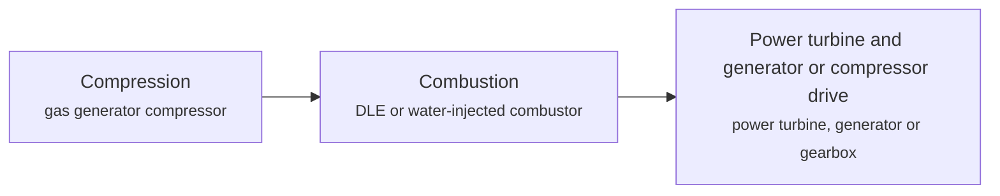

**Key equipment:** gas generator, power turbine, dry low-emission combustor, generator or driven compressor, package enclosure and inlet filtration.

**Performance:**
- LM6000PF+ output: 52.5-53.8 MW; 52.5 MWe at generator terminals; 53.8 MW mechanical drive. [source](https://www.bakerhughes.com/gas-turbines/aeroderivative-technology/lm6000pf)
- LM6000PF+ simple-cycle efficiency: 41-42 %; vendor spec table; 41 power generation, 42 mechanical drive. [source](https://www.bakerhughes.com/gas-turbines/aeroderivative-technology/lm6000pf)
- LM6000PF+ start to full power: 10 min (or less); start in under 5 minutes. [source](https://www.bakerhughes.com/gas-turbines/aeroderivative-technology/lm6000pf)
- LM2500XPRESS+ output (50 Hz, ISO, natural gas): 34.5-36.3 MW; G4 and G5 DLE UPT variants. [source](https://www.gevernova.com/gas-power/products/gas-turbines/lm2500)
- LM2500 hydrogen-blend operating experience: 5-95 % hydrogen by volume; about 2 million operating hours on hydrogen-blend fuels; headline capability up to 75% hydrogen. [source](https://www.gevernova.com/gas-power/products/gas-turbines/lm2500)

**Costs:**
- overnight capital cost, aeroderivative simple cycle: 1606 USD per kW (2023$); 4 x 54 MW aeroderivative units, 211 MW net, overnight capital excluding financing.. [source](https://www.eia.gov/analysis/studies/powerplants/capitalcost/pdf/capital_cost_AEO2025.pdf)

**Reference plants:**
- QPM Isaac Power Station aeroderivative units, Queensland, AU: two GE Vernova LM6000 aeroderivative gas turbines generating up to 112 MW; delivered 2025; construction. [source](https://www.turbomachinerymag.com/view/ge-vernova-delivers-two-lm6000-aeroderivatives-for-qpm-s-isaac-power-station)

**Missing inputs:**
- TRL with a cited source (trl): The IEA ETP Clean Energy Technology Guide has no matching entry. no open TRL source found (IEA ETP guide checked 2026-10-28; no SETIS/DOE entry). Where: IEA ETP Clean Energy Technology Guide (collected): search for the technology name (catalog: iea-reports, open). Next: Find a TRL table that lists this technology, or leave maturity resting on the evidence on the card.

Sources: [1](https://www.bakerhughes.com/gas-turbines/aeroderivative-technology/lm6000pf), [2](https://www.gevernova.com/gas-power/products/gas-turbines/lm2500), [3](https://www.epa.gov/system/files/documents/2024-04/tsd-efficient-generation-combustion-turbine-egus-april-2024.pdf), [4](https://www.turbomachinerymag.com/view/ge-vernova-delivers-two-lm6000-aeroderivatives-for-qpm-s-isaac-power-station), [5](https://www.bakerhughes.com/sites/bakerhughes/files/2021-06/BakerHughes_LMPGT25%2BG4_Overview-060121.pdf). Last reviewed 2026-11-17.

## Biomass and waste-to-energy
<a id="pwr-biomass-waste-to-energy"></a>

Solid biomass or municipal waste is burned on a grate or in a fluidised bed to raise steam for a turbine, or gasified to a fuel gas. The IEA guide rates small-scale biomass gasification (bio-syngas) at TRL 9; no source read so far gives power-plant efficiency or cost.

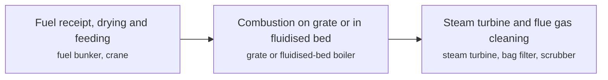

**Key equipment:** fuel handling, grate or fluidised-bed boiler, steam turbine, flue gas cleaning.

**Performance:**
- net electricity yield per tonne of municipal solid waste: 550 kWh/t; EIA: a typical waste-to-energy plant generates about 550 kWh per ton of waste. No net electrical-efficiency percentage is given.. [source](https://www.eia.gov/energyexplained/biomass/waste-to-energy-in-depth.php)

**Costs:**
- capital cost of the Dubai Waste Management Centre waste-to-energy plant: 1 billion USD project cost (1.9 Mt/yr waste processing) (2023$); dollar year not stated in the source (publication 2023); "Dubai opens $1bn waste-to-energy centre" covering 1.9 Mt/yr of waste. [source](https://www.agbi.com/energy/2023/07/dubai-waste-to-energy-plant-starts-transmitting-electricity)

**Reference plants:**
- Dubai Waste Management Centre (Warsan), United Arab Emirates, AE: world's largest waste-to-energy plant: processes 1.9 million tonnes of waste a year, powers about 135,000 homes; about USD 1 bn project; began transmitting electricity July 2023; operating. [source](https://www.agbi.com/energy/2023/07/dubai-waste-to-energy-plant-starts-transmitting-electricity)

TRL source: [IEA ETP Clean Energy Technology Guide, dataset of 24 July 2026, latest assessment (IEA 1-11 scale): 'Biomass gasification - small-scale (bio-syngas)' 9 (2025)](https://www.iea.org/data-and-statistics/data-tools/etp-clean-energy-technology-guide)

Sources: [1](https://www.iea.org/data-and-statistics/data-tools/etp-clean-energy-technology-guide), [2](https://www.agbi.com/energy/2023/07/dubai-waste-to-energy-plant-starts-transmitting-electricity), [3](https://en.wikipedia.org/wiki/Waste-to-energy). Last reviewed 2026-11-17.

## Cogeneration and combined heat and power
<a id="pwr-cogeneration-chp"></a>

A prime mover (gas turbine, reciprocating engine or boiler with steam turbine) makes electricity while its waste heat is recovered as steam or hot water for a process or building. US EPA reports total CHP efficiencies of 65 to 80% and sometimes close to 90%, against 50 to 55% for separate heat and grid power.

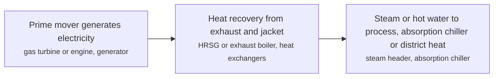

**Key equipment:** prime mover, heat recovery steam generator or exhaust boiler, generator, switchgear and grid interconnection, heat distribution.

**Performance:**
- total CHP efficiency: 65-80 % (some systems approach 90%); EPA CHP benefits page. [source](https://www.epa.gov/chp/chp-benefits)
- gas-turbine CHP electrical efficiency: 23.95-35.96 % HHV; five representative systems, 3.3 MW to 44.5 MW. [source](https://www.epa.gov/sites/default/files/2015-07/documents/catalog_of_chp_technologies_section_3._technology_characterization_-_combustion_turbines.pdf)
- gas-turbine CHP total efficiency: 65.7-70.5 % HHV; same five systems. [source](https://www.epa.gov/sites/default/files/2015-07/documents/catalog_of_chp_technologies_section_3._technology_characterization_-_combustion_turbines.pdf)
- separate heat and power efficiency: 50-55 %; reference case in the EPA page. [source](https://www.epa.gov/chp/chp-benefits)

**Costs:**
- installed cost, gas-turbine CHP: 1248-3281 USD/kW (2013$); 3 MW system $3,281; 45 MW system $1,248; costs fall with size. [source](https://www.epa.gov/sites/default/files/2015-07/documents/catalog_of_chp_technologies_section_3._technology_characterization_-_combustion_turbines.pdf)

**Reference plants:**
- Dresden-Reick CHP (DREWAG / SachsenEnergie), DE: 94 MW electrical, 84 MW district heating; operational in 2022; 8 x Wärtsilä 31SG gas engines, natural gas, EPC. [source](https://www.wartsila.com/energy/learn-more/references/utilities/drewag-germany)
- Bremen CHP (swb Erzeugung), DE: 105 MW electrical, up to 93 MW district heating; delivery mid-2022; 9 x Wärtsilä 31SG gas engines with heat recovery, EPC with Uniper as consortium leader — delivery date, not a stated commercial-operation date. [source](https://www.wartsila.com/energy/learn-more/references/utilities/bremen-germany)

TRL source: [IEA ETP Clean Energy Technology Guide public dataset, row 'Trigeneration (CCHP)', TRL 2025 = 9 (9 in every year 2020-2025); the guide has no separate 'gas engine' row; read 2026-11-16](https://www.iea.org/files/57136415-72b6-4548-9deb-f81fc9a6048d/IEACleanTechGuidepublicdataset.csv)

Sources: [1](https://www.epa.gov/sites/default/files/2015-07/documents/catalog_of_chp_technologies_section_3._technology_characterization_-_combustion_turbines.pdf), [2](https://www.epa.gov/chp/chp-benefits), [3](https://en.wikipedia.org/wiki/Cogeneration). Last reviewed 2026-11-16.

## Combined cycle and HRSG
<a id="pwr-combined-cycle-hrsg"></a>

A gas turbine exhausts at about 600 °C into a heat recovery steam generator (HRSG) that raises steam for a steam turbine, so the plant makes electricity from both cycles. Multi-pressure HRSGs with reheat give the highest efficiency; US EPA reports combined-cycle efficiencies routinely above 55% HHV and 57.1% to 57.9% for GE HA-class units.

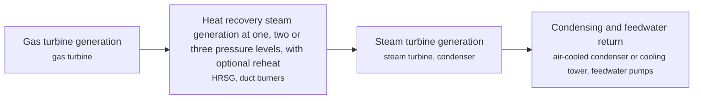

**Key equipment:** gas turbine, HRSG, steam turbine, condenser, feedwater system, SCR for NOx.

**Performance:**
- combined-cycle efficiency, utility scale: 55 % HHV (more than); EPA: routinely above 55%. [source](https://www.epa.gov/system/files/documents/2024-04/tsd-efficient-generation-combustion-turbine-egus-april-2024.pdf)
- net plant efficiency, GE HA 1 on 1: 56.1-57.9 % HHV; 7HA.01 56.1, 7HA.02 57.1, 7HA.03 57.6, 9HA.02 (2x) 57.9. [source](https://www.epa.gov/system/files/documents/2024-04/tsd-efficient-generation-combustion-turbine-egus-april-2024.pdf)
- steam-cycle efficiency by HRSG type: 20-30 %; about 20% two-pressure no reheat, 26% three-pressure, about 30% three-pressure with reheat. [source](https://www.epa.gov/system/files/documents/2024-04/tsd-efficient-generation-combustion-turbine-egus-april-2024.pdf)
- combined cycle at 1-on-1, M701JAC: 64 % LHV (more than); vendor claim. [source](https://power.mhi.com/products/gasturbines/lineup/m701j)

**Costs:**
- total overnight cost, combined cycle single-shaft: 1086 USD/kW (2025$); AEO2026 EMM Table 3 (2025$/kW): 627 MW unit, first available 2028, technological optimism factor 1.00; excludes regional multipliers, learning effects and interest during construction; current costs for plants coming online in 2026; based on Sargent & Lundy (Jan 2024) with about a 20% combined-cycle increase per the Brattle Group/S&L PJM new-entry study; Table 4 regional range 875-1,513 USD/kW (2025$), average 1,102. [source](https://www.eia.gov/outlooks/aeo/assumptions/pdf/EMM_Assumptions.pdf)
- total overnight cost, combined cycle multi-shaft: 1032 USD/kW (2025$); AEO2026 EMM Table 3 (2025$/kW): 1,227 MW unit, first available 2028, technological optimism factor 1.00; exclusions and S&L/PJM adjustment basis as for the single-shaft entry; Table 4 regional range 830-1,445 USD/kW (2025$), average 1,049. [source](https://www.eia.gov/outlooks/aeo/assumptions/pdf/EMM_Assumptions.pdf)
- total overnight cost, combined cycle with 95% carbon capture: 2824 USD/kW (2025$); AEO2026 EMM Table 3 (2025$/kW): 543 MW unit, first available 2029, base overnight cost 2,567 USD/kW times technological optimism factor 1.10; excludes regional multipliers, learning effects and interest during construction; Table 4 regional range 2,268-5,674 USD/kW (2025$), average 2,954. [source](https://www.eia.gov/outlooks/aeo/assumptions/pdf/EMM_Assumptions.pdf)

**Reference plants:**
- Keadby 2 CCGT (SSE Thermal), United Kingdom: 893 MW CCGT (N2 configuration with HRSG); commercial operation March 2023. [source](https://www.ssethermal.com/flexible-generation/operational/keadby-2)

**Missing inputs:**
- TRL with a cited source (trl): The IEA ETP Clean Energy Technology Guide has no matching entry. Where: IEA ETP Clean Energy Technology Guide (collected): search for the technology name (catalog: iea-reports, open). Next: Find a TRL table that lists this technology, or leave maturity resting on the evidence on the card.

Sources: [1](https://www.epa.gov/system/files/documents/2024-04/tsd-efficient-generation-combustion-turbine-egus-april-2024.pdf), [2](https://www.gevernova.com/gas-power/products/gas-turbines/7ha), [3](https://power.mhi.com/products/gasturbines/lineup/m701j), [4](https://www.eia.gov/outlooks/aeo/assumptions/pdf/EMM_Assumptions.pdf), [5](https://en.wikipedia.org/wiki/Combined_cycle_power_plant). Last reviewed 2026-11-16.

## Concentrated solar power with storage
<a id="pwr-concentrated-solar-power"></a>

Mirrors concentrate sunlight on a receiver; the heat is stored in molten salt and used to raise steam for a turbine, giving dispatchable solar. NREL's 2024 baseline is a 102 MWe molten-salt power tower with 10 hours of two-tank storage, costed at $7,912/kWe in the 2022 base year.

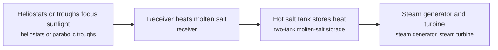

**Key equipment:** heliostat field, receiver, molten-salt tanks, steam generator, turbine.

**Performance:**
- capacity factor with 10 h storage, base year: 51.4-66.6 %; Abilene TX 51.4, Phoenix 64.7, Daggett CA 66.6. [source](https://atb.nrel.gov/electricity/2024/concentrating_solar_power)
- power cycle gross efficiency, 2022: 41.2 %; steam Rankine at 574 °C. [source](https://atb.nrel.gov/electricity/2024/concentrating_solar_power)
- fixed O&M: 74.6 USD/kW-yr (2022$); 2022. [source](https://atb.nrel.gov/electricity/2024/concentrating_solar_power)

**Costs:**
- capital cost, base year: 7912 USD/kWe (2022$); 2022 dollars. [source](https://atb.nrel.gov/electricity/2024/concentrating_solar_power)

**Reference plants:**
- Noor Ouarzazate solar complex, Morocco (MASEN), MA: about 510 MW of concentrated solar power (plus a 72 MW PV plant) across Noor I-III, including the Noor III molten-salt tower; about USD 2.5 bn; phases 2014-2018; world's largest CSP complex; operating. [source](https://documents.worldbank.org/en/publication/documents-reports/documentdetail/103151506335526236)

TRL source: [IEA ETP Clean Energy Technology Guide, dataset of 24 July 2026, latest assessment (IEA 1-11 scale): 'Solar tower' 9 (2025); 'Parabolic trough (solar)' 9 (2025)](https://www.iea.org/data-and-statistics/data-tools/etp-clean-energy-technology-guide)

Sources: [1](https://atb.nrel.gov/electricity/2024/concentrating_solar_power), [2](https://en.wikipedia.org/wiki/Concentrated_solar_power). Last reviewed 2026-10-29.

## Containerised hybrid power modules (solar, storage, gensets)
<a id="pwr-containerised-hybrid-modules"></a>

Factory-integrated containers or skids combine solar PV, battery storage and diesel/gas gensets under one hybrid controller, so a remote site replaces part of its diesel generation within days to weeks of arrival. Aggreko delivers such plants as rental or build-own-operate contracts (relocatable solar farms plus its containerised Y.Cube batteries), BoxPower ships pre-engineered container microgrids from 5 kW to 20 MW, and fold-out PV containers such as SolarContainer's 140 kWp unit install in hours.

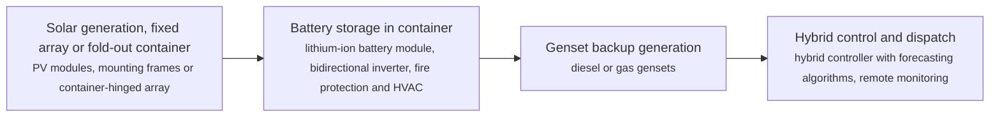

**Key equipment:** PV array or fold-out solar container, containerised battery energy storage, diesel or gas gensets, hybrid controller, microgrid switchgear.

**Performance:**
- Aggreko containerised battery ratings: 250-500 kW / kWh; 250 kW / 575 kWh and 500 kW / 250 kWh plug-and-play units, expandable down to 30/60 kVA small nodes; Y.Cube fits a standard 20 ft container. [source](https://www.aggreko.com/en-us/news/aggreko-launches-new-mid-sized-500-kw-250-kwh-and-250-kw-575-kwh-energy-storage-systems)
- Bisha mine, Eritrea: fuel savings: 12 %; 22 MW generation plus 7.5 MWp solar on 9 ha; about 10,000 litres of diesel saved per day; roughly 10,000 tonnes of CO2 avoided annually. [source](https://www.aggreko.com/en-sg/case-studies/mining/eritrea-solar-hybrid-mine-project)
- Aggreko hybrid plants savings claim: 5-20 %; savings from the first kWh on hybrid solar-storage-genset plants; contract durations 3-10+ years with no upfront capital. [source](https://www.aggreko.com/en-ae/solutions/power-plants/hybrid-power-plants)
- BoxPower product range: 5-20000 kW; 5 kW to 20 MW+ solar PV and 15 kWh to 6 MWh storage; MiniBox installs in a few hours with no foundation. [source](https://boxpower.io/products/solar-container/)
- SolarContainer fold-out PV array: 140 kWp; 140 kWp from 240 modules over about 720 square metres, assembly up to 5 hours; ISO container with CSC badge. [source](https://www.solarcontainer.one/english/product-information)

**Reference plants:**
- Bisha mine solar-hybrid plant, Eritrea: 22 MW gensets + 7.5 MWp solar; operating under Aggreko contract; over 12% fuel savings. [source](https://www.aggreko.com/en-sg/case-studies/mining/eritrea-solar-hybrid-mine-project)
- Porphyry gold mine hybrid plant (Northern Star), Australia: 4.4 MW solar + 2 MW battery; operating under a 10-year PPA; 1.91 million litres of fuel saved per year. [source](https://www.aggreko.com/en-pg/case-studies/mining/solar-power-remote-gold-mine-western-australia)
- Bisha mine solar-diesel hybrid (Aggreko for Nevsun), Eritrea: 22 MW diesel + 7.5 MW solar = 29.5 MW; in service 2017. [source](https://www.miningweekly.com/article/nevsun-taps-uk-based-aggreko-to-provide-295-mw-solar-diesel-hybrid-power-to-bisha-2017-05-04)

**Missing inputs:**
- module prices or contract rates in $/kW or $/kWh delivered, with dollar year (costs): Vendor pages sell services without publishing rates. Web-checked 2026-10-28; module prices are quote-only. Where: arXiv and open-access journals: hybrid solar-storage-diesel techno-economic studies for mines and islands (catalog: arxiv, open); IRENA reports on hybrid mini-grid costs (irena.org) (open). Next: Find an open cost figure; record it with metric, range, unit, dollar year, basis and source.
- TRL with a cited source (trl): The IEA ETP Clean Energy Technology Guide has no entry for hybrid container modules as such. no open TRL source found (IEA ETP guide checked 2026-10-28; no SETIS/DOE entry). Where: IEA ETP Clean Energy Technology Guide (collected): mini-grid and off-grid PV entries (catalog: iea-reports, open). Next: Find a TRL table entry or leave maturity resting on the evidence on the card.

Sources: [1](https://www.aggreko.com/en-ae/solutions/power-plants/hybrid-power-plants), [2](https://www.aggreko.com/en-us/news/aggreko-launches-new-mid-sized-500-kw-250-kwh-and-250-kw-575-kwh-energy-storage-systems), [3](https://www.aggreko.com/en-sg/case-studies/mining/eritrea-solar-hybrid-mine-project), [4](https://www.aggreko.com/en-pg/case-studies/mining/solar-power-remote-gold-mine-western-australia), [5](https://boxpower.io/products/solar-container/), [6](https://www.bredenoord.com/en/knowledge/mobile-solar-plant), [7](https://www.solarcontainer.one/english/product-information), [8](https://www.cat.com/en_US/by-industry/electric-power/Articles/White-papers/how-solar-and-battery-energy-storage-change-the-way-diesel-generator-sets-run.html). Last reviewed 2026-11-16.

## Crystalline silicon PV (PERC, TOPCon, HJT)
<a id="pwr-crystalline-silicon-pv"></a>

Silicon wafers convert sunlight to DC electricity; the cell structure sets efficiency. PERC is the mature cell, TOPCon and heterojunction (HJT/SHJ) are the current upgrades. NREL's 2024 baseline models a 100 MWdc (74.6 MWac) one-axis tracked plant with bifacial modules and costs it at $1.56/WAC in 2023.

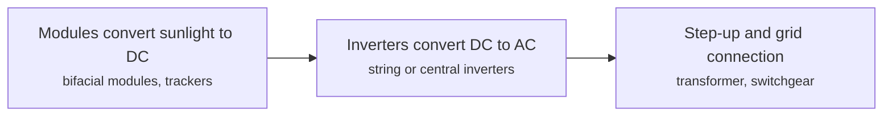

**Key equipment:** PV modules, single-axis trackers, inverters, step-up transformer.

**Performance:**
- capacity factor, AC, one-axis tracking, ILR 1.34: 21.4-34 %; 2021 first-year range from lowest to best solar resource class. [source](https://atb.nrel.gov/electricity/2024/utility-scale_pv)
- fixed O&M: 22 USD/kWac-yr (2023$); 2023. [source](https://atb.nrel.gov/electricity/2024/utility-scale_pv)

**Costs:**
- overnight capital cost: 1.56 USD/Wac (2023$); 2023 benchmark (Q1 2023), 100 MWdc one-axis tracking; the base year 2022 value is $1.43/Wac. [source](https://atb.nrel.gov/electricity/2024/utility-scale_pv)

**Reference plants:**
- Cirata floating solar PV plant, West Java, Indonesia, ID: 145 MW floating PV, the largest in Southeast Asia at commissioning (planned expansion to up to 500 MW); powers about 50,000 homes; operating. [source](https://taiyangnews.info/markets/floating-solar-expansion-in-southeast-asian-nations)
- Sunny Bangchak solar plant, Thailand, TH: 44 MW silicon PV, Southeast Asia's largest silicon photovoltaic plant at grid connection (27 Sep 2012); operating. [source](https://www.eco-business.com/news/southeast-asias-largest-solar-plant-in-thailand-gets-turned-on)

TRL source: [IEA ETP Clean Energy Technology Guide, dataset of 24 July 2026, latest assessment (IEA 1-11 scale): 'Crystalline silicon PV' 9 (2025)](https://www.iea.org/data-and-statistics/data-tools/etp-clean-energy-technology-guide)

Sources: [1](https://atb.nrel.gov/electricity/2024/utility-scale_pv), [2](https://taiyangnews.info/markets/floating-solar-expansion-in-southeast-asian-nations), [3](https://en.wikipedia.org/wiki/Photovoltaics). Last reviewed 2026-10-29.

## Floating solar
<a id="pwr-floating-solar"></a>

PV modules mounted on floats moored on reservoirs, lakes or near-shore water. The World Bank found floating PV grew from about 10 MW at end 2014 to 1.1 GW by September 2018, with a conservative global potential of 400 GW, a cooling-driven yield gain, and lifetime costs at par with land PV.

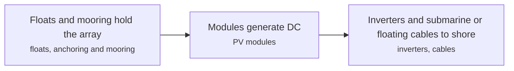

**Key equipment:** floats, mooring system, PV modules, inverters, cables.

**Performance:**
- global installed floating PV: 1.1 GW; September 2018 (report date 30 October 2018). [source](https://www.worldbank.org/en/topic/energy/publication/where-sun-meets-water)
- conservative global potential: 400 GW; World Bank estimate. [source](https://www.worldbank.org/en/topic/energy/publication/where-sun-meets-water)
- global cumulative installed floating PV capacity, end-2024: 9.16 GW; IEA PVPS: 9.16 GW cumulative at end-2024, up from 7.7 GW in 2023 with 1.5 GW added in 2024. A verified yield gain versus land PV is not given.. [source](https://taiyangnews.info/technology/iea-pvps-global-floating-solar-capacity-exceeds-9-gw-in-2024)

**Costs:**
- total capital cost, floating PV: 1.18 USD per Wp (2022$); Median of reported projects (about 1,180 USD/kWp); 30 projects sit below 1.00 USD/W. Total capex, not overnight.. [source](https://iea-pvps.org/wp-content/uploads/2025/04/IEA-PVPS-T13-31-2025-REPORT-Floating-PV-Plants.pdf)

**Reference plants:**
- Cirata floating solar PV plant, West Java, Indonesia, ID: 145 MW floating PV (Masdar/PLN), largest in Southeast Asia at its 2023 commissioning, planned expansion to 500 MW; operating. [source](https://taiyangnews.info/markets/floating-solar-expansion-in-southeast-asian-nations)

TRL source: [IEA ETP Clean Energy Technology Guide, dataset of 24 July 2026, latest assessment (IEA 1-11 scale): 'Floating solar PV' 9 (2025)](https://www.iea.org/data-and-statistics/data-tools/etp-clean-energy-technology-guide)

Sources: [1](https://www.worldbank.org/en/topic/energy/publication/where-sun-meets-water), [2](https://en.wikipedia.org/wiki/Floating_solar). Last reviewed 2026-11-17.

## Flow batteries (vanadium, zinc-bromine)
<a id="pwr-flow-batteries"></a>

Energy is stored in liquid electrolytes in tanks and pumped through a cell stack, so power and energy are sized separately. Invinity reports over 11,000 MWh discharged since 2022 and cites a 1.5 GWh vanadium project at Laufenburg, Switzerland; duration, cycle life and efficiency were not quantified on its page.

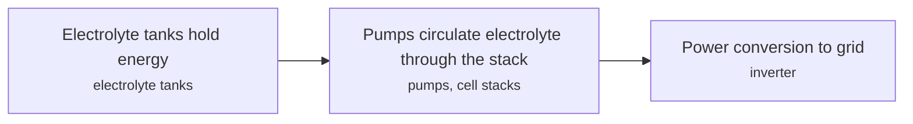

**Key equipment:** electrolyte tanks, cell stacks, pumps, power conversion.

**Performance:**
- energy discharged since 2022, Invinity fleet: 11000 MWh; vendor claim. [source](https://invinity.com/)

**Costs:**
- installed cost, vanadium redox flow battery: 446 USD per kWh (2024$); 100 MW / 10 h system, total installed cost, from the PNNL assessment as reported second-hand; a 10-hour LFP comparator is $379/kWh.. [source](https://gr1d.us/insights/flow-battery-data-center)

**Reference plants:**
- Dalian Flow Battery Energy Storage Peak-shaving Power Station (Rongke Power), Dalian, Liaoning, CN: Phase 1 100 MW / 400 MWh vanadium redox flow battery, first phase of a planned 200 MW / 800 MWh station; grid-connected 29 September 2022 with commercial operation from mid-October 2022 — the largest flow-battery station in the world at the time; operating. [source](https://english.cas.cn/Special_Reports/rd/2022/202410/t20241031_693355.shtml)

TRL source: [IEA ETP Clean Energy Technology Guide, dataset of 24 July 2026, latest assessment (IEA 1-11 scale): 'Redox flow storage battery' 9 (2025)](https://www.iea.org/data-and-statistics/data-tools/etp-clean-energy-technology-guide)

Sources: [1](https://invinity.com/), [2](https://en.wikipedia.org/wiki/Flow_battery). Last reviewed 2026-11-16.

## Gas engine generator power plant equipment and facilities — supply-chain evidence (7 units, SESB 132/33/11 kV)
<a id="pwr-geg-plant-wbs-supply-chain"></a>

Evidence assembled for every line item of the GEG plant WBS/BOQ across procurement, construction, commissioning and EPC indirects, with sourced specifications, dated prices and explicit gaps.

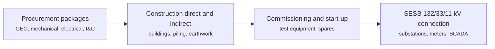

**Key equipment:** LV auxiliary transformer bay, Fire fighting system, 132 kV busbar potential transformer, Gas receiving and metering station with hot tap and fuel gas supply, Cooling water system with air-cooled radiator, Water storage tank system, Exhaust gas system, Unloading station (steel structure), Service air system, 11 kV generator circuit breakers, HV and LV cables with cable trays and accessories, Pre-commissioning and start-up management, Security room and gatehouse, Electrical and mechanical workshop building, Uninterruptible power supply system, 33 kV substation and LV distribution room, Main and check tariff meters, Compressor room (reinforced concrete), Diesel oxidation catalyst and SCR emission control system, Civil and structural buildings, Site gate and fencing, Power transformers, Powerhouse building (steel structure), Lube oil storage and transfer system, Commissioning equipment and consumables, Telecommunication and network infrastructure, Intake air system, Bus duct, 132 kV substation, CCTV system, Administration building (reinforced concrete), Field instrumentation, MV switchgear room, Fire and service water pump house, 11 kV switchgear, Public address system, Bored piling works, Bonds, guarantees, insurance and financing costs, Mechanical, electrical and C&I installation, Low voltage switchgear, 33 kV busbar potential transformer, Gas metering foundation, Electrical laboratory test equipment, Pump building (steel structure), Two-year operational spares, Step-up transformer bay, Utility communication system, HVAC system, Sampling system, Black start diesel generator, Contractor site facilities and laydown area, Gas engine generator units, Oily water treatment system, Site roads and paving, Health, safety, security and environment, Diesel fuel system, LV switchgear and control room, Construction management and services, Black start generator building, Crane and hoist, Visitor and meeting building (reinforced concrete), Plant control system, 132 kV switchgear room, Instrument air system, Neutral grounding resistor panels, Sewerage and water storage system, Utility SCADA and automatic generation control integration, Chemical and urea storage building, Gas treatment scrubber, 33 kV substation, Scheduled waste building (steel structure), Mechanical maintenance workshop equipment, Earthworks and soil import, Energy billing system, Freight, transport, cargo insurance and installation.

**Performance:**
- Operational history — GE acquired Jenbacher gas engine-energy division; later sold Jenbacher and Waukesha to Advent International, creating INNIO: no range recorded; Wikipedia: 'The remaining gas engine-energy division was acquired by General Electric in 2003' and 'In 2018 GE sold its Jenbacher and Waukesha brands to the private equity company Advent International which created the new company INNIO.' Ownership-change dates both retained.. [source](https://en.wikipedia.org/wiki/Jenbacher)
- Operational history — Kipevu II financial closing, construction start and commercial operation: no range recorded; Wärtsilä reference: 'Wärtsilä began the construction immediately after financial closing in August 2000, and commercial operation was started on 4th September 2001, exactly on schedule.' Owner Tsavo Power Company; off-taker KPLC; seven Wärtsilä 38 generating sets.. [source](https://www.wartsila.com/energy/learn-more/references/utilities/kipevu-ii-iii-kenya)
- Operational history — Kipevu III turnkey contract awarded and handover: no range recorded; Wärtsilä reference: 'In November 2009, Wärtsilä was awarded a turnkey contract for a 117 MW thermal power plant ... Kipevu III, consisting of seven W18V46 engines, was successfully handed over to KenGen in March 2011.'. [source](https://www.wartsila.com/energy/learn-more/references/utilities/kipevu-ii-iii-kenya)
- Operational history — Pesanggaran Bali order, full output and fuel switch: no range recorded; Wärtsilä reference: 'This order was received in the fourth quarter 2013 and began functioning at full output by the end of May 2015'; 'since the building of the Tanjung Benoa LNG storage and regasification terminal in July 2016, it operates primarily on LNG.' EPC in consortium with PT PP.. [source](https://www.wartsila.com/energy/learn-more/references/utilities/pesanggaran-bali)
- Operational history — Wärtsilä contract for three 150 MW Brazilian balancing plants announced: no range recorded; Wärtsilä press release '18 November 2021 at 09:30 UTC+2': 16 Wärtsilä 20V34SG gas engine generating sets, three EPC plants in Espírito Santo; orders placed by companies held by funds managed by BTG Pactual Asset Management; booked in Q4 2021; scheduled operational Q2 2022.. [source](https://www.wartsila.com/media/news/18-11-2021-wartsila-contracted-to-supply-three-flexible-thermal-balancing-power-plants-totalling-150-mw-to-brazil-3009303)
- Operational history — Rolls-Royce launches mtu Series 500 gas gensets: no range recorded; Rolls-Royce press release dated 10 December 2020: 250-550 kW, peak efficiency up to 42.6%; initially natural gas, biogas from end 2021; H2-ready; Series 400 orderable until mid 2021, production end late 2021.. [source](https://r.jina.ai/https://www.rolls-royce.com/media/press-releases/2020/10-12-2020-rr-introduces-new-mtu-gas-engine-series-500-for-power-generation.aspx)
- Operational history — Wärtsilä/EPV Mertaniemi 43 MW balancing plant order booked: no range recorded; POWER magazine article dated Thursday, November 12, 2026: 43-MW facility at existing Mertaniemi site, Lappeenranta, Finland; four Wärtsilä 34SG engines; six-year service agreement; order booked Q4 2026; scheduled fully operational first half of 2029.. [source](https://www.powermag.com/wartsila-will-supply-engines-for-finnish-power-plant-project/)
- Reliability — Plant availability, combustion engine power plants: 95 %; Wärtsilä white paper 'Combustion engine power plants', section 'Maintenance of combustion engines': 'Operational statistics prove that power plants achieve a plant availability of 95%, plant reliability of 97%, and starting reliability of 99%'. Published Time Tue, 14 Apr 2020 per r.jina.ai; document footer copyright 2011 Wärtsilä Corporation.. [source](https://r.jina.ai/https://www.wartsila.com/docs/default-source/power-plants-documents/downloads/white-papers/general/wartsila-bwp-combustion-engine-power-plants.pdf)
- Reliability — Plant reliability, combustion engine power plants: 97 %; Same Wärtsilä white paper sentence: 'plant reliability of 97%'. Published Time Tue, 14 Apr 2020 per r.jina.ai; footer copyright 2011 Wärtsilä Corporation.. [source](https://r.jina.ai/https://www.wartsila.com/docs/default-source/power-plants-documents/downloads/white-papers/general/wartsila-bwp-combustion-engine-power-plants.pdf)
- Reliability — Starting reliability, combustion engine power plants: 99 %; Same Wärtsilä white paper sentence: 'starting reliability of 99%'. Published Time Tue, 14 Apr 2020 per r.jina.ai; footer copyright 2011 Wärtsilä Corporation.. [source](https://r.jina.ai/https://www.wartsila.com/docs/default-source/power-plants-documents/downloads/white-papers/general/wartsila-bwp-combustion-engine-power-plants.pdf)
- Operational history — Wärtsilä gas power plants reference delivery: Sasolburg, South Africa, 18 x Wärtsilä 20V34SG, 175 MW, EPC, delivery 2012: no range recorded; Printed in Wärtsilä 'Gas and multi-fuel power plants' brochure, printed 08.2017, read via r.jina.ai 2026-08-18.. [source](https://www.wartsila.com/docs/default-source/energy-docs/technology-products/brochures/gas-and-multi-fuel-power-plants.pdf?sfvrsn=6f4dbb45_22)
- Reliability — SCR operating hours before maintenance: no range recorded; Johnson Matthey NOx control systems webpage, ©Johnson Matthey 2026, read 2026-11-25.. [source](https://matthey.com/products-and-markets/emissions-control/nox-control-systems)
- Operational history — Donaldson states it has delivered air intake systems meeting equipment manufacturers' needs 'for more than 100 years' since Frank Donaldso: no range recorded; Donaldson Air Intake Systems Product Guide, 'AIR INTAKE INNOVATION – by Donaldson'; print date not stated in pages read; r.jina.ai retrieval 2026-11-11.. [source](https://www.donaldson.com/content/dam/donaldson/engine-hydraulics-bulk/catalogs/air-intake/north-america/F110027-ENG/Air-Intake-Systems-Product-Guide.pdf)
- Operational history — Johnson Matthey SCR and oxidation catalyst systems installed on twenty 6 MW natural gas engines at a Colorado energy plant: no range recorded; Photograph caption in JM 'Emission control solutions for power generation'; cover ©2018 Johnson Matthey; no installation year printed; read via r.jina.ai 2023-04-05.. [source](https://matthey.com/documents/161599/1358970/Johnson+Matthey+solutions+for+power+generation+May+2021.pdf/70214546-a466-cf73-4c96-9faff04671da)
- Operational history — JM SCR and oxidation catalyst systems on four 2-stroke diesel engines (total 7.5 MW) supplying Catalina Island micro-grid, reducing pollut: no range recorded; JM power generation brochure 'Clean power from diesel and fuel oil' case note; cover ©2018 Johnson Matthey; read via r.jina.ai 2023-04-05.. [source](https://matthey.com/documents/161599/1358970/Johnson+Matthey+solutions+for+power+generation+May+2021.pdf/70214546-a466-cf73-4c96-9faff04671da)
- Reliability — SCR hours before maintenance: no range recorded; Johnson Matthey NOx control systems webpage, ©Johnson Matthey 2026, read 2026-11-25.. [source](https://matthey.com/products-and-markets/emissions-control/nox-control-systems)
- Reliability — Umicore catalyst experience / reference base: no range recorded; Umicore Data Center Emission Control Catalysts brochure, read via r.jina.ai 2026-09-02; print date not stated.. [source](https://www.umicore.com/storage/demo_2024/data-center-emission-control-catalysts.pdf)
- Operational history — Dunham-Bush states it was founded in the USA in 1894 and has more than 100 years of air-conditioning manufacturing history: no range recorded; Dunham-Bush homepage and Our Products page; WebFetch 2026-11-25.. [source](https://dunham-bush.com/)
- Operational history — T.D. Williamson states it has provided solutions for pressurized piping systems worldwide for more than 100 years: no range recorded; TDW homepage footer text, read directly 2026-11-25; site footer ©2020 T.D. Williamson, LLC; no founding year printed on page.. [source](https://www.tdwilliamson.com/)
- Reliability — Regulator station redundancy practice: no range recorded; Emerson White Paper D353412X012, August 2024, Reliability section; read via r.jina.ai 2026-02-27.. [source](https://emerson.com/is/content/emerson/pt/final-control/pressure-management/common-applications/natural-gas-pressure-regulators/documents/fuel-gas-supply-system-for-gas-power-plants-white-paper-en-10975562.pdf)
- Reliability — Emerson metering skid installed base: no range recorded; Emerson datasheet DAN-GAS-TQ-GUSM-0213, February 2022; read via r.jina.ai 2026-01-30.. [source](https://emerson.com/is/content/emerson/pt/measurement-instrumentation/technical/products/flow-ultrasonic/documents/doc-emerson-dan-gas-tq-gusm-0213.pdf)
- Operational history — Documented case of a turbine avoiding bearing failure because the automatic emergency lube pump started on main pump trip and maintained b: no range recorded; No event date given; Prismecs states the outcome depends on the pump being last proved by testing. Article published 11 February 2024.. [source](https://prismecs.com/blog/components-of-the-lubrication-system-of-gas-turbine-engines)
- Reliability — emergency lube pump proving: no range recorded; Prismecs article, 'If the emergency pump does not start'; published 11 February 2024: 'Monthly start testing ... belong in the preventive maintenance programme.'. [source](https://prismecs.com/blog/components-of-the-lubrication-system-of-gas-turbine-engines)
- Reliability — varnish detection: no range recorded; Prismecs article, 'How is it detected?'; published 11 February 2024.. [source](https://prismecs.com/blog/components-of-the-lubrication-system-of-gas-turbine-engines)
- Reliability — debris localisation: no range recorded; Prismecs article, 'Chip detectors and debris monitors'; published 11 February 2024.. [source](https://prismecs.com/blog/components-of-the-lubrication-system-of-gas-turbine-engines)
- Reliability — material service claim: no range recorded; PIPECO GRP Sectional Water Tank product description; page read 2026-11-25; vendor claim, not independently verified.. [source](https://pipeco.com.my/tank-product/grp-sectional-water-tank)
- Operational history — 1985 API survey of refinery oil-water separators incorporated into API 421: no range recorded; API 421 states data from a 1985 survey of design and operation of oil-water separators were incorporated; survey found all separators had average horizontal velocities below 2 feet per minute and more than half below 1 foot per minute.. [source](https://www.abpsoil.com/images/oil-waste-treatment/API-421.pdf)
- Reliability — separation stability: no range recorded; Alfa Laval OFPX 517 leaflet introduction; PDF read via r.jina.ai; r.jina.ai Published Time 27 Nov 2018.. [source](https://alfalaval.my/globalassets/documents/products/separation/centrifugal-separators/separators/of-series/product-leaflet-of-500-separator-en.pdf)
- Reliability — separator sizing effect: no range recorded; API Publication 421 First Edition February 1990 Section 1.4; PDF read via r.jina.ai.. [source](https://www.abpsoil.com/images/oil-waste-treatment/API-421.pdf)
- Reliability — free oil only limitation: no range recorded; API Publication 421 First Edition February 1990 Sections 1.2 and 1.4; PDF read via r.jina.ai.. [source](https://www.abpsoil.com/images/oil-waste-treatment/API-421.pdf)
- Reliability — standby reliability claim: no range recorded; ROTAMAC PDF 'Fire Pump for FPSO & FSO' benefits; PDF read via r.jina.ai; r.jina.ai Published Time 10 May 2023.. [source](https://rotamac.co.th/uploads/7430/files/APPLICATIONS/03%20FIRE%20FIGHTING%20PUMPS.pdf)
- Reliability — jockey pump function: no range recorded; ROTAMAC PDF 'Jockey Pump' design features; PDF read via r.jina.ai; r.jina.ai Published Time 10 May 2023.. [source](https://rotamac.co.th/uploads/7430/files/APPLICATIONS/03%20FIRE%20FIGHTING%20PUMPS.pdf)
- Reliability — continuous operation claim: 8000 hours per year (printed 'continuing yearly running of over 8,000 hours' for cent; Comair 'Instrument Air Compressor' page; page read 2026-11-25; footer ©2026.. [source](https://comairflow.com/instrument-air-compressor)
- Reliability — monitoring requirement: no range recorded; nano-purification article 'Monitor Performance Continuously'; page read 2026-11-25.. [source](https://www.nano-purification.com/en-sg/resources/blog/industry-uses/oil-and-gas/instrument-air-standards-oil-gas-iso-8573-compliance)
- Reliability — hazardous area option: no range recorded; Comair page: 'For your hazardous applications, our instrument air compressor could be completely explosion proof'; page read 2026-11-25.. [source](https://comairflow.com/instrument-air-compressor)
- Reliability — maintenance design claim: no range recorded; Comair page; page read 2026-11-25; footer ©2026.. [source](https://comairflow.com/instrument-air-compressor)
- Reliability — air treatment requirement: no range recorded; Aerodyn Group Pneumatech page; page read 2026-11-25; footer ©2026.. [source](https://aerodyngroup.com/pneumatech)
- Reliability — in-house certification claim: no range recorded; Vibrant Engineering 'Key Features'; page read 2026-11-25; footer ©2026.. [source](https://vibrantengineering.com.my/products/overhead-crane)
- Operational history — Impinjet scrubber removing hazardous vapours at a major industrial chemicals producer: system handles 2,500 CFM, efficiencies exceeding 95: no range recorded; Case study printed in Sly Wet Scrubber Application Guide, catalogue WS-1003091, ©2009 Sly Inc.; no event date given; read via r.jina.ai 2026-11-25.. [source](https://www.slyinc.com/wp-content/uploads/2024/08/WetScrubber.pdf)
- Operational history — Skid-mounted Impinjet wet gas scrubber cleaning medical waste incinerator exhaust: 7,258 CFM of gas at 1800°F from a 100 lb. per hour inci: no range recorded; Case study printed in Sly guide ©2009 Sly Inc.; no event date given; read via r.jina.ai 2026-11-25.. [source](https://www.slyinc.com/wp-content/uploads/2024/08/WetScrubber.pdf)
- Operational history — Eductor venturi/packed tower combination at a specialty chemical producer, skid-mounted stainless steel construction designed for 500 CFM: no range recorded; Case study printed in Sly guide ©2009 Sly Inc.; no event date given; read via r.jina.ai 2026-11-25.. [source](https://www.slyinc.com/wp-content/uploads/2024/08/WetScrubber.pdf)
- Reliability — no consumable media: no range recorded; GWE SULFURIX™ page, 'How can a SULFURIX benefit your business?'; page read 2026-11-25.. [source](https://globalwe.com/en/technologies/biogas-valorization/sulfurix-1)
- Reliability — no moving parts: no range recorded; Sly Wet Scrubber Application Guide, benefits and operating principles; ©2009 Sly Inc.; read via r.jina.ai 2026-11-25.. [source](https://www.slyinc.com/wp-content/uploads/2024/08/WetScrubber.pdf)
- Reliability — emissions control independent of fuel sulphur/load: no range recorded; APZEM SOX Scrubber page 'Working'; page read 2026-11-25; footer ©2023.. [source](https://wet-scrubber.com/sox-scrubber)
- Operational history — 750 kV transformers supplied: no range recorded; CG Electric Systems Hungary 'Having supplied 750 kV transformers as early as in 1977' and CG India 'a dominant player in 800 kV transformers market'. [source](https://pdf.directindustry.com/pdf/cg-power-systems/power-transformers/13988-206783.html)
- Operational history — First 765 kV transformer manufactured in India: no range recorded; 260 MVA, 765 kV single-phase generator transformer supplied by CG India to NTPC was the first 765 kV transformer manufactured in India; year not stated on the catalogue excerpt. [source](https://pdf.directindustry.com/pdf/cg-power-systems/power-transformers/13988-206783.html)
- Reliability — Installed units stated by OEM: 600 units installed in 75 countries; CG Power Systems Power Transformers catalogue summary, 'Technical Documentation and Export: over 600 units installed in 75 countries'; page read 2026-11-25, no date printed on the source page. [source](https://pdf.directindustry.com/pdf/cg-power-systems/power-transformers/13988-206783.html)
- Operational history — ABB commissioned a 1200 kV GIS: no range recorded; Rated to handle more than one million volts (1200 kV) with transmission capability of 6900 MW; ABB ELK-04 C 145 kV brochure, '50 years of GIS innovation'; read 2026-11-25 via r.jina.ai. [source](https://resources.news.e.abb.com/attachments/published/50944/en-US/EC5ACE15FFEF/ELK-04-C-145-2GHV008915-0315En.pdf)
- Reliability — GIS bays installed worldwide: 25000 bays in over 100 countries (vendor stated); ABB ELK-04 C 145 kV brochure, Technology section: 'delivering over 25,000 switchgear bays in over 100 countries'; brochure 2GV008915 En / 03.15; read 2026-11-25 via r.jina.ai. [source](https://resources.news.e.abb.com/attachments/published/50944/en-US/EC5ACE15FFEF/ELK-04-C-145-2GHV008915-0315En.pdf)
- Reliability — SF6 leakage type test: 0.1 % of SF6 gas per year; ABB ELK-04 C 145 kV brochure, life cycle section: 'Type tested for 0.1 percent SF6 gas leakage rate per year'; read 2026-11-25 via r.jina.ai. [source](https://resources.news.e.abb.com/attachments/published/50944/en-US/EC5ACE15FFEF/ELK-04-C-145-2GHV008915-0315En.pdf)
- Reliability — Service life claim: 50 years of operation with periodic visual checks (vendor stated); ABB ELK-04 C 145 kV brochure: 'Under normal operational conditions, more than 50 years smooth operation is assured with periodic visual checks'; read 2026-11-25 via r.jina.ai. [source](https://resources.news.e.abb.com/attachments/published/50944/en-US/EC5ACE15FFEF/ELK-04-C-145-2GHV008915-0315En.pdf)
- Reliability — Maintenance interval claim: 10000 operating cycles maintenance-free; Siemens Catalog HG 11.06 Edition 2017, 3AK7 description; read 2026-11-25 via r.jina.ai. [source](https://assets.new.siemens.com/siemens/assets/api/uuid:c6813788-c460-47db-9c9c-2d0f9b9fab3f/3AK7-EN.pdf)
- Reliability — Installed MNS switchgears worldwide: 1.5e+06 switchgears delivered since 1973 (vendor stated); ABB MNS 3.0 catalogue Rev C 2019.11: 'over 1.5 million MNS switchgears delivered worldwide since the inception of this system in 1973'; read 2026-11-25 via r.jina.ai. [source](https://library.e.abb.com/public/d0deede175db43f0918316d79d8be21e/MNS3.0_Catalogue_EN_1SXH900001C0201%20RevC%202019.11.pdf)
- Operational history — Grid System Restoration Plan obligation stated: no range recorded; Sabah Distribution Code (posted 2024-01-05) 6.9.7.1.1: the plan uses Black Start Generating Units to develop local Power Islands, progressively restore Demand then re-synchronise and interconnect Power Islands; 6.9.7.2.1 notes Black Start Generating Units are mainly directly connected to the Transmission System, but Distributed Generators can provide black-start service.. [source](https://ecos.gov.my/sites/default/files/uploads/para/attachments/2024-01/Sabah%20Distribution%20Code.pdf)
- Reliability — Reliability feature (qualitative): no range recorded; Vertiv Liebert APM Plus brochure UPS-APM Plus-BR-V1-0322-EN (copyright 2022 Vertiv Group Corp.): 'Reliability boosters- Robust air channels, PCBs embedded with conformal coating'; 'Proven Hot-swappable Design ... reduced MTTR'.. [source](https://r.jina.ai/https://www.vertiv.com/48ea97/globalassets/products/critical-power/uninterruptible-power-supplies-ups/vertiv-liebert-apm-plus-brochure.pdf)
- Reliability — Reliability statement (qualitative): no range recorded; ABB WavePro Series Busway Leaflet 1SXH3432025 REV A 04-2022, copyright 2022 ABB: 'Reliability and Safety is a priority and WavePro meets the requirements of IEC 61439-6, rigorous testing has been conducted to ensure safety, availability, and reliability.'. [source](https://r.jina.ai/https://library.e.abb.com/public/3c00a6fc0d83461481ef6d5dafad0ca7/WavePro+Series+Busway_Leaflet_EN_1SXH3432025_REV+A+04-2022.pdf)
- Reliability — Element design (qualitative): no range recorded; I-Gard C-098EB brochure, April 2022: 'Edgewound element design eliminates hot-spots'; 'special grade of electrical alloy with a very low temperature coefficient of resistance'; 'CSA certified and UL approved'.. [source](https://r.jina.ai/https://i-gard.com/site/assets/files/1073/c-098eb_ngr_brochure_-_april_2022.pdf)
- Reliability — Design life (minimum): 40 years; Northern Powergrid NPS/003/001 v6.0, Date of Issue May 2024, clause 3.1.5: 'VTs shall be designed to provide a minimum operating life of 40 years in normal outdoor service conditions as defined by BS EN 61869-1 clause 4.2.5.'. [source](https://r.jina.ai/https://northernpowergrid.opendatasoft.com/explore/dataset/document_library/files/7da89b287743e31e5770b071642aea0c/download)
- Reliability — Design life (minimum): 40 years; Northern Powergrid NPS/003/001 v6.0, Date of Issue May 2024, clause 3.1.5: 'VTs shall be designed to provide a minimum operating life of 40 years in normal outdoor service conditions as defined by BS EN 61869-1 clause 4.2.5.'. [source](https://r.jina.ai/https://northernpowergrid.opendatasoft.com/explore/dataset/document_library/files/7da89b287743e31e5770b071642aea0c/download)
- Operational history — SESB Patau-Patau power plant automation replacement; value of order not disclosed; start-up planned July 2016: no range recorded; Valmet supplied Valmet DNA, information management application, turbine controller for an AEG Kanis steam turbine, integration of two existing GE F6 gas turbine controllers, engineering and commissioning; PESTECH responsible for total project delivery; 112 MWe plant with three gas turbines and one steam turbine, largest of SESB's plants.. [source](https://www.valmet.com/news/press-releases/2016/valmet-to-supply-automation-technology-to-sabah-electricitys-power-plant-in-malaysia/)
- Operational history — Prior Valmet automation deliveries to SESB Tenom and Melawa power plants: no range recorded; Valmet press release of 1 July 2016 quotes Esko Koivisto: 'We have previously delivered automation to Sabah Electricity's power plants in Tenom and Melawa'; no year stated on page.. [source](https://www.valmet.com/news/press-releases/2016/valmet-to-supply-automation-technology-to-sabah-electricitys-power-plant-in-malaysia/)
- Operational history — Enecogen gas-fired plant commissioned with Omnivise T3000 as digital backbone: no range recorded; Omterra reference page (read 2026, reference listing dated November 13, 2025) states Enecogen, Rotterdam, commissioned 2011, two single-shaft combined cycle units with SGT5-4000F gas turbines and SST5-5000 steam turbines, 958 MW, black start, automated load ramping, IEC 62443 compliance.. [source](https://www.siemens-energy.com/us/en/home/references/enecogen-power-plant-integrated-controls.html)
- Reliability — redundant controller switchover: 500 ms (approximate, Honeywell Experion C300); Honeywell C300 product page, © 2026 Honeywell, read directly: 'Switchover Time: ~500 ms'.. [source](https://process.honeywell.com/us/en/products/process-automation/distributed-control-systems-dcs/experion-pks/controllers/experion-pks-c300-controller)
- Reliability — sequence-of-events time tagging: 1 millisecond accuracy; ABB System 800xA Safety Overview, © 2025 ABB, read via r.jina.ai: 'Time tagging events to millisecond accuracy for Sequence of Events (SOE)'.. [source](https://search.abb.com/library/Download.aspx?DocumentID=3BSE038820&LanguageCode=en&DocumentPartId=&Action=Launch)
- Reliability — metering installation availability target: 99 % per annum; Sabah Grid Code clause MC6.1 (published 2024, read via r.jina.ai): 'The target availability of measurement transformers and Metering Installations shall be 99% per annum'.. [source](https://ecos.gov.my/sites/default/files/uploads/para/attachments/2024-01/Sabah%20Grid%20Code.pdf)
- Reliability — measurement transformer/metering installation availability: 99 % per annum; Sabah Grid Code MC6.1 (published 2024, read via r.jina.ai): 'target availability of measurement transformers and Metering Installations shall be 99% per annum'.. [source](https://ecos.gov.my/sites/default/files/uploads/para/attachments/2024-01/Sabah%20Grid%20Code.pdf)
- Reliability — communication link availability: 95 % per annum; Sabah Grid Code MC6.1 (published 2024, read via r.jina.ai): 'target availability of the communication link shall be 95% per annum'.. [source](https://ecos.gov.my/sites/default/files/uploads/para/attachments/2024-01/Sabah%20Grid%20Code.pdf)
- Reliability — substation switch EMI performance: no range recorded; Siemens RUGGEDCOM brochure, Edition 09/2018, read via r.jina.ai: 'RUGGEDCOM technology withstands all of the EMI type tests required by IEC 61850-3 without experiencing any communications loss or delays ... qualify as IEEE 1613 class 2 error-free devices'.. [source](https://cache.industry.siemens.com/dl/files/345/109766345/att_980971/v1/ruggedcom_ethernet_layer_2_switches_en.pdf)
- Reliability — communication link availability target (revenue metering): 95 % per annum; Sabah Grid Code MC6.1 (published 2024, read via r.jina.ai).. [source](https://ecos.gov.my/sites/default/files/uploads/para/attachments/2024-01/Sabah%20Grid%20Code.pdf)
- Operational history — Enecogen control system integration supporting grid stability and black start: no range recorded; Omterra reference page: Omnivise T3000 integrates gas and steam turbines, black start unit and electrical houses; automated black start procedures and rapid load ramping; plant commissioned 2011.. [source](https://www.siemens-energy.com/us/en/home/references/enecogen-power-plant-integrated-controls.html)
- Reliability — loss of SLDC contingency: no range recorded; Sabah Grid Code contents/OC7.8 (published 2024, read via r.jina.ai): 'OC7.8 Loss of Sabah Load Dispatch Centre'.. [source](https://ecos.gov.my/sites/default/files/uploads/para/attachments/2024-01/Sabah%20Grid%20Code.pdf)
- Reliability — loudspeaker line supervision: no range recorded; Bosch Praesideo databook, read via r.jina.ai: 'This monitoring extends from the capsule of a call station microphone to the end of a loudspeaker line.'. [source](https://www.pagcanada.com/wp-content/uploads/2016/06/Praesideo-DS-EN.pdf)
- Reliability — transmitter long-term stability: 0.2 % of URL over 10 years; Rosemount 3051 PDS, February 2017, read via r.jina.ai: '10-year stability of 0.2 percent of URL'.. [source](https://www.instrumart.com/assets/rosemount_3051_datasheet.pdf)
- Operational history — EPCC contract signed for Kimanis 300 MW plant: no range recorded; Signing reported 24 May 2011; construction start 1 Apr 2011; first block COD 1 Dec 2013, second 1 Feb 2014, third 1 Apr 2014.. [source](https://www.dailyexpress.com.my/news/78066/rm1-5b-gas-fired-plant-operational-in-3-years/)
- Operational history — SESB 94 MW fast-track Kimanis project notified: no range recorded; LoN from ECoS reported 25 September 2024; connection at Langsat PMU; completion expected June 2025.. [source](https://www.theborneopost.com/2024/09/25/94mw-gas-turbine-generators-project-in-kimanis-to-boost-sabahs-grid-reserve/)
- Reliability — long-term service agreements held by GE worldwide: 700 sites (more than); GE press release 14 June 2011: 'GE has long-term service agreements in place at more than 700 sites worldwide.'. [source](https://www.ge.com/news/press-releases/ges-frame-6fa-gas-turbines-help-meet-growing-power-needs-sabah-malaysia)
- Operational history — Remote pre-commissioning and first engine start supported from Augsburg: no range recorded; MAN Digital Services case study: confidential Canadian vessel with 4 x MAN 6L32/44CR GenSets with GE generators and SCR; pre-commissioning and first engine start supported remotely during Covid-19 self-isolation restrictions; remote evaluation of load tests by superintendents.. [source](https://r.jina.ai/https://www.man-es.com/docs/default-source/document-sync/primeserv-digital-services-eng.pdf?sfvrsn=12967c97_4)
- Operational history — Remote engine and generator commissioning at Triumph Power plant, Kenya: no range recorded; MAN PrimeServ O&M operates ten Himsen engines at Kitengela outside Nairobi for Triumph Power Generation Company Ltd; after a 2020 crankshaft/generator failure and Covid-19 repatriation, commissioning was executed remotely with PrimeServ Assist data and EyeTech video, including coupling alignment, safety checks, test certificates and hot commissioning.. [source](https://r.jina.ai/https://www.man-es.com/docs/default-source/document-sync/primeserv-digital-services-eng.pdf?sfvrsn=12967c97_4)
- Reliability — PrimeServ Assist agreements: 80 customers (more than), representing almost 600 four-stroke engines; MAN PrimeServ Digital Services brochure (document code D2366686), read via r.jina.ai 25 Nov 2026: 'Since market launch in 2019, more than 80 customers - representing almost 600 MAN four-stroke engines and auxiliary systems - have already made PrimeServ Assist agreements'.. [source](https://r.jina.ai/https://www.man-es.com/docs/default-source/document-sync/primeserv-digital-services-eng.pdf?sfvrsn=12967c97_4)
- Operational history — 18-year CSA signed for Kimanis plant: no range recorded; GE press release 14 June 2011; plant developed BOOT by Kimanis Power Sdn Bhd, electricity sold to SESB; 3 Frame 6FA gas turbines shipped Q1 2012, commercial operation Q4 2013.. [source](https://www.ge.com/news/press-releases/ges-frame-6fa-gas-turbines-help-meet-growing-power-needs-sabah-malaysia)
- Reliability — GE long-term service agreements worldwide: 700 sites (more than); GE press release 14 June 2011: 'GE has long-term service agreements in place at more than 700 sites worldwide.'. [source](https://www.ge.com/news/press-releases/ges-frame-6fa-gas-turbines-help-meet-growing-power-needs-sabah-malaysia)
- Operational history — GE turbine shipment scheduled: no range recorded; Kimanis Frame 6FA units expected to ship Q1 2012; CO scheduled Q4 2013 (GE press release dated 14 June 2011).. [source](https://www.ge.com/news/press-releases/ges-frame-6fa-gas-turbines-help-meet-growing-power-needs-sabah-malaysia)
- Operational history — Act A1648 amendments to the OSH Act 1994 came into operation: no range recorded; DOSH Act 514 reprint 'As at 1 June 2024' states latest amendment by Act A1648 came into operation 1 June 2024 (including increased penalties).. [source](https://r.jina.ai/https://dosh.gov.my/wp-content/uploads/2025/03/Act-514-Reprint-Version-1.6.2024_English.pdf)
- Operational history — ISO 14001:2015 withdrawn: no range recorded; ISO standard page shows ISO 14001:2015 status Withdrawn, stage 95.99 dated 2026-04-15, replaced by ISO 14001:2026; ISO advises certified organisations to consult their certification body on transition. ISO 45001:2018 remains published with Amd 1:2024.. [source](https://www.iso.org/standard/60857.html)
- Reliability — maximum fine for breach of OSH Act 1994 sections 15, 16, 17, 18, 18A or 18B: 500000 RM (not exceeding), or imprisonment up to 2 years, or both; DOSH Act 514 reprint as at 1 June 2024, section 19; footnote states previously RM50,000, increased by Act A1648. Separate section 23 penalty for sections 20/21 is RM200,000 or 2 years.. [source](https://r.jina.ai/https://dosh.gov.my/wp-content/uploads/2025/03/Act-514-Reprint-Version-1.6.2024_English.pdf)
- Reliability — steam power station EIA capacity threshold (First Schedule item 11(a)): 10 MW or more; Environmental Quality (Prescribed Activities) (EIA) Order 2015, made 5 August 2015: First Schedule item 11(a) 'Construction of steam generated power station using fossil fuels (other than coal) and having the capacity of 10 megawatts or more, with or without transmission line'; 11(b) covers combined cycle stations. The order text as read contains no explicit gas-engine-only entry - applicability t. [source](https://r.jina.ai/https://eswis.doe.gov.my/helpDocs/No.4%20-%202015/Perintah-Kualiti-Alam-Sekeliling-Aktiviti-Yang-Ditetapkan-Eia-2015_EN.pdf)

**Costs:**
- Price — Total capital cost, 4 x 5.6 MW natural-gas reciprocating engine (RICE) plant, 21.4 MW net: 3.8727e+07 USD (2019$); EIA/Sargent & Lundy 'Capital Cost and Performance Characteristic Estimates for Utility Scale Electric Power Generating Technologies', Case 4, Table 4-1: 'Total Capital Cost $ 38,727,000', 'Case 4 EIA – Capital Cost Estimates – 2019 $s'. Contractor final Rev. 1 dated 9 December 2019; EIA report February 2020; r.jina.ai Published Time Wed, 05 Feb 2020. Fetched via r.jina.ai.. [source](https://r.jina.ai/https://www.eia.gov/analysis/studies/powerplants/capitalcost/pdf/capital_cost_aeo2020.pdf)
- Price — Overnight capital cost per kW net, 4 x 5.6 MW natural-gas RICE plant: 1810 USD/kW (2019$); Same EIA/Sargent & Lundy Case 4: 'The base cost estimate for this technology case totals $1810/kW' and table row '$/kW net 1,810', in 2019 $s. EIA report February 2020; fetched via r.jina.ai.. [source](https://r.jina.ai/https://www.eia.gov/analysis/studies/powerplants/capitalcost/pdf/capital_cost_aeo2020.pdf)
- Price — Engines and associated auxiliaries, owner-furnished from engine OEM (4 x 5.6 MW case): 1.1974e+07 USD (2019$); EIA/Sargent & Lundy Case 4 Table 4-1: 'Engines (Note 3) $ 11,974,000' and 'Owner Furnished Equipment (Note 3) $ 11,974,000'; Note 3 'Engines and associated auxiliaries procured by Owner from the engine OEM.' 2019 $s; report February 2020.. [source](https://r.jina.ai/https://www.eia.gov/analysis/studies/powerplants/capitalcost/pdf/capital_cost_aeo2020.pdf)
- Price — Total installed cost, industrial natural gas reciprocating engine 1,000 kW, year 2015: 1899 USD/kW (2015$); EIA 'Distributed Generation and Combined Heat & Power System Characteristics and Costs in the Buildings Sector', Appendix A Leidos report, Table 5-6 'Industrial Capital Costs - Natural Gas Reciprocating Engine - Reference New Equipment', year column 2015, 'Total Installed Cost ($/kW) 1,899'. Footnote: 'Costs presented are in current 2015 dollars'. EIA report April 2017; Leidos appendix May 2016; r. [source](https://r.jina.ai/https://www.eia.gov/analysis/studies/buildings/distrigen/pdf/dg_chp.pdf)
- Price — Total installed cost, industrial natural gas reciprocating engine 1,000 kW, year 2020: 2105 USD/kW (2020$); Same Table 5-6, year column 2020, 'Total Installed Cost ($/kW) 2,105'; footnote 'Costs presented are in current 2015 dollars' (i.e. nominal dollars reported on a 2015 price basis in the printed table). EIA report April 2017; Leidos appendix May 2016.. [source](https://r.jina.ai/https://www.eia.gov/analysis/studies/buildings/distrigen/pdf/dg_chp.pdf)
- Price — Total installed cost, industrial natural gas reciprocating engine 3,000 kW, year 2015: 1742 USD/kW (2015$); Same EIA/Leidos report Table 5-14 'Industrial Capital Costs Natural Gas Reciprocating Engine - Reference New Equipment', year column 2015, 'Total Installed Cost ($/kW) 1,742'. Footnote: 'Costs presented are in current 2015 dollars'.. [source](https://r.jina.ai/https://www.eia.gov/analysis/studies/buildings/distrigen/pdf/dg_chp.pdf)
- Price — Total installed cost, industrial natural gas reciprocating engine 3,000 kW, year 2020: 1931 USD/kW (2020$); Same Table 5-14, year column 2020, 'Total Installed Cost ($/kW) 1,931'; footnote 'Costs presented are in current 2015 dollars'.. [source](https://r.jina.ai/https://www.eia.gov/analysis/studies/buildings/distrigen/pdf/dg_chp.pdf)
- Price — Exhaust gas treatment capital cost (representative lean-burn gas engine CHP, systems 2-5 in Table 2-4): 150-750 $/kW (2013 dollars, USD as printed) (2013$); US EPA / ICF 'Catalog of CHP Technologies, Section 2 — Reciprocating Internal Combustion Engines', March 2015 (September 2017 revision noted), Table 2-4 row 'Exhaust Gas Treatment': $750, $500, $230, $150 $/kW for systems 2-5; text §2.5.2.6 states SCR with oxidation catalyst and CEMS adds between $150-$700/kW for lean burn engines. Read via r.jina.ai 2026-06-25.. [source](https://epa.gov/sites/default/files/2015-07/documents/catalog_of_chp_technologies_section_2._technology_characterization_-_reciprocating_internal_combustion_engines.pdf)
- Price — SCR with oxidation catalyst and CEMS capital-cost increment, lean-burn reciprocating-engine CHP: 150-700 $/kW (2013 dollars, USD as printed) (2013$); US EPA/ICF Catalog of CHP Technologies Section 2, §2.5.2.6, 'adds between $150-$700/kW to the capital cost for a lean burn reciprocating engine CHP installation. The cost burden is higher for smaller engines'; March 2015 document (Sept 2017 revision); read via r.jina.ai 2026-06-25.. [source](https://epa.gov/sites/default/files/2015-07/documents/catalog_of_chp_technologies_section_2._technology_characterization_-_reciprocating_internal_combustion_engines.pdf)
- Price — SCR total project cost per kW, 500 MW oil/gas-fired boiler IPM example (NOT a gas-engine figure — printed scope retained for comparison): 127-135 $/kW (2021 dollars, USD; EPA IPM methodology February 2023) (2021$); Sargent & Lundy / Eastern Research Group for US EPA, 'IPM Model – Updates to Cost and Performance for APC Technologies: SCR Cost Development Methodology for Oil/Gas-fired Boilers', Final February 2023, Table 1 example: 'Total project cost ... 127 $/kW' and 'Total project cost 135 $/kW'; states 'Costs are all based on 2021 dollars'; read via r.jina.ai 2023-04-04.. [source](https://www.epa.gov/system/files/documents/2022-03/gas-fired-scr-cost-methodology.pdf)
- Price — ASME B31.1-2026 Power Piping standard list price (print book or PDF): 450 $450.00 (USD as printed, 2026 edition) (2026$); ASME standards store page for B31.1 - 2026, 'Price $450.00', order nos. A05826 (print) / A0582V (PDF); read directly 2026-11-25. This is a standard price, not a gas receiving station package price.. [source](https://www.asme.org/codes-standards/find-codes-standards/b31-1-power-piping)
- Price — reference price, 1 ton single girder overhead crane: 1830-5100 USD (2025$); Dafang Crane 'Overhead Crane Price' PDF, 'Single Girder Electric Overhead Travelling Crane Price List (Reference)': '$1,830-5,100' for span 7.5-28.5 m, lift 6-30 m, 220V-660V 50-60Hz 3ph AC. PDF file path /2025/07/ (printed folder year 2025); r.jina.ai reports Published Time Sat, 31 Jan 2026 01:04:46 GMT. PDF read via r.jina.ai mirror 2026-11-25.. [source](https://dgcrane.com/wp-content/uploads/2025/07/Overhead-Crane-Price.pdf)
- Price — reference price, 5 ton single girder overhead crane: 3130-8680 USD (2025$); Dafang Crane price PDF single girder reference table: '$3,130-8,680'; span 7.5-31.5 m, lift 6-30 m. File path /2025/07/; r.jina.ai Published Time 31 Jan 2026; read via r.jina.ai 2026-11-25.. [source](https://dgcrane.com/wp-content/uploads/2025/07/Overhead-Crane-Price.pdf)
- Price — reference price, 10 ton single girder overhead crane: 3890-12000 USD (2025$); Dafang Crane price PDF single girder reference table: '$3,890-12,000'. File path /2025/07/; r.jina.ai Published Time 31 Jan 2026; read via r.jina.ai 2026-11-25.. [source](https://dgcrane.com/wp-content/uploads/2025/07/Overhead-Crane-Price.pdf)
- Price — reference price, 5t LH-type double girder crane with hoist trolley: 15600-29500 USD (2025$); Dafang Crane price PDF LH-type table: 5t, span 10.5-31.5 m, lift 16 m, A5/A6, total power 22.8-27.8 kW, '$15600-$29500'. File path /2025/07/; r.jina.ai Published Time 31 Jan 2026; read via r.jina.ai 2026-11-25.. [source](https://dgcrane.com/wp-content/uploads/2025/07/Overhead-Crane-Price.pdf)
- Price — reference price, 10t LH-type double girder crane with hoist trolley: 17200-32500 USD (2025$); Dafang Crane price PDF LH-type table: 10t, span 10.5-31.5 m, lift 16 m, A5/A6, '$17200-$32500'. File path /2025/07/; r.jina.ai Published Time 31 Jan 2026; read via r.jina.ai 2026-11-25.. [source](https://dgcrane.com/wp-content/uploads/2025/07/Overhead-Crane-Price.pdf)
- Price — reference price, 20t/5t LH-type double girder crane: 25500-45900 USD (2025$); Dafang Crane price PDF LH-type table: 20t/5t, span 10.5-31.5 m, lift 12/14 m, A5/A6, '$25500-$45900'. File path /2025/07/; r.jina.ai Published Time 31 Jan 2026; read via r.jina.ai 2026-11-25.. [source](https://dgcrane.com/wp-content/uploads/2025/07/Overhead-Crane-Price.pdf)
- Price — reference price, 50t/10t LH-type double girder crane: 49500-72000 USD (2025$); Dafang Crane price PDF LH-type table: 50t/10t, span 10.5-31.5 m, lift 12/16 m, A5/A6, '$49500-$72000'. File path /2025/07/; r.jina.ai Published Time 31 Jan 2026; read via r.jina.ai 2026-11-25.. [source](https://dgcrane.com/wp-content/uploads/2025/07/Overhead-Crane-Price.pdf)
- Price — reference price, 100t/20t LH-type double girder crane: 115000-166700 USD (2025$); Dafang Crane price PDF LH-type table: 100t/20t, span 13-31 m, lift 18/20 m, A5/A6, '$115000-$166700'. File path /2025/07/; r.jina.ai Published Time 31 Jan 2026; read via r.jina.ai 2026-11-25.. [source](https://dgcrane.com/wp-content/uploads/2025/07/Overhead-Crane-Price.pdf)
- Price — reference price, manual single girder overhead crane 1 ton: 840-1800 USD (2025$); Dafang Crane price PDF 'Manual Single Girder Overhead Crane Price List (Reference)': 1 ton, span 4-12 m, lift 3m/6m/9m upto 10m, Manual Mode, '$840-1,800'. File path /2025/07/; r.jina.ai Published Time 31 Jan 2026; read via r.jina.ai 2026-11-25.. [source](https://dgcrane.com/wp-content/uploads/2025/07/Overhead-Crane-Price.pdf)
- Price — typical automation system delivery order value (not the disclosed SESB order value): 1e+06-3e+06 EUR; Valmet press release 1 July 2016: 'The value of the order will not be disclosed. Typically the order value of automation system deliveries ranges from below EUR one million to EUR three million.' This is a company-stated typical range, NOT a price for the SESB project or for this 7-unit plant.. [source](https://www.valmet.com/news/press-releases/2016/valmet-to-supply-automation-technology-to-sabah-electricitys-power-plant-in-malaysia/)
- Price — IEC 62052-11:2020 electronic standard list price: 405 CHF; IEC Webstore product page, publication date 2020-06-29, edition 2.0: 'CHF 405.-'. This is the price of the standard document, not of metering equipment or of this line item.. [source](https://webstore.iec.ch/en/publication/28212)
- Price — Lighting point, PVC cable in conduit (switch separate): 85 RM/point; JKR Jadual Kadar Kerja Elektrik 2025 (JKKE 2025), item I-A1m/s 12; KL base; JKKE approved 28 May 2025, valid to 31 Dec 2026. [source](https://rumahhq.my/ilmu/jadual-kadar-kerja-jkr-2025)
- Price — MCB single pole up to 32A: 32 RM/no; JKR JKKE 2025, item II-C1m/s 43; KL base. [source](https://rumahhq.my/ilmu/jadual-kadar-kerja-jkr-2025)
- Price — Insulation and continuity test, single-phase DB: 719 RM/no; JKR JKKE 2025, item VII-E4.1m/s 146; KL base. [source](https://rumahhq.my/ilmu/jadual-kadar-kerja-jkr-2025)
- Price — EPC contract value, 132/33/11 kV Star1 & Star2 substation incl. GIS building: 1.83e+08 AED; SCAN Electromechanical project page: client SEWA, Down Town Sharjah UAE, year completed 2016, contract value AED183,000,000 - a total contract value, not a unit rate. [source](https://scanelectromechanical.com/project/scan-project-03)
- Price — Reinforced concrete C16/20 in foundations and floor: 492.1 RM/m3; RumahHQ Academy article quoting Jadual Kadar Kerja Kejuruteraan Awam dan Bangunan 2025 (JKR20800-0258-25), item B94B/2; KL base rate; formwork and reinforcement measured separately. [source](https://rumahhq.my/ilmu/jadual-kadar-kerja-jkr-2025)
- Price — Reinforced concrete C16/20 in beams: 634.4 RM/m3; RumahHQ Academy article quoting Jadual Kadar Kerja Kejuruteraan Awam dan Bangunan 2025 (JKR20800-0258-25), item B104B/2; KL base rate; formwork and reinforcement measured separately. [source](https://rumahhq.my/ilmu/jadual-kadar-kerja-jkr-2025)
- Price — Reinforced concrete C16/20 in columns: 663.6 RM/m3; RumahHQ Academy article quoting Jadual Kadar Kerja Kejuruteraan Awam dan Bangunan 2025 (JKR20800-0258-25), item B114B/2; KL base rate; formwork and reinforcement measured separately. [source](https://rumahhq.my/ilmu/jadual-kadar-kerja-jkr-2025)
- Price — Reinforced concrete C16/20 floor slab, average 75 mm: 36.9 RM/m2; RumahHQ Academy article quoting Jadual Kadar Kerja Kejuruteraan Awam dan Bangunan 2025 (JKR20800-0258-25), item B124B/2; KL base rate. [source](https://rumahhq.my/ilmu/jadual-kadar-kerja-jkr-2025)
- Price — High tensile reinforcement 12 mm: 5.3 RM/kg; RumahHQ Academy article quoting Jadual Kadar Kerja Kejuruteraan Awam dan Bangunan 2025 (JKR20800-0258-25), item B704B/7; KL base rate; rebar priced separately from concrete. [source](https://rumahhq.my/ilmu/jadual-kadar-kerja-jkr-2025)
- Price — BRC A6 steel fabric: 35.1 RM/m2; RumahHQ Academy article quoting Jadual Kadar Kerja Kejuruteraan Awam dan Bangunan 2025 (JKR20800-0258-25), item B744B/7; KL base rate. [source](https://rumahhq.my/ilmu/jadual-kadar-kerja-jkr-2025)
- Price — Formwork to vertical faces (footings, ground beams): 61.7 RM/m2; RumahHQ Academy article quoting Jadual Kadar Kerja Kejuruteraan Awam dan Bangunan 2025 (JKR20800-0258-25), item B804B/8; KL base rate. [source](https://rumahhq.my/ilmu/jadual-kadar-kerja-jkr-2025)
- Price — Formwork to beam sides and soffit: 80.1 RM/m2; RumahHQ Academy article quoting Jadual Kadar Kerja Kejuruteraan Awam dan Bangunan 2025 (JKR20800-0258-25), item B814B/8; KL base rate. [source](https://rumahhq.my/ilmu/jadual-kadar-kerja-jkr-2025)
- Price — Formwork to columns: 69.3 RM/m2; RumahHQ Academy article quoting Jadual Kadar Kerja Kejuruteraan Awam dan Bangunan 2025 (JKR20800-0258-25), item B824B/8; KL base rate. [source](https://rumahhq.my/ilmu/jadual-kadar-kerja-jkr-2025)
- Price — Bored pile 600 mm diameter: 600-1000 RM/m; Infraconcrete Cost & Programme Guide 2025-2026, indicative Klang Valley market rate, Pile Foundations table; 1500-2500 kN working load; indicative 2025-2026, typical Klang Valley ground; excludes pile cap/head detailing; East Malaysia rates differ. [source](https://infraconcrete.co/cost-programme-guide)
- Price — Drill 1000 mm nominal diameter vertical holes in soil other than rock with temporary casing: 109-450 RM/m; Jabatan Kerja Raya 'Bahagian 3.6: Piling Work (Class H)' cost database, PURATA/JULAT, Peninsular regions only, item 5; PURATA RM292.19, JULAT RM109.00-450.00; Peninsular Kawasan Utara/Tengah/Timur; 2013. [source](https://r.jina.ai/http://kontrak.water.gov.my/division/qs/mkos2012/Kos%20Item%20Kerja/3.6%20Piling%20works.pdf)
- Price — Drill 1000 mm nominal diameter vertical holes in rock: 900-2200 RM/m; Jabatan Kerja Raya 'Bahagian 3.6: Piling Work (Class H)' cost database, PURATA/JULAT, Peninsular regions only, item 6; PURATA RM1,751.62, JULAT RM900.00-2,200.00; Peninsular only; 2013. [source](https://r.jina.ai/http://kontrak.water.gov.my/division/qs/mkos2012/Kos%20Item%20Kerja/3.6%20Piling%20works.pdf)
- Price — 1000 mm nominal diameter x 12 mm thick permanent casing: 2000-3300 RM/m; Jabatan Kerja Raya 'Bahagian 3.6: Piling Work (Class H)' cost database, PURATA/JULAT, Peninsular regions only, item 7; PURATA RM2,223.92, JULAT RM2,000.00-3,300.00; Peninsular only; 2013. [source](https://r.jina.ai/http://kontrak.water.gov.my/division/qs/mkos2012/Kos%20Item%20Kerja/3.6%20Piling%20works.pdf)
- Price — Concreted length with Grade 40/20: 253.6-497.4 RM/m3; Jabatan Kerja Raya 'Bahagian 3.6: Piling Work (Class H)' cost database, PURATA/JULAT, Peninsular regions only, item 11; PURATA RM361.48, JULAT RM253.60-497.40; Peninsular only; 2013. [source](https://r.jina.ai/http://kontrak.water.gov.my/division/qs/mkos2012/Kos%20Item%20Kerja/3.6%20Piling%20works.pdf)
- Price — High yield reinforcement up to 12 mm / 16 mm and above: 3000-3636 RM/tonne; Jabatan Kerja Raya 'Bahagian 3.6: Piling Work (Class H)' cost database, PURATA/JULAT, Peninsular regions only, item 8(a) and 9(b); PURATA RM3,436.27, JULAT RM3,000.00-3,636.00; Peninsular only; 2013. [source](https://r.jina.ai/http://kontrak.water.gov.my/division/qs/mkos2012/Kos%20Item%20Kerja/3.6%20Piling%20works.pdf)
- Price — Cutting off pile heads and preparing as shown: 249-335 RM/no; Jabatan Kerja Raya 'Bahagian 3.6: Piling Work (Class H)' cost database, PURATA/JULAT, Peninsular regions only, item 13; PURATA RM293.63, JULAT RM249.00-335.00; Peninsular only; 2013. [source](https://r.jina.ai/http://kontrak.water.gov.my/division/qs/mkos2012/Kos%20Item%20Kerja/3.6%20Piling%20works.pdf)
- Price — Mobilisation/demobilisation of labour, plant and drilling equipment for bored piling: 20000-185000 RM/sum; Jabatan Kerja Raya 'Bahagian 3.6: Piling Work (Class H)' cost database, PURATA/JULAT, Peninsular regions only, item 1; PURATA RM140,366.67, JULAT RM20,000.00-185,000.00; Peninsular only; 2013. [source](https://r.jina.ai/http://kontrak.water.gov.my/division/qs/mkos2012/Kos%20Item%20Kerja/3.6%20Piling%20works.pdf)
- Price — Initial maintained load test to 2.0 x maximum working load, 5500 kN pile: 50000-60900 RM/no; Jabatan Kerja Raya 'Bahagian 3.6: Piling Work (Class H)' cost database, PURATA/JULAT, Peninsular regions only, item 67; PURATA RM56,141.54, JULAT RM50,000.00-60,900.00; Peninsular only; 2013. [source](https://r.jina.ai/http://kontrak.water.gov.my/division/qs/mkos2012/Kos%20Item%20Kerja/3.6%20Piling%20works.pdf)
- Price — Pile dynamic analyser (PDA) test: 485-5024.3 RM/no; Jabatan Kerja Raya 'Bahagian 3.6: Piling Work (Class H)' cost database, PURATA/JULAT, Peninsular regions only, item 71; PURATA RM2,332.79, JULAT RM485.00-5,024.30; Peninsular only; 2013. [source](https://r.jina.ai/http://kontrak.water.gov.my/division/qs/mkos2012/Kos%20Item%20Kerja/3.6%20Piling%20works.pdf)
- Price — Handle, pitch and drive vertical 300 x 300 mm precast RC pile: 12-30 RM/m; Jabatan Kerja Raya 'Bahagian 3.6: Piling Work (Class H)' cost database, PURATA/JULAT, Peninsular regions only, item 41; PURATA RM21.11, JULAT RM12.00-30.00; Peninsular only; 2013. [source](https://r.jina.ai/http://kontrak.water.gov.my/division/qs/mkos2012/Kos%20Item%20Kerja/3.6%20Piling%20works.pdf)
- Price — Bore 200 mm diameter micropile not exceeding 13.5 m deep in soil: 50-115 RM/m; Jabatan Kerja Raya 'Bahagian 3.6: Piling Work (Class H)' cost database, PURATA/JULAT, Peninsular regions only, item 14; PURATA RM81.13, JULAT RM50.00-115.00; Peninsular only; 2013. [source](https://r.jina.ai/http://kontrak.water.gov.my/division/qs/mkos2012/Kos%20Item%20Kerja/3.6%20Piling%20works.pdf)
- Price — Supply and drive 12 m long steel sheet pile type OZ 13A or equivalent: 180-460 RM/m2; Jabatan Kerja Raya 'Bahagian 3.6: Piling Work (Class H)' cost database, PURATA/JULAT, Peninsular regions only, item 51; PURATA RM311.00, JULAT RM180.00-460.00; Peninsular only; 2013. [source](https://r.jina.ai/http://kontrak.water.gov.my/division/qs/mkos2012/Kos%20Item%20Kerja/3.6%20Piling%20works.pdf)
- Price — Site clearing (semak, tunggul, akar): 0.9 RM/m2; RumahHQ Academy article quoting Jadual Kadar Kerja Kejuruteraan Awam dan Bangunan 2025 (JKR20800-0258-25), item N34N/1; KL base rate for small JKR daywork; insurance excluded; location/access additions apply. [source](https://rumahhq.my/ilmu/jadual-kadar-kerja-jkr-2025)
- Price — Excavate topsoil up to 150 mm by machine: 4.2 RM/m2; RumahHQ Academy article quoting Jadual Kadar Kerja Kejuruteraan Awam dan Bangunan 2025 (JKR20800-0258-25), item A174A/2; KL base rate, small JKR daywork. [source](https://rumahhq.my/ilmu/jadual-kadar-kerja-jkr-2025)
- Price — Excavate foundation pit not exceeding 1 m3 by machine: 22 RM/no; RumahHQ Academy article quoting Jadual Kadar Kerja Kejuruteraan Awam dan Bangunan 2025 (JKR20800-0258-25), item A334A/2; KL base rate, small JKR daywork. [source](https://rumahhq.my/ilmu/jadual-kadar-kerja-jkr-2025)
- Price — Excavate trench up to 1.5 m deep by machine: 21.2 RM/m3; RumahHQ Academy article quoting Jadual Kadar Kerja Kejuruteraan Awam dan Bangunan 2025 (JKR20800-0258-25), item A214A/2; KL base rate, small JKR daywork. [source](https://rumahhq.my/ilmu/jadual-kadar-kerja-jkr-2025)
- Price — Dispose surplus soil 1-5 km by lorry: 37.6 RM/m3; RumahHQ Academy article quoting Jadual Kadar Kerja Kejuruteraan Awam dan Bangunan 2025 (JKR20800-0258-25), item A444A/3; KL base rate, small JKR daywork. [source](https://rumahhq.my/ilmu/jadual-kadar-kerja-jkr-2025)
- Price — Hardcore 150 mm under concrete floor: 14.4 RM/m2; RumahHQ Academy article quoting Jadual Kadar Kerja Kejuruteraan Awam dan Bangunan 2025 (JKR20800-0258-25), item A564A/4; KL base rate, small JKR daywork; measured separately from concrete. [source](https://rumahhq.my/ilmu/jadual-kadar-kerja-jkr-2025)
- Price — Preload fill (sand/aggregate), place, surcharge, monitor settlement, remove: 50-120 RM/m3; Infraconcrete Cost & Programme Guide 2025-2026, indicative Klang Valley market rate, Ground Improvement table; indicative 2025-2026, Klang Valley conditions. [source](https://infraconcrete.co/cost-programme-guide)
- Price — Reinforced concrete C16/20 in foundations and floor: 492.1 RM/m3; RumahHQ Academy article quoting Jadual Kadar Kerja Kejuruteraan Awam dan Bangunan 2025 (JKR20800-0258-25), item B94B/2; KL base rate; formwork and reinforcement measured separately. [source](https://rumahhq.my/ilmu/jadual-kadar-kerja-jkr-2025)
- Price — Reinforced concrete C16/20 in beams: 634.4 RM/m3; RumahHQ Academy article quoting Jadual Kadar Kerja Kejuruteraan Awam dan Bangunan 2025 (JKR20800-0258-25), item B104B/2; KL base rate; formwork and reinforcement measured separately. [source](https://rumahhq.my/ilmu/jadual-kadar-kerja-jkr-2025)
- Price — Reinforced concrete C16/20 in columns: 663.6 RM/m3; RumahHQ Academy article quoting Jadual Kadar Kerja Kejuruteraan Awam dan Bangunan 2025 (JKR20800-0258-25), item B114B/2; KL base rate; formwork and reinforcement measured separately. [source](https://rumahhq.my/ilmu/jadual-kadar-kerja-jkr-2025)
- Price — Reinforced concrete C16/20 floor slab, average 75 mm: 36.9 RM/m2; RumahHQ Academy article quoting Jadual Kadar Kerja Kejuruteraan Awam dan Bangunan 2025 (JKR20800-0258-25), item B124B/2; KL base rate. [source](https://rumahhq.my/ilmu/jadual-kadar-kerja-jkr-2025)
- Price — Additional per 25 mm of slab thickness: 12.3 RM/m2; RumahHQ Academy article quoting Jadual Kadar Kerja Kejuruteraan Awam dan Bangunan 2025 (JKR20800-0258-25), item B134B/2; KL base rate. [source](https://rumahhq.my/ilmu/jadual-kadar-kerja-jkr-2025)
- Price — High tensile reinforcement 12 mm: 5.3 RM/kg; RumahHQ Academy article quoting Jadual Kadar Kerja Kejuruteraan Awam dan Bangunan 2025 (JKR20800-0258-25), item B704B/7; KL base rate; rebar priced separately from concrete. [source](https://rumahhq.my/ilmu/jadual-kadar-kerja-jkr-2025)
- Price — Mild steel reinforcement 6 mm (links): 6.2 RM/kg; RumahHQ Academy article quoting Jadual Kadar Kerja Kejuruteraan Awam dan Bangunan 2025 (JKR20800-0258-25), item B664B/7; KL base rate. [source](https://rumahhq.my/ilmu/jadual-kadar-kerja-jkr-2025)
- Price — BRC A6 steel fabric: 35.1 RM/m2; RumahHQ Academy article quoting Jadual Kadar Kerja Kejuruteraan Awam dan Bangunan 2025 (JKR20800-0258-25), item B744B/7; KL base rate. [source](https://rumahhq.my/ilmu/jadual-kadar-kerja-jkr-2025)
- Price — Formwork to vertical faces (footings, ground beams): 61.7 RM/m2; RumahHQ Academy article quoting Jadual Kadar Kerja Kejuruteraan Awam dan Bangunan 2025 (JKR20800-0258-25), item B804B/8; KL base rate. [source](https://rumahhq.my/ilmu/jadual-kadar-kerja-jkr-2025)
- Price — Formwork to beam sides and soffit: 80.1 RM/m2; RumahHQ Academy article quoting Jadual Kadar Kerja Kejuruteraan Awam dan Bangunan 2025 (JKR20800-0258-25), item B814B/8; KL base rate. [source](https://rumahhq.my/ilmu/jadual-kadar-kerja-jkr-2025)
- Price — Formwork to columns: 69.3 RM/m2; RumahHQ Academy article quoting Jadual Kadar Kerja Kejuruteraan Awam dan Bangunan 2025 (JKR20800-0258-25), item B824B/8; KL base rate. [source](https://rumahhq.my/ilmu/jadual-kadar-kerja-jkr-2025)
- Price — Half-brick clay wall 113 mm: 76.8 RM/m2; RumahHQ Academy article quoting Jadual Kadar Kerja Kejuruteraan Awam dan Bangunan 2025 (JKR20800-0258-25), item C54C/1; KL base rate. [source](https://rumahhq.my/ilmu/jadual-kadar-kerja-jkr-2025)
- Price — Reinforced concrete C16/20 in foundations and floor: 492.1 RM/m3; RumahHQ Academy article quoting Jadual Kadar Kerja Kejuruteraan Awam dan Bangunan 2025 (JKR20800-0258-25), item B94B/2; KL base rate; formwork and reinforcement measured separately. [source](https://rumahhq.my/ilmu/jadual-kadar-kerja-jkr-2025)
- Price — Reinforced concrete C16/20 in beams: 634.4 RM/m3; RumahHQ Academy article quoting Jadual Kadar Kerja Kejuruteraan Awam dan Bangunan 2025 (JKR20800-0258-25), item B104B/2; KL base rate; formwork and reinforcement measured separately. [source](https://rumahhq.my/ilmu/jadual-kadar-kerja-jkr-2025)
- Price — Reinforced concrete C16/20 in columns: 663.6 RM/m3; RumahHQ Academy article quoting Jadual Kadar Kerja Kejuruteraan Awam dan Bangunan 2025 (JKR20800-0258-25), item B114B/2; KL base rate; formwork and reinforcement measured separately. [source](https://rumahhq.my/ilmu/jadual-kadar-kerja-jkr-2025)
- Price — Reinforced concrete C16/20 floor slab, average 75 mm: 36.9 RM/m2; RumahHQ Academy article quoting Jadual Kadar Kerja Kejuruteraan Awam dan Bangunan 2025 (JKR20800-0258-25), item B124B/2; KL base rate. [source](https://rumahhq.my/ilmu/jadual-kadar-kerja-jkr-2025)
- Price — Additional per 25 mm of slab thickness: 12.3 RM/m2; RumahHQ Academy article quoting Jadual Kadar Kerja Kejuruteraan Awam dan Bangunan 2025 (JKR20800-0258-25), item B134B/2; KL base rate. [source](https://rumahhq.my/ilmu/jadual-kadar-kerja-jkr-2025)
- Price — High tensile reinforcement 12 mm: 5.3 RM/kg; RumahHQ Academy article quoting Jadual Kadar Kerja Kejuruteraan Awam dan Bangunan 2025 (JKR20800-0258-25), item B704B/7; KL base rate; rebar priced separately from concrete. [source](https://rumahhq.my/ilmu/jadual-kadar-kerja-jkr-2025)
- Price — BRC A6 steel fabric: 35.1 RM/m2; RumahHQ Academy article quoting Jadual Kadar Kerja Kejuruteraan Awam dan Bangunan 2025 (JKR20800-0258-25), item B744B/7; KL base rate. [source](https://rumahhq.my/ilmu/jadual-kadar-kerja-jkr-2025)
- Price — Formwork to vertical faces (footings, ground beams): 61.7 RM/m2; RumahHQ Academy article quoting Jadual Kadar Kerja Kejuruteraan Awam dan Bangunan 2025 (JKR20800-0258-25), item B804B/8; KL base rate. [source](https://rumahhq.my/ilmu/jadual-kadar-kerja-jkr-2025)
- Price — Formwork to beam sides and soffit: 80.1 RM/m2; RumahHQ Academy article quoting Jadual Kadar Kerja Kejuruteraan Awam dan Bangunan 2025 (JKR20800-0258-25), item B814B/8; KL base rate. [source](https://rumahhq.my/ilmu/jadual-kadar-kerja-jkr-2025)
- Price — Formwork to columns: 69.3 RM/m2; RumahHQ Academy article quoting Jadual Kadar Kerja Kejuruteraan Awam dan Bangunan 2025 (JKR20800-0258-25), item B824B/8; KL base rate. [source](https://rumahhq.my/ilmu/jadual-kadar-kerja-jkr-2025)
- Price — Half-brick clay wall 113 mm: 76.8 RM/m2; RumahHQ Academy article quoting Jadual Kadar Kerja Kejuruteraan Awam dan Bangunan 2025 (JKR20800-0258-25), item C54C/1; KL base rate. [source](https://rumahhq.my/ilmu/jadual-kadar-kerja-jkr-2025)
- Price — Reinforced concrete C16/20 in foundations and floor: 492.1 RM/m3; RumahHQ Academy article quoting Jadual Kadar Kerja Kejuruteraan Awam dan Bangunan 2025 (JKR20800-0258-25), item B94B/2; KL base rate; formwork and reinforcement measured separately. [source](https://rumahhq.my/ilmu/jadual-kadar-kerja-jkr-2025)
- Price — Reinforced concrete C16/20 in beams: 634.4 RM/m3; RumahHQ Academy article quoting Jadual Kadar Kerja Kejuruteraan Awam dan Bangunan 2025 (JKR20800-0258-25), item B104B/2; KL base rate; formwork and reinforcement measured separately. [source](https://rumahhq.my/ilmu/jadual-kadar-kerja-jkr-2025)
- Price — Reinforced concrete C16/20 in columns: 663.6 RM/m3; RumahHQ Academy article quoting Jadual Kadar Kerja Kejuruteraan Awam dan Bangunan 2025 (JKR20800-0258-25), item B114B/2; KL base rate; formwork and reinforcement measured separately. [source](https://rumahhq.my/ilmu/jadual-kadar-kerja-jkr-2025)
- Price — Reinforced concrete C16/20 floor slab, average 75 mm: 36.9 RM/m2; RumahHQ Academy article quoting Jadual Kadar Kerja Kejuruteraan Awam dan Bangunan 2025 (JKR20800-0258-25), item B124B/2; KL base rate. [source](https://rumahhq.my/ilmu/jadual-kadar-kerja-jkr-2025)
- Price — High tensile reinforcement 12 mm: 5.3 RM/kg; RumahHQ Academy article quoting Jadual Kadar Kerja Kejuruteraan Awam dan Bangunan 2025 (JKR20800-0258-25), item B704B/7; KL base rate; rebar priced separately from concrete. [source](https://rumahhq.my/ilmu/jadual-kadar-kerja-jkr-2025)
- Price — Formwork to vertical faces (footings, ground beams): 61.7 RM/m2; RumahHQ Academy article quoting Jadual Kadar Kerja Kejuruteraan Awam dan Bangunan 2025 (JKR20800-0258-25), item B804B/8; KL base rate. [source](https://rumahhq.my/ilmu/jadual-kadar-kerja-jkr-2025)
- Price — Formwork to beam sides and soffit: 80.1 RM/m2; RumahHQ Academy article quoting Jadual Kadar Kerja Kejuruteraan Awam dan Bangunan 2025 (JKR20800-0258-25), item B814B/8; KL base rate. [source](https://rumahhq.my/ilmu/jadual-kadar-kerja-jkr-2025)
- Price — EPC contract value, 132/33/11 kV Star1 & Star2 substation incl. GIS building: 1.83e+08 AED; SCAN Electromechanical project page: client SEWA, Down Town Sharjah UAE, year completed 2016, contract value AED183,000,000 - a total contract value, not a unit rate. [source](https://scanelectromechanical.com/project/scan-project-03)
- Price — Reinforced concrete C16/20 in foundations and floor: 492.1 RM/m3; RumahHQ Academy article quoting Jadual Kadar Kerja Kejuruteraan Awam dan Bangunan 2025 (JKR20800-0258-25), item B94B/2; KL base rate; formwork and reinforcement measured separately. [source](https://rumahhq.my/ilmu/jadual-kadar-kerja-jkr-2025)
- Price — Reinforced concrete C16/20 in beams: 634.4 RM/m3; RumahHQ Academy article quoting Jadual Kadar Kerja Kejuruteraan Awam dan Bangunan 2025 (JKR20800-0258-25), item B104B/2; KL base rate; formwork and reinforcement measured separately. [source](https://rumahhq.my/ilmu/jadual-kadar-kerja-jkr-2025)
- Price — Reinforced concrete C16/20 in columns: 663.6 RM/m3; RumahHQ Academy article quoting Jadual Kadar Kerja Kejuruteraan Awam dan Bangunan 2025 (JKR20800-0258-25), item B114B/2; KL base rate; formwork and reinforcement measured separately. [source](https://rumahhq.my/ilmu/jadual-kadar-kerja-jkr-2025)
- Price — Reinforced concrete C16/20 floor slab, average 75 mm: 36.9 RM/m2; RumahHQ Academy article quoting Jadual Kadar Kerja Kejuruteraan Awam dan Bangunan 2025 (JKR20800-0258-25), item B124B/2; KL base rate. [source](https://rumahhq.my/ilmu/jadual-kadar-kerja-jkr-2025)
- Price — High tensile reinforcement 12 mm: 5.3 RM/kg; RumahHQ Academy article quoting Jadual Kadar Kerja Kejuruteraan Awam dan Bangunan 2025 (JKR20800-0258-25), item B704B/7; KL base rate; rebar priced separately from concrete. [source](https://rumahhq.my/ilmu/jadual-kadar-kerja-jkr-2025)
- Price — Formwork to vertical faces (footings, ground beams): 61.7 RM/m2; RumahHQ Academy article quoting Jadual Kadar Kerja Kejuruteraan Awam dan Bangunan 2025 (JKR20800-0258-25), item B804B/8; KL base rate. [source](https://rumahhq.my/ilmu/jadual-kadar-kerja-jkr-2025)
- Price — Formwork to beam sides and soffit: 80.1 RM/m2; RumahHQ Academy article quoting Jadual Kadar Kerja Kejuruteraan Awam dan Bangunan 2025 (JKR20800-0258-25), item B814B/8; KL base rate. [source](https://rumahhq.my/ilmu/jadual-kadar-kerja-jkr-2025)
- Price — Reinforced concrete C16/20 in foundations and floor: 492.1 RM/m3; RumahHQ Academy article quoting Jadual Kadar Kerja Kejuruteraan Awam dan Bangunan 2025 (JKR20800-0258-25), item B94B/2; KL base rate; formwork and reinforcement measured separately. [source](https://rumahhq.my/ilmu/jadual-kadar-kerja-jkr-2025)
- Price — Reinforced concrete C16/20 in beams: 634.4 RM/m3; RumahHQ Academy article quoting Jadual Kadar Kerja Kejuruteraan Awam dan Bangunan 2025 (JKR20800-0258-25), item B104B/2; KL base rate; formwork and reinforcement measured separately. [source](https://rumahhq.my/ilmu/jadual-kadar-kerja-jkr-2025)
- Price — Reinforced concrete C16/20 in columns: 663.6 RM/m3; RumahHQ Academy article quoting Jadual Kadar Kerja Kejuruteraan Awam dan Bangunan 2025 (JKR20800-0258-25), item B114B/2; KL base rate; formwork and reinforcement measured separately. [source](https://rumahhq.my/ilmu/jadual-kadar-kerja-jkr-2025)
- Price — Reinforced concrete C16/20 floor slab, average 75 mm: 36.9 RM/m2; RumahHQ Academy article quoting Jadual Kadar Kerja Kejuruteraan Awam dan Bangunan 2025 (JKR20800-0258-25), item B124B/2; KL base rate. [source](https://rumahhq.my/ilmu/jadual-kadar-kerja-jkr-2025)
- Price — High tensile reinforcement 12 mm: 5.3 RM/kg; RumahHQ Academy article quoting Jadual Kadar Kerja Kejuruteraan Awam dan Bangunan 2025 (JKR20800-0258-25), item B704B/7; KL base rate; rebar priced separately from concrete. [source](https://rumahhq.my/ilmu/jadual-kadar-kerja-jkr-2025)
- Price — Formwork to vertical faces (footings, ground beams): 61.7 RM/m2; RumahHQ Academy article quoting Jadual Kadar Kerja Kejuruteraan Awam dan Bangunan 2025 (JKR20800-0258-25), item B804B/8; KL base rate. [source](https://rumahhq.my/ilmu/jadual-kadar-kerja-jkr-2025)
- Price — Formwork to beam sides and soffit: 80.1 RM/m2; RumahHQ Academy article quoting Jadual Kadar Kerja Kejuruteraan Awam dan Bangunan 2025 (JKR20800-0258-25), item B814B/8; KL base rate. [source](https://rumahhq.my/ilmu/jadual-kadar-kerja-jkr-2025)
- Price — Reinforced concrete C16/20 in foundations and floor: 492.1 RM/m3; RumahHQ Academy article quoting Jadual Kadar Kerja Kejuruteraan Awam dan Bangunan 2025 (JKR20800-0258-25), item B94B/2; KL base rate; formwork and reinforcement measured separately. [source](https://rumahhq.my/ilmu/jadual-kadar-kerja-jkr-2025)
- Price — Reinforced concrete C16/20 in beams: 634.4 RM/m3; RumahHQ Academy article quoting Jadual Kadar Kerja Kejuruteraan Awam dan Bangunan 2025 (JKR20800-0258-25), item B104B/2; KL base rate; formwork and reinforcement measured separately. [source](https://rumahhq.my/ilmu/jadual-kadar-kerja-jkr-2025)
- Price — Reinforced concrete C16/20 in columns: 663.6 RM/m3; RumahHQ Academy article quoting Jadual Kadar Kerja Kejuruteraan Awam dan Bangunan 2025 (JKR20800-0258-25), item B114B/2; KL base rate; formwork and reinforcement measured separately. [source](https://rumahhq.my/ilmu/jadual-kadar-kerja-jkr-2025)
- Price — Reinforced concrete C16/20 floor slab, average 75 mm: 36.9 RM/m2; RumahHQ Academy article quoting Jadual Kadar Kerja Kejuruteraan Awam dan Bangunan 2025 (JKR20800-0258-25), item B124B/2; KL base rate. [source](https://rumahhq.my/ilmu/jadual-kadar-kerja-jkr-2025)
- Price — High tensile reinforcement 12 mm: 5.3 RM/kg; RumahHQ Academy article quoting Jadual Kadar Kerja Kejuruteraan Awam dan Bangunan 2025 (JKR20800-0258-25), item B704B/7; KL base rate; rebar priced separately from concrete. [source](https://rumahhq.my/ilmu/jadual-kadar-kerja-jkr-2025)
- Price — Formwork to vertical faces (footings, ground beams): 61.7 RM/m2; RumahHQ Academy article quoting Jadual Kadar Kerja Kejuruteraan Awam dan Bangunan 2025 (JKR20800-0258-25), item B804B/8; KL base rate. [source](https://rumahhq.my/ilmu/jadual-kadar-kerja-jkr-2025)
- Price — Formwork to beam sides and soffit: 80.1 RM/m2; RumahHQ Academy article quoting Jadual Kadar Kerja Kejuruteraan Awam dan Bangunan 2025 (JKR20800-0258-25), item B814B/8; KL base rate. [source](https://rumahhq.my/ilmu/jadual-kadar-kerja-jkr-2025)
- Price — Reinforced concrete C16/20 in foundations and floor: 492.1 RM/m3; RumahHQ Academy article quoting Jadual Kadar Kerja Kejuruteraan Awam dan Bangunan 2025 (JKR20800-0258-25), item B94B/2; KL base rate; formwork and reinforcement measured separately. [source](https://rumahhq.my/ilmu/jadual-kadar-kerja-jkr-2025)
- Price — Reinforced concrete C16/20 in beams: 634.4 RM/m3; RumahHQ Academy article quoting Jadual Kadar Kerja Kejuruteraan Awam dan Bangunan 2025 (JKR20800-0258-25), item B104B/2; KL base rate; formwork and reinforcement measured separately. [source](https://rumahhq.my/ilmu/jadual-kadar-kerja-jkr-2025)
- Price — Reinforced concrete C16/20 in columns: 663.6 RM/m3; RumahHQ Academy article quoting Jadual Kadar Kerja Kejuruteraan Awam dan Bangunan 2025 (JKR20800-0258-25), item B114B/2; KL base rate; formwork and reinforcement measured separately. [source](https://rumahhq.my/ilmu/jadual-kadar-kerja-jkr-2025)
- Price — Reinforced concrete C16/20 floor slab, average 75 mm: 36.9 RM/m2; RumahHQ Academy article quoting Jadual Kadar Kerja Kejuruteraan Awam dan Bangunan 2025 (JKR20800-0258-25), item B124B/2; KL base rate. [source](https://rumahhq.my/ilmu/jadual-kadar-kerja-jkr-2025)
- Price — High tensile reinforcement 12 mm: 5.3 RM/kg; RumahHQ Academy article quoting Jadual Kadar Kerja Kejuruteraan Awam dan Bangunan 2025 (JKR20800-0258-25), item B704B/7; KL base rate; rebar priced separately from concrete. [source](https://rumahhq.my/ilmu/jadual-kadar-kerja-jkr-2025)
- Price — Formwork to vertical faces (footings, ground beams): 61.7 RM/m2; RumahHQ Academy article quoting Jadual Kadar Kerja Kejuruteraan Awam dan Bangunan 2025 (JKR20800-0258-25), item B804B/8; KL base rate. [source](https://rumahhq.my/ilmu/jadual-kadar-kerja-jkr-2025)
- Price — Formwork to beam sides and soffit: 80.1 RM/m2; RumahHQ Academy article quoting Jadual Kadar Kerja Kejuruteraan Awam dan Bangunan 2025 (JKR20800-0258-25), item B814B/8; KL base rate. [source](https://rumahhq.my/ilmu/jadual-kadar-kerja-jkr-2025)
- Price — Lighting point, PVC cable in conduit (switch separate): 85 RM/point; JKR Jadual Kadar Kerja Elektrik 2025 (JKKE 2025), item I-A1m/s 12; KL base; JKKE approved 28 May 2025, valid to 31 Dec 2026. [source](https://rumahhq.my/ilmu/jadual-kadar-kerja-jkr-2025)
- Price — MCB single pole up to 32A: 32 RM/no; JKR JKKE 2025, item II-C1m/s 43; KL base. [source](https://rumahhq.my/ilmu/jadual-kadar-kerja-jkr-2025)
- Price — Insulation and continuity test, single-phase DB: 719 RM/no; JKR JKKE 2025, item VII-E4.1m/s 146; KL base. [source](https://rumahhq.my/ilmu/jadual-kadar-kerja-jkr-2025)
- Price — Reinforced concrete C16/20 in foundations and floor: 492.1 RM/m3; RumahHQ Academy article quoting Jadual Kadar Kerja Kejuruteraan Awam dan Bangunan 2025 (JKR20800-0258-25), item B94B/2; KL base rate; formwork and reinforcement measured separately. [source](https://rumahhq.my/ilmu/jadual-kadar-kerja-jkr-2025)
- Price — Reinforced concrete C16/20 in beams: 634.4 RM/m3; RumahHQ Academy article quoting Jadual Kadar Kerja Kejuruteraan Awam dan Bangunan 2025 (JKR20800-0258-25), item B104B/2; KL base rate; formwork and reinforcement measured separately. [source](https://rumahhq.my/ilmu/jadual-kadar-kerja-jkr-2025)
- Price — Reinforced concrete C16/20 in columns: 663.6 RM/m3; RumahHQ Academy article quoting Jadual Kadar Kerja Kejuruteraan Awam dan Bangunan 2025 (JKR20800-0258-25), item B114B/2; KL base rate; formwork and reinforcement measured separately. [source](https://rumahhq.my/ilmu/jadual-kadar-kerja-jkr-2025)
- Price — Reinforced concrete C16/20 floor slab, average 75 mm: 36.9 RM/m2; RumahHQ Academy article quoting Jadual Kadar Kerja Kejuruteraan Awam dan Bangunan 2025 (JKR20800-0258-25), item B124B/2; KL base rate. [source](https://rumahhq.my/ilmu/jadual-kadar-kerja-jkr-2025)
- Price — High tensile reinforcement 12 mm: 5.3 RM/kg; RumahHQ Academy article quoting Jadual Kadar Kerja Kejuruteraan Awam dan Bangunan 2025 (JKR20800-0258-25), item B704B/7; KL base rate; rebar priced separately from concrete. [source](https://rumahhq.my/ilmu/jadual-kadar-kerja-jkr-2025)
- Price — Formwork to vertical faces (footings, ground beams): 61.7 RM/m2; RumahHQ Academy article quoting Jadual Kadar Kerja Kejuruteraan Awam dan Bangunan 2025 (JKR20800-0258-25), item B804B/8; KL base rate. [source](https://rumahhq.my/ilmu/jadual-kadar-kerja-jkr-2025)
- Price — Formwork to beam sides and soffit: 80.1 RM/m2; RumahHQ Academy article quoting Jadual Kadar Kerja Kejuruteraan Awam dan Bangunan 2025 (JKR20800-0258-25), item B814B/8; KL base rate. [source](https://rumahhq.my/ilmu/jadual-kadar-kerja-jkr-2025)
- Price — Reinforced concrete C16/20 in foundations and floor: 492.1 RM/m3; RumahHQ Academy article quoting Jadual Kadar Kerja Kejuruteraan Awam dan Bangunan 2025 (JKR20800-0258-25), item B94B/2; KL base rate; formwork and reinforcement measured separately. [source](https://rumahhq.my/ilmu/jadual-kadar-kerja-jkr-2025)
- Price — Reinforced concrete C16/20 in beams: 634.4 RM/m3; RumahHQ Academy article quoting Jadual Kadar Kerja Kejuruteraan Awam dan Bangunan 2025 (JKR20800-0258-25), item B104B/2; KL base rate; formwork and reinforcement measured separately. [source](https://rumahhq.my/ilmu/jadual-kadar-kerja-jkr-2025)
- Price — Reinforced concrete C16/20 in columns: 663.6 RM/m3; RumahHQ Academy article quoting Jadual Kadar Kerja Kejuruteraan Awam dan Bangunan 2025 (JKR20800-0258-25), item B114B/2; KL base rate; formwork and reinforcement measured separately. [source](https://rumahhq.my/ilmu/jadual-kadar-kerja-jkr-2025)
- Price — Reinforced concrete C16/20 floor slab, average 75 mm: 36.9 RM/m2; RumahHQ Academy article quoting Jadual Kadar Kerja Kejuruteraan Awam dan Bangunan 2025 (JKR20800-0258-25), item B124B/2; KL base rate. [source](https://rumahhq.my/ilmu/jadual-kadar-kerja-jkr-2025)
- Price — High tensile reinforcement 12 mm: 5.3 RM/kg; RumahHQ Academy article quoting Jadual Kadar Kerja Kejuruteraan Awam dan Bangunan 2025 (JKR20800-0258-25), item B704B/7; KL base rate; rebar priced separately from concrete. [source](https://rumahhq.my/ilmu/jadual-kadar-kerja-jkr-2025)
- Price — Half-brick clay wall 113 mm: 76.8 RM/m2; RumahHQ Academy article quoting Jadual Kadar Kerja Kejuruteraan Awam dan Bangunan 2025 (JKR20800-0258-25), item C54C/1; KL base rate. [source](https://rumahhq.my/ilmu/jadual-kadar-kerja-jkr-2025)
- Price — Formwork to vertical faces (footings, ground beams): 61.7 RM/m2; RumahHQ Academy article quoting Jadual Kadar Kerja Kejuruteraan Awam dan Bangunan 2025 (JKR20800-0258-25), item B804B/8; KL base rate. [source](https://rumahhq.my/ilmu/jadual-kadar-kerja-jkr-2025)
- Price — Formwork to beam sides and soffit: 80.1 RM/m2; RumahHQ Academy article quoting Jadual Kadar Kerja Kejuruteraan Awam dan Bangunan 2025 (JKR20800-0258-25), item B814B/8; KL base rate. [source](https://rumahhq.my/ilmu/jadual-kadar-kerja-jkr-2025)
- Price — Borehole 150 mm dia, soil through residual to weathered rock: 250-500 RM/m; Infraconcrete Cost & Programme Guide 2025-2026, indicative Klang Valley market rate, Site Investigation table; includes SPT, samples, basic logging; indicative 2025-2026. [source](https://infraconcrete.co/cost-programme-guide)
- Price — Reinforced concrete C16/20 in foundations and floor: 492.1 RM/m3; RumahHQ Academy article quoting Jadual Kadar Kerja Kejuruteraan Awam dan Bangunan 2025 (JKR20800-0258-25), item B94B/2; KL base rate; formwork and reinforcement measured separately. [source](https://rumahhq.my/ilmu/jadual-kadar-kerja-jkr-2025)
- Price — High tensile reinforcement 12 mm: 5.3 RM/kg; RumahHQ Academy article quoting Jadual Kadar Kerja Kejuruteraan Awam dan Bangunan 2025 (JKR20800-0258-25), item B704B/7; KL base rate; rebar priced separately from concrete. [source](https://rumahhq.my/ilmu/jadual-kadar-kerja-jkr-2025)
- Price — Formwork to vertical faces (footings, ground beams): 61.7 RM/m2; RumahHQ Academy article quoting Jadual Kadar Kerja Kejuruteraan Awam dan Bangunan 2025 (JKR20800-0258-25), item B804B/8; KL base rate. [source](https://rumahhq.my/ilmu/jadual-kadar-kerja-jkr-2025)
- Price — Excavate foundation pit not exceeding 1 m3 by machine: 22 RM/no; RumahHQ Academy article quoting Jadual Kadar Kerja Kejuruteraan Awam dan Bangunan 2025 (JKR20800-0258-25), item A334A/2; KL base rate, small JKR daywork. [source](https://rumahhq.my/ilmu/jadual-kadar-kerja-jkr-2025)
- Price — RC retaining wall up to 3 m (cantilever): 800-1500 RM/m2 wall face; Infraconcrete Cost & Programme Guide 2025-2026, indicative Klang Valley market rate, RC Retaining Walls table; includes excavation, footing, stem, drainage, formwork, rebar, C30/37; excludes backfill. [source](https://infraconcrete.co/cost-programme-guide)
- Price — RC retaining wall 3-6 m (cantilever): 1500-2500 RM/m2 wall face; Infraconcrete Cost & Programme Guide 2025-2026, indicative Klang Valley market rate, RC Retaining Walls table; includes excavation, footing, stem, drainage, formwork, rebar, C30/37; excludes backfill. [source](https://infraconcrete.co/cost-programme-guide)
- Price — Reinforced concrete C16/20 in foundations and floor: 492.1 RM/m3; RumahHQ Academy article quoting Jadual Kadar Kerja Kejuruteraan Awam dan Bangunan 2025 (JKR20800-0258-25), item B94B/2; KL base rate; formwork and reinforcement measured separately. [source](https://rumahhq.my/ilmu/jadual-kadar-kerja-jkr-2025)
- Price — High tensile reinforcement 12 mm: 5.3 RM/kg; RumahHQ Academy article quoting Jadual Kadar Kerja Kejuruteraan Awam dan Bangunan 2025 (JKR20800-0258-25), item B704B/7; KL base rate; rebar priced separately from concrete. [source](https://rumahhq.my/ilmu/jadual-kadar-kerja-jkr-2025)
- Price — Formwork to vertical faces (footings, ground beams): 61.7 RM/m2; RumahHQ Academy article quoting Jadual Kadar Kerja Kejuruteraan Awam dan Bangunan 2025 (JKR20800-0258-25), item B804B/8; KL base rate. [source](https://rumahhq.my/ilmu/jadual-kadar-kerja-jkr-2025)
- Price — RC retaining wall up to 3 m (cantilever): 800-1500 RM/m2 wall face; Infraconcrete Cost & Programme Guide 2025-2026, indicative Klang Valley market rate, RC Retaining Walls table; includes excavation, footing, stem, drainage, formwork, rebar, C30/37; excludes backfill. [source](https://infraconcrete.co/cost-programme-guide)
- Price — RC retaining wall 3-6 m (cantilever): 1500-2500 RM/m2 wall face; Infraconcrete Cost & Programme Guide 2025-2026, indicative Klang Valley market rate, RC Retaining Walls table; includes excavation, footing, stem, drainage, formwork, rebar, C30/37; excludes backfill. [source](https://infraconcrete.co/cost-programme-guide)
- Price — Reinforced concrete C16/20 in foundations and floor: 492.1 RM/m3; RumahHQ Academy article quoting Jadual Kadar Kerja Kejuruteraan Awam dan Bangunan 2025 (JKR20800-0258-25), item B94B/2; KL base rate; formwork and reinforcement measured separately. [source](https://rumahhq.my/ilmu/jadual-kadar-kerja-jkr-2025)
- Price — High tensile reinforcement 12 mm: 5.3 RM/kg; RumahHQ Academy article quoting Jadual Kadar Kerja Kejuruteraan Awam dan Bangunan 2025 (JKR20800-0258-25), item B704B/7; KL base rate; rebar priced separately from concrete. [source](https://rumahhq.my/ilmu/jadual-kadar-kerja-jkr-2025)
- Price — Formwork to vertical faces (footings, ground beams): 61.7 RM/m2; RumahHQ Academy article quoting Jadual Kadar Kerja Kejuruteraan Awam dan Bangunan 2025 (JKR20800-0258-25), item B804B/8; KL base rate. [source](https://rumahhq.my/ilmu/jadual-kadar-kerja-jkr-2025)
- Price — uPVC soil pipe 100 mm: 22.4 RM/m; RumahHQ Academy article quoting Jadual Kadar Kerja Kejuruteraan Awam dan Bangunan 2025 (JKR20800-0258-25), item D324D/3; KL base rate; fitting of sanitary appliances priced separately. [source](https://rumahhq.my/ilmu/jadual-kadar-kerja-jkr-2025)
- Price — Brick inspection chamber/manhole up to 600 mm deep: 174.5 RM/no; RumahHQ Academy article quoting Jadual Kadar Kerja Kejuruteraan Awam dan Bangunan 2025 (JKR20800-0258-25), item D354D/3; KL base rate. [source](https://rumahhq.my/ilmu/jadual-kadar-kerja-jkr-2025)
- Price — Cast iron manhole cover 600 x 450 mm: 158.4 RM/no; RumahHQ Academy article quoting Jadual Kadar Kerja Kejuruteraan Awam dan Bangunan 2025 (JKR20800-0258-25), item D414D/3; KL base rate. [source](https://rumahhq.my/ilmu/jadual-kadar-kerja-jkr-2025)
- Price — Subsoil drain 100 mm UPVC perforated, gravel surround, geotextile filter: 150-280 RM/linear m; Infraconcrete Cost & Programme Guide 2025-2026, indicative Klang Valley market rate, Drainage table; indicative 2025-2026; subsoil drain, NOT foul sewer pipe. [source](https://infraconcrete.co/cost-programme-guide)
- Price — Reinforced concrete C16/20 in foundations and floor: 492.1 RM/m3; RumahHQ Academy article quoting Jadual Kadar Kerja Kejuruteraan Awam dan Bangunan 2025 (JKR20800-0258-25), item B94B/2; KL base rate; formwork and reinforcement measured separately. [source](https://rumahhq.my/ilmu/jadual-kadar-kerja-jkr-2025)
- Price — Reinforced concrete C16/20 floor slab, average 75 mm: 36.9 RM/m2; RumahHQ Academy article quoting Jadual Kadar Kerja Kejuruteraan Awam dan Bangunan 2025 (JKR20800-0258-25), item B124B/2; KL base rate. [source](https://rumahhq.my/ilmu/jadual-kadar-kerja-jkr-2025)
- Price — Soil nail with 100 mm shotcrete + BRC A8 mesh, permanent (32 mm Grade 670, 1.5x1.5 m grid, 9-12 m, residual soil): 200-400 RM/m2 of slope face; Infraconcrete Cost & Programme Guide 2025-2026, indicative Klang Valley market rate, Soil Nailing table; indicative 2025-2026, Klang Valley conditions. [source](https://infraconcrete.co/cost-programme-guide)
- Price — Individual permanent soil nail (32 mm Grade 670, 9-12 m, HDG, grouted): 1500-3500 RM/nail; Infraconcrete Cost & Programme Guide 2025-2026, indicative Klang Valley market rate, Soil Nailing table; includes drilling, bar, grout, end plate, installation; indicative 2025-2026. [source](https://infraconcrete.co/cost-programme-guide)
- Price — Wet-mix shotcrete 100 mm thickness with mesh: 130-200 RM/m2; Infraconcrete Cost & Programme Guide 2025-2026, indicative Klang Valley market rate, Shotcrete table; indicative 2025-2026, Klang Valley; excludes excavation, scaffolding, drainage. [source](https://infraconcrete.co/cost-programme-guide)
- Price — Shotcrete, volume basis (for comparison with structural concrete): 1200-1800 RM/m3; Infraconcrete Cost & Programme Guide 2025-2026, indicative Klang Valley market rate, Shotcrete table; indicative 2025-2026. [source](https://infraconcrete.co/cost-programme-guide)
- Price — Gabion wall up to 4 m (galvanised + PVC double-twist mesh, stone fill): 500-900 RM/m2 wall face; Infraconcrete Cost & Programme Guide 2025-2026, indicative Klang Valley market rate, Gabion/Modular Block table; indicative 2025-2026. [source](https://infraconcrete.co/cost-programme-guide)
- Price — Site clearing (semak, tunggul, akar): 0.9 RM/m2; RumahHQ Academy article quoting Jadual Kadar Kerja Kejuruteraan Awam dan Bangunan 2025 (JKR20800-0258-25), item N34N/1; KL base rate for small JKR daywork; insurance excluded; location/access additions apply. [source](https://rumahhq.my/ilmu/jadual-kadar-kerja-jkr-2025)
- Price — Excavate topsoil up to 150 mm by machine: 4.2 RM/m2; RumahHQ Academy article quoting Jadual Kadar Kerja Kejuruteraan Awam dan Bangunan 2025 (JKR20800-0258-25), item A174A/2; KL base rate, small JKR daywork. [source](https://rumahhq.my/ilmu/jadual-kadar-kerja-jkr-2025)
- Price — Hardcore 150 mm under concrete floor: 14.4 RM/m2; RumahHQ Academy article quoting Jadual Kadar Kerja Kejuruteraan Awam dan Bangunan 2025 (JKR20800-0258-25), item A564A/4; KL base rate, small JKR daywork; measured separately from concrete. [source](https://rumahhq.my/ilmu/jadual-kadar-kerja-jkr-2025)
- Price — total Kimanis 300 MW CCGT plant capital (not a construction-management component): 1.5e+09 RM; Daily Express, published 24 May 2011: 'The RM1.5 billion plant owned by Kimanis Power Sdn Bhd (KPSB)', 60:40 JV of Petronas Gas Berhad and NRG Consortium (Sabah) Sdn Bhd. Whole-plant figure; no indirect-cost breakdown printed.. [source](https://www.dailyexpress.com.my/news/78066/rm1-5b-gas-fired-plant-operational-in-3-years/)
- Price — lease stamp duty per RM250 of annual rent, term up to 1 year: 1 RM per RM250 or part thereof; HASiL guideline LHDN.AG.600-1/10/3 printed 30 June 2026, item 49(a): factory/building/business premises/workspace lease <=1 year, RM1.00.. [source](https://r.jina.ai/https://www.hasil.gov.my/wp-content/uploads/garis-panduan-pengenaan-duti-setem-jadual-pertama-as-1949.pdf)
- Price — lease stamp duty per RM250 of annual rent, term over 1 to 3 years: 3 RM per RM250 or part thereof; Same HASiL guideline printed 30 June 2026, item 49(a): RM3.00 for >1-3 years.. [source](https://r.jina.ai/https://www.hasil.gov.my/wp-content/uploads/garis-panduan-pengenaan-duti-setem-jadual-pertama-as-1949.pdf)
- Price — lease stamp duty per RM250 of annual rent, term over 3 to 5 years: 5 RM per RM250 or part thereof; Same HASiL guideline printed 30 June 2026, item 49(a): RM5.00 for >3-5 years.. [source](https://r.jina.ai/https://www.hasil.gov.my/wp-content/uploads/garis-panduan-pengenaan-duti-setem-jadual-pertama-as-1949.pdf)
- Price — lease stamp duty per RM250 of annual rent, term over 5 years: 7 RM per RM250 or part thereof; Same HASiL guideline printed 30 June 2026, item 49(a): RM7.00 for >5 years.. [source](https://r.jina.ai/https://www.hasil.gov.my/wp-content/uploads/garis-panduan-pengenaan-duti-setem-jadual-pertama-as-1949.pdf)
- Price — fixed stamp duty, electricity and water supply application forms: 10 RM (fixed); Same HASiL guideline printed 30 June 2026, section G 4.3-4.4: electricity and water supply application forms under general fixed duty RM10.. [source](https://r.jina.ai/https://www.hasil.gov.my/wp-content/uploads/garis-panduan-pengenaan-duti-setem-jadual-pertama-as-1949.pdf)
- Price — ad valorem stamp duty on security/bond instruments, first RM100,000: 1-4 RM per RM100 or part thereof (RM1.00 first RM100,000; RM2.00 >RM100,000-RM500,00; HASiL guideline LHDN.AG.600-1/10/3 printed 30 June 2026, item 32(a) and section F; duty on consideration/loan amount or market value whichever higher. Currency RM (ringgit Malaysia).. [source](https://r.jina.ai/https://www.hasil.gov.my/wp-content/uploads/garis-panduan-pengenaan-duti-setem-jadual-pertama-as-1949.pdf)
- Price — fixed stamp duty, general stamping (insurance policy, performance bond/guarantee, factoring agreement): 10 RM (fixed); Same HASiL guideline printed 30 June 2026, section G and sections F 4.22 / 4.14 / G 4.11; instruments listed include Performance Bond, Performance Guarantee, Insurance Guarantee, Takaful Guarantee, Cargo Insurance Policy and Factoring Agreement.. [source](https://r.jina.ai/https://www.hasil.gov.my/wp-content/uploads/garis-panduan-pengenaan-duti-setem-jadual-pertama-as-1949.pdf)
- Price — fixed stamp duty for marine/cargo insurance documents: 10 RM (fixed); HASiL guideline LHDN.AG.600-1/10/3 printed 30 June 2026, section G 4.11: Cargo Insurance Certificate, Cargo Insurance Policy, Certificate of Insurance Marine Cargo Policy (Export), Marine Cargo Insurance Certificate. This is a stamp duty, not an insurance premium.. [source](https://r.jina.ai/https://www.hasil.gov.my/wp-content/uploads/garis-panduan-pengenaan-duti-setem-jadual-pertama-as-1949.pdf)
- Price — ISO 45001:2018 standard list price (PDF + ePub): 196 CHF; ISO standard page read 25 Nov 2026 (© ISO 2026): 'CHF 196', 41 pages, publication date 2018-03, Edition 1; this is the price of the standard document, not a project HSSE cost.. [source](https://www.iso.org/standard/63787.html)

**Missing inputs:**
- WBS line item with zero evidence: Admin Charges for Gas Engine Generator Handling (other): No publicly readable page was found for this exact line item in the 2026-11-25 sweep. Where: OEM catalogues, tender documents, SESB/DOSH filings and Malaysian cost references (open). Next: Search supplier catalogues and project tender awards for the item.
- WBS line item with zero evidence: Profit Undertaking for Gas Engine Generator (other): No publicly readable page was found for this exact line item in the 2026-11-25 sweep. Where: OEM catalogues, tender documents, SESB/DOSH filings and Malaysian cost references (open). Next: Search supplier catalogues and project tender awards for the item.
- WBS line item with zero evidence: Others (BIDDER to specify): (other): No publicly readable page was found for this exact line item in the 2026-11-25 sweep. Where: OEM catalogues, tender documents, SESB/DOSH filings and Malaysian cost references (open). Next: Search supplier catalogues and project tender awards for the item.

Sources: [1](https://www.wartsila.com/energy/engine-power-plant-solutions/engine-power-plant-products), [2](https://r.jina.ai/https://www.wartsila.com/docs/default-source/power-plants-documents/downloads/white-papers/general/wartsila-bwp-combustion-engine-power-plants.pdf), [3](https://www.jenbacher.com/en/energy-solutions/selecting-power-generation-equipment/), [4](https://en.wikipedia.org/wiki/Jenbacher), [5](https://r.jina.ai/https://www.rolls-royce.com/media/press-releases/2020/10-12-2020-rr-introduces-new-mtu-gas-engine-series-500-for-power-generation.aspx), [6](https://r.jina.ai/https://www.cat.com/en_US/campaigns/awareness/electric-power/k-series.html), [7](https://www.cummins.com/en-na/generators/natural-gas), [8](https://www.clarke-energy.com/us/gas-engines/), [9](https://www.wartsila.com/energy/learn-more/references/utilities/kipevu-ii-iii-kenya), [10](https://www.wartsila.com/media/news/18-11-2021-wartsila-contracted-to-supply-three-flexible-thermal-balancing-power-plants-totalling-150-mw-to-brazil-3009303), [11](https://www.powermag.com/wartsila-will-supply-engines-for-finnish-power-plant-project/), [12](https://www.aquathermindia.com/accordions/gas-turbine-completed-projects/), [13](https://r.jina.ai/https://www.scribd.com/presentation/460356567/GAS-ENGINE-POWER-PLANT-GEPP), [14](https://r.jina.ai/https://www.eia.gov/analysis/studies/powerplants/capitalcost/pdf/capital_cost_aeo2020.pdf), [15](https://r.jina.ai/https://www.eia.gov/analysis/studies/buildings/distrigen/pdf/dg_chp.pdf), [16](https://ecos.gov.my/sites/default/files/uploads/para/attachments/2024-01/Sabah%20Grid%20Code.pdf), [17](https://www.iso.org/standard/30567.html), [18](https://patents.google.com/patent/US9172217B2/en), [19](https://patents.google.com/patent/US9249723B2/en), [20](https://www.iacacoustics.global/diesel-exhaust-silencers-and-purifiers-diesel-generator-silencer-iac/), [21](https://www.mtu-solutions.com/content/dam/mtu/products/power-generation/powergeneration-product-list-latest/231296_PG_Spec_12V1600GS400_400kW_3D_60Hz.pdf/_jcr_content/renditions/original./231296_PG_Spec_12V1600GS400_400kW_3D_60Hz.pdf), [22](https://matthey.com/products-and-markets/emissions-control/nox-control-systems), [23](https://www.wartsila.com/docs/default-source/energy-docs/technology-products/brochures/gas-and-multi-fuel-power-plants.pdf?sfvrsn=6f4dbb45_22), [24](https://epa.gov/sites/default/files/2015-07/documents/catalog_of_chp_technologies_section_2._technology_characterization_-_reciprocating_internal_combustion_engines.pdf), [25](https://www.camfil.com/dam/files/7014/1664178/Data-Sheet---United-States-of-America--en-US----CamGT-Box-Type-G-II.pdf), [26](https://www.donaldson.com/content/dam/donaldson/engine-hydraulics-bulk/catalogs/air-intake/north-america/F110027-ENG/Air-Intake-Systems-Product-Guide.pdf), [27](https://techcomm.kohler.com/techcomm/pdf/Remote_Cooling_Design_Factors_Generators_WP.pdf), [28](https://matthey.com/documents/161599/1358970/Johnson+Matthey+solutions+for+power+generation+May+2021.pdf/70214546-a466-cf73-4c96-9faff04671da), [29](https://www.umicore.com/storage/demo_2024/data-center-emission-control-catalysts.pdf), [30](https://patents.google.com/patent/EP3137745B1/en), [31](https://www.epa.gov/system/files/documents/2022-03/gas-fired-scr-cost-methodology.pdf), [32](https://fluidprocessing.it/wp-content/uploads/2021/04/Elster-TRZ2-Datasheet-EN.pdf), [33](https://daikinapplied.co.id/wp-content/uploads/2025/05/Hybrd-AHU_Final_R2.pdf), [34](https://dunham-bush.com/our-products/), [35](https://emerson.com/is/content/emerson/pt/final-control/pressure-management/common-applications/natural-gas-pressure-regulators/documents/fuel-gas-supply-system-for-gas-power-plants-white-paper-en-10975562.pdf), [36](https://emerson.com/is/content/emerson/pt/measurement-instrumentation/technical/products/flow-ultrasonic/documents/doc-emerson-dan-gas-tq-gusm-0213.pdf), [37](https://www.tdwilliamson.com/solutions/intervention-and-isolation/tapping-machines), [38](https://preferred-mfg.com/Products/Preferred%20Utilities/Day%20Tanks/Fuel%20Oil%20Day%20Tanks/Documents/Files/Day%20Tank%20-%20Model%20DT%20Cutsheet.pdf), [39](https://preferred-mfg.com/Products/Preferred%20Utilities/Day%20Tanks/Fuel%20Oil%20Transfer%20Pump%20and%20Day%20Tank%20Set/Documents/Files/Fuel%20Oil%20Transfer%20Pump%20and%20Day%20Tank%20Set%20Cutsheet.pdf), [40](https://robenmfg.com/lubricating-oil-storage-application), [41](https://atlanticcontainment.com/lube-tanks), [42](https://prismecs.com/blog/components-of-the-lubrication-system-of-gas-turbine-engines), [43](https://focusmalaysia.my/kinergy-secures-biggest-epcc-contract-from-petronas-at-rm646m-its-3rd-from-the-national-oil-corp), [44](https://basiia.com/products/api-650-tanks), [45](https://pipeco.com.my/tank-product/grp-sectional-water-tank), [46](https://alfalaval.my/globalassets/documents/products/separation/centrifugal-separators/separators/of-series/product-leaflet-of-500-separator-en.pdf), [47](https://www.abpsoil.com/images/oil-waste-treatment/API-421.pdf), [48](https://rotamac.co.th/uploads/7430/files/APPLICATIONS/03%20FIRE%20FIGHTING%20PUMPS.pdf), [49](https://ruhrpumpen.com/media-center-en/ruhrpumpen-has-developed-high-performance-fire-pump-package-with-electric-diesel-drives), [50](https://hadetec.com/products/air-compressor-packages/instrument-air-package), [51](https://comairflow.com/instrument-air-compressor), [52](https://www.nano-purification.com/en-sg/resources/blog/industry-uses/oil-and-gas/instrument-air-standards-oil-gas-iso-8573-compliance), [53](https://aerodyngroup.com/pneumatech), [54](https://vibrantengineering.com.my/products/overhead-crane), [55](https://dgcrane.com/wp-content/uploads/2025/07/Overhead-Crane-Price.pdf), [56](https://globalwe.com/en/technologies/biogas-valorization/sulfurix-1), [57](https://wet-scrubber.com/sox-scrubber), [58](https://www.slyinc.com/wp-content/uploads/2024/08/WetScrubber.pdf), [59](https://pdf.directindustry.com/pdf/cg-power-systems/power-transformers/13988-206783.html), [60](https://electrical-engineering-portal.com/wp-content/uploads/2024/10/IEC-60076-1-Power-Transformers-General.pdf). Last reviewed 2026-11-25.

## Gas engines
<a id="pwr-gas-engines"></a>

Spark-ignited or dual-fuel reciprocating engines in the 1 to 20 MW class generate power from natural gas or biogas. Wärtsilä's 50SG makes about 18.4 MW at 50.2% electrical efficiency, connects to the grid within 30 seconds and reaches full load in under 2 minutes in a fast start.

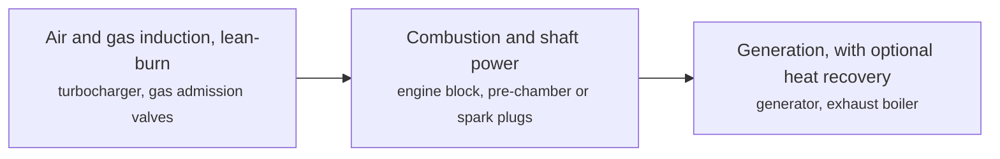

**Key equipment:** gas engine, generator, turbocharger, exhaust after-treatment, cooling system, gas engine prime mover, alternator, packaged genset enclosure, jacket-water and radiator cooling, lube oil system, fuel gas train and storage, exhaust silencer and SCR, starting air, paralleling controller, generator circuit breaker and MV switchgear, absorption chiller for waste heat, foundation and vibration isolation, diesel generator, solar hybrid, wireless instrumentation, gas export compressor.

**Performance:**
- 18V50SG electrical efficiency (50 Hz): 50.2 %; output 18,434 kW; 5% tolerance on efficiency. [source](https://www.wartsila.com/energy/solutions/engine-power-plants/wartsila-50sg-gas-engine)
- 50SG start to grid connection: 30 s; fast start to full load under 2 minutes. [source](https://www.wartsila.com/energy/solutions/engine-power-plants/wartsila-50sg-gas-engine)
- engine plant simple-cycle efficiency: 50 % (or more); up to 54% in Flexicycle configuration. [source](https://www.wartsila.com/energy/engine-power-plant-solutions/flexible-baseload-power-plants)
- CHP efficiency, Wärtsilä 31SG: 90 %; vendor claim. [source](https://www.wartsila.com/energy/engine-power-plant-solutions/flexible-baseload-power-plants)
- minimum load, 50SG: 10 % at unit level; 1% at plant level with multiple engines. [source](https://www.wartsila.com/energy/solutions/engine-power-plants/wartsila-50sg-gas-engine)

**Costs:**
- total installed cost, gas engine in grid-interconnected CHP application: 1433-2900 USD/kW (2013) (2013$); Total plant cost by baseload capacity: 100 kW $2,900; 633 kW $2,837; 1,121 kW $2,366; 3,326 kW $1,801; 9,341 kW $1,433. Covers gen-set, heat recovery (exhaust economiser, jacket-coolant HX, pump, controls, piping), interconnection/paralleling, exhaust treatment, labour and materials, engineering, project management, 5% contingency and project financing. Compiled by ICF from vendor data.. [source](https://www.epa.gov/sites/default/files/2015-07/documents/catalog_of_chp_technologies_section_2._technology_characterization_-_reciprocating_internal_combustion_engines.pdf)
- total installed cost, reciprocating engine CHP: 2000-4250 USD/kW (2020) (2020$); DOE fact sheet by size: 35 kW $4,250; 100 kW $3,700; 250 kW $3,450; 500 kW $3,150; 1 MW $2,800; 2 MW $2,550; 3 MW $2,350; 4.5 MW $2,000. Independent of the EPA table and higher at the small end (100 kW: $3,700 in 2020$ vs $2,900 in 2013$) — use as a budget range, not a market price.. [source](https://betterbuildingssolutioncenter.energy.gov/sites/default/files/attachments/CHP_Reciprocating_Engines.pdf)

**Reference plants:**
- PLTD Pesanggaran, Bali (PT Indonesia Power), ID: 200 MW, 12 x Wärtsilä 50DF multi-fuel engines; in operation; delivered 2015 and began on HFO, primarily LNG since July 2016 (largest engine-based power plant in Indonesia). [source](https://www.wartsila.com/energy/learn-more/references/utilities/pesanggaran-bali)

TRL source: [DOE/EE-2764 (Aug 2023): 'Reciprocating internal combustion engines are a mature technology'; over 2,700 US sites with engine CHP, aggregate ~2.9 GW; read 2026-11-16](https://betterbuildingssolutioncenter.energy.gov/sites/default/files/attachments/CHP_Reciprocating_Engines.pdf)

Sources: [1](https://www.wartsila.com/energy/solutions/engine-power-plants/wartsila-50sg-gas-engine), [2](https://www.wartsila.com/energy/engine-power-plant-solutions/flexible-baseload-power-plants), [3](https://www.wartsila.com/energy/learn-more/references/utilities/pesanggaran-bali), [4](https://en.wikipedia.org/wiki/Gas_engine), [5](https://www.wartsila.com/energy/engine-power-plant-solutions/flexible-baseload-power-plants/data-center-power-solutions), [6](https://www.jenbacher.com/en/energy-solutions/industries/data-center/), [7](https://download.se.com/files?amp%3Bp_enDocType=White+Paper&p_Doc_Ref=SPD_286_EN), [8](https://www.cummins.com/sites/default/files/2024-08/t035-Gas-Power-Plant-application-manual.pdf), [9](https://uptimeinstitute.com/tiers). Last reviewed 2026-11-24.

## Gas-fired steam and hot-water boilers
<a id="pwr-gas-fired-boilers"></a>

A gas-fired boiler burns natural gas (or another gaseous fuel) in a contained furnace and transfers the heat through pressure-part surfaces to water, producing steam or hot water. Package fire-tube boilers pass hot gas through tubes surrounded by water; water-tube boilers pass water through tubes in the gas path and separate steam in a drum or use once-through circuits; condensing designs cool the flue gas below its dew point to recover latent heat. Low-NOx burners, flue-gas recirculation and post-combustion catalysts control emissions. Heat recovery steam generators raise steam from gas-turbine exhaust and may burn additional gas in the duct.

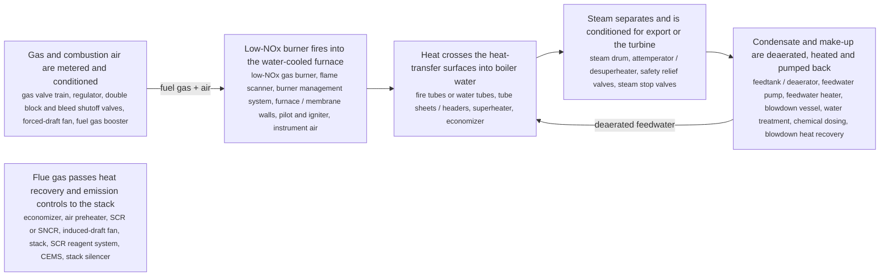

**Key equipment:** low-NOx / ultra-low-NOx gas burner, burner management and flame safeguard system, fuel gas train, furnace and membrane water walls, fire tubes or water tubes and tube sheets, steam drum and mud drum, superheater and attemperator, economizer, air preheater, deaerator and feedwater pump, safety relief valves and blowdown system, forced- and induced-draft fans, SCR / SNCR and CEMS, boiler controls and oxygen trim, boiler feedwater pretreatment, RO/EDI make-up treatment, chemical dosing, deaerator and feedtank, blowdown heat recovery, steam traps and condensate return, instrument air, fuel gas booster, SCR reagent system, CEMS.

**Performance:**
- minimum combustion efficiency, large gas-fired commercial hot-water boiler: 96 % Ec; US DOE FEMP purchasing requirement for 2.5-10 MMBtu/hr input gas-fired hot-water boilers, based on 10 CFR 431.86; federal purchase minimum, not a product rating.. [source](https://www.energy.gov/cmei/femp/purchasing-energy-efficient-boilers)
- AHRI thermal efficiency, condensing gas hot-water boiler: 94.7-96 %; Cleaver-Brooks ClearFire-CE technical data: AHRI combustion 94.7%, AHRI thermal 96.0%; 'up to 99%' is OEM marketing wording and is not used here.. [source](https://cleaverbrooks.com/product/cfce)
- NOx, natural-gas low-NOx burner without FGR: 9-40 ppm; Zeeco PLN brochure ladder: 40 ppm at 40% excess air, 30 at 45%, 15 at 50%, 9 at 60%; the page does not state the O2 reference basis, so these are not directly comparable to 3%-O2 figures.. [source](https://zeeco.com/resources/brochures/pln-ultra-low-nox-package-burner)
- NOx, natural-gas burner at about 3% O2 without FGR: 15-30 ppm at about 3% O2; Cleaver-Brooks SBR-30 under 30 ppm; John Zink ECOjet Edge+ as low as 15 ppm without FGR in select applications (vendor claims).. [source](https://cleaverbrooks.com/product/sbr30-burner)
- NOx, ultra-low-NOx burner with flue-gas recirculation: 5 ppm at about 3% O2; Cleaver-Brooks SBR-5 with induced FGR at about 3% O2 (body states 3-4%); ALZETA surface-stabilised burner below 5 ppm corrected to 3% O2.. [source](https://cleaverbrooks.com/product/sbr5-burner)
- turndown, package gas burners: 10 :1; Cleaver-Brooks SBR-30/SBR-5 and Zeeco PLN/GO stated firing turndown on gaseous fuel; ClearFire-CE condensing boiler also 10:1.. [source](https://cleaverbrooks.com/product/sbr30-burner)
- efficiency improvement per feedwater temperature rise: 2 % per 10 degC; Spirax Sarco: in broad terms each 10 C increase in feedwater temperature gives about a 2% boiler efficiency improvement.. [source](https://spiraxsarco.com/learn-about-steam/the-boiler-house/miscellaneous-boiler-types-economisers-and-superheaters?sc_lang=en-GB)
- US combined-cycle capacity equipped with duct burners: 208 GW; About 75% of the 278 GW US combined-cycle fleet, EIA data from EIA-860 and EIA-923, article 15 June 2022.. [source](https://www.eia.gov/todayinenergy/detail.php?id=52778)

**Reference plants:**
- Sultan Ibrahim power plant, Track 4A (Pasir Gudang, Johor), MY: 1,440 MW total; two 9HA.02 gas turbines, two once-through HRSGs; operating. [source](https://www.gevernova.com/gas-power/resources/case-studies/southern-power-generations-track-4a-employs-9ha)
- GS Caltex Yeosu complex (SOLEX burner retrofit), KR: 32 SOLEX burners; under 5 ppm NOx, SCR avoided; operating. [source](https://johnzink.com/products/powerburners/ecojet-edge-plus)

**Missing inputs:**
- installed cost per kW or per t/h of steam for gas-fired package boilers in 2026 USD (costs): No page read in this sweep states a boiler installed cost with a dollar year; DOE FEMP cost examples on the read page omit the year. Where: DOE FEMP boiler purchasing guide and recent EPC cost benchmarks; record the cost year (catalog: doe-femp-boilers). Next: Find a dated installed-cost reference before adding any cost figure to this card.
- site-specific NOx on a common O2 basis for the named burners (performance): Zeeco quotes ppm at varying excess air without an O2 basis, while Cleaver-Brooks, ALZETA and Miura quote ppm at about 3% O2. Where: Vendor emission test sheets stating the O2 reference and fuel (catalog: zeeco-pln-burner). Next: Normalise the figures to a stated O2 basis before comparing them.
- named 100% natural-gas-fired CFB boiler plant with owner, capacity and status (reference_plants): Read OEM pages cover solid/multi-fuel CFB; the Zeeco gas-conversion paper PDF was not fetched and the EPA 40 ppm datum is an alumina calciner, not a boiler. Where: Zeeco/ASME POWER2014-32258 paper and CFB operators' conversion case studies (catalog: zeeco-cfb-gas-conversion). Next: Read the conversion paper and record a named plant if one is identified.
- duct-burner fuel input range and FGR ratios with design basis (performance): Read HRSG pages give burner types and inspection limits but no quantified duct-firing duty or FGR ratio. Where: HRSG OEM duct-burner specification sheets with heat input (catalog: tetra-duct-burners). Next: Add a sourced duty range when a specification sheet is read.
- Product catalogs and PFD/P&ID coverage across every equipment class (other): Product and drawing records are catalogued at the publisher's URL; not every equipment class has a directly fetchable specification sheet or diagram. Where: OEM product catalogs, DOE/EPA steam sourcebooks and vendor installation manuals (catalog: doe-steam-systems). Next: Fill the per-class product and drawing gaps listed on the new records when a citable page is read.

Sources: [1](https://spiraxsarco.com/learn-about-steam/the-boiler-house/shell-boilers?sc_lang=en-GB), [2](https://spiraxsarco.com/learn-about-steam/the-boiler-house/water-tube-boilers?sc_lang=en-GB), [3](https://www.energy.gov/cmei/femp/purchasing-energy-efficient-boilers), [4](https://cleaverbrooks.com/product/cfce), [5](https://cleaverbrooks.com/product/sbr5-burner), [6](https://zeeco.com/resources/brochures/pln-ultra-low-nox-package-burner), [7](https://johnzink.com/products/powerburners/ecojet-edge-plus), [8](https://www.gevernova.com/gas-power/products/hrsg), [9](https://www.eia.gov/todayinenergy/detail.php?id=52778), [10](https://www.asme.org/certification-accreditation/boiler-and-pressure-vessel-certification). Last reviewed 2026-11-24.

## Geothermal (flash and binary cycle)
<a id="pwr-geothermal-flash-binary"></a>

Hot water or steam from wells drives a turbine directly (dry steam, flash at 200 °C and above) or heats a secondary fluid in an organic Rankine cycle (binary, 110 to under 200 °C). NREL's 2024 baseline sizes a hydrothermal flash plant at 40 MWe, 225 °C, 2.5 km, and a binary plant at 30 MWe, 175 °C, 1.5 km.

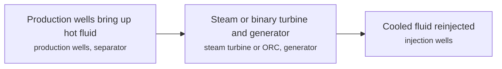

**Key equipment:** production and injection wells, separator, steam turbine or organic Rankine unit, condenser, generator.

**Performance:**
- flash plant representative size and resource: 40 MWe at 225 °C, 2.5 km; NREL ATB 2024 representative plant. [source](https://atb.nrel.gov/electricity/2024/geothermal)
- binary plant representative size and resource: 30 MWe at 175 °C, 1.5 km; NREL ATB 2024 representative plant. [source](https://atb.nrel.gov/electricity/2024/geothermal)

**Costs:**
- overnight capital cost, hydrothermal: 4759-6349 USD/kW; flash 4,759, binary 6,349; example values, dollar year not stated on the page (base year 2022). [source](https://atb.nrel.gov/electricity/2024/geothermal)

**Reference plants:**
- Hellisheidi geothermal power plant, Hengill, Iceland (ON Power), IS: 303 MWe plus 200-400 MWth hot-water supply; commissioned in five stages 2006-2011; Iceland's largest geothermal CHP plant; operating. [source](https://verkis.com/projects/energy/hellisheidi-power-plant)

TRL source: [IEA ETP Clean Energy Technology Guide, dataset of 24 July 2026, latest assessment (IEA 1-11 scale): 'Flash steam geothermal power plant (hot water)' 9 (2025); 'Organic rankine cycle (low temperature resources)' 9 (2025)](https://www.iea.org/data-and-statistics/data-tools/etp-clean-energy-technology-guide)

Sources: [1](https://atb.nrel.gov/electricity/2024/geothermal), [2](https://en.wikipedia.org/wiki/Geothermal_power). Last reviewed 2026-10-29.

## Grid-forming inverters and synchronous condensers
<a id="pwr-grid-forming-inverters"></a>

Grid-forming inverters set their own voltage and frequency, partly mimicking synchronous generators, whereas grid-following inverters need a stable grid to follow. Synchronous condensers add real inertia and short-circuit strength.

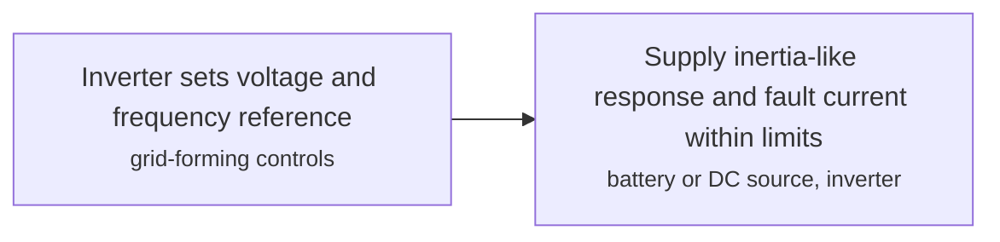

**Key equipment:** grid-forming inverter, battery storage, synchronous condenser, control software.

**Performance:**
- grid-following loss in Blue Cut Fire event, 2016: 1200 MW PV lost (largest single); inverters tripped on faults under 60 ms. [source](https://en.wikipedia.org/wiki/Grid-forming_inverter)
- Hornsdale Power Reserve grid-forming operation: 100-150 MW discharge (100 MW / 129 MWh at Nov 2017 commissioning; expanded by 50 MW / 64.5 MWh from 2020); world's first big battery, first 100 MW / 129 MWh completed November 2017 (hornsdalepowerreserve.com.au); AEMO approved Hornsdale's grid-forming inverters to deliver inertia services into the South Australian grid (Neoen). [source](https://hornsdalepowerreserve.com.au)

**Costs:**
- Hornsdale grid-forming expansion cost: 71 million AUD (50 MW / 64.5 MWh expansion); "The $71 million project will see the current 100 MW / 129 MWh battery expanded" (ARENA, 19 Nov 2019), demonstrating grid-scale batteries providing grid-forming services. [source](https://arena.gov.au/news/worlds-largest-scale-battery-set-to-get-even-bigger)

**Reference plants:**
- Hornsdale Power Reserve, South Australia (Neoen/Tesla), AU: 100 MW / 129 MWh lithium-ion big battery (Nov 2017) expanded by 50 MW / 64.5 MWh; first grid-forming-inverter inertia services approved by AEMO; operating. [source](https://hornsdalepowerreserve.com.au)

TRL source: [IEA ETP Clean Energy Technology Guide, dataset of 24 July 2026, latest assessment (IEA 1-11 scale): 'Battery storage system with grid-forming inverter' 9 (2025)](https://www.iea.org/data-and-statistics/data-tools/etp-clean-energy-technology-guide)

Sources: [1](https://en.wikipedia.org/wiki/Grid-forming_inverter), [2](https://arena.gov.au/news/worlds-largest-scale-battery-set-to-get-even-bigger). Last reviewed 2026-10-29.

## HVDC transmission and interconnectors
<a id="pwr-hvdc-transmission"></a>

Converter stations change AC to DC for long-distance or subsea transmission with lower losses than AC lines. Line-commutated (LCC) converters suit bulk power and AC interconnections; voltage-source converters (VSC) are compact and suit offshore wind.

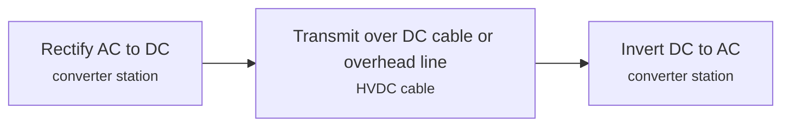

**Key equipment:** converter stations, HVDC cables or overhead lines, converter transformers, DC breakers (emerging).

**Performance:**
- world-record UHVDC voltage and capacity (Changji-Guquan, China): 1100-12 kV DC bipolar voltage (±1,100) and GW transmission capacity (12 GW over about 3,300 km); ±1,100 kV Changji (Xinjiang) to Guquan (Anhui) UHVDC link, 12,000 MW, world records in voltage, capacity and distance; full-voltage transmission began January 2019; loss-per-1,000-km figure not stated in the pages read. [source](https://www.jiludb.com/en/record/highest-voltage-power-transmission-project)

**Costs:**
- capital cost, HVDC transmission line: 0.3-0.34 USD million per km (2010$); Line only - converter stations excluded, and no per-MW figure is separable; average about $0.30M/km, example $275M for an 805 km line.. [source](https://documents1.worldbank.org/curated/en/099040926152055780/pdf/P506480-a2f4b5e4-cca9-437b-b33d-38293adae0e7.pdf)

**Reference plants:**
- Changji-Guquan ±1,100 kV UHVDC link, China (SGCC), CN: ±1,100 kV, 12 GW, about 3,300 km from Xinjiang to Anhui; world's highest-voltage DC transmission; full-voltage operation January 2019; operating. [source](https://www.powermag.com/press-releases/abb-wins-orders-of-over-300-million-for-worlds-first-1100-kv-uhvdc-power-link-in-china)

TRL source: [IEA ETP Clean Energy Technology Guide, dataset of 24 July 2026, latest assessment (IEA 1-11 scale): 'HVDC power transmission' 9 (2025)](https://www.iea.org/data-and-statistics/data-tools/etp-clean-energy-technology-guide)

Sources: [1](https://www.hitachienergy.com/products-and-solutions/hvdc), [2](https://en.wikipedia.org/wiki/High-voltage_direct_current). Last reviewed 2026-11-16.

## Heavy-duty gas turbines (H and J class)
<a id="pwr-heavy-duty-gas-turbines"></a>

Large frame gas turbines compress air, burn natural gas at firing temperatures above 1,400 °C and expand the gas through a turbine that drives the compressor and a generator. H- and J-class machines are the most efficient frames: GE Vernova's 7HA.03 is rated 430 MW net in 60 Hz service and Mitsubishi's M701J/JAC series exceeds 64% combined-cycle efficiency on a lower-heating-value basis.

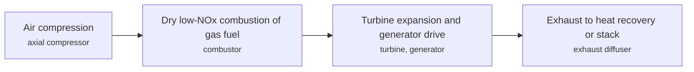

**Key equipment:** axial compressor, dry low-NOx combustor, turbine section, generator, inlet air filtration.

**Performance:**
- 7HA.03 output (60 Hz, simple cycle): 430 MW net; vendor page; simple-cycle range 290 to 430 MW across the 7HA family. [source](https://www.gevernova.com/gas-power/products/gas-turbines/7ha)
- 7HA net combined-cycle efficiency: 63-64 % (vendor basis not stated on page); vendor claim. [source](https://www.gevernova.com/gas-power/products/gas-turbines/7ha)
- 7HA.03 net plant efficiency, 1 on 1: 57.6 % HHV; EPA technical support document table. [source](https://www.epa.gov/system/files/documents/2024-04/tsd-efficient-generation-combustion-turbine-egus-april-2024.pdf)
- M701J/JAC combined-cycle efficiency: 64 % LHV (more than); vendor claim, 1-on-1 plant output 650 to 840 MW. [source](https://power.mhi.com/products/gasturbines/lineup/m701j)
- 7HA hot restart to full gas-turbine load: 10-21 min; 7HA.02 10 min, 7HA.03 21 min. [source](https://www.gevernova.com/gas-power/products/gas-turbines/7ha)
- hydrogen co-firing capability: 30-50 % hydrogen by volume; GE 7HA up to 50%; MHI says 30% demonstrated on M701J. [source](https://www.gevernova.com/gas-power/products/gas-turbines/7ha)

**Costs:**
- overnight capital cost, heavy-duty gas turbine: 836-921 USD per kW (2023$); Simple cycle 1xH-class 419 MW $836/kW; combined cycle 2x2x1 $868/kW; single-shaft CC 1x1x1 $921/kW. Overnight capital, no financing.. [source](https://www.eia.gov/analysis/studies/powerplants/capitalcost/pdf/capital_cost_AEO2025.pdf)

**Reference plants:**
- Hamriyah Independent Power Plant (3 x GE 9HA.01), United Arab Emirates: 1.8 GW; commercial operation October 2023. [source](https://www.gevernova.com/news/press-releases/sewa-shipco-ge-vernova-announce-commercial-operations-of-hamriyah-ipp-meas-most)

TRL source: [IEA ETP Clean Energy Technology Guide, dataset of 24 July 2026, latest assessment (IEA 1-11 scale): 'H₂ blending in natural gas turbine' 9 (2025)](https://www.iea.org/data-and-statistics/data-tools/etp-clean-energy-technology-guide)

Sources: [1](https://www.gevernova.com/gas-power/products/gas-turbines/7ha), [2](https://power.mhi.com/products/gasturbines/lineup/m701j), [3](https://www.epa.gov/system/files/documents/2024-04/tsd-efficient-generation-combustion-turbine-egus-april-2024.pdf), [4](https://en.wikipedia.org/wiki/Gas_turbine). Last reviewed 2026-11-16.

## Hydropower
<a id="pwr-hydropower"></a>

Water driven through turbines at a dam or run-of-river site generates power; reservoirs add storage. NREL's 2024 baseline gives new-stream-reach development costs of $6,574 to $8,611/kW and non-powered-dam costs of $3,045 to $20,043/kW, with capacity factors of 0.33 to 0.67.

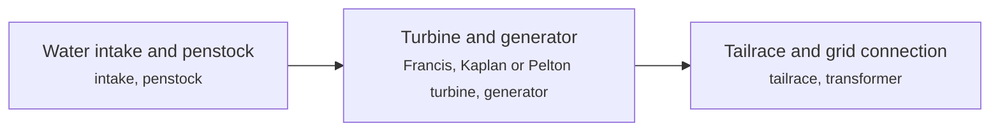

**Key equipment:** dam or weir, penstock, turbine, generator.

**Performance:**
- capacity factor, non-powered dams: 0.333-0.623 fraction; representative plants NPD 1 to 8. [source](https://atb.nrel.gov/electricity/2024/hydropower)
- capacity factor, new stream-reach: 0.624-0.665 fraction; NSD 1 to 4. [source](https://atb.nrel.gov/electricity/2024/hydropower)

**Costs:**
- overnight capital cost, new stream-reach: 6574-8611 USD/kW; base year; dollar year not stated on the page. [source](https://atb.nrel.gov/electricity/2024/hydropower)
- overnight capital cost, hydropower: 3045-20043 USD per kW (2023$); NREL ATB 2025 base year 2022 plant: new planned development $3,045-20,043/kW, new site development $6,574-8,611/kW. EIA cross-check $7,073/kW for 100 MW new stream-reach. Both in 2023 USD, which answers the dollar-year question in the gap.. [source](https://atb.nrel.gov/electricity/2025/hydropower)

**Reference plants:**
- Bakun Hydroelectric Plant, Sarawak, Malaysia (Sarawak Energy), MY: 2,400 MW turbine capacity (installed 2,520 MW per 2026 trade press); commissioned 2011; 205 m concrete-faced rockfill dam; firm energy about 1,771 MW; Southeast Asia's largest hydropower installation; operating. [source](https://www.sarawakenergy.com/bakun-hydroelectric-plant)

TRL source: [IEA ETP Clean Energy Technology Guide, dataset of 24 July 2026, latest assessment (IEA 1-11 scale): 'Hydropower' 9 (2025)](https://www.iea.org/data-and-statistics/data-tools/etp-clean-energy-technology-guide)

Sources: [1](https://atb.nrel.gov/electricity/2024/hydropower), [2](https://www.sarawakenergy.com/bakun-hydroelectric-plant), [3](https://en.wikipedia.org/wiki/Hydropower). Last reviewed 2026-11-16.

## Large light-water reactors
<a id="pwr-large-light-water-reactors"></a>

Pressurised and boiling water reactors above 300 MWe use water as coolant and moderator to raise steam for turbines. The World Nuclear Association lists 316 operable PWRs (306.2 GWe) and 60 BWRs (61.0 GWe), with licence extensions to 60 years and sometimes 80 years.

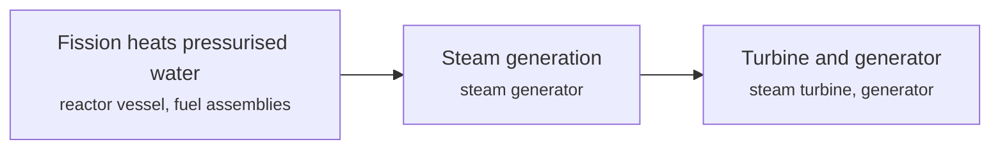

**Key equipment:** reactor pressure vessel, steam generators, primary pumps, containment, turbine generator.

**Performance:**
- operable PWRs worldwide: 316 reactors (306.2 GWe); WNA table, page dated 5 August 2026. [source](https://world-nuclear.org/information-library/nuclear-fuel-cycle/nuclear-power-reactors/nuclear-power-reactors)
- operable BWRs worldwide: 60 reactors (61.0 GWe); WNA table. [source](https://world-nuclear.org/information-library/nuclear-fuel-cycle/nuclear-power-reactors/nuclear-power-reactors)

**Costs:**
- Barakah four-unit plant cost (financing basis) and build time: 4360 USD/kW derived (USD 24.4 bn for 5.6 GW); build time 12 years (2012-2024) (2016$); derived: "The UAE's nuclear energy project has completed a $24.4bn [financing]... four 1,400 megawatt nuclear reactors" (Gulf Business, Oct 2016); 24.4e9 / 5.6e6 = 4,357 USD/kW. Financing-basis figure, not a settled overnight cost; construction ran 2012 to Unit-4 grid connection in March 2024. [source](https://gulfbusiness.com/en/2016/energy/uaes-nuclear-power-project-raises-24-4bn-financing)

**Reference plants:**
- Barakah Nuclear Energy Plant, UAE (ENEC/NAWAH), AE: four APR1400 units, 5.6 GW total, about 25% of UAE electricity; construction from 2012; Unit 4 grid-connected March 2024; ~40 TWh/yr; operating. [source](https://www.world-nuclear-news.org/articles/barakah-4-landmark-announced-as-world-nuclear-symp)

TRL source: [IEA ETP Clean Energy Technology Guide, dataset of 24 July 2026, latest assessment (IEA 1-11 scale): 'Generation III/III+ large reactors' 9 (2025)](https://www.iea.org/data-and-statistics/data-tools/etp-clean-energy-technology-guide)

Sources: [1](https://world-nuclear.org/information-library/nuclear-fuel-cycle/nuclear-power-reactors/nuclear-power-reactors), [2](https://gulfbusiness.com/en/2016/energy/uaes-nuclear-power-project-raises-24-4bn-financing), [3](https://en.wikipedia.org/wiki/Light-water_reactor). Last reviewed 2026-10-29.

## Lithium-ion battery energy storage
<a id="pwr-lithium-ion-bess"></a>

Lithium-ion cells (mainly LFP for stationary use since 2022) store grid power for short durations. NREL's 2024 baseline uses an 85% round-trip efficiency, 15 year life with augmentation, and projects capex cuts for a 60 MW, 4-hour system of 18, 37 or 52% by 2035.

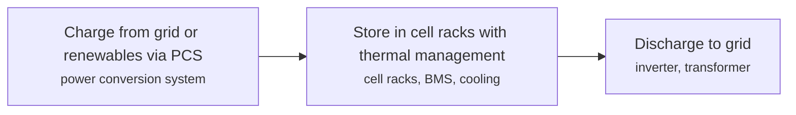

**Key equipment:** battery racks, battery management system, power conversion system, thermal management, fire protection.

**Performance:**
- round-trip efficiency: 85 %; NREL ATB 2024 assumption. [source](https://atb.nrel.gov/electricity/2024/utility-scale_battery_storage)
- design life: 15 years; with augmentation. [source](https://atb.nrel.gov/electricity/2024/utility-scale_battery_storage)
- capex reduction 2022 to 2035, 60 MW 4-hour: 18-52 % (conservative to advanced); moderate 37%. [source](https://atb.nrel.gov/electricity/2024/utility-scale_battery_storage)

**Costs:**
- total capital cost, 4-hour lithium-ion BESS: 436-1744 USD per kW and USD per kWh (2023$); 150 MW/600 MWh greenfield: $1,744/kW and $436/kWh (EPC plus owner's costs). NREL's 2025 projection for 4-hour systems is $147-339/kWh.. [source](https://www.eia.gov/analysis/studies/powerplants/capitalcost/pdf/capital_cost_AEO2025.pdf)

**Reference plants:**
- Edwards & Sanborn Solar + Energy Storage project, Kern County, California (Terra-Gen), US: about USD 2 bn project: 875 MW solar PV with 3,287 MWh of lithium-ion battery storage (about 1,300 MW discharge); largest of its kind when completed; first phases from 2021, full operation 2023; operating. [source](https://centralcalifornia.org/solar-energy-project-extending-onto-edwards-air-force-base-becomes-kerns-largest-2)

TRL source: [IEA ETP Clean Energy Technology Guide, dataset of 24 July 2026, latest assessment (IEA 1-11 scale): 'Lithium-ion storage battery' 9 (2025)](https://www.iea.org/data-and-statistics/data-tools/etp-clean-energy-technology-guide)

Sources: [1](https://atb.nrel.gov/electricity/2024/utility-scale_battery_storage), [2](https://en.wikipedia.org/wiki/Battery_storage_power_station). Last reviewed 2026-11-16.

## Mobile gas turbine power plants
<a id="pwr-mobile-gas-turbine-plants"></a>

Aeroderivative gas turbines (LM2500, Industrial Trent 60, FT8, LM6000) packaged on trailers or single-lift skids with generator, enclosure and auxiliaries, so a complete simple-cycle power plant ships by road, sea or air and reaches full load within days to weeks of arrival. Units are fleet-operated for rental bridge power (APR Energy) or sold as packages (GE Vernova TM2500, PROENERGY PE6000), typically 20 to 50 MW each and multipliable to hundreds of MW.

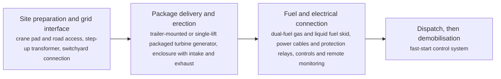

**Key equipment:** aeroderivative gas turbine, generator, trailer or skid package enclosure, step-up transformer, switchgear, dual-fuel system.

**Performance:**
- TM2500 net output at 50 Hz (ISO, natural gas): 34.5-34.6 MW; DLE variant 34.5 MW, SAC variant 34.6 MW net; headline rating up to 37 MW simple cycle. [source](https://www.gevernova.com/gas-power/products/gas-turbines/tm2500)
- TM2500 net efficiency, DLE, 50 Hz: 39.5 %; net LHV on natural gas; SAC variant 34.8%; page headline approximately 40%. [source](https://www.gevernova.com/gas-power/products/gas-turbines/tm2500)
- TM2500 installation time: 14-30 days; about 14 days to install; grid power within 30 days of contract signature; 5-minute start. [source](https://www.gevernova.com/gas-power/products/gas-turbines/tm2500)
- Siemens SGT-A45 TR mobile unit output: up to 44 MW; up to 44 MW, Industrial Trent 60 based, installed in less than two weeks, full power less than 9 minutes from start. [source](https://www.powermag.com/press-releases/siemens-new-44-megawatt-aeroderivative-gas-turbine-for-mobile-power-generation)
- PROENERGY PE6000 gross output: 50.2 MW; gross heat rate 8,800 Btu/kWh; 5-minute start; factory enclosure unloaded in a single lift; 35% hydrogen ready. [source](https://www.proenergyservices.com/solutions/manufactured-equipment/pe6000/)
- APR Energy deployment time: 30-90 days; 30 to 90 days average, some projects in 15 days; 20-35 MW ISO per unit; fleet over 1.1 GW. [source](https://web.archive.org/web/20260715202302/https://www.aprenergy.com/our-technology/gas-turbines/)

**Costs:**
- rental cost, 25-35 MW mobile gas turbine: 1.2e+06-2.5e+06 USD per month (2025$); Rental or lease for a TM2500-class set (about $40-70/kW-month), fuel excluded, vendor-side indicative; trade range $18,000-28,000/MW-month. Capital anchor if needed: EIA aeroderivative $1,606/kW.. [source](https://megagridsupply.com/tm2500-rental)

**Reference plants:**
- 38 TM2500 units across Algeria, Algeria: 38 units; operating; fleet of more than 350 units installed worldwide. [source](https://www.gevernova.com/gas-power/products/gas-turbines/tm2500)
- SAPN bridge power, South Australia, Australia: 276 MW; APR Energy rapid deployment reference. [source](https://web.archive.org/web/20260715202302/https://www.aprenergy.com/)
- GE TM2500 mobile power for remote Indonesia, ID: TM2500 mobile generators on two-trailer assemblies, more than 25 MW per unit, delivering electricity to Indonesia's remote areas (2016); operating. [source](https://jakartaglobe.id/context/ges-power-plant-wheels-delivers-electricity-indonesias-remote-areas)

**Missing inputs:**
- capital cost per kW (rental is now recorded; capex is not) (costs): Rental and lease rates are recorded. A capex figure for a mobile set was not found - the EIA aeroderivative number is a comparable, not this product. Where: arXiv and open-access journals: techno-economic studies of rental or mobile peaking capacity (catalog: arxiv, open); Vendor quotations and cost databases; paid sources are catalog-only (paid); OSTI.GOV reports; osti.gov is unreachable from this machine (catalog: osti, open). Next: Leave open until a source states this metric and scope.
- TRL with a cited source (trl): No agency TRL row corresponds to this power technology in the IEA guide. Checked 2026-11-16. Where: IEA ETP Clean Energy Technology Guide (already searched, 634 rows) (open); Sector regulator or industry body publishing a TRL for this class (open). Next: Add the TRL only when an agency publishes one for this technology; do not infer it from 'commercial' maturity.

Sources: [1](https://www.gevernova.com/gas-power/products/gas-turbines/tm2500), [2](https://www.proenergyservices.com/solutions/manufactured-equipment/pe6000/), [3](https://www.proenergyservices.com/solutions/manufactured-equipment/package/), [4](https://web.archive.org/web/20260715202302/https://www.aprenergy.com/our-technology/gas-turbines/), [5](https://www.powermag.com/press-releases/siemens-new-44-megawatt-aeroderivative-gas-turbine-for-mobile-power-generation), [6](https://www.siemens-energy.com/global/en/home/products-services/product-offerings/gas-turbines.html), [7](https://www.gevernova.com/content/dam/gepower-new/global/en_US/downloads/gas-new-site/resources/GEA31885B-TM2500DLE-brochure.pdf). Last reviewed 2026-11-16.

## Modular ORC units for waste heat and small geothermal
<a id="pwr-modular-orc-units"></a>

Organic Rankine Cycle modules in the tens of kW to multi-MW range convert heat sources from about 70 to 400 degrees C into electricity using a low-boiling working fluid in a skid- or container-mounted unit. Climeon's HeatPower 300 makes 50-355 kW net from heat as cool as 75 degrees C for ships; Enogia builds 10-180 kWe micro-modules; Exergy supplies plants from 100 kW to 50 MWe around its radial outflow turbine; Turboden and Ormat cover the multi-MW geothermal and industrial market with hundreds of plants installed.

```mermaid
flowchart LR
    HEAT["Heat source collection<br/><small>jacket water, exhaust or geothermal brine piping, heat source pump (brine)</small>"]
    EVAP["Preheating and evaporation of working fluid<br/><small>preheater, evaporator</small>"]
    EXP["Expansion and power generation<br/><small>turbine or screw expander, generator</small>"]
    COND["Condensation and working fluid return<br/><small>condenser (air or water cooled), working fluid pump</small>"]
    HEAT --> EVAP
    EVAP --> EXP
    EXP --> COND
```

**Key equipment:** evaporator and preheater, expander or radial outflow turbine, generator, condenser, working fluid loop and skid enclosure.

**Performance:**
- Climeon HeatPower 300 net output: 50-355 kW; 50-355 kW net per unit from 1,000-4,500 kW thermal input; heat source as low as 75 degrees C; footprint 5.8 x 2.4 x 2.8 m. [source](https://climeon.com/heatpower-300-technology/)
- Enogia ORC module range: 10-180 kWe; 10, 20, 40, 100 and 180 kWe models; waste heat from 70 degrees C; two pipe connections and one cable. [source](https://www.enogia.com/orc)
- Exergy ORC plant range: 0.1-50 MWe; plants between 100 kW and 50 MWe from heat sources at 80-400 degrees C; radial outflow turbine up to 30 MW and Gemini turbine up to 60 MWe per unit. [source](https://exergyint.com/orc/)
- Turboden installed base: 470 plants; 470+ plants in more than 50 countries, over 1 GWe overall installed capacity; plant sizes grew from 1-2 MWe to 10-20 MWe. [source](https://www.turboden.com/)
- Ormat geothermal fleet: 3200 MW; more than 3,200 MW of geothermal capacity across more than 190 plants, described as modular and flexible. [source](https://www.ormat.com/en/renewables/geothermal/view/?ContentID=89)
- ElectraTherm Power+ Generator output: up to 150 kWe; up to 150 kWe currently available (250 kW in development) from heat sources at 70-150 degrees C. [source](https://electratherm.com/products/)

**Costs:**
- installed cost, waste-heat ORC: 1800-3000 USD per kW; Installed cost for small waste-heat ORC units, clustering at the high end; the paper is around 2011 and does not restate a dollar year; dollar year not stated. [source](https://www.aceee.org/wp-content/uploads/proceedings-1980-2020/2011/0085-000077.pdf)

**Reference plants:**
- Virgin Voyages cruise ships, HeatPower 150, multi-country operation: 900 kW per vessel (six units); in service with Lloyd's Register class approval since 2020. [source](https://climeon.com/references/)
- Maersk Horsburgh retrofit, Denmark (operator): 150 kW; marine retrofit with ABS approval since 2022. [source](https://climeon.com/references/)
- Fervo Energy geothermal order, USA: 300 MWe (largest project named); Turboden homepage names a 300 MWe supply for Fervo Energy. [source](https://www.turboden.com/)
- Velika Ciglena geothermal ORC (Turboden), Croatia: 17.5 MWe gross (one engineering page quotes 10 MWe net); commissioned December 2018. [source](https://www.turboden.com/media/press/504/turboden-completed-the-commissioning-of-the-175-mwe-velika-ciglena-geothermal-plant)

TRL source: [IEA ETP Clean Energy Technology Guide public dataset, row 'Organic rankine cycle (low temperature resources)' TRL 2025; read 2026-11-16](https://www.iea.org/files/57136415-72b6-4548-9deb-f81fc9a6048d/IEACleanTechGuidepublicdataset.csv)

Sources: [1](https://climeon.com/heatpower-300-technology/), [2](https://climeon.com/references/), [3](https://www.enogia.com/orc), [4](https://exergyint.com/orc/), [5](https://exergyint.com/radial-outflow-turbine/), [6](https://www.turboden.com/), [7](https://www.ormat.com/en/renewables/geothermal/view/?ContentID=89), [8](https://electratherm.com/products/), [9](https://www.mdpi.com/2227-9717/11/7/1982). Last reviewed 2026-11-16.

## Modular reciprocating engine power plants
<a id="pwr-modular-engine-plants"></a>

Power plants built from factory-fabricated modules: an engine, generator and auxiliaries are assembled and tested in a factory enclosure (a genset container or a multi-megawatt power block), shipped complete and bolted together on a prepared foundation, with no site welding. Wärtsilä's Modular Block takes one 34SG generating set per block, Rolls-Royce (mtu) offers factory-tested 10, 20 and 30 MW power blocks for plants of five to several hundred megawatts, and Everllence (formerly MAN Energy Solutions) modularises engine-specific systems for its 51/60 series plants.

```mermaid
flowchart LR
    FACTORY["Factory fabrication and testing of modules<br/><small>engine and generator in enclosure, pre-installed auxiliary box modules, factory test bed</small>"]
    SITE["Foundations and bolted erection on site<br/><small>civil foundations, crane, bolted joints, no site welding</small>"]
    BOP["Balance of plant connection<br/><small>fuel gas and liquid fuel systems, closed cooling radiators, HV switchyard</small>"]
    GRID["Commissioning and grid synchronisation<br/><small>plant control system, grid synchronisation</small>"]
    FACTORY --> SITE
    SITE --> BOP
    BOP --> GRID
```

**Key equipment:** gas engine generating set, factory enclosure or power block, auxiliary box modules, cooling radiators, HV switchyard and transformer.

**Performance:**
- Wärtsilä Modular Block output per block: 6-10 MW; one Wärtsilä 34SG generating set per block, 12V/16V/20V configurations; blocks installed side by side. [source](https://www.wartsila.com/insights/article/towards-higher-efficiencies-with-wartsila-modular-block)
- Modular Block erection time: 5 weeks; assembly of a complete block excluding foundations in around five weeks; on-site installation cut from several months to a few weeks. [source](https://www.wartsila.com/insights/article/towards-higher-efficiencies-with-wartsila-modular-block)
- Engine power plant EPC build time: 10 months; notice to proceed to final handover for the 102 MW Dohazari plant in Bangladesh. [source](https://www.wartsila.com/docs/default-source/power-plants-documents/downloads/white-papers/general/wartsila-bwp-combustion-engine-power-plants.pdf)
- mtu modular plant power block sizes: 10-30 MW; factory-tested blocks of 10, 20 and 30 MW; plants grid-connected within 12 to 18 months of ordering. [source](https://www.mtu-solutions.com/na/en/pressreleases/2026/Rolls-Royce-launches-modular-gas-engine-power-plants.html)
- Everllence 51/60 series single-cycle efficiency: 51 % (or more); vendor claim for 200 MW+ baseload plants; combined cycle adds about 4.5 percentage points. [source](https://www.everllence.com/energy/solutions/thermal-power/baseload/)
- Jenbacher Type 6 container rating: 1634-4507 kW; containerised gensets on Type 6 engines, built from two or three pre-assembled modules; Type 2/3/4 containers 249-1,562 kW. [source](https://www.jenbacher.com/en/energy-solutions/containerized-solutions/)

**Reference plants:**
- Dohazari power plant, Bangladesh: 102 MW; delivered in 10 months from notice to proceed to handover. [source](https://www.wartsila.com/docs/default-source/power-plants-documents/downloads/white-papers/general/wartsila-bwp-combustion-engine-power-plants.pdf)
- Texas peaking plant for KPUB, USA: 124 MW; six MAN 18V51/60G engines with prefabricated assemblies; engine delivery 2026, operation 2027. [source](https://www.man-es.com/company/press-releases/press-details/2025/05/22/man-51-60g-engines-bound-for-texas-gas--power-plant)

**Missing inputs:**
- capital cost per kW for a modular engine plant versus a conventional build, with dollar year (costs): Searched three times (2026-10-28, 2026-11-16 twice). No open source states a capital cost per kW for a modular/containerised engine plant, or a premium/discount against a stick-built plant: EIA's AEO2025 capital-cost report has no reciprocating-engine or modular line to cite, the Danish Energy Agency catalogue page 404s, ESMAP's equipment-price study is 403, and vendor pages claim only qualitative savings (Wärtsilä's '20-30% lower CAPEX' names no comparator). The EPA and DOE engine figures now on pwr-gas-engines are engine CHP, not a modular premium. Where: Manufacturer investor material or EPC tender results comparing modular and stick-built engine plants (open); Owner/utility board papers publishing both bids for the same project (open). Next: Treat as unmeasured. Only an owner/utility board paper publishing both bids for one project, or a manufacturer's investor disclosure, can close this; do not derive it by subtracting unrelated figures.
- TRL with a cited source (trl): No agency assigns a TRL or maturity grade to modular engine plants as distinct from the engine itself: the IEA Clean Energy Technology Guide dataset has no such row, and maturity schemes (IEA, DOE, EPA) grade reciprocating/gas engines generically. Commercial deployment is evidenced by the reference plants (Dohazari 102 MW in 10 months; KPUB 124 MW), so the blocker is the missing agency rating, not the technology. Where: IEA ETP Clean Energy Technology Guide (collected): search for reciprocating engine power plants (catalog: iea-reports, open). Next: Leave the TRL empty rather than infer 9; cite the deployment record in prose if a number is demanded.

Sources: [1](https://www.wartsila.com/insights/article/towards-higher-efficiencies-with-wartsila-modular-block), [2](https://www.wartsila.com/media/news/13-06-2019-wartsila-launches-modular-solution-for-providing-ready-to-go-power-plants-3086905), [3](https://www.wartsila.com/docs/default-source/power-plants-documents/downloads/white-papers/general/wartsila-bwp-combustion-engine-power-plants.pdf), [4](https://www.mtu-solutions.com/na/en/pressreleases/2026/Rolls-Royce-launches-modular-gas-engine-power-plants.html), [5](https://www.everllence.com/energy/solutions/thermal-power/baseload/), [6](https://www.jenbacher.com/en/energy-solutions/containerized-solutions/). Last reviewed 2026-11-16.

## Offshore wind (fixed bottom)
<a id="pwr-offshore-wind-fixed"></a>

Large turbines on monopile or jacket foundations in water shallower than 60 m, connected by export cables or HVDC links. NREL's 2024 baseline representative turbine is rated 12 MW with a 216 m rotor and 137 m hub height; near-term costs are higher than earlier projections.

```mermaid
flowchart LR
    TURB["Turbine generates AC<br/><small>12 MW class turbine</small>"]
    ARR["Inter-array cables to an offshore substation<br/><small>inter-array cables, offshore substation</small>"]
    EXP["Export cable to shore, AC or HVDC<br/><small>export cable, HVDC converter</small>"]
    TURB --> ARR
    ARR --> EXP
```

**Key equipment:** turbine, monopile or jacket foundation, inter-array cables, offshore substation, export cable, monopile foundation, jacket foundation, suction bucket jacket, grouted pile connection.

**Performance:**
- representative turbine rating: 12 MW; 216 m rotor, 137 m hub height, base year. [source](https://atb.nrel.gov/electricity/2024/offshore_wind)
- capex learning rate, fixed bottom: 6.3-11.2 % per doubling; conservative to advanced scenario. [source](https://atb.nrel.gov/electricity/2024/offshore_wind)
- global weighted average total installed cost, projects commissioned 2023: 2800 2023 USD/kW (2023$); global weighted average, projects commissioned in 2023. [source](https://www.irena.org/-/media/Files/IRENA/Agency/Publication/2024/Sep/IRENA_Renewable_power_generation_costs_in_2023_executive_summary.pdf)
- global weighted average capacity factor, projects commissioned 2023: 41 %; global weighted average, projects commissioned in 2023 (38% in 2010). [source](https://www.irena.org/-/media/Files/IRENA/Agency/Publication/2024/Sep/IRENA_Renewable_power_generation_costs_in_2023_executive_summary.pdf)
- global weighted average LCOE, projects commissioned 2023: 0.075 2023 USD/kWh (2023$); global weighted average, projects commissioned in 2023; down 63% from 0.203 in 2010. [source](https://www.irena.org/-/media/Files/IRENA/Agency/Publication/2024/Sep/IRENA_Renewable_power_generation_costs_in_2023_executive_summary.pdf)

**Reference plants:**
- Hornsea 2 offshore wind farm, UK North Sea (Orsted), GB: 1.3 GW (165 turbines x 8 MW), world's largest offshore wind farm at full commissioning on 31 Aug 2022; powers about 1.4 million UK homes; operating. [source](https://offshorewind.biz/2022/08/31/worlds-largest-offshore-wind-farm-goes-into-operation)

TRL source: [IEA ETP Clean Energy Technology Guide, dataset of 24 July 2026, latest assessment (IEA 1-11 scale): 'Seabed fixed offshore wind turbine' 9 (2025)](https://www.iea.org/data-and-statistics/data-tools/etp-clean-energy-technology-guide)

Sources: [1](https://atb.nrel.gov/electricity/2024/offshore_wind), [2](https://en.wikipedia.org/wiki/Offshore_wind_power). Last reviewed 2026-11-24.

## Onshore wind
<a id="pwr-onshore-wind"></a>

Horizontal-axis turbines on land convert wind to electricity through a rotor, gearbox or direct-drive generator and a power converter. The IEA Clean Energy Technology Guide rates onshore wind TRL 9. The DOE market report page was not reachable, so figures on turbine size and cost are not yet on this card.

```mermaid
flowchart LR
    ROT["Rotor turns in the wind<br/><small>blades, hub</small>"]
    GEN["Generator and converter<br/><small>gearbox or direct drive, converter</small>"]
    GRID["Collection system and substation<br/><small>transformer, cables</small>"]
    ROT --> GEN
    GEN --> GRID
```

**Key equipment:** rotor, nacelle with generator, tower, converter, foundation.

**Performance:**
- capacity factor, US onshore wind: 37 %; Average 2022 capacity factor for projects built in 2021 was 37%, below 2014-2020 vintages.. [source](https://www.energy.gov/sites/default/files/2023-08/land-based-wind-market-report-2023-edition.pdf)

**Costs:**
- global weighted-average utility-scale onshore wind cost: 1210 USD/kW installed (2018), average LCOE 0.056 USD/kWh (2018$); IRENA, Renewable Power Generation Costs in 2018: utility-scale onshore wind installed costs fell 13% to USD 1,210/kW in 2018 (2018 USD); weighted-average LCOE USD 0.056/kWh. [source](https://www.actu-environnement.com/media/pdf/news-33524-rapport.pdf)

**Reference plants:**
- Fantanele-Cogealac wind farm, Romania: 600 MW (240 x GE 2.5xl); in operation 2012. [source](https://www.power-technology.com/projects/fantanele-cogealac-wind-farm)

TRL source: [IEA ETP Clean Energy Technology Guide, dataset of 24 July 2026, latest assessment (IEA 1-11 scale): 'Onshore wind' 9 (2025)](https://www.iea.org/data-and-statistics/data-tools/etp-clean-energy-technology-guide)

Sources: [1](https://www.iea.org/data-and-statistics/data-tools/etp-clean-energy-technology-guide), [2](https://www.actu-environnement.com/media/pdf/news-33524-rapport.pdf), [3](https://en.wikipedia.org/wiki/Wind_power). Last reviewed 2026-11-17.

## Powerships and power barges
<a id="pwr-powerships-power-barges"></a>

A complete engine or gas-turbine power plant is installed on a ship hull or barge, moored at a port or prepared basin and connected to the onshore grid through a switchyard, so a country adds 30 to 470 MW of capacity in weeks without land acquisition or construction. Karpowership operates the largest fleet (45 powerships, 8,500 MW installed across 20+ countries); vendors such as Power Barge Corporation and Wärtsilä deliver barge-mounted plants from 30 MW gas-turbine barges to 180 MW medium-speed-engine barges, and an estimated 75 or more power barges operate worldwide.

```mermaid
flowchart LR
    PREP["Berth and basin preparation<br/><small>mooring dolphins or quay wall, dredged berth</small>"]
    MOOR["Arrival and mooring of the vessel<br/><small>powership hull or barge, mooring lines</small>"]
    CONNECT["Fuel and grid connection<br/><small>fuel receiving (HFO, distillate or LNG), export cable to onshore substation, step-up transformers</small>"]
    GENERATE["Generation and dispatch to the grid<br/><small>reciprocating engines or gas turbines, onboard generators and switchgear, plant control room</small>"]
    PREP --> MOOR
    MOOR --> CONNECT
    CONNECT --> GENERATE
```

**Key equipment:** self-propelled or towed power barge hull, reciprocating engines or gas turbines, onboard switchgear and export cable, fuel storage and transfer system, mooring system.

**Performance:**
- Karpowership fleet size and capacity: 8500 MW installed; 45 powerships, 8,500 MW installed, 20+ countries, 12 LNG vessels; expansion target 21,000 MW. [source](https://karpowership.com)
- Powership class capacity range: 34-470 MW; Seal class 34-40 MW up to Khan class 415-470 MW; intermediate Orca 200-260, Shark 110-240, Mermaid 70-80. [source](https://karpowership.com/powership-classes-and-fleet/)
- Powership deployment time: 30 days; vendor claim: commissioned in under 30 days; grid connection in weeks, not years. [source](https://karpowership.com/the-powership-solution/)
- Waller Marine Tacoa barges: 171 MW; two barges of 171 MW each, one GE 7FA dual-fuel turbine per barge, in a prepared basin at Tacoa, Venezuela. [source](https://www.marinelink.com/news/waller-marine-installs-floating-power-generation-barges-venezuela-338083)
- Power Barge Corporation product range: 30-300 MW; gas-turbine barges 30-300 MW (simple and combined cycle); medium-speed-engine barges 80-200 MW on gas, diesel, biodiesel or low-sulphur HFO. [source](https://powerbargecorp.com)
- Wärtsilä power barge for Jamaica: 50 MW; repeat order for a 50 MW barge with three Wärtsilä 18V46 generating sets. [source](https://www.wartsila.com/energy/engine-power-plant-solutions/engine-power-plant-products/applications/floating-power-plants)

**Costs:**
- power tariff, powership supply: 0.072-0.095 USD per kWh (2024$); Guyana contract at $0.072/kWh (2024) and $0.09-0.095/kWh under negotiation; a tariff, not a charter rate - Karpowership day rates are confidential.. [source](https://inewsguyana.com/guyana-karpowership-negotiating-9-9-5%C2%A2-per-kwh-power-price-min-indar)

**Reference plants:**
- Estrella del Mar II, Dominican Republic: ; Wärtsilä floating power plant reference. [source](https://www.wartsila.com/energy/engine-power-plant-solutions/engine-power-plant-products/applications/floating-power-plants)
- DR Bird I and II, Jamaica: 50 MW (new unit); Wärtsilä power barges; repeat order for a third 50 MW barge with three 18V46 sets. [source](https://www.wartsila.com/energy/engine-power-plant-solutions/engine-power-plant-products/applications/floating-power-plants)
- Tacoa floating power barges, supplying Caracas, Venezuela: 2 x 171 MW; installed by Waller Marine in a prepared basin. [source](https://www.marinelink.com/news/waller-marine-installs-floating-power-generation-barges-venezuela-338083)
- Karpowership Indonesia floating power plants with PAL Indonesia shipyard cooperation, ID: Karpowership Indonesia operates floating power plants; cooperation agreement with state shipbuilder PAL Indonesia to build power ships for Indonesia (2016); per-ship capacity not stated in the source; operating. [source](https://www.thejakartapost.com/news/2016/10/28/karpowership-pal-to-build-power-ships-to-light-up-indonesia)
- MV Karadeniz Powership Osman Khan (Karpowership), Ghana: 470 MW installed; 450 MW under the ECG PPA; deployed August 2017. [source](https://karpowership.com/media/s1wesz43/ghana.pdf)

**Missing inputs:**
- charter rate and levelised cost (costs): A delivered tariff is recorded ($0.072-0.095/kWh); charter day rates are commercially confidential and unpublished. Where: arXiv and open-access journals: techno-economic studies of powership or barge-mounted generation (catalog: arxiv, open); Regulator filings, for example South Africa NERSA hearings on Karpowership tariffs (open). Next: Leave open until a source states this metric and scope.
- cable routing, on-board substation interface and commissioning-test detail for a powership connection (process): The commercial sequence is now cited (Karpowership); the engineering detail of the shore connection is not published by the operator. Where: Port authority or regulator case documents for a specific powership project (open). Next: Leave open until an operator or equipment source publishes this detail.
- TRL with a cited source (trl): No agency TRL row corresponds to this power technology in the IEA guide. Checked 2026-11-16. Where: IEA ETP Clean Energy Technology Guide (already searched, 634 rows) (open); Sector regulator or industry body publishing a TRL for this class (open). Next: Add the TRL only when an agency publishes one for this technology; do not infer it from 'commercial' maturity.

Sources: [1](https://karpowership.com), [2](https://karpowership.com/the-powership-solution/), [3](https://karpowership.com/powership-classes-and-fleet/), [4](https://karpowership.com/lng-to-power/), [5](https://www.marinelink.com/news/waller-marine-installs-floating-power-generation-barges-venezuela-338083), [6](https://powerbargecorp.com), [7](https://gcaptain.com/power-barge-corporation-announces-new-medium-speed-engine-power-barge-design), [8](https://www.wartsila.com/energy/engine-power-plant-solutions/engine-power-plant-products/applications/floating-power-plants), [9](https://en.wikipedia.org/wiki/Powership), [10](https://karpowership.com/the-powership-solution). Last reviewed 2026-11-16.

## Pumped hydro storage
<a id="pwr-pumped-hydro-storage"></a>

Water is pumped to an upper reservoir when power is cheap and released through turbines when needed. NREL's 2024 baseline uses 80% round-trip efficiency (literature range 70 to 87%) and 8, 10 or 12 hour durations; US capacity was about 23 GW in 2021.

```mermaid
flowchart LR
    PUMP["Pump water uphill<br/><small>reversible pump-turbine</small>"]
    UP["Store in upper reservoir<br/><small>reservoir</small>"]
    GEN["Release through turbine<br/><small>pump-turbine, generator</small>"]
    PUMP --> UP
    UP --> GEN
```

**Key equipment:** upper and lower reservoirs, reversible pump-turbine, tunnels and penstocks, motor-generator.

**Performance:**
- round-trip efficiency: 80 %; literature range 70 to 87%. [source](https://atb.nrel.gov/electricity/2024/pumped_storage_hydropower)
- US deployed capacity: 23 GW; 2021 base year. [source](https://atb.nrel.gov/electricity/2024/pumped_storage_hydropower)

**Costs:**
- overnight capital cost, 10 h, closed loop: 3029-4501 USD/kW (2021$); median by resource class 1 to 15. [source](https://atb.nrel.gov/electricity/2024/pumped_storage_hydropower)
- overnight capital cost, 10 h, one new reservoir: 1730-3250 USD/kW (2021$); median by resource class 1 to 5. [source](https://atb.nrel.gov/electricity/2024/pumped_storage_hydropower)

**Reference plants:**
- Fengning Pumped Storage Power Station, Hebei, China (Grid Corporation), CN: world's most powerful pumped storage station: 3,600 MW installed (12 units), designed to generate 6.61 billion kWh/yr; fully operational December 2024; operating. [source](https://english.news.cn/20241231/bfa9e1c920f34e0194978ad9706f8d0f/c.html)

TRL source: [IEA ETP Clean Energy Technology Guide, dataset of 24 July 2026, latest assessment (IEA 1-11 scale): 'Pumped storage' 9 (2025)](https://www.iea.org/data-and-statistics/data-tools/etp-clean-energy-technology-guide)

Sources: [1](https://atb.nrel.gov/electricity/2024/pumped_storage_hydropower), [2](https://en.wikipedia.org/wiki/Pumped-storage_hydroelectricity). Last reviewed 2026-10-29.

## Smart grids, microgrids and virtual power plants
<a id="pwr-smart-grids-vpp"></a>

Software and communications aggregate distributed solar, batteries, flexible loads and generators so they dispatch like one power plant and provide reserves within seconds to minutes. North American VPP capacity was estimated at 37.5 GW in 2025.

```mermaid
flowchart LR
    AGG["Aggregate distributed resources<br/><small>IoT gateways, aggregation platform</small>"]
    DISP["Dispatch to market or grid operator<br/><small>market interface, control software</small>"]
    AGG --> DISP
```

**Key equipment:** aggregation software, smart meters, gateways, communications.

**Performance:**
- North American VPP capacity: 37.5 GW; 2025. [source](https://en.wikipedia.org/wiki/Virtual_power_plant)
- AGL South Australia VPP: 25-37 MW solar and MW storage; 2025 programme size after AGL acquisition. [source](https://en.wikipedia.org/wiki/Virtual_power_plant)
- share of platform electricity demand met by offshore wind: 35 %; 88 MW Hywind Tampen is expected to meet about 35% of the electricity demand of the Gullfaks and Snorre fields - the closest cited oil-and-gas microgrid case.. [source](https://www.equinor.com/news/20221114-first-power-from-hywind-tampen)

**Costs:**
- cost of VPP-delivered resource versus conventional alternative: 40-60 percent of conventional cost; Brattle finds VPP resources cost about 40-60% of the conventional alternative - a comparative ratio, not an absolute capital cost.. [source](https://www.brattle.com/wp-content/uploads/2023/04/Real-Reliability-The-Value-of-Virtual-Power-Full-Report.pdf)

**Reference plants:**
- Next Kraftwerke Next Pool VPP, Germany (plus seven EU countries): 15,541 MW networked; 14,375 units; operating, Q4 2025 figures. [source](https://www.next-kraftwerke.com/vpp)

TRL source: [IEA ETP Clean Energy Technology Guide, dataset of 24 July 2026, latest assessment (IEA 1-11 scale): 'Virtual power plants' 9 (2025)](https://www.iea.org/data-and-statistics/data-tools/etp-clean-energy-technology-guide)

**Missing inputs:**
- absolute capital and operating cost (costs): Only a comparative ratio is published (40-60% of the conventional alternative); no absolute $/kW for a VPP platform was found. Where: arXiv and open-access journals: techno-economic or review papers (MDPI is blocked by its CDN; use the manual inbox) (catalog: arxiv, open); Licensor and EPC studies; paid cost databases are catalog-only (paid); OSTI.GOV full-text reports from DOE labs: search the technology name plus 'techno-economic' (catalog: osti, open). Next: Leave open until a source states this metric and scope.

Sources: [1](https://en.wikipedia.org/wiki/Virtual_power_plant), [2](https://en.wikipedia.org/wiki/Smart_grid). Last reviewed 2026-11-17.

## Ammonia co-firing in coal boilers
<a id="pwr-ammonia-coal-cofiring"></a>

Ammonia is injected through burners into a pulverised-coal boiler to replace part of the coal. JERA and IHI ran 20% ammonia substitution (by heat) at the 1 GW Unit 4 of Hekinan, Japan, from 1 April to 26 June 2024 with NOx no higher than coal alone and SOx down 20%.

```mermaid
flowchart LR
    NH3["Ammonia receipt, storage and vaporisation<br/><small>ammonia tank, vaporiser</small>"]
    BURN["Ammonia burners alongside coal burners<br/><small>ammonia burner</small>"]
    BOIL["Boiler, steam turbine and flue gas treatment<br/><small>boiler, SCR, FGD</small>"]
    NH3 --> BURN
    BURN --> BOIL
```

**Key equipment:** ammonia storage and vaporiser, ammonia burners, boiler, flue gas treatment.

**Performance:**
- ammonia substitution ratio, heat basis: 20 %; Hekinan Unit 4, 1 GW rated output. [source](https://www.jera.co.jp/en/news/notice/20240626_1954)
- SOx change with 20% ammonia: -20 %; versus coal alone. [source](https://www.jera.co.jp/en/news/notice/20240626_1954)
- CO2 change with 20% ammonia: -20 %; IHI reports about 20% lower CO2; the JERA notice gives no CO2 figure. [source](https://www.ihi.co.jp/en/all_news/2024/resources_energy_environment/1200954_13691.html)

**Costs:**
- green ammonia fuel price: 782-860 USD per tonne (2025$); US $782/t (June 2025) against $807-860/t CFR Europe - fuel price only. No citable co-firing retrofit capex exists; JERA/Hekinan demo costs are undisclosed.. [source](https://www.imarcgroup.com/green-ammonia-price-trend)

**Reference plants:**
- JERA Hekinan Thermal Power Station Unit 4 ammonia co-firing demonstration, Aichi, Japan (with IHI), JP: 1 GW coal unit; world's first large-scale demonstration of 20% (by heating value) fuel-ammonia substitution; three-month trial concluded June 2024 with positive results; pilot. [source](https://www.hydrocarbonprocessing.com/news/2024/06/jera-ends-ammonia-co-firing-trial-at-coal-power-station-with-positive-results)

TRL source: [IEA ETP Clean Energy Technology Guide, dataset of 24 July 2026, latest assessment (IEA 1-11 scale): 'Co-firing of ammonia in coal power plants' 8 (2025)](https://www.iea.org/data-and-statistics/data-tools/etp-clean-energy-technology-guide)

**Missing inputs:**
- co-firing retrofit capital cost (costs): The fuel price is recorded ($782-860/t, 2025). Retrofit capex is unpublished: the demonstration projects do not disclose it. Where: NEDO and METI Green Innovation Fund documents (catalog: meti-japan, open). Next: Leave open until a source states this metric and scope.

Sources: [1](https://www.jera.co.jp/en/news/notice/20240626_1954), [2](https://www.ihi.co.jp/en/all_news/2024/resources_energy_environment/1200954_13691.html), [3](https://www.hydrocarbonprocessing.com/news/2024/06/jera-ends-ammonia-co-firing-trial-at-coal-power-station-with-positive-results), [4](https://www.ihi.co.jp/en/technology/techinfo/contents_no/1199400_13586.html). Last reviewed 2026-11-17.

## Compressed and liquid air energy storage
<a id="pwr-compressed-liquid-air-storage"></a>

Air is compressed (CAES) into a cavern or vessel, or liquefied (LAES), and later expanded through a turbine; advanced designs store the compression heat to avoid burning gas. Hydrostor's Willow Rock project in California is 500 MW and 4,000 MWh (8+ hours) of advanced CAES with a 50+ year design life.

```mermaid
flowchart LR
    COMP["Compress air using surplus power, storing the heat<br/><small>compressors, thermal store</small>"]
    CAV["Store air in cavern or tank<br/><small>cavern</small>"]
    EXP["Expand air with stored heat through turbine<br/><small>expander, generator</small>"]
    COMP --> CAV
    CAV --> EXP
```

**Key equipment:** compressors, thermal store, air cavern or tank, expander and generator.

**Performance:**
- Willow Rock power: 500 MW; late-stage development. [source](https://www.hydrostor.ca/willow-rock/)
- Willow Rock energy: 4000 MWh; 8+ hours. [source](https://www.hydrostor.ca/willow-rock/)
- round-trip efficiency, liquid air energy storage: 50-60 %; Optimised process model predicted up to 60% round-trip efficiency against a >50% design target for the pilot plant. No Carrington operating figure is stated.. [source](https://cris.brighton.ac.uk/ws/files/5530179/Liquid_air_energy_storage_Analysis_and_first_results_from_a_pilot_scale_demonstration_plant.pdf.pdf)

**Costs:**
- capital cost, liquid air energy storage: 3250 GBP per kW; Per kW of power capacity, not per kWh - a scope difference the gap's wording does not anticipate.. [source](https://insights.lcp.com/rs/032-PAO-331/images/LCP-Delta-Value-of-long-duration-BESS-April-2025.pdf)

**Reference plants:**
- Huntorf CAES (Germany, 1978) and McIntosh CAES (Alabama, USA, 1991), DE: Huntorf: world's first CAES plant, 290 MW (1978); McIntosh: 110 MW salt-cavern CAES storing air in a 19-million-cubic-foot cavern (1991); operating. [source](https://www.nytimes.com/1991/09/29/business/technology-using-compressed-air-to-store-up-electricity.html)

TRL source: [IEA ETP Clean Energy Technology Guide, dataset of 24 July 2026, latest assessment (IEA 1-11 scale): 'Compressed air energy storage' 9 (2025); 'Liquid air energy storage' 7 (2025)](https://www.iea.org/data-and-statistics/data-tools/etp-clean-energy-technology-guide)

Sources: [1](https://www.hydrostor.ca/willow-rock/), [2](https://en.wikipedia.org/wiki/Compressed_air_energy_storage). Last reviewed 2026-11-17.

## Enhanced geothermal systems
<a id="pwr-enhanced-geothermal"></a>

Engineers create or enhance permeability in hot dry rock with hydraulic stimulation and horizontal drilling borrowed from oil and gas, so a circulating fluid can carry heat to a surface plant. NREL's 2024 baseline lists near-field EGS flash at 6,535 USD/kW and deep EGS binary at 13,508 USD/kW (dollar year not stated).

```mermaid
flowchart LR
    DRILL["Drill injector and producer wells into hot rock<br/><small>directional drilling</small>"]
    STIM["Stimulate fractures to link the wells<br/><small>hydraulic stimulation</small>"]
    CIRC["Circulate fluid and generate power<br/><small>surface plant, ORC or flash</small>"]
    DRILL --> STIM
    STIM --> CIRC
```

**Key equipment:** horizontal wells, stimulation equipment, surface power plant, downhole monitoring.

**Performance:**
- EGS plant size, moderate scenario: 40 MWe; advanced scenario 100 MWe. [source](https://atb.nrel.gov/electricity/2024/geothermal)

**Costs:**
- overnight capital cost, near-field EGS to deep EGS: 6535-13508 USD/kW; NF-EGS flash 6,535 to deep EGS binary 13,508; dollar year not stated (base year 2022). [source](https://atb.nrel.gov/electricity/2024/geothermal)

**Reference plants:**
- Fervo Energy Cape Station, Beaver County, Utah, US: 500 MW under construction (GeoBlocks 1-11); approximately 900 MW fully contracted with offtakers; GeoBlock 1 reached commercial operation 30 September 2026, about 100 MW of operating capacity expected by early 2027 and GeoBlocks 4-11 targeted for 2028 — the first greenfield enhanced-geothermal development to reach contractual commercial operation; operating (GeoBlock 1), construction (rest). [source](https://fervoenergy.com/projects/)

TRL source: [IEA ETP Clean Energy Technology Guide, dataset of 24 July 2026, latest assessment (IEA 1-11 scale): 'Enhanced geothermal systems' 7 (2025); 'Closed-loop geothermal systems' 6 (2025)](https://www.iea.org/data-and-statistics/data-tools/etp-clean-energy-technology-guide)

Sources: [1](https://atb.nrel.gov/electricity/2024/geothermal), [2](https://en.wikipedia.org/wiki/Enhanced_geothermal_system). Last reviewed 2026-11-11.

## Floating offshore wind
<a id="pwr-floating-offshore-wind"></a>

Turbines on floating spar, semi-submersible or barge hulls moored in water deeper than 60 m. Equinor's Hywind Tampen has 11 turbines of 8.6 MW (94.6 MW) in 260 to 300 m of water and meets about 35% of the annual electricity demand of five Snorre and Gullfaks platforms.

```mermaid
flowchart LR
    FLT["Floating hull and mooring<br/><small>spar or semi-submersible, mooring lines</small>"]
    TURB["Turbine generates power<br/><small>wind turbine</small>"]
    CAB["Dynamic cables to platforms or shore<br/><small>dynamic cable</small>"]
    FLT --> TURB
    TURB --> CAB
```

**Key equipment:** floating hull, mooring and anchors, turbine, dynamic cable, semi-submersible floater, SPAR floater, tension-leg platform floater, barge/pontoon floater, mooring and anchoring.

**Performance:**
- Hywind Tampen capacity: 94.6 MW; 11 turbines of 8.6 MW. [source](https://www.equinor.com/energy/hywind-tampen)
- Hywind Tampen share of platform demand: 35 % of annual electricity demand of Snorre A, B and Gullfaks A, B, C; higher in strong wind. [source](https://www.equinor.com/energy/hywind-tampen)
- demonstration floating project capex before 2030: 10000 USD/kW (may exceed); US demonstration-scale projects; dollar year not stated. [source](https://atb.nrel.gov/electricity/2024/offshore_wind)

**Costs:**
- Hywind Tampen project cost: 488-550 million USD (about NOK 5 bn) (2020$); dollar year not stated (2019-2020 estimates); "The Hywind Tampen investment will be close to NOK 5 billion ($488 million)" (Maritime Executive, Apr 2020); USD 550 m figure at FID (Oct 2019 reports); NOK 2.3 bn Enova grant support. [source](https://maritime-executive.com/article/wind-farm-to-power-offshore-platforms-gains-approval)

**Reference plants:**
- Hywind Tampen floating wind farm, North Sea (Equinor), NO: 88 MW, 11 floating turbines, world's largest floating wind farm; first power 13 Nov 2022; powers Snorre and Gullfaks oil and gas platforms; operating. [source](https://jpt.spe.org/equinor-announces-first-power-from-hywind-tampen-wind-farm)

TRL source: [IEA ETP Clean Energy Technology Guide, dataset of 24 July 2026, latest assessment (IEA 1-11 scale): 'Floating offshore wind turbine' 8 (2025)](https://www.iea.org/data-and-statistics/data-tools/etp-clean-energy-technology-guide)

Sources: [1](https://www.equinor.com/energy/hywind-tampen), [2](https://atb.nrel.gov/electricity/2024/offshore_wind), [3](https://maritime-executive.com/article/wind-farm-to-power-offshore-platforms-gains-approval), [4](https://en.wikipedia.org/wiki/Floating_wind_turbine). Last reviewed 2026-11-24.

## Gravity energy storage
<a id="pwr-gravity-storage"></a>

Heavy blocks or masses are lifted when power is cheap and lowered to drive generators. The IEA guide rates gravity storage (excluding pumped hydro) at TRL 7. Energy Vault's current website describes only battery-based projects, so no gravity data could be sourced.

```mermaid
flowchart LR
    LIFT["Motor lifts masses<br/><small>crane or shaft hoist, motor</small>"]
    HOLD["Hold at height<br/><small>stacked blocks</small>"]
    LOWER["Lower masses to generate<br/><small>generator</small>"]
    LIFT --> HOLD
    HOLD --> LOWER
```

**Key equipment:** hoist, masses, motor-generator, control system.

**Performance:**
- round-trip efficiency, gravity energy storage: 65-90 %; Peer-reviewed assessment reports a 65-90% round-trip band for gravity storage, against 65-87% for pumped hydro.. [source](https://www.sciencedirect.com/science/article/abs/pii/S2352152X22014967)

**Reference plants:**
- Energy Vault EVx Rudong gravity storage, Rudong, Jiangsu (with China Tianying), CN: 25 MW / 100 MWh grid-connected gravity-energy-storage system supporting a wind farm under SGCC — first-of-its-kind commercial EVx deployment, shown as operating on the company's project page; operating. [source](https://energyvault.com/projects)

TRL source: [IEA ETP Clean Energy Technology Guide, dataset of 24 July 2026, latest assessment (IEA 1-11 scale): 'Gravity-based storage (excluding pumped hydro)' 7 (2025)](https://www.iea.org/data-and-statistics/data-tools/etp-clean-energy-technology-guide)

**Missing inputs:**
- capital cost and operating or unit cost, with dollar year and basis (costs): No open source read so far gives costs for this technology. Web-checked 2026-10-28; no open cost figures. Where: arXiv and open-access journals: techno-economic or review papers (MDPI is blocked by its CDN; use the manual inbox) (catalog: arxiv, open); Licensor and EPC studies; paid cost databases are catalog-only (paid); OSTI.GOV full-text reports from DOE labs: search the technology name plus 'techno-economic' (catalog: osti, open). Next: Look for an open techno-economic study; record each figure with metric, range, unit, dollar year, basis and source.

Sources: [1](https://www.energyvault.com/), [2](https://en.wikipedia.org/wiki/Gravity_battery). Last reviewed 2026-11-17.

## Hydrogen-capable and ammonia-fired gas turbines
<a id="pwr-hydrogen-ammonia-turbines"></a>

Gas turbines burn natural gas blended with hydrogen, and developers are working toward pure hydrogen and ammonia. Mitsubishi Power has run a 30% hydrogen blend on an M501JAC and supplied two M501JAC units (about 840 MW) to the Intermountain Power Project in Utah with a 100% hydrogen target by 2045; GE says its 7HA can burn up to 50% hydrogen.

```mermaid
flowchart LR
    H2["Hydrogen supply and blending with natural gas<br/><small>blending skid, storage</small>"]
    COMB["Combustion in a modified or multi-cluster combustor<br/><small>hydrogen-capable combustor</small>"]
    TURB["Turbine and generator<br/><small>gas turbine, generator</small>"]
    H2 --> COMB
    COMB --> TURB
```

**Key equipment:** hydrogen-capable combustor, fuel blending skid, gas turbine, hydrogen storage and supply.

**Performance:**
- hydrogen blend at IPP Renewed start-up: 30 % hydrogen with natural gas; two M501JAC, about 840 MW; 100% hydrogen target by 2045. [source](https://www.turbomachinerymag.com/view/mitsubishi-power-delivers-30-hydrogen-fuel-gas-turbines-to-ipp-renewed-project-in-utah)
- 7HA hydrogen capability: 50 % hydrogen (vendor claim); pathway stated to 100%. [source](https://www.gevernova.com/gas-power/products/gas-turbines/7ha)
- 30% hydrogen co-firing combustion results, JAC gas turbine at T-Point 2 (grid-connected validation): 30 % hydrogen by volume in the fuel (demonstrated); Mitsubishi Power, 30 Nov 2023: world's first operation of an advanced-class gas turbine with 30% hydrogen co-firing at the grid-connected T-Point 2 validation plant, Takasago; low NOx and stable combustion achieved (manufacturer-reported); a numeric NOx ppm value was not stated in the open release. [source](https://power.mhi.com/news/231130.html)

**Reference plants:**
- T-Point 2 validation plant with Takasago Hydrogen Park, Japan (Mitsubishi Power), JP: JAC advanced-class gas turbine validated in commercial configuration; world's first grid-connected 30% hydrogen co-firing demonstration (Nov 2023); Takasago Hydrogen Park supplies on-site hydrogen across the value chain; operating. [source](https://power.mhi.com/news/231130.html)

TRL source: [IEA ETP Clean Energy Technology Guide, dataset of 24 July 2026, latest assessment (IEA 1-11 scale): 'H₂ blending in natural gas turbine' 9 (2025); 'Pure h₂ gas turbine' 8 (2025); 'Co-firing of ammonia in gas turbines' 5 (2025)](https://www.iea.org/data-and-statistics/data-tools/etp-clean-energy-technology-guide)

**Missing inputs:**
- cost of hydrogen-ready turbine and conversion (costs): None of the pages read gives a cost. Web-checked 2026-10-28; OEM premium/conversion prices are quote-only. Where: Mitsubishi Power and GE Vernova project announcements (open). Next: Add conversion cost with a dollar year if a project disclosure exists.

Sources: [1](https://www.turbomachinerymag.com/view/mitsubishi-power-delivers-30-hydrogen-fuel-gas-turbines-to-ipp-renewed-project-in-utah), [2](https://www.power-eng.com/hydrogen/mitsubishi-power-highlights-four-hydrogen-projects/), [3](https://www.turbomachinerymag.com/view/mitsubishi-power-executes-30-hydrogen-fuel-blend-in-jac-gas-turbine), [4](https://www.gevernova.com/gas-power/products/gas-turbines/7ha), [5](https://power.mhi.com/news/231130.html), [6](https://www.mhi.com/technology/review/sites/g/files/jwhtju2326/files/tr/pdf/e583/e583030.pdf). Last reviewed 2026-11-17.

## Microreactors (transportable nuclear)
<a id="pwr-microreactors"></a>

Very small nuclear reactors, roughly 1 to 75 MWe, that are fabricated and fuelled in a factory, shipped complete in standard containers and installed on a small site, running for years without on-site refuelling. Designs use heat pipes (Westinghouse eVinci, 5 MWe), high-temperature gas cooling with TRISO fuel (BWXT BANR, 75 MWt) or liquid-metal fast cooling on HALEU (Oklo Aurora, up to 75 MWe). No commercial unit operates yet: the eVinci test reactor reached criticality in September 2026, and Oklo targets commercial operation at Idaho National Laboratory in 2028.

```mermaid
flowchart LR
    FAB["Factory fabrication and fuel loading<br/><small>reactor module, TRISO or metal fuel, conversion equipment (turbine generator or heat exchangers)</small>"]
    TRANSPORT["Container transport to site<br/><small>standard shipping containers, road, rail or barge transport</small>"]
    SITE["Site installation and activation<br/><small>small reinforced pad (under 2 acres for eVinci), heat sink or air cooling, grid or load connection</small>"]
    OPERATE["Multi-year operation, then core return<br/><small>autonomous control system, used-core shipping container</small>"]
    FAB --> TRANSPORT
    TRANSPORT --> SITE
    SITE --> OPERATE
```

**Key equipment:** microreactor core (heat-pipe, HTGR or fast), TRISO or HALEU metal fuel, power conversion unit, transport and used-fuel containers, autonomous control system.

**Performance:**
- Westinghouse eVinci output: 5 MWe; 5 MWe from a 15 MWth heat-pipe core; TRISO fuel at 19.75% enrichment; 8+ full-power years before refuelling; transportable in shipping containers by rail, barge and truck. [source](https://www.westinghousenuclear.com/energy-systems/evinci-microreactor)
- eVinci test reactor criticality: 663 degrees C; reached criticality at 663 degrees C on 3 September 2026 at NCERC, Nevada (DOE ARDP funded); peak core temperature 1,011 degrees C. [source](https://www.energy.gov/ne/articles/westinghouse-evinci-microreactor-achieves-criticality-milestone)
- BWXT BANR output: 75 MWt; 75 MWt (22 MWe) high-temperature gas reactor on TRISO fuel at 19.75% enrichment; selected for a Canadian transportable nuclear power plant at Belledune with service targeted in the early 2030s. [source](https://www.bwxt.com/sectors/nuclear-energy/smrs-microreactors/bwxt-advanced-nuclear-reactor-banr)
- Oklo Aurora maximum output: up to 75 MWe; liquid-metal-cooled, metal-fuelled fast reactor, maximum power level 75 MWe (NRC pre-application docket 99902095); first plant at Idaho National Laboratory forecast to begin commercial operations in 2028. [source](https://www.nrc.gov/facilities-safety/new-reactors/advanced-reactors/who-were-working-with/pre-application-activities/oklo-aurora-powerhouse)
- HolosGen Holos Quad output: 3-13 MWe; scalable 3-13 MWe from subcritical modules in ISO shipping containers; 3-5 MWe units airliftable; Quad Titan up to 81 MWe. [source](https://holosgen.com/)

**Costs:**
- overnight capital cost, microreactor: 8000-17000 USD per kW (2023$); Literature synthesis: low $8,000/kW, median $13,000/kW, high $17,000/kW. The extract does not restate a dollar year; the study is 2023.. [source](https://gain.inl.gov/content/uploads/4/2024/11/INL-RPT-23-72972-Literature-Review-of-Adv-Reactor-Cost-Estimates.pdf)

TRL source: [IEA ETP Clean Energy Technology Guide public dataset, row 'Heat-pipe cooled SMRs' TRL 2025 - the guide has no 'microreactor' row; heat-pipe SMR is the closest class and the basis for the number; read 2026-11-16](https://www.iea.org/files/57136415-72b6-4548-9deb-f81fc9a6048d/IEACleanTechGuidepublicdataset.csv)

**Missing inputs:**
- licensing and deployment milestones are moving fast (status): Milestones read on 26 October 2026 (eVinci criticality, Oklo 2028 target, Belledune early 2030s) will age quickly. Checked Google News and Bing News for NRC, DOE and developer news on 2026-10-28; no licensing or deployment milestone after 26 October 2026 found for eVinci, Oklo Aurora or BWXT (an Environment+Energy Leader item dated 26 October 2026 reports DOE approval of the Oklo Aurora-INL safety analysis under the DOE pilot programme, within the same-day window already reviewed). Where: NRC and DOE news pages, developer newsrooms (open). Next: Re-check statuses quarterly and update this card.

Sources: [1](https://www.westinghousenuclear.com/energy-systems/evinci-microreactor), [2](https://info.westinghousenuclear.com/news/westinghouse-evinci-test-reactor-first-to-receive-approval-for-preliminary-safety-design-report), [3](https://www.energy.gov/ne/articles/westinghouse-evinci-microreactor-achieves-criticality-milestone), [4](https://www.bwxt.com/sectors/nuclear-energy/smrs-microreactors/bwxt-advanced-nuclear-reactor-banr), [5](https://www.bwxt.com/bwxts-banr-microreactor-chosen-for-canadian-transportable-nuclear-power-plant-project), [6](https://www.bwxt.com/sectors/defense-space/land), [7](https://www.nrc.gov/facilities-safety/new-reactors/advanced-reactors/who-were-working-with/pre-application-activities/oklo-aurora-powerhouse), [8](https://oklo.com/business-lines/power), [9](https://holosgen.com/), [10](https://www.nanonuclearenergy.com), [11](https://www.nrc.gov/docs/ML2509/ML25094A039.pdf). Last reviewed 2026-11-16.

## Small modular reactors
<a id="pwr-small-modular-reactors"></a>

Reactors generally 300 MWe or less (microreactors under 20 MWe), built in factories and installed in modules. The World Nuclear Association page read names project Pele (1 to 10 MWe, TRISO fuel completed November 2025) but does not describe NuScale, BWRX-300 or Rolls-Royce SMR.

```mermaid
flowchart LR
    FAB["Factory fabrication of modules<br/><small>module factory</small>"]
    INST["Site installation and fuelling<br/><small>reactor module</small>"]
    OP["Steam or heat to turbine, process or desalination<br/><small>steam generator, turbine</small>"]
    FAB --> INST
    INST --> OP
```

**Key equipment:** reactor module, steam generator, containment, turbine.

**Performance:**
- net electrical capacity, BWRX-300 SMR: 300 MWe; 300 MWe BWRX-300 at Darlington, construction approval April 2025, CAD 7.7 bn project.. [source](https://pro.smrbrief.com/projects/darlington-bwrx-300)

**Costs:**
- overnight capital cost, light-water SMR: 8936 USD per kW (2023$); 6 x 80 MW SMR, 480 MW net, total overnight capital.. [source](https://www.eia.gov/analysis/studies/powerplants/capitalcost/pdf/capital_cost_AEO2025.pdf)

**Reference plants:**
- Darlington BWRX-300, Ontario (OPG / GE Hitachi), CA: 300 MWe BWRX-300; OPG received construction approval April 2025 - first grid-scale SMR under construction in a G7 country; CAD 7.7 bn project; construction. [source](https://pro.smrbrief.com/projects/darlington-bwrx-300)

TRL source: [IEA ETP Clean Energy Technology Guide, dataset of 24 July 2026, latest assessment (IEA 1-11 scale): 'Water-cooled SMR' 7 (2025)](https://www.iea.org/data-and-statistics/data-tools/etp-clean-energy-technology-guide)

Sources: [1](https://world-nuclear.org/information-library/nuclear-fuel-cycle/nuclear-power-reactors/small-nuclear-power-reactors), [2](https://en.wikipedia.org/wiki/Small_modular_reactor). Last reviewed 2026-11-17.

## Sodium-ion batteries
<a id="pwr-sodium-ion-batteries"></a>

Sodium replaces lithium in the cathode and electrolyte chemistry, avoiding lithium and cobalt. CATL launched its Naxtra sodium-ion line in April 2025 at 175 Wh/kg; HiNa products run 140 to 155 Wh/kg.

```mermaid
flowchart LR
    CELL["Manufacture sodium-ion cells<br/><small>cell line</small>"]
    PACK["Assemble packs for vehicles or storage<br/><small>pack line, BMS</small>"]
    CELL --> PACK
```

**Key equipment:** sodium-ion cells, battery management system, pack.

**Performance:**
- energy density, CATL Naxtra: 175 Wh/kg; versus about 185 Wh/kg for LFP; secondary source. [source](https://en.wikipedia.org/wiki/Sodium-ion_battery)
- cycle life claim, CATL Naxtra: 10000 cycles; vendor claim relayed by a secondary source. [source](https://en.wikipedia.org/wiki/Sodium-ion_battery)
- energy density, sodium-ion battery: 175 Wh/kg; CATL states 175 Wh/kg with a claim of over 10,000 cycles - manufacturer figures.. [source](https://www.catl.com/en/news/6401.html)

**Reference plants:**
- Fulin Sodium-ion Battery Energy Storage Station, Nanning, Guangxi (China Southern Power Grid / HiNa Battery), CN: China's first large-scale sodium-ion BESS; first phase 10 MWh entered operation 11 May 2024; 42 battery containers and 21 PCS units at full build-out (1 July 2024 completion reported); operating. [source](https://electrek.co/2024/05/17/china-first-large-scale-sodium-ion-battery)

TRL source: [IEA ETP Clean Energy Technology Guide, dataset of 24 July 2026, latest assessment (IEA 1-11 scale): 'Sodium-ion storage battery' 9 (2025)](https://www.iea.org/data-and-statistics/data-tools/etp-clean-energy-technology-guide)

**Missing inputs:**
- capital cost and operating or unit cost, with dollar year and basis (costs): No open source read so far gives costs for this technology. Web-checked 2026-10-28; pack prices not published in open sources. Where: arXiv and open-access journals: techno-economic or review papers (MDPI is blocked by its CDN; use the manual inbox) (catalog: arxiv, open); Licensor and EPC studies; paid cost databases are catalog-only (paid); OSTI.GOV full-text reports from DOE labs: search the technology name plus 'techno-economic' (catalog: osti, open). Next: Look for an open techno-economic study; record each figure with metric, range, unit, dollar year, basis and source.

Sources: [1](https://en.wikipedia.org/wiki/Sodium-ion_battery), [2](https://www.batterydesign.net/sodium-ion-cell-manufacturing-process/). Last reviewed 2026-11-17.

## Thermal energy storage (molten salt, sand, bricks)
<a id="pwr-thermal-energy-storage"></a>

Electricity or renewable heat is stored as sensible heat in salts, sand or refractory brick and released as steam or process heat. Rondo's heat battery stores in brick at 1,100 to 1,500 °C and claims over 98% electricity-to-heat efficiency; a 360 MWh unit is for the Rio Tinto Yarwun alumina refinery in Australia.

```mermaid
flowchart LR
    CHG["Resistive heating of storage medium<br/><small>heating elements</small>"]
    STORE["Insulated storage of hot medium<br/><small>brick, sand or salt store</small>"]
    OUT["Discharge heat as steam or hot air<br/><small>steam generator or heat exchanger</small>"]
    CHG --> STORE
    STORE --> OUT
```

**Key equipment:** storage medium, heating elements, insulation, steam generator or heat exchanger.

**Performance:**
- Rondo storage temperature: 1100-1500 °C; refractory brick. [source](https://rondo.com/)
- Rondo electricity-to-heat efficiency: 98 % (over); vendor claim. [source](https://rondo.com/)
- Yarwun project storage: 360 MWh; Rio Tinto alumina refinery, Australia. [source](https://rondo.com/)

**Costs:**
- specific capital cost, two-tank molten salt storage: 30-40 USD per kWh-thermal; Two-tank molten-salt specific cost at CSP-class sizes; the source does not restate a dollar year (paper from the 2010s). Newer trade estimates put it at $15-25/kWh; dollar year not stated. [source](https://www.researchgate.net/publication/223608778_Two-Tank_Molten_Salt_Storage_for_Parabolic_Trough_Solar_Power_Plants)

**Reference plants:**
- Polar Night Energy sand batteries: Kankaanpaeae (Vatajankoski) and Pornainen, Finland, FI: Kankaanpaeae: world's first commercial sand battery, 100 kW heating power / 8 MWh, in commercial use since mid-2022; Pornainen: 1 MW / 100 MWh, world's largest, in operation 2025; operating. [source](https://evertiq.com/news/2025-07-01-worlds-largest-sand-battery-now-in-operation-in-finland)

TRL source: [IEA ETP Clean Energy Technology Guide, dataset of 24 July 2026, latest assessment (IEA 1-11 scale): 'Molten salts storage' 8 (2025); 'Sand thermal battery' 8 (2025)](https://www.iea.org/data-and-statistics/data-tools/etp-clean-energy-technology-guide)

Sources: [1](https://rondo.com/), [2](https://polarnightenergy.com/), [3](https://en.wikipedia.org/wiki/Thermal_energy_storage). Last reviewed 2026-11-16.

## Advanced reactors (high-temperature gas, molten salt)
<a id="pwr-advanced-reactors"></a>

Generation IV concepts cool with helium, molten salt, sodium or lead for higher outlet temperatures and process heat. The WNA page says HTGRs use helium at up to 950 °C and TRISO fuel stable to 1,600 °C, and describes China's HTR-PM at Shidaowan (210 MWe from two 105 MWe modules, 750 °C outlet, about 40% efficiency) as a demonstration plant under construction when the page was written.

```mermaid
flowchart LR
    CORE["Fission heats helium, salt or liquid metal<br/><small>reactor core, TRISO or molten-salt fuel</small>"]
    HX["Heat exchanger to steam or process<br/><small>intermediate heat exchanger</small>"]
    USE["Power generation or industrial heat<br/><small>turbine or process heat user</small>"]
    CORE --> HX
    HX --> USE
```

**Key equipment:** reactor core, primary coolant system, heat exchanger, TRISO fuel (HTGR).

**Performance:**
- HTR-PM demonstration size: 210 MWe; two 250 MWt modules; steam at 566 °C. [source](https://world-nuclear.org/information-library/nuclear-fuel-cycle/nuclear-power-reactors/advanced-nuclear-power-reactors)
- HTGR helium coolant temperature: 950 °C (up to); general HTGR statement. [source](https://world-nuclear.org/information-library/nuclear-fuel-cycle/nuclear-power-reactors/advanced-nuclear-power-reactors)

**Costs:**
- overnight capital cost, advanced reactor (2 x AP1000): 7861 USD per kW (2023$); EIA/Sargent & Lundy, total overnight capital cost, brownfield 2xAP1000 at 2,156 MW net.. [source](https://www.eia.gov/analysis/studies/powerplants/capitalcost/pdf/capital_cost_AEO2025.pdf)

**Reference plants:**
- HTR-PM demonstration plant, Shidaowan, China (CNNC/Huaneng/Tsinghua), CN: world's first high-temperature gas-cooled reactor pebble-bed module plant; two 105 MWe reactor modules; grid-connected December 2021, commercial operation from December 2023; 750 C core-outlet helium, 566 C steam; operating. [source](https://en.cnnc.com.cn/searchen.html?searchText=HTGR)

TRL source: [IEA ETP Clean Energy Technology Guide, dataset of 24 July 2026, latest assessment (IEA 1-11 scale): 'High-temperature gas-cooled SMR' 8 (2025); 'Molten salt SMR' 4 (2025)](https://www.iea.org/data-and-statistics/data-tools/etp-clean-energy-technology-guide)

Sources: [1](https://world-nuclear.org/information-library/nuclear-fuel-cycle/nuclear-power-reactors/advanced-nuclear-power-reactors), [2](https://www.world-energy.org/article/19854.html), [3](https://www.gen-4.org/generation-iv-criteria-and-technologies). Last reviewed 2026-11-17.

## Perovskite and tandem solar cells
<a id="pwr-perovskite-tandem"></a>

A perovskite layer is added on top of a silicon cell (tandem) or used alone to capture more of the spectrum than silicon can. NREL's 2024 baseline assumes advanced-scenario modules sit midway between TOPCon/SHJ and tandem technology. The Oxford PV page read did not carry current tandem efficiency or shipment data.

```mermaid
flowchart LR
    DEP["Deposit perovskite layers on a silicon or glass substrate<br/><small>coating and deposition tools</small>"]
    MOD["Encapsulate into a module<br/><small>laminator</small>"]
    DEP --> MOD
```

**Key equipment:** perovskite deposition line, silicon bottom cell, encapsulation.

**Performance:**
- certified cell efficiency, two-terminal perovskite/silicon tandem: 34.85 %; Independently certified 34.85% for a two-terminal crystalline-silicon/perovskite tandem cell. Module efficiency is recorded separately on the card.. [source](https://www.longi.com/en/news/silicon-perovskite-tandem-solar-cells-new-world-efficiency)

**Costs:**
- module manufacturing cost, perovskite/silicon tandem: 0.29-0.42 USD per W-DC (2024$); Module manufacturing cost only (median $0.35/W), not plant capex per kW; at 25-30% module efficiency.. [source](https://www.cell.com/joule/pdf/S2542-4351(24)00466-5.pdf)

**Reference plants:**
- Oxford PV perovskite-on-silicon tandem line, Brandenburg an der Havel, Germany, DE: world's first commercial shipment of perovskite-tandem solar modules to a customer (5 Sep 2024); production modules 24.5% efficiency (up to 20% more energy than silicon); record 28.6% commercial-size cell (2024); operating. [source](https://pv-magazine-usa.com/2024/09/05/oxford-pv-starts-commercial-distribution-of-perovskite-solar-modules)

TRL source: [IEA ETP Clean Energy Technology Guide, dataset of 24 July 2026, latest assessment (IEA 1-11 scale): 'Perovskite thin film' 6 (2025)](https://www.iea.org/data-and-statistics/data-tools/etp-clean-energy-technology-guide)

**Missing inputs:**
- plant capital cost per kW for a tandem PV plant (costs): Module manufacturing cost is recorded ($0.29-0.42/W DC, 2024). A plant-level capex per kW needs BOS and installation, which no source loaded provides. Where: arXiv and open-access journals: techno-economic or review papers (MDPI is blocked by its CDN; use the manual inbox) (catalog: arxiv, open); Licensor and EPC studies; paid cost databases are catalog-only (paid); OSTI.GOV full-text reports from DOE labs: search the technology name plus 'techno-economic' (catalog: osti, open). Next: Leave open until a source states this metric and scope.

Sources: [1](https://atb.nrel.gov/electricity/2024/utility-scale_pv), [2](https://www.oxfordpv.com/), [3](https://en.wikipedia.org/wiki/Perovskite_solar_cell). Last reviewed 2026-11-17.

## Tidal and wave energy
<a id="pwr-tidal-wave"></a>

Turbines or oscillating devices capture tidal streams and waves. Orbital Marine's 2 MW O2 floating tidal turbine is anchored in the Fall of Warness at the European Marine Energy Centre, Orkney, and feeds the local grid by subsea cable.

```mermaid
flowchart LR
    CAP["Device captures tidal or wave energy<br/><small>turbine rotors or wave converter</small>"]
    GEN["Generator and power conversion<br/><small>generator</small>"]
    CAB["Subsea cable to shore<br/><small>export cable</small>"]
    CAP --> GEN
    GEN --> CAB
```

**Key equipment:** turbine or converter, mooring, subsea cable.

**Performance:**
- O2 rated capacity: 2 MW; anchored at EMEC Fall of Warness. [source](https://www.orbitalmarine.com/o2/)

**Costs:**
- levelised cost of electricity, wave and tidal: 120-140 USD per MWh (2025$); Projected LCOE at 2 GW deployed: about $120/MWh wave, $140/MWh tidal. IRENA publishes no $/kW because too few devices are commissioned.. [source](https://www.irena.org/-/media/Files/IRENA/Agency/Publication/2025/Jul/IRENA_TEC_RPGC_in_2024_2025.pdf)

**Reference plants:**
- La Rance tidal barrage, France, FR: 240 MW (24 x 10 MW bulb turbines), commissioned 1966, the world's first large tidal-range power station, still in full operation; operating. [source](https://www.researchgate.net/publication/229648846_POWER_FROM_TIDES-_THE_RANCE_TIDAL_POWER_STATION)
- MeyGen tidal stream array, Pentland Firth, Scotland (SAE Renewables), GB: phase 1 tidal stream array; more than 91 GWh generated over seven-plus years of operation; supporting a 59 MW commercial-scale development; operating. [source](https://www.directorstalkinterviews.com/meygen-strengthens-the-case-for-scalable-tidal-power/4121247469)

TRL source: [IEA ETP Clean Energy Technology Guide, dataset of 24 July 2026, latest assessment (IEA 1-11 scale): 'Tidal stream (ocean current energy)' 6 (2025); 'Wave energy converters (wave energy)' 6 (2025)](https://www.iea.org/data-and-statistics/data-tools/etp-clean-energy-technology-guide)

**Missing inputs:**
- capital cost per kW (costs): Only LCOE is published ($120-140/MWh projected at 2 GW); IRENA gives no $/kW because too few devices are built. Where: arXiv and open-access journals: techno-economic or review papers (MDPI is blocked by its CDN; use the manual inbox) (catalog: arxiv, open); Licensor and EPC studies; paid cost databases are catalog-only (paid); OSTI.GOV full-text reports from DOE labs: search the technology name plus 'techno-economic' (catalog: osti, open). Next: Leave open until a source states this metric and scope.

Sources: [1](https://www.orbitalmarine.com/o2/), [2](https://en.wikipedia.org/wiki/Tidal_power). Last reviewed 2026-11-16.

## Fusion
<a id="pwr-fusion"></a>

Fusion would release energy by joining light nuclei, using magnetic confinement (tokamak, stellarator) or inertial confinement. NIF achieved ignition in December 2022 and a record 8.6 MJ yield in April 2025; ITER now plans research operation in 2034 and deuterium-tritium operation in 2039, and no fusion plant has delivered electricity.

```mermaid
flowchart LR
    HEAT["Heat and confine plasma<br/><small>magnets or lasers, heating systems</small>"]
    BLAN["Neutrons heat a lithium blanket that breeds tritium<br/><small>blanket</small>"]
    POW["Heat to steam cycle<br/><small>heat exchanger, turbine</small>"]
    HEAT --> BLAN
    BLAN --> POW
```

**Key equipment:** superconducting magnets or lasers, vacuum vessel, blanket and divertor, tritium plant.

**Performance:**
- NIF record yield: 8.6 MJ; April 2025. [source](https://world-nuclear.org/information-library/current-and-future-generation/nuclear-fusion-power)
- ITER plasma thermal output target: 500 MW for at least 400 s; heating input under 50 MW; no electricity generated. [source](https://world-nuclear.org/information-library/current-and-future-generation/nuclear-fusion-power)

**Costs:**
- ITER project cost (construction and operations, evolving): 15-22 billion EUR (estimates; EU share EUR 5.61 bn approved to 2027); dollar year n/a — euro figures. NucNet (May 2018): EUR 15 bn project; S&P Global (Feb 2021): European Council agreed EUR 5.61 bn EU funding to 2027; 2024 re-baseline reported adding about EUR 5 bn and about ten years. Commercial fusion plant costs do not exist yet. [source](https://www.spglobal.com/energy/en/news-research/latest-news/crude-oil/022221-european-council-agrees-eur561-billion-funding-for-iter-fusion-project)

**Reference plants:**
- ITER, Cadarache, France (35-nation collaboration), FR: tokamak designed for 500 MW fusion power (ten times the input heating); European Council approved EUR 5.61 bn EU funding to 2027 (Feb 2021); first plasma had been expected December 2025 before the 2024 schedule re-baseline added years and about EUR 5 bn; NIF (US) demonstrated fusion ignition December 2022; construction. [source](https://www.spglobal.com/energy/en/news-research/latest-news/crude-oil/022221-european-council-agrees-eur561-billion-funding-for-iter-fusion-project)

TRL source: [IEA ETP Clean Energy Technology Guide, dataset of 24 July 2026, latest assessment (IEA 1-11 scale): 'Magnetic confinement fusion: tokamaks' 3 (2025); 'Fusion energy (general entry)' 3 (2025)](https://www.iea.org/data-and-statistics/data-tools/etp-clean-energy-technology-guide)

Sources: [1](https://world-nuclear.org/information-library/current-and-future-generation/nuclear-fusion-power), [2](https://en.wikipedia.org/wiki/Fusion_power). Last reviewed 2026-10-29.
