# REF technology options

27 technologies, from commercial to lab stage. Generated from catalog/technologies/; every figure links to its source.

| Technology | Category | Maturity | TRL | Suppliers | Cost figures |
| --- | --- | --- | --- | --- | --- |
| [Advanced process control and real-time optimisation](#ref-apc-rto) | Refining / digital | commercial |  | Yokogawa (APC (SMOC)); AspenTech (register examples); Honeywell (register examples); Emerson (register examples) |  |
| [Alkylation (HF, sulfuric, ionic liquid, solid acid)](#ref-alkylation) | Octane upgrading | commercial |  | Chevron / Honeywell UOP (ISOALKY (ionic liquid)); Honeywell UOP (HF alkylation); DuPont (Veolia) (STRATCO sulfuric); KBR (K-SAAT solid acid) |  |
| [Catalytic reforming (CCR, semi-regenerative)](#ref-catalytic-reforming) | Octane upgrading | commercial |  | Honeywell UOP (CCR Platforming); Axens (Octanizing, Aromizing) |  |
| [Co-processing of bio-feeds in FCC and hydrotreaters](#ref-co-processing) | Low-carbon refining | commercial |  | Honeywell UOP (Unionfining co-processing, FCC co-processing); Topsoe; Axens |  |
| [Crude and vacuum distillation with heat integration](#ref-cdu-vdu) | Distillation | commercial |  | EPC contractors (process designed by refiner or contractor); Cameron (SLB) (electrostatic desalters) |  |
| [Crude-to-chemicals complexes](#ref-crude-to-chemicals) | Refinery-petrochemical integration | commercial |  | Saudi Aramco / SABIC; Honeywell UOP; Axens; Chevron Lummus Global |  |
| [Delayed coking and fluid coking](#ref-delayed-coking) | Conversion / thermal | commercial |  | Lummus; Bechtel/Foster Wheeler (Amec); ExxonMobil (Flexicoking) |  |
| [Etherification (MTBE, ETBE, TAME)](#ref-etherification) | Refining / gasoline blending | commercial |  | Axens (MTBE/ETBE, TAME/TAEE, Isobutely back-cracking); Lummus Technology (CDEthers (page not read)); Lummus Technology (etherification technologies (CDEthers/CDTaee line - MTBE, ETBE, TAEE and bio-ethers) — started up the CDTaee bio-ethers unit at Hellenic Petroleum Aspropyrgos, Greece (Aug 2020)) |  |
| [FCC gasoline post-treating (Prime-G+, SCANfining)](#ref-fcc-gasoline-post-treating) | Refining / treating | commercial |  | Axens (Prime-G+); ExxonMobil (SCANfining (register examples; not verified in sources read)) |  |
| [Flare gas recovery and smokeless flares](#ref-flare-systems) | Refining / environment | commercial |  | Zeeco (flare systems (register examples)); John Zink (flare systems); John Zink (Koch) (industrial burners, flares (enclosed ground, ultra-low-emission), thermal oxidizers, vapor control and flare gas recovery systems) |  |
| [Fluid catalytic cracking and resid FCC](#ref-fcc) | Conversion / catalytic cracking | commercial |  | Honeywell UOP (FCC, RFCC, PetroFCC); KBR; Axens/Technip Energies; Lummus; Shell |  |
| [Hydrocracking (fixed bed)](#ref-hydrocracking) | Conversion / hydroprocessing | commercial |  | Chevron Lummus Global (ISOCRACKING); Honeywell UOP (Unicracking); Shell; Topsoe; Axens |  |
| [Hydrotreating (naphtha, diesel, VGO)](#ref-hydrotreating) | Treating / hydroprocessing | commercial |  | Topsoe (TK-series BRIM and HyBRIM catalysts, HDS/HDA); Axens; Honeywell UOP (Unionfining); Shell Catalysts & Technologies; Chevron Lummus Global |  |
| [Isomerisation (C5/C6)](#ref-isomerisation) | Octane upgrading | commercial |  | Axens (once-through, Ipsorb, Hexorb; ATIS-1L/2L catalysts); Honeywell UOP (Penex); GTC Technology |  |
| [Mercaptan sweetening (Merox)](#ref-merox-sweetening) | Refining / treating | commercial |  | Honeywell UOP (Merox); Merichem (mercaptan treating (register examples; not verified)) |  |
| [Process simulation and digital twins](#ref-process-simulation-digital-twin) | Refining / digital | commercial |  | AspenTech (Aspen HYSYS); AVEVA (register examples); KBC (Petro-SIM (register examples)) |  |
| [Refinery-petrochemical integration (FCC propylene, HS-FCC)](#ref-petrochemical-integration) | Refining / petrochemical integration | commercial |  | Axens (HS-FCC licensing (with Shaw, search result not read)); Chiyoda (built the 30 b/d demonstration plant); Saudi Aramco (HS-FCC development with KFUPM and JX Nippon Oil); Honeywell UOP (register examples; not verified); KBR (register examples; not verified) |  |
| [Renewable diesel and SAF by hydrotreated esters and fatty acids (HEFA)](#ref-hefa) | Low-carbon refining / bio-feed hydroprocessing | commercial | 9 | Neste (NEXBTL); Honeywell UOP (Ecofining (with Eni)); Topsoe (HydroFlex); Axens (Vegan) | minimum jet fuel selling price, HEFA: 3.8-11 USD/gal (2014$) |
| [Resid hydrocracking (ebullated and slurry bed)](#ref-resid-hydrocracking) | Conversion / residue upgrading | commercial |  | Eni (EST); Axens (H-Oil); Chevron Lummus Global (LC-FINING); KBR (VCC) |  |
| [Sour water stripping and amine regeneration](#ref-sour-water-stripping) | Refining / utilities | commercial |  | Bechtel (sour water stripping design) |  |
| [Visbreaking and solvent deasphalting](#ref-visbreaking-sda) | Refining / residue upgrading | commercial |  | KBR (ROSE solvent deasphalting); Koch-Glitsch (extractor internals); Shell (visbreaking (register examples; not verified)); Axens (register examples; not verified) |  |
| [Wastewater treatment (API separators, DAF, biological, MBR)](#ref-wastewater-treatment) | Refining / environment | commercial |  | Veolia (register examples; not verified); Suez (register examples; not verified) | capital cost per m3/d capacity, API+DAF versus MBR: 1070-6870 USD per m3/d (2023$) |
| [Alcohol-to-jet SAF](#ref-alcohol-to-jet) | Low-carbon fuels / SAF | demonstration | 8 | LanzaJet; Honeywell UOP (ethanol-to-jet); Gevo | alcohol-to-jet conversion cost, ethanol intermediate: 0.821 USD/gal<br>alcohol-to-jet conversion cost, isobutanol intermediate: 0.535 USD/gal<br>ethanol intermediate reference price: 534 USD/t |
| [Direct crude cracking](#ref-direct-crude-cracking) | Crude-to-chemicals | demonstration |  | ExxonMobil (Singapore crude-cracking steam cracker); Saudi Aramco (TC2C (with Lummus and CLG)); Lummus Technology (TC2C); Chevron Lummus Global (TC2C) |  |
| [Green hydrogen in refineries](#ref-green-hydrogen) | Low-carbon refining | demonstration | 9 | ITM Power (10 MW PEM electrolyser for Shell Rheinland); Shell (REFHYNE operator) | electrolyser system installed CAPEX, global average: 2000-2600 USD/kWe (2024$)<br>electrolyser system installed CAPEX, China: 600-1200 USD/kWe (2024$)<br>electrolyser CAPEX for European projects by equipment origin: 1800-2300 USD/kW (2024$)<br>merchant renewable hydrogen tender price for refinery supply (India, awarded bids): 3.8-4.6 USD/kg H2 (2025$)<br>levelised cost of hydrogen, renewable electrolytic, STEPS 2030 projection: 2-4 USD/kg H2 (2024$) |
| [Refinery electrification and heat pumps](#ref-electrification-heat-pumps) | Low-carbon refining | demonstration | 6-9 | BASF, SABIC, Linde (electric steam-cracker furnace demonstration) |  |
| [Refinery flue gas and FCC carbon capture](#ref-flue-gas-carbon-capture) | Low-carbon refining | demonstration | 5 | Shell (Pernis refinery (Porthos customer)); ExxonMobil (Porthos customer) |  |

## Advanced process control and real-time optimisation
<a id="ref-apc-rto"></a>

Model-predictive controllers push units against constraints automatically, and real-time optimisation updates targets from plant models. Yokogawa's APC at Shell Deer Park's gas oil hydrotreater (2013) maximises ULSD output, controls reactor temperature and balances fractionator heater passes.


**Key equipment:** APC server, DCS interface, plant historian, inferential models, real-time optimiser.

**Performance:**
- payback time of the Deer Park GOHT APC: 3 months; Yokogawa reference; project 8% under budget; benefit 198% greater than the original estimate. [source](https://www.yokogawa.com/sa-es/library/resources/references/suc-shell-deerpark-apc-gasoil-hydrotreater/)
- APC benefit benchmarks across refineries (published industry study): 3-5 % capacity increase equivalent per APC controller (average benefit); "each generating an average benefit roughly equivalent to a 3-5% capacity increase" across surveyed refinery APC applications (Hydrocarbon Processing industry study, 'The future of advanced process control promises more benefits and sustained value'); training-industry summaries cite 2-6% of annual operating costs. [source](https://www.researchgate.net/publication/292549246_The_future_of_advanced_process_control_promises_more_benefits_and_sustained_value)

**Missing inputs:**
- capital cost and operating or unit cost, with dollar year and basis (costs): No open source read so far gives costs for this technology. Web-checked 2026-10-28; APC project prices are vendor-quoted. Where: arXiv and open-access journals: techno-economic or review papers (MDPI is blocked by its CDN; use the manual inbox) (catalog: arxiv, open); Licensor and EPC studies; paid cost databases are catalog-only (paid); OSTI.GOV full-text reports from DOE labs: search the technology name plus 'techno-economic' (catalog: osti, blocked). Next: Look for an open techno-economic study; record each figure with metric, range, unit, dollar year, basis and source.
- named plants or projects with capacity and year (reference_plants): The sources read name no specific plant. Web-checked 2026-10-28; benefit study figures recorded in performance; no single named refinery project with figures on open pages. Where: Licensor and operator press releases for the suppliers listed (open). Next: Add one or two plants with country, capacity and start-up year.
- TRL with a cited source (trl): The IEA ETP Clean Energy Technology Guide has no matching entry. no open TRL table found (IEA ETP guide checked 2026-10-28). Where: IEA ETP Clean Energy Technology Guide (collected): search for the technology name (catalog: iea-reports, open). Next: Find a TRL table that lists this technology, or leave maturity resting on the evidence on the card.
- process steps and equipment are general engineering practice, not taken from one source (process): The sources read describe the principle but not a full step-by-step flow. Where: Licensor process descriptions and textbooks (open). Next: Check the steps against a licensor description and name it.

Sources: [1](https://www.yokogawa.com/sa-es/library/resources/references/suc-shell-deerpark-apc-gasoil-hydrotreater/). Last reviewed 2026-10-28.

## Alkylation (HF, sulfuric, ionic liquid, solid acid)
<a id="ref-alkylation"></a>

Isobutane reacts with light olefins (propylene, butylenes) over a strong acid catalyst to make branched paraffins called alkylate. Conventional units use hydrofluoric or sulfuric acid; newer units use ionic liquids or solid acids to remove the hazards of HF or the cost of acid regeneration.


**Key equipment:** reactors or contactors, settlers, refrigeration compressor (sulfuric), catalyst regeneration, deisobutaniser.

**Reference plants:**
- Chevron Salt Lake City refinery ISOALKY unit, US: retrofit of a 4,500 b/d HF alkylation unit in a 58,000 b/d refinery, with capacity increased; first commercial ionic liquid alkylation; start-up announced 13 April 2021. [source](https://www.ogj.com/refining-processing/refining/article/14201279/chevrons-salt-lake-city-refinery-starts-up-isoalky-unit)

**Missing inputs:**
- TRL range with a cited source (trl): Commercial technology, so TRL 9 is expected, but no source read states it. The IEA Clean Energy Technology Guide (collected October 2026, 634 entries) has no matching entry. no open TRL table found (IEA ETP guide checked 2026-10-28; ISOALKY first commercial unit 2021 implies ionic-liquid line at 8-9 but no citable TRL number). Where: Licensor or industry association statements of commercial deployment; academic reviews (open). Next: Find a TRL table that covers this technology and add trl {low, high, source}.
- capital cost and levelized or unit cost, with dollar year and basis (costs): No open source read so far gives costs for this technology. Refinery and gas plant unit costs are mostly published in paid sources. Searched OSTI corpus (25 reports) for "alkylation", "alkylate", "octane", "isobutane", "capital cost", "levelized", "$/bbl"; not present; 2026-10-28 Web-checked 2026-10-28; unit costs are licensor-quoted only. Where: OSTI.GOV full-text reports from DOE labs (NETL, NREL, PNNL): search the technology name plus 'techno-economic' (catalog: osti, blocked); NREL techno-economic reports and the NREL/PNNL SAF analyses (private copy only) (catalog: nrel, open); Oil & Gas Journal refinery construction cost indexes (Nelson-Farrar): paywalled, summary only (catalog: ogj, paid); Paid cost databases (consultancies, licensor studies): catalog-only until the owner provides access (paid). Next: Look for an open techno-economic study; record each figure with metric, range, unit, dollar year, basis and source.
- key performance figures (energy use, yields, capture or conversion rate) (performance): No source read so far gives performance figures. Searched OSTI corpus (25 reports) for "alkylation", "octane", "isobutane", "energy use", "yields"; not present; 2026-10-28 Web-checked 2026-10-28: ISOALKY first commercial unit at Chevron Salt Lake City (Jan 2021, about 5,000 bpd per C&EN) - yield/energy figures remain in the Honeywell whitepaper PDF, unreadable this session. Where: Supplier datasheets and brochures for the companies listed on the card (open); arXiv: open techno-economic and review papers (collector already runs weekly) (catalog: arxiv, open); OSTI.GOV full-text reports from DOE labs (NETL, NREL, PNNL): search the technology name plus 'techno-economic' (catalog: osti, blocked). Next: Add the figures that matter for comparing options, each with its basis and source.

Sources: [1](https://www.ogj.com/refining-processing/refining/article/14201279/chevrons-salt-lake-city-refinery-starts-up-isoalky-unit). Last reviewed 2026-10-28.

## Catalytic reforming (CCR, semi-regenerative)
<a id="ref-catalytic-reforming"></a>

Hydrotreated heavy naphtha passes over a platinum (or platinum-rhenium) catalyst in a series of reactors with fired heaters between them, because the reactions absorb heat. Naphthenes and paraffins become aromatics and hydrogen. Semi-regenerative units stop every 8 to 18 months to regenerate catalyst; continuous units circulate catalyst through a regenerator.

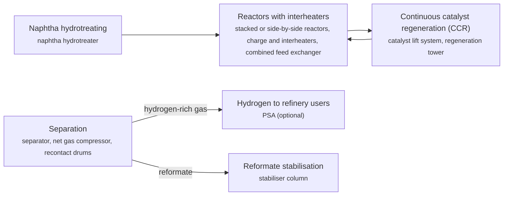

**Key equipment:** naphtha hydrotreater, reformer reactors, charge and interheaters, combined feed exchanger, CCR regenerator, net gas compressor, stabiliser.

**Performance:**
- semi-regenerative cycle between regenerations: 8-18 months; EPA AP-42; regeneration takes 1-2 weeks. [source](https://19january2021snapshot.epa.gov/sites/static/files/2020-09/documents/5.1_petroleum_refining.pdf)

**Reference plants:**
- Sinopec Hainan Petrochemical (200th UOP CCR Platforming unit), CN: not stated; CCR Platforming first commercialised 1971; commissioned by 2007. [source](https://www.chemicalonline.com/doc/uop-commissions-200th-ccr-platforming-process-0001)

**Missing inputs:**
- TRL range with a cited source (trl): Commercial technology, so TRL 9 is expected, but no source read states it. The IEA Clean Energy Technology Guide (collected October 2026, 634 entries) has no matching entry. no open TRL table found (IEA ETP guide checked 2026-10-28; mature technology, TRL 9 implied but uncitable). Where: Licensor or industry association statements of commercial deployment; academic reviews (open). Next: Find a TRL table that covers this technology and add trl {low, high, source}.
- capital cost and levelized or unit cost, with dollar year and basis (costs): No open source read so far gives costs for this technology. Refinery and gas plant unit costs are mostly published in paid sources. Web-checked 2026-10-28; licensor quotes only. Where: OSTI.GOV full-text reports from DOE labs (NETL, NREL, PNNL): search the technology name plus 'techno-economic' (catalog: osti, blocked); NREL techno-economic reports and the NREL/PNNL SAF analyses (private copy only) (catalog: nrel, open); Oil & Gas Journal refinery construction cost indexes (Nelson-Farrar): paywalled, summary only (catalog: ogj, paid); Paid cost databases (consultancies, licensor studies): catalog-only until the owner provides access (paid). Next: Look for an open techno-economic study; record each figure with metric, range, unit, dollar year, basis and source.

Sources: [1](https://19january2021snapshot.epa.gov/sites/static/files/2020-09/documents/5.1_petroleum_refining.pdf), [2](https://www.chemicalonline.com/doc/uop-commissions-200th-ccr-platforming-process-0001). Last reviewed 2026-10-28.

## Co-processing of bio-feeds in FCC and hydrotreaters
<a id="ref-co-processing"></a>

Bio-feeds such as vegetable oils, animal fats, used cooking oil or biomass pyrolysis oil are blended into the fossil feed of an existing hydrotreater, hydrocracker or FCC. Small shares need only catalyst changes; larger shares need unit modifications for extra hydrogen, heat release, CO/CO2 and water.

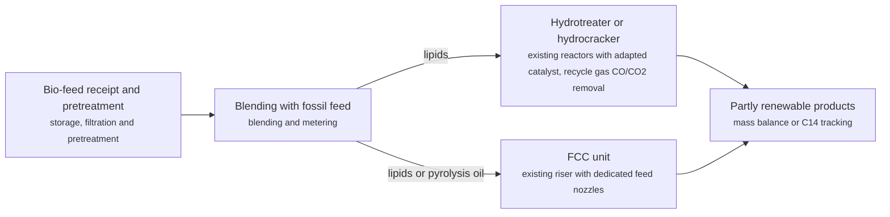

**Key equipment:** bio-feed storage and pretreatment, blending, existing hydroprocessing or FCC unit, recycle gas treating.

**Performance:**
- bio-feed share in hydroprocessing: 5-20 % of feed; Honeywell UOP: under 5% with catalyst change, 5-10% with minor modification, 10-20% with revamp. [source](https://ess.honeywell.com/content/dam/pmt/en/documents/Honeywell-UOP-Co-Processing-Technologies-web-brochure.pdf)
- biogenic feed rate in an FCC case study: 20 % of feed; Honeywell UOP (over 20%). [source](https://ess.honeywell.com/content/dam/pmt/en/documents/Honeywell-UOP-Co-Processing-Technologies-web-brochure.pdf)

**Reference plants:**
- Preem Gothenburg refinery hydrotreater co-processing, Sweden (Preem/Topsoe HydroFlex), SE: 6,600 bpd hydrotreater co-processing 85% renewable feedstock (achieved May 2021); first company in the world to produce renewable diesel at refinery scale through co-processing; operating. [source](https://www.topsoe.com/news/topsoe-and-preem-achieve-85-co-processing-renewable-feedstock)

**Missing inputs:**
- TRL range with a cited source (trl): Commercial technology, so TRL 9 is expected, but no source read states it. The IEA Clean Energy Technology Guide (collected October 2026, 634 entries) has no matching entry. no open TRL table found (IEA ETP guide checked 2026-10-28). Where: Licensor or industry association statements of commercial deployment; academic reviews (open). Next: Find a TRL table that covers this technology and add trl {low, high, source}.
- capital cost and levelized or unit cost, with dollar year and basis (costs): No open source read so far gives costs for this technology. Refinery and gas plant unit costs are mostly published in paid sources. Web-checked 2026-10-28; revamp costs case-specific. Where: OSTI.GOV full-text reports from DOE labs (NETL, NREL, PNNL): search the technology name plus 'techno-economic' (catalog: osti, blocked); NREL techno-economic reports and the NREL/PNNL SAF analyses (private copy only) (catalog: nrel, open); Oil & Gas Journal refinery construction cost indexes (Nelson-Farrar): paywalled, summary only (catalog: ogj, paid); Paid cost databases (consultancies, licensor studies): catalog-only until the owner provides access (paid). Next: Look for an open techno-economic study; record each figure with metric, range, unit, dollar year, basis and source.

Sources: [1](https://ess.honeywell.com/content/dam/pmt/en/documents/Honeywell-UOP-Co-Processing-Technologies-web-brochure.pdf), [2](https://www.topsoe.com/news/topsoe-and-preem-achieve-85-co-processing-renewable-feedstock). Last reviewed 2026-10-28.

## Crude and vacuum distillation with heat integration
<a id="ref-cdu-vdu"></a>

Crude is desalted, preheated against hot product streams and heated in a fired furnace, then separated by boiling range in an atmospheric column into gas, naphtha, kerosene, diesel and atmospheric residue. The residue would crack and foul at atmospheric pressure, so it is reheated and split again under vacuum into vacuum gas oils and vacuum residue.

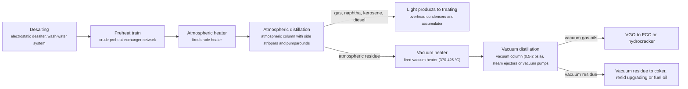

**Key equipment:** electrostatic desalter, preheat exchanger train, crude and vacuum fired heaters, atmospheric column, vacuum column, ejector or vacuum pump system.

**Performance:**
- vacuum heater outlet temperature: 370-425 °C; EPA AP-42 description. [source](https://19january2021snapshot.epa.gov/sites/static/files/2020-09/documents/5.1_petroleum_refining.pdf)
- vacuum column absolute pressure: 0.5-2 psia; EPA AP-42 description. [source](https://19january2021snapshot.epa.gov/sites/static/files/2020-09/documents/5.1_petroleum_refining.pdf)

**Reference plants:**
- Jamnagar refinery complex, Gujarat, India (Reliance), IN: 1.24 million bpd combined crude capacity - the world's largest refining complex (first phase 1999, doubled by 2008); Bechtel was the builder; operating. [source](https://www.bechtel.com/projects/jamnagar-oil-refinery)

**Missing inputs:**
- TRL range with a cited source (trl): Commercial technology, so TRL 9 is expected, but no source read states it. The IEA Clean Energy Technology Guide (collected October 2026, 634 entries) has no matching entry. no open TRL table found (IEA ETP guide checked 2026-10-28). Where: Licensor or industry association statements of commercial deployment; academic reviews (open). Next: Find a TRL table that covers this technology and add trl {low, high, source}.
- capital cost and levelized or unit cost, with dollar year and basis (costs): No open source read so far gives costs for this technology. Refinery and gas plant unit costs are mostly published in paid sources. Web-checked 2026-10-28; Jamnagar aggregate cost figures exist but not per-CDU. Where: OSTI.GOV full-text reports from DOE labs (NETL, NREL, PNNL): search the technology name plus 'techno-economic' (catalog: osti, blocked); NREL techno-economic reports and the NREL/PNNL SAF analyses (private copy only) (catalog: nrel, open); Oil & Gas Journal refinery construction cost indexes (Nelson-Farrar): paywalled, summary only (catalog: ogj, paid); Paid cost databases (consultancies, licensor studies): catalog-only until the owner provides access (paid). Next: Look for an open techno-economic study; record each figure with metric, range, unit, dollar year, basis and source.

Sources: [1](https://19january2021snapshot.epa.gov/sites/static/files/2020-09/documents/5.1_petroleum_refining.pdf). Last reviewed 2026-10-28.

## Crude-to-chemicals complexes
<a id="ref-crude-to-chemicals"></a>

A refinery is configured to send most of its crude to petrochemical feedstocks rather than fuels. Deep conversion such as hydrocracking and resid upgrading makes naphtha and gas oils for steam crackers and aromatics complexes, so a large share of each barrel ends as ethylene, propylene, paraxylene and other chemicals.

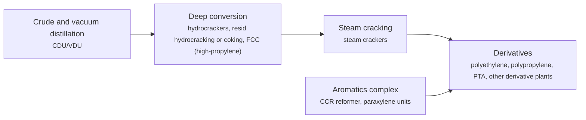

**Key equipment:** CDU/VDU, hydrocrackers, resid upgrading, steam crackers, aromatics complex, derivative units.

**Performance:**
- chemicals yield per barrel of crude, crude-to-chemicals complexes (TC2C design basis): 70-80 % of crude barrel to chemicals (target 70-80%; TC2C pilot results reported exceeding 70%); Aramco/SABIC crude-to-chemicals: TC2C aims to convert 70-80% of each barrel to chemicals vs roughly 10-30% in conventional refining; pilot results exceeded 70% (as reported by S&P Global report scope and trade analyses). [source](https://www.futurebridge.com/blog/crude-oil-to-chemicals-future-of-refinery)

**Reference plants:**
- PETRONAS Pengerang RAPID (PIC), Johor, MY: 300 kb/d refinery with 3.3 Mt/yr petrochemical capacity; PETRONAS and Saudi Aramco joint ventures; refinery start-up targeted Q1 2019 at time of release. [source](https://www.petronas.com/pic/news-resources/press-releases/petronas-saudi-aramco-announce-formation-jv-malaysia)
- Hengli Petrochemical, Dalian, CN: 20 Mt/yr crude processing; production start announced December 2018. [source](https://yicaiglobal.com/news/hengli-petrochemical-to-finish-dalian-plant-start-20-million-ton-production-)

**Missing inputs:**
- TRL range with a cited source (trl): Commercial technology, so TRL 9 is expected, but no source read states it. The IEA Clean Energy Technology Guide (collected October 2026, 634 entries) has no matching entry. no open TRL table found (IEA ETP guide checked 2026-10-28; TC2C pilot stage per sources read). Where: Licensor or industry association statements of commercial deployment; academic reviews (open). Next: Find a TRL table that covers this technology and add trl {low, high, source}.
- capital cost and levelized or unit cost, with dollar year and basis (costs): No open source read so far gives costs for this technology. Refinery and gas plant unit costs are mostly published in paid sources. Web-checked 2026-10-28; complex-level capex (Hengli, Zhejiang) reported in trade press but not per-technology. Where: OSTI.GOV full-text reports from DOE labs (NETL, NREL, PNNL): search the technology name plus 'techno-economic' (catalog: osti, blocked); NREL techno-economic reports and the NREL/PNNL SAF analyses (private copy only) (catalog: nrel, open); Oil & Gas Journal refinery construction cost indexes (Nelson-Farrar): paywalled, summary only (catalog: ogj, paid); Paid cost databases (consultancies, licensor studies): catalog-only until the owner provides access (paid). Next: Look for an open techno-economic study; record each figure with metric, range, unit, dollar year, basis and source.

Sources: [1](https://www.petronas.com/pic/news-resources/press-releases/petronas-saudi-aramco-announce-formation-jv-malaysia), [2](https://yicaiglobal.com/news/hengli-petrochemical-to-finish-dalian-plant-start-20-million-ton-production-). Last reviewed 2026-10-28.

## Delayed coking and fluid coking
<a id="ref-delayed-coking"></a>

Vacuum residue is heated quickly in a furnace to 480 to 590 °C and sent to a coke drum at about 400 °C and 25 to 30 psig, where it cracks thermally over many hours. Vapours go to a fractionator, and solid coke builds up in the drum. Drums run in pairs on a semi-batch cycle of 28 to 36 hours, with one filling while the other is steamed, cooled and cut out with high-pressure water.

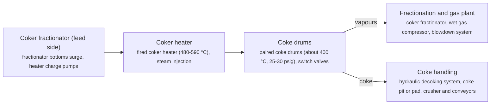

**Key equipment:** coker heater, coke drums, hydraulic decoking, coke handling, fractionator, blowdown system.

**Performance:**
- coker heater outlet temperature: 480-590 °C; EPA AP-42 description. [source](https://19january2021snapshot.epa.gov/sites/static/files/2020-09/documents/5.1_petroleum_refining.pdf)
- coke drum cycle: 28-36 h; EPA AP-42 description, start of feed to start of next feed to the same drum. [source](https://19january2021snapshot.epa.gov/sites/static/files/2020-09/documents/5.1_petroleum_refining.pdf)

**Reference plants:**
- Essar Oil (now Nayara Energy) Vadinar refinery delayed coker, Gujarat, IN: coker capacity not stated (described as one of the largest in the world); refinery expanded to 20 Mt/yr (405,000 b/d); Lummus technology and heater design; commissioned 2012. [source](https://www.hydrocarbonprocessing.com/news/2012/09/cbi-commissions-delayed-coking-unit-on-essar-oil-vadinar-expansion-in-india/)
- Vadinar refinery delayed coking unit (Essar Oil, now Nayara Energy), Gujarat, India, IN: delayed coker described as one of the largest in the world (unit capacity not published in the open article); part of the expansion that lifted the refinery from 200,000 to 405,000 bpd (20 Mt/yr) with Nelson complexity 6.1 to 11.8; commissioned by CB&I in 2012 after a 30-month EPC; operating. [source](https://www.hydrocarbonprocessing.com/news/2012/09/cbi-commissions-delayed-coking-unit-on-essar-oil-vadinar-expansion-in-india)

**Missing inputs:**
- TRL range with a cited source (trl): Commercial technology, so TRL 9 is expected, but no source read states it. The IEA Clean Energy Technology Guide (collected October 2026, 634 entries) has no matching entry. Where: Licensor or industry association statements of commercial deployment; academic reviews (open). Next: Find a TRL table that covers this technology and add trl {low, high, source}.
- capital cost and levelized or unit cost, with dollar year and basis (costs): No open source read so far gives costs for this technology. Refinery and gas plant unit costs are mostly published in paid sources. Where: OSTI.GOV full-text reports from DOE labs (NETL, NREL, PNNL): search the technology name plus 'techno-economic' (catalog: osti, blocked); NREL techno-economic reports and the NREL/PNNL SAF analyses (private copy only) (catalog: nrel, open); Oil & Gas Journal refinery construction cost indexes (Nelson-Farrar): paywalled, summary only (catalog: ogj, paid); Paid cost databases (consultancies, licensor studies): catalog-only until the owner provides access (paid). Next: Look for an open techno-economic study; record each figure with metric, range, unit, dollar year, basis and source.
- Vadinar coker capacity (reference_plants): The article does not give the coker's own capacity. DCU commissioning and refinery context recorded in reference_plants; the coker-only capacity figure is not published in the open article, 2026-10-28. Where: Nayara Energy refinery configuration page; Lummus project references (open). Next: Add the coker capacity with source.

Sources: [1](https://19january2021snapshot.epa.gov/sites/static/files/2020-09/documents/5.1_petroleum_refining.pdf), [2](https://www.hydrocarbonprocessing.com/news/2012/09/cbi-commissions-delayed-coking-unit-on-essar-oil-vadinar-expansion-in-india/). Last reviewed 2026-10-28.

## Etherification (MTBE, ETBE, TAME)
<a id="ref-etherification"></a>

Reactive isobutylene (from FCC or steam cracker C4) or isoamylenes (from light FCC naphtha) are reacted with methanol or ethanol over an acid resin catalyst to make high-octane ethers. Axens combines expanded-bed reactors with Catacol reactive distillation. Isobutylene can be recovered again by back-cracking MTBE.


**Key equipment:** expanded-bed reactors, reactive distillation column, alcohol recovery.

**Performance:**
- MTBE-mode conversion: 99.9 %; Axens claim for MTBE/ETBE with Catacol. [source](https://www.axens.net/markets/oil-refining/etherification)
- MTBE back-cracking per-pass conversion: 88 %; Axens Isobutely, isobutylene purity 99.9%+. [source](https://www.axens.net/markets/oil-refining/etherification)

**Reference plants:**
- CDTaee bio-etherification unit, Hellenic Petroleum Aspropyrgos refinery, Greece, GR: Lummus CDTaee unit producing bio-ethers (TAEE) from bio-ethanol and isobutylene; start-up announced August 2020; operating. [source](https://www.hydrocarbonengineering.com/clean-fuels/18082020/lummus-technology-announces-start-up-of-bio-ethers-unit-at-greek-refinery)

**Missing inputs:**
- capital cost and operating or unit cost, with dollar year and basis (costs): No open source read so far gives costs for this technology. Web-checked 2026-10-28; licensor quotes only. Where: arXiv and open-access journals: techno-economic or review papers (MDPI is blocked by its CDN; use the manual inbox) (catalog: arxiv, open); Licensor and EPC studies; paid cost databases are catalog-only (paid); OSTI.GOV full-text reports from DOE labs: search the technology name plus 'techno-economic' (catalog: osti, blocked). Next: Look for an open techno-economic study; record each figure with metric, range, unit, dollar year, basis and source.
- TRL with a cited source (trl): The IEA ETP Clean Energy Technology Guide has no matching entry. no open TRL table found (IEA ETP guide checked 2026-10-28). Where: IEA ETP Clean Energy Technology Guide (collected): search for the technology name (catalog: iea-reports, open). Next: Find a TRL table that lists this technology, or leave maturity resting on the evidence on the card.
- process steps and equipment are general engineering practice, not taken from one source (process): The sources read describe the principle but not a full step-by-step flow. Where: Licensor process descriptions and textbooks (open); [Open process-description authority (secondary): Wikipedia article 'Ether'. Cross-check the card's process_steps against it, then cite it in sources with note 'secondary'.](https://en.wikipedia.org/wiki/Ether) (open). Next: Verify the card's process_steps against the attached authority page, then cite it and delete this gap. Check the steps against a licensor description and name it.

Sources: [1](https://www.axens.net/markets/oil-refining/etherification), [2](https://www.hydrocarbonengineering.com/clean-fuels/18082020/lummus-technology-announces-start-up-of-bio-ethers-unit-at-greek-refinery). Last reviewed 2026-10-28.

## FCC gasoline post-treating (Prime-G+, SCANfining)
<a id="ref-fcc-gasoline-post-treating"></a>

FCC gasoline carries most of a refinery's gasoline-pool sulfur and most of its olefins, which supply octane. Post-treating removes sulfur with limited octane loss. In Axens Prime-G+ a first-step selective hydrogenation unit makes an olefin-rich light cracked naphtha, a naphtha splitter is optional, and the sulfur-rich heavy cracked naphtha goes to selective hydrodesulfurisation.

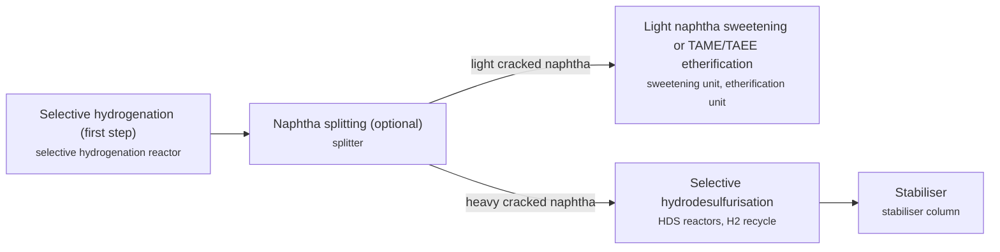

**Key equipment:** selective hydrogenation reactor, HDS reactors, naphtha splitter, hydrogen recycle compressor, stabiliser.

**Performance:**
- FCC gasoline sulfur from first units: up to 10 wppm; Axens says it was first to start up units producing FCC gasoline at 10 wppm. [source](https://www.axens.net/markets/oil-refining/fcc-naphtha-hydrotreating)
- licensed units: 300 units; Axens: over 300 Prime-G+ units; licensed capacity above 7,350,000 BPSD. [source](https://www.axens.net/markets/oil-refining/fcc-naphtha-hydrotreating)
- octane loss in FCC gasoline selective hydrodesulphurisation (Prime-G+ type, Tier 3 case study): 1.3 RON units (total octane loss); "The total octane loss was 1.3 RON units, mostly due to saturation of linear C6-olefins and dienes to form normal hexane" (DigitalRefining FCC gasoline desulphurisation for Tier 3 sulphur compliance); PTQ Q1 2024 reports configurations that virtually eliminate octane loss while reducing hydrogen consumption; hydrogen-consumption figure not stated in the open pages read. [source](https://www.digitalrefining.com/article/1001408/fcc-gasoline-desulphurisation-for-tier-3-sulphur-compliance)

**Missing inputs:**
- octane loss and hydrogen consumption (performance): The Axens page gives no figures. Octane loss recorded in performance (1.3 RON case study); an open hydrogen-consumption figure was not found, 2026-10-28. Where: Axens technical papers (catalog: axens, open); SCANfining ExxonMobil literature (catalog: exxonmobil-catalysts, open). Next: Add them from a licensor paper.
- capital cost and operating or unit cost, with dollar year and basis (costs): No open source read so far gives costs for this technology. Web-checked 2026-10-28; licensor quotes only. Where: arXiv and open-access journals: techno-economic or review papers (MDPI is blocked by its CDN; use the manual inbox) (catalog: arxiv, open); Licensor and EPC studies; paid cost databases are catalog-only (paid); OSTI.GOV full-text reports from DOE labs: search the technology name plus 'techno-economic' (catalog: osti, blocked). Next: Look for an open techno-economic study; record each figure with metric, range, unit, dollar year, basis and source.
- named plants or projects with capacity and year (reference_plants): The sources read name no specific plant. Web-checked 2026-10-28; no single named unit with figures on open pages. Where: Licensor and operator press releases for the suppliers listed (open). Next: Add one or two plants with country, capacity and start-up year.
- TRL with a cited source (trl): The IEA ETP Clean Energy Technology Guide has no matching entry. no open TRL table found (IEA ETP guide checked 2026-10-28). Where: IEA ETP Clean Energy Technology Guide (collected): search for the technology name (catalog: iea-reports, open). Next: Find a TRL table that lists this technology, or leave maturity resting on the evidence on the card.
- process steps and equipment are general engineering practice, not taken from one source (process): The sources read describe the principle but not a full step-by-step flow. Where: Licensor process descriptions and textbooks (open). Next: Check the steps against a licensor description and name it.

Sources: [1](https://www.axens.net/markets/oil-refining/fcc-naphtha-hydrotreating), [2](https://www.digitalrefining.com/article/1001408/fcc-gasoline-desulphurisation-for-tier-3-sulphur-compliance). Last reviewed 2026-10-28.

## Flare gas recovery and smokeless flares
<a id="ref-flare-systems"></a>

Elevated flares burn relief and vent gas at the tip of a stack 10 to over 100 m tall, using steam or air assistance for smokeless burning; ground flares burn at ground level, often in enclosures. EPA's AP-42 says properly operated flares achieve at least 98% destruction efficiency, with refinery flares needing at least 270 Btu/ft3 net heating value in the combustion zone. Flare gas recovery compressors return routine flow to fuel gas; see the upstream flare gas recovery card.

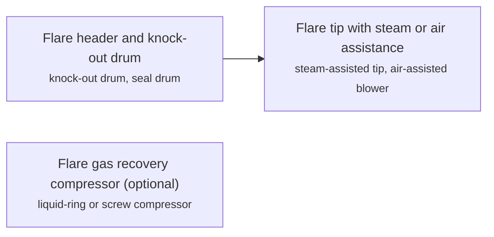

**Key equipment:** flare stack and tip, knock-out and seal drums, steam or air assist, pilots and ignition, flare gas recovery compressors.

**Performance:**
- destruction efficiency of properly operated flares: 98 %; EPA AP-42; 96.5% combustion efficiency roughly equals 98% destruction. [source](https://www.epa.gov/sites/default/files/2020-10/documents/13.5_industrial_flares.pdf)
- NOx emission factor, elevated flares: 0.068 lb/10^6 Btu; EPA AP-42. [source](https://www.epa.gov/sites/default/files/2020-10/documents/13.5_industrial_flares.pdf)

**Missing inputs:**
- capital cost and operating or unit cost, with dollar year and basis (costs): No open source read so far gives costs for this technology. Web-checked 2026-10-28; vendor quotes only. Where: arXiv and open-access journals: techno-economic or review papers (MDPI is blocked by its CDN; use the manual inbox) (catalog: arxiv, open); Licensor and EPC studies; paid cost databases are catalog-only (paid); OSTI.GOV full-text reports from DOE labs: search the technology name plus 'techno-economic' (catalog: osti, blocked). Next: Look for an open techno-economic study; record each figure with metric, range, unit, dollar year, basis and source.
- named plants or projects with capacity and year (reference_plants): The sources read name no specific plant. Web-checked 2026-10-28; no named flare project with figures on open pages. Where: Licensor and operator press releases for the suppliers listed (open). Next: Add one or two plants with country, capacity and start-up year.
- TRL with a cited source (trl): The IEA ETP Clean Energy Technology Guide has no matching entry. no open TRL table found (IEA ETP guide checked 2026-10-28). Where: IEA ETP Clean Energy Technology Guide (collected): search for the technology name (catalog: iea-reports, open). Next: Find a TRL table that lists this technology, or leave maturity resting on the evidence on the card.
- process steps and equipment are general engineering practice, not taken from one source (process): The sources read describe the principle but not a full step-by-step flow. Where: Licensor process descriptions and textbooks (open); [Open process-description authority (secondary): Wikipedia article 'Gas flare'. Cross-check the card's process_steps against it, then cite it in sources with note 'secondary'.](https://en.wikipedia.org/wiki/Gas_flare) (open). Next: Verify the card's process_steps against the attached authority page, then cite it and delete this gap. Check the steps against a licensor description and name it.

Sources: [1](https://www.epa.gov/sites/default/files/2020-10/documents/13.5_industrial_flares.pdf). Last reviewed 2026-10-28.

## Fluid catalytic cracking and resid FCC
<a id="ref-fcc"></a>

Hot, fine zeolite catalyst behaves like a fluid and meets vaporised gas oil in a riser reactor at 470 to 525 °C, cracking it into gasoline, LPG, light cycle oil and slurry. Coke deposited on the catalyst is burned off with air in a regenerator at 590 to 675 °C, which reheats the catalyst for the next pass. Residue versions use two-stage regenerators and catalyst coolers.

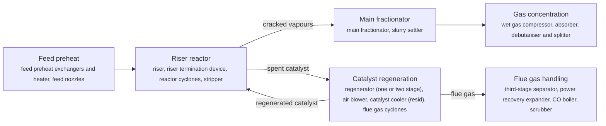

**Key equipment:** riser and reactor, regenerator, air blower, cyclones, main fractionator, wet gas compressor, flue gas power recovery and scrubber.

**Performance:**
- riser reaction temperature: 470-525 °C; EPA AP-42 description. [source](https://19january2021snapshot.epa.gov/sites/static/files/2020-09/documents/5.1_petroleum_refining.pdf)
- regenerator temperature: 590-675 °C; EPA AP-42 description. [source](https://19january2021snapshot.epa.gov/sites/static/files/2020-09/documents/5.1_petroleum_refining.pdf)
- propylene yield, PetroFCC: 18-20 wt%; Honeywell UOP, depending on feed. [source](https://uop.honeywell.com/content/dam/uop/en-us/documents/industry-solutions/refining/vaccuum-gas-oil-conversion/honeywell-uop-fcc-related-processes-datasheet.pdf)

**Reference plants:**
- UOP-licensed FCC fleet: over 215 FCC/RFCC/MSCC units licensed; over 150 of more than 400 FCC units worldwide under UOP licence; per 2016 datasheet. [source](https://uop.honeywell.com/content/dam/uop/en-us/documents/industry-solutions/refining/vaccuum-gas-oil-conversion/honeywell-uop-fcc-related-processes-datasheet.pdf)

**Missing inputs:**
- TRL range with a cited source (trl): Commercial technology, so TRL 9 is expected, but no source read states it. The IEA Clean Energy Technology Guide (collected October 2026, 634 entries) has no matching entry. no open TRL table found (IEA ETP guide checked 2026-10-28). Where: Licensor or industry association statements of commercial deployment; academic reviews (open). Next: Find a TRL table that covers this technology and add trl {low, high, source}.
- capital cost and levelized or unit cost, with dollar year and basis (costs): No open source read so far gives costs for this technology. Refinery and gas plant unit costs are mostly published in paid sources. Web-checked 2026-10-28; licensor quotes only. Where: OSTI.GOV full-text reports from DOE labs (NETL, NREL, PNNL): search the technology name plus 'techno-economic' (catalog: osti, blocked); NREL techno-economic reports and the NREL/PNNL SAF analyses (private copy only) (catalog: nrel, open); Oil & Gas Journal refinery construction cost indexes (Nelson-Farrar): paywalled, summary only (catalog: ogj, paid); Paid cost databases (consultancies, licensor studies): catalog-only until the owner provides access (paid). Next: Look for an open techno-economic study; record each figure with metric, range, unit, dollar year, basis and source.

Sources: [1](https://19january2021snapshot.epa.gov/sites/static/files/2020-09/documents/5.1_petroleum_refining.pdf), [2](https://uop.honeywell.com/content/dam/uop/en-us/documents/industry-solutions/refining/vaccuum-gas-oil-conversion/honeywell-uop-fcc-related-processes-datasheet.pdf). Last reviewed 2026-10-28.

## Hydrocracking (fixed bed)
<a id="ref-hydrocracking"></a>

Vacuum gas oil and hydrogen pass at high pressure over a pretreatment catalyst that removes nitrogen and sulfur, then over a cracking catalyst with acid and metal functions that breaks heavy molecules into diesel, jet and naphtha while saturating them. Unconverted oil can be recycled to a second stage or sent to lube units or the FCC.

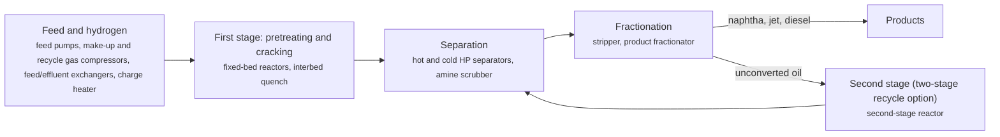

**Key equipment:** high-pressure reactors, charge heater, recycle gas compressor, HP separators, amine scrubber, fractionator.

**Performance:**
- conversion of straight-run VGO (revamped two-stage recycle unit): 80 %; CLG case study (upwards of 80%); unit revamped from 40,000 to 64,000 b/d fresh VGO. [source](https://www.digitalrefining.com/article/1002562/78)

**Missing inputs:**
- TRL range with a cited source (trl): Commercial technology, so TRL 9 is expected, but no source read states it. The IEA Clean Energy Technology Guide (collected October 2026, 634 entries) has no matching entry. no open TRL table found (IEA ETP guide checked 2026-10-28). Where: Licensor or industry association statements of commercial deployment; academic reviews (open). Next: Find a TRL table that covers this technology and add trl {low, high, source}.
- capital cost and levelized or unit cost, with dollar year and basis (costs): No open source read so far gives costs for this technology. Refinery and gas plant unit costs are mostly published in paid sources. Web-checked 2026-10-28; licensor quotes only. Where: OSTI.GOV full-text reports from DOE labs (NETL, NREL, PNNL): search the technology name plus 'techno-economic' (catalog: osti, blocked); NREL techno-economic reports and the NREL/PNNL SAF analyses (private copy only) (catalog: nrel, open); Oil & Gas Journal refinery construction cost indexes (Nelson-Farrar): paywalled, summary only (catalog: ogj, paid); Paid cost databases (consultancies, licensor studies): catalog-only until the owner provides access (paid). Next: Look for an open techno-economic study; record each figure with metric, range, unit, dollar year, basis and source.
- named operating or planned plants with capacity and status (reference_plants): No plant was named in the sources read. Web-checked 2026-10-28; no single verifiable named unit added. Where: Licensor and refiner press releases for the named suppliers; Oil & Gas Journal construction news (catalog: ogj, paid); Press releases from the suppliers listed on the card (open). Next: Add one to three reference plants with country, capacity, status and source.

Sources: [1](https://www.digitalrefining.com/article/1002562/78), [2](https://19january2021snapshot.epa.gov/sites/static/files/2020-09/documents/5.1_petroleum_refining.pdf). Last reviewed 2026-10-28.

## Hydrotreating (naphtha, diesel, VGO)
<a id="ref-hydrotreating"></a>

Oil and hydrogen are heated and passed over fixed beds of CoMo or NiMo catalyst, where sulfur, nitrogen and oxygen are converted to H2S, ammonia and water and olefins and aromatics are partly saturated. Separators and an amine scrubber clean and recycle the hydrogen, and a stripper removes H2S and light ends from the product. Topsoe states ULSD below 10 wt ppm sulfur.

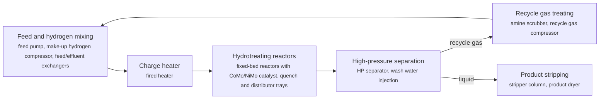

**Key equipment:** feed/effluent exchangers, charge heater, hydrotreating reactors with internals, HP and LP separators, recycle gas amine scrubber, recycle gas compressor, product stripper.

**Performance:**
- ULSD product sulfur: up to 10 wt ppm S; Topsoe diesel hydrotreating. [source](https://www.topsoe.com/processes/hydrotreating/diesel-hydrotreating)

**Missing inputs:**
- TRL range with a cited source (trl): Commercial technology, so TRL 9 is expected, but no source read states it. The IEA Clean Energy Technology Guide (collected October 2026, 634 entries) has no matching entry. no open TRL table found (IEA ETP guide checked 2026-10-28). Where: Licensor or industry association statements of commercial deployment; academic reviews (open). Next: Find a TRL table that covers this technology and add trl {low, high, source}.
- capital cost and levelized or unit cost, with dollar year and basis (costs): No open source read so far gives costs for this technology. Refinery and gas plant unit costs are mostly published in paid sources. Web-checked 2026-10-28; licensor quotes only. Where: OSTI.GOV full-text reports from DOE labs (NETL, NREL, PNNL): search the technology name plus 'techno-economic' (catalog: osti, blocked); NREL techno-economic reports and the NREL/PNNL SAF analyses (private copy only) (catalog: nrel, open); Oil & Gas Journal refinery construction cost indexes (Nelson-Farrar): paywalled, summary only (catalog: ogj, paid); Paid cost databases (consultancies, licensor studies): catalog-only until the owner provides access (paid). Next: Look for an open techno-economic study; record each figure with metric, range, unit, dollar year, basis and source.
- named operating or planned plants with capacity and status (reference_plants): No plant was named in the sources read. Web-checked 2026-10-28; ubiquitous unit, no single named reference added. Where: Licensor and refiner press releases for the named suppliers; Oil & Gas Journal construction news (catalog: ogj, paid); Press releases from the suppliers listed on the card (open). Next: Add one to three reference plants with country, capacity, status and source.

Sources: [1](https://www.topsoe.com/processes/hydrotreating/diesel-hydrotreating), [2](https://19january2021snapshot.epa.gov/sites/static/files/2020-09/documents/5.1_petroleum_refining.pdf). Last reviewed 2026-10-28.

## Isomerisation (C5/C6)
<a id="ref-isomerisation"></a>

Light straight-run naphtha (pentanes and hexanes) is converted over a catalyst, typically chlorinated alumina, into branched isomers with higher octane. Equilibrium limits a once-through unit, so recycle schemes separate unconverted normal paraffins with a deisohexaniser or molecular sieves and send them back.

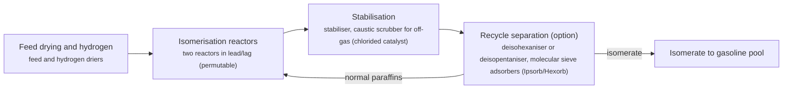

**Key equipment:** feed and hydrogen driers, isomerisation reactors, stabiliser, deisohexaniser, molecular sieve adsorbers.

**Performance:**
- isomerate RON, once-through: 83-84 RON; Axens, for 40:60 C5:C6 feed starting at RON about 70. [source](https://www.axens.net/markets/oil-refining/c5c6-isomerization)
- isomerate RON, recycle with molecular sieves (Hexorb): 91-92 RON; Axens, at C5/C6 ratio 0.65; deisohexaniser recycle gives about 88. [source](https://www.axens.net/markets/oil-refining/c5c6-isomerization)

**Reference plants:**
- Jiangsu Xinhai Petrochemicals isomerisation unit, CN: isomerate RON above 88, up to 89.2, at 65-105% of design feed; started up 2019. [source](https://www.axens.net/markets/oil-refining/c5c6-isomerization)
- Axens isomerisation licences: more than 95 C5/C6 licences in 25 years, over 20 once-through; per Axens page, read 2026-10-24. [source](https://www.axens.net/markets/oil-refining/c5c6-isomerization)

**Missing inputs:**
- TRL range with a cited source (trl): Commercial technology, so TRL 9 is expected, but no source read states it. The IEA Clean Energy Technology Guide (collected October 2026, 634 entries) has no matching entry. no open TRL table found (IEA ETP guide checked 2026-10-28). Where: Licensor or industry association statements of commercial deployment; academic reviews (open). Next: Find a TRL table that covers this technology and add trl {low, high, source}.
- capital cost and levelized or unit cost, with dollar year and basis (costs): No open source read so far gives costs for this technology. Refinery and gas plant unit costs are mostly published in paid sources. Web-checked 2026-10-28; licensor quotes only. Where: OSTI.GOV full-text reports from DOE labs (NETL, NREL, PNNL): search the technology name plus 'techno-economic' (catalog: osti, blocked); NREL techno-economic reports and the NREL/PNNL SAF analyses (private copy only) (catalog: nrel, open); Oil & Gas Journal refinery construction cost indexes (Nelson-Farrar): paywalled, summary only (catalog: ogj, paid); Paid cost databases (consultancies, licensor studies): catalog-only until the owner provides access (paid). Next: Look for an open techno-economic study; record each figure with metric, range, unit, dollar year, basis and source.

Sources: [1](https://www.axens.net/markets/oil-refining/c5c6-isomerization). Last reviewed 2026-10-28.

## Mercaptan sweetening (Merox)
<a id="ref-merox-sweetening"></a>

Merox converts malodorous mercaptans to disulfides (4 RSH + O2 -> 2 RSSR + 2 H2O) over a catalyst in alkaline conditions. For LPG and light naphtha, an extraction variant uses caustic to pull mercaptans out and air regenerates the caustic. For kerosene and jet fuel, a fixed-bed sweetening variant oxidises them in place on catalyst-impregnated charcoal.

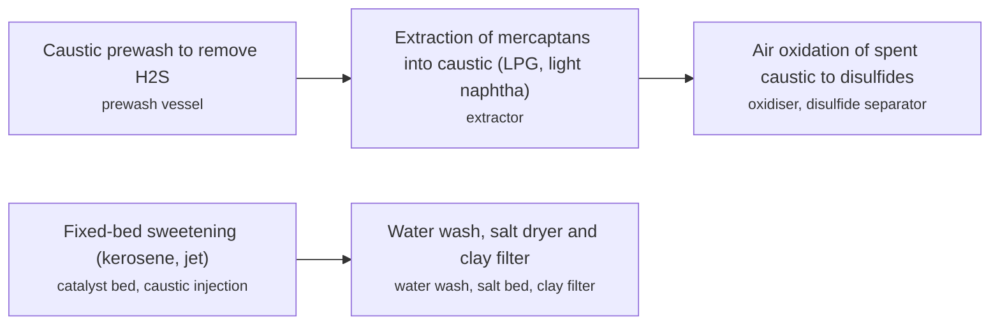

**Key equipment:** prewash, extractor, oxidiser, disulfide separator, fixed catalyst bed, salt dryer, clay filter.

**Performance:**
- jet fuel sulfur limit mentioned: up to 3000 ppm; sweetening is usually enough for straight-run kerosene to meet it; the page gives no treated-product mercaptan figure. [source](https://en.wikipedia.org/wiki/Merox)

**Reference plants:**
- SPEC Energy DMCC refinery, Fujairah, UAE (multiple Honeywell UOP units including Merox), AE: refinery project using UOP Merox plus other UOP technologies; UOP provides licensing, design services, catalysts and adsorbents; construction. [source](https://www.hydrocarbonprocessing.com/news/2022/03/spec-energy-dmcc-to-use-multiple-honeywell-uop-technologies-at-refinery)

**Missing inputs:**
- capital cost and operating or unit cost, with dollar year and basis (costs): No open source read so far gives costs for this technology. Web-checked 2026-10-28; licensor quotes only. Where: arXiv and open-access journals: techno-economic or review papers (MDPI is blocked by its CDN; use the manual inbox) (catalog: arxiv, open); Licensor and EPC studies; paid cost databases are catalog-only (paid); OSTI.GOV full-text reports from DOE labs: search the technology name plus 'techno-economic' (catalog: osti, blocked). Next: Look for an open techno-economic study; record each figure with metric, range, unit, dollar year, basis and source.
- TRL with a cited source (trl): The IEA ETP Clean Energy Technology Guide has no matching entry. no open TRL table found (IEA ETP guide checked 2026-10-28). Where: IEA ETP Clean Energy Technology Guide (collected): search for the technology name (catalog: iea-reports, open). Next: Find a TRL table that lists this technology, or leave maturity resting on the evidence on the card.
- process steps and equipment are general engineering practice, not taken from one source (process): The sources read describe the principle but not a full step-by-step flow. Where: Licensor process descriptions and textbooks (open). Next: Check the steps against a licensor description and name it.

Sources: [1](https://en.wikipedia.org/wiki/Merox), [2](https://www.hydrocarbonprocessing.com/news/2022/03/spec-energy-dmcc-to-use-multiple-honeywell-uop-technologies-at-refinery). Last reviewed 2026-10-28.

## Process simulation and digital twins
<a id="ref-process-simulation-digital-twin"></a>

Rigorous steady-state and dynamic models of units or whole refineries are used for design, planning and what-if studies, and are kept in step with plant data to act as a digital twin. At KIPIC's Al Zour refinery a refinery-wide Aspen HYSYS model supported start-up planning, crude-blend forecasting, sulfur recovery and kerosene yield optimisation and the case study reports USD 950,000 in savings.


**Key equipment:** process simulator, plant historian, model calibration tools.

**Performance:**
- savings reported at Al Zour: 0.95 USD million; AspenTech case study, dollar year not stated, not broken down; refinery capacity 615,000 bpd. [source](https://solutions.aspentech.com/en/resources/case-studies/refinery-wide-simulation-in-aspen-hysys-a-game-changer-for-kipics-al-zour-refinery)

**Missing inputs:**
- independent evidence of benefits (performance): One vendor case study. Web-checked 2026-10-28: published benefit figures found are vendor case studies (CTG: 80% project-cost saving, 95% workflow-time cut) and cross-industry claims (18-28% opex); no independent refinery-specific study found. Where: arXiv and open-access journals: techno-economic or review papers (MDPI is blocked by its CDN; use the manual inbox) (catalog: arxiv, open). Next: Add an independent study.
- capital cost and operating or unit cost, with dollar year and basis (costs): No open source read so far gives costs for this technology. Web-checked 2026-10-28; simulator licence prices are vendor-quoted. Where: arXiv and open-access journals: techno-economic or review papers (MDPI is blocked by its CDN; use the manual inbox) (catalog: arxiv, open); Licensor and EPC studies; paid cost databases are catalog-only (paid); OSTI.GOV full-text reports from DOE labs: search the technology name plus 'techno-economic' (catalog: osti, blocked). Next: Look for an open techno-economic study; record each figure with metric, range, unit, dollar year, basis and source.
- named plants or projects with capacity and year (reference_plants): The sources read name no specific plant. Web-checked 2026-10-28; no verifiable named refinery digital-twin project with figures on open pages. Where: Licensor and operator press releases for the suppliers listed (open). Next: Add one or two plants with country, capacity and start-up year.
- TRL with a cited source (trl): The IEA ETP Clean Energy Technology Guide has no matching entry. no open TRL table found (IEA ETP guide checked 2026-10-28; its Digital twins entry is grids-category, not refining). Where: IEA ETP Clean Energy Technology Guide (collected): search for the technology name (catalog: iea-reports, open). Next: Find a TRL table that lists this technology, or leave maturity resting on the evidence on the card.
- process steps and equipment are general engineering practice, not taken from one source (process): The sources read describe the principle but not a full step-by-step flow. Where: Licensor process descriptions and textbooks (open). Next: Check the steps against a licensor description and name it.

Sources: [1](https://solutions.aspentech.com/en/resources/case-studies/refinery-wide-simulation-in-aspen-hysys-a-game-changer-for-kipics-al-zour-refinery). Last reviewed 2026-10-28.

## Refinery-petrochemical integration (FCC propylene, HS-FCC)
<a id="ref-petrochemical-integration"></a>

Refineries shift FCC conditions and catalyst to make more propylene and other light olefins for petrochemicals. High-severity FCC (HS-FCC) uses a downflow reactor, about 600 degC, short contact time and a catalyst-to-oil ratio above 30, which gives conversion above 80 wt% and about 20 wt% propylene in pilot tests with ZSM-5 additive on untreated VGO.


**Key equipment:** downer reactor, catalyst regenerator, main fractionator, gas plant, propylene splitter.

**Performance:**
- propylene yield, pilot plant with ZSM-5 additive: 20 wt%; 600 degC, untreated VGO; demo plant 13 wt% propylene in low-sulfur fuel oil blend tests. [source](https://ogj.com/refining-processing/petrochemicals/article/17235744/demonstration-plant-for-new-fcc-technology-yields-increased-propylene)
- conversion at catalyst-to-oil above 30: 80 wt%; both pilot and demonstration plants. [source](https://ogj.com/refining-processing/petrochemicals/article/17235744/demonstration-plant-for-new-fcc-technology-yields-increased-propylene)
- FCC share of world propylene supply: 30 % of world propylene from FCC units; "FCC units supply about 30% of the world's propylene" (Oil & Gas Journal special report on Saudi Aramco FCC catalyst evaluation); HS-FCC (Aramco/TechnipFMC/Axens CC2C basis) is described as proven technology for higher propylene yield. [source](https://www.ogj.com/refining-processing/petrochemicals/article/17218410/special-report-saudi-aramco-outlines-fcc-catalyst-evaluation-method)

**Reference plants:**
- HS-FCC demonstration plant near Ras Tanura refinery (30 b/d; 5,000 b/d planned at the time), SA: 30 b/d; . [source](https://ogj.com/refining-processing/petrochemicals/article/17235744/demonstration-plant-for-new-fcc-technology-yields-increased-propylene)

**Missing inputs:**
- commercial HS-FCC units and conventional FCC propylene units (reference_plants): Only the demonstration plant was read. FCC ~30% of world propylene recorded in performance; a named commercial HS-FCC unit was not verifiable on open pages (CC2C announcement describes HS-FCC as proven), 2026-10-28. Where: Axens FCC and Honeywell UOP PetroFCC pages (catalog: axens, open). Next: Add commercial references.
- capital cost and operating or unit cost, with dollar year and basis (costs): No open source read so far gives costs for this technology. Web-checked 2026-10-28; integration capex case-specific. Where: arXiv and open-access journals: techno-economic or review papers (MDPI is blocked by its CDN; use the manual inbox) (catalog: arxiv, open); Licensor and EPC studies; paid cost databases are catalog-only (paid); OSTI.GOV full-text reports from DOE labs: search the technology name plus 'techno-economic' (catalog: osti, blocked). Next: Look for an open techno-economic study; record each figure with metric, range, unit, dollar year, basis and source.
- TRL with a cited source (trl): The IEA ETP Clean Energy Technology Guide has no matching entry. no open TRL table found (IEA ETP guide checked 2026-10-28). Where: IEA ETP Clean Energy Technology Guide (collected): search for the technology name (catalog: iea-reports, open). Next: Find a TRL table that lists this technology, or leave maturity resting on the evidence on the card.
- process steps and equipment are general engineering practice, not taken from one source (process): The sources read describe the principle but not a full step-by-step flow. Where: Licensor process descriptions and textbooks (open). Next: Check the steps against a licensor description and name it.

Sources: [1](https://ogj.com/refining-processing/petrochemicals/article/17235744/demonstration-plant-for-new-fcc-technology-yields-increased-propylene), [2](https://korea.aramco.com/en/news-media/news/2019/cc2c). Last reviewed 2026-10-28.

## Renewable diesel and SAF by hydrotreated esters and fatty acids (HEFA)
<a id="ref-hefa"></a>

Waste fats, used cooking oil and vegetable oils are pretreated to remove metals and phosphorus, then hydrotreated to strip oxygen and make straight-chain paraffins. A second step isomerises and, for jet, mildly cracks them to meet cold-flow specifications, and the products are fractionated into renewable diesel, SAF, naphtha and propane.

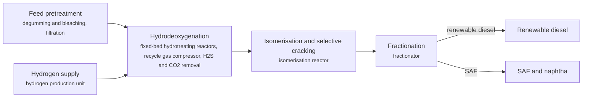

**Key equipment:** pretreatment unit, HDO reactors, isomerisation reactor, recycle gas scrubber, fractionator, hydrogen plant.

**Costs:**
- minimum jet fuel selling price, HEFA: 3.8-11 USD/gal (2014$); Tao et al. 2017 open-access NREL-led TEA; range across five lipid feedstocks (waste oils lowest, dedicated lipid crops highest); 10% IRR discounted cash flow. [source](https://pmc.ncbi.nlm.nih.gov/articles/PMC5679388)

**Reference plants:**
- Neste Singapore refinery, SG: 2.6 Mt/yr renewable products including up to 1 Mt/yr SAF; expansion completed April 2023 (EUR 1.6 billion). [source](https://www.neste.com/en-sg/about-neste/how-we-operate/production/singapore-refinery)
- Diamond Green Diesel, Norco, Louisiana, US: 275 million gal/yr, expanding to 675 million gal/yr (Ecofining); expansion announced September 2019, completion expected late 2021. [source](https://www.digitalrefining.com/news/1005764/diamond-green-expands-production-capacity-using-ecofining-technology-from-honeywell)

TRL source: [IEA ETP Clean Energy Technology Guide, dataset of 24 July 2026, 2025 assessment (IEA 1-11 scale): 'Hydrotreating of oil/fats to HVOs or HEFAs' 9](https://www.iea.org/data-and-statistics/data-tools/etp-clean-energy-technology-guide)

**Missing inputs:**
- key performance figures (energy use, yields, capture or conversion rate) (performance): No source read so far gives performance figures. The Tao et al. 2017 paper now in the corpus reports jet-blendstock yields by feedstock and has not been fully mined yet. Web-checked 2026-10-28 + corpus re-search 2026-10-28: the SAF pathways review (corpus) covers readiness/blending but states no HEFA conversion-yield figure; the Tao 2017 HEFA TEA named in STATUS is not in the corpus (only Geleynse ATJ). Where: Tao et al. 2017 in corpus/nrel/ - jet blendstock yield and hydrogen consumption by feedstock (catalog: nrel, open); Supplier datasheets and brochures for the companies listed on the card (open). Next: Extract the per-feedstock jet yield and hydrogen consumption from the Tao paper; add supplier datasheet figures.

Sources: [1](https://www.neste.com/en-sg/about-neste/how-we-operate/production/singapore-refinery), [2](https://www.digitalrefining.com/news/1005764/diamond-green-expands-production-capacity-using-ecofining-technology-from-honeywell), [3](https://pmc.ncbi.nlm.nih.gov/articles/PMC5679388). Last reviewed 2026-10-28.

## Resid hydrocracking (ebullated and slurry bed)
<a id="ref-resid-hydrocracking"></a>

Residue is hydrocracked at high pressure in reactors that keep catalyst moving: ebullated beds fluidise supported catalyst with recycled liquid, while slurry processes disperse a very fine catalyst in the feed in bubble column reactors. Unconverted residue can be recycled, which lets slurry processes reach very high conversion.

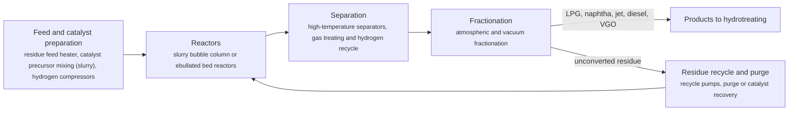

**Key equipment:** high-pressure residue reactors, feed heaters, hydrogen compressors, hot separators, vacuum fractionator, catalyst handling or recovery.

**Performance:**
- residue conversion, EST pilot and demonstration runs: 97 %; Eni (above 97% in all experimental runs). [source](https://eni.com/assets/documents/eng/company/brochure/2014/eni_EST_esecutivo.pdf)

**Reference plants:**
- Eni Sannazzaro EST unit, IT: 23,000 b/d design; oil-in 14 October 2013. [source](https://eni.com/assets/documents/eng/company/brochure/2014/eni_EST_esecutivo.pdf)

**Missing inputs:**
- TRL range with a cited source (trl): Commercial technology, so TRL 9 is expected, but no source read states it. The IEA Clean Energy Technology Guide (collected October 2026, 634 entries) has no matching entry. no open TRL table found (IEA ETP guide checked 2026-10-28). Where: Licensor or industry association statements of commercial deployment; academic reviews (open). Next: Find a TRL table that covers this technology and add trl {low, high, source}.
- capital cost and levelized or unit cost, with dollar year and basis (costs): No open source read so far gives costs for this technology. Refinery and gas plant unit costs are mostly published in paid sources. Web-checked 2026-10-28; licensor quotes only. Where: OSTI.GOV full-text reports from DOE labs (NETL, NREL, PNNL): search the technology name plus 'techno-economic' (catalog: osti, blocked); NREL techno-economic reports and the NREL/PNNL SAF analyses (private copy only) (catalog: nrel, open); Oil & Gas Journal refinery construction cost indexes (Nelson-Farrar): paywalled, summary only (catalog: ogj, paid); Paid cost databases (consultancies, licensor studies): catalog-only until the owner provides access (paid). Next: Look for an open techno-economic study; record each figure with metric, range, unit, dollar year, basis and source.

Sources: [1](https://eni.com/assets/documents/eng/company/brochure/2014/eni_EST_esecutivo.pdf). Last reviewed 2026-10-28.

## Sour water stripping and amine regeneration
<a id="ref-sour-water-stripping"></a>

Refinery sour water, which carries H2S and NH3 from hydroprocessing and coking, is flashed, then steam-stripped in a column. Stripped water returns to the refinery and the H2S and NH3 overhead goes to the sulfur recovery unit. Rich refinery amine from fuel gas and LPG treating is regenerated in a similar steam-stripping loop.

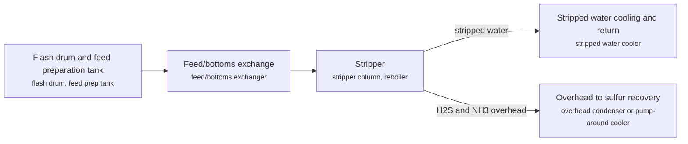

**Key equipment:** flash drum, stripper column, reboiler, feed/bottoms exchanger, overhead condenser.

**Performance:**
- stripped sour water specifications and one- vs two-stage design: 30-80 ppmw NH3 typical target (10-20 ppm when reused in crude desalter); NH3 column ~3.5 barg producing <5 ppmw H2S ammonia with scrubbing; Brimstone STS (Hatcher et al.): "Typical targets for NH3 are 30-80 ppmw" in stripped sour water; Lieberman (DigitalRefining/PTQ): when stripper bottoms are reused in the crude desalter "the NH3 content should be about 10 to 20 ppm"; BRE Sour Water paper: the ammonia column typically operates around 3.5 barg and with additional scrubbing can produce <5 ppmw H2S; two-stage sour water strippers are the most common technology (SDEWES journal; ResearchGate control-scheme study). [source](https://brimstone-sts.com/wp-content/uploads/2015/11/03V12-Hatcher-SWS-Performance-With-HSS.pdf)

**Missing inputs:**
- capital cost and operating or unit cost, with dollar year and basis (costs): No open source read so far gives costs for this technology. Web-checked 2026-10-28; no open figures. Where: arXiv and open-access journals: techno-economic or review papers (MDPI is blocked by its CDN; use the manual inbox) (catalog: arxiv, open); Licensor and EPC studies; paid cost databases are catalog-only (paid); OSTI.GOV full-text reports from DOE labs: search the technology name plus 'techno-economic' (catalog: osti, blocked). Next: Look for an open techno-economic study; record each figure with metric, range, unit, dollar year, basis and source.
- named plants or projects with capacity and year (reference_plants): The sources read name no specific plant. Web-checked 2026-10-28; ubiquitous unit, no named reference added. Where: Licensor and operator press releases for the suppliers listed (open). Next: Add one or two plants with country, capacity and start-up year.
- TRL with a cited source (trl): The IEA ETP Clean Energy Technology Guide has no matching entry. no open TRL table found (IEA ETP guide checked 2026-10-28). Where: IEA ETP Clean Energy Technology Guide (collected): search for the technology name (catalog: iea-reports, open). Next: Find a TRL table that lists this technology, or leave maturity resting on the evidence on the card.
- process steps and equipment are general engineering practice, not taken from one source (process): The sources read describe the principle but not a full step-by-step flow. Where: Licensor process descriptions and textbooks (open). Next: Check the steps against a licensor description and name it.

Sources: [1](https://www.bechtel.com/services/petrochemicals/bhts/sulfur/sour-water-stripping/), [2](https://www.digitalrefining.com/article/1000799/sour-water-strippers-design-and-operation). Last reviewed 2026-10-28.

## Visbreaking and solvent deasphalting
<a id="ref-visbreaking-sda"></a>

Visbreaking mildly thermally cracks vacuum residue to cut its viscosity so less cutter stock is needed for fuel oil. Solvent deasphalting extracts deasphalted oil (DAO) from residue with a light hydrocarbon solvent, leaving asphaltenes or pitch; KBR's ROSE uses supercritical solvent recovery. DAO feeds FCC, hydrocrackers or lube plants.

```mermaid
flowchart LR
    FEED["Vacuum residue feed<br/><small>feed heater</small>"]
    EXT["Solvent extraction (ROSE)<br/><small>extractor with internals, supercritical solvent recovery</small>"]
    DAO["DAO to FCC, hydrocracker or lube plant"]
    ASP["Asphaltenes to fuel oil, asphalt, coker, POX or pellets<br/><small>Aquaform pelletiser</small>"]
    FEED --> EXT
    EXT -->|deasphalted oil| DAO
    EXT -->|asphaltenes| ASP
```

**Key equipment:** extractor with Lubemax (trays) or Rosemax (packing) internals, solvent recovery, visbreaker furnace and soaker.

**Performance:**
- DAO yield increase from Rosemax internals: 1 % of feed; KBR article claim, at maximum extraction; Rosemax 20 to 30% more capacity than random packing. [source](https://www.digitalrefining.com/article/1000691/processing-heavy-ends-part-ii)
- coke make reduction when coking ROSE asphaltenes instead of vacuum residue: 10-20 %; KBR article. [source](https://www.digitalrefining.com/article/1000691/processing-heavy-ends-part-ii)
- visbreaker conversion and yield behaviour: 5-10 % conversion of residuum to naphtha (typical), giving about a five-fold viscosity reduction; 360-510 C cut yield 16-24% on feed depending on severity; Speight (2012): "A 5%-10% conversion of residuum to naphtha is usually sufficient to afford at least an approximate five-fold reduction in viscosity"; Stratiev et al. (Luko Neftochim): the unit objective is maximum vacuum-residue conversion with a stable residual fuel oil - higher furnace outlet temperature raises conversion but degrades colloidal stability (S-value), which sets the stability limit; 360-510 C cut yield 16-24% on feed depending on conversion. [source](https://www.sid.ir/fileserver/je/955201203c08)

**Missing inputs:**
- visbreaker conversion, yields and stability limits; SDA solvent and conditions (performance): The page read gives only one sentence on visbreaking. Visbreaker conversion/yield/stability figures recorded in performance; SDA solvent-choice and conditions figures were not captured this pass (solvent typically C3-C5, but no citable open page read), 2026-10-28. Where: Shell visbreaking and Axens documents (catalog: axens, open). Next: Add a visbreaking source and operating data.
- capital cost and operating or unit cost, with dollar year and basis (costs): No open source read so far gives costs for this technology. Web-checked 2026-10-28; no open figures. Where: arXiv and open-access journals: techno-economic or review papers (MDPI is blocked by its CDN; use the manual inbox) (catalog: arxiv, open); Licensor and EPC studies; paid cost databases are catalog-only (paid); OSTI.GOV full-text reports from DOE labs: search the technology name plus 'techno-economic' (catalog: osti, blocked). Next: Look for an open techno-economic study; record each figure with metric, range, unit, dollar year, basis and source.
- named plants or projects with capacity and year (reference_plants): The sources read name no specific plant. Web-checked 2026-10-28; no verifiable named unit with figures found. Where: Licensor and operator press releases for the suppliers listed (open). Next: Add one or two plants with country, capacity and start-up year.
- TRL with a cited source (trl): The IEA ETP Clean Energy Technology Guide has no matching entry. no open TRL table found (IEA ETP guide checked 2026-10-28). Where: IEA ETP Clean Energy Technology Guide (collected): search for the technology name (catalog: iea-reports, open). Next: Find a TRL table that lists this technology, or leave maturity resting on the evidence on the card.
- process steps and equipment are general engineering practice, not taken from one source (process): The sources read describe the principle but not a full step-by-step flow. Where: Licensor process descriptions and textbooks (open); [Open process-description authority (secondary): Wikipedia article 'Visbreaking'. Cross-check the card's process_steps against it, then cite it in sources with note 'secondary'.](https://en.wikipedia.org/wiki/Visbreaking) (open). Next: Verify the card's process_steps against the attached authority page, then cite it and delete this gap. Check the steps against a licensor description and name it.

Sources: [1](https://www.digitalrefining.com/article/1000691/processing-heavy-ends-part-ii). Last reviewed 2026-10-28.

## Wastewater treatment (API separators, DAF, biological, MBR)
<a id="ref-wastewater-treatment"></a>

Refinery effluent passes through an API gravity separator, then dissolved air flotation with coagulant and polymer, and usually biological treatment; a membrane bioreactor (MBR) is the high-quality option. A 2023 study of the Kawrgosk refinery measured API at about 17 to 18% oil and grease removal and DAF at 85 to 86%, giving about 90% combined, and modelled MBR at above 90% COD removal.

```mermaid
flowchart LR
    API["API separator<br/><small>API oil/water separator</small>"]
    DAF["Dissolved air flotation with coagulant and polymer<br/><small>DAF unit</small>"]
    BIO["Biological treatment or MBR<br/><small>aeration basin, membrane bioreactor</small>"]
    API --> DAF
    DAF --> BIO
```

**Key equipment:** API separator, DAF unit, chemical dosing, biological reactor or MBR, sludge handling.

**Performance:**
- oil and grease removal, API separator then DAF: 90 %; Kawrgosk refinery data March to June 2022; API 17 to 18%, DAF 85 to 86%; treated O&G below 50 mg/L. [source](https://pmc.ncbi.nlm.nih.gov/articles/PMC10456940)
- COD removal, API plus DAF: 75 %; same study; MBR projected above 90%. [source](https://pmc.ncbi.nlm.nih.gov/articles/PMC10456940)
- specific energy, API plus DAF versus MBR: 0.091-0.857 kWh/m3; low = API+DAF, high = MBR (modelled). [source](https://pmc.ncbi.nlm.nih.gov/articles/PMC10456940)

**Costs:**
- capital cost per m3/d capacity, API+DAF versus MBR: 1070-6870 USD per m3/d (2023$); 2023 USD, 1,800 m3/d plant; API 255 plus DAF 815 = 1,070 (low); MBR 6,870 (high); MBR costs modelled from published data. [source](https://pmc.ncbi.nlm.nih.gov/articles/PMC10456940)

**Missing inputs:**
- operators other than the Kawrgosk study (reference_plants): One refinery study. Web-checked 2026-10-28; refinery wastewater case studies are vendor-published without verifiable operator figures. Where: Veolia and Suez references (open). Next: Add suppliers' plants.
- TRL with a cited source (trl): The IEA ETP Clean Energy Technology Guide has no matching entry. IEA ETP Guide (July 2026) has no matching entry (searched 'wastewater', 'waste water', 'effluent', 'API separator', 'dissolved air flotation', 'membrane bioreactor', 'activated sludge'); 2026-10-28 no open TRL table found (IEA ETP guide checked 2026-10-28). Where: IEA ETP Clean Energy Technology Guide (collected): search for the technology name (catalog: iea-reports, open). Next: Find a TRL table that lists this technology, or leave maturity resting on the evidence on the card.
- process steps and equipment are general engineering practice, not taken from one source (process): The sources read describe the principle but not a full step-by-step flow. Where: Licensor process descriptions and textbooks (open); [Open process-description authority (secondary): Wikipedia article 'Industrial wastewater treatment'. Cross-check the card's process_steps against it, then cite it in sources with note 'secondary'.](https://en.wikipedia.org/wiki/Industrial_wastewater_treatment) (open). Next: Verify the card's process_steps against the attached authority page, then cite it and delete this gap. Check the steps against a licensor description and name it.

Sources: [1](https://pmc.ncbi.nlm.nih.gov/articles/PMC10456940). Last reviewed 2026-10-28.

## Alcohol-to-jet SAF
<a id="ref-alcohol-to-jet"></a>

Ethanol or isobutanol is dehydrated to light olefins, which are oligomerised into longer chains, hydrogenated and fractionated into jet and diesel range paraffins. Any low-carbon alcohol can be the feed, including ethanol from wastes or gas fermentation.

```mermaid
flowchart LR
    DH["Alcohol dehydration<br/><small>dehydration reactor, water removal</small>"]
    OLI["Oligomerisation<br/><small>oligomerisation reactors</small>"]
    HYD["Hydrogenation<br/><small>hydrogenation reactor, hydrogen supply</small>"]
    FR["Fractionation<br/><small>fractionator</small>"]
    SAF["SAF"]
    RD["Renewable diesel"]
    DH --> OLI
    OLI --> HYD
    HYD --> FR
    FR -->|SAF| SAF
    FR -->|renewable diesel| RD
```

**Key equipment:** dehydration reactor, oligomerisation reactors, hydrogenation reactor, fractionation.

**Performance:**
- overall mass yield, alcohol to fuel blendstock, Core ATJ: 0.6-0.75 kg fuel per kg alcohol fed; Aspen Core ATJ simulation at 200 ton/d alcohol feed: 0.60 for ethanol-to-jet, 0.75 for isobutanol-to-jet (Table 2); fuel production 39.15 vs 49.25 k-ton/yr respectively. [source](https://rosap.ntl.bts.gov/view/dot/57459/dot_57459_DS1.pdf)
- jet fraction of fuel product, Core ATJ: 70 % of fuel blendstock (maximum selected); Selected fuel product distribution (gasoline/jet/diesel): 10/70/20 for ethanol-to-jet, 30/70/0 for isobutanol-to-jet; some jet-range product is fractionated off to meet distillation specification. [source](https://rosap.ntl.bts.gov/view/dot/57459/dot_57459_DS1.pdf)
- hydrogen requirement, Core ATJ normalized to 10 million gal/yr ATJ-SPK: 1.1 ton/day; Table 3: 1.1 ton/day H2 in both cases, at alcohol feed rates of 185 ton/d (ethanol-to-jet) and 147 ton/d (isobutanol-to-jet). [source](https://rosap.ntl.bts.gov/view/dot/57459/dot_57459_DS1.pdf)

**Costs:**
- alcohol-to-jet conversion cost, ethanol intermediate: 0.821 USD/gal; Geleynse et al. 2018 PNNL TEA base case; dollar year not stated; feedstock (ethanol) costs excluded by design. [source](https://rosap.ntl.bts.gov/view/dot/57459/dot_57459_DS1.pdf)
- alcohol-to-jet conversion cost, isobutanol intermediate: 0.535 USD/gal; Geleynse et al. 2018 PNNL TEA base case; dollar year not stated; feedstock costs excluded by design. [source](https://rosap.ntl.bts.gov/view/dot/57459/dot_57459_DS1.pdf)
- ethanol intermediate reference price: 534 USD/t; 2013-2017 average cost of ethanol production, 1.76 USD/gal; dollar year not stated; ATJ minimum selling price scales with alcohol price. [source](https://rosap.ntl.bts.gov/view/dot/57459/dot_57459_DS1.pdf)

**Reference plants:**
- LanzaJet Freedom Pines Fuels, Soperton, Georgia, US: 10 million gal/yr SAF and renewable diesel from ethanol; opened January 2024; described as the first ATJ SAF plant. [source](https://hydrocarbonprocessing.com/news/2024/01/industry-leaders-investors-excited-over-grand-opening-of-lanzajet-freedom-pines-fuels/)

TRL source: [IEA ETP Clean Energy Technology Guide, dataset of 24 July 2026, 2025 assessment (IEA 1-11 scale): 'Ethanol / butanol-to-jet' 8](https://www.iea.org/data-and-statistics/data-tools/etp-clean-energy-technology-guide)

Sources: [1](https://hydrocarbonprocessing.com/news/2024/01/industry-leaders-investors-excited-over-grand-opening-of-lanzajet-freedom-pines-fuels/), [2](https://rosap.ntl.bts.gov/view/dot/57459/dot_57459_DS1.pdf). Last reviewed 2026-10-28.

## Direct crude cracking
<a id="ref-direct-crude-cracking"></a>

Crude oil, or a light fraction of it, is sent directly to a steam cracker to make olefins and aromatics, skipping some or all of the conventional distillation and conversion steps. ExxonMobil's Singapore cracker started up in 2013 as the first to process crude directly. Saudi Aramco, Lummus and Chevron Lummus Global developed TC2C, which uses steam dilution to vaporise a light cut for the cracker, hydroprocesses a heart cut, and converts the heaviest fraction in liquid-circulation reactors.

```mermaid
flowchart LR
    SEP["Crude separation (flash or specialised devices)<br/><small>separation devices</small>"]
    SC["Light cut to steam cracker<br/><small>steam cracker</small>"]
    HC["Heart cut hydroprocessing (about C20-C35)<br/><small>fixed-bed hydroprocessing</small>"]
    RES["Heaviest fraction (C35+) to liquid-circulation reactors<br/><small>LC reactor</small>"]
    SEP --> SC
    SEP --> HC
    SEP --> RES
    HC --> SC
```

**Key equipment:** steam cracker, separation devices (TC2C), hydroprocessing reactors, liquid-circulation reactors.

**Performance:**
- slurry hydrocracking residue conversion in TC2C: 97 %; more than 97% of residue; LC reactors can run more than five years. [source](https://digitalrefining.com/article/1003050/crude-to-chemicals-part-2)
- TC2C (thermal crude-to-chemicals) chemicals yield from crude: 70-80 % of feed crude converted to chemicals (S&P Global: '70% (or higher) possible'; Aramco/SABIC stated target 70-80%; pilot results reported exceeding 70%); TC2C direct crude cracking (Saudi Aramco/Lummus): highest chemicals yield from crude, >70%, with about 30-40% lower CAPEX than conventional refinery/ethylene integration (Lummus-Aramco TC2C paper, PTQ/digitalrefining); ExxonMobil crude-cracking yield figure not published in open sources. [source](https://www.spglobal.com/content/dam/spglobal/ci/en/documents/products/1025/reports/RP303F_TOC.pdf)

**Reference plants:**
- ExxonMobil Singapore crude-cracking steam cracker, Jurong Island, SG: 1 Mtpa steam cracker; started mid-2013; formally launched 2014. [source](https://chemanager-online.com/en/node/399006)

**Missing inputs:**
- capital cost and operating or unit cost, with dollar year and basis (costs): No open source read so far gives costs for this technology. TC2C claims ~30-40% CAPEX reduction vs conventional integration (Lummus-Aramco paper, 2026-10-28); absolute costs remain proprietary. Web-checked 2026-10-28; TC2C claims 30-40% CAPEX reduction (relative only). Where: arXiv and open-access journals: techno-economic or review papers (MDPI is blocked by its CDN; use the manual inbox) (catalog: arxiv, open); Licensor and EPC studies; paid cost databases are catalog-only (paid); OSTI.GOV full-text reports from DOE labs: search the technology name plus 'techno-economic' (catalog: osti, blocked). Next: Look for an open techno-economic study; record each figure with metric, range, unit, dollar year, basis and source.
- TRL with a cited source (trl): The IEA ETP Clean Energy Technology Guide has no matching entry. no open TRL table found (IEA ETP guide checked 2026-10-28). Where: IEA ETP Clean Energy Technology Guide (collected): search for the technology name (catalog: iea-reports, open). Next: Find a TRL table that lists this technology, or leave maturity resting on the evidence on the card.
- process steps and equipment are general engineering practice, not taken from one source (process): The sources read describe the principle but not a full step-by-step flow. Where: Licensor process descriptions and textbooks (open). Next: Check the steps against a licensor description and name it.

Sources: [1](https://chemanager-online.com/en/node/399006), [2](https://digitalrefining.com/article/1003050/crude-to-chemicals-part-2). Last reviewed 2026-10-28.

## Green hydrogen in refineries
<a id="ref-green-hydrogen"></a>

A PEM electrolyser on renewable electricity supplies hydrogen to refinery hydroprocessing in place of some steam-reformer hydrogen. Shell's REFHYNE at its Rheinland site is a 10 MW PEM unit built by ITM Power, producing up to 1,300 t/yr, with expansion to 100 MW planned.

```mermaid
flowchart LR
    PWR["Renewable power<br/><small>rectifier</small>"]
    EL["PEM electrolysis<br/><small>PEM stacks, water treatment</small>"]
    H2["Hydrogen to refinery header<br/><small>compressor, piping</small>"]
    PWR --> EL
    EL --> H2
```

**Key equipment:** PEM electrolyser, water treatment, rectifier, hydrogen compressor.

**Performance:**
- REFHYNE hydrogen output: up to 1300 t/yr; 10 MW PEM; plans for 100 MW at Rheinland. [source](https://www.hydrocarbonengineering.com/clean-fuels/05072021/shell-starts-up-pem-green-hydrogen-electrolyser-in-europe/)

**Costs:**
- electrolyser system installed CAPEX, global average: 2000-2600 USD/kWe (2024$); annex table column 2024 (dollar year not explicitly stated); includes electrolyser system, electric equipment, gas treatment, plant balancing and EPC, excluding power generation assets; STEPS 2030 projection: 1400-1820 USD/kWe. [source](https://iea.blob.core.windows.net/assets/15673ab3-a86a-4434-bff4-490bb42d3563/GlobalHydrogenReview2025AssumptionsAnnex.pdf)
- electrolyser system installed CAPEX, China: 600-1200 USD/kWe (2024$); annex table column 2024 (dollar year not explicitly stated); same system boundary as the global-average entry; STEPS 2030 projection: 450-900 USD/kWe. [source](https://iea.blob.core.windows.net/assets/15673ab3-a86a-4434-bff4-490bb42d3563/GlobalHydrogenReview2025AssumptionsAnnex.pdf)
- electrolyser CAPEX for European projects by equipment origin: 1800-2300 USD/kW (2024$); USD 2300/kW with all-European equipment, 2150 with Chinese stack only, 1800 with Chinese stack and BoP; electrolyser efficiency 62% (European) versus 56% (Chinese components); EPC and contingency at European prices. [source](https://iea.blob.core.windows.net/assets/a6c466dd-b6f0-44bd-a60a-6940eccfb1c3/GlobalHydrogenReview2025.pdf)
- merchant renewable hydrogen tender price for refinery supply (India, awarded bids): 3.8-4.6 USD/kg H2 (2025$); build-own-operate tenders, status August 2025, dollar year not stated: Indian Oil Panipat 10 kt awarded to L&T Energy Green Tech at INR 397/kg H2 (~USD 4.6/kg), project at FID; BPCL Bina and HPCL Visakh 5 kt each awarded to Ocior Energy at INR 328/kg H2 (~USD 3.8/kg). [source](https://iea.blob.core.windows.net/assets/a6c466dd-b6f0-44bd-a60a-6940eccfb1c3/GlobalHydrogenReview2025.pdf)
- levelised cost of hydrogen, renewable electrolytic, STEPS 2030 projection: 2-4 USD/kg H2 (2024$); Stated Policies Scenario 2030, in USD (2024): regions in China, the Middle East, Australia and some areas of the United States can reduce renewable hydrogen production cost to USD 2-4/kg (China's lower end close to under USD 2/kg). [source](https://iea.blob.core.windows.net/assets/a6c466dd-b6f0-44bd-a60a-6940eccfb1c3/GlobalHydrogenReview2025.pdf)

**Reference plants:**
- REFHYNE, Shell Energy and Chemicals Park Rheinland, DE: 10 MW PEM, up to 1,300 t/yr H2; . [source](https://www.hydrocarbonengineering.com/clean-fuels/05072021/shell-starts-up-pem-green-hydrogen-electrolyser-in-europe/)

TRL source: [IEA ETP Clean Energy Technology Guide, dataset of 24 July 2026, latest assessment (IEA 1-11 scale): 'Polymer electrolyte membrane electrolyser' 9 (2025)](https://www.iea.org/data-and-statistics/data-tools/etp-clean-energy-technology-guide)

**Missing inputs:**
- process steps and equipment are general engineering practice, not taken from one source (process): The sources read describe the principle but not a full step-by-step flow. Where: Licensor process descriptions and textbooks (open). Next: Check the steps against a licensor description and name it.

Sources: [1](https://www.hydrocarbonengineering.com/clean-fuels/05072021/shell-starts-up-pem-green-hydrogen-electrolyser-in-europe/), [2](https://iea.blob.core.windows.net/assets/a6c466dd-b6f0-44bd-a60a-6940eccfb1c3/GlobalHydrogenReview2025.pdf), [3](https://iea.blob.core.windows.net/assets/15673ab3-a86a-4434-bff4-490bb42d3563/GlobalHydrogenReview2025AssumptionsAnnex.pdf). Last reviewed 2026-10-28.

## Refinery electrification and heat pumps
<a id="ref-electrification-heat-pumps"></a>

Fired heaters and boilers are replaced by electric heating, and low-temperature process heat is lifted with heat pumps. Evidence read here is for electric steam-cracker furnaces: BASF, SABIC and Linde started a demonstration at Ludwigshafen in April 2024 with two electrically heated furnaces, 6 MW of renewable power and about 4 t/h of feed, targeting 90% lower emissions.

```mermaid
flowchart LR
    PWR["Renewable electricity supply<br/><small>transformers, power electronics</small>"]
    HT["Electric heating of process fluid or furnace<br/><small>electric furnace, heat pump</small>"]
    PWR --> HT
```

**Key equipment:** electric furnace coils, high-temperature heat pump, power electronics, electric boilers.

**Performance:**
- emission reduction target of the electric furnace demonstration: 90 %; target, not a measured result at the time of the article. [source](https://www.thechemicalengineer.com/news/world-first-electric-steam-cracker-demo-starts-operations-in-push-to-slash-emissions-by-90/)
- demonstration power and feed: 6 MW; about 4 t/h of hydrocarbon feed across two furnaces; start 17 April 2024. [source](https://www.thechemicalengineer.com/news/world-first-electric-steam-cracker-demo-starts-operations-in-push-to-slash-emissions-by-90/)

TRL source: [IEA ETP Clean Energy Technology Guide, dataset of 24 July 2026, latest assessment (IEA 1-11 scale): 'High value chemicals production using steam cracker electrification' 6 (2025); 'Large-scale heat pump (low temperature heating)' 9 (2025)](https://www.iea.org/data-and-statistics/data-tools/etp-clean-energy-technology-guide)

**Missing inputs:**
- refinery (not petrochemical) electrification and heat-pump installations (reference_plants): The source read is about a steam cracker. Web-checked 2026-10-28: no named refinery heat-pump installation found in open pages (SPIRIT demos are sugar-industry; HPI articles are conceptual); keep watching Pernis/Rhineland announcements. Where: Refinery operator announcements (open). Next: Add refinery references.
- capital cost and operating or unit cost, with dollar year and basis (costs): No open source read so far gives costs for this technology. Web-checked 2026-10-28; no open figures. Where: arXiv and open-access journals: techno-economic or review papers (MDPI is blocked by its CDN; use the manual inbox) (catalog: arxiv, open); Licensor and EPC studies; paid cost databases are catalog-only (paid); OSTI.GOV full-text reports from DOE labs: search the technology name plus 'techno-economic' (catalog: osti, blocked). Next: Look for an open techno-economic study; record each figure with metric, range, unit, dollar year, basis and source.
- process steps and equipment are general engineering practice, not taken from one source (process): The sources read describe the principle but not a full step-by-step flow. Where: Licensor process descriptions and textbooks (open). Next: Check the steps against a licensor description and name it.

Sources: [1](https://www.thechemicalengineer.com/news/world-first-electric-steam-cracker-demo-starts-operations-in-push-to-slash-emissions-by-90/). Last reviewed 2026-10-28.

## Refinery flue gas and FCC carbon capture
<a id="ref-flue-gas-carbon-capture"></a>

CO2 is captured from refinery combustion and FCC regenerator flue gas, usually with amine absorption, then compressed for storage. IEA lists post-combustion and oxy-fuel capture for cracking units at TRL 5. In the Netherlands the Porthos system will carry CO2 from Shell's Pernis refinery and three other industrial customers to depleted gas fields.

```mermaid
flowchart LR
    FLU["Flue gas conditioning<br/><small>quench, flue gas blower</small>"]
    ABS["Amine absorption<br/><small>absorber</small>"]
    REG["Regeneration and CO2 compression<br/><small>stripper, compressor</small>"]
    TS["Transport and storage<br/><small>pipeline, offshore injection</small>"]
    FLU --> ABS
    ABS --> REG
    REG --> TS
```

**Key equipment:** flue gas quench and blower, absorber, stripper, CO2 compressors, transport pipeline.

**Performance:**
- Porthos CO2 transport and storage: 2.5 Mtpa; 37 Mt over 15 years; compressed from 35 bar up to 130 bar; stored about 3 km below the sea surface in depleted fields P18-2, P18-4, P18-6. [source](https://ioplus.nl/en/posts/the-first-dutch-carbon-capture-and-storage-plant-is-taking-shape)

**Reference plants:**
- Porthos CO2 transport and storage, Rotterdam (Pernis refinery is a source), NL: 2.5 Mtpa; works from 2024, operational expected 2026 per the article. [source](https://ioplus.nl/en/posts/the-first-dutch-carbon-capture-and-storage-plant-is-taking-shape)

TRL source: [IEA ETP Clean Energy Technology Guide, dataset of 24 July 2026, latest assessment (IEA 1-11 scale): 'Post-combustion carbon capture (cracking)' 5 (2025); 'Oxy-fuelling carbon capture (cracking)' 5 (2025)](https://www.iea.org/data-and-statistics/data-tools/etp-clean-energy-technology-guide)

**Missing inputs:**
- capture rate, energy penalty and cost of FCC flue gas capture (performance): No source read describes the capture unit. Web-checked 2026-10-28; no named refinery FCC flue-gas capture project with figures found in open pages. Where: Shell Pernis and Aramis project documents (open); IEAGHG refinery capture reports (catalog: iea-ghg, open). Next: Add capture figures.
- capital cost and operating or unit cost, with dollar year and basis (costs): No open source read so far gives costs for this technology. Web-checked 2026-10-28; project figures proprietary. Where: arXiv and open-access journals: techno-economic or review papers (MDPI is blocked by its CDN; use the manual inbox) (catalog: arxiv, open); Licensor and EPC studies; paid cost databases are catalog-only (paid); OSTI.GOV full-text reports from DOE labs: search the technology name plus 'techno-economic' (catalog: osti, blocked). Next: Look for an open techno-economic study; record each figure with metric, range, unit, dollar year, basis and source.
- process steps and equipment are general engineering practice, not taken from one source (process): The sources read describe the principle but not a full step-by-step flow. Where: Licensor process descriptions and textbooks (open). Next: Check the steps against a licensor description and name it.

Sources: [1](https://ioplus.nl/en/posts/the-first-dutch-carbon-capture-and-storage-plant-is-taking-shape). Last reviewed 2026-10-28.
