# REF technology options

13 technologies, from commercial to lab stage. Generated from catalog/technologies/; every figure links to its source.

| Technology | Category | Maturity | TRL | Suppliers | Cost figures |
| --- | --- | --- | --- | --- | --- |
| [Alkylation (HF, sulfuric, ionic liquid, solid acid)](#ref-alkylation) | Octane upgrading | commercial |  | Chevron / Honeywell UOP (ISOALKY (ionic liquid)); Honeywell UOP (HF alkylation); DuPont (Veolia) (STRATCO sulfuric); KBR (K-SAAT solid acid) |  |
| [Catalytic reforming (CCR, semi-regenerative)](#ref-catalytic-reforming) | Octane upgrading | commercial |  | Honeywell UOP (CCR Platforming); Axens (Octanizing, Aromizing) |  |
| [Co-processing of bio-feeds in FCC and hydrotreaters](#ref-co-processing) | Low-carbon refining | commercial |  | Honeywell UOP (Unionfining co-processing, FCC co-processing); Topsoe; Axens |  |
| [Crude and vacuum distillation with heat integration](#ref-cdu-vdu) | Distillation | commercial |  | EPC contractors (process designed by refiner or contractor); Cameron (SLB) (electrostatic desalters) |  |
| [Crude-to-chemicals complexes](#ref-crude-to-chemicals) | Refinery-petrochemical integration | commercial |  | Saudi Aramco / SABIC; Honeywell UOP; Axens; Chevron Lummus Global |  |
| [Delayed coking and fluid coking](#ref-delayed-coking) | Conversion / thermal | commercial |  | Lummus; Bechtel/Foster Wheeler (Amec); ExxonMobil (Flexicoking) |  |
| [Fluid catalytic cracking and resid FCC](#ref-fcc) | Conversion / catalytic cracking | commercial |  | Honeywell UOP (FCC, RFCC, PetroFCC); KBR; Axens/Technip Energies; Lummus; Shell |  |
| [Hydrocracking (fixed bed)](#ref-hydrocracking) | Conversion / hydroprocessing | commercial |  | Chevron Lummus Global (ISOCRACKING); Honeywell UOP (Unicracking); Shell; Topsoe; Axens |  |
| [Hydrotreating (naphtha, diesel, VGO)](#ref-hydrotreating) | Treating / hydroprocessing | commercial |  | Topsoe (TK-series BRIM and HyBRIM catalysts, HDS/HDA); Axens; Honeywell UOP (Unionfining); Shell Catalysts & Technologies; Chevron Lummus Global |  |
| [Isomerisation (C5/C6)](#ref-isomerisation) | Octane upgrading | commercial |  | Axens (once-through, Ipsorb, Hexorb; ATIS-1L/2L catalysts); Honeywell UOP (Penex); GTC Technology |  |
| [Renewable diesel and SAF by hydrotreated esters and fatty acids (HEFA)](#ref-hefa) | Low-carbon refining / bio-feed hydroprocessing | commercial | 9 | Neste (NEXBTL); Honeywell UOP (Ecofining (with Eni)); Topsoe (HydroFlex); Axens (Vegan) |  |
| [Resid hydrocracking (ebullated and slurry bed)](#ref-resid-hydrocracking) | Conversion / residue upgrading | commercial |  | Eni (EST); Axens (H-Oil); Chevron Lummus Global (LC-FINING); KBR (VCC) |  |
| [Alcohol-to-jet SAF](#ref-alcohol-to-jet) | Low-carbon fuels / SAF | demonstration | 8 | LanzaJet; Honeywell UOP (ethanol-to-jet); Gevo |  |

## Alkylation (HF, sulfuric, ionic liquid, solid acid)

Isobutane reacts with light olefins (propylene, butylenes) over a strong acid catalyst to make branched paraffins called alkylate. Conventional units use hydrofluoric or sulfuric acid; newer units use ionic liquids or solid acids to remove the hazards of HF or the cost of acid regeneration.

**Key equipment:** reactors or contactors, settlers, refrigeration compressor (sulfuric), catalyst regeneration, deisobutaniser.

**Reference plants:**
- Chevron Salt Lake City refinery ISOALKY unit, US: retrofit of a 4,500 b/d HF alkylation unit in a 58,000 b/d refinery, with capacity increased; first commercial ionic liquid alkylation; start-up announced 13 April 2021. [source](https://www.ogj.com/refining-processing/refining/article/14201279/chevrons-salt-lake-city-refinery-starts-up-isoalky-unit)

**Missing inputs:**
- TRL range with a cited source (trl): Commercial technology, so TRL 9 is expected, but no source read states it. The IEA Clean Energy Technology Guide (collected October 2026, 634 entries) has no matching entry. Where: Licensor or industry association statements of commercial deployment; academic reviews (open). Next: Find a TRL table that covers this technology and add trl {low, high, source}.
- capital cost and levelized or unit cost, with dollar year and basis (costs): No open source read so far gives costs for this technology. Refinery and gas plant unit costs are mostly published in paid sources. Where: OSTI.GOV full-text reports from DOE labs (NETL, NREL, PNNL): search the technology name plus 'techno-economic' (catalog: osti, blocked); NREL techno-economic reports and the NREL/PNNL SAF analyses (private copy only) (catalog: nrel, open); Oil & Gas Journal refinery construction cost indexes (Nelson-Farrar): paywalled, summary only (catalog: ogj, paid); Paid cost databases (consultancies, licensor studies): catalog-only until the owner provides access (paid). Next: Look for an open techno-economic study; record each figure with metric, range, unit, dollar year, basis and source.
- key performance figures (energy use, yields, capture or conversion rate) (performance): No source read so far gives performance figures. Where: Supplier datasheets and brochures for the companies listed on the card (open); arXiv: open techno-economic and review papers (collector already runs weekly) (catalog: arxiv, open); OSTI.GOV full-text reports from DOE labs (NETL, NREL, PNNL): search the technology name plus 'techno-economic' (catalog: osti, blocked). Next: Add the figures that matter for comparing options, each with its basis and source.

Sources: [1](https://www.ogj.com/refining-processing/refining/article/14201279/chevrons-salt-lake-city-refinery-starts-up-isoalky-unit). Last reviewed 2026-10-24.

## Catalytic reforming (CCR, semi-regenerative)

Hydrotreated heavy naphtha passes over a platinum (or platinum-rhenium) catalyst in a series of reactors with fired heaters between them, because the reactions absorb heat. Naphthenes and paraffins become aromatics and hydrogen. Semi-regenerative units stop every 8 to 18 months to regenerate catalyst; continuous units circulate catalyst through a regenerator.

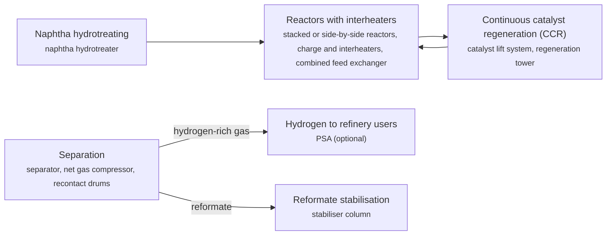

**Key equipment:** naphtha hydrotreater, reformer reactors, charge and interheaters, combined feed exchanger, CCR regenerator, net gas compressor, stabiliser.

**Performance:**
- semi-regenerative cycle between regenerations: 8-18 months; EPA AP-42; regeneration takes 1-2 weeks. [source](https://19january2021snapshot.epa.gov/sites/static/files/2020-09/documents/5.1_petroleum_refining.pdf)

**Reference plants:**
- Sinopec Hainan Petrochemical (200th UOP CCR Platforming unit), CN: not stated; CCR Platforming first commercialised 1971; commissioned by 2007. [source](https://www.chemicalonline.com/doc/uop-commissions-200th-ccr-platforming-process-0001)

**Missing inputs:**
- TRL range with a cited source (trl): Commercial technology, so TRL 9 is expected, but no source read states it. The IEA Clean Energy Technology Guide (collected October 2026, 634 entries) has no matching entry. Where: Licensor or industry association statements of commercial deployment; academic reviews (open). Next: Find a TRL table that covers this technology and add trl {low, high, source}.
- capital cost and levelized or unit cost, with dollar year and basis (costs): No open source read so far gives costs for this technology. Refinery and gas plant unit costs are mostly published in paid sources. Where: OSTI.GOV full-text reports from DOE labs (NETL, NREL, PNNL): search the technology name plus 'techno-economic' (catalog: osti, blocked); NREL techno-economic reports and the NREL/PNNL SAF analyses (private copy only) (catalog: nrel, open); Oil & Gas Journal refinery construction cost indexes (Nelson-Farrar): paywalled, summary only (catalog: ogj, paid); Paid cost databases (consultancies, licensor studies): catalog-only until the owner provides access (paid). Next: Look for an open techno-economic study; record each figure with metric, range, unit, dollar year, basis and source.

Sources: [1](https://19january2021snapshot.epa.gov/sites/static/files/2020-09/documents/5.1_petroleum_refining.pdf), [2](https://www.chemicalonline.com/doc/uop-commissions-200th-ccr-platforming-process-0001). Last reviewed 2026-10-24.

## Co-processing of bio-feeds in FCC and hydrotreaters

Bio-feeds such as vegetable oils, animal fats, used cooking oil or biomass pyrolysis oil are blended into the fossil feed of an existing hydrotreater, hydrocracker or FCC. Small shares need only catalyst changes; larger shares need unit modifications for extra hydrogen, heat release, CO/CO2 and water.

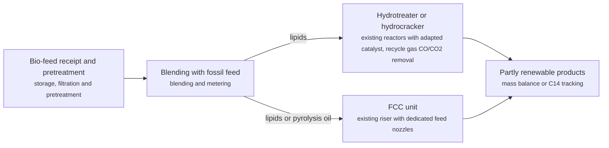

**Key equipment:** bio-feed storage and pretreatment, blending, existing hydroprocessing or FCC unit, recycle gas treating.

**Performance:**
- bio-feed share in hydroprocessing: 5-20 % of feed; Honeywell UOP: under 5% with catalyst change, 5-10% with minor modification, 10-20% with revamp. [source](https://ess.honeywell.com/content/dam/pmt/en/documents/Honeywell-UOP-Co-Processing-Technologies-web-brochure.pdf)
- biogenic feed rate in an FCC case study: 20 % of feed; Honeywell UOP (over 20%). [source](https://ess.honeywell.com/content/dam/pmt/en/documents/Honeywell-UOP-Co-Processing-Technologies-web-brochure.pdf)

**Missing inputs:**
- TRL range with a cited source (trl): Commercial technology, so TRL 9 is expected, but no source read states it. The IEA Clean Energy Technology Guide (collected October 2026, 634 entries) has no matching entry. Where: Licensor or industry association statements of commercial deployment; academic reviews (open). Next: Find a TRL table that covers this technology and add trl {low, high, source}.
- capital cost and levelized or unit cost, with dollar year and basis (costs): No open source read so far gives costs for this technology. Refinery and gas plant unit costs are mostly published in paid sources. Where: OSTI.GOV full-text reports from DOE labs (NETL, NREL, PNNL): search the technology name plus 'techno-economic' (catalog: osti, blocked); NREL techno-economic reports and the NREL/PNNL SAF analyses (private copy only) (catalog: nrel, open); Oil & Gas Journal refinery construction cost indexes (Nelson-Farrar): paywalled, summary only (catalog: ogj, paid); Paid cost databases (consultancies, licensor studies): catalog-only until the owner provides access (paid). Next: Look for an open techno-economic study; record each figure with metric, range, unit, dollar year, basis and source.
- named operating or planned plants with capacity and status (reference_plants): No plant was named in the sources read. Where: Licensor and refiner press releases for the named suppliers; Oil & Gas Journal construction news (catalog: ogj, paid); Press releases from the suppliers listed on the card (open). Next: Add one to three reference plants with country, capacity, status and source.

Sources: [1](https://ess.honeywell.com/content/dam/pmt/en/documents/Honeywell-UOP-Co-Processing-Technologies-web-brochure.pdf). Last reviewed 2026-10-24.

## Crude and vacuum distillation with heat integration

Crude is desalted, preheated against hot product streams and heated in a fired furnace, then separated by boiling range in an atmospheric column into gas, naphtha, kerosene, diesel and atmospheric residue. The residue would crack and foul at atmospheric pressure, so it is reheated and split again under vacuum into vacuum gas oils and vacuum residue.

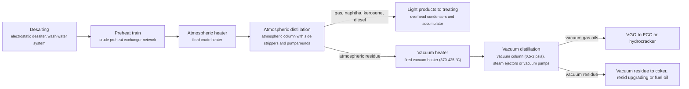

**Key equipment:** electrostatic desalter, preheat exchanger train, crude and vacuum fired heaters, atmospheric column, vacuum column, ejector or vacuum pump system.

**Performance:**
- vacuum heater outlet temperature: 370-425 °C; EPA AP-42 description. [source](https://19january2021snapshot.epa.gov/sites/static/files/2020-09/documents/5.1_petroleum_refining.pdf)
- vacuum column absolute pressure: 0.5-2 psia; EPA AP-42 description. [source](https://19january2021snapshot.epa.gov/sites/static/files/2020-09/documents/5.1_petroleum_refining.pdf)

**Missing inputs:**
- TRL range with a cited source (trl): Commercial technology, so TRL 9 is expected, but no source read states it. The IEA Clean Energy Technology Guide (collected October 2026, 634 entries) has no matching entry. Where: Licensor or industry association statements of commercial deployment; academic reviews (open). Next: Find a TRL table that covers this technology and add trl {low, high, source}.
- capital cost and levelized or unit cost, with dollar year and basis (costs): No open source read so far gives costs for this technology. Refinery and gas plant unit costs are mostly published in paid sources. Where: OSTI.GOV full-text reports from DOE labs (NETL, NREL, PNNL): search the technology name plus 'techno-economic' (catalog: osti, blocked); NREL techno-economic reports and the NREL/PNNL SAF analyses (private copy only) (catalog: nrel, open); Oil & Gas Journal refinery construction cost indexes (Nelson-Farrar): paywalled, summary only (catalog: ogj, paid); Paid cost databases (consultancies, licensor studies): catalog-only until the owner provides access (paid). Next: Look for an open techno-economic study; record each figure with metric, range, unit, dollar year, basis and source.
- named operating or planned plants with capacity and status (reference_plants): No plant was named in the sources read. Where: Licensor and refiner press releases for the named suppliers; Oil & Gas Journal construction news (catalog: ogj, paid); Press releases from the suppliers listed on the card (open). Next: Add one to three reference plants with country, capacity, status and source.

Sources: [1](https://19january2021snapshot.epa.gov/sites/static/files/2020-09/documents/5.1_petroleum_refining.pdf). Last reviewed 2026-10-24.

## Crude-to-chemicals complexes

A refinery is configured to send most of its crude to petrochemical feedstocks rather than fuels. Deep conversion such as hydrocracking and resid upgrading makes naphtha and gas oils for steam crackers and aromatics complexes, so a large share of each barrel ends as ethylene, propylene, paraxylene and other chemicals.

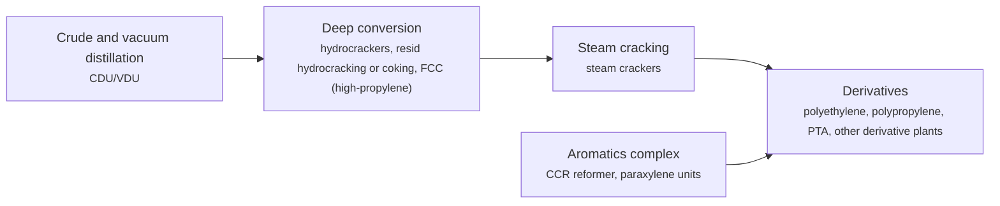

**Key equipment:** CDU/VDU, hydrocrackers, resid upgrading, steam crackers, aromatics complex, derivative units.

**Reference plants:**
- PETRONAS Pengerang RAPID (PIC), Johor, MY: 300 kb/d refinery with 3.3 Mt/yr petrochemical capacity; PETRONAS and Saudi Aramco joint ventures; refinery start-up targeted Q1 2019 at time of release. [source](https://www.petronas.com/pic/news-resources/press-releases/petronas-saudi-aramco-announce-formation-jv-malaysia)
- Hengli Petrochemical, Dalian, CN: 20 Mt/yr crude processing; production start announced December 2018. [source](https://yicaiglobal.com/news/hengli-petrochemical-to-finish-dalian-plant-start-20-million-ton-production-)

**Missing inputs:**
- TRL range with a cited source (trl): Commercial technology, so TRL 9 is expected, but no source read states it. The IEA Clean Energy Technology Guide (collected October 2026, 634 entries) has no matching entry. Where: Licensor or industry association statements of commercial deployment; academic reviews (open). Next: Find a TRL table that covers this technology and add trl {low, high, source}.
- capital cost and levelized or unit cost, with dollar year and basis (costs): No open source read so far gives costs for this technology. Refinery and gas plant unit costs are mostly published in paid sources. Where: OSTI.GOV full-text reports from DOE labs (NETL, NREL, PNNL): search the technology name plus 'techno-economic' (catalog: osti, blocked); NREL techno-economic reports and the NREL/PNNL SAF analyses (private copy only) (catalog: nrel, open); Oil & Gas Journal refinery construction cost indexes (Nelson-Farrar): paywalled, summary only (catalog: ogj, paid); Paid cost databases (consultancies, licensor studies): catalog-only until the owner provides access (paid). Next: Look for an open techno-economic study; record each figure with metric, range, unit, dollar year, basis and source.
- chemicals yield per barrel of crude (performance): Neither source read gives a chemicals yield. Where: Saudi Aramco and SABIC crude-to-chemicals publications (catalog: saudi-aramco-tech, open); IEA reports on petrochemicals (catalog: iea-reports, open). Next: Add chemicals yield (% of crude) for named complexes.

Sources: [1](https://www.petronas.com/pic/news-resources/press-releases/petronas-saudi-aramco-announce-formation-jv-malaysia), [2](https://yicaiglobal.com/news/hengli-petrochemical-to-finish-dalian-plant-start-20-million-ton-production-). Last reviewed 2026-10-24.

## Delayed coking and fluid coking

Vacuum residue is heated quickly in a furnace to 480 to 590 °C and sent to a coke drum at about 400 °C and 25 to 30 psig, where it cracks thermally over many hours. Vapours go to a fractionator, and solid coke builds up in the drum. Drums run in pairs on a semi-batch cycle of 28 to 36 hours, with one filling while the other is steamed, cooled and cut out with high-pressure water.

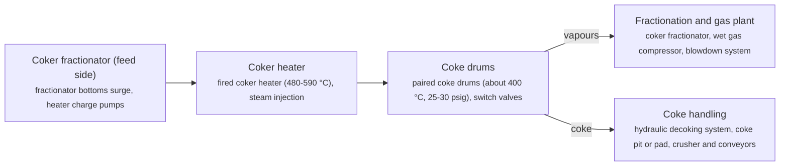

**Key equipment:** coker heater, coke drums, hydraulic decoking, coke handling, fractionator, blowdown system.

**Performance:**
- coker heater outlet temperature: 480-590 °C; EPA AP-42 description. [source](https://19january2021snapshot.epa.gov/sites/static/files/2020-09/documents/5.1_petroleum_refining.pdf)
- coke drum cycle: 28-36 h; EPA AP-42 description, start of feed to start of next feed to the same drum. [source](https://19january2021snapshot.epa.gov/sites/static/files/2020-09/documents/5.1_petroleum_refining.pdf)

**Missing inputs:**
- TRL range with a cited source (trl): Commercial technology, so TRL 9 is expected, but no source read states it. The IEA Clean Energy Technology Guide (collected October 2026, 634 entries) has no matching entry. Where: Licensor or industry association statements of commercial deployment; academic reviews (open). Next: Find a TRL table that covers this technology and add trl {low, high, source}.
- capital cost and levelized or unit cost, with dollar year and basis (costs): No open source read so far gives costs for this technology. Refinery and gas plant unit costs are mostly published in paid sources. Where: OSTI.GOV full-text reports from DOE labs (NETL, NREL, PNNL): search the technology name plus 'techno-economic' (catalog: osti, blocked); NREL techno-economic reports and the NREL/PNNL SAF analyses (private copy only) (catalog: nrel, open); Oil & Gas Journal refinery construction cost indexes (Nelson-Farrar): paywalled, summary only (catalog: ogj, paid); Paid cost databases (consultancies, licensor studies): catalog-only until the owner provides access (paid). Next: Look for an open techno-economic study; record each figure with metric, range, unit, dollar year, basis and source.
- named operating or planned plants with capacity and status (reference_plants): No plant was named in the sources read. Where: Licensor and refiner press releases for the named suppliers; Oil & Gas Journal construction news (catalog: ogj, paid); Press releases from the suppliers listed on the card (open). Next: Add one to three reference plants with country, capacity, status and source.

Sources: [1](https://19january2021snapshot.epa.gov/sites/static/files/2020-09/documents/5.1_petroleum_refining.pdf). Last reviewed 2026-10-24.

## Fluid catalytic cracking and resid FCC

Hot, fine zeolite catalyst behaves like a fluid and meets vaporised gas oil in a riser reactor at 470 to 525 °C, cracking it into gasoline, LPG, light cycle oil and slurry. Coke deposited on the catalyst is burned off with air in a regenerator at 590 to 675 °C, which reheats the catalyst for the next pass. Residue versions use two-stage regenerators and catalyst coolers.

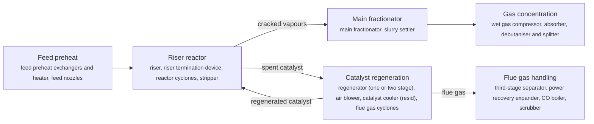

**Key equipment:** riser and reactor, regenerator, air blower, cyclones, main fractionator, wet gas compressor, flue gas power recovery and scrubber.

**Performance:**
- riser reaction temperature: 470-525 °C; EPA AP-42 description. [source](https://19january2021snapshot.epa.gov/sites/static/files/2020-09/documents/5.1_petroleum_refining.pdf)
- regenerator temperature: 590-675 °C; EPA AP-42 description. [source](https://19january2021snapshot.epa.gov/sites/static/files/2020-09/documents/5.1_petroleum_refining.pdf)
- propylene yield, PetroFCC: 18-20 wt%; Honeywell UOP, depending on feed. [source](https://uop.honeywell.com/content/dam/uop/en-us/documents/industry-solutions/refining/vaccuum-gas-oil-conversion/honeywell-uop-fcc-related-processes-datasheet.pdf)

**Reference plants:**
- UOP-licensed FCC fleet: over 215 FCC/RFCC/MSCC units licensed; over 150 of more than 400 FCC units worldwide under UOP licence; per 2016 datasheet. [source](https://uop.honeywell.com/content/dam/uop/en-us/documents/industry-solutions/refining/vaccuum-gas-oil-conversion/honeywell-uop-fcc-related-processes-datasheet.pdf)

**Missing inputs:**
- TRL range with a cited source (trl): Commercial technology, so TRL 9 is expected, but no source read states it. The IEA Clean Energy Technology Guide (collected October 2026, 634 entries) has no matching entry. Where: Licensor or industry association statements of commercial deployment; academic reviews (open). Next: Find a TRL table that covers this technology and add trl {low, high, source}.
- capital cost and levelized or unit cost, with dollar year and basis (costs): No open source read so far gives costs for this technology. Refinery and gas plant unit costs are mostly published in paid sources. Where: OSTI.GOV full-text reports from DOE labs (NETL, NREL, PNNL): search the technology name plus 'techno-economic' (catalog: osti, blocked); NREL techno-economic reports and the NREL/PNNL SAF analyses (private copy only) (catalog: nrel, open); Oil & Gas Journal refinery construction cost indexes (Nelson-Farrar): paywalled, summary only (catalog: ogj, paid); Paid cost databases (consultancies, licensor studies): catalog-only until the owner provides access (paid). Next: Look for an open techno-economic study; record each figure with metric, range, unit, dollar year, basis and source.

Sources: [1](https://19january2021snapshot.epa.gov/sites/static/files/2020-09/documents/5.1_petroleum_refining.pdf), [2](https://uop.honeywell.com/content/dam/uop/en-us/documents/industry-solutions/refining/vaccuum-gas-oil-conversion/honeywell-uop-fcc-related-processes-datasheet.pdf). Last reviewed 2026-10-24.

## Hydrocracking (fixed bed)

Vacuum gas oil and hydrogen pass at high pressure over a pretreatment catalyst that removes nitrogen and sulfur, then over a cracking catalyst with acid and metal functions that breaks heavy molecules into diesel, jet and naphtha while saturating them. Unconverted oil can be recycled to a second stage or sent to lube units or the FCC.

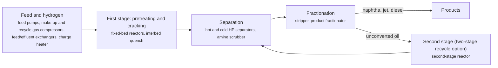

**Key equipment:** high-pressure reactors, charge heater, recycle gas compressor, HP separators, amine scrubber, fractionator.

**Performance:**
- conversion of straight-run VGO (revamped two-stage recycle unit): 80 %; CLG case study (upwards of 80%); unit revamped from 40,000 to 64,000 b/d fresh VGO. [source](https://www.digitalrefining.com/article/1002562/78)

**Missing inputs:**
- TRL range with a cited source (trl): Commercial technology, so TRL 9 is expected, but no source read states it. The IEA Clean Energy Technology Guide (collected October 2026, 634 entries) has no matching entry. Where: Licensor or industry association statements of commercial deployment; academic reviews (open). Next: Find a TRL table that covers this technology and add trl {low, high, source}.
- capital cost and levelized or unit cost, with dollar year and basis (costs): No open source read so far gives costs for this technology. Refinery and gas plant unit costs are mostly published in paid sources. Where: OSTI.GOV full-text reports from DOE labs (NETL, NREL, PNNL): search the technology name plus 'techno-economic' (catalog: osti, blocked); NREL techno-economic reports and the NREL/PNNL SAF analyses (private copy only) (catalog: nrel, open); Oil & Gas Journal refinery construction cost indexes (Nelson-Farrar): paywalled, summary only (catalog: ogj, paid); Paid cost databases (consultancies, licensor studies): catalog-only until the owner provides access (paid). Next: Look for an open techno-economic study; record each figure with metric, range, unit, dollar year, basis and source.
- named operating or planned plants with capacity and status (reference_plants): No plant was named in the sources read. Where: Licensor and refiner press releases for the named suppliers; Oil & Gas Journal construction news (catalog: ogj, paid); Press releases from the suppliers listed on the card (open). Next: Add one to three reference plants with country, capacity, status and source.

Sources: [1](https://www.digitalrefining.com/article/1002562/78), [2](https://19january2021snapshot.epa.gov/sites/static/files/2020-09/documents/5.1_petroleum_refining.pdf). Last reviewed 2026-10-24.

## Hydrotreating (naphtha, diesel, VGO)

Oil and hydrogen are heated and passed over fixed beds of CoMo or NiMo catalyst, where sulfur, nitrogen and oxygen are converted to H2S, ammonia and water and olefins and aromatics are partly saturated. Separators and an amine scrubber clean and recycle the hydrogen, and a stripper removes H2S and light ends from the product. Topsoe states ULSD below 10 wt ppm sulfur.

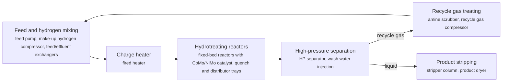

**Key equipment:** feed/effluent exchangers, charge heater, hydrotreating reactors with internals, HP and LP separators, recycle gas amine scrubber, recycle gas compressor, product stripper.

**Performance:**
- ULSD product sulfur: up to 10 wt ppm S; Topsoe diesel hydrotreating. [source](https://www.topsoe.com/processes/hydrotreating/diesel-hydrotreating)

**Missing inputs:**
- TRL range with a cited source (trl): Commercial technology, so TRL 9 is expected, but no source read states it. The IEA Clean Energy Technology Guide (collected October 2026, 634 entries) has no matching entry. Where: Licensor or industry association statements of commercial deployment; academic reviews (open). Next: Find a TRL table that covers this technology and add trl {low, high, source}.
- capital cost and levelized or unit cost, with dollar year and basis (costs): No open source read so far gives costs for this technology. Refinery and gas plant unit costs are mostly published in paid sources. Where: OSTI.GOV full-text reports from DOE labs (NETL, NREL, PNNL): search the technology name plus 'techno-economic' (catalog: osti, blocked); NREL techno-economic reports and the NREL/PNNL SAF analyses (private copy only) (catalog: nrel, open); Oil & Gas Journal refinery construction cost indexes (Nelson-Farrar): paywalled, summary only (catalog: ogj, paid); Paid cost databases (consultancies, licensor studies): catalog-only until the owner provides access (paid). Next: Look for an open techno-economic study; record each figure with metric, range, unit, dollar year, basis and source.
- named operating or planned plants with capacity and status (reference_plants): No plant was named in the sources read. Where: Licensor and refiner press releases for the named suppliers; Oil & Gas Journal construction news (catalog: ogj, paid); Press releases from the suppliers listed on the card (open). Next: Add one to three reference plants with country, capacity, status and source.

Sources: [1](https://www.topsoe.com/processes/hydrotreating/diesel-hydrotreating), [2](https://19january2021snapshot.epa.gov/sites/static/files/2020-09/documents/5.1_petroleum_refining.pdf). Last reviewed 2026-10-24.

## Isomerisation (C5/C6)

Light straight-run naphtha (pentanes and hexanes) is converted over a catalyst, typically chlorinated alumina, into branched isomers with higher octane. Equilibrium limits a once-through unit, so recycle schemes separate unconverted normal paraffins with a deisohexaniser or molecular sieves and send them back.

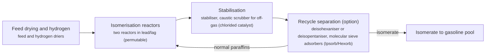

**Key equipment:** feed and hydrogen driers, isomerisation reactors, stabiliser, deisohexaniser, molecular sieve adsorbers.

**Performance:**
- isomerate RON, once-through: 83-84 RON; Axens, for 40:60 C5:C6 feed starting at RON about 70. [source](https://www.axens.net/markets/oil-refining/c5c6-isomerization)
- isomerate RON, recycle with molecular sieves (Hexorb): 91-92 RON; Axens, at C5/C6 ratio 0.65; deisohexaniser recycle gives about 88. [source](https://www.axens.net/markets/oil-refining/c5c6-isomerization)

**Missing inputs:**
- TRL range with a cited source (trl): Commercial technology, so TRL 9 is expected, but no source read states it. The IEA Clean Energy Technology Guide (collected October 2026, 634 entries) has no matching entry. Where: Licensor or industry association statements of commercial deployment; academic reviews (open). Next: Find a TRL table that covers this technology and add trl {low, high, source}.
- capital cost and levelized or unit cost, with dollar year and basis (costs): No open source read so far gives costs for this technology. Refinery and gas plant unit costs are mostly published in paid sources. Where: OSTI.GOV full-text reports from DOE labs (NETL, NREL, PNNL): search the technology name plus 'techno-economic' (catalog: osti, blocked); NREL techno-economic reports and the NREL/PNNL SAF analyses (private copy only) (catalog: nrel, open); Oil & Gas Journal refinery construction cost indexes (Nelson-Farrar): paywalled, summary only (catalog: ogj, paid); Paid cost databases (consultancies, licensor studies): catalog-only until the owner provides access (paid). Next: Look for an open techno-economic study; record each figure with metric, range, unit, dollar year, basis and source.
- named operating or planned plants with capacity and status (reference_plants): No plant was named in the sources read. Where: Licensor and refiner press releases for the named suppliers; Oil & Gas Journal construction news (catalog: ogj, paid); Press releases from the suppliers listed on the card (open). Next: Add one to three reference plants with country, capacity, status and source.

Sources: [1](https://www.axens.net/markets/oil-refining/c5c6-isomerization). Last reviewed 2026-10-24.

## Renewable diesel and SAF by hydrotreated esters and fatty acids (HEFA)

Waste fats, used cooking oil and vegetable oils are pretreated to remove metals and phosphorus, then hydrotreated to strip oxygen and make straight-chain paraffins. A second step isomerises and, for jet, mildly cracks them to meet cold-flow specifications, and the products are fractionated into renewable diesel, SAF, naphtha and propane.

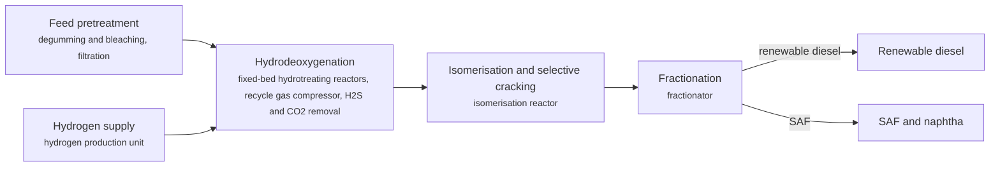

**Key equipment:** pretreatment unit, HDO reactors, isomerisation reactor, recycle gas scrubber, fractionator, hydrogen plant.

**Reference plants:**
- Neste Singapore refinery, SG: 2.6 Mt/yr renewable products including up to 1 Mt/yr SAF; expansion completed April 2023 (EUR 1.6 billion). [source](https://www.neste.com/en-sg/about-neste/how-we-operate/production/singapore-refinery)
- Diamond Green Diesel, Norco, Louisiana, US: 275 million gal/yr, expanding to 675 million gal/yr (Ecofining); expansion announced September 2019, completion expected late 2021. [source](https://www.digitalrefining.com/news/1005764/diamond-green-expands-production-capacity-using-ecofining-technology-from-honeywell)

TRL source: [IEA ETP Clean Energy Technology Guide, dataset of 24 July 2026, 2025 assessment (IEA 1-11 scale): 'Hydrotreating of oil/fats to HVOs or HEFAs' 9](https://www.iea.org/data-and-statistics/data-tools/etp-clean-energy-technology-guide)

**Missing inputs:**
- key performance figures (energy use, yields, capture or conversion rate) (performance): No source read so far gives performance figures. Where: Supplier datasheets and brochures for the companies listed on the card (open); arXiv: open techno-economic and review papers (collector already runs weekly) (catalog: arxiv, open); OSTI.GOV full-text reports from DOE labs (NETL, NREL, PNNL): search the technology name plus 'techno-economic' (catalog: osti, blocked). Next: Add the figures that matter for comparing options, each with its basis and source.
- minimum fuel selling price (USD/gal) for HEFA renewable diesel and SAF (costs): The NREL/PNNL techno-economic reports are on osti.gov, which the collector cannot reach, and NREL copies are private only. The DOE SAF Grand Challenge Roadmap (2022) and Implementation Framework (2024) were collected and checked: they give only the USD 1.25-1.75/gal tax credit, not a production cost. Where: OSTI.GOV full-text reports from DOE labs (NETL, NREL, PNNL): search the technology name plus 'techno-economic' (catalog: osti, blocked); NREL SAF techno-economic analyses (catalog: nrel, open). Next: Collect the NREL/PNNL techno-economic reports when osti.gov is reachable (or download them by hand into corpus/_inbox/osti/); add yield and minimum selling price with dollar year. Blocked by: osti.gov reachable from the Mac.

Sources: [1](https://www.neste.com/en-sg/about-neste/how-we-operate/production/singapore-refinery), [2](https://www.digitalrefining.com/news/1005764/diamond-green-expands-production-capacity-using-ecofining-technology-from-honeywell). Last reviewed 2026-10-24.

## Resid hydrocracking (ebullated and slurry bed)

Residue is hydrocracked at high pressure in reactors that keep catalyst moving: ebullated beds fluidise supported catalyst with recycled liquid, while slurry processes disperse a very fine catalyst in the feed in bubble column reactors. Unconverted residue can be recycled, which lets slurry processes reach very high conversion.

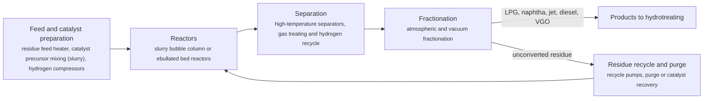

**Key equipment:** high-pressure residue reactors, feed heaters, hydrogen compressors, hot separators, vacuum fractionator, catalyst handling or recovery.

**Performance:**
- residue conversion, EST pilot and demonstration runs: 97 %; Eni (above 97% in all experimental runs). [source](https://eni.com/assets/documents/eng/company/brochure/2014/eni_EST_esecutivo.pdf)

**Reference plants:**
- Eni Sannazzaro EST unit, IT: 23,000 b/d design; oil-in 14 October 2013. [source](https://eni.com/assets/documents/eng/company/brochure/2014/eni_EST_esecutivo.pdf)

**Missing inputs:**
- TRL range with a cited source (trl): Commercial technology, so TRL 9 is expected, but no source read states it. The IEA Clean Energy Technology Guide (collected October 2026, 634 entries) has no matching entry. Where: Licensor or industry association statements of commercial deployment; academic reviews (open). Next: Find a TRL table that covers this technology and add trl {low, high, source}.
- capital cost and levelized or unit cost, with dollar year and basis (costs): No open source read so far gives costs for this technology. Refinery and gas plant unit costs are mostly published in paid sources. Where: OSTI.GOV full-text reports from DOE labs (NETL, NREL, PNNL): search the technology name plus 'techno-economic' (catalog: osti, blocked); NREL techno-economic reports and the NREL/PNNL SAF analyses (private copy only) (catalog: nrel, open); Oil & Gas Journal refinery construction cost indexes (Nelson-Farrar): paywalled, summary only (catalog: ogj, paid); Paid cost databases (consultancies, licensor studies): catalog-only until the owner provides access (paid). Next: Look for an open techno-economic study; record each figure with metric, range, unit, dollar year, basis and source.

Sources: [1](https://eni.com/assets/documents/eng/company/brochure/2014/eni_EST_esecutivo.pdf). Last reviewed 2026-10-24.

## Alcohol-to-jet SAF

Ethanol or isobutanol is dehydrated to light olefins, which are oligomerised into longer chains, hydrogenated and fractionated into jet and diesel range paraffins. Any low-carbon alcohol can be the feed, including ethanol from wastes or gas fermentation.

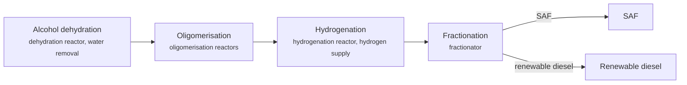

**Key equipment:** dehydration reactor, oligomerisation reactors, hydrogenation reactor, fractionation.

**Reference plants:**
- LanzaJet Freedom Pines Fuels, Soperton, Georgia, US: 10 million gal/yr SAF and renewable diesel from ethanol; opened January 2024; described as the first ATJ SAF plant. [source](https://hydrocarbonprocessing.com/news/2024/01/industry-leaders-investors-excited-over-grand-opening-of-lanzajet-freedom-pines-fuels/)

TRL source: [IEA ETP Clean Energy Technology Guide, dataset of 24 July 2026, 2025 assessment (IEA 1-11 scale): 'Ethanol / butanol-to-jet' 8](https://www.iea.org/data-and-statistics/data-tools/etp-clean-energy-technology-guide)

**Missing inputs:**
- key performance figures (energy use, yields, capture or conversion rate) (performance): No source read so far gives performance figures. Where: Supplier datasheets and brochures for the companies listed on the card (open); arXiv: open techno-economic and review papers (collector already runs weekly) (catalog: arxiv, open); OSTI.GOV full-text reports from DOE labs (NETL, NREL, PNNL): search the technology name plus 'techno-economic' (catalog: osti, blocked). Next: Add the figures that matter for comparing options, each with its basis and source.
- minimum fuel selling price (USD/gal) and yield per gallon of ethanol (costs): PNNL/NREL alcohol-to-jet analyses are on osti.gov, which the collector cannot reach. The DOE SAF Grand Challenge Roadmap (2022) and Implementation Framework (2024) were collected and checked: they give only the USD 1.25-1.75/gal tax credit, not a production cost. Where: OSTI.GOV full-text reports from DOE labs (NETL, NREL, PNNL): search the technology name plus 'techno-economic' (catalog: osti, blocked); PNNL alcohol-to-jet reports (catalog: pnnl, open). Next: Collect the NREL/PNNL techno-economic reports when osti.gov is reachable (or download them by hand into corpus/_inbox/osti/); add yield and minimum selling price with dollar year. Blocked by: osti.gov reachable from the Mac.

Sources: [1](https://hydrocarbonprocessing.com/news/2024/01/industry-leaders-investors-excited-over-grand-opening-of-lanzajet-freedom-pines-fuels/). Last reviewed 2026-10-24.
