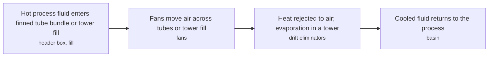
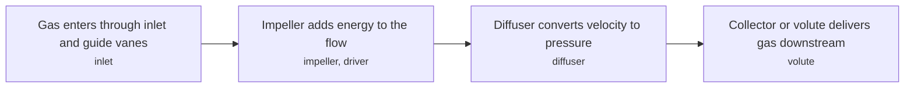
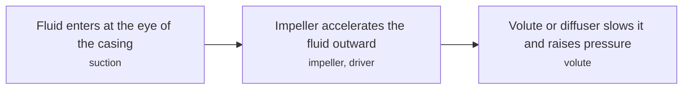
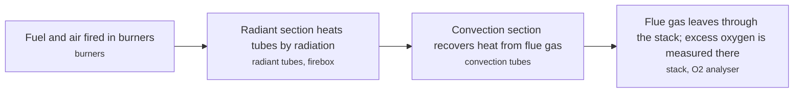
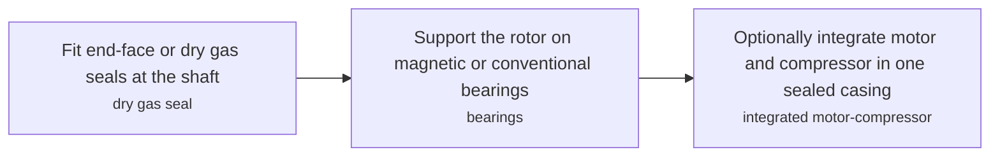
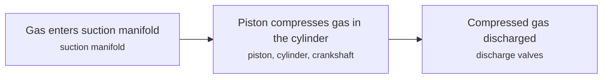
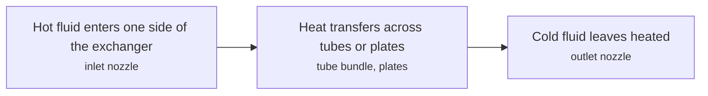
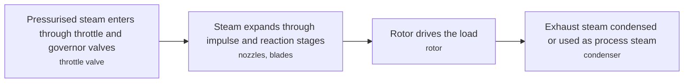

# ROT technology options

11 technologies, from commercial to lab stage. Generated from catalog/technologies/; every figure links to its source.

| Technology | Category | Maturity | TRL | Suppliers | Cost figures |
| --- | --- | --- | --- | --- | --- |
| [Air coolers and cooling towers](#rot-air-coolers-cooling-towers) | Static equipment | commercial |  | Alfa Laval (finned tube air heat exchangers); Hamon (cooling tower design (named in the Wikipedia reference)); SPX Cooling Technologies |  |
| [Centrifugal and axial compressors](#rot-centrifugal-axial-compressors) | Rotating equipment | commercial |  | Siemens Energy (axial and centrifugal process compressors for oil and gas to API 617); Mitsubishi Heavy Industries (MCO-I) (API 617 centrifugal compressors with dedicated performance test stand); Elliott Group (centrifugal and axial compressors for refinery and gas service); Baker Hughes (centrifugal and integrally-geared compressors for LNG and gas processing); Atlas Copco (process centrifugal compressors to API 617, up to 205 bar(a)) |  |
| [Centrifugal and positive displacement pumps](#rot-pumps) | Rotating equipment | commercial |  | American Marsh (early self-priming centrifugal pump (1938)); Sulzer (API 610 centrifugal process pumps (overhung, between-bearing, vertical)); Flowserve (API 610 process pumps for refinery and petrochemical service); KSB (API 610 centrifugal pumps); ITT Goulds Pumps (API 610 pump families (BB1/BB2/BB3/OH2), more than 20,000 API pumps installed) |  |
| [Columns, trays and structured packing](#rot-columns-trays-packing) | Static equipment | commercial |  | Koch-Glitsch (trays and structured/random packing for separation columns); Sulzer (column internals: structured packing, trays and column technology) |  |
| [Fired heaters and low-NOx burners](#rot-fired-heaters-low-nox-burners) | Static equipment | commercial |  | ClearSign (Duplex ceramic-tile flame retrofit); Hamworthy Peabody Combustion (ECOjet staged-gas boiler burner (not a heater burner)) |  |
| [Mechanical seals, magnetic bearings and integrated motor-compressors](#rot-seals-bearings-motor-compressors) | Rotating equipment | commercial |  | Gallagher Seals; Omniseal Solutions; Ashton Seals |  |
| [Pressure vessels, reactors and cryogenic tanks](#rot-pressure-vessels-reactors-tanks) | Static equipment | commercial |  |  |  |
| [Reciprocating and screw compressors](#rot-reciprocating-screw-compressors) | Rotating equipment | commercial |  |  |  |
| [Shell-and-tube, plate and printed-circuit heat exchangers](#rot-heat-exchangers) | Static equipment | commercial |  | Alfa Laval (plate-and-frame and welded plate heat exchangers); Heatric (Parker Hannifin) (printed-circuit heat exchangers (diffusion-bonded), design pressure above 900 bar class up to about 1,000 bar, temperatures 76 K to 1,255 K) |  |
| [Steam turbines and expanders](#rot-steam-turbines-expanders) | Rotating equipment | commercial |  | Siemens Energy; GE Vernova; Mitsubishi Heavy Industries; Baker Hughes; MAN Energy Solutions; Doosan Skoda Power; Dongfang Electric; Shanghai Electric | maintenance cost: 0.005 USD per kWh |
| [Valves and actuators](#rot-valves-actuators) | Static equipment | commercial |  |  |  |

## Air coolers and cooling towers

Air coolers pass hot process fluid through finned tubes cooled by fan-driven air; cooling towers reject heat by evaporating water. Both remove process heat when cooling water or low ambient air is the sink.

**Key equipment:** finned tube bundles, fans, fill, drift eliminators, basin.

**Performance:**
- API 661 air cooler temperature limit: up to 400 degC (up to); Alfa Laval states API 661 units handle up to 400 degC. [source](https://www.alfalaval.com/products/heat-transfer/finned-tube-air-heat-exchangers/Finned-tube-air-heat-exchangers/)
- API 661 air cooler pressure limit: up to 700 bar (up to); Alfa Laval states API 661 units handle up to 700 bar. [source](https://www.alfalaval.com/products/heat-transfer/finned-tube-air-heat-exchangers/Finned-tube-air-heat-exchangers/)
- refinery cooling water circulation: 80000 m3/h; example of a 300,000 bbl/d refinery given in the Wikipedia cooling tower article. [source](https://en.wikipedia.org/wiki/Cooling_tower)
- cooling tower make-up water: 5 % of circulation (perhaps); stated for a 700 MWth coal plant example. [source](https://en.wikipedia.org/wiki/Cooling_tower)

**Missing inputs:**
- air cooler and tower capex and opex (costs): No cost figures in the pages read. Where: arXiv and open-access journals: techno-economic or review papers (MDPI is blocked by its CDN; use the manual inbox) (catalog: arxiv, open). Next: Add cost per duty with year.
- named plants or projects with capacity and year (reference_plants): The sources read name no specific plant. Web-checked 2026-10-28; ubiquitous equipment. Where: Licensor and operator press releases for the suppliers listed (open). Next: Add one or two plants with country, capacity and start-up year.
- TRL with a cited source (trl): The IEA ETP Clean Energy Technology Guide has no matching entry. no open TRL table found (IEA ETP guide checked 2026-10-28). Where: IEA ETP Clean Energy Technology Guide (collected): search for the technology name (catalog: iea-reports, open). Next: Find a TRL table that lists this technology, or leave maturity resting on the evidence on the card.
- process steps and equipment are general engineering practice, not taken from one source (process): The sources read describe the principle but not a full step-by-step flow. Where: Licensor process descriptions and textbooks (open). Next: Check the steps against a licensor description and name it.

Sources: [1](https://www.alfalaval.com/products/heat-transfer/finned-tube-air-heat-exchangers/Finned-tube-air-heat-exchangers/), [2](https://en.wikipedia.org/wiki/Cooling_tower). Last reviewed 2026-10-28.

## Centrifugal and axial compressors

A spinning impeller adds energy to a continuous gas flow; a diffuser turns the kinetic energy into static pressure. In oil and gas they drive pipelines, refining, gas processing and reinjection.

**Key equipment:** impeller, diffuser, casing, gas turbine or electric driver, dry gas seals, anti-surge control.

**Performance:**
- oilfield reinjection discharge pressure: 700 bar (approaching); barrel-style casings for gas reinjection, as stated. [source](https://en.wikipedia.org/wiki/Centrifugal_compressor)
- single-stage pressure ratio: 1-10 ratio (few exceed 10:1); single-stage machines; the 8 stated is a helicopter engine example, not process duty. [source](https://en.wikipedia.org/wiki/Centrifugal_compressor)

**Missing inputs:**
- process-duty flow and head ranges, efficiency and API 617 limits (performance): The page gives only a small research compressor map. Web-checked 2026-10-28: Atlas Copco centrifugal class to 205 bar(a) recorded with suppliers; polytropic-efficiency and flow/head envelope tables sit in vendor selectors. Where: OEM datasheets and API 617 summaries (open). Next: Add typical flow, head and efficiency ranges.
- capital cost and operating or unit cost, with dollar year and basis (costs): No open source read so far gives costs for this technology. Web-checked 2026-10-28; OEM quotes only. Where: arXiv and open-access journals: techno-economic or review papers (MDPI is blocked by its CDN; use the manual inbox) (catalog: arxiv, open); Licensor and EPC studies; paid cost databases are catalog-only (paid); OSTI.GOV full-text reports from DOE labs: search the technology name plus 'techno-economic' (catalog: osti, blocked). Next: Look for an open techno-economic study; record each figure with metric, range, unit, dollar year, basis and source.
- named plants or projects with capacity and year (reference_plants): The sources read name no specific plant. Web-checked 2026-10-28; ubiquitous equipment. Where: Licensor and operator press releases for the suppliers listed (open). Next: Add one or two plants with country, capacity and start-up year.
- TRL with a cited source (trl): The IEA ETP Clean Energy Technology Guide has no matching entry. no open TRL table found (IEA ETP guide checked 2026-10-28). Where: IEA ETP Clean Energy Technology Guide (collected): search for the technology name (catalog: iea-reports, open). Next: Find a TRL table that lists this technology, or leave maturity resting on the evidence on the card.
- process steps and equipment are general engineering practice, not taken from one source (process): The sources read describe the principle but not a full step-by-step flow. Where: Licensor process descriptions and textbooks (open). Next: Check the steps against a licensor description and name it.

Sources: [1](https://en.wikipedia.org/wiki/Centrifugal_compressor). Last reviewed 2026-10-28.

## Centrifugal and positive displacement pumps

A centrifugal pump converts rotational kinetic energy into hydrodynamic energy of the fluid with an impeller inside a volute or diffuser casing. Positive-displacement pumps suit high pressure and are the alternative.

**Key equipment:** impeller, casing, shaft and bearings, seal or gland, driver (motor or turbine).

**Performance:**
- boiler feed pump flow: 150 L/s per pump at 21 MPa; two pumps in parallel for a 350 MW unit, example given in the article. [source](https://en.wikipedia.org/wiki/Centrifugal_pump)

**Missing inputs:**
- pump efficiency, head and flow by type (performance): Not stated on the page. Web-checked 2026-10-28; pump selection curves are vendor-selector material. Where: Hydraulic Institute and OEM catalogues (open). Next: Add ranges per pump class.
- capital cost and operating or unit cost, with dollar year and basis (costs): No open source read so far gives costs for this technology. Web-checked 2026-10-28; vendor quotes only. Where: arXiv and open-access journals: techno-economic or review papers (MDPI is blocked by its CDN; use the manual inbox) (catalog: arxiv, open); Licensor and EPC studies; paid cost databases are catalog-only (paid); OSTI.GOV full-text reports from DOE labs: search the technology name plus 'techno-economic' (catalog: osti, blocked). Next: Look for an open techno-economic study; record each figure with metric, range, unit, dollar year, basis and source.
- named plants or projects with capacity and year (reference_plants): The sources read name no specific plant. Web-checked 2026-10-28; ubiquitous equipment. Where: Licensor and operator press releases for the suppliers listed (open). Next: Add one or two plants with country, capacity and start-up year.
- TRL with a cited source (trl): The IEA ETP Clean Energy Technology Guide has no matching entry. no open TRL table found (IEA ETP guide checked 2026-10-28). Where: IEA ETP Clean Energy Technology Guide (collected): search for the technology name (catalog: iea-reports, open). Next: Find a TRL table that lists this technology, or leave maturity resting on the evidence on the card.
- process steps and equipment are general engineering practice, not taken from one source (process): The sources read describe the principle but not a full step-by-step flow. Where: Licensor process descriptions and textbooks (open). Next: Check the steps against a licensor description and name it.

Sources: [1](https://en.wikipedia.org/wiki/Centrifugal_pump). Last reviewed 2026-10-28.

## Columns, trays and structured packing

A fractionating column separates liquids by volatility; vapour and liquid contact on trays or packing. Packing gives low pressure drop, which suits vacuum service.

**Key equipment:** trays, random and structured packing, reboiler, condenser, reflux drum.

**Performance:**
- industrial column diameter: 0.65-6 m; range stated for industrial columns. [source](https://en.wikipedia.org/wiki/Fractionating_column)
- industrial column height: 6-60 m (or more); range stated. [source](https://en.wikipedia.org/wiki/Fractionating_column)
- share of plant energy use: 40 % (about); stated for a typical chemical plant. [source](https://en.wikipedia.org/wiki/Fractionating_column)

**Missing inputs:**
- tray efficiency and packing pressure drop figures (performance): Not in the page read. Web-checked 2026-10-28; efficiency correlations are textbook/vendor-selector material. Where: Vendor technical bulletins (open). Next: Add figures with source.
- capital cost and operating or unit cost, with dollar year and basis (costs): No open source read so far gives costs for this technology. Web-checked 2026-10-28; vendor quotes only. Where: arXiv and open-access journals: techno-economic or review papers (MDPI is blocked by its CDN; use the manual inbox) (catalog: arxiv, open); Licensor and EPC studies; paid cost databases are catalog-only (paid); OSTI.GOV full-text reports from DOE labs: search the technology name plus 'techno-economic' (catalog: osti, blocked). Next: Look for an open techno-economic study; record each figure with metric, range, unit, dollar year, basis and source.
- named plants or projects with capacity and year (reference_plants): The sources read name no specific plant. Web-checked 2026-10-28; ubiquitous equipment. Where: Licensor and operator press releases for the suppliers listed (open). Next: Add one or two plants with country, capacity and start-up year.
- TRL with a cited source (trl): The IEA ETP Clean Energy Technology Guide has no matching entry. no open TRL table found (IEA ETP guide checked 2026-10-28). Where: IEA ETP Clean Energy Technology Guide (collected): search for the technology name (catalog: iea-reports, open). Next: Find a TRL table that lists this technology, or leave maturity resting on the evidence on the card.
- process steps and equipment are general engineering practice, not taken from one source (process): The sources read describe the principle but not a full step-by-step flow. Where: Licensor process descriptions and textbooks (open). Next: Check the steps against a licensor description and name it.

Sources: [1](https://en.wikipedia.org/wiki/Fractionating_column). Last reviewed 2026-10-28.

## Fired heaters and low-NOx burners

A fired heater burns fuel in a firebox to heat process fluid in radiant and convection tubes. Low-NOx and ultra-low-NOx burners limit emissions by fuel staging, delayed mixing and internal flue gas recirculation.

**Key equipment:** burners, radiant tubes, convection tubes, refractory, stack.

**Performance:**
- ultra-low-NOx burner guaranteed emission: 18-25 ppm at 3% O2; typically guaranteed range, depends on fuel and furnace conditions; ClearSign white paper. [source](https://clearsign.com/wp-content/uploads/2019/10/Duplex-for-Refinery-Process-Heaters.Rev_.3-18-2015-1.pdf)
- claimed thermal efficiency gain from Duplex: 2-4 % (vendor claim); ClearSign's own analysis, not independent. [source](https://clearsign.com/wp-content/uploads/2019/10/Duplex-for-Refinery-Process-Heaters.Rev_.3-18-2015-1.pdf)

**Missing inputs:**
- independent heater efficiency and NOx data (performance): Only a vendor white paper was read. Web-checked 2026-10-28; heater efficiency/NOx tables sit in vendor and EPA material not read this pass. Where: API 560 summaries (open); EPA and industry burner test reports (open). Next: Add independent figures.
- capital cost and operating or unit cost, with dollar year and basis (costs): No open source read so far gives costs for this technology. Web-checked 2026-10-28; vendor quotes only. Where: arXiv and open-access journals: techno-economic or review papers (MDPI is blocked by its CDN; use the manual inbox) (catalog: arxiv, open); Licensor and EPC studies; paid cost databases are catalog-only (paid); OSTI.GOV full-text reports from DOE labs: search the technology name plus 'techno-economic' (catalog: osti, blocked). Next: Look for an open techno-economic study; record each figure with metric, range, unit, dollar year, basis and source.
- named plants or projects with capacity and year (reference_plants): The sources read name no specific plant. Web-checked 2026-10-28; ubiquitous equipment. Where: Licensor and operator press releases for the suppliers listed (open). Next: Add one or two plants with country, capacity and start-up year.
- TRL with a cited source (trl): The IEA ETP Clean Energy Technology Guide has no matching entry. no open TRL table found (IEA ETP guide checked 2026-10-28). Where: IEA ETP Clean Energy Technology Guide (collected): search for the technology name (catalog: iea-reports, open). Next: Find a TRL table that lists this technology, or leave maturity resting on the evidence on the card.
- process steps and equipment are general engineering practice, not taken from one source (process): The sources read describe the principle but not a full step-by-step flow. Where: Licensor process descriptions and textbooks (open). Next: Check the steps against a licensor description and name it.

Sources: [1](https://clearsign.com/wp-content/uploads/2019/10/Duplex-for-Refinery-Process-Heaters.Rev_.3-18-2015-1.pdf). Last reviewed 2026-10-28.

## Mechanical seals, magnetic bearings and integrated motor-compressors

Seals keep process gas inside a machine; dry gas seals and labyrinth seals suit compressors, and spring-energised seals handle extreme temperature and pressure. Magnetic bearings and integrated motor-compressors remove oil systems and shaft seals.

**Key equipment:** dry gas seal, labyrinth seal, spring-energised seal, magnetic bearing, integrated motor-compressor.

**Missing inputs:**
- magnetic bearing and integrated motor-compressor performance (performance): Not covered on the page read. Where: OEM pages for subsea and onshore motor-compressors (open). Next: Add references from OEMs and operators.
- seal leakage rates and pressure limits (API 682, dry gas seals) (other): Not stated on the page. Where: OEM seal datasheets (open). Next: Add limits with source.
- capital cost and operating or unit cost, with dollar year and basis (costs): No open source read so far gives costs for this technology. Where: arXiv and open-access journals: techno-economic or review papers (MDPI is blocked by its CDN; use the manual inbox) (catalog: arxiv, open); Licensor and EPC studies; paid cost databases are catalog-only (paid); OSTI.GOV full-text reports from DOE labs: search the technology name plus 'techno-economic' (catalog: osti, blocked). Next: Look for an open techno-economic study; record each figure with metric, range, unit, dollar year, basis and source.
- named plants or projects with capacity and year (reference_plants): The sources read name no specific plant. Where: Licensor and operator press releases for the suppliers listed (open). Next: Add one or two plants with country, capacity and start-up year.
- TRL with a cited source (trl): The IEA ETP Clean Energy Technology Guide has no matching entry. Where: IEA ETP Clean Energy Technology Guide (collected): search for the technology name (catalog: iea-reports, open). Next: Find a TRL table that lists this technology, or leave maturity resting on the evidence on the card.
- process steps and equipment are general engineering practice, not taken from one source (process): The sources read describe the principle but not a full step-by-step flow. Where: Licensor process descriptions and textbooks (open). Next: Check the steps against a licensor description and name it.

Sources: [1](https://en.wikipedia.org/wiki/Mechanical_seal). Last reviewed 2026-10-25.

## Pressure vessels, reactors and cryogenic tanks

Vessels hold gas or liquid at a pressure different from ambient; the wall carries the load in tension. Design is governed by codes such as ASME BPVC and the EU Pressure Equipment Directive.

**Key equipment:** shell, heads, nozzles, relief valves and rupture discs, supports.

**Performance:**
- hydrostatic test pressure: 1.5 times working pressure; as stated for pressure vessels. [source](https://en.wikipedia.org/wiki/Pressure_vessel)

**Missing inputs:**
- fabricators of pressure vessels, reactors and cryogenic tanks (suppliers): The sources read name no suppliers for this technology. Where: Fabricator pages (open). Next: Add suppliers from vendor pages, with the product each supplies.
- cryogenic tank designs (full-containment LNG, double-wall LH2) (performance): Not on the page read. Where: IGU and OEM LNG tank pages (open). Next: Add a cryogenic section with sources.
- capital cost and operating or unit cost, with dollar year and basis (costs): No open source read so far gives costs for this technology. Where: arXiv and open-access journals: techno-economic or review papers (MDPI is blocked by its CDN; use the manual inbox) (catalog: arxiv, open); Licensor and EPC studies; paid cost databases are catalog-only (paid); OSTI.GOV full-text reports from DOE labs: search the technology name plus 'techno-economic' (catalog: osti, blocked). Next: Look for an open techno-economic study; record each figure with metric, range, unit, dollar year, basis and source.
- named plants or projects with capacity and year (reference_plants): The sources read name no specific plant. Where: Licensor and operator press releases for the suppliers listed (open). Next: Add one or two plants with country, capacity and start-up year.
- TRL with a cited source (trl): The IEA ETP Clean Energy Technology Guide has no matching entry. Where: IEA ETP Clean Energy Technology Guide (collected): search for the technology name (catalog: iea-reports, open). Next: Find a TRL table that lists this technology, or leave maturity resting on the evidence on the card.
- process steps and equipment are general engineering practice, not taken from one source (process): The sources read describe the principle but not a full step-by-step flow. Where: Licensor process descriptions and textbooks (open). Next: Check the steps against a licensor description and name it.

Sources: [1](https://en.wikipedia.org/wiki/Pressure_vessel). Last reviewed 2026-10-25.

## Reciprocating and screw compressors

Positive-displacement machines: crank-driven pistons in cylinders compress gas in a reciprocating compressor, while meshing rotors do so in a screw compressor.

**Key equipment:** pistons, crankshaft, cylinders, valves, coolers and pulsation dampers.

**Performance:**
- multistage discharge pressure: up to 34.5 MPa (up to about); 5,000 psig stated for multistage reciprocating compressors. [source](https://en.wikipedia.org/wiki/Reciprocating_compressor)

**Missing inputs:**
- reciprocating and screw compressor OEMs (suppliers): The sources read name no suppliers for this technology. Where: OEM pages (open). Next: Add suppliers from vendor pages, with the product each supplies.
- screw compressor pressure and flow ranges; reciprocating efficiency (performance): Screw compressors are not covered by the page read. Where: OEM datasheets (open); GPSA Engineering Data Book summaries (paid). Next: Add ranges with source.
- capital cost and operating or unit cost, with dollar year and basis (costs): No open source read so far gives costs for this technology. Where: arXiv and open-access journals: techno-economic or review papers (MDPI is blocked by its CDN; use the manual inbox) (catalog: arxiv, open); Licensor and EPC studies; paid cost databases are catalog-only (paid); OSTI.GOV full-text reports from DOE labs: search the technology name plus 'techno-economic' (catalog: osti, blocked). Next: Look for an open techno-economic study; record each figure with metric, range, unit, dollar year, basis and source.
- named plants or projects with capacity and year (reference_plants): The sources read name no specific plant. Where: Licensor and operator press releases for the suppliers listed (open). Next: Add one or two plants with country, capacity and start-up year.
- TRL with a cited source (trl): The IEA ETP Clean Energy Technology Guide has no matching entry. Where: IEA ETP Clean Energy Technology Guide (collected): search for the technology name (catalog: iea-reports, open). Next: Find a TRL table that lists this technology, or leave maturity resting on the evidence on the card.
- process steps and equipment are general engineering practice, not taken from one source (process): The sources read describe the principle but not a full step-by-step flow. Where: Licensor process descriptions and textbooks (open). Next: Check the steps against a licensor description and name it.

Sources: [1](https://en.wikipedia.org/wiki/Reciprocating_compressor). Last reviewed 2026-10-25.

## Shell-and-tube, plate and printed-circuit heat exchangers

Heat moves between two fluids across a wall. Shell-and-tube units suit high pressure and temperature, plate exchangers are compact, and plate-and-fin types are lighter. Counter-current flow is the most effective arrangement.

**Key equipment:** tube bundle, tube sheets, baffles, plates and gaskets, fins.

**Performance:**
- counter-current effectiveness: 70-90 %; stated for counter-flow designs; cross-flow in air is 50 to 70%. [source](https://en.wikipedia.org/wiki/Heat_exchanger)
- shell-and-tube typical duty: 30 bar and above, 260 degC and above; typical conditions where shell-and-tube is used, as stated. [source](https://en.wikipedia.org/wiki/Heat_exchanger)
- printed-circuit heat exchanger (PCHE) design envelope (Heatric): 900-1255 bar design pressure (exceeding 900, capability to about 1,000) and kelvin design temperature (76 K to 1,255 K); unit weights 1 kg to 60 t; Heatric PCHE characteristics: diffusion-bonded blocks with unit weight 1 kg-60 t, maximum design pressure exceeding 900 bar, design temperature 76 K-1,255 K; Parker material cites pressure capabilities up to 1,000 bar. [source](https://ph.parker.com/de/en/product-list/heatric-printed-circuit-heat-exchanger)

**Missing inputs:**
- capital cost and operating or unit cost, with dollar year and basis (costs): No open source read so far gives costs for this technology. Web-checked 2026-10-28; vendor quotes only. Where: arXiv and open-access journals: techno-economic or review papers (MDPI is blocked by its CDN; use the manual inbox) (catalog: arxiv, open); Licensor and EPC studies; paid cost databases are catalog-only (paid); OSTI.GOV full-text reports from DOE labs: search the technology name plus 'techno-economic' (catalog: osti, blocked). Next: Look for an open techno-economic study; record each figure with metric, range, unit, dollar year, basis and source.
- named plants or projects with capacity and year (reference_plants): The sources read name no specific plant. Web-checked 2026-10-28; ubiquitous equipment. Where: Licensor and operator press releases for the suppliers listed (open). Next: Add one or two plants with country, capacity and start-up year.
- TRL with a cited source (trl): The IEA ETP Clean Energy Technology Guide has no matching entry. no open TRL table found (IEA ETP guide checked 2026-10-28). Where: IEA ETP Clean Energy Technology Guide (collected): search for the technology name (catalog: iea-reports, open). Next: Find a TRL table that lists this technology, or leave maturity resting on the evidence on the card.
- process steps and equipment are general engineering practice, not taken from one source (process): The sources read describe the principle but not a full step-by-step flow. Where: Licensor process descriptions and textbooks (open). Next: Check the steps against a licensor description and name it.

Sources: [1](https://en.wikipedia.org/wiki/Heat_exchanger). Last reviewed 2026-10-28.

## Steam turbines and expanders

A steam turbine extracts thermal energy from pressurised steam in several stages and converts it to shaft work, often driving a generator, pump or compressor.

**Key equipment:** rotor, nozzles and blades, casing, governor and valves, condenser.

**Performance:**
- isentropic efficiency: 20-90 %; range stated, depending on application. [source](https://en.wikipedia.org/wiki/Steam_turbine)
- unit size: 0.75-1.5e+06 kW (from under 0.75 kW up to 1,500 MW); range of units built, as stated. [source](https://en.wikipedia.org/wiki/Steam_turbine)

**Costs:**
- maintenance cost: 0.005 USD per kWh; typical value as stated; dollar year not stated. [source](https://en.wikipedia.org/wiki/Steam_turbine)

**Missing inputs:**
- expander duties such as turboexpanders in LNG and gas plants (performance): The page covers steam turbines only. Where: OEM pages for turboexpanders (open). Next: Add a card or section for gas expanders with figures.
- named plants or projects with capacity and year (reference_plants): The sources read name no specific plant. Where: Licensor and operator press releases for the suppliers listed (open). Next: Add one or two plants with country, capacity and start-up year.
- TRL with a cited source (trl): The IEA ETP Clean Energy Technology Guide has no matching entry. IEA ETP Guide (July 2026) has no matching entry (searched 'steam turbine', 'turboexpander', 'expander'); 2026-10-28 Where: IEA ETP Clean Energy Technology Guide (collected): search for the technology name (catalog: iea-reports, open). Next: Find a TRL table that lists this technology, or leave maturity resting on the evidence on the card.
- process steps and equipment are general engineering practice, not taken from one source (process): The sources read describe the principle but not a full step-by-step flow. Where: Licensor process descriptions and textbooks (open). Next: Check the steps against a licensor description and name it.

Sources: [1](https://en.wikipedia.org/wiki/Steam_turbine). Last reviewed 2026-10-28.

## Valves and actuators

A control valve varies the flow passage as directed by a controller signal; an actuator moves the valve and a positioner confirms its position. Air-actuated valves are most common.

**Key equipment:** valve body (globe, ball, butterfly), actuator, positioner.

**Performance:**
- pneumatic signal range: 20.7-103 kPa (3 to 15 psig); travel of 0 to 100%. [source](https://en.wikipedia.org/wiki/Control_valve)
- electrical signal range: 4-20 mA; industry standard signal. [source](https://en.wikipedia.org/wiki/Control_valve)

**Missing inputs:**
- valve and actuator manufacturers (suppliers): The sources read name no suppliers for this technology. Where: Emerson, Flowserve and other OEM pages (open). Next: Add suppliers from vendor pages, with the product each supplies.
- emissions performance and fugitive standards (ISO 15848, API 624) (other): Not covered. Where: API and ISO summaries (open). Next: Add fugitive-emission classes with source.
- capital cost and operating or unit cost, with dollar year and basis (costs): No open source read so far gives costs for this technology. Where: arXiv and open-access journals: techno-economic or review papers (MDPI is blocked by its CDN; use the manual inbox) (catalog: arxiv, open); Licensor and EPC studies; paid cost databases are catalog-only (paid); OSTI.GOV full-text reports from DOE labs: search the technology name plus 'techno-economic' (catalog: osti, blocked). Next: Look for an open techno-economic study; record each figure with metric, range, unit, dollar year, basis and source.
- named plants or projects with capacity and year (reference_plants): The sources read name no specific plant. Where: Licensor and operator press releases for the suppliers listed (open). Next: Add one or two plants with country, capacity and start-up year.
- TRL with a cited source (trl): The IEA ETP Clean Energy Technology Guide has no matching entry. Where: IEA ETP Clean Energy Technology Guide (collected): search for the technology name (catalog: iea-reports, open). Next: Find a TRL table that lists this technology, or leave maturity resting on the evidence on the card.
- process steps and equipment are general engineering practice, not taken from one source (process): The sources read describe the principle but not a full step-by-step flow. Where: Licensor process descriptions and textbooks (open). Next: Check the steps against a licensor description and name it.

Sources: [1](https://en.wikipedia.org/wiki/Control_valve), [2](https://en.wikipedia.org/wiki/Actuator). Last reviewed 2026-10-25.
