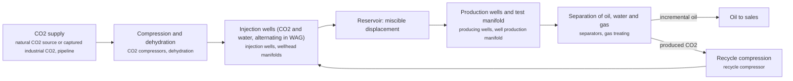
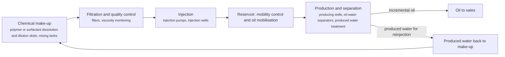
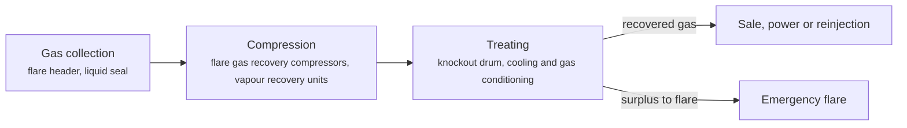
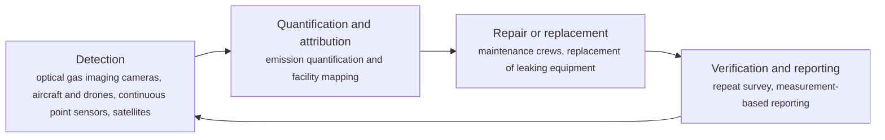
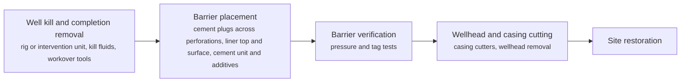

# UPS technology options

5 technologies, from commercial to lab stage. Generated from catalog/technologies/; every figure links to its source.

| Technology | Category | Maturity | TRL | Suppliers | Cost figures |
| --- | --- | --- | --- | --- | --- |
| [CO2 enhanced oil recovery (miscible CO2 flooding)](#ups-co2-eor) | Enhanced oil recovery / gas injection | commercial | 9 | Occidental; Denbury (ExxonMobil) | illustrative pre-tax economic margin: 15-25 USD/bbl (2008$) |
| [Chemical EOR (polymer and surfactant flooding)](#ups-chemical-eor) | Enhanced oil recovery / chemical injection | commercial |  | SNF; Shell; PETRONAS |  |
| [Flare gas recovery and zero routine flaring](#ups-flare-gas-recovery) | Emissions monitoring and abatement | commercial | 9 | Zeeco; John Zink; Hy-Bon (Cimarron) |  |
| [Methane leak detection and repair (LDAR, satellites and continuous monitoring)](#ups-methane-leak-detection) | Emissions monitoring and abatement | commercial | 9 | FLIR; GHGSat; Kayrros; Project Canary |  |
| [Well plug and abandonment (cement plugs, rig-based)](#ups-well-plug-abandonment) | Well decommissioning | commercial |  | Rig and cementing service contractors (none named in the sources read) | estimated cost of abandoning directional well H-11 by SNI 13-6910-2002: 505738 USD (2026$) estimated cost of abandoning the same well by NORSOK D-010: 1.17056e+06 USD (2026$) |

## CO2 enhanced oil recovery (miscible CO2 flooding)

CO2 is compressed and injected into an oil reservoir, usually one already waterflooded, where at or above the minimum miscibility pressure it mixes with the crude, swells it and lowers its viscosity so that residual oil can be swept to producing wells. Water and CO2 are often injected in alternating slugs (WAG). Produced CO2 is separated from oil and water, recompressed and reinjected, so most purchased CO2 stays underground.

**Key equipment:** CO2 compressors, CO2 pipeline, injection and production wells, production manifold, oil-water-gas separators, recycle compressor.

**Performance:**
- incremental oil recovery over primary and secondary recovery: 4-15 % of original oil in place; NETL primer; primary plus secondary typically 30-35% OOIP; one pilot reported up to 22%. [source](https://www.netl.doe.gov/sites/default/files/netl-file/co2_eor_primer.pdf)
- water to CO2 injection ratio in WAG: 0.5-4 volumes of water per volume of CO2 at reservoir conditions; NETL primer; slug size 0.1-2% of pore volume. [source](https://www.netl.doe.gov/sites/default/files/netl-file/co2_eor_primer.pdf)
- cumulative CO2 injected: 15-30 % of hydrocarbon pore volume; NETL primer. [source](https://www.netl.doe.gov/sites/default/files/netl-file/co2_eor_primer.pdf)
- share of oil cost per barrel taken by CO2 purchase and recycle: 25-50 % of cost per barrel produced; NETL primer. [source](https://www.netl.doe.gov/sites/default/files/netl-file/co2_eor_primer.pdf)
- reservoir depth screening range: 2000-9800 ft; NETL primer screening table (other criteria: oil gravity above 27-30 °API, viscosity at or below 10-12 cp, pressure above 1,200-1,500 psia, residual oil saturation above 0.25-0.30). [source](https://www.netl.doe.gov/sites/default/files/netl-file/co2_eor_primer.pdf)

**Costs:**
- illustrative pre-tax economic margin: 15-25 USD/bbl (2008$); NETL primer example: oil USD 70/bbl, net wellhead USD 55, capital amortization USD 5-10, CO2 USD 15 (USD 2/Mcf purchase, USD 0.70/Mcf recycle), operations USD 10-15; dollar year not stated, data to 2008. [source](https://www.netl.doe.gov/sites/default/files/netl-file/co2_eor_primer.pdf)

**Reference plants:**
- Weyburn field, Saskatchewan (EnCana), CA: about 95 million ft3/d CO2 (4,935 t/d) from the Dakota Gasification plant via a 205-mile pipeline; 130 million bbl incremental oil expected; operating as of the primer (data to 2008). [source](https://www.netl.doe.gov/sites/default/files/netl-file/co2_eor_primer.pdf)
- Wasson field Denver Unit, West Texas (Shell), US: 31,500 bbl/d of which 26,850 bbl/d incremental from CO2; over 120 million bbl incremental to 2008; operating as of 2008. [source](https://www.netl.doe.gov/sites/default/files/netl-file/co2_eor_primer.pdf)
- Sukowati field, Bojonegoro (Pertamina EP, with JOGMEC and JAPEX), ID: pilot: about 500 t CO2 huff-and-puff into well SKW-18 over 7 days; first CO2 injection 7 December 2023; full implementation planned with CO2 from Jambaran Tiung Biru. [source](https://www.migas.esdm.go.id/post/implementasikan-ccus-lapangan-sukowati-injeksi-co2-perdana)

TRL source: [IEA ETP Clean Energy Technology Guide, dataset of 24 July 2026, 2025 assessment (IEA 1-11 scale): 'CO2-enhanced oil recovery' 9](https://www.iea.org/data-and-statistics/data-tools/etp-clean-energy-technology-guide)

**Missing inputs:**
- current CO2-EOR cost per barrel and CO2 utilisation (t CO2 per bbl) in USD with dollar year (costs): The only cost read is an illustrative example in a primer with data to 2008 and no dollar year. Where: NETL 'Next Generation CO2-EOR' report (collected: corpus/netl) (catalog: netl, open); IEA oil and gas industry in net-zero transitions (collected) (catalog: iea-reports, open). Next: Read the collected NETL 2011 report and IEA reports for utilisation and cost, then add dollar-year figures.
- Sukowati: full-scale CO2 injection after the 2023 pilot (status): Only the December 2023 launch page was read. Where: Ditjen Migas and Pertamina news after 2023 (catalog: id-ditjen-migas, open). Next: Check whether the Jambaran Tiung Biru CO2 supply started and update the reference plant.
- CO2-EOR operators in Malaysia and Indonesia beyond Pertamina (suppliers): No PETRONAS CO2-EOR source has been read. Where: PETRONAS technology pages and reports (record verified for personal non-commercial copies) (catalog: petronas-tech, open). Next: Collect PETRONAS EOR material into corpus/_inbox/petronas-tech and add any project.

Sources: [1](https://www.netl.doe.gov/sites/default/files/netl-file/co2_eor_primer.pdf), [2](https://www.migas.esdm.go.id/post/implementasikan-ccus-lapangan-sukowati-injeksi-co2-perdana), [3](https://www.iea.org/data-and-statistics/data-tools/etp-clean-energy-technology-guide). Last reviewed 2026-10-24.

## Chemical EOR (polymer and surfactant flooding)

Chemicals are added to injection water to recover oil that waterflooding leaves behind. Polymers such as hydrolyzed polyacrylamide (HPAM) raise the viscosity of the injected water so it sweeps the reservoir more evenly and water breaks through later. Surfactants lower the interfacial tension between oil and water so trapped oil droplets can move. Alkali-surfactant-polymer (ASP) combines both. Polymer and surfactant performance depends on salinity, temperature, adsorption on the rock and injectivity, so candidates are screened in the laboratory and by core flooding before a field pilot.

**Key equipment:** polymer or surfactant make-up units, filters, injection pumps, injection and production wells, produced water treatment.

**Performance:**
- incremental recovery, HPAM Polymer C at 3000 ppm, laboratory core floods: 8.8-10 % (two cores); Five commercial HPAM polymers tested at 500-5000 ppm, salinity 3,000-200,000 ppm, up to 90 °C; laboratory only. [source](https://journal.lemigas.esdm.go.id/index.php/SCOG/article/view/2125)
- average incremental recovery of HPAM injection in Daqing field blocks (field): 11 % over waterflooding; as reported in the HPAM article's introduction, which calls Daqing the world's largest commercial polymer flood; original study not read. [source](https://journal.lemigas.esdm.go.id/index.php/SCOG/article/view/2125)
- incremental recovery factor from palm-oil MES surfactant with 96% ethanol, laboratory coreflood: 29.24 % over waterflooding; total recovery factor 45.90%; MES 0.5-2.0%, best formulation 1.25% MES; laboratory only. [source](https://journal.lemigas.esdm.go.id/index.php/SCOG/article/view/2096)
- interfacial tension achieved: 0.521 mN/m; MES with ethanol co-surfactant. [source](https://journal.lemigas.esdm.go.id/index.php/SCOG/article/view/2096)

**Reference plants:**
- Daqing oilfield polymer flood, CN: average incremental recovery about 11% over waterflooding across tested blocks; described as the world's largest commercial polymer flood. [source](https://journal.lemigas.esdm.go.id/index.php/SCOG/article/view/2125)

**Missing inputs:**
- TRL with a cited source (trl): The IEA guide has no chemical EOR entry; 'commercial' rests on the Daqing statement in the HPAM article, which was read only second-hand. Where: IEA ETP Clean Energy Technology Guide (collected): search for the technology name (catalog: iea-reports, open); Peer-reviewed reviews of chemical EOR field projects (SPE, open journals) (catalog: doaj, open). Next: Find an independent review that lists field projects, and read the original Daqing study.
- chemical cost per barrel of incremental oil and project capex, with dollar year and basis (costs): No source read gives costs. Where: Open techno-economic papers (arXiv, LEMIGAS SCOG archive, Universitas Trisakti publications) (catalog: lemigas-scog, open). Next: Add cost per incremental barrel with dollar year.
- chemical EOR field projects in Southeast Asia (reference_plants): No source read names one; PETRONAS is listed in the register as a supplier. Where: PETRONAS and Pertamina EOR project reports (catalog: petronas-tech, open). Next: Add a Malaysian or Indonesian pilot with capacity and year.

Sources: [1](https://journal.lemigas.esdm.go.id/index.php/SCOG/article/view/2125), [2](https://journal.lemigas.esdm.go.id/index.php/SCOG/article/view/2096). Last reviewed 2026-10-24.

## Flare gas recovery and zero routine flaring

Gas that would be burned in a flare is instead collected, compressed and treated so that it can be sold, used for power or reinjected. Vapour recovery units capture low-pressure methane streams from tanks and compressor seals. Where no pipeline exists, small-scale GTL or power generation can use the gas on site. Routine, non-emergency flaring can then be ended.

**Key equipment:** flare gas recovery compressors, liquid seal drum, vapour recovery units, gas treating skid, flare tip.

**Performance:**
- natural gas flared globally each year: 150 bcm; majority is routine, non-emergency flaring; IEA 2025 tracker. [source](https://iea.blob.core.windows.net/assets/b83c32dd-fc1b-4917-96e9-8cd918801cbf/GlobalMethaneTracker2025.pdf)

TRL source: [IEA ETP Clean Energy Technology Guide, dataset of 24 July 2026, 2025 assessment (IEA 1-11 scale): 'Flare gas recovery' 9](https://www.iea.org/data-and-statistics/data-tools/etp-clean-energy-technology-guide)

**Missing inputs:**
- capex per unit and payback with dollar year (costs): The tracker gives the flared volume only. Where: IEA Global Methane Tracker documentation (collected) (catalog: iea-methane-tracker, open); World Bank Global Gas Flaring Reduction partnership reports (open). Next: Add capex and payback with basis.
- recovery efficiency and turndown of recovery units (performance): No source read gives them. Where: Supplier datasheets for the companies listed (open). Next: Add recovery efficiency with source.
- named flare reduction projects in Malaysia and Indonesia (reference_plants): None read. Where: PETRONAS and Pertamina sustainability reports (catalog: petronas-tech, open). Next: Collect the reports and add a project with year and volume.

Sources: [1](https://iea.blob.core.windows.net/assets/b83c32dd-fc1b-4917-96e9-8cd918801cbf/GlobalMethaneTracker2025.pdf), [2](https://www.iea.org/data-and-statistics/data-tools/etp-clean-energy-technology-guide). Last reviewed 2026-10-24.

## Methane leak detection and repair (LDAR, satellites and continuous monitoring)

Leaks are located by surveying facilities with optical gas imaging cameras, aircraft or drone sensors, fixed continuous sensors or satellites, and then quantified and repaired. Satellites flag large emission events and recurrent leaks, which are passed to operators for rapid repair. A repeat survey confirms the fix.

**Key equipment:** optical gas imaging cameras, continuous methane sensors, aircraft and drone payloads, satellite data feeds, repair crews and replacement equipment.

**Performance:**
- fossil-fuel methane emissions that could be avoided at no net cost: 30 % of 2024 fossil-fuel methane emissions; about 35 Mt; at average 2024 energy prices; oil and gas share higher than coal. [source](https://iea.blob.core.windows.net/assets/b83c32dd-fc1b-4917-96e9-8cd918801cbf/GlobalMethaneTracker2025.pdf)
- methane emitted by the fossil fuel sector: 200 bcm in 2024; abatement could have made nearly 100 bcm of gas available. [source](https://iea.blob.core.windows.net/assets/b83c32dd-fc1b-4917-96e9-8cd918801cbf/GlobalMethaneTracker2025.pdf)
- satellites in orbit able to observe methane emissions: 25 satellites (more than); MethaneSAT and Tanager-1 started in 2024. [source](https://iea.blob.core.windows.net/assets/b83c32dd-fc1b-4917-96e9-8cd918801cbf/GlobalMethaneTracker2025.pdf)
- share of satellite-detected oil and gas sources that were recurrent: 25 % (about); Carbon Mapper analysis of more than 2,000 plumes. [source](https://iea.blob.core.windows.net/assets/b83c32dd-fc1b-4917-96e9-8cd918801cbf/GlobalMethaneTracker2025.pdf)

TRL source: [IEA ETP Clean Energy Technology Guide, dataset of 24 July 2026, 2025 assessment (IEA 1-11 scale): 'Periodic methane emission monitoring in oil and gas facilities' 9; 'Satellite-based methane emission monitoring in oil and gas facilities' 9](https://www.iea.org/data-and-statistics/data-tools/etp-clean-energy-technology-guide)

**Missing inputs:**
- cost per survey, per sensor and per tonne of methane abated (costs): The tracker gives the no-net-cost share but the cost curves were not read in detail. Where: IEA Global Methane Tracker documentation (collected: corpus/iea-methane-tracker) (catalog: iea-methane-tracker, open). Next: Read the abatement cost curves and record USD per tonne with year.
- process steps are general practice, not taken from one source (process): The tracker names the technologies and measures; the sequence of steps is general knowledge. Where: OGMP 2.0 and OGDC guidance (open). Next: Cite a measurement guideline for the sequence.
- regional (Southeast Asia) service providers (suppliers): No source read names providers in Malaysia or Indonesia. Where: PETRONAS and Pertamina methane programmes (catalog: petronas-tech, open). Next: Add regional operators or providers.

Sources: [1](https://iea.blob.core.windows.net/assets/b83c32dd-fc1b-4917-96e9-8cd918801cbf/GlobalMethaneTracker2025.pdf), [2](https://www.iea.org/data-and-statistics/data-tools/etp-clean-energy-technology-guide). Last reviewed 2026-10-24.

## Well plug and abandonment (cement plugs, rig-based)

A well that is no longer needed is permanently sealed so that formation fluids cannot reach the surface. Barriers, usually cement plugs set across producing zones, above the liner top and near the surface, are placed from a rig after the well is killed and equipment is removed. Standards differ in the barriers they require, for example Indonesia's SNI 13-6910-2002 and Norway's NORSOK D-010, and the choice drives cost. Newer methods such as through-tubing abandonment aim to avoid pulling the completion.

**Key equipment:** workover or drilling rig, cement unit, casing cutting tools, pressure testing equipment.

**Performance:**
- cement plugs in the SNI design for directional well H-11, Tambun field: 7 plugs; total 160.11 bbl cement (576 sacks), deepest plug 8,300-8,638 ft MD; one well, design study. [source](https://journal.lemigas.esdm.go.id/index.php/SCOG/article/view/2141)
- UKCS well abandonment spend in 2025: 1273 GBP million (in-year prices); 49% of total decommissioning spend; 2024 was GBP 1,168 million. [source](https://www.nstauthority.co.uk/media/w1fa3xvv/ukcs-decommissioning-cost-and-performance-update-2026.pdf)
- suspended UKCS wells awaiting final abandonment: 500 wells (approximate); backlog unchanged from 2024. [source](https://www.nstauthority.co.uk/media/w1fa3xvv/ukcs-decommissioning-cost-and-performance-update-2026.pdf)

**Costs:**
- estimated cost of abandoning directional well H-11 by SNI 13-6910-2002: 505738 USD (2026$); rig method, onshore Tambun field, Indonesia; design estimate; currency year not stated, publication year used. [source](https://journal.lemigas.esdm.go.id/index.php/SCOG/article/view/2141)
- estimated cost of abandoning the same well by NORSOK D-010: 1.17056e+06 USD (2026$); same well and method; the authors recommend SNI on technical, safety, regulatory and cost grounds. [source](https://journal.lemigas.esdm.go.id/index.php/SCOG/article/view/2141)

**Missing inputs:**
- average P&A cost per well offshore Southeast Asia and per well in the UKCS (costs): The NSTA report read gives totals and spend, not a clear cost per well; the LEMIGAS figure is one onshore well. Where: NSTA decommissioning benchmarking report (appendices); SKK Migas decommissioning guidance (catalog: uk-nsta, open). Next: Add cost per well with dollar year and basis from the NSTA appendices or SKK Migas.
- named service companies and new plug technologies (thermite, bismuth, through-tubing) (suppliers): The NSTA report mentions through-tubing abandonment trials but names no supplier; the register lists thermite and bismuth plugs (Interwell, BiSN) as demonstration, and they have no card yet. Where: Supplier pages for Interwell and BiSN; NSTA well P&A technology trials (catalog: uk-nsta, open). Next: Add a card for the new plug technologies and name suppliers of conventional P&A services.
- process steps are general practice, not taken from one source (process): Only the barrier layout in the LEMIGAS paper was read; the sequence of steps is general knowledge. Where: SKK Migas Work Procedure Guideline 040/PTK/SKKIA0000/2023/S9 Rev.02 and NORSOK D-010 (catalog: id-skkmigas, open). Next: Check the steps against the standards and name them.

Sources: [1](https://journal.lemigas.esdm.go.id/index.php/SCOG/article/view/2141), [2](https://www.nstauthority.co.uk/media/w1fa3xvv/ukcs-decommissioning-cost-and-performance-update-2026.pdf). Last reviewed 2026-10-24.
