# UPS technology options

61 technologies, from commercial to lab stage. Generated from catalog/technologies/; every figure links to its source.

| Technology | Category | Maturity | TRL | Suppliers | Cost figures |
| --- | --- | --- | --- | --- | --- |
| [3D and 4D seismic acquisition (towed streamer, ocean-bottom nodes)](#ups-seismic-acquisition) | Exploration and subsurface | commercial |  | PGS (marine streamer surveys); TGS (multi-client data); Shearwater (marine seismic); Sercel (acquisition equipment) |  |
| [Basin and petroleum systems modelling](#ups-basin-petroleum-systems-modelling) | Exploration and subsurface | commercial |  | SLB (PetroMod) |  |
| [CO2 enhanced oil recovery (miscible CO2 flooding)](#ups-co2-eor) | Enhanced oil recovery / gas injection | commercial | 9 | Occidental; Denbury (ExxonMobil); Japan Petroleum Exploration Co. (JAPEX) (CO2-EOR huff-and-puff pilot with Pertamina EP at the Sukowati field, Bojonegoro, East Java, Indonesia (joint study with JOGMEC under a July 2023 JSA; first CO2 injection 7 December 2023)); JOGMEC (Japan Organization for Metals and Energy Security) (CO2-EOR/CCUS pilot partner with Pertamina at Sukowati field, Indonesia) | illustrative pre-tax economic margin: 15-25 USD/bbl (2008$)<br>CO2 purchase cost per barrel of oil produced (0.5 t CO2/bbl injected): 7.5-15 USD/bbl (2020$) |
| [Casing drilling and expandable tubulars](#ups-casing-drilling-expandable-tubulars) | Drilling and completions | commercial |  | Weatherford (expandables and casing drilling); Enventure (solid expandables) |  |
| [Chemical EOR (polymer and surfactant flooding)](#ups-chemical-eor) | Enhanced oil recovery / chemical injection | commercial |  | SNF; Shell; PETRONAS |  |
| [Coal bed methane](#ups-coal-bed-methane) | Unconventional and other resources | commercial |  | Operators (CBM projects) |  |
| [Coiled tubing and well intervention](#ups-coiled-tubing-intervention) | Drilling and completions | commercial |  | NOV (coiled tubing units); Halliburton (coiled tubing services); Baker Hughes (coiled tubing services) |  |
| [Digital core and special core analysis](#ups-digital-core-analysis) | Exploration and subsurface | commercial |  | Thermo Fisher Scientific (imaging systems); Core Laboratories (core analysis); SLB (DHD and CoreFlow) |  |
| [Electric instead of gas-pneumatic controllers](#ups-electric-pneumatic-controllers) | Water and emissions in upstream | commercial | 9 | Various vendors (electric and instrument-air controllers) | typical instrument-air conversion cost: 45000-75000 USD (2006$) |
| [Electric submersible pumps](#ups-electric-submersible-pumps) | Production and artificial lift | commercial |  | SLB (REDA ESPs); Baker Hughes (ESPs); Borets (ESPs); Novomet (ESPs) |  |
| [Extended-reach and multilateral wells](#ups-extended-reach-multilateral-wells) | Drilling and completions | commercial |  | Exxon Neftegas (Sakhalin-1 ERD operator); Major drilling contractors (ERD rigs) |  |
| [FPSO and floating production (TLP, spar, semi-submersible)](#ups-fpso-floating-production) | Offshore and subsea | commercial |  | SBM Offshore (FPSO); MODEC (FPSO); BW Offshore (FPSO); MISC (FPSO operator) | new-build FPSO: 1000 USD million (up to)<br>announced capital investment: 12 AUD (USD 8.71 billion equivalent as stat<br>analyst estimated vessel cost: 10.8-12.6 USD<br>initial project cost: 34 USD billion<br>Total project CAPEX / investment at FID: 3.4e+10 USD billion (as printed) (2012$)<br>Total project investment at FID (JV partner statement): 3.4e+10 USD billion (as printed) (2012$)<br>FLNG vessel EPC contract value (Samsung regulatory filing): 3.27e+12 KRW<br>Cost (project tracker): 1.6e+09 USD |
| [Fixed jackets and gravity-based structures](#ups-fixed-jackets-gravity-structures) | Offshore and subsea | commercial |  | McDermott (jackets); Saipem (jackets); MMHE (jackets) |  |
| [Flare gas recovery and zero routine flaring](#ups-flare-gas-recovery) | Emissions monitoring and abatement | commercial | 9 | Zeeco; John Zink; Hy-Bon (Cimarron) |  |
| [Full-waveform inversion and seismic imaging](#ups-full-waveform-inversion) | Exploration and subsurface | commercial |  | SLB (seismic imaging software); Halliburton Landmark (imaging); CGG (Viridien) (FWI imaging) |  |
| [Gas injection and WAG (hydrocarbon, CO2, nitrogen)](#ups-gas-injection-wag) | Improved and enhanced oil recovery | commercial |  | Operators (field projects) |  |
| [Gas lift](#ups-gas-lift) | Production and artificial lift | commercial |  | SLB (gas lift systems); Weatherford (gas lift); Baker Hughes (gas lift) |  |
| [Hydraulic fracturing (plug-and-perf, electric frac fleets)](#ups-hydraulic-fracturing) | Drilling and completions | commercial |  | Halliburton (ZEUS electric fleet); Liberty Energy (digiFrac); SLB (frac services); JEREH (frac spreads and e-frac power packages: gas-turbine power for fracturing fleets (vendor case studies in the United States and China)) |  |
| [Intelligent completions and inflow control devices](#ups-intelligent-completions) | Drilling and completions | commercial |  | Baker Hughes (intelligent completions); SLB (intelligent completions); Halliburton (intelligent completions); Tendeka (ICDs and AICDs) |  |
| [Long subsea tiebacks with direct electrical heating](#ups-direct-electrical-heating-tiebacks) | Offshore and subsea | commercial |  | Nexans (DEH cables); Equinor (DEH operator); TechnipFMC (DEH pipe) |  |
| [Managed pressure drilling](#ups-managed-pressure-drilling) | Drilling and completions | commercial |  | Weatherford (MPD); Halliburton (MPD); NOV (MPD equipment) |  |
| [Measurement and logging while drilling (MWD/LWD)](#ups-mwd-lwd) | Drilling and completions | commercial |  | SLB (LWD services); Halliburton (Sperry LWD); Baker Hughes (LWD services) |  |
| [Methane leak detection and repair (LDAR, satellites and continuous monitoring)](#ups-methane-leak-detection) | Emissions monitoring and abatement | commercial | 9 | FLIR; GHGSat; Kayrros; Project Canary | greenhouse gas emissions price at which almost all available methane abatement measures across the energy sector would be cost-effective: 20 USD/tCO2-eq (2025$)<br>payback period of many oil and gas methane abatement options: 1 years<br>share of LDAR emissions savings achievable at no net cost to operators (Eurasia oil and gas): 95 % of LDAR emissions savings in Eurasia |
| [Minimum-facility wellhead platform structures and marine systems](#ups-whp-platform-structures-and-marine-systems) | Offshore wellhead platforms | commercial |  | 2H Offshore; 2H Offshore; 2H Offshore; 2H Offshore | Price — Topsides fabrication contract, Kebabangan: 380 USD million (as printed)<br>Price — Kebabangan FEED contract value (USD-equivalent as printed): 30 USD million (as printed)<br>Price — Kebabangan topsides fabrication contract: 380 USD million (as printed) |
| [Multiphase flow metering](#ups-multiphase-flow-metering) | Production and artificial lift | commercial |  | Emerson (Roxar 2600); SLB (Vx); TechnipFMC (multiphase meters) |  |
| [Offshore platform electrification (power from shore, offshore wind)](#ups-platform-electrification) | Offshore and subsea | commercial |  | Equinor (Johan Sverdrup and Hywind Tampen); Siemens Energy (power systems); ABB (power systems) | Contracted day rates, next-generation wind turbine installation vessels (WTIVs) and heavy-lift jack-ups: 200000-350000 USD/day<br>Jack-up rig one-well option contract value, ~30 days: 4e+06 USD<br>Jack-up rig contract value, 330-day campaign (including minor rig modifications): 4.8e+07 USD<br>Valaris heavy-duty harsh-environment (HDHE) jack-up average day rate, 2024: 125000 USD/day (2024$) |
| [Oil sands mining and froth treatment](#ups-oil-sands-mining) | Unconventional and other resources | commercial |  | Suncor (mining operations); Syncrude (mining operations) |  |
| [Plunger lift and hydraulic jet pumps](#ups-plunger-hydraulic-lift) | Production and artificial lift | commercial |  | Weatherford (plunger and hydraulic lift); Liberty Lift (hydraulic and plunger lift) |  |
| [Produced water treatment (hydrocyclones, flotation, membranes)](#ups-produced-water-treatment) | Water and emissions in upstream | commercial |  | Veolia (produced water treatment); Siemens (water treatment); SLB (produced water systems); Frames Group (produced-water packages); CETCO (CROSFLOW produced-water membranes) |  |
| [Production optimisation and digital oilfield](#ups-production-optimisation-digital-oilfield) | Production and artificial lift | commercial |  | SLB (digital platforms); Halliburton (digital platforms); AspenTech (optimisation software); Cognite (data operations) |  |
| [Reservoir simulation (black oil, compositional, thermal)](#ups-reservoir-simulation) | Exploration and subsurface | commercial |  | SLB (ECLIPSE and INTERSECT); CMG (IMEX, GEM, STARS); Rock Flow Dynamics (tNavigator) |  |
| [Rod lift and progressing cavity pumps](#ups-rod-lift-pcp) | Production and artificial lift | commercial |  | Weatherford (rod lift and PCP); Dover (rod lift); NOV (PCP) |  |
| [Rotary steerable systems](#ups-rotary-steerable-systems) | Drilling and completions | commercial |  | SLB (PowerDrive); Baker Hughes (AutoTrak); Halliburton (Geo-Pilot); Weatherford (Revolution) |  |
| [Sand control (gravel pack, frac pack, screens)](#ups-sand-control) | Drilling and completions | commercial |  | Halliburton (sand control); Baker Hughes (sand control); SLB (sand control) |  |
| [Seawater sulfate removal for injection water](#ups-seawater-sulfate-removal) | Water and emissions in upstream | commercial |  | Veolia (sulfate removal process); DuPont (FilmTec) (SR90 membranes); Toray (membranes) |  |
| [Shale oil and gas multi-stage horizontal development](#ups-shale-multistage-horizontal) | Unconventional and other resources | commercial |  | Operators (Permian, Bakken, Eagle Ford and others) |  |
| [Subsea boosting and multiphase pumps](#ups-subsea-boosting) | Offshore and subsea | commercial |  | SLB OneSubsea (Framo) (helico-axial pumps); Sulzer (subsea pumps); Baker Hughes (subsea pumps) |  |
| [Subsea gas compression](#ups-subsea-gas-compression) | Offshore and subsea | commercial |  | Equinor (Åsgard operator); SLB OneSubsea (compressors); MAN Energy Solutions (compressors) | project cost: 19 NOK billion (just above) |
| [Subsea production systems (trees, manifolds, umbilicals)](#ups-subsea-production-systems) | Offshore and subsea | commercial |  | TechnipFMC (Subsea 2.0); SLB OneSubsea (subsea production systems); Baker Hughes (subsea trees) |  |
| [Thermal EOR (steam flood, SAGD, CSS)](#ups-thermal-eor) | Improved and enhanced oil recovery | commercial |  | Suncor (SAGD operator); Cenovus (Foster Creek SAGD (first commercial, 1996)); Chevron (Kern River steam flood) |  |
| [Twenty-year wellhead platform development and cost history (2006–2026)](#ups-whp-twenty-year-retrospective) | Offshore wellhead platforms | commercial |  |  | Price — pipeline EPCI and pre-commissioning contract value: 59 USD million (2019$)<br>Price — EPC substructures and templates for Patricia and Serendah platforms: 33.4 USD million (2012$)<br>Price — acquisition price for 100% of Murphy Oil's Malaysia business: 2127 USD million (2019$)<br>Price — finding and development cost, company-wide: 11 USD per barrel of oil equivalent (less than) (2018$)<br>Price — realised oil price, company-wide: 64 USD per barrel (2018$)<br>Price — write-off of prior-year Kenarong and Pertang well costs: 47.4 USD million (2014$)<br>Price — Cash consideration for DIALOG acquisition of Tarpon Malaysia + TSIL assets: 1.19 USD million (as printed) (2023$)<br>Price — Final investment decision (FDAP approval) amount: 81 USD million (as printed) (2026$)<br>Price — Development cost per barrel of 2P reserves: 13.3 USD/bbl (as printed) (2026$)<br>Price — Assumed oil price (analyst scenario): 65 USD/bbl (as printed) (2026$)<br>Price — Estimated FY29 earnings contribution: 30-50 MYR<br>Price — Central processing platform EPCIC contract: 226.7 USD (2017$)<br>Price — Brooke CPP EPC contract (SK405B Sirung/Chenda): 1 MYR<br>Price — Expected local procurement: 480 MYR<br>Price — Duyong redevelopment CAPEX without gas surface jet pump: 5-25 USD million (as printed)<br>Price — Total multi-package deal including Kinabalu WHP LOA: 39.8 USD million (as printed) (2015$)<br>Price — Maximum total consideration for four PSC packages: 833 USD million (as printed) (2026$)<br>Price — Upfront consideration: 554 USD million (as printed) (2026$)<br>Price — Deferred consideration: 189 USD million (as printed) (2026$)<br>Price — Contingent consideration cap: 90 USD (2026$)<br>Price — Life-of-field 2P capex for acquired PIs: 170 USD million (as printed) (2026$)<br>Price — Upfront consideration per boe 2P: 4 USD/boe (as printed) (2026$)<br>Price — pipeline EPCI contract value: 5.9e+07 USD (2019$)<br>Price — external turret system contract: 4e+07 USD<br>Price — pre-development phase investment: 2e+08-2.5e+08 USD (2011$)<br>Price — development phase investment: 6.5e+08-7e+08 USD<br>Price — debt financing received: 1.62e+08 USD (2012$)<br>Price — Roc Oil Malaysia contribution: 3.5e+07 USD<br>Price — project capital expenditure: 1.4e+09 USD<br>Price — TLP transport and installation contract: 1e+08 USD<br>Price — initial work commitment: 600000 USD<br>Price — award financial commitment: 2e+06 USD<br>Price — high-level exploration well cost estimate: 7e+07 USD<br>Price — EPC/fabrication contract value - SK309/SK311 phase 1 substructures: 16.5 USD million (as printed) (2007$)<br>Price — EPC contract value - Patricia & Serendah substructures/template (RM as printed): 101 RM<br>Price — EPC contract value - Patricia & Serendah substructures/template (USD as printed): 33.4 USD million (as printed) (2012$)<br>Price — EPCC contract value - PT-SA + SN-AA topsides (RM range, source A): 250-300 RM<br>Price — EPC contract value - PT-SA + SN-AA topsides (USD, source B - conflicting): 78 USD million (as printed) (2012$)<br>Price — EPCC contract value - SA-SA topside (RM as printed): 149 RM<br>Price — EPCC contract value - SA-SA topside (USD as printed): 39.9 USD million (as printed) (2015$)<br>Price — Pipeline EPCI and pre-commissioning contract - Tembikai TNAG: 59 USD (2019$)<br>Price — Corporate acquisition consideration - Tarpon Malaysia + TSIL assets/IP (USD): 1.19 USD million (as printed) (2023$)<br>Price — Corporate acquisition consideration - Tarpon Malaysia + TSIL assets/IP (RM, first source): 5.5 RM<br>Price — Corporate acquisition consideration - Tarpon Malaysia + TSIL assets/IP (USD, second source): 1.19 USD million (as printed) (2023$)<br>Price — RAJA Cluster development FID value: 81 USD million (as printed) (2026$)<br>Price — Vessel charter contract value (USD, 125 days): 45 USD million (as printed) (2012$)<br>Price — Vessel charter contract value (RM, 125 days): 139.5 RM<br>Price — Malaysian assets 30% stake aggregate purchase price (not WHP capex): 2 USD billion (as printed) (2014$)<br>Price — Malaysian subsidiary sale consideration (USD, not WHP capex): 2.127 USD billion (as printed) (2019$)<br>Price — Malaysian subsidiary sale consideration (RM, not WHP capex): 8.62 RM<br>Price — Contingent drilling-results bonus, maximum: 100 USD million (as printed) (2019$)<br>Price — cash consideration for Tarpon Malaysia equity plus TSIL assets and IP: 1.19e+06 USD million (as printed) (2023$)<br>Price — EPCI and pre-commissioning contract for TNAG pipeline system: 5.9e+07 USD (2019$)<br>Price — TNAG pipeline EPCI contract value: 5.9e+07 USD (2019$)<br>Price — estimated capital expenditure saving of MPFM versus test separator solution: 800000 USD (2001$)<br>Price — UK decommissioning expenditure in 2020: 1.1e+09 GBP<br>Price — global offshore platform removal cost estimate: 2.1e+11 USD billion (as printed) (2023$)<br>Price — MARS waste-handling facility investment: 2e+08 USD million (as printed) (2023$)<br>Price — Piper Alpha 1988 disaster property damage: 1.4e+09 USD billion (as printed) (2023$) |
| [Unmanned and normally unattended installations](#ups-unmanned-installations) | Offshore and subsea | commercial |  | Operators (NUIs) |  |
| [Waterflooding and low-salinity water injection](#ups-waterflood-low-salinity) | Improved and enhanced oil recovery | commercial |  | BP (LoSal) | desalination facilities for Clair Ridge: 120 USD million (earmarked) |
| [Well plug and abandonment (cement plugs, rig-based)](#ups-well-plug-abandonment) | Well decommissioning | commercial |  | Cementing service contractors (none named in the sources read); Dolphin Drilling (Paul B Loyd Junior semi-submersible rig used to abandon nine subsea wells in Harbour Energy's Balmoral Area Phase 1 campaign); Wellstrom (Wellstrom T1000 electrically run bismuth plug, trialled setting a 9-5/8" x 13-3/8" plug on TAQA Cormorant North with NZTC funding); Axter (Axter Retrieve control-line tool string enabling tubing-in-hole (through-tubing) abandonment; trialled by TotalEnergies and Aker BP at Ullrigg); Exedra (Balder tracer-gas tool for verifying P&A barriers, pilot jointly funded by NZTC, NORCE and the Norwegian Research Council) | estimated cost of abandoning directional well H-11 by SNI 13-6910-2002: 179276 USD (2026$)<br>estimated cost of abandoning the same well by NORSOK D-010: 414945 USD (2026$)<br>average UKCS well decommissioning spend per well worked on, 2025 (derived): 4.95 GBP million<br>operator-reported saving per well on a recent eight-well UKCS campaign: 250000 GBP |
| [Wellhead platform control, safety and communication systems](#ups-whp-control-safety-and-communication-systems) | Offshore wellhead platforms | commercial |  | Rockwell Automation; AVEVA; Yokogawa Electric; Yokogawa Electric | Price — Wellhead monitoring installed hardware per well (onshore proxy, NOT offshore WHP): 3000-8000 USD (2026$)<br>Price — Upfront implementation, traditional on-premise SCADA for 10 wells (onshore proxy): 80000-200000 USD (2026$)<br>Price — 4-20 mA wellhead pressure transmitter (onshore proxy): 300-800 USD (2026$) |
| [Wellhead platform production process systems](#ups-whp-production-process-systems) | Offshore wellhead platforms | commercial |  | TechnipFMC (CDS Separation Systems); Baker Hughes; Aker Solutions; TechnipFMC (CDS Separation Systems); Aker Solutions; Velan; Flowserve; Aker Solutions; TechnipFMC (CDS Separation Systems); Baker Hughes; Aker Solutions; American Bureau of Shipping; ChampionX; Clariant; Allmarc Industries; John Zink (Koch Engineered Solutions) |  |
| [Wellhead platform safety and emergency equipment](#ups-whp-safety-and-emergency-equipment) | Offshore wellhead platforms | commercial |  | SLB (Cameron pressure control equipment); Cameron (SLB); Baker Hughes | Price — Revere USCG/SOLAS 'A' liferaft, low profile container - list price from: 4095 USD<br>Price — Survitec Zodiac USCG/SOLAS 'A' liferaft, low profile container - list price from: 3450 USD<br>Price — Survitec Zodiac XTREM USCG/SOLAS 'A' liferaft - list price from: 6250 USD<br>Price — Revere USCG-approved compact liferaft - list price from: 5000 USD<br>Price — Pre-owned Crewsaver USCG/SOLAS 6-person liferaft: 1995 USD |
| [Wellhead platform utility systems](#ups-whp-utility-systems) | Offshore wellhead platforms | commercial |  | Shell Malaysia Exploration and Production; PALFINGER; Cummins; Caterpillar; Shell Malaysia Exploration and Production | Price — Wholesale electricity benchmark (North America): 0.06 USD/kWh (2013$)<br>Price — Diesel standby fuel infrastructure - day tank: 2000-8000 USD (2026$)<br>Price — Diesel standby fuel infrastructure - bulk storage tank: 8000-60000 USD (2026$)<br>Price — Fuel infrastructure for 500 kW / 72 h autonomy: 25000-50000 USD (2026$)<br>Price — Diesel fuel cost: 0.08-0.15 USD/kWh (2026$)<br>Price — Cost of drying air for instrument air: 0.005 USD per standard m3 (2013$)<br>Price — Raw water rough cost estimate: 2 USD per 1000 gal (2013$)<br>Price — Demineralised water cost multiple: 2 x raw water price<br>Price — Cooling-water system make-up and chemical treatment cost: 0.02 USD/1000 gal (2013$)<br>Price — Recirculating cooling water pumping power: 1-2 kWh/1000 gal circulated<br>Price — 500 kW diesel standby genset total installed (factory-direct): 135000-305000 USD (2026$)<br>Price — 500 kW diesel standby genset total installed (Tier 1 dealer): 320000-600000 USD (2026$)<br>Price — 100 kW diesel standby genset total installed (factory-direct): 28000-73000 USD (2026$)<br>Price — 1,000 kW diesel standby genset total installed (factory-direct): 300000-620000 USD (2026$)<br>Price — Diesel genset equipment cost: 180-400 USD/kW (2026$)<br>Price — US large industrial total installed cost: 250-450 USD/kW (2026$)<br>Price — Southeast Asia total installed cost: 280-550 USD/kW (2026$)<br>Price — ATS 500-1,000 kW total cost: 23000-60000 USD (2026$) |
| [Wellhead platform well systems](#ups-whp-well-systems) | Offshore wellhead platforms | commercial |  | Aquaterra Energy; Baker Hughes; TechnipFMC (CDS Separation Systems); Aker Solutions; IPS Group BV; IPS Group BV; Baker Hughes; Aquaterra Energy; Aquaterra Energy; SLB (Cameron pressure control equipment) |  |
| [AI-assisted seismic interpretation and history matching](#ups-ai-seismic-interpretation-history-matching) | Exploration and subsurface | demonstration |  | SLB (Delfi); Halliburton (DecisionSpace 365); Cognite (data platform) |  |
| [All-electric subsea systems](#ups-all-electric-subsea) | Offshore and subsea | demonstration |  | SLB OneSubsea (all-electric subsea production system); TechnipFMC (all-electric trees) |  |
| [Downhole gas and water separation](#ups-downhole-separation) | Production and artificial lift | demonstration |  | Operators and service companies (DOWS systems) |  |
| [Drilling automation and autonomous rigs](#ups-drilling-automation) | Drilling and completions | demonstration |  | Nabors (SmartROS); NOV (rig automation); Helmerich & Payne (FlexRig automation); SLB (autonomous directional drilling) |  |
| [Heavy oil upgrading (in-field)](#ups-heavy-oil-upgrading-in-field) | Unconventional and other resources | demonstration |  | Petrobank (THAI) (THAI-CAPRI); Research groups (nanocatalysts) |  |
| [Oil shale retorting](#ups-oil-shale-retorting) | Unconventional and other resources | demonstration |  | Enefit (Galoter-based plants); Petrobras (Petrosix) |  |
| [Subsea separation and water reinjection](#ups-subsea-separation) | Offshore and subsea | demonstration |  | Equinor (Tordis operator); Framo Engineering (pumps); Petrobras (Marlim system) |  |
| [Well plug and abandonment technologies (thermite, bismuth plugs)](#ups-thermite-bismuth-plugs) | Drilling and completions | demonstration |  | BiSN (wel-lok bismuth barriers); Interwell (RockSolid thermite P&A) | P&A cost with an electrically run bismuth plug versus section milling and cement remediation: 50 % reduction in P&A cost |
| [Gas hydrate production](#ups-gas-hydrate-production) | Unconventional and other resources | pilot |  | JOGMEC (Nankai Trough trials); CNPC (China trials) | unit cost of methane exploitation with the proposed reservoir-reconstruction method (simulation study): 0.46 USD/m3 gas (2025$) |
| [In-situ combustion and solvent-assisted SAGD](#ups-in-situ-combustion-solvent-sagd) | Improved and enhanced oil recovery | pilot |  | Petrobank (THAI developer) (THAI pilots); Operators (SAGD solvent trials) |  |
| [Microbial EOR](#ups-microbial-eor) | Improved and enhanced oil recovery | pilot |  | Research groups and small service companies (MEOR trials) | MEOR treatment cost per incremental barrel (Argentina field projects): 2.9-5.1 USD/bbl incremental oil (2009$) |
| [Nanofluid EOR](#ups-nanofluid-eor) | Improved and enhanced oil recovery | lab |  | Research groups (nanofluids) | operational cost reduction in the Colombian nanofluid CSS field trial: 48 % reduction vs conventional steam operations |

## 3D and 4D seismic acquisition (towed streamer, ocean-bottom nodes)
<a id="ups-seismic-acquisition"></a>

Sound sources generate waves that reflect from subsurface layers and are recorded by receivers: towed streamers (5 to 15 m deep, Ramform vessels tow up to 24), ocean-bottom cables, or battery-powered ocean-bottom nodes placed by ROV. A 4D survey repeats a 3D survey after production starts to watch reservoir changes.

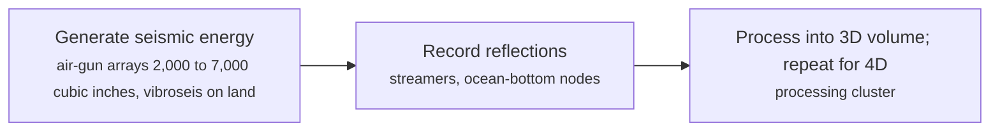

**Key equipment:** seismic vessel, air-gun arrays, streamers or nodes, ROV or node deployment, processing cluster.

**Performance:**
- towed-streamer depth: 5-15 m; marine streamer towing. [source](https://en.wikipedia.org/wiki/Reflection_seismology)
- streamers towed by a Ramform vessel: 24 streamers (up to); spreads can exceed one nautical mile. [source](https://en.wikipedia.org/wiki/Reflection_seismology)
- ocean-bottom node deployment depth: 3000 m (about, by ROV); 30-day battery example; node weight over 10 kg. [source](https://en.wikipedia.org/wiki/Reflection_seismology)

**Missing inputs:**
- survey cost per km2 with year (costs): Not in the free source; broker and vendor price data are commercial. Where: Wood Mackenzie or Westwood survey cost reports (paid). Next: Add a published cost range with year.
- named plants or projects with capacity and year (reference_plants): The sources read name no specific plant. Web-checked 2026-10-28; survey trade press names campaigns but no verifiable per-survey figures on open pages. Where: Licensor and operator press releases for the suppliers listed (open). Next: Add one or two plants with country, capacity and start-up year.
- TRL with a cited source (trl): The IEA ETP Clean Energy Technology Guide has no matching entry. IEA ETP Guide (July 2026) has no matching entry (searched seismic, geophone, exploration, acquisition); 2026-10-28 no open TRL source found (IEA ETP guide checked 2026-10-28; no SETIS/DOE entry). Where: IEA ETP Clean Energy Technology Guide (collected): search for the technology name (catalog: iea-reports, open). Next: Find a TRL table that lists this technology, or leave maturity resting on the evidence on the card.

Sources: [1](https://en.wikipedia.org/wiki/Reflection_seismology), [2](https://en.wikipedia.org/wiki/Seismic_survey). Last reviewed 2026-10-29.

## Basin and petroleum systems modelling
<a id="ups-basin-petroleum-systems-modelling"></a>

Software reconstructs burial, heat flow and fluid flow in a sedimentary basin to estimate when and where source rocks generated oil or gas, how it migrated and whether a trap was in place. The general framework is source rock, burial heat, migration, reservoir, seal and trap.

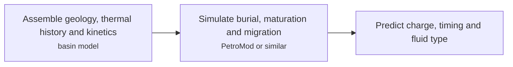

**Key equipment:** basin modelling software, geochemical kinetic data, seismic-derived structure.

**Performance:**
- oil generation depth range: 1000-6000 m; about 60 to 150 °C. [source](https://en.wikipedia.org/wiki/Petroleum_system)
- model dimensions documented for petroleum systems modeling workflows (PetroMod): 1-3 D (model dimensionality); USGS OFR 2006-1024 documents the PetroMod workflow (1D to 3D) with calibration data from source-rock pyrolysis (kerogen type, TOC, HI, kinetics) and well thermal data; SLB documents heat flow calibration to well temperature and vitrinite reflectance and the PetroRisk uncertainty module; example result: migration flowpaths and accumulations modeled for the Mannville petroleum system, Western Canada Sedimentary Basin. [source](https://pubs.usgs.gov/of/2006/1024/pdf/OFR-2006-1024.pdf)

**Reference plants:**
- USGS Western Canada Sedimentary Basin petroleum systems modeling demonstration (PetroMod), CA: 1D, 2D and 3D petroleum systems models of the Lower Cretaceous Mannville petroleum system, Western Canada Sedimentary Basin, applied to USGS oil and gas resource assessment; pilot. [source](https://pubs.usgs.gov/of/2006/1024/pdf/OFR-2006-1024.pdf)

**Missing inputs:**
- capital cost and operating or unit cost, with dollar year and basis (costs): No open source read so far gives costs for this technology. Web-checked 2026-10-28 (PetroMod software license cost price USD); only forum threads found, no published license price. Where: arXiv and open-access journals: techno-economic or review papers (MDPI is blocked by its CDN; use the manual inbox) (catalog: arxiv, open); Licensor and EPC studies; paid cost databases are catalog-only (paid); OSTI.GOV full-text reports from DOE labs: search the technology name plus 'techno-economic' (catalog: osti, open). Next: Look for an open techno-economic study; record each figure with metric, range, unit, dollar year, basis and source.
- TRL with a cited source (trl): The IEA ETP Clean Energy Technology Guide has no matching entry. Web-checked 2026-10-28 (petroleum systems modeling technology readiness level TRL); Brave search returned a bot-block page; no TRL table found. Where: IEA ETP Clean Energy Technology Guide (collected): search for the technology name (catalog: iea-reports, open). Next: Find a TRL table that lists this technology, or leave maturity resting on the evidence on the card.

Sources: [1](https://en.wikipedia.org/wiki/Petroleum_system), [2](https://pubs.usgs.gov/of/2006/1024/pdf/OFR-2006-1024.pdf), [3](https://www.slb.com/products-and-services/delivering-digital-at-scale/software/basin-modeling/petromod-basin-modeling-software), [4](https://pubs.usgs.gov/of/2006/1024/pdf/OFR-2006-1024.pdf). Last reviewed 2026-11-17.

## CO2 enhanced oil recovery (miscible CO2 flooding)
<a id="ups-co2-eor"></a>

CO2 is compressed and injected into an oil reservoir, usually one already waterflooded, where at or above the minimum miscibility pressure it mixes with the crude, swells it and lowers its viscosity so that residual oil can be swept to producing wells. Water and CO2 are often injected in alternating slugs (WAG). Produced CO2 is separated from oil and water, recompressed and reinjected, so most purchased CO2 stays underground.

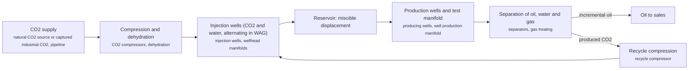

**Key equipment:** CO2 compressors, CO2 pipeline, injection and production wells, production manifold, oil-water-gas separators, recycle compressor.

**Performance:**
- incremental oil recovery over primary and secondary recovery: 4-15 % of original oil in place; NETL primer; primary plus secondary typically 30-35% OOIP; one pilot reported up to 22%. [source](https://www.netl.doe.gov/sites/default/files/netl-file/co2_eor_primer.pdf)
- water to CO2 injection ratio in WAG: 0.5-4 volumes of water per volume of CO2 at reservoir conditions; NETL primer; slug size 0.1-2% of pore volume. [source](https://www.netl.doe.gov/sites/default/files/netl-file/co2_eor_primer.pdf)
- cumulative CO2 injected: 15-30 % of hydrocarbon pore volume; NETL primer. [source](https://www.netl.doe.gov/sites/default/files/netl-file/co2_eor_primer.pdf)
- share of oil cost per barrel taken by CO2 purchase and recycle: 25-50 % of cost per barrel produced; NETL primer. [source](https://www.netl.doe.gov/sites/default/files/netl-file/co2_eor_primer.pdf)
- reservoir depth screening range: 2000-9800 ft; NETL primer screening table (other criteria: oil gravity above 27-30 °API, viscosity at or below 10-12 cp, pressure above 1,200-1,500 psia, residual oil saturation above 0.25-0.30). [source](https://www.netl.doe.gov/sites/default/files/netl-file/co2_eor_primer.pdf)
- CO2 injected per barrel of oil produced (United States fields): 0.3-0.6 t CO2/bbl; varies between fields and across the life of projects; dollar year not stated. [source](https://iea.blob.core.windows.net/assets/181b48b4-323f-454d-96fb-0bb1889d96a9/CCUS_in_clean_energy_transitions.pdf)

**Costs:**
- illustrative pre-tax economic margin: 15-25 USD/bbl (2008$); NETL primer example: oil USD 70/bbl, net wellhead USD 55, capital amortization USD 5-10, CO2 USD 15 (USD 2/Mcf purchase, USD 0.70/Mcf recycle), operations USD 10-15; dollar year not stated, data to 2008. [source](https://www.netl.doe.gov/sites/default/files/netl-file/co2_eor_primer.pdf)
- CO2 purchase cost per barrel of oil produced (0.5 t CO2/bbl injected): 7.5-15 USD/bbl (2020$); purchased CO2 for EOR priced around USD 15-30/t CO2, generally indexed to the oil price; injecting 0.5 t CO2 per barrel of oil produced; dollar year not stated. [source](https://iea.blob.core.windows.net/assets/181b48b4-323f-454d-96fb-0bb1889d96a9/CCUS_in_clean_energy_transitions.pdf)

**Reference plants:**
- Weyburn field, Saskatchewan (EnCana), CA: about 95 million ft3/d CO2 (4,935 t/d) from the Dakota Gasification plant via a 205-mile pipeline; 130 million bbl incremental oil expected; operating as of the primer (data to 2008). [source](https://www.netl.doe.gov/sites/default/files/netl-file/co2_eor_primer.pdf)
- Wasson field Denver Unit, West Texas (Shell), US: 31,500 bbl/d of which 26,850 bbl/d incremental from CO2; over 120 million bbl incremental to 2008; operating as of 2008. [source](https://www.netl.doe.gov/sites/default/files/netl-file/co2_eor_primer.pdf)
- Sukowati field, Bojonegoro (Pertamina EP, with JOGMEC and JAPEX), ID: pilot: about 500 t CO2 huff-and-puff into well SKW-18 over 7 days; first CO2 injection 7 December 2023 (500 t huff-and-puff pilot into well SKW-18); inter-well CO2 injection field trial started 8 October 2024 under an August 2024 joint study by Pertamina EP, JAPEX and JOGMEC; full-scale application is still being evaluated by the joint study and Pertamina EP Cepu (operator of the adjacent Jambaran Tiung Biru field) as of October 2026, with commercial CO2-EOR not yet running. [source](https://www.chemanalyst.com/NewsAndDeals/NewsDetails/japex-and-partners-launch-co2-injection-test-at-sukowati-oil-field-in-indonesia-30847)

TRL source: [IEA ETP Clean Energy Technology Guide, dataset of 24 July 2026, 2025 assessment (IEA 1-11 scale): 'CO2-enhanced oil recovery' 9](https://www.iea.org/data-and-statistics/data-tools/etp-clean-energy-technology-guide)

Sources: [1](https://www.netl.doe.gov/sites/default/files/netl-file/co2_eor_primer.pdf), [2](https://www.migas.esdm.go.id/post/implementasikan-ccus-lapangan-sukowati-injeksi-co2-perdana), [3](https://www.chemanalyst.com/NewsAndDeals/NewsDetails/japex-and-partners-launch-co2-injection-test-at-sukowati-oil-field-in-indonesia-30847), [4](https://suaradesa.co/energi/ccus-sukowati-dorong-optimalisasi-produksi-migas-melalui-inovasi-teknologi-dan-pengelolaan-karbon-yang-bertanggung-jawab/), [5](https://www.iea.org/data-and-statistics/data-tools/etp-clean-energy-technology-guide). Last reviewed 2026-10-28.

## Casing drilling and expandable tubulars
<a id="ups-casing-drilling-expandable-tubulars"></a>

Expandable tubulars are run and then enlarged by pulling or pushing an expansion tool through them, cutting the diameter lost with each casing string and aiming at a monobore well. The Wikipedia page read does not cover casing drilling (drilling with the casing itself).

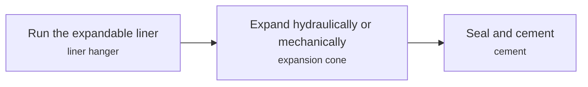

**Key equipment:** expandable liner or clad, expansion tool, liner hanger.

**Performance:**
- expansion ratio: 20-30 %; the page gives both 20% and 30%. [source](https://en.wikipedia.org/wiki/Expandable_tubular_technology)
- expansion length: 30-6000 ft; cold-working expansion. [source](https://en.wikipedia.org/wiki/Expandable_tubular_technology)

**Reference plants:**
- Occidental Petroleum of Qatar — directional casing while drilling at Idd Shargi North Dome (offshore Qatar), QA: 12-1/4-in. horizontal production and injection wells landed up to 86 deg inclination into the top of the Shuaiba, with 9-5/8-in. casing drilled and set through the unstable Nahr Umr shale; operating. [source](https://www.offshore-mag.com/drilling-completion/article/16757958/directional-casing-while-drilling-eases-path-through-nahr-umr-shale-off-qatar)

**Missing inputs:**
- capital cost and operating or unit cost, with dollar year and basis (costs): No open source read so far gives costs for this technology. Web-checked 2026-10-28 (offshore-mag casing drilling articles: 'Casing drilling marks a century of progress' and 'Directional casing while drilling off Qatar'); only qualitative cost-reduction claims, no dollar figures stated. Where: arXiv and open-access journals: techno-economic or review papers (MDPI is blocked by its CDN; use the manual inbox) (catalog: arxiv, open); Licensor and EPC studies; paid cost databases are catalog-only (paid); OSTI.GOV full-text reports from DOE labs: search the technology name plus 'techno-economic' (catalog: osti, open). Next: Look for an open techno-economic study; record each figure with metric, range, unit, dollar year, basis and source.
- TRL with a cited source (trl): The IEA ETP Clean Energy Technology Guide has no matching entry. Web-checked 2026-10-28 (casing drilling technology readiness level TRL); no open TRL table found. Where: IEA ETP Clean Energy Technology Guide (collected): search for the technology name (catalog: iea-reports, open). Next: Find a TRL table that lists this technology, or leave maturity resting on the evidence on the card.

Sources: [1](https://en.wikipedia.org/wiki/Expandable_tubular_technology), [2](https://www.offshore-mag.com/drilling-completion/article/16757958/directional-casing-while-drilling-eases-path-through-nahr-umr-shale-off-qatar), [3](https://www.offshore-mag.com/drilling-completion/article/16760145/casing-drilling-marks-a-century-of-progress). Last reviewed 2026-10-28.

## Chemical EOR (polymer and surfactant flooding)
<a id="ups-chemical-eor"></a>

Chemicals are added to injection water to recover oil that waterflooding leaves behind. Polymers such as hydrolyzed polyacrylamide (HPAM) raise the viscosity of the injected water so it sweeps the reservoir more evenly and water breaks through later. Surfactants lower the interfacial tension between oil and water so trapped oil droplets can move. Alkali-surfactant-polymer (ASP) combines both. Polymer and surfactant performance depends on salinity, temperature, adsorption on the rock and injectivity, so candidates are screened in the laboratory and by core flooding before a field pilot.

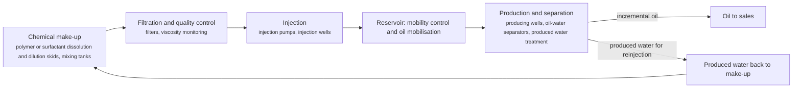

**Key equipment:** polymer or surfactant make-up units, filters, injection pumps, injection and production wells, produced water treatment.

**Performance:**
- incremental recovery, HPAM Polymer C at 3000 ppm, laboratory core floods: 8.8-10 % (two cores); Five commercial HPAM polymers tested at 500-5000 ppm, salinity 3,000-200,000 ppm, up to 90 °C; laboratory only. [source](https://journal.lemigas.esdm.go.id/index.php/SCOG/article/view/2125)
- average incremental recovery of HPAM injection in Daqing field blocks (field): 11 % over waterflooding; as reported in the HPAM article's introduction, which calls Daqing the world's largest commercial polymer flood; original study not read. [source](https://journal.lemigas.esdm.go.id/index.php/SCOG/article/view/2125)
- incremental recovery factor from palm-oil MES surfactant with 96% ethanol, laboratory coreflood: 29.24 % over waterflooding; total recovery factor 45.90%; MES 0.5-2.0%, best formulation 1.25% MES; laboratory only. [source](https://journal.lemigas.esdm.go.id/index.php/SCOG/article/view/2096)
- interfacial tension achieved: 0.521 mN/m; MES with ethanol co-surfactant. [source](https://journal.lemigas.esdm.go.id/index.php/SCOG/article/view/2096)
- incremental recovery after 0.35 PV HPAM polymer slug following waterflood, light-oil coreflood: 13-13.5 % OOIP incremental over waterflood; HPAM 500-1,500 ppm (1,000 ppm recommended) in brine of roughly 2,800 ppm salinity at 70 C; waterflood alone 38.7% OOIP; about 22% of residual oil in place; 500 ppm avoided plugging (FR 1.1, RRF near 1); laboratory coreflood only. [source](https://journal.lemigas.esdm.go.id/index.php/SCOG/article/download/1181/964)
- oil recovery factor after 3-year waterflood plus 17-year polymer flood, Air Benakat formation model, South Sumatra (simulation): 45.83-80.46 % OOIP; CMG-STARS, 1,500 ppm polymer after 3 years of waterflooding; 59.86% homogeneous model, 45.83/69.27/80.46% for Lorenz coefficient 0.2/0.4/0.6; simulation only. [source](https://journal.lemigas.esdm.go.id/index.php/SCOG/article/download/1334/pdf)
- incremental recovery from microemulsion ASP plus polymer drive after waterflood, Bentheimer coreflood: 57.71 % of initial oil saturation (Soi); 2% surfactant A + 0.85% Na2CO3 (ASP) with 2,200 ppm polymer; 0.15 PV ASP slug then 1.5 PV polymer drive at 85 C; waterflood alone 38.21% Soi, total 95.93% Soi, i.e. 93.41% of remaining oil; salinity conditioned by synthetic softened brine preflush; laboratory only. [source](https://journal.lemigas.esdm.go.id/index.php/SCOG/article/download/43/pdf)

**Reference plants:**
- Daqing oilfield polymer flood, CN: average incremental recovery about 11% over waterflooding across tested blocks; described as the world's largest commercial polymer flood. [source](https://journal.lemigas.esdm.go.id/index.php/SCOG/article/view/2125)
- PETRONAS Carigali and Shell Malaysia EOR program, Baram Delta (Sarawak) and North Sabah PSCs, offshore Malaysia, MY: HOA aims to lift production by 90,000-100,000 boe/d across the Baram Delta and North Sabah fields, raising average recovery factor from 36% to 50% and extending field life beyond 2040; technology deployed at North Sabah flagged as possibly the world's first field-scale offshore chemical EOR process; planned. [source](https://www.offshore-mag.com/production/article/16775227/petronas-shell-consider-first-ever-field-scale-chemical-eor-offshore-malaysia)

**Missing inputs:**
- TRL with a cited source (trl): The IEA guide has no chemical EOR entry; 'commercial' rests on the Daqing statement in the HPAM article, which was read only second-hand. IEA ETP Guide (July 2026) has no matching entry (searched chemical EOR, polymer flood, surfactant, alkaline, enhanced oil recovery); 2026-10-28 Web-checked 2026-10-28 (DOAJ search: chemical enhanced oil recovery polymer); independent open review found - Podoprigora, Byazrov and Sytnik, Energies 15(21):8300, 2022, covering pilot and full-scale SP/ASP field tests in China, Canada, Russia, Hungary and Oman (abstract via DOAJ; MDPI full text CDN-blocked) - but no TRL number stated and the original Daqing study was not open. Where: IEA ETP Clean Energy Technology Guide (collected): search for the technology name (catalog: iea-reports, open); Peer-reviewed reviews of chemical EOR field projects (SPE, open journals) (catalog: doaj, open). Next: Find an independent review that lists field projects, and read the original Daqing study.
- chemical cost per barrel of incremental oil and project capex, with dollar year and basis (costs): No source read gives costs. Searched LEMIGAS SCOG corpus for cost, USD, capex, price, economics across the four polymer/surfactant papers; they state no dollar cost per barrel of incremental oil or project capex, only qualitative remarks such as 1,500 ppm striking 'a fair compromise between ... lowering the cost of the polymer injection'; 2026-10-28 Web-checked 2026-10-28 (DOAJ searches: polymer flooding economic analysis field; Frontiers in Energy Research 2023 Bohai B oilfield discontinuous chemical flooding paper read); sources describe cost savings qualitatively, no open source states dollar cost per barrel of incremental oil or project capex. Where: Open techno-economic papers (arXiv, LEMIGAS SCOG archive, Universitas Trisakti publications) (catalog: lemigas-scog, open). Next: Add cost per incremental barrel with dollar year.

Sources: [1](https://journal.lemigas.esdm.go.id/index.php/SCOG/article/view/2125), [2](https://journal.lemigas.esdm.go.id/index.php/SCOG/article/view/2096), [3](https://journal.lemigas.esdm.go.id/index.php/SCOG/article/download/1181/964), [4](https://journal.lemigas.esdm.go.id/index.php/SCOG/article/download/1334/pdf), [5](https://journal.lemigas.esdm.go.id/index.php/SCOG/article/download/43/pdf), [6](https://www.offshore-mag.com/production/article/16775227/petronas-shell-consider-first-ever-field-scale-chemical-eor-offshore-malaysia). Last reviewed 2026-10-28.

## Coal bed methane
<a id="ups-coal-bed-methane"></a>

Wells in coal seams 100 to 1,500 m deep are dewatered to lower pressure so methane desorbs, giving a rising gas profile after start-up. US coal bed methane was 1.76 Tcf in 2017 (3.6% of dry gas), down from a 1.97 Tcf peak in 2008; Queensland supplied about 10% of Australia's gas by 2014.

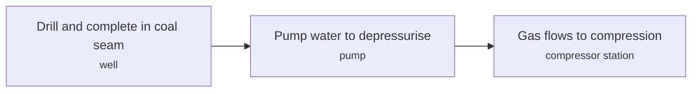

**Key equipment:** coal seam wells, dewatering pumps, water handling, gas compression.

**Performance:**
- US CBM production, 2017: 1.76 Tcf; 3.6% of dry gas; peak 1.97 Tcf in 2008. [source](https://en.wikipedia.org/wiki/Coalbed_methane)
- well peak output: 8500 m3/day (about); 300,000 cf/d. [source](https://en.wikipedia.org/wiki/Coalbed_methane)
- peak gas rate per coalbed methane well: 236-319 Mcf/d; About 6,600 Powder River Basin CBM wells: average peak 319 Mcf/d (median 236), reached on average 1.2 years after first production.. [source](https://onepetro.org/SPERMPTC/proceedings/07RMTC/All-07RMTC/SPE-107308-MS/142057)

**Missing inputs:**
- capital cost and operating or unit cost, with dollar year and basis (costs): No open source read so far gives costs for this technology. Web-checked 2026-10-28 (coal bed methane techno-economic cost study; search engines returned bot-block pages, Queensland and Geoscience Australia pages unreachable or 404); no open source gives CBM capex/opex. Where: arXiv and open-access journals: techno-economic or review papers (MDPI is blocked by its CDN; use the manual inbox) (catalog: arxiv, open); Licensor and EPC studies; paid cost databases are catalog-only (paid); OSTI.GOV full-text reports from DOE labs: search the technology name plus 'techno-economic' (catalog: osti, open). Next: Look for an open techno-economic study; record each figure with metric, range, unit, dollar year, basis and source.
- named plants or projects with capacity and year (reference_plants): The sources read name no specific plant. Web-checked 2026-10-28 (Queensland CSG-LNG projects QCLNG/APLNG/GLNG capacity pages; operator and qld.gov.au pages 404, search engines blocked); no named-project page reachable. Where: Licensor and operator press releases for the suppliers listed (open). Next: Add one or two plants with country, capacity and start-up year.
- TRL with a cited source (trl): The IEA ETP Clean Energy Technology Guide has no matching entry. Web-checked 2026-10-28 (coal seam gas / coal bed methane technology readiness level TRL; DuckDuckGo anomaly-blocked); no open TRL table found for CBM. Where: IEA ETP Clean Energy Technology Guide (collected): search for the technology name (catalog: iea-reports, open). Next: Find a TRL table that lists this technology, or leave maturity resting on the evidence on the card.

Sources: [1](https://en.wikipedia.org/wiki/Coalbed_methane). Last reviewed 2026-11-17.

## Coiled tubing and well intervention
<a id="ups-coiled-tubing-intervention"></a>

A continuous steel pipe (normally 1 to 3.25 inch) on a reel is pushed into live wells for cleanouts, chemical placement, milling, logging and drilling. It trips faster than jointed pipe and acts as a nearly closed system, but cannot trip jointed pipe and needs a larger offshore footprint than wireline.


**Key equipment:** coiled-tubing reel, injector head, BOP stack, bottom-hole assembly.

**Performance:**
- coiled-tubing diameter: 1-3.25 in; 25 to 83 mm. [source](https://en.wikipedia.org/wiki/Coiled_tubing)
- steel yield strength: 55000-120000 psi; coil grades. [source](https://en.wikipedia.org/wiki/Coiled_tubing)

**Reference plants:**
- Statoil (now Equinor) first North Sea HP/HT coiled tubing milling job, Kvitebjoern field, block 34/11, Norwegian continental shelf, NO: well 34/11-A-9 T2, gas/condensate producer with reservoir at about 4,000 m, 770 bar and 160 C; CT milling of a stuck-closed isolation ball valve; operating. [source](https://www.offshore-mag.com/business-briefs/equipment-engineering/article/16761449/statoil-records-first-successful-north-sea-hp-ht-coiled-tubing-milling-job)

**Missing inputs:**
- day rate or job cost (costs): Not stated. Web-checked 2026-10-28 (coiled tubing day rate and job cost; DOAJ search 'coiled tubing intervention cost' returned only fatigue-modeling papers, no figures); no open source states a day rate or job cost - intervention day-rate surveys are paid. Where: Operator intervention cost studies (open). Next: Add typical cost with year.
- TRL with a cited source (trl): The IEA ETP Clean Energy Technology Guide has no matching entry. IEA ETP Guide (July 2026) has no matching entry (searched coiled tubing, well intervention, workover, downhole); 2026-10-28 Web-checked 2026-10-28 (coiled tubing technology readiness level TRL; DuckDuckGo and Brave returned bot-block pages); no open TRL table found. Where: IEA ETP Clean Energy Technology Guide (collected): search for the technology name (catalog: iea-reports, open). Next: Find a TRL table that lists this technology, or leave maturity resting on the evidence on the card.

Sources: [1](https://en.wikipedia.org/wiki/Coiled_tubing), [2](https://www.offshore-mag.com/business-briefs/equipment-engineering/article/16761449/statoil-records-first-successful-north-sea-hp-ht-coiled-tubing-milling-job). Last reviewed 2026-10-29.

## Digital core and special core analysis
<a id="ups-digital-core-analysis"></a>

Cores are imaged by whole-core CT (0.5 mm slices), micro-CT and FIB-SEM, and the 3D images are used to compute porosity, permeability, capillary pressure and relative permeability in simulations. Schlumberger reports that analysis taking weeks or months can finish in hours or days.

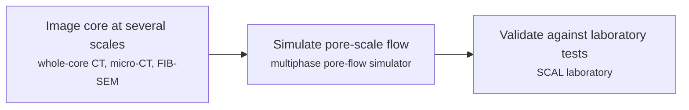

**Key equipment:** CT and micro-CT scanners, FIB-SEM, HPC simulation, SCAL laboratory.

**Performance:**
- whole-core CT slice resolution: 0.5 mm; 4-inch core in liner. [source](https://geoexpro.com/inside-the-rock/)

**Reference plants:**
- Sonatrach commercial use of Ingrain digital rock physics services, DZ: commercial agreement covering Ingrain's digital rock physics services (3D imaging and computation of reservoir rock properties); operating. [source](https://www.offshore-mag.com/exploration-geosciences/article/16789934/sonatrach-to-use-ingrains-digital-rock-physics-technology)

**Missing inputs:**
- service price (costs): Not published. Where: Vendor quotations (paid). Next: Leave unless a published price is found.
- TRL with a cited source (trl): The IEA ETP Clean Energy Technology Guide has no matching entry. IEA ETP Guide (July 2026) has no matching entry (searched digital rock, core analysis, digital core, digital twin); 2026-10-28 Web-checked 2026-10-28 (digital rock physics technology readiness level TRL; DuckDuckGo and Brave returned bot-block pages); no open TRL table found. Where: IEA ETP Clean Energy Technology Guide (collected): search for the technology name (catalog: iea-reports, open). Next: Find a TRL table that lists this technology, or leave maturity resting on the evidence on the card.

Sources: [1](https://geoexpro.com/inside-the-rock/), [2](https://www.offshore-mag.com/exploration-geosciences/article/16789934/sonatrach-to-use-ingrains-digital-rock-physics-technology), [3](https://www.halliburton.com/en/resources/fastscal-digital-scal-improves-resource-estimates). Last reviewed 2026-11-17.

## Electric instead of gas-pneumatic controllers
<a id="ups-electric-pneumatic-controllers"></a>

Gas-driven pneumatic controllers vent methane to operate valves; replacing them with instrument air or electric controllers removes that venting. EPA Natural Gas STAR reports gas pneumatic devices vented about 51 Bcf/yr in production (2006) and a conversion typically costs $45,000 to $75,000 with payback in months at $7/Mcf.

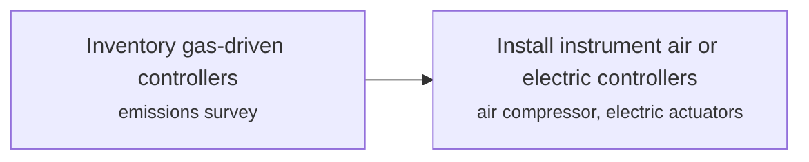

**Key equipment:** instrument air compressor and dryer, electric controllers, solar and battery power at remote sites.

**Performance:**
- gas vented by pneumatic controllers in US production: 51 Bcf/yr; 2006; transmission about 14 Bcf/yr. [source](https://19january2021snapshot.epa.gov/sites/static/files/2016-06/documents/ll_instrument_air.pdf)
- methane emission rate per pneumatic controller: 0.68-19.25 scf/h; Measured over 72 devices: high-bleed 19.25 scf/h (n=8), low-bleed 0.68 scf/h (n=19), all controllers 4.98 scf/h. Electric controllers vent nothing by design.. [source](https://pubs.acs.org/estlcu/article/6/6/348/507411/Multiday-Measurements-of-Pneumatic-Controller)

**Costs:**
- typical instrument-air conversion cost: 45000-75000 USD (2006$); 2006 dollars. [source](https://19january2021snapshot.epa.gov/sites/static/files/2016-06/documents/ll_instrument_air.pdf)

TRL source: [IEA ETP Clean Energy Technology Guide dataset (July 2026), entry 'Instrumented air systems'](https://www.iea.org/data-and-statistics/data-tools/etp-clean-energy-technology-guide)

**Missing inputs:**
- named plants or projects with capacity and year (reference_plants): The sources read name no specific plant. Web-checked 2026-10-28; no operator press release names a specific controller-conversion project with counts. Where: Licensor and operator press releases for the suppliers listed (open). Next: Add one or two plants with country, capacity and start-up year.

Sources: [1](https://19january2021snapshot.epa.gov/sites/static/files/2016-06/documents/ll_instrument_air.pdf), [2](https://www.iea.org/data-and-statistics/data-tools/etp-clean-energy-technology-guide), [3](https://canusaepc.com/resources/instrument-air-nitrogen-or-electric-a-side-by-side-look-at-instrumentation-alternatives-for-emissions-reduction-compliance). Last reviewed 2026-11-17.

## Electric submersible pumps
<a id="ups-electric-submersible-pumps"></a>

A downhole multistage centrifugal pump driven by a submersible motor on a cable lifts 16 to 4,770 m³/d (100 to 30,000 bbl/d). SLB reports an installed base of 150,000 to 200,000 wells and notes ESPs are usually uneconomic below about 25 m³/d.

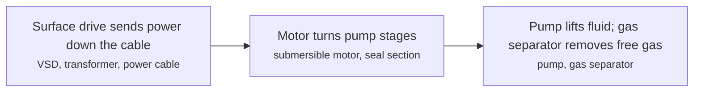

**Key equipment:** ESP pump, motor, seal section, gas separator, power cable, variable speed drive.

**Performance:**
- flow rate range: 16-4770 m3/d; 100 to 30,000 bbl/d. [source](https://www.slb.com/-/media/files/oilfield-review/defining-esp.ashx)
- installed ESP wells worldwide: 150000-200000 wells (estimate); SLB Oilfield Review. [source](https://www.slb.com/-/media/files/oilfield-review/defining-esp.ashx)
- ESP depth capability: 3000 m (about 10,000 ft); Wikipedia comparison table. [source](https://en.wikipedia.org/wiki/Artificial_lift)
- average ESP run life: 1058 days; Average ESP lifespan of 1,058 days in the offshore field studied, with half of all ESPs below 1,000 days.. [source](https://onepetro.org/SJ/article/31/03/1802/794801/Lifespan-Prediction-and-Multiobjective)

**Missing inputs:**
- capital cost and operating or unit cost, with dollar year and basis (costs): No open source read so far gives costs for this technology. Web-checked 2026-10-28; no open techno-economic study found. Where: arXiv and open-access journals: techno-economic or review papers (MDPI is blocked by its CDN; use the manual inbox) (catalog: arxiv, open); Licensor and EPC studies; paid cost databases are catalog-only (paid); OSTI.GOV full-text reports from DOE labs: search the technology name plus 'techno-economic' (catalog: osti, open). Next: Look for an open techno-economic study; record each figure with metric, range, unit, dollar year, basis and source.
- named plants or projects with capacity and year (reference_plants): The sources read name no specific plant. Web-checked 2026-10-28; no OEM/operator release names a specific ESP installation with counts. Where: Licensor and operator press releases for the suppliers listed (open). Next: Add one or two plants with country, capacity and start-up year.
- TRL with a cited source (trl): The IEA ETP Clean Energy Technology Guide has no matching entry. no open TRL source found (IEA ETP guide checked 2026-10-28; no SETIS/DOE entry). Where: IEA ETP Clean Energy Technology Guide (collected): search for the technology name (catalog: iea-reports, open). Next: Find a TRL table that lists this technology, or leave maturity resting on the evidence on the card.

Sources: [1](https://www.slb.com/-/media/files/oilfield-review/defining-esp.ashx), [2](https://en.wikipedia.org/wiki/Artificial_lift), [3](https://en.wikipedia.org/wiki/Submersible_pump). Last reviewed 2026-11-17.

## Extended-reach and multilateral wells
<a id="ups-extended-reach-multilateral-wells"></a>

Extended-reach drilling (ERD) reaches a large reservoir area from one surface location by drilling very long deviated wells; multilateral wells add branches from a main bore. The record ERD well (Orlan platform, Sakhalin-1, 24 April 2015) has a measured depth of 13,500 m and a horizontal displacement of 12,030 m.

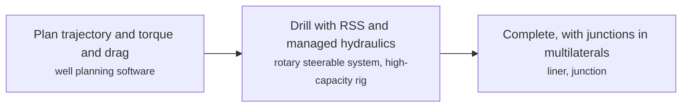

**Key equipment:** high-capacity rig, rotary steerable system, torque-and-drag management, junction systems for multilaterals.

**Performance:**
- record ERD measured depth: 13500 m; Orlan, Sakhalin-1, April 2015. [source](https://en.wikipedia.org/wiki/Extended_reach_drilling)
- record ERD horizontal displacement: 12030-12130 m; Orlan 12,030 m (2015); earlier Yastreb well 12,130 m (2014). [source](https://en.wikipedia.org/wiki/Extended_reach_drilling)

**Reference plants:**
- Odoptu OP-11 extended-reach well (Sakhalin-1, Exxon Neftegas), RU: world-record extended-reach well at completion: 12,345 m measured depth (40,502 ft); operating. [source](https://offshore-energy.biz/2011/01/28/exxon-drills-the-worlds-longest-extended-reach-well-offshore-sakhalin-russia)

**Missing inputs:**
- cost versus several conventional wells (costs): Not stated. Web-checked 2026-10-28 (SPE ERD papers OnePetro-restricted); no open published cost comparison found. Where: SPE ERD papers (catalog: onepetro, open). Next: Add a published cost comparison.
- TRL with a cited source (trl): The IEA ETP Clean Energy Technology Guide has no matching entry. IEA ETP Guide (July 2026) has no matching entry (searched multilateral, extended reach, horizontal well, drilling); 2026-10-28 Where: IEA ETP Clean Energy Technology Guide (collected): search for the technology name (catalog: iea-reports, open). Next: Find a TRL table that lists this technology, or leave maturity resting on the evidence on the card.

Sources: [1](https://en.wikipedia.org/wiki/Extended_reach_drilling), [2](https://jpt.spe.org/inflow-control-device-inflow-control-valves-aid-kuwaits-first-smart-multilateral-well), [3](https://offshore-energy.biz/2011/01/28/exxon-drills-the-worlds-longest-extended-reach-well-offshore-sakhalin-russia), [4](https://petroedgeasia.net/blog/extended-reach-drilling-erd-complete-guide-to-planning-execution-and-risk-control). Last reviewed 2026-11-17.

## FPSO and floating production (TLP, spar, semi-submersible)
<a id="ups-fpso-floating-production"></a>

A floating production, storage and offloading vessel processes, stores and offloads oil, usually moored by a turret; TLPs, spars and semi-submersibles host dry or wet trees in deeper water. Over 270 FPSOs were in service (a 2019 figure), and a new build can cost up to US$1 billion.


**Key equipment:** hull, turret and mooring, topsides process, storage tanks, offloading system, ship-shaped FPSO, semi-submersible production platform, SPAR production platform, TLP production topsides, FLNG, turret mooring.

**Performance:**
- oil FPSOs in service: 270 units (over); 2019 figure cited by Wikipedia. [source](https://en.wikipedia.org/wiki/Floating_production_storage_and_offloading)
- Kizomba A storage: 2.2 million barrels; built by Hyundai Heavy Industries for over US$800 million. [source](https://en.wikipedia.org/wiki/Floating_production_storage_and_offloading)
- TLP depth limit: 2000 m (about); Perdido spar is in 2,438 m. [source](https://en.wikipedia.org/wiki/Oil_platform)

**Costs:**
- new-build FPSO: 1000 USD million (up to); dollar year not stated; conversions can cost under US$100 million. [source](https://en.wikipedia.org/wiki/Floating_production_storage_and_offloading)
- announced capital investment: 12 AUD (USD 8.71 billion equivalent as stat; Investment announced by Shell to build the Prelude FLNG facility; source gives announcement date 20 May 2011 but no explicit price-year label  Dollar year not stated.. [source](https://en.wikipedia.org/w/index.php?title=Floating_liquefied_natural_gas&action=raw)
- analyst estimated vessel cost: 10.8-12.6 USD; Industry analyst estimate of Prelude vessel cost reported by Reuters; article dated 4 December 2013  Dollar year not stated.. [source](https://www.bbc.com/news/technology-25213845)
- initial project cost: 34 USD billion; Initial cost of the integrated LNG project (offshore CPF + FPSO + 889 km pipeline + onshore liquefaction plant)  Dollar year not stated.. [source](https://en.wikipedia.org/w/index.php?title=Ichthys_gas_field&action=raw)
- Total project CAPEX / investment at FID: 3.4e+10 USD billion (as printed) (2012$); INPEX and Total FID announcement: 'US$34 billion Ichthys LNG Project'; CAPEX line in INPEX project summary Source dated 13 January 2012 and states the figure at FID; source does not separately label a nominal-dollar base year.. [source](https://www.inpex.com.au/news-and-updates/media-centre/media-releases/final-investment-decision-on-ichthys-lng-project/)
- Total project investment at FID (JV partner statement): 3.4e+10 USD billion (as printed) (2012$); Total/TotalEnergies press release: 'investment of US$34 billion dollars'; Total holds 24% Press release dated 13 January 2012; base dollar year not separately labelled.. [source](https://totalenergies.com/newsroom/australie-total-et-inpex-lancent-ichthys-projet-strategique-de-gnl-offshore/?lang=eng)
- FLNG vessel EPC contract value (Samsung regulatory filing): 3.27e+12 KRW; 3.27 trillion won contract for Technip Samsung Consortium to engineer, procure, construct and install the vessel; article prints '($3 billion)' conversion Contract period 1 June 2011 to 30 September 2016, as stated in the filing; base year not separately labelled.. [source](https://gcaptain.com/samsung-shells-flng-facility/)
- Cost (project tracker): 1.6e+09 USD; LNG2030 project tracker record for PFLNG Dua: 'Cost (US$bn) 1.6' Dollar price year not stated by the source; tracker entry last reviewed 24 July 2026. Dollar year not stated.. [source](https://lng2030.com/project/lng_223)

**Reference plants:**
- FPSO Kikeh (Kikeh field, offshore Sabah), MY: 120,000 bopd process capacity; water depth about 1,300 m; first deepwater FPSO in Malaysia and Asia; operating. [source](https://www.oedigital.com/news/493811-pttep-awards-long-term-charter-extension-for-fpso-kikeh)

**Missing inputs:**
- TRL with a cited source (trl): The IEA ETP Clean Energy Technology Guide has no matching entry. IEA ETP Guide (July 2026) has no matching entry (searched FPSO, floating production, floating storage, turret); 2026-10-28 Where: IEA ETP Clean Energy Technology Guide (collected): search for the technology name (catalog: iea-reports, open). Next: Find a TRL table that lists this technology, or leave maturity resting on the evidence on the card.

Sources: [1](https://en.wikipedia.org/wiki/Floating_production_storage_and_offloading), [2](https://en.wikipedia.org/wiki/Oil_platform), [3](https://www.oedigital.com/news/493811-pttep-awards-long-term-charter-extension-for-fpso-kikeh). Last reviewed 2026-11-24.

## Fixed jackets and gravity-based structures
<a id="ups-fixed-jackets-gravity-structures"></a>

Fixed platforms stand on steel jackets piled to the seabed or on concrete gravity-based structures (GBS) that can store oil; they are economic to about 520 m of water. Bullwinkle (Gulf of Mexico) is the tallest fixed example at 529 m, and Hibernia's GBS weighs about 1.2 million tons with 1.3 million barrels of storage.

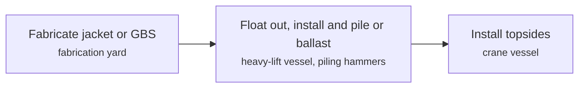

**Key equipment:** steel jacket or concrete GBS, piles, topsides, risers.

**Performance:**
- fixed-platform economic depth limit: 520 m; about 1,710 ft. [source](https://en.wikipedia.org/wiki/Oil_platform)
- Hibernia GBS weight: 1.2 million tons; 111 m tall; 1.3 million bbl storage. [source](https://en.wikipedia.org/wiki/Oil_platform)
- Troll A GBS height: 472 m; 300 m water depth, built 1996. [source](https://en.wikipedia.org/wiki/Oil_platform)

**Reference plants:**
- Troll A Condeep gravity-based structure (Troll field, Norwegian North Sea), NO: natural-gas production platform; gravity-based substructure about 472 m total height in about 300 m water depth, about 245,000 m3 concrete, about 683,600 t unballasted weight; operating. [source](https://www.akersolutions.com/what-we-do/fixed-and-floating-solutions/gbs/gbs-cases/troll-a)

**Missing inputs:**
- jacket and topsides cost per tonne with year (costs): Not on the page. Web-checked 2026-10-28; no open source states jacket/topside cost per tonne (IHS data paid). Where: Offshore Magazine and IHS cost data (open). Next: Add a cost reference.
- TRL with a cited source (trl): The IEA ETP Clean Energy Technology Guide has no matching entry. IEA ETP Guide (July 2026) has no matching entry (searched jacket, gravity structure, fixed platform, topside, offshore structure); 2026-10-28 Where: IEA ETP Clean Energy Technology Guide (collected): search for the technology name (catalog: iea-reports, open). Next: Find a TRL table that lists this technology, or leave maturity resting on the evidence on the card.

Sources: [1](https://en.wikipedia.org/wiki/Oil_platform), [2](https://www.akersolutions.com/what-we-do/fixed-and-floating-solutions/gbs/gbs-cases/troll-a), [3](https://fgg-web.fgg.uni-lj.si/~/pmoze/esdep/master/wg15a/l0100.htm). Last reviewed 2026-11-17.

## Flare gas recovery and zero routine flaring
<a id="ups-flare-gas-recovery"></a>

Gas that would be burned in a flare is instead collected, compressed and treated so that it can be sold, used for power or reinjected. Vapour recovery units capture low-pressure methane streams from tanks and compressor seals. Where no pipeline exists, small-scale GTL or power generation can use the gas on site. Routine, non-emergency flaring can then be ended.

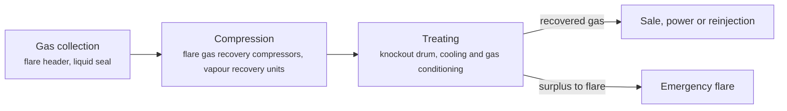

**Key equipment:** flare gas recovery compressors, liquid seal drum, vapour recovery units, gas treating skid, flare tip.

**Performance:**
- natural gas flared globally each year: 150 bcm; majority is routine, non-emergency flaring; IEA 2025 tracker. [source](https://iea.blob.core.windows.net/assets/b83c32dd-fc1b-4917-96e9-8cd918801cbf/GlobalMethaneTracker2025.pdf)
- hydrocarbon vapour capture by vapour recovery units: 95 % of tank hydrocarbon vapours (up to); EPA Lessons Learned case study: vapor recovery can capture up to 95% of hydrocarbon vapors from tanks; recovered vapours usable as fuel or sale gas. Specific flare-gas-recovery-unit turndown figures were not found in open supplier datasheets. [source](https://19january2021snapshot.epa.gov/sites/static/files/2017-08/documents/richards_midland_2006.pdf)
- flare gas recovery unit product recovery: 94 %; ASPEN HYSYS simulation of a 430,600 kg/h refinery FGRU: 94% average product recovery; sliding-vane recovery compressors give about 3:1 turndown.. [source](https://biomedres.us/fulltexts/BJSTR.MS.ID.007881.php)

TRL source: [IEA ETP Clean Energy Technology Guide, dataset of 24 July 2026, 2025 assessment (IEA 1-11 scale): 'Flare gas recovery' 9](https://www.iea.org/data-and-statistics/data-tools/etp-clean-energy-technology-guide)

**Missing inputs:**
- capex per unit and payback with dollar year (costs): The tracker gives the flared volume only; the collected IEA documents state no capex per unit or payback for flare gas recovery and the World Bank GFMR reports were not collected. Web-checked 2026-10-28 (World Bank Zero Routine Flaring materials argue economic viability but state no per-unit capex or payback). Where: IEA Global Methane Tracker documentation (collected) (catalog: iea-methane-tracker, open); World Bank Global Gas Flaring Reduction partnership reports (open). Next: Add capex and payback with basis.
- named flare reduction projects in Malaysia and Indonesia (reference_plants): None read. Web-checked 2026-10-28; PETRONAS/Pertamina sustainability pages state ZRF commitments without named per-site recovery projects. Where: PETRONAS and Pertamina sustainability reports (catalog: petronas-tech, open). Next: Collect the reports and add a project with year and volume.

Sources: [1](https://iea.blob.core.windows.net/assets/b83c32dd-fc1b-4917-96e9-8cd918801cbf/GlobalMethaneTracker2025.pdf), [2](https://www.iea.org/data-and-statistics/data-tools/etp-clean-energy-technology-guide). Last reviewed 2026-11-17.

## Full-waveform inversion and seismic imaging
<a id="ups-full-waveform-inversion"></a>

An initial velocity model is updated iteratively until simulated seismic waveforms match recorded ones, producing a high-resolution subsurface velocity model that feeds migration and imaging. Compute needs are large and the method can fail when the starting model is too far off (cycle skipping); the SEG page read explains the geotechnical form of the method only.

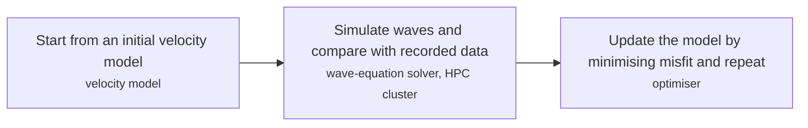

**Key equipment:** HPC cluster or GPUs, wave-equation solver, velocity model building software.

**Performance:**
- FWI frequency band and compute cost: 4-28 Hz in 15.9 hours on one GPU; 4-28 Hz data inverted in three bands over 34 iterations, completed in 15.9 hours on a single laptop GPU.. [source](https://bfienergygroup.ca/full-waveform-inversion)

**Missing inputs:**
- capital cost and operating or unit cost, with dollar year and basis (costs): No open source read so far gives costs for this technology. Web-checked 2026-10-28; survey acquisition costs are commercial; no open unit cost found. Where: arXiv and open-access journals: techno-economic or review papers (MDPI is blocked by its CDN; use the manual inbox) (catalog: arxiv, open); Licensor and EPC studies; paid cost databases are catalog-only (paid); OSTI.GOV full-text reports from DOE labs: search the technology name plus 'techno-economic' (catalog: osti, open). Next: Look for an open techno-economic study; record each figure with metric, range, unit, dollar year, basis and source.
- named plants or projects with capacity and year (reference_plants): The sources read name no specific plant. Web-checked 2026-10-28; no named survey with figures on open pages. Where: Licensor and operator press releases for the suppliers listed (open). Next: Add one or two plants with country, capacity and start-up year.
- TRL with a cited source (trl): The IEA ETP Clean Energy Technology Guide has no matching entry. no open TRL source found (IEA ETP guide checked 2026-10-28; no SETIS/DOE entry). Where: IEA ETP Clean Energy Technology Guide (collected): search for the technology name (catalog: iea-reports, open). Next: Find a TRL table that lists this technology, or leave maturity resting on the evidence on the card.

Sources: [1](https://wiki.seg.org/wiki/Full-waveform_inversion), [2](https://en.wikipedia.org/wiki/Seismic_inversion), [3](https://slim.gatech.edu/research/full-waveform-inversion). Last reviewed 2026-11-17.

## Gas injection and WAG (hydrocarbon, CO2, nitrogen)
<a id="ups-gas-injection-wag"></a>

Gas (natural gas, nitrogen or CO2) is injected to maintain pressure or become miscible with oil; water-alternating-gas (WAG) cycles gas and water to improve sweep. Gas injection projects made up 56% of the 374 EOR projects counted worldwide in 2017 (CO2 44%, other gas 12%).

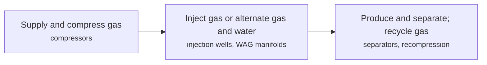

**Key equipment:** gas compressors, injection wells, WAG manifolds, separation and recycle.

**Performance:**
- share of 2017 EOR projects using CO2: 44 % of 374 projects; other gas injection 12%. [source](https://en.wikipedia.org/wiki/Enhanced_oil_recovery)
- CO2 EOR effective depth: 2000 ft (deeper than); depth threshold for miscible CO2 flooding as stated in the source. [source](https://en.wikipedia.org/wiki/Enhanced_oil_recovery)
- WAG incremental recovery factor: 5-20 % of OOIP; WAG pilots typically yield 5-10% of OOIP incremental recovery, with up to 20% in a few pilots.. [source](https://link.springer.com/article/10.1007/s13202-019-0694-x)

**Reference plants:**
- Statfjord WAG (water-alternating-gas injection), NO: largest oil field in the North Sea at start-up (production began 23 Nov 1979); injection converted from water-only to WAG in the late 1990s; operating. [source](https://www.equinor.com/news/archive/2003/03/17/BoostingRecoveryWithFoam)

**Missing inputs:**
- capital cost and operating or unit cost, with dollar year and basis (costs): No open source read so far gives costs for this technology. Web-checked 2026-10-28; no open techno-economic study found. Where: arXiv and open-access journals: techno-economic or review papers (MDPI is blocked by its CDN; use the manual inbox) (catalog: arxiv, open); Licensor and EPC studies; paid cost databases are catalog-only (paid); OSTI.GOV full-text reports from DOE labs: search the technology name plus 'techno-economic' (catalog: osti, open). Next: Look for an open techno-economic study; record each figure with metric, range, unit, dollar year, basis and source.
- TRL with a cited source (trl): The IEA ETP Clean Energy Technology Guide has no matching entry. no open TRL source found (IEA ETP guide checked 2026-10-28; no SETIS/DOE entry). Where: IEA ETP Clean Energy Technology Guide (collected): search for the technology name (catalog: iea-reports, open). Next: Find a TRL table that lists this technology, or leave maturity resting on the evidence on the card.

Sources: [1](https://en.wikipedia.org/wiki/Enhanced_oil_recovery), [2](https://www.equinor.com/news/archive/2003/03/17/BoostingRecoveryWithFoam), [3](https://www.norskpetroleum.no/en/facts/field/statfjord), [4](https://www.sciopen.com/article/10.46690/ager.2021.02.04?issn=2207-9963). Last reviewed 2026-11-17.

## Gas lift
<a id="ups-gas-lift"></a>

Compressed gas is injected into the production tubing through valves in mandrels to lighten the fluid column so the well flows. About 10% of US oil wells with insufficient reservoir pressure use gas lift, and side-pocket mandrels let valves be changed by wireline.

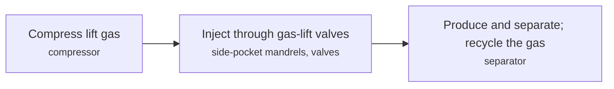

**Key equipment:** gas compressor, gas-lift mandrels and valves, injection manifold.

**Performance:**
- US oil wells using gas lift: 10 % (about); wells with insufficient reservoir pressure. [source](https://en.wikipedia.org/wiki/Gas_lift)
- gas lift depth and rate capability: 4600 m (up to 15,000 ft); up to 30,000 bbl/d; Wikipedia comparison. [source](https://en.wikipedia.org/wiki/Artificial_lift)
- overall system efficiency of gas lift vs other artificial lift methods: 35 % overall system efficiency; IPIECA Energy Efficiency Compendium, artificial lift entry (2023), Table 1: gas lift 35% overall system efficiency; comparison: sucker rod pumps 45-60%, progressive cavity pumps 70-80%, ESPs 30-70%, hydraulic pumps 20-35%, plunger lift 75-85%. The compendium defines injected-gas scf/bbl-of-liquid as the KPI but publishes no benchmark value for it. [source](https://www.ipieca.org/resources/energy-efficiency-compendium/artificial-lift-2023)

**Missing inputs:**
- capital cost and operating or unit cost, with dollar year and basis (costs): No open source read so far gives costs for this technology. Web-checked 2026-10-28; no open techno-economic study found. Where: arXiv and open-access journals: techno-economic or review papers (MDPI is blocked by its CDN; use the manual inbox) (catalog: arxiv, open); Licensor and EPC studies; paid cost databases are catalog-only (paid); OSTI.GOV full-text reports from DOE labs: search the technology name plus 'techno-economic' (catalog: osti, open). Next: Look for an open techno-economic study; record each figure with metric, range, unit, dollar year, basis and source.
- named plants or projects with capacity and year (reference_plants): The sources read name no specific plant. Web-checked 2026-10-28; ubiquitous method, no single named deployment release found. Where: Licensor and operator press releases for the suppliers listed (open). Next: Add one or two plants with country, capacity and start-up year.
- TRL with a cited source (trl): The IEA ETP Clean Energy Technology Guide has no matching entry. no open TRL source found (IEA ETP guide checked 2026-10-28; no SETIS/DOE entry). Where: IEA ETP Clean Energy Technology Guide (collected): search for the technology name (catalog: iea-reports, open). Next: Find a TRL table that lists this technology, or leave maturity resting on the evidence on the card.

Sources: [1](https://en.wikipedia.org/wiki/Gas_lift), [2](https://en.wikipedia.org/wiki/Artificial_lift). Last reviewed 2026-10-29.

## Hydraulic fracturing (plug-and-perf, electric frac fleets)
<a id="ups-hydraulic-fracturing"></a>

High-pressure fluid and proppant open fractures along a cased and perforated lateral in stages; plug-and-perf isolates each stage with a plug, while sliding sleeves open one at a time. Typical fluid is about 90% water, 9.5% sand and 0.5% additives, and pumps reach 100 MPa (15,000 psi).

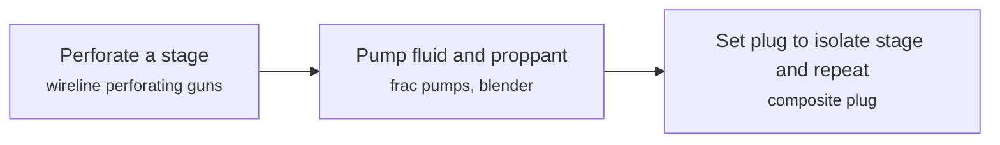

**Key equipment:** frac pumps (diesel, dual fuel or electric), blender, wireline unit, composite plugs, sand and water supply.

**Performance:**
- water per well: 1.2-3.5 million US gallons; up to 5 million for large projects. [source](https://en.wikipedia.org/wiki/Hydraulic_fracturing)
- maximum pump pressure: 100 MPa (15,000 psi); and 265 L/s. [source](https://en.wikipedia.org/wiki/Hydraulic_fracturing)
- emissions of electric fleet vs Tier 2 diesel: 30-45 % lower; 30% on reciprocating-engine power, up to 45% on ERCOT grid; Halliburton estimate. [source](https://www.halliburton.com/en/completions/stimulation/hydraulic-fracturing/zeus-fracturing-services)
- ZEUS pump unit hydraulic horsepower: 5000 HHP (up to); vendor. [source](https://www.halliburton.com/en/completions/stimulation/hydraulic-fracturing/zeus-fracturing-services)

**Missing inputs:**
- completion cost per stage or per well with year (costs): Neither page gives it; the collected EIA document (AEO2026 Electricity Market Module assumptions, April 2026) contains no well-cost, completion-cost or drilling data (it covers power-plant technology costs only). Web-checked 2026-10-28: per-stage pricing ranges (about USD 30,000-70,000/stage; electric frac fleet USD 40-60 m) appear only in finance/trade guides without a primary open source; not recorded. Where: EIA drilling productivity and well cost studies (catalog: eia-reports, open). Next: Add a well-cost figure with year.
- named plants or projects with capacity and year (reference_plants): The sources read name no specific plant. Web-checked 2026-10-28; no named completion campaign with per-well figures on open pages. Where: Licensor and operator press releases for the suppliers listed (open). Next: Add one or two plants with country, capacity and start-up year.
- TRL with a cited source (trl): The IEA ETP Clean Energy Technology Guide has no matching entry. no open TRL source found (IEA ETP guide checked 2026-10-28; no SETIS/DOE entry). Where: IEA ETP Clean Energy Technology Guide (collected): search for the technology name (catalog: iea-reports, open). Next: Find a TRL table that lists this technology, or leave maturity resting on the evidence on the card.

Sources: [1](https://en.wikipedia.org/wiki/Hydraulic_fracturing), [2](https://www.halliburton.com/en/completions/stimulation/hydraulic-fracturing/zeus-fracturing-services). Last reviewed 2026-10-29.

## Intelligent completions and inflow control devices
<a id="ups-intelligent-completions"></a>

Downhole valves, gauges and inflow control devices let operators monitor and adjust production from each zone without intervention. In Kuwait's first smart multilateral well, two 10-position hydraulic valves and nozzle-type ICDs controlled two laterals to fight early water breakthrough.

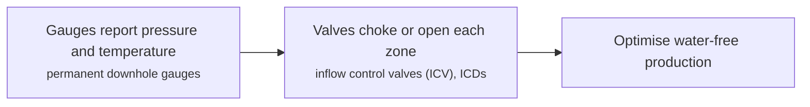

**Key equipment:** inflow control valves, inflow control devices, downhole gauges, control lines.

**Performance:**
- ICV positions: 10 positions per valve; two ICVs, one per lateral, Kuwait Minagish. [source](https://jpt.spe.org/inflow-control-device-inflow-control-valves-aid-kuwaits-first-smart-multilateral-well)
- CP+ICD water-shutoff trial result, Liuhua 4-1 Well A4H4, offshore China: 14-78 % water production index of baseline (14); % WOR reduction vs pre-trial (78); well had been shut in Dec 2015 after producing 99.5% BS&W; after the continuous pack-off ICD trial filling the 575-m lateral, water production index fell to about 14% of baseline and dimensionless water-oil ratio was down 78% vs pre-trial; oil production could increase 2.6 times at the same liquid rate (authors caution the before/after comparison). [source](https://www.ogj.com/drilling-production/production-operations/article/17232592/continuous-pack-off-inflow-control-device-lowers-water-cut-in-trial-offshore-china)
- water cut with optimised inflow control valves: 30 % water cut; Sector model of an Iranian field: water cut 80% in conventional wells against 30% with optimised ICVs; cumulative water 14.0 to 3.5 million bbl.. [source](https://ijogst.put.ac.ir/article_13827.html)

**Missing inputs:**
- capital cost and operating or unit cost, with dollar year and basis (costs): No open source read so far gives costs for this technology. Web-checked 2026-10-28; no open techno-economic study found. Where: arXiv and open-access journals: techno-economic or review papers (MDPI is blocked by its CDN; use the manual inbox) (catalog: arxiv, open); Licensor and EPC studies; paid cost databases are catalog-only (paid); OSTI.GOV full-text reports from DOE labs: search the technology name plus 'techno-economic' (catalog: osti, open). Next: Look for an open techno-economic study; record each figure with metric, range, unit, dollar year, basis and source.
- named plants or projects with capacity and year (reference_plants): The sources read name no specific plant. Web-checked 2026-10-28 (the Liuhua CP+ICD trial is recorded in performance; Kuwait smart-well SPE papers restricted). Where: Licensor and operator press releases for the suppliers listed (open). Next: Add one or two plants with country, capacity and start-up year.
- TRL with a cited source (trl): The IEA ETP Clean Energy Technology Guide has no matching entry. no open TRL source found (IEA ETP guide checked 2026-10-28; no SETIS/DOE entry). Where: IEA ETP Clean Energy Technology Guide (collected): search for the technology name (catalog: iea-reports, open). Next: Find a TRL table that lists this technology, or leave maturity resting on the evidence on the card.

Sources: [1](https://jpt.spe.org/inflow-control-device-inflow-control-valves-aid-kuwaits-first-smart-multilateral-well), [2](https://www.halliburton.com/en/completions/well-completions/intelligent-completions/flow-controls). Last reviewed 2026-11-17.

## Long subsea tiebacks with direct electrical heating
<a id="ups-direct-electrical-heating-tiebacks"></a>

Alternating current is passed through the pipeline wall to keep fluids above hydrate temperature or to re-heat them after a shutdown. Tyrihans is the longest DEH line described, 43 km, 18 inch, about 10 MW, with Huldra (16 km) before it.

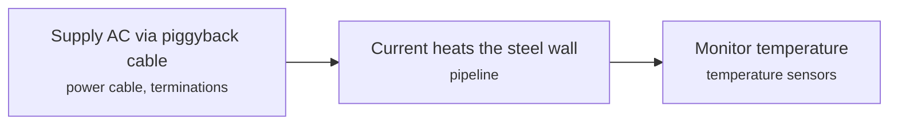

**Key equipment:** power cable, pipeline terminations and anodes, topside power unit.

**Performance:**
- Tyrihans DEH tieback length: 43 km (18 in); about 10 MW. [source](https://www.offshore-mag.com/pipelines/article/16760932/direct-heating-safeguards-flow-through-harsh-environment-pipelines)
- Ormen Lange DEH retrofit power: 6.4 MW (2.6 kA, 52 kV); 20 km section, 30 in. [source](https://www.offshore-mag.com/pipelines/article/16760932/direct-heating-safeguards-flow-through-harsh-environment-pipelines)
- longest electrically trace-heated (ETH) pipe-in-pipe production pipeline (Fenja tieback, for comparison with DEH): 37 km; 37-km ETH pipe-in-pipe pipeline for Neptune Energy's Fenja field installed and tested in 2020-21 campaigns, claimed by Neptune as the world's longest to date for that technology; tieback to Equinor's Njord A platform — a different active-heating technology from DEH. [source](https://www.offshore-mag.com/subsea/article/14208015/record-length-heated-subsea-production-pipeline-installed-at-fenja-oil-field-offshore-norway)
- longest DEH-heated subsea flowline: 43 km; Lianzi field: 43 km DEH flowline in 1,050 m of water, the longest and deepest DEH installation; Tyrihans holds the highest voltage at 52 kV.. [source](https://blog.sintef.com/energy/electrical-heating-flow-assurance-subsea-flowlines)

**Reference plants:**
- Tyrihans DEH tieback to the Kristin FPSO (Norwegian Sea), NO: 43 km, 18-in production pipeline with piggybacked DEH cable, about 10 MW, 52 kV cable — the longest DEH line described in the source; operating. [source](https://www.offshore-mag.com/pipelines/article/16760932/direct-heating-safeguards-flow-through-harsh-environment-pipelines)
- Huldra DEH pipeline (North Sea), NO: 16 km DEH piggybacked pipeline; activated about 60 times since commissioning in May 2002 — first commercial DEH use in the source; operating. [source](https://www.offshore-mag.com/pipelines/article/16760932/direct-heating-safeguards-flow-through-harsh-environment-pipelines)

**Missing inputs:**
- capital cost and operating or unit cost, with dollar year and basis (costs): No open source read so far gives costs for this technology. Web-checked 2026-10-28 (direct electrical heating subsea pipeline cost per km); only paywalled OnePetro papers and OEM (ABB, SLB OneSubsea) product pages found, no open cost figure. Where: arXiv and open-access journals: techno-economic or review papers (MDPI is blocked by its CDN; use the manual inbox) (catalog: arxiv, open); Licensor and EPC studies; paid cost databases are catalog-only (paid); OSTI.GOV full-text reports from DOE labs: search the technology name plus 'techno-economic' (catalog: osti, open). Next: Look for an open techno-economic study; record each figure with metric, range, unit, dollar year, basis and source.
- TRL with a cited source (trl): The IEA ETP Clean Energy Technology Guide has no matching entry. Web-checked 2026-10-28 (direct electrical heating subsea TRL; Brave search served a bot-block page; no open TRL table found). Where: IEA ETP Clean Energy Technology Guide (collected): search for the technology name (catalog: iea-reports, open). Next: Find a TRL table that lists this technology, or leave maturity resting on the evidence on the card.

Sources: [1](https://www.offshore-mag.com/pipelines/article/16760932/direct-heating-safeguards-flow-through-harsh-environment-pipelines), [2](https://www.offshore-mag.com/home/article/16764484/tyrihans-tied-to-kristin), [3](https://www.offshore-mag.com/subsea/article/14208015/record-length-heated-subsea-production-pipeline-installed-at-fenja-oil-field-offshore-norway), [4](https://blog.sintef.com/ocean/direct-electrical-heating-deh). Last reviewed 2026-11-17.

## Managed pressure drilling
<a id="ups-managed-pressure-drilling"></a>

IADC defines MPD as an adaptive drilling process that precisely controls the annular pressure profile; a rotating control device and automated choke let the driller hold bottomhole pressure within a narrow window. Variants include continuous circulation, constant bottomhole pressure, pressurised mud cap and dual-gradient drilling.

```mermaid
flowchart LR
    SEAL["Seal annulus with a rotating control device<br/><small>RCD</small>"]
    CTRL["Control back-pressure with automated choke<br/><small>PLC choke manifold, mass-flow meter</small>"]
    DRILL["Drill within the pore-fracture window<br/><small>rig</small>"]
    SEAL --> CTRL
    CTRL --> DRILL
```

**Key equipment:** rotating control device (API 16RCD), automated choke manifold, mass-flow meter, non-return valves.

**Performance:**
- marine RCD tensile rating when placed below the riser tension ring: 3e+06 lb; typical. [source](https://iadc.org/wp-content/uploads/2015/08/preview-mpub.pdf)

**Reference plants:**
- Petrobras managed-pressure drilling programme, offshore Brazil pre-salt, BR: 2 rigs equipped for MPD as of mid-2014, planned expansion to 12 by end-2015 and 16 by 2016; seven wells drilled with MPD at the time; operating. [source](https://jpt.spe.org/managed-pressure-drilling-migrates-deep-water-offshore-brazil)

**Missing inputs:**
- cost versus conventional drilling (costs): The preview gives none. Web-checked 2026-10-28; no open published MPD-vs-conventional cost comparison (SPE papers restricted). Where: IADC MPD publications (open). Next: Add a published cost or time saving.
- TRL with a cited source (trl): The IEA ETP Clean Energy Technology Guide has no matching entry. IEA ETP Guide (July 2026) has no matching entry (searched managed pressure, MPD, underbalanced, drilling); 2026-10-28 no open TRL source found (IEA ETP guide checked 2026-10-28; no SETIS/DOE entry). Where: IEA ETP Clean Energy Technology Guide (collected): search for the technology name (catalog: iea-reports, open). Next: Find a TRL table that lists this technology, or leave maturity resting on the evidence on the card.

Sources: [1](https://iadc.org/wp-content/uploads/2015/08/preview-mpub.pdf), [2](https://jpt.spe.org/managed-pressure-drilling-migrates-deep-water-offshore-brazil), [3](https://www.drillopedia.com/mpd-equipment). Last reviewed 2026-11-17.

## Measurement and logging while drilling (MWD/LWD)
<a id="ups-mwd-lwd"></a>

Sensors in the bottom-hole assembly measure well direction (MWD) and formation properties (LWD) while drilling and send data to the surface, usually by mud pulses, for real-time geosteering. LWD measurements include gamma ray, resistivity, density, neutron porosity, sonic, NMR, images and formation testing.

```mermaid
flowchart LR
    SENSE["Sensors measure direction and formation<br/><small>MWD and LWD collars</small>"]
    TX["Transmit by mud pulse or store in memory<br/><small>mud pulser</small>"]
    STEER["Geosteer to stay in the target zone<br/><small>geosteering software</small>"]
    SENSE --> TX
    TX --> STEER
```

**Key equipment:** MWD tool, LWD collars, mud pulser, surface decoding.

**Performance:**
- mud-pulse telemetry data rate: 3-20 bit/s; Up to 20 bit/s against below 3 bit/s conventionally, including 15 bit/s at 24,000 ft in the North Sea.. [source](https://www.academia.edu/9840372/IADC_SPE_112683_A_New_Mud_Pulse_Telemetry_System_for_Enhanced_MWD_LWD_Applications)

**Missing inputs:**
- capital cost and operating or unit cost, with dollar year and basis (costs): No open source read so far gives costs for this technology. Web-checked 2026-10-28; no open techno-economic study found. Where: arXiv and open-access journals: techno-economic or review papers (MDPI is blocked by its CDN; use the manual inbox) (catalog: arxiv, open); Licensor and EPC studies; paid cost databases are catalog-only (paid); OSTI.GOV full-text reports from DOE labs: search the technology name plus 'techno-economic' (catalog: osti, open). Next: Look for an open techno-economic study; record each figure with metric, range, unit, dollar year, basis and source.
- named plants or projects with capacity and year (reference_plants): The sources read name no specific plant. Web-checked 2026-10-28; no named deployment with figures on open pages. Where: Licensor and operator press releases for the suppliers listed (open). Next: Add one or two plants with country, capacity and start-up year.
- TRL with a cited source (trl): The IEA ETP Clean Energy Technology Guide has no matching entry. no open TRL source found (IEA ETP guide checked 2026-10-28; no SETIS/DOE entry). Where: IEA ETP Clean Energy Technology Guide (collected): search for the technology name (catalog: iea-reports, open). Next: Find a TRL table that lists this technology, or leave maturity resting on the evidence on the card.

Sources: [1](https://en.wikipedia.org/wiki/Logging_while_drilling), [2](https://en.wikipedia.org/wiki/Measurement_while_drilling). Last reviewed 2026-11-17.

## Methane leak detection and repair (LDAR, satellites and continuous monitoring)
<a id="ups-methane-leak-detection"></a>

Leaks are located by surveying facilities with optical gas imaging cameras, aircraft or drone sensors, fixed continuous sensors or satellites, and then quantified and repaired. Satellites flag large emission events and recurrent leaks, which are passed to operators for rapid repair. A repeat survey confirms the fix.

```mermaid
flowchart LR
    DET["Detection<br/><small>optical gas imaging cameras, aircraft and drones, continuous point sensors, satellites</small>"]
    QNT["Quantification and attribution<br/><small>emission quantification and facility mapping</small>"]
    REP["Repair or replacement<br/><small>maintenance crews, replacement of leaking equipment</small>"]
    VER["Verification and reporting<br/><small>repeat survey, measurement-based reporting</small>"]
    DET --> QNT
    QNT --> REP
    REP --> VER
    VER --> DET
```

**Key equipment:** optical gas imaging cameras, continuous methane sensors, aircraft and drone payloads, satellite data feeds, repair crews and replacement equipment.

**Performance:**
- fossil-fuel methane emissions that could be avoided at no net cost: 30 % of 2024 fossil-fuel methane emissions; about 35 Mt; at average 2024 energy prices; oil and gas share higher than coal. [source](https://iea.blob.core.windows.net/assets/b83c32dd-fc1b-4917-96e9-8cd918801cbf/GlobalMethaneTracker2025.pdf)
- methane emitted by the fossil fuel sector: 200 bcm in 2024; abatement could have made nearly 100 bcm of gas available. [source](https://iea.blob.core.windows.net/assets/b83c32dd-fc1b-4917-96e9-8cd918801cbf/GlobalMethaneTracker2025.pdf)
- satellites in orbit able to observe methane emissions: 25 satellites (more than); MethaneSAT and Tanager-1 started in 2024. [source](https://iea.blob.core.windows.net/assets/b83c32dd-fc1b-4917-96e9-8cd918801cbf/GlobalMethaneTracker2025.pdf)
- share of satellite-detected oil and gas sources that were recurrent: 25 % (about); Carbon Mapper analysis of more than 2,000 plumes. [source](https://iea.blob.core.windows.net/assets/b83c32dd-fc1b-4917-96e9-8cd918801cbf/GlobalMethaneTracker2025.pdf)

**Costs:**
- greenhouse gas emissions price at which almost all available methane abatement measures across the energy sector would be cost-effective: 20 USD/tCO2-eq (2025$); dollar year not stated; read from the marginal abatement cost curves for methane from the fossil fuel sector, 2024; 1 t methane treated as 30 t CO2-eq (GWP100, IPCC 2021); value of captured methane based on 2024 net-back natural gas import prices; per-survey and per-sensor costs are not stated in the collected documents. [source](https://iea.blob.core.windows.net/assets/b83c32dd-fc1b-4917-96e9-8cd918801cbf/GlobalMethaneTracker2025.pdf)
- payback period of many oil and gas methane abatement options: 1 years; dollar year not stated; document states many abatement options can pay for themselves within a year and around 30% of oil and gas industry emissions could be avoided with measures offering rates of return of more than 25%; value of methane captured based on net-back natural gas import prices in 2024. [source](https://iea.blob.core.windows.net/assets/b83c32dd-fc1b-4917-96e9-8cd918801cbf/GlobalMethaneTracker2025.pdf)
- share of LDAR emissions savings achievable at no net cost to operators (Eurasia oil and gas): 95 % of LDAR emissions savings in Eurasia; dollar year not stated; includes rapid-response systems for addressing large emissions events detected by satellite. [source](https://iea.blob.core.windows.net/assets/b83c32dd-fc1b-4917-96e9-8cd918801cbf/GlobalMethaneTracker2025.pdf)

TRL source: [IEA ETP Clean Energy Technology Guide, dataset of 24 July 2026, 2025 assessment (IEA 1-11 scale): 'Periodic methane emission monitoring in oil and gas facilities' 9; 'Satellite-based methane emission monitoring in oil and gas facilities' 9](https://www.iea.org/data-and-statistics/data-tools/etp-clean-energy-technology-guide)

**Missing inputs:**
- regional (Southeast Asia) service providers (suppliers): No source read names providers in Malaysia or Indonesia. Web-checked 2026-10-28; the named LDAR providers found (Encino, Applus, Gazomat) are US/EU/Middle-East; no SEA-local provider with an open page found; card already lists satellite operators (GHGSat, Kayrros) that cover the region. Where: PETRONAS and Pertamina methane programmes (catalog: petronas-tech, open). Next: Add regional operators or providers.

Sources: [1](https://iea.blob.core.windows.net/assets/b83c32dd-fc1b-4917-96e9-8cd918801cbf/GlobalMethaneTracker2025.pdf), [2](https://www.iea.org/data-and-statistics/data-tools/etp-clean-energy-technology-guide), [3](https://en.wikipedia.org/wiki/Methane_emissions). Last reviewed 2026-10-28.

## Minimum-facility wellhead platform structures and marine systems
<a id="ups-whp-platform-structures-and-marine-systems"></a>

Minimum-facility wellhead platform structures and marine systems: jackets, topsides, risers/J-tubes, helidecks, jack-up installation and unmanned operation. Sourced from pages read in the 2026-11-24 WHP component sweep.

```mermaid
flowchart LR
    JACKET_STRUCTURE["Jacket structure<br/><small>Jacket structure</small>"]
    TOPSIDE_DECKS["Topside decks<br/><small>Topside decks</small>"]
    RISERS_AND_J_TUBES["Risers and J-tubes for pipelines and subsea cables<br/><small>Risers and J-tubes for pipelines and subsea cables</small>"]
    HELIDECK["Helideck<br/><small>Helideck</small>"]
    MINIMUM_FACILITY_L["Minimum-facility WHP logistics: designed for jack-up-rig installation, little or<br/><small>Minimum-facility WHP logistics: designed for jack-up-rig installation, little or</small>"]
    MALAYSIAN_OPERATIN["Malaysian WHP operating context: normally unmanned, no separators/produced-water<br/><small>Malaysian WHP operating context: normally unmanned, no separators/produced-water</small>"]
    JACKET_STRUCTURE --> TOPSIDE_DECKS
    TOPSIDE_DECKS --> RISERS_AND_J_TUBES
    RISERS_AND_J_TUBES --> HELIDECK
    HELIDECK --> MINIMUM_FACILITY_L
    MINIMUM_FACILITY_L --> MALAYSIAN_OPERATIN
```

**Key equipment:** Jacket structure, Topside decks, Risers and J-tubes for pipelines and subsea cables, Helideck, Minimum-facility WHP logistics: designed for jack-up-rig installation, little or no onboard, Malaysian WHP operating context: normally unmanned, no separators/produced-water treatment/g.

**Performance:**
- Reliability — Survival load case recurrence period: no range recorded; ESDEP 15A.1 section 8.2: survival state under wave/current/wind attack with 50 or 100 years recurrence period.. [source](https://fgg-web.fgg.uni-lj.si/~/pmoze/esdep/master/wg15a/l0100.htm)
- Reliability — Operational load case recurrence period: no range recorded; ESDEP 15A.1 section 8.2: operational state under wave/current/wind attack with 1 or 5 years recurrence period, under full operation.. [source](https://fgg-web.fgg.uni-lj.si/~/pmoze/esdep/master/wg15a/l0100.htm)
- Reliability — Offshore inspection, maintenance and repair share of OPEX: 20 % of OPEX (North Sea); ESDEP 15A.1 section 9.3: "In the North Sea approximately 20 percent of OPEX are required for offshore inspection, maintenance and repair (IMR)".. [source](https://fgg-web.fgg.uni-lj.si/~/pmoze/esdep/master/wg15a/l0100.htm)
- Reliability — IMR expenditure over project life: no range recorded; ESDEP 15A.1 section 9.3: amount spent on IMR over project life "can add up to approximately half the original investment".. [source](https://fgg-web.fgg.uni-lj.si/~/pmoze/esdep/master/wg15a/l0100.htm)
- Reliability — Dynamic analysis trigger: 3 seconds (natural period); ESDEP 15A.1 section 8.1: dynamic analysis performed for system behaviour under wave attack if the natural period exceeds 3 seconds.. [source](https://fgg-web.fgg.uni-lj.si/~/pmoze/esdep/master/wg15a/l0100.htm)
- Reliability — Fatigue assessment inclusion: no range recorded; ESDEP 15A.1 section 8.2 lists fatigue assessment alongside survival, operational and accidental cases; DNV-RP-C203 objective is methods for fatigue assessment of offshore steel structures.. [source](https://fgg-web.fgg.uni-lj.si/~/pmoze/esdep/master/wg15a/l0100.htm)
- Operational history — operational history: no range recorded; As printed on the cited page.. [source](https://fgg-web.fgg.uni-lj.si/~/pmoze/esdep/master/wg15a/l0100.htm)
- Operational history — operational history: no range recorded; As printed on the cited page.. [source](https://fgg-web.fgg.uni-lj.si/~/pmoze/esdep/master/wg15a/l0100.htm)
- Operational history — operational history: no range recorded; As printed on the cited page.. [source](https://patents.google.com/patent/US4932811A/en)
- Operational history — operational history: no range recorded; As printed on the cited page.. [source](https://www.offshore-technology.com/projects/kebabangan-field)
- Reliability — GBS topside rigid-connection fatigue: no range recorded; ESDEP 15A.1 section 5.3.. [source](https://fgg-web.fgg.uni-lj.si/~/pmoze/esdep/master/wg15a/l0100.htm)
- Reliability — Local dynamic behaviour items: no range recorded; ESDEP 15A.1 section 8.1.. [source](https://fgg-web.fgg.uni-lj.si/~/pmoze/esdep/master/wg15a/l0100.htm)
- Reliability — Design life of Tarpon KMSE/AJK WHPs: 20 years (operational lifespan, design); Tarpon Systems project page: platforms designed for a 20-year operational lifespan and made relocatable.. [source](https://www.tarponsystems.com/installation-of-two-wellhead-platforms-for-kayu-manis-south-east-and-anjung-kecil)
- Operational history — operational history: no range recorded; As printed on the cited page.. [source](https://fgg-web.fgg.uni-lj.si/~/pmoze/esdep/master/wg15a/l0100.htm)
- Operational history — operational history: no range recorded; As printed on the cited page.. [source](https://2hoffshore.com/projects/se-asia-minimum-facilities-platform-design)
- Operational history — operational history: no range recorded; As printed on the cited page.. [source](https://www.offshore-technology.com/projects/anjung-kecil-oil-field)
- Reliability — Conductor contribution to total environmental loading on fixed platform: no range recorded; US5513929A background: "well conductors above the seabed contribute a major portion of the total environmental loading on the platform (typically twenty to 30 percent)".. [source](https://patents.google.com/patent/US5513929A/en)
- Reliability — Dynamic analysis trigger for slender members and conductors: 3 seconds (natural period); ESDEP 15A.1 section 8.1: dynamic analysis if natural period exceeds 3 seconds; slender jacket members and conductors listed as locally dynamic.. [source](https://fgg-web.fgg.uni-lj.si/~/pmoze/esdep/master/wg15a/l0100.htm)
- Reliability — Fatigue assessment: no range recorded; ESDEP 15A.1 section 8.2; DNV-RP-C203 provides methods for fatigue assessment of offshore steel structures.. [source](https://www.dnv.com/energy/standards-guidelines/dnv-rp-c203-fatigue-design-of-offshore-steel-structures)
- Operational history — operational history: no range recorded; As printed on the cited page.. [source](https://patents.google.com/patent/US5513929A/en)
- Operational history — operational history: no range recorded; As printed on the cited page.. [source](https://www.offshore-technology.com/projects/anjung-kecil-oil-field)
- Operational history — operational history: no range recorded; As printed on the cited page.. [source](https://2hoffshore.com/projects/se-asia-minimum-facilities-platform-design)
- Reliability — NUI refuge provision: no range recorded; Wikipedia Normally unmanned installation.. [source](https://en.wikipedia.org/wiki/Normally_unmanned_installation)
- Reliability — Helicopter access rationale: no range recorded; US4679964A description.. [source](https://patents.google.com/patent/US4679964A/en)
- Operational history — operational history: no range recorded; As printed on the cited page.. [source](https://en.wikipedia.org/wiki/Normally_unmanned_installation)
- Operational history — operational history: no range recorded; As printed on the cited page.. [source](https://en.wikipedia.org/wiki/Normally_unmanned_installation)
- Reliability — Lost time incidents on CoSMOS project: 0 LTI (lost time incidents); 2H project: approx. 225,000 man hours and zero lost time incidents, attributed to QHSE procedures.. [source](https://2hoffshore.com/projects/se-asia-minimum-facilities-platform-design)
- Reliability — Power supply redundancy: no range recorded; 2H SE Asia project.. [source](https://2hoffshore.com/projects/se-asia-minimum-facilities-platform-design)
- Reliability — Rig-interfaces robustness: no range recorded; 2H SE Asia project, Challenges section.. [source](https://2hoffshore.com/projects/se-asia-minimum-facilities-platform-design)
- Operational history — operational history: no range recorded; As printed on the cited page.. [source](https://2hoffshore.com/projects/se-asia-minimum-facilities-platform-design)
- Operational history — operational history: no range recorded; As printed on the cited page.. [source](https://www.tarponsystems.com/installation-of-two-wellhead-platforms-for-kayu-manis-south-east-and-anjung-kecil)
- Operational history — operational history: no range recorded; As printed on the cited page.. [source](https://patents.google.com/patent/US4932811A/en)
- Reliability — Emergency shelter for visiting crews: no range recorded; Wikipedia Normally unmanned installation.. [source](https://en.wikipedia.org/wiki/Normally_unmanned_installation)
- Reliability — NUI decommissioning-phase integrity checks: no range recorded; Wikipedia Normally unmanned installation.. [source](https://en.wikipedia.org/wiki/Normally_unmanned_installation)
- Reliability — Ageing conductor integrity topics: no range recorded; 2H webinar page dated 28 Oct 2020.. [source](https://2hoffshore.com/knowledge/addressing-integrity-issues-on-ageing-platform-conductors)
- Operational history — operational history: no range recorded; As printed on the cited page.. [source](https://www.offshore-technology.com/projects/anjung-kecil-oil-field)
- Operational history — operational history: no range recorded; As printed on the cited page.. [source](https://www.offshore-technology.com/projects/anjung-kecil-oil-field)
- Operational history — operational history: no range recorded; As printed on the cited page.. [source](https://www.offshore-technology.com/projects/kebabangan-field)
- Operational history — operational history: no range recorded; As printed on the cited page.. [source](https://2hoffshore.com/projects/se-asia-minimum-facilities-platform-design)

**Costs:**
- Price — Topsides fabrication contract, Kebabangan: 380 USD million (as printed); As printed: "A $380m (RM1.15bn) contract to fabricate the topsides of the platform was awarded to Sime Darby Engineering in April 2011". Dollar year not stated; article dated 5 May 2016. Not a unit-rate or full project cost. (dollar year not stated). [source](https://www.offshore-technology.com/projects/kebabangan-field)
- Price — Kebabangan FEED contract value (USD-equivalent as printed): 30 USD million (as printed); As printed: "The four-year contract is valued at Nkr170m (approximately $30m)". Dollar year not stated; article dated 5 May 2016. USD-equivalent only; Nkr figure not converted here. (dollar year not stated). [source](https://www.offshore-technology.com/projects/kebabangan-field)
- Price — Kebabangan topsides fabrication contract: 380 USD million (as printed); As printed: "A $380m (RM1.15bn) contract to fabricate the topsides of the platform was awarded to Sime Darby Engineering in April 2011". Dollar year not stated; article dated 5 May 2016. (dollar year not stated). [source](https://www.offshore-technology.com/projects/kebabangan-field)

**Missing inputs:**
- Barge bumper and pull-in tube sizing (performance): No page read in this sweep gave dimensions, energy ratings or detailing rules for barge bumpers or pull-in tubes. Where: OEM datasheets, operator project pages, API/ISO standards and SPE/OTC papers for Jacket structure (open). Next: Fetch a jacket appurtenance specification page or engineering-company detail sheet and read it with WebFetch.
- ISO 19902 full text (performance): The ISO 19902:2020 sample PDF was not read successfully and the ISO standard page was not resolved; no figures or clauses from ISO 19902 are asserted. Where: OEM datasheets, operator project pages, API/ISO standards and SPE/OTC papers for Jacket structure (open). Next: Locate and WebFetch a readable ISO 19902 landing page, or read the standard under licence.
- Cellar / main / mezzanine deck naming (performance): None of the pages read explicitly names a three-level cellar-main-mezzanine arrangement for a wellhead platform; only CN103758095A mentions a sub-cellar deck. Where: OEM datasheets, operator project pages, API/ISO standards and SPE/OTC papers for Topside decks (open). Next: Fetch a WHP topside GA description page and confirm the deck naming and functions.
- Deck steel weight for an unmanned WHP (performance): Weight bands read are for integrated/modular production topsides (MN scale), not minimum-facility WHP decks. Where: OEM datasheets, operator project pages, API/ISO standards and SPE/OTC papers for Topside decks (open). Next: Fetch a minimum-facility topside weight statement.
- J-tube sizing and bend restrictor data (performance): The CRP Subsea page was not fetched successfully in this sweep; no J-tube diameter, bend radius or MBR figures are asserted. Where: OEM datasheets, operator project pages, API/ISO standards and SPE/OTC papers for Risers and J-tubes for pipelines and subsea cables (open). Next: Fetch and WebFetch a manufacturer J-tube/bend-restrictor data page.
- Riser design standard (performance): API RP 2RD / API RP 17B were not read directly; the BSEE report PDF was refused in this sweep. Where: OEM datasheets, operator project pages, API/ISO standards and SPE/OTC papers for Risers and J-tubes for pipelines and subsea cables (open). Next: Fetch readable HTML pages naming the applicable riser standards and read them.
- Helideck D-value, load class and obstacle-free sectors (performance): UK CAA CAP 437 PDF was refused by WebFetch (application/pdf); no figures asserted from it. Where: OEM datasheets, operator project pages, API/ISO standards and SPE/OTC papers for Helideck (open). Next: Read an HTML CAP 437 / ICAO helideck page, or fetch the PDF by another method, then record sections and values.
- Visit frequency rule for crewed visits (performance): The read pages say "occasionally" or "regular visits" but give no numeric interval; the fortnightly-visit statement in the source chat was not verified. Where: OEM datasheets, operator project pages, API/ISO standards and SPE/OTC papers for Helideck (open). Next: Find an operator or regulator page stating the actual visit interval for Malaysian WHPs.
- MFP cost with dollar year (performance): 2H states the CoSMOS design was lowest cost but gives no USD figure; no dollar-year cost was read. Where: OEM datasheets, operator project pages, API/ISO standards and SPE/OTC papers for Minimum-facility WHP logistics: designed for jack-up-rig ins (open). Next: Fetch a project page printing a dated USD cost.
- Onboard processing inventory for the SE Asia MFP (performance): The 2H page names a multiphase flow meter and power sources but does not list separators, produced-water treatment or gas compression as absent. Where: OEM datasheets, operator project pages, API/ISO standards and SPE/OTC papers for Minimum-facility WHP logistics: designed for jack-up-rig ins (open). Next: Fetch a facilities scope page to confirm which processing equipment is omitted.
- No separators / produced-water treatment / gas compression onboard (performance): Not stated explicitly on any page read; inference from "minimum facility and unmanned" and from processing equipment being on the FPSO is NOT recorded as a fact. Where: OEM datasheets, operator project pages, API/ISO standards and SPE/OTC papers for Malaysian WHP operating context: normally unmanned, no separ (open). Next: Fetch a PETRONAS/Vestigo WHP facilities-scope page listing equipment excluded from the WHP.
- Fortnightly visits (performance): The fortnightly interval appears in the source chat only; read pages say "occasionally" or "regular visits" without a number. Where: OEM datasheets, operator project pages, API/ISO standards and SPE/OTC papers for Malaysian WHP operating context: normally unmanned, no separ (open). Next: Verify with an operator or regulator page before recording.

Sources: [1](https://fgg-web.fgg.uni-lj.si/~/pmoze/esdep/master/wg15a/l0100.htm), [2](https://en.wikipedia.org/wiki/Fixed_platform), [3](https://fgg-web.fgg.uni-lj.si/~/pmoze/esdep/master/wg15a/l0100.htm), [4](https://www.dnv.com/energy/standards-guidelines/dnv-rp-c203-fatigue-design-of-offshore-steel-structures), [5](https://patents.google.com/patent/CN103758095A/en), [6](https://patents.google.com/patent/US5513929A/en), [7](https://patents.google.com/patent/US4932811A/en), [8](https://patents.google.com/patent/CN103758095A/en), [9](https://fgg-web.fgg.uni-lj.si/~/pmoze/esdep/master/wg15a/l0100.htm), [10](https://fgg-web.fgg.uni-lj.si/~/pmoze/esdep/master/wg15a/l0100.htm), [11](https://fgg-web.fgg.uni-lj.si/~/pmoze/esdep/master/wg15a/l0100.htm), [12](https://patents.google.com/patent/CN103758095A/en), [13](https://patents.google.com/patent/US5513929A/en), [14](https://patents.google.com/patent/US5513929A/en), [15](https://patents.google.com/patent/US5513929A/en), [16](https://patents.google.com/patent/US4679964A/en), [17](https://en.wikipedia.org/wiki/Offshore_platform), [18](https://en.wikipedia.org/wiki/Normally_unmanned_installation), [19](https://patents.google.com/patent/US4679964A/en), [20](https://patents.google.com/patent/US4932811A/en), [21](https://2hoffshore.com/projects/se-asia-minimum-facilities-platform-design), [22](https://2hoffshore.com/sectors/oil-and-gas/platforms/minimum-facility-platforms), [23](https://patents.google.com/patent/US4679964A/en), [24](https://patents.google.com/patent/US4932811A/en). Last reviewed 2026-11-24.

## Multiphase flow metering
<a id="ups-multiphase-flow-metering"></a>

Meters measure oil, water and gas rates without separation. Emerson's Roxar 2600 combines a Venturi differential-pressure measurement with electrical impedance and optional gamma densitometry, reports at 10 Hz and covers 0 to 100% water-liquid ratio and 0 to 100% gas volume fraction.

```mermaid
flowchart LR
    DP["Venturi measures total mass flow<br/><small>Venturi</small>"]
    IMP["Impedance and gamma give phase fractions<br/><small>electrodes, gamma densitometer</small>"]
    CALC["Software computes phase rates<br/><small>flow computer</small>"]
    DP --> IMP
    IMP --> CALC
```

**Key equipment:** Venturi, impedance sensors, gamma densitometer, flow computer.

**Performance:**
- Roxar 2600 measurement frequency: 10 Hz; phase rates in real time. [source](https://www.emerson.com/en-us/automation/measurement-instrumentation/flow-measurement/multiphase-meters)
- water-liquid ratio range: 0-100 %; WLR. [source](https://www.emerson.com/en-us/automation/measurement-instrumentation/flow-measurement/multiphase-meters)
- gas volume fraction range: 0-100 %; GVF. [source](https://www.emerson.com/en-us/automation/measurement-instrumentation/flow-measurement/multiphase-meters)
- multiphase flow meter measurement uncertainty: 5-10 % of reading; Allocation agreements required 5% on oil and gas and 10% on water; the meter was verified to 5% on oil and gas over six months at 80-85% GVF.. [source](https://www.osti.gov/etdeweb/servlets/purl/20892519)

**Reference plants:**
- Kashagan MPFM deployment (NCOC/Schlumberger), Kashagan field, Kazakhstan, KZ: multiphase flow meters on unmanned production islands: one MPFM per group of wells on some islands, one per well on others; used for allocation, well testing and virtual-meter calibration; operating. [source](https://www.academia.edu/66524444/Multiphase_flow_metering_Current_trends_and_future_developments)

**Missing inputs:**
- capital cost and operating or unit cost, with dollar year and basis (costs): No open source read so far gives costs for this technology. Web-checked 2026-10-28; meter prices are vendor-quoted only. Where: arXiv and open-access journals: techno-economic or review papers (MDPI is blocked by its CDN; use the manual inbox) (catalog: arxiv, open); Licensor and EPC studies; paid cost databases are catalog-only (paid); OSTI.GOV full-text reports from DOE labs: search the technology name plus 'techno-economic' (catalog: osti, open). Next: Look for an open techno-economic study; record each figure with metric, range, unit, dollar year, basis and source.
- TRL with a cited source (trl): The IEA ETP Clean Energy Technology Guide has no matching entry. no open TRL source found (IEA ETP guide checked 2026-10-28; no SETIS/DOE entry). Where: IEA ETP Clean Energy Technology Guide (collected): search for the technology name (catalog: iea-reports, open). Next: Find a TRL table that lists this technology, or leave maturity resting on the evidence on the card.

Sources: [1](https://www.emerson.com/en-us/automation/measurement-instrumentation/flow-measurement/multiphase-meters), [2](https://www.emerson.com/en-us/automation/measurement-instrumentation/flow-measurement/multiphase-meters). Last reviewed 2026-11-17.

## Offshore platform electrification (power from shore, offshore wind)
<a id="ups-platform-electrification"></a>

Platforms take electricity from shore or from offshore wind instead of burning gas on site. Johan Sverdrup runs on hydro power from shore at about 0.67 kg CO2 per barrel against a world average of 15 kg, and Hywind Tampen's 94.6 MW meets about 35% of five platforms' demand.

```mermaid
flowchart LR
    SRC["Supply power from shore cable or floating wind<br/><small>HVAC or HVDC cable, floating wind turbines</small>"]
    PLAT["Distribute to platform loads<br/><small>switchgear, transformers</small>"]
    SRC --> PLAT
```

**Key equipment:** power cable, converter or transformer, platform switchgear, floating wind turbines (Hywind).

**Performance:**
- Johan Sverdrup CO2 intensity: 0.67 kg CO2/bbl; versus 15 kg world average. [source](https://www.equinor.com/energy/johan-sverdrup)
- Johan Sverdrup plateau capacity: 755000 bbl/d; Phase 1 Oct 2019, Phase 2 Dec 2022. [source](https://www.equinor.com/energy/johan-sverdrup)
- Hywind Tampen capacity: 94.6 MW; 11 turbines of 8.6 MW. [source](https://www.equinor.com/energy/hywind-tampen)

**Costs:**
- Contracted day rates, next-generation wind turbine installation vessels (WTIVs) and heavy-lift jack-ups: 200000-350000 USD/day; Contracted dayrates for major project campaigns for Cadeler Wind Peaks/Wind Apex, Heerema Aegir, Charybdis, Van Oord Boreas, DEME Orion/Gulliver; attributed to genuine scarcity of suitable installation capacity.  Dollar year not stated.. [source](https://offshoreindustry.co.uk/offshore-heavy-lift-2026-crane-vessel-scarcity-sscv-market-dynamics-and-the-wind-sector-collision/)
- Jack-up rig one-well option contract value, ~30 days: 4e+06 USD; TotalEnergies exercised a one-well option for HDHE jack-up Valaris Stavanger in UK North Sea, ~30 additional days.  Dollar year not stated.. [source](https://www.rivieramm.com/news-content-hub/north-seas-jack-up-pool-shrinks-as-rigs-move-to-more-lucrative-waters-80654)
- Jack-up rig contract value, 330-day campaign (including minor rig modifications): 4.8e+07 USD; TotalEnergies / VALARIS Stavanger 330-day campaign from March 2024; approximate total contract value as reported.  Dollar year not stated.. [source](https://www.rivieramm.com/news-content-hub/rigs-report-north-sea-jack-up-utility-hits-94-79737)
- Valaris heavy-duty harsh-environment (HDHE) jack-up average day rate, 2024: 125000 USD/day (2024$); Average day rates as of 29 July 2024, excluding non-recurring mobilisation/contract-preparation revenue; rigs used in the North Sea.. [source](https://s23.q4cdn.com/956522167/files/doc_downloads/2024/07292024-Fleet-Status-Report_FINAL.pdf)

**Reference plants:**
- Johan Sverdrup power-from-shore (Equinor), North Sea, NO: field producing since Oct 2019 entirely on hydropower from shore; CO2 emissions 0.67 kg/bbl vs about 9 kg/bbl NCS average; launch estimate 460,000 t CO2/yr avoided, Equinor now states more than 620,000 t/yr; operating. [source](https://www.equinor.com/energy/electrification)

**Missing inputs:**
- electrification capex per platform with year (costs): Neither page gives costs. Web-checked 2026-10-28; Equinor pages state emission figures, not per-platform capex. Where: Norwegian Offshore Directorate reports (catalog: norway-sodir, open). Next: Add a cost with year.
- TRL with a cited source (trl): The IEA ETP Clean Energy Technology Guide has no matching entry. IEA ETP Guide (July 2026) has no matching entry (searched platform electrification, electrification of offshore, electrification, offshore platform); 2026-10-28 no open TRL source found (IEA ETP guide checked 2026-10-28; no SETIS/DOE entry). Where: IEA ETP Clean Energy Technology Guide (collected): search for the technology name (catalog: iea-reports, open). Next: Find a TRL table that lists this technology, or leave maturity resting on the evidence on the card.

Sources: [1](https://www.equinor.com/energy/johan-sverdrup), [2](https://www.equinor.com/energy/hywind-tampen), [3](https://www.equinor.com/energy/electrification), [4](https://www.equinor.com/news/archive/2018-10-09-johan-sverdrup-powered-shore), [5](https://www.equinor.com/news/archive/2018-10-09-johan-sverdrup-powered-shore). Last reviewed 2026-11-24.

## Oil sands mining and froth treatment
<a id="ups-oil-sands-mining"></a>

Oil sand is mined in open pits, crushed and mixed with 50 to 80 °C water so bitumen floats as froth (about 60% bitumen, 30% water, 10% solids), then diluent and settlers clean it. About two tons of sand yield a barrel, and tailings are the main environmental problem.

```mermaid
flowchart LR
    MINE["Open-pit mining<br/><small>shovels, trucks</small>"]
    EXT["Hot-water extraction and flotation<br/><small>slurry pipeline, separation vessel</small>"]
    FROTH["Froth treatment<br/><small>inclined plate settlers, centrifuges</small>"]
    MINE --> EXT
    EXT --> FROTH
```

**Key equipment:** shovels and trucks, crushers, separation vessels, froth treatment plant, tailings ponds.

**Performance:**
- bitumen recovery: 90-100 %; modern hot-water extraction. [source](https://en.wikipedia.org/wiki/Athabasca_oil_sands)
- natural gas use, mining with upgrading: 1.54 GJ per barrel; CERI figure via Wikipedia, year not stated. [source](https://en.wikipedia.org/wiki/Athabasca_oil_sands)
- mined share of oil sands production, 2010: 53 %; in situ 47%. [source](https://en.wikipedia.org/wiki/Athabasca_oil_sands)
- fluid tailings inventory reduction, Suncor Base Mine: 17 %; Inventory fell from 316 million m3 in 2015 to 263 million m3 in 2019, about 17%.. [source](https://www.abenergycentre.ca/oil/notable-acceleration-in-oil-sands-tailings-tech-development-paying-off-with-results)

**Reference plants:**
- Muskeg River Mine (Albian Sands Energy, Shell-led), Athabasca, Alberta, CA: full production 155,000 b/d of bitumen (first oil delayed by a Jan 2003 fire, ramp-up during 2003); operating. [source](https://www.ogj.com/drilling-production/article/17255656/fire-at-muskeg-river-mine-delays-first-athabasca-bitumen-production)

**Missing inputs:**
- capital cost and operating or unit cost, with dollar year and basis (costs): No open source read so far gives costs for this technology. Web-checked 2026-10-28; no open techno-economic study found. Where: arXiv and open-access journals: techno-economic or review papers (MDPI is blocked by its CDN; use the manual inbox) (catalog: arxiv, open); Licensor and EPC studies; paid cost databases are catalog-only (paid); OSTI.GOV full-text reports from DOE labs: search the technology name plus 'techno-economic' (catalog: osti, open). Next: Look for an open techno-economic study; record each figure with metric, range, unit, dollar year, basis and source.
- TRL with a cited source (trl): The IEA ETP Clean Energy Technology Guide has no matching entry. no open TRL source found (IEA ETP guide checked 2026-10-28; no SETIS/DOE entry). Where: IEA ETP Clean Energy Technology Guide (collected): search for the technology name (catalog: iea-reports, open). Next: Find a TRL table that lists this technology, or leave maturity resting on the evidence on the card.

Sources: [1](https://en.wikipedia.org/wiki/Athabasca_oil_sands), [2](https://en.wikipedia.org/wiki/Oil_sands). Last reviewed 2026-11-17.

## Plunger lift and hydraulic jet pumps
<a id="ups-plunger-hydraulic-lift"></a>

Plunger lift uses the well's own gas pressure to push a plunger and liquid slug up the tubing; hydraulic pumps (piston, jet) are driven by power fluid from the surface. Jet pumps tolerate solids above 50% by volume and hydraulic pumps cover about 1,000 to 18,000 ft.

```mermaid
flowchart LR
    BUILD["Gas pressure builds under the plunger<br/><small>plunger, lubricator</small>"]
    RISE["Plunger lifts the liquid slug"]
    FLOW["Well flows; plunger falls and cycle repeats<br/><small>controller</small>"]
    BUILD --> RISE
    RISE --> FLOW
```

**Key equipment:** plunger, lubricator, controller, hydraulic jet pump and power-fluid system.

**Performance:**
- hydraulic pump depth range: 1000-18000 ft; piston, jet, turbine. [source](https://en.wikipedia.org/wiki/Artificial_lift)
- jet pump solids tolerance: 50 % volume (above); hydraulic pumps, Wikipedia comparison table. [source](https://en.wikipedia.org/wiki/Artificial_lift)
- plunger lift and hydraulic pump application envelopes (rate and depth): 25-4000 blpd (hydraulic pump 25-4,000; plunger lift 1-100 vertical / 1-400 horizontal bbl per MMscfd gas, <5,000 ft TVD); IPIECA Energy Efficiency Compendium artificial-lift table: plunger lift <5,000 ft TVD with liquid rate 1-100 (vertical) / 1-400 (horizontal) bbl per MMscfd of gas, no external power required except valve actuation; linear hydraulic pump 25-4,000 blpd, <15,000 ft TVD (jet/venturi pumps discussed under hydraulic pumping). [source](https://www.ipieca.org/resources/energy-efficiency-compendium/artificial-lift-2023)

**Missing inputs:**
- capital cost and operating or unit cost, with dollar year and basis (costs): No open source read so far gives costs for this technology. Web-checked 2026-10-28; no open techno-economic study found. Where: arXiv and open-access journals: techno-economic or review papers (MDPI is blocked by its CDN; use the manual inbox) (catalog: arxiv, open); Licensor and EPC studies; paid cost databases are catalog-only (paid); OSTI.GOV full-text reports from DOE labs: search the technology name plus 'techno-economic' (catalog: osti, open). Next: Look for an open techno-economic study; record each figure with metric, range, unit, dollar year, basis and source.
- named plants or projects with capacity and year (reference_plants): The sources read name no specific plant. Web-checked 2026-10-28; no named deployment with figures on open pages. Where: Licensor and operator press releases for the suppliers listed (open). Next: Add one or two plants with country, capacity and start-up year.
- TRL with a cited source (trl): The IEA ETP Clean Energy Technology Guide has no matching entry. no open TRL source found (IEA ETP guide checked 2026-10-28; no SETIS/DOE entry). Where: IEA ETP Clean Energy Technology Guide (collected): search for the technology name (catalog: iea-reports, open). Next: Find a TRL table that lists this technology, or leave maturity resting on the evidence on the card.

Sources: [1](https://en.wikipedia.org/wiki/Artificial_lift), [2](https://en.wikipedia.org/wiki/Plunger_lift). Last reviewed 2026-10-28.

## Produced water treatment (hydrocyclones, flotation, membranes)
<a id="ups-produced-water-treatment"></a>

Water produced with oil is treated by gravity separators, hydrocyclones, plate coalescers, dissolved gas flotation and nutshell filters before discharge or reinjection. Radioactive radium in some brines (above 3,500 pCi/L in one sample) adds disposal constraints; membranes are not covered by the page read.

```mermaid
flowchart LR
    GRAV["Gravity separation and coalescing<br/><small>separator, plate coalescer</small>"]
    HYC["Hydrocyclones and flotation<br/><small>hydrocyclones, flotation unit</small>"]
    POL["Polishing filters, then discharge or reinjection<br/><small>nutshell filters</small>"]
    GRAV --> HYC
    HYC --> POL
```

**Key equipment:** hydrocyclones, flotation unit, filters, reinjection pumps.

**Performance:**
- radium in an Ohio brine sample: 3500 pCi/L (above); NRC discharge limit below 60 pCi/L for Ra-226 and Ra-228. [source](https://en.wikipedia.org/wiki/Produced_water)
- OSPAR dispersed-oil-in-produced-water discharge performance standard (NE Atlantic offshore): 30 mg oil per litre discharged (average annual performance standard); OSPAR offshore discharges report tables list "installations for which the average annual oil content of the produced water discharged to the sea exceeds the 30 mg/l performance standard"; treatment to below the standard is by hydrocyclones/flotation, for which the sources read state no single efficiency figure. [source](https://oap.ospar.org/media/filer_public/54/79/54796902-37e5-4166-816c-5177bf65b584/p00634e_offshore_discharges_report_2012.pdf)
- oil-in-water after treatment: 10-30 mg/L; typical discharge compliance range. [source](https://www.frames-group.com/)

**Reference plants:**
- Pengerang Integrated Complex effluent systems: ; . [source](https://www.petronas.com/)

**Missing inputs:**
- capital cost and operating or unit cost, with dollar year and basis (costs): No open source read so far gives costs for this technology. Web-checked 2026-10-28; no open techno-economic study found. Where: arXiv and open-access journals: techno-economic or review papers (MDPI is blocked by its CDN; use the manual inbox) (catalog: arxiv, open); Licensor and EPC studies; paid cost databases are catalog-only (paid); OSTI.GOV full-text reports from DOE labs: search the technology name plus 'techno-economic' (catalog: osti, open). Next: Look for an open techno-economic study; record each figure with metric, range, unit, dollar year, basis and source.
- named plants or projects with capacity and year (reference_plants): The sources read name no specific plant. Web-checked 2026-10-28; OSPAR reports aggregate installations, no named treatment plant. Where: Licensor and operator press releases for the suppliers listed (open). Next: Add one or two plants with country, capacity and start-up year.
- TRL with a cited source (trl): The IEA ETP Clean Energy Technology Guide has no matching entry. no open TRL source found (IEA ETP guide checked 2026-10-28; no SETIS/DOE entry). Where: IEA ETP Clean Energy Technology Guide (collected): search for the technology name (catalog: iea-reports, open). Next: Find a TRL table that lists this technology, or leave maturity resting on the evidence on the card.
- capital cost per m3/d for a CPI/IGF plus hydrocyclone de-oiling train, with dollar year (costs): The 2015 Antero figure is recorded but its scope is evaporation/crystallisation ZLD, not de-oiling. No loaded source prices the simpler train as a unit cost; searched 2026-11-16. Where: [Global Water Intelligence cost benchmarks](https://www.globalwaterintel.com/). Next: Leave open until a source states this exact metric and scope.
- TRL with a cited source (trl): The IEA guide covers anaerobic digestion but not municipal wastewater process units; no agency TRL exists for most of them. Checked 2026-11-16. Where: IEA ETP Clean Energy Technology Guide (already searched, 634 rows) (open); Sector regulator or industry body publishing a TRL for this class (open). Next: Add the TRL only when an agency publishes one for this technology; do not infer it from 'commercial' maturity.

Sources: [1](https://en.wikipedia.org/wiki/Produced_water), [2](https://www.veoliawatertech.com/). Last reviewed 2026-11-18.

## Production optimisation and digital oilfield
<a id="ups-production-optimisation-digital-oilfield"></a>

Real-time data from wells and facilities feed models that recommend or set choke, lift and process settings, often from a remote operations centre. ADNOC and SLB report an AI-enabled real-time operations centre covering more than 120 rigs, with human effort down 30 to 40%; these are company claims relayed by a vendor article.

```mermaid
flowchart LR
    DATA["Collect sensor and SCADA data<br/><small>sensors, SCADA</small>"]
    MODEL["Models diagnose and recommend<br/><small>analytics platform</small>"]
    ACT["Operators or controls apply changes<br/><small>remote operations centre</small>"]
    DATA --> MODEL
    MODEL --> ACT
```

**Key equipment:** sensors, data platform, analytics software, remote operations centre.

**Performance:**
- human effort reduction at ADNOC rig operations centre: 30-40 %; ADNOC statement relayed by AVEVA. [source](https://www.aveva.com/en/our-industrial-life/type/article/when-the-rig-starts-thinking-the-rise-of-autonomous-drilling/)
- production increase from digital oilfield implementation: 2-8 %; IHS CERA: 2-8% production increase and 5-25% operating expense reduction.. [source](https://www.imeche.org/news/news-article/digital-oilfield-2.0-uses-smart-technology-to-boost-production-efficiency)

**Missing inputs:**
- capital cost and operating or unit cost, with dollar year and basis (costs): No open source read so far gives costs for this technology. Web-checked 2026-10-28; no open techno-economic study found. Where: arXiv and open-access journals: techno-economic or review papers (MDPI is blocked by its CDN; use the manual inbox) (catalog: arxiv, open); Licensor and EPC studies; paid cost databases are catalog-only (paid); OSTI.GOV full-text reports from DOE labs: search the technology name plus 'techno-economic' (catalog: osti, open). Next: Look for an open techno-economic study; record each figure with metric, range, unit, dollar year, basis and source.
- named plants or projects with capacity and year (reference_plants): The sources read name no specific plant. Web-checked 2026-10-28; no named deployment with figures on open pages. Where: Licensor and operator press releases for the suppliers listed (open). Next: Add one or two plants with country, capacity and start-up year.
- TRL with a cited source (trl): The IEA ETP Clean Energy Technology Guide has no matching entry. IEA ETP Guide (July 2026) has no matching entry (searched digital twin, digital oilfield, production optimisation, digitalisation); 2026-10-28 Where: IEA ETP Clean Energy Technology Guide (collected): search for the technology name (catalog: iea-reports, open). Next: Find a TRL table that lists this technology, or leave maturity resting on the evidence on the card.

Sources: [1](https://www.aveva.com/en/our-industrial-life/type/article/when-the-rig-starts-thinking-the-rise-of-autonomous-drilling/), [2](https://www.aveva.com/en/our-industrial-life/type/article/when-the-rig-starts-thinking-the-rise-of-autonomous-drilling/). Last reviewed 2026-11-17.

## Reservoir simulation (black oil, compositional, thermal)
<a id="ups-reservoir-simulation"></a>

Numerical models solve mass conservation, phase behaviour and Darcy flow on a grid to forecast production and test recovery schemes. Black-oil models track oil, water and gas; compositional models track components with an equation of state; thermal models add energy balance for heavy oil.

```mermaid
flowchart LR
    MODEL["Build static grid and rock-fluid properties<br/><small>geological model, PVT data</small>"]
    HM["History match to production and pressure<br/><small>simulator</small>"]
    FORE["Forecast scenarios<br/><small>simulator</small>"]
    MODEL --> HM
    HM --> FORE
```

**Key equipment:** reservoir simulator, HPC cluster, PVT and SCAL data, history-matching tools.

**Performance:**
- runtime for a 2-billion-cell simulation: 8 hours; GigaPOWERS V9 ran a 2-billion-cell CO2 storage model simulating 1,000 years in 8 hours.. [source](https://www.aramcolife.com/en/publications/the-arabian-sun/articles/2023/week-33-articles/gigapowers-v9-celebrated)

**Missing inputs:**
- capital cost and operating or unit cost, with dollar year and basis (costs): No open source read so far gives costs for this technology. Web-checked 2026-10-28; simulator licence prices are vendor-quoted only. Where: arXiv and open-access journals: techno-economic or review papers (MDPI is blocked by its CDN; use the manual inbox) (catalog: arxiv, open); Licensor and EPC studies; paid cost databases are catalog-only (paid); OSTI.GOV full-text reports from DOE labs: search the technology name plus 'techno-economic' (catalog: osti, open). Next: Look for an open techno-economic study; record each figure with metric, range, unit, dollar year, basis and source.
- named plants or projects with capacity and year (reference_plants): The sources read name no specific plant. Web-checked 2026-10-28; simulator case studies name fields but no model-size/run-time figures on open pages. Where: Licensor and operator press releases for the suppliers listed (open). Next: Add one or two plants with country, capacity and start-up year.
- TRL with a cited source (trl): The IEA ETP Clean Energy Technology Guide has no matching entry. no open TRL source found (IEA ETP guide checked 2026-10-28; no SETIS/DOE entry). Where: IEA ETP Clean Energy Technology Guide (collected): search for the technology name (catalog: iea-reports, open). Next: Find a TRL table that lists this technology, or leave maturity resting on the evidence on the card.

Sources: [1](https://en.wikipedia.org/wiki/Reservoir_simulation), [2](https://en.wikipedia.org/wiki/Reservoir_simulation). Last reviewed 2026-11-17.

## Rod lift and progressing cavity pumps
<a id="ups-rod-lift-pcp"></a>

A surface pumping unit moves a sucker-rod string that drives a downhole plunger pump (rod lift), or a rotating rod string drives a progressing cavity pump (PCP). PCPs reach about 1,800 m and 5,000 bbl/d, and aromatics can degrade the elastomer stator.

```mermaid
flowchart LR
    DRV["Surface unit or rotary drive<br/><small>pumping unit or PCP drive head</small>"]
    ROD["Rod string transmits motion<br/><small>sucker rods</small>"]
    PUMP["Downhole pump lifts fluid<br/><small>plunger pump or PCP</small>"]
    DRV --> ROD
    ROD --> PUMP
```

**Key equipment:** pumping unit, sucker rods, downhole pump, PCP stator and rotor.

**Performance:**
- PCP depth capability: 1800 m (6,000 ft); up to 5,000 bbl/day. [source](https://en.wikipedia.org/wiki/Artificial_lift)
- rod pump realistic output vs theoretical: 80 %; of theoretical output. [source](https://en.wikipedia.org/wiki/Artificial_lift)
- rod lift and PCP application envelopes (rate and depth): 100-10000 ft TVD (sucker rod pump 100-10,000; liquid rate up to 5,000 blpd); IPIECA Energy Efficiency Compendium artificial-lift table: sucker rod pump 5,000 blpd, 100-10,000 ft TVD; rod-driven elastomeric PCP 5-5,000 blpd, 100-9,000 ft; rod-driven metal-to-metal PCP 350-2,500 blpd, 100-3,500 ft; electric submersible PCP 5-5,000 blpd, 100-8,000 ft. [source](https://www.ipieca.org/resources/energy-efficiency-compendium/artificial-lift-2023)

**Missing inputs:**
- capital cost and operating or unit cost, with dollar year and basis (costs): No open source read so far gives costs for this technology. Web-checked 2026-10-28; no open techno-economic study found. Where: arXiv and open-access journals: techno-economic or review papers (MDPI is blocked by its CDN; use the manual inbox) (catalog: arxiv, open); Licensor and EPC studies; paid cost databases are catalog-only (paid); OSTI.GOV full-text reports from DOE labs: search the technology name plus 'techno-economic' (catalog: osti, open). Next: Look for an open techno-economic study; record each figure with metric, range, unit, dollar year, basis and source.
- named plants or projects with capacity and year (reference_plants): The sources read name no specific plant. Web-checked 2026-10-28; no named deployment with figures on open pages. Where: Licensor and operator press releases for the suppliers listed (open). Next: Add one or two plants with country, capacity and start-up year.
- TRL with a cited source (trl): The IEA ETP Clean Energy Technology Guide has no matching entry. no open TRL source found (IEA ETP guide checked 2026-10-28; no SETIS/DOE entry). Where: IEA ETP Clean Energy Technology Guide (collected): search for the technology name (catalog: iea-reports, open). Next: Find a TRL table that lists this technology, or leave maturity resting on the evidence on the card.

Sources: [1](https://en.wikipedia.org/wiki/Artificial_lift), [2](https://en.wikipedia.org/wiki/Artificial_lift). Last reviewed 2026-11-17.

## Rotary steerable systems
<a id="ups-rotary-steerable-systems"></a>

Downhole tools steer the bit while the whole string rotates, either by pushing pads against the wellbore (push-the-bit) or by bending the shaft inside the tool (point-the-bit). Continuous rotation improves cuttings transport and weight transfer and produces a smoother borehole than sliding with a mud motor.

```mermaid
flowchart LR
    DRILL["Rotate string from surface<br/><small>top drive</small>"]
    STEER["Tool adjusts bit direction downhole<br/><small>push or point-the-bit RSS</small>"]
    SURV["Survey and send commands by mud pulse<br/><small>MWD</small>"]
    DRILL --> STEER
    STEER --> SURV
```

**Key equipment:** rotary steerable tool, MWD tools, top drive, mud pumps.

**Performance:**
- rotary-steerable build (dogleg) capability, PowerDrive suite: 8 deg/100 ft dogleg severity (maximum); "[Schlumberger] PowerDrive suite of fully rotating rotary steerable systems ... can develop dogleg severity as high as 8 deg/100 ft, significantly higher than" bent-motor practice; ROP gain and service day rates not stated in open sources. [source](https://drillingcontractor.org/dcpi/2004/dc-septoct04/Sep4-Schlumberger.pdf)
- rate-of-penetration improvement with a high-build RSS: 50-170 % ROP; Woodford 80% faster with 10 days saved, Eagle Ford 85%, Marcellus 170%, Thailand 50%; build rates 8-12 deg/100 ft against 6-8 typical.. [source](https://jpt.spe.org/hybrid-rotary-steerable-system-delivers-higher-build-rates-and-smoother-holes)

**Missing inputs:**
- capital cost and operating or unit cost, with dollar year and basis (costs): No open source read so far gives costs for this technology. Web-checked 2026-10-28; service day rates are vendor-quoted only. Where: arXiv and open-access journals: techno-economic or review papers (MDPI is blocked by its CDN; use the manual inbox) (catalog: arxiv, open); Licensor and EPC studies; paid cost databases are catalog-only (paid); OSTI.GOV full-text reports from DOE labs: search the technology name plus 'techno-economic' (catalog: osti, open). Next: Look for an open techno-economic study; record each figure with metric, range, unit, dollar year, basis and source.
- named plants or projects with capacity and year (reference_plants): The sources read name no specific plant. Web-checked 2026-10-28; no named RSS campaign with figures on open pages. Where: Licensor and operator press releases for the suppliers listed (open). Next: Add one or two plants with country, capacity and start-up year.
- TRL with a cited source (trl): The IEA ETP Clean Energy Technology Guide has no matching entry. no open TRL source found (IEA ETP guide checked 2026-10-28; no SETIS/DOE entry). Where: IEA ETP Clean Energy Technology Guide (collected): search for the technology name (catalog: iea-reports, open). Next: Find a TRL table that lists this technology, or leave maturity resting on the evidence on the card.

Sources: [1](https://drillingcontractor.org/dcpi/2004/dc-septoct04/Sep4-Schlumberger.pdf), [2](https://en.wikipedia.org/wiki/Rotary_steerable_system). Last reviewed 2026-11-17.

## Sand control (gravel pack, frac pack, screens)
<a id="ups-sand-control"></a>

Sand control keeps formation sand out of the well in soft reservoirs, typically with compressive strength below about 1,000 psi, using gravel packs, frac packs or screens; excluding sand builds a filter cake that can impair productivity, while managed sand production is sometimes cheaper and recovers more oil. PetroWiki's page covers the managed approach, not the mechanical methods.

```mermaid
flowchart LR
    SCREEN["Run screens across the interval<br/><small>sand screens</small>"]
    PACK["Place gravel pack or frac pack<br/><small>gravel slurry, pumping unit</small>"]
    FLOW["Produce through the filter"]
    SCREEN --> PACK
    PACK --> FLOW
```

**Key equipment:** sand screens, gravel, packers, pumping equipment.

**Performance:**
- soft-formation compressive strength threshold: 1000 psi (under); typical definition. [source](https://petrowiki.spe.org/Sand_control)

**Missing inputs:**
- frac-pack procedure, premium and expandable screen types, and the pumping/TSO sequence (process): The gravel-pack sequence is now cited (SPE PetroWiki), which covers only two screen types and no frac packing; those parts remain open. Where: SPE PetroWiki sand control sections (catalog: onepetro, open). Next: Leave open until an operator or equipment source publishes this detail.
- capital cost and operating or unit cost, with dollar year and basis (costs): No open source read so far gives costs for this technology. Web-checked 2026-10-28; no open techno-economic study found. Where: arXiv and open-access journals: techno-economic or review papers (MDPI is blocked by its CDN; use the manual inbox) (catalog: arxiv, open); Licensor and EPC studies; paid cost databases are catalog-only (paid); OSTI.GOV full-text reports from DOE labs: search the technology name plus 'techno-economic' (catalog: osti, open). Next: Look for an open techno-economic study; record each figure with metric, range, unit, dollar year, basis and source.
- named plants or projects with capacity and year (reference_plants): The sources read name no specific plant. Web-checked 2026-10-28; no named completion campaign with figures on open pages. Where: Licensor and operator press releases for the suppliers listed (open). Next: Add one or two plants with country, capacity and start-up year.
- TRL with a cited source (trl): The IEA ETP Clean Energy Technology Guide has no matching entry. no open TRL source found (IEA ETP guide checked 2026-10-28; no SETIS/DOE entry). Where: IEA ETP Clean Energy Technology Guide (collected): search for the technology name (catalog: iea-reports, open). Next: Find a TRL table that lists this technology, or leave maturity resting on the evidence on the card.

Sources: [1](https://petrowiki.spe.org/Sand_control), [2](https://petrowiki.spe.org/Sand_control_techniques). Last reviewed 2026-11-16.

## Seawater sulfate removal for injection water
<a id="ups-seawater-sulfate-removal"></a>

Nanofiltration membranes strip sulfate from seawater before injection so it does not form barium sulfate scale with reservoir water. At Marathon's Brae field the first plant (South Brae, 1988) handled 40,000 bw/d with sulfate rejection of 98 to 99% and about 75% feed recovery.

```mermaid
flowchart LR
    FILT["Pre-filter seawater<br/><small>filters</small>"]
    NF["Nanofiltration removes sulfate<br/><small>spiral-wound membranes</small>"]
    INJ["Inject low-sulfate water<br/><small>injection pumps</small>"]
    FILT --> NF
    NF --> INJ
```

**Key equipment:** nanofiltration membranes, pre-filtration, antiscalant dosing, high-pressure pumps.

**Performance:**
- sulfate rejection: 98-99 %; first and second generation membranes. [source](https://www.ogj.com/general-interest/companies/article/17235495/membranes-solve-north-sea-waterflood-sulfate-problems)
- feed-water recovery: 75 %; about. [source](https://www.ogj.com/general-interest/companies/article/17235495/membranes-solve-north-sea-waterflood-sulfate-problems)
- membrane life: 4-5 years; chemical cleaning at pH 3 to 10. [source](https://www.ogj.com/general-interest/companies/article/17235495/membranes-solve-north-sea-waterflood-sulfate-problems)

**Reference plants:**
- Sulfate Removal Package (Veolia SRP with Dow FilmTec nanofiltration membranes), offshore Angola, AO: seawater treatment for injection: SRP removes sulphates and other divalent ions from injection water (capacity not stated in the source); operating. [source](https://www.pollutionsolutions-online.com/news/water-wastewater/17/veolia-water-solutions-technologies/ultrafiltration-and-sulphate-removal-seawater-treatment-in-offshore-angola/14681)

**Missing inputs:**
- capex and opex with year (costs): Not stated. Web-checked 2026-10-28; package prices are vendor-quoted only. Where: Veolia and DuPont case studies (open). Next: Add cost per m3 with year.
- TRL with a cited source (trl): The IEA ETP Clean Energy Technology Guide has no matching entry. IEA ETP Guide (July 2026) has no matching entry (searched sulfate, sulphate, nanofiltration, desalination, water treatment); 2026-10-28 no open TRL source found (IEA ETP guide checked 2026-10-28; no SETIS/DOE entry). Where: IEA ETP Clean Energy Technology Guide (collected): search for the technology name (catalog: iea-reports, open). Next: Find a TRL table that lists this technology, or leave maturity resting on the evidence on the card.

Sources: [1](https://www.ogj.com/general-interest/companies/article/17235495/membranes-solve-north-sea-waterflood-sulfate-problems), [2](https://www.pollutionsolutions-online.com/news/water-wastewater/17/veolia-water-solutions-technologies/ultrafiltration-and-sulphate-removal-seawater-treatment-in-offshore-angola/14681), [3](https://www.ogj.com/general-interest/companies/article/17235495/membranes-solve-north-sea-waterflood-sulfate-problems). Last reviewed 2026-11-17.

## Shale oil and gas multi-stage horizontal development
<a id="ups-shale-multistage-horizontal"></a>

Horizontal wells with laterals of 1,500 to 10,000 ft are fractured in 30 or more stages to produce tight oil and shale gas. EIA data cited by Wikipedia put US tight oil at 7.23 million b/d in 2021, about 64% of US crude.

```mermaid
flowchart LR
    DRILL["Drill horizontal lateral<br/><small>rotary steerable system</small>"]
    FRAC["Multi-stage hydraulic fracturing<br/><small>frac fleet</small>"]
    FLOW["Flowback and production<br/><small>separators</small>"]
    DRILL --> FRAC
    FRAC --> FLOW
```

**Key equipment:** rig, frac fleet, proppant and water supply, flowback equipment.

**Performance:**
- US tight oil production, 2021: 7.23 million b/d; about 64% of US crude oil. [source](https://en.wikipedia.org/wiki/Shale_oil)
- lateral length: 1500-10000 ft; Barnett 1,500 to 5,000; Bakken up to 10,000. [source](https://en.wikipedia.org/wiki/Hydraulic_fracturing)

**Missing inputs:**
- well cost and decline rate with year (costs): Not given; the collected EIA document (AEO2026 Electricity Market Module assumptions, April 2026) has no shale well-cost or decline-rate data (it covers power-plant technology costs only). Web-checked 2026-10-28: open academic sources give Sichuan-basin D&C at USD 10.4-11.7 m/well (mid-2015) and scattered Marcellus averages, but no current authoritative US well-cost series in open form; EIA discontinued the DPR well-cost content. Where: EIA drilling productivity report (catalog: eia-reports, open). Next: Add cost and decline figures.
- named plants or projects with capacity and year (reference_plants): The sources read name no specific plant. Web-checked 2026-10-28; play-level counts only, no named verifiable well set on open pages. Where: Licensor and operator press releases for the suppliers listed (open). Next: Add one or two plants with country, capacity and start-up year.
- TRL with a cited source (trl): The IEA ETP Clean Energy Technology Guide has no matching entry. no open TRL source found (IEA ETP guide checked 2026-10-28; no SETIS/DOE entry). Where: IEA ETP Clean Energy Technology Guide (collected): search for the technology name (catalog: iea-reports, open). Next: Find a TRL table that lists this technology, or leave maturity resting on the evidence on the card.

Sources: [1](https://en.wikipedia.org/wiki/Hydraulic_fracturing), [2](https://en.wikipedia.org/wiki/Shale_oil), [3](https://en.wikipedia.org/wiki/Shale_gas). Last reviewed 2026-10-29.

## Subsea boosting and multiphase pumps
<a id="ups-subsea-boosting"></a>

Pumps on the seabed add pressure to the multiphase stream to raise flow and recovery. Pazflor (800 m, 2011) uses six pumps plus two spares at 13.8 MW with up to 105 bar differential; Draugen (1994) was the first, at 1 MW and 53 bar.

```mermaid
flowchart LR
    IN["Wellstream enters pump station<br/><small>subsea manifold</small>"]
    PUMP["Helico-axial or twin-screw pump adds pressure<br/><small>multiphase pump, motor</small>"]
    OUT["Boosted flow to host<br/><small>flowline</small>"]
    IN --> PUMP
    PUMP --> OUT
```

**Key equipment:** multiphase pumps, electric motors, power and control umbilicals, subsea controls, multiphase pump, subsea separator, wet-gas meter, electric choke.

**Performance:**
- Pazflor boost differential pressure: 105 bar (max); 13.8 MW, 800 m, 2011. [source](https://www.oedigital.com/news/458098-deepwater-production-gets-high-pressure-boost)
- Barracuda pump output gain: 40 % over natural flow; 1,000 m3/d, 60 bar operating. [source](https://www.oedigital.com/news/458098-deepwater-production-gets-high-pressure-boost)
- Draugen first subsea multiphase pump gain: 5000 b/d; 1 MW, 53 bar, 6 km tieback, 1994. [source](https://www.oedigital.com/news/458098-deepwater-production-gets-high-pressure-boost)

**Reference plants:**
- Perdido subsea boosting (Baker Hughes), Gulf of Mexico, US: subsea pumps boosting production from three satellite fields (Great White, Silvertip, Tobago) tied back to the Perdido spar; installed 2010; operating. [source](http://www.findingpetroleum.com/n/Baker-Hughes-installs-subsea-pumps-at-Perdido-field/8c0b00f8.aspx)

**Missing inputs:**
- capital cost and operating or unit cost, with dollar year and basis (costs): No open source read so far gives costs for this technology. Web-checked 2026-10-28; no open techno-economic study found. Where: arXiv and open-access journals: techno-economic or review papers (MDPI is blocked by its CDN; use the manual inbox) (catalog: arxiv, open); Licensor and EPC studies; paid cost databases are catalog-only (paid); OSTI.GOV full-text reports from DOE labs: search the technology name plus 'techno-economic' (catalog: osti, open). Next: Look for an open techno-economic study; record each figure with metric, range, unit, dollar year, basis and source.
- TRL with a cited source (trl): The IEA ETP Clean Energy Technology Guide has no matching entry. no open TRL source found (IEA ETP guide checked 2026-10-28; no SETIS/DOE entry). Where: IEA ETP Clean Energy Technology Guide (collected): search for the technology name (catalog: iea-reports, open). Next: Find a TRL table that lists this technology, or leave maturity resting on the evidence on the card.

Sources: [1](https://www.oedigital.com/news/458098-deepwater-production-gets-high-pressure-boost), [2](http://www.findingpetroleum.com/n/Baker-Hughes-installs-subsea-pumps-at-Perdido-field/8c0b00f8.aspx), [3](https://mcedd.com/wp-content/uploads/Arne%20B.%20Olsen%20-%20OneSubsea.pdf). Last reviewed 2026-11-24.

## Subsea gas compression
<a id="ups-subsea-gas-compression"></a>

Compressors on the seabed boost gas to the platform, replacing topside compression. Equinor's Åsgard system, in about 300 m of water with a 40 km pipeline to Åsgard B, raised recovery on Midgard from 67% to 87% and on Mikkel from 59% to 84%, adding 306 million boe for just above NOK 19 billion.

```mermaid
flowchart LR
    SEP["Gas-liquid separation<br/><small>scrubber</small>"]
    COMP["Compress gas<br/><small>subsea compressor, motor</small>"]
    EXP["Export gas by pipeline<br/><small>pipeline</small>"]
    SEP --> COMP
    COMP --> EXP
```

**Key equipment:** subsea compressor trains, scrubbers, power and control umbilicals.

**Performance:**
- Midgard recovery: 67-87 % (before to after); Equinor, 17 September 2015. [source](https://www.equinor.com/news/archive/2015/09/17/17SepAasgardsubsea)
- Mikkel recovery: 59-84 % (before to after); Mikkel field recovery factor before and after subsea compression, as stated in the Equinor news item. [source](https://www.equinor.com/news/archive/2015/09/17/17SepAasgardsubsea)
- added reserves: 306 million boe; overall. [source](https://www.equinor.com/news/archive/2015/09/17/17SepAasgardsubsea)
- Asgard subsea gas compression duty and availability: 11.5 MW per compressor unit (two HOFIM motor-compressor units); availability approaching 100% over 80,000 operational hours; "an availability approaching 100%" after 80,000 operational hours since September 2015; two MAN Energy Solutions HOFIM motor-compressor units, each 11.5 MW, at 300 m water depth. [source](https://www.offshore-mag.com/subsea/article/14185923/asgard-subsea-compressors-provide-high-availability)

**Costs:**
- project cost: 19 NOK billion (just above); dollar year not stated. [source](https://www.equinor.com/news/archive/2015/09/17/17SepAasgardsubsea)

**Reference plants:**
- Asgard subsea gas compression, Norwegian Sea, NO: world's first subsea gas compression facility; on stream 17 Sep 2015; phase 2 started 2025 (first module replaced 2023, second installed at 270 m); recovery from Mikkel and Midgard rising to 90%, about 306 million boe additional, about NOK 175 bn added value; operating. [source](https://www.equinor.com/news/20250926-phase-2-asgard-subsea-compression)

**Missing inputs:**
- TRL with a cited source (trl): The IEA ETP Clean Energy Technology Guide has no matching entry. IEA ETP Guide (July 2026) has no matching entry (searched subsea compression, subsea, compressor, wet gas); 2026-10-28 no open TRL source found (IEA ETP guide checked 2026-10-28; no SETIS/DOE entry). Where: IEA ETP Clean Energy Technology Guide (collected): search for the technology name (catalog: iea-reports, open). Next: Find a TRL table that lists this technology, or leave maturity resting on the evidence on the card.

Sources: [1](https://www.equinor.com/news/archive/2015/09/17/17SepAasgardsubsea), [2](https://www.equinor.com/news/20250926-phase-2-asgard-subsea-compression), [3](https://www.akersolutions.com/what-we-do/projects/asgard-solving-subseas-biggest-challenge), [4](https://www.equinor.com/news/archive/2015/09/17/17SepAasgardsubsea). Last reviewed 2026-11-17.

## Subsea production systems (trees, manifolds, umbilicals)
<a id="ups-subsea-production-systems"></a>

Wells are completed on the seabed with trees, linked by manifolds, jumpers, umbilicals and flowlines to a host. TechnipFMC delivered its 100th standardised Subsea 2.0 tree in May 2025 with lead times about a third shorter than engineered-to-order trees; Westwood counted 255 tree awards in 2024.

```mermaid
flowchart LR
    TREE["Install tree on wellhead<br/><small>subsea tree</small>"]
    MAN["Gather via manifold and flowlines<br/><small>manifold, jumpers</small>"]
    HOST["Control and power via umbilical<br/><small>umbilical, control system</small>"]
    TREE --> MAN
    MAN --> HOST
```

**Key equipment:** subsea trees, manifolds, umbilicals, control systems, flowlines, subsea tree, subsea wellhead, manifold/PLET, umbilical and SCM, flexible flowline, SCR, subsea boosting, CALM/SPM export, riser, subsea umbilical, pipeline/flowline, wet-mate connector, BOP, subsea separator, injection system.

**Performance:**
- subsea tree awards in 2024: 255 units; 12% below 2023. [source](https://www.westwoodenergy.com/sectors/offshore-energy-services/subsea-equipment-and-services/global-subsea-tree-tracker-2025)
- Subsea 2.0 lead-time reduction: 33 % (about one third); versus engineered-to-order trees; vendor claim. [source](https://www.technipfmc.com/en/media/news/2025/05/technipfmc-marks-milestone-100th-subsea-20-tree-delivery-with-client-that-placed-first-order/)
- world water-depth records for subsea completions (Gulf of Mexico Perdido development): 2851-2925 m water depth (Silvertip 9,356 ft = 2,851 m record Dec 2008; Tobago about 2,925 m world's deepest subsea completion); Shell set a world water-depth record completing a subsea well 9,356 ft below sea level at Silvertip (OGJ, 3 Dec 2008); Tobago, in roughly 2,925 m of water, is the world's deepest subsea completion (Offshore Magazine, 1 Dec 2010); tieback-distance records not found in this pass. [source](https://www.offshore-mag.com/field-development/article/16763670/perdido-advances-deepwater-gom-production-possibilities)
- longest subsea tieback distance: 109 km at 1,615 m water depth; Mensa, Gulf of Mexico: 68 miles (about 109 km) in 5,300 ft of water, the world's longest subsea tieback at the time.. [source](https://www.offshore-mag.com/home/article/16755757/shell-drills-record-tieback-well-to-counter-sand-watercut-problems)

**Missing inputs:**
- capital cost and operating or unit cost, with dollar year and basis (costs): No open source read so far gives costs for this technology. Web-checked 2026-10-28; no open techno-economic study found. Where: arXiv and open-access journals: techno-economic or review papers (MDPI is blocked by its CDN; use the manual inbox) (catalog: arxiv, open); Licensor and EPC studies; paid cost databases are catalog-only (paid); OSTI.GOV full-text reports from DOE labs: search the technology name plus 'techno-economic' (catalog: osti, open). Next: Look for an open techno-economic study; record each figure with metric, range, unit, dollar year, basis and source.
- named plants or projects with capacity and year (reference_plants): The sources read name no specific plant. Web-checked 2026-10-28; depth-record developments (Perdido/Tobago) are recorded in performance. Where: Licensor and operator press releases for the suppliers listed (open). Next: Add one or two plants with country, capacity and start-up year.
- TRL with a cited source (trl): The IEA ETP Clean Energy Technology Guide has no matching entry. no open TRL source found (IEA ETP guide checked 2026-10-28; no SETIS/DOE entry). Where: IEA ETP Clean Energy Technology Guide (collected): search for the technology name (catalog: iea-reports, open). Next: Find a TRL table that lists this technology, or leave maturity resting on the evidence on the card.

Sources: [1](https://www.technipfmc.com/en/media/news/2025/05/technipfmc-marks-milestone-100th-subsea-20-tree-delivery-with-client-that-placed-first-order/), [2](https://www.westwoodenergy.com/sectors/offshore-energy-services/subsea-equipment-and-services/global-subsea-tree-tracker-2025), [3](https://www.ogj.com/general-interest/companies/article/17268670/shell-sets-record-with-perdido-offshore-well-completion), [4](https://www.slb.com/-/media/files/oilfield-review/defining-subsea-infrastructure.ashx). Last reviewed 2026-11-24.

## Thermal EOR (steam flood, SAGD, CSS)
<a id="ups-thermal-eor"></a>

Steam lowers heavy-oil viscosity so it flows: steam flooding (commercial in California since the 1960s), cyclic steam stimulation and SAGD, where a steam injector sits 4 to 6 m above a horizontal producer. SAGD recovery is 60 to 80% in good reservoirs with steam-oil ratios of 2.8 to 4.0 in one Clearwater case.

```mermaid
flowchart LR
    STEAM["Generate steam<br/><small>once-through steam generators or boilers</small>"]
    INJ["Inject steam into the reservoir<br/><small>injection wells</small>"]
    PROD["Produce hot oil and water by gravity<br/><small>progressing cavity pumps or ESPs</small>"]
    STEAM --> INJ
    INJ --> PROD
```

**Key equipment:** steam generators, horizontal well pairs, artificial lift, water treatment.

**Performance:**
- SAGD recovery factor: 60-80 % of oil in place; one section says up to 60%, another 70 to 80% in suitable reservoirs. [source](https://en.wikipedia.org/wiki/Steam-assisted_gravity_drainage)
- SAGD cumulative steam-oil ratio (Clearwater/Lower Grand Rapids): 2.8-4 t/t; 100% steam quality; operating pressure 3 to 5 MPa. [source](https://en.wikipedia.org/wiki/Steam-assisted_gravity_drainage)
- economic oil price per National Energy Board: 30-35 USD/bbl (at least); dollar year not stated. [source](https://en.wikipedia.org/wiki/Steam-assisted_gravity_drainage)
- natural gas per barrel, SAGD vs CSS: 1.08-2.14 GJ/bbl; SAGD 1.08, cyclic steam 2.14; Canadian Energy Research Institute via Wikipedia, year not stated. [source](https://en.wikipedia.org/wiki/Athabasca_oil_sands)
- SAGD emissions intensity: 48.3-61.3 kg CO2e per bbl dilbit; OPGEE: 61.3 kg CO2e/bbl for SAGD and 48.3 for solvent-aided SAGD.. [source](https://albertainnovates.ca/wp-content/uploads/2021/01/LCA-Oil-Sands-Final-Report-December-10th-2019.pdf)

**Missing inputs:**
- capital cost and operating or unit cost, with dollar year and basis (costs): No open source read so far gives costs for this technology. Web-checked 2026-10-28; no open techno-economic study found. Where: arXiv and open-access journals: techno-economic or review papers (MDPI is blocked by its CDN; use the manual inbox) (catalog: arxiv, open); Licensor and EPC studies; paid cost databases are catalog-only (paid); OSTI.GOV full-text reports from DOE labs: search the technology name plus 'techno-economic' (catalog: osti, open). Next: Look for an open techno-economic study; record each figure with metric, range, unit, dollar year, basis and source.
- named plants or projects with capacity and year (reference_plants): The sources read name no specific plant. Web-checked 2026-10-28; card already carries named SAGD/CSS projects; no new verifiable addition found. Where: Licensor and operator press releases for the suppliers listed (open). Next: Add one or two plants with country, capacity and start-up year.
- TRL with a cited source (trl): The IEA ETP Clean Energy Technology Guide has no matching entry. no open TRL source found (IEA ETP guide checked 2026-10-28; no SETIS/DOE entry). Where: IEA ETP Clean Energy Technology Guide (collected): search for the technology name (catalog: iea-reports, open). Next: Find a TRL table that lists this technology, or leave maturity resting on the evidence on the card.

Sources: [1](https://en.wikipedia.org/wiki/Steam-assisted_gravity_drainage), [2](https://en.wikipedia.org/wiki/Enhanced_oil_recovery), [3](https://en.wikipedia.org/wiki/Steam_assisted_gravity_drainage). Last reviewed 2026-11-17.

## Twenty-year wellhead platform development and cost history (2006–2026)
<a id="ups-whp-twenty-year-retrospective"></a>

A 20-year retrospective assembled from dated project, technology and cost evidence on Malaysian and regional wellhead platforms, recorded with sources and dollar years where published.

```mermaid
flowchart LR
    BASE_2006["Baseline conventional WHP practice (2006)<br/><small>conventional platform</small>"]
    MIN_FACILITY["Minimum-facility and conductor-supported WHPs<br/><small>conductor-supported WHP, jacket WHP</small>"]
    UNMANNED["Unmanned operation and remote monitoring<br/><small>SCADA, F&G, solar-battery</small>"]
    TODAY["Current tieback and digital practice (2026)<br/><small>subsea tieback, MPFM</small>"]
    BASE_2006 --> MIN_FACILITY
    MIN_FACILITY --> UNMANNED
    UNMANNED --> TODAY
```

**Key equipment:** wellhead platforms, conductor-supported WHPs, subsea tiebacks, multiphase meters.

**Performance:**
- Operational history — Golok discovered (gas in multiple reservoirs): no range recorded; OGJ reported that Belum, Golok, Maharani and Serampang found gas in multiple reservoirs in 2005; Murphy's 2005 10-K lists Golok among discoveries added in SK309/SK311.. [source](https://www.ogj.com/general-interest/companies/article/17224324/a-malaysian-perspective)
- Operational history — First gas from SK309/SK311 Sarawak Gas Project: no range recorded; Production commenced 17 September 2009 from natural gas fields in Blocks SK309 and SK311, supplied to the PETRONAS LNG Complex at Bintulu; Murphy 85%, PETRONAS Carigali 15%.. [source](https://ir.murphyoilcorp.com/news-releases/news-release-details/murphy-oil-announces-first-production-sarawak-natural-gas/)
- Operational history — Serampang gas discovery: no range recorded; OGJ reported Belum, Golok, Maharani and Serampang found gas in multiple reservoirs in 2005; Murphy's 2005 10-K also lists Serampang among discoveries added.. [source](https://www.ogj.com/general-interest/companies/article/17224324/a-malaysian-perspective)
- Operational history — Gas production start for SK309/SK311 Sarawak Gas Project: no range recorded; Serampang is part of the multi-phase development whose first production started 17 September 2009, with gas supplied to the PETRONAS LNG Complex at Bintulu.. [source](https://ir.murphyoilcorp.com/news-releases/news-release-details/murphy-oil-announces-first-production-sarawak-natural-gas/)
- Operational history — PETRONAS decided not to award the Tembikai & Chenang small field RSC after competitive bidding: no range recorded; PETRONAS media release dated 25 January 2013 stated it would not proceed with the award and would not re-open the cluster for bidding.. [source](https://www.petronas.com/media/media-releases/petronas-clarifies-status-tembikai-and-chenang-rsc)
- Operational history — First oil from Tembikai field: no range recorded; Offshore Technology states oil production from the Tembikai oil field began in October 2015 from a separate development with a central processing platform and FSO; PETRONAS later stated first oil in June 2015.. [source](https://www.offshore-technology.com/projects/tembikai-non-associated-gas-development/)
- Operational history — First ZEEPod installed and commissioned at TNAG: no range recorded; ZEE Engineering states the first ZEEPod was installed and commissioned in July 2019 for Vestigo Petroleum; MMHE/MHB delivered topside and substructure from its Pasir Gudang/West yard in a nine-month schedule.. [source](https://zee-eng.com/blog-detail/zeepod-is-reshaping-the-future-of-marginal-oil-amp-gas-field-development-in-malaysia-the-future-of-marginal-oil-amp-gas-field-development-in-malaysia)
- Operational history — Tembikai gas pipelay completed: no range recorded; OGJ reported the 68-km 12-in subsea pipelay to the Berantai FPSO completed in July 2020; gas production was expected to commence in 2020.. [source](https://www.ogj.com/pipelines-transportation/pipelines/article/14180036/petronas-completes-tembikai-gas-pipelay)
- Reliability — ZEEPod TNAG units in operation: 5 years of operation; ZEE Engineering delivered-units table lists ZEEPod No. 1 TNAG - VESTIGO, water depth 70 m, topside lifting weight 400 MT, status '5 Years Operation' (page undated, accessed 2026). [source](https://zee-eng.com/zeepod)
- Operational history — West Patricia first oil: no range recorded; Murphy Sarawak Oil started first oil production from West Patricia in Block SK309 in May 2003, 40 km offshore Bintulu in 130 ft of water.. [source](https://www.offshore-mag.com/production/article/16771129/murphy-oil-has-first-production-in-malaysia)
- Operational history — West Patricia and Congkak combined production: no range recorded; Murphy's 2005 10-K reported about 13,500 net barrels of oil per day from West Patricia and Congkak, with 2006 output expected to decline 10-15% on PSC entitlement effects.. [source](https://www.sec.gov/Archives/edgar/data/717423/000119312506054960/d10k.htm)
- Operational history — Second West Patricia wellhead platform work started: no range recorded; Upstream reported in December 2011 that Murphy had started work on a new wellhead platform to boost capacity at West Patricia to handle more output from SK309/SK311.. [source](https://www.upstreamonline.com/weekly/murphy-double-for-malaysia/1-1-977294)
- Operational history — Water injection / capacity support works at West Patricia: no range recorded; Vantris Energy (formerly SapuraKencana) track record lists EPCIC of Patricia Satellite PT-SA and West Patricia WP-PA topside facilities for SK309/311, February to August 2013.. [source](https://vantrisenergy.com/operations-maintenance/hook-up-and-commissioning/track-record)
- Operational history — FSO swap at West Patricia: no range recorded; Malaysia Marine Department notice 96/2026(T) advised that NEPTUNE MOON would arrive on 14 July 2026 to temporarily replace FSO CASPIAN SEA until 18 September 2026, while CASPIAN SEA sailed to Singapore for maintenance on 19 July 2026.. [source](https://www.marine.gov.my/wp-content/uploads/2026/07/96-2026T-%E2%80%93-NOTICE-OF-TEMPORARY-REPLACEMENT-OF-FSO-CASPIAN-SEA-BY-NEPTUNE-MOON-AT-WEST-PATRICIA-FIELD-BLOCK-SK309-OFFSHORE-SARAWAK-WITHIN-THE-EXCLUSIVE-ECONOMIC-ZONE.pdf)
- Reliability — share of SK309/SK311 oil production attributable to West Patricia: 75 percent approximately; About 7,400 barrels of oil per day produced in 2012 in Blocks SK309/311, almost 75% at West Patricia (Murphy 2012 Form 10-K). [source](https://www.sec.gov/Archives/edgar/data/717423/000119312513082919/d446290d10k.htm)
- Operational history — HOA for gas sales signed: no range recorded; A Barrel Full chronology records a heads of agreement for gas sales signed in 2006, followed by FEED completion for phase 1 in 2007 and first gas in 2009.. [source](https://www.abarrelfull.co.uk/Sarawak_Gas_Project)
- Operational history — East Patricia gas discovery: no range recorded; Murphy announced the East Patricia discovery in SK309 on 12 June 2009 with about 230 ft of net gas pay in 89 ft of water, 23 miles from the Bintulu gas receiving facility; Murphy 60%, PETRONAS Carigali 40%.. [source](https://ir.murphyoilcorp.com/news-releases/news-release-details/murphy-oil-announces-additional-discoveries-malaysia)
- Operational history — Gas sales agreement extended to September 2021: no range recorded; Murphy exercised its option in December 2012 to extend the PETRONAS gas sales agreement, lengthening the contract from 2014 to September 2021.. [source](https://www.sec.gov/Archives/edgar/data/717423/000119312513082919/d446290d10k.htm)
- Operational history — Five new SK309/SK311 fields on production: no range recorded; Serendah, Patricia, South Acis, Permas and Merapuh were brought on production in the second half of 2013 through platforms and pipelines tied back to existing infrastructure.. [source](https://www.sec.gov/Archives/edgar/data/717423/000071742315000016/mur-20141231x10k.htm)
- Operational history — Murphy sold 30% of its Malaysian interests: no range recorded; Murphy completed sale of 20% of its Malaysian oil and gas interests in December 2014 and an additional 10% in January 2015, reducing its SK309/SK311 interest to 59.5%.. [source](https://www.sec.gov/Archives/edgar/data/717423/000071742315000016/mur-20141231x10k.htm)
- Operational history — PTTEP acquired Murphy's Malaysia business: no range recorded; PTTEP HK Offshore signed an SSPA on 21 March 2019 to acquire 100% of Murphy's Malaysian business for USD 2,127 million, including the SK309 & SK311 project; completion expected end Q2 2019.. [source](https://www.pttep.com/en/newsroom/press-releases/460/pttep-acquires-murphy-oil-corporation-s-business-in-malaysia-strengthen-long-term-growth-in-southeast-asia)
- Operational history — D28 Phase 1 conductor-supported platform installed offshore Sarawak: no range recorded; 2H Offshore completed concept, detailed design, transportation and installation in 35 m water for OceanMight on behalf of PETRONAS Carigali; jack-up rig installation used for both jacket and topside.. [source](https://2hoffshore.com/about/news/2h-offshore-installs-its-eighth-conductor-supported-platform-offshore-malaysia)
- Operational history — D18 Phase 2 conductor-supported platform installed offshore Sarawak: no range recorded; 2H's eighth conductor-supported platform in Malaysian waters; installed in 35 m water, jacket and topside in the same campaign and handed over to drilling and completions.. [source](https://2hoffshore.com/about/news/2h-offshore-installs-its-eighth-conductor-supported-platform-offshore-malaysia)
- Operational history — Kikeh first production: no range recorded; Kikeh, Malaysia's first deepwater development, had been in production since 2007 (Murphy operations summary, 2013).. [source](http://supplybase.blogspot.com/2013/11/murphy-oil-malaysia.html)
- Operational history — East Patricia and Siakap North discoveries announced: no range recorded; Murphy announced East Patricia in SK309 (about 230 ft net gas pay, 89 ft water) and Siakap North in Block K (about 4,300 ft water, 80% Murphy) on 12 June 2009.. [source](https://ir.murphyoilcorp.com/news-releases/news-release-details/murphy-oil-announces-additional-discoveries-malaysia)
- Operational history — Kakap-Gumusut full-field production startup: no range recorded; Murphy's 2014 10-K states the Kakap main production facility was completed and full-field production started in October 2014, with early production via a temporary tie-back to Kikeh from late 2012.. [source](https://www.sec.gov/Archives/edgar/data/717423/000071742315000016/mur-20141231x10k.htm)
- Operational history — SK314A and SK405B exploration commitments: no range recorded; Murphy's 2018 10-K records a 59.5% interest in SK314A (488 thousand gross acres; three exploration wells drilled 2015-2016) and a 59.5% working interest in SK405B acquired November 2017 (2,305 sq km, 10-50 m water depth).. [source](https://ir.murphyoilcorp.com/static-files/612fc5f0-5d77-4441-a7c0-5dfffc905e63)
- Operational history — Kikeh deepwater gas-lift and Malaysia free cash flow: no range recorded; Murphy's 2018 annual report says the Kikeh DTU gas lift project was completed, with a field-wide subsea gas lift project next; Malaysia assets continued to generate free cash flow.. [source](https://ir.murphyoilcorp.com/static-files/612fc5f0-5d77-4441-a7c0-5dfffc905e63)
- Reliability — Murphy company-wide total recordable incident rate trend: no range recorded; Murphy 2018 annual report states TRIR was unchanged from the previous year and that its safety record places it in the top quartile versus peers; no numeric rate given and this is not Malaysia-specific. [source](https://ir.murphyoilcorp.com/static-files/612fc5f0-5d77-4441-a7c0-5dfffc905e63)
- Operational history — First Tarpon (cable-guyed caisson) used: no range recorded; Offshore Magazine 1999: the cable-guyed caisson known as Tarpon was first used in 1987; patents owned by Stolt Comex Seaway.. [source](https://www.offshore-mag.com/equipment-engineering/article/16757693/tarpon-monotower-develops-further-from-37-field-applications)
- Operational history — Fleet size reported: no range recorded; 37 cable-guyed caisson minimal production platforms operating in Gulf of Mexico, West Africa and Indonesia (1999 article).. [source](https://www.offshore-mag.com/equipment-engineering/article/16757693/tarpon-monotower-develops-further-from-37-field-applications)
- Operational history — Malaysian fleet sample installed: no range recorded; IJREST 2014 Platform X: 76.30 m water depth, 200 km shore distance, unmanned, PETRONAS operator, installed 2006.. [source](https://ijrest.net/old_website/downloads/16112014/pid-16201408.pdf)
- Operational history — DIALOG acquisition of Tarpon IP and Malaysian company: no range recorded; DIALOG acquired entire equity in Tarpon Platform Systems Malaysia Sdn Bhd and all assets of Tarpon Systems International II LLC including IP, 15 November 2023.. [source](https://www.dialogasia.com/news/acquisition-of-entire-equity-interest-in-tarpon-platform-systems-malaysia-sdn-bhd)
- Operational history — Fleet size reported by DIALOG: no range recorded; DIALOG OTC Asia 2026 deck: Tarpon minimal field production system with over 60 installations worldwide.. [source](https://cdn.prod.website-files.com/64c7cf43942a53056c13f754/69ca1db5102fd7a4134f550b_Dialog%20Upstream%20-%20OTC%20Asia%202026.pdf)
- Reliability — Design storm return period: 100 years; Tarpon What We Do and DIALOG BPTEC 2025 deck: designed to API RP2A to withstand 100-year storm.. [source](https://www.tarponsystems.com/what-we-do)
- Reliability — Minimum fatigue life practice: 3 x anticipated service life; 1999 Tarpon article: fatigue life of the system is a prerogative of the owner but generally three times the anticipated service life as a minimum.. [source](https://www.offshore-mag.com/equipment-engineering/article/16757693/tarpon-monotower-develops-further-from-37-field-applications)
- Reliability — Platform X topside weight: 196.1 tonnes; IJREST 2014 paper Table 1: Tarpon monopod offshore East Peninsular Malaysia, unmanned, installed 2006; topside 196.10 T, substructure 800 T, water depth 76.30 m.. [source](https://ijrest.net/old_website/downloads/16112014/pid-16201408.pdf)
- Reliability — Platform X governing load: no range recorded; IJREST 2014: as-designed metocean displacement was 1.16 times the 0.114g response, equivalent to about 0.124g; seismic did not govern. Range of PGA models 0.01-0.114g.. [source](https://ijrest.net/old_website/downloads/16112014/pid-16201408.pdf)
- Operational history — RAJA SFA PSC signed: no range recorded; PETRONAS (via MPM) and DIALOG Resources signed the RAJA Cluster Small Field Asset PSC on 5 December 2024.. [source](https://www.dialogasia.com/news/raja-cluster-small-field-asset-production-sharing-contract-2)
- Operational history — FDAP approved / FID reached: no range recorded; PETRONAS approved the field development and abandonment plan on 21 September 2026 at USD81 million FID.. [source](https://www.dialogasia.com/news/raja-cluster-small-field-asset-production-sharing-contract-2)
- Operational history — First commercial production expected: no range recorded; Borneo Post quoting PublicInvest: first commercial production targeted by end of the two-year development phase, implying around September 2028.. [source](https://www.theborneopost.com/2026/09/22/dialogs-raja-cluster-devt-plan-secures-petronas-approval-us81-mln-fid)
- Operational history — DIALOG entry into upstream: no range recorded; DIALOG Annual Report 2026 key milestones: ventured into Upstream with Balai Cluster Fields in Sarawak.. [source](https://newsfile.futunn.com/public/NN-PersistNoticeAttachment/7781/20261020/910_MYX_3716449_en-us_1.pdf)
- Operational history — BJC SFA PSC participation: no range recorded; Annual Report 2026: 70% participating interest and operatorship of Baram Junior Cluster SFA PSC up to 2037 (offshore Sarawak).. [source](https://newsfile.futunn.com/public/NN-PersistNoticeAttachment/7781/20261020/910_MYX_3716449_en-us_1.pdf)
- Operational history — Salbiah WHP installed: no range recorded; Annual Report 2026 key events: installation of Salbiah wellhead platform offshore Miri, Sarawak, 25 March 2026; COO review calls it successful completion including fabrication, load-out, sail-away and offshore installation.. [source](https://newsfile.futunn.com/public/NN-PersistNoticeAttachment/7781/20261020/910_MYX_3716449_en-us_1.pdf)
- Operational history — Salbiah first gas expected: no range recorded; Annual Report 2026 executive chairman statement: development progressing with expected first gas in Q2 FY2027.. [source](https://newsfile.futunn.com/public/NN-PersistNoticeAttachment/7781/20261020/910_MYX_3716449_en-us_1.pdf)
- Operational history — Zuhal East WHP installed: no range recorded; Tarpon page records EPCIC completion but prints no date; DIALOG BPTEC/OTC decks list Zuhal East as a completed Malaysian installation at 42 m.. [source](https://www.tarponsystems.com/epcic-for-zuhal-east-development-project)
- Reliability — Operating mode: no range recorded; Tarpon Zuhal East page: unmanned platform with minimal manual intervention and minimum facilities; remote monitoring from SUPG-B.. [source](https://www.tarponsystems.com/epcic-for-zuhal-east-development-project)
- Operational history — EPC contract awarded: no range recorded; Tarpon awarded EPC contract for four WHPs; project ran October 2011 to June 2012.. [source](https://www.tarponsystems.com/wellhead-platforms-for-balai-bentara-spaoh-and-west-acis-fields)
- Operational history — WHP installation year per DIALOG decks: no range recorded; BPTEC 2025 deck project photos label Balai, Bentara, Spaoh and West Acis as 2012.. [source](https://cdn.prod.website-files.com/64c7cf43942a53056c13f754/67a06cb414f86bdde3dbe790_Dialog%20Upsteam%20-%20BPTEC%202025.pdf)
- Reliability — Delivery time under contract: 9 months; Tarpon Balai page: constrained time frame under nine months while adhering to safety and integrity principles.. [source](https://www.tarponsystems.com/wellhead-platforms-for-balai-bentara-spaoh-and-west-acis-fields)
- Operational history — Tanjong Baram contract award: no range recorded; 2H awarded detailed engineering/procurement/fabrication/installation support/commissioning; installation planned 1H 2015.. [source](https://www.offshore-mag.com/business-briefs/company-news/article/16782486/2h-offshore-to-deliver-lightweight-conductor-supported-platform)
- Operational history — D28 Phase 1 WHP installed: no range recorded; March 2019 report of completed jackup installation offshore Sarawak.. [source](https://www.offshore-mag.com/field-development/article/16790310/2h-offshore-jackup-sets-down-lightweight-platform-offshore-sarawak)
- Operational history — D18 Phase 2 WHP installed: no range recorded; May 2020 report of second platform of its kind installed by jackup for PETRONAS in Malaysia.. [source](https://www.oedigital.com/news/478690-2h-offshore-installs-wellhead-platform-offshore-malaysia)
- Reliability — Install method: no range recorded; Offshore Magazine 2019: both substructure and topsides installed using a jackup drilling rig, a first for PETRONAS offshore Malaysia.. [source](https://www.offshore-mag.com/field-development/article/16790310/2h-offshore-jackup-sets-down-lightweight-platform-offshore-sarawak)
- Operational history — WSS ordered: no range recorded; Petrofac and PETRONAS ordered the unmanned minimal facilities platform; first Sea Swift-type installation in Asia/Pacific; production planned for 2012.. [source](https://www.offshore-mag.com/subsea/article/16760031/conductor-supported-platform-brings-multiple-benefits-for-malaysia-field-tie-in)
- Reliability — Fatigue-life sensitivity to site shift: no range recorded; Offshore Magazine 2012: moving platform a few kilometres could lessen fatigue life from 15 to three years, unacceptable; structure redesigned for 10-year minimum.. [source](https://www.offshore-mag.com/subsea/article/16760031/conductor-supported-platform-brings-multiple-benefits-for-malaysia-field-tie-in)
- Operational history — FID taken: no range recorded; Offshore Magazine 2022: Sarawak Shell and partners took FID in August 2021; PETRONAS 2023 confirms two years from FID to first gas.. [source](https://www.offshore-mag.com/regional-reports/asia/article/14284091/timi-field-platform-completed-at-sarawak-yard)
- Operational history — Mechanical completion: no range recorded; Brooke Dockyard completed fixed offshore structure works at Demak yard; event 1 Oct 2022.. [source](https://www.offshore-mag.com/regional-reports/asia/article/14284091/timi-field-platform-completed-at-sarawak-yard)
- Operational history — First gas production: no range recorded; PETRONAS: first gas on 22 August 2023.. [source](https://www.petronas.com/media/media-releases/first-gas-production-sk318-timi-field)
- Reliability — Power system: no range recorded; PETRONAS 2023: designed unmanned and powered by solar and wind hybrid power energy system; less than 5 kW continuous generation.. [source](https://www.petronas.com/media/media-releases/first-gas-production-sk318-timi-field)
- Operational history — Field discovered: no range recorded; Offshore Technology: discovered in the 1970s; about 150 vertically stacked Miocene sand reservoirs.. [source](https://www.offshore-technology.com/projects/bokor-phase-3-redevelopment-project/)
- Operational history — First oil: no range recorded; Offshore Technology project profile.. [source](https://www.offshore-technology.com/projects/bokor-phase-3-redevelopment-project/)
- Operational history — Artificial lift review: no range recorded; BPMT reviewed artificial lift technologies; ESP selected for additional capacity and reliability.. [source](https://www.offshore-technology.com/projects/bokor-phase-3-redevelopment-project/)
- Operational history — Phase 3 construction: no range recorded; Offshore Technology: construction began 2018, completion expected 2020; WHP FEED/EPCIC awarded to Brooke Dockyard April 2017.. [source](https://www.offshore-technology.com/projects/bokor-phase-3-redevelopment-project/)
- Reliability — First oil year: no range recorded; Offshore Technology: Bokor produced first oil in 1982; artificial lift reviewed in 2007 after decline.. [source](https://www.offshore-technology.com/projects/bokor-phase-3-redevelopment-project/)
- Operational history — Sirung-1 discovery: no range recorded; The Star 2026 quote from PTTEP Malaysia asset country manager.. [source](https://www.thestar.com.my/business/business-news/2026/06/01/brooke-holdings-wins-rm1bil-oil-and-gas-job)
- Operational history — FID for first operated Malaysian project: no range recorded; The Star: PTTEP made FID in February 2026.. [source](https://www.thestar.com.my/business/business-news/2026/06/01/brooke-holdings-wins-rm1bil-oil-and-gas-job)
- Operational history — CPP EPC agreement signing: no range recorded; Brooke CPP EPC agreement signed 26 May 2026, witnessed by Sarawak Premier; completion targeted February 2028.. [source](https://www.thestar.com.my/business/business-news/2026/06/01/brooke-holdings-wins-rm1bil-oil-and-gas-job)
- Operational history — MFDP price agreement awarded: no range recorded; MHB press release dated 3 March 2026.. [source](https://mhb.com.my/mhb-group-secures-epc-contract-from-pttep-strengthening-its-position-as-a-leading-offshore-solutions-provider)
- Operational history — First oil targeted: no range recorded; The Star: aligned towards first oil in 2028.. [source](https://www.thestar.com.my/business/business-news/2026/06/01/brooke-holdings-wins-rm1bil-oil-and-gas-job)
- Reliability — Design philosophy: no range recorded; MHB press release 2026: standardised WHP design with catalogue-of-items approach for consistency, efficiency and replicability.. [source](https://mhb.com.my/mhb-group-secures-epc-contract-from-pttep-strengthening-its-position-as-a-leading-offshore-solutions-provider)
- Operational history — Field discovered: no range recorded; MSOSH: discovered July 1970; AWT case study: discovered by CONOCO in July 1970.. [source](https://award39.msosh.org.my/petronas-duyong-platform)
- Operational history — First commercial gas: no range recorded; MSOSH: first gas flowed December 1984; AWT case study: first commercial gas April 1984 — two dated sources with different months, both recorded.. [source](https://award39.msosh.org.my/petronas-duyong-platform)
- Operational history — Revisits / redevelopment studies: no range recorded; AWT: drilling four new wells (1995), workover/evaluating T reservoir (1999), workover/testing T reservoir (2001); Revisit IV in 2004.. [source](https://www.awtinternational.com/wp-content/uploads/2021/12/AWT-Case-Study-Geoscience-Wells-Duyong-Field-Development-Plan-PCSB-Rev-0.pdf)
- Operational history — EnQuest farm-out announcement: no range recorded; EnQuest RNS 10 Jun 2026: proposed acquisition of 30% non-operated PI in PM6-12 PSC including Duyong, Gansar and Resak.. [source](https://www.enquest.com/fileadmin/content/press_release_pdfs/2026/Malaysia_FOA_RNS_Announcement_10.06.26_-_vF.pdf)
- Reliability — Production efficiency 2025: 90 percent; EnQuest RNS 2026: PM6-12 production efficiency in excess of 90% in 2025.. [source](https://www.enquest.com/fileadmin/content/press_release_pdfs/2026/Malaysia_FOA_RNS_Announcement_10.06.26_-_vF.pdf)
- Operational history — Tukau discovery: no range recorded; OSTI: discovered by TK-2 in 1966 with 235 ft net oil sand and 16 ft wet gas sand.. [source](https://www.osti.gov/biblio/6859707)
- Operational history — Tukau development drilling began: no range recorded; OSTI: development drilling commenced in 1975 with 23 wells; appraisal wells 1973-1975.. [source](https://www.osti.gov/biblio/6859707)
- Operational history — SK305 D30 first oil: no range recorded; A Barrel Full wiki: first oil from D30 field in 2010.. [source](https://www.abarrelfull.co.uk/SK305_Block_Oil_And_Gas_Fields)
- Operational history — Kinabalu WHP letter of award: no range recorded; Gulf Oil and Gas 11 Sep 2015: OceanMight LOA from Talisman, conditional on FDP approval and detailed design; completion expected before end Q2 2017.. [source](https://gulfoilandgas.com/webpro1/main/mainnews.asp?id=46930)
- Operational history — Balingian first hydrocarbon: no range recorded; EnQuest investor deck asset summary: Balingian first hydrocarbon date 1979; PSC expiry Dec-2036.. [source](https://www.enquest.com/fileadmin/content/press_release_pdfs/2026/Malaysia_FOA_-_Investor_Deck_vF.pdf)
- Operational history — D35-D21-J4 first hydrocarbon: no range recorded; EnQuest investor deck asset summary.. [source](https://www.enquest.com/fileadmin/content/press_release_pdfs/2026/Malaysia_FOA_-_Investor_Deck_vF.pdf)
- Operational history — SK8 first hydrocarbon: no range recorded; EnQuest investor deck asset summary.. [source](https://www.enquest.com/fileadmin/content/press_release_pdfs/2026/Malaysia_FOA_-_Investor_Deck_vF.pdf)
- Operational history — Proposed farm-outs announced: no range recorded; EnQuest RNS 10 Jun 2026: three FOAs for four PSC packages, completion expected 31 Dec 2026.. [source](https://www.enquest.com/fileadmin/content/press_release_pdfs/2026/Malaysia_FOA_RNS_Announcement_10.06.26_-_vF.pdf)
- Reliability — Balingian uptime: 90 percent; EnQuest RNS 2026: uptime across the fields exceeding 90% in recent years; each field hub underwent asset life extension to PSC expiry 2036.. [source](https://www.enquest.com/fileadmin/content/press_release_pdfs/2026/Malaysia_FOA_RNS_Announcement_10.06.26_-_vF.pdf)
- Reliability — D35-D21-J4 production efficiency 2025: 85 percent; EnQuest RNS: production efficiency in 2025 above 85%.. [source](https://www.enquest.com/fileadmin/content/press_release_pdfs/2026/Malaysia_FOA_RNS_Announcement_10.06.26_-_vF.pdf)
- Operational history — Discovery: no range recorded; Timi sweet gas field discovered. [source](https://www.offshore-technology.com/projects/timi-sweet-gas-field-development-sarawak-malaysia)
- Operational history — PSC signed: no range recorded; SSB signed PSCs for blocks 2B and SK318 (9,000 km2) in April 2012. [source](https://www.offshore-technology.com/projects/timi-sweet-gas-field-development-sarawak-malaysia)
- Operational history — FID: no range recorded; Partners took FID in August 2021. [source](https://www.offshore-technology.com/projects/timi-sweet-gas-field-development-sarawak-malaysia)
- Operational history — EPC award: no range recorded; Brooke Dockyard awarded EPC for fixed offshore structure in November 2021. [source](https://www.offshore-technology.com/projects/timi-sweet-gas-field-development-sarawak-malaysia)
- Operational history — Oil production start: no range recorded; Oil production began October 2015. [source](https://www.offshore-technology.com/projects/tembikai-non-associated-gas-development)
- Operational history — Gas project launched: no range recorded; Gas development launched in H2 2018; MHB contracted for WHP in October 2018. [source](https://www.offshore-technology.com/projects/tembikai-non-associated-gas-development)
- Operational history — Pipeline EPCI award: no range recorded; Alam Maritim Resources awarded $59m EPCI contract in April 2019. [source](https://www.offshore-technology.com/projects/tembikai-non-associated-gas-development)
- Operational history — Offshore installation: no range recorded; Offshore installation works initiated in 2019. [source](https://www.offshore-technology.com/projects/tembikai-non-associated-gas-development)
- Operational history — EIA final report: no range recorded; Final EIA submitted February 2026. [source](https://r.jina.ai/https://edl.doe.gov.my/media/260142?signature=1549bf4b79ff65f4374a1feea79bb742106aa294933c6cb54ee089f24b144bd9)
- Operational history — Fabrication planned: no range recorded; Teja fabrication Mar 2027; Pepulut Feb 2027. [source](https://r.jina.ai/https://edl.doe.gov.my/media/260142?signature=1549bf4b79ff65f4374a1feea79bb742106aa294933c6cb54ee089f24b144bd9)
- Operational history — Installation planned: no range recorded; Both jackets planned for installation Mar 2028. [source](https://r.jina.ai/https://edl.doe.gov.my/media/260142?signature=1549bf4b79ff65f4374a1feea79bb742106aa294933c6cb54ee089f24b144bd9)
- Operational history — First gas planned: no range recorded; Teja first gas Oct 2029; Pepulut July 2029. [source](https://r.jina.ai/https://edl.doe.gov.my/media/260142?signature=1549bf4b79ff65f4374a1feea79bb742106aa294933c6cb54ee089f24b144bd9)
- Operational history — Block award: no range recorded; JX Nippon acquired Block SK10. [source](https://www.offshore-technology.com/projects/layang-offshore-field)
- Operational history — Discovery: no range recorded; Layang discovered (Helang discovered 1990). [source](https://www.offshore-technology.com/projects/layang-offshore-field)

**Costs:**
- Price — pipeline EPCI and pre-commissioning contract value: 59 USD million (2019$); Alam Maritim Resources Berhad contract for engineering, procurement, construction, installation and pre-commissioning of the Tembikai gas pipeline system, awarded April 2019; dollar year not stated. [source](https://www.offshore-technology.com/projects/tembikai-non-associated-gas-development/)
- Price — EPC substructures and templates for Patricia and Serendah platforms: 33.4 USD million (2012$); Kencana Petroleum contract from Murphy Sarawak Oil, reported approximately RM101 million (USD 33.4 million), delivered 1st-3rd quarter 2012; dollar year not stated. [source](https://www.offshore-energy.biz/2012/02/23/kencana-lands-epc-deal-for-project-offshore-malaysia)
- Price — acquisition price for 100% of Murphy Oil's Malaysia business: 2127 USD million (2019$); PTTEP press release 21 March 2019: acquisition worth USD 2,127 million covering five projects including SK309 & SK311; dollar year not stated. [source](https://www.pttep.com/en/newsroom/press-releases/460/pttep-acquires-murphy-oil-corporation-s-business-in-malaysia-strengthen-long-term-growth-in-southeast-asia)
- Price — finding and development cost, company-wide: 11 USD per barrel of oil equivalent (less than) (2018$); Murphy 2018 annual report: 166% organic reserve replacement with finding and development costs below $11/BOE; dollar year 2018. [source](https://ir.murphyoilcorp.com/static-files/612fc5f0-5d77-4441-a7c0-5dfffc905e63)
- Price — realised oil price, company-wide: 64 USD per barrel (2018$); Murphy 2018 annual report: $64/bbl realised price in 2018; dollar year 2018. [source](https://ir.murphyoilcorp.com/static-files/612fc5f0-5d77-4441-a7c0-5dfffc905e63)
- Price — write-off of prior-year Kenarong and Pertang well costs: 47.4 USD million (2014$); Murphy 2014 Form 10-K: prior-year well costs of $47.4 million related to Kenarong and Pertang written off in 2014 after PETRONAS rejected an extension of the gas holding agreement; dollar year not stated in filing. [source](https://www.sec.gov/Archives/edgar/data/717423/000071742315000016/mur-20141231x10k.htm)
- Price — Cash consideration for DIALOG acquisition of Tarpon Malaysia + TSIL assets: 1.19 USD million (as printed) (2023$); DIALOG press release dated 15 Nov 2023: cash consideration approximately USD1.19 million (approximately RM5.5 million).. [source](https://www.dialogasia.com/news/acquisition-of-entire-equity-interest-in-tarpon-platform-systems-malaysia-sdn-bhd)
- Price — Final investment decision (FDAP approval) amount: 81 USD million (as printed) (2026$); DIALOG press release dated 21 Sep 2026: FDAP achieved FID amounting to USD81 million; Borneo Post reports RM330m equivalent.. [source](https://www.dialogasia.com/news/raja-cluster-small-field-asset-production-sharing-contract-2)
- Price — Development cost per barrel of 2P reserves: 13.3 USD/bbl (as printed) (2026$); PublicInvest Research quoted by Borneo Post 22 Sep 2026: US$81m translates to approximately US$13.3 per barrel of 2P reserves (analyst estimate).. [source](https://www.theborneopost.com/2026/09/22/dialogs-raja-cluster-devt-plan-secures-petronas-approval-us81-mln-fid)
- Price — Assumed oil price (analyst scenario): 65 USD/bbl (as printed) (2026$); PublicInvest Research assumption quoted by Borneo Post: oil price US$65 per barrel; not a realised price.. [source](https://www.theborneopost.com/2026/09/22/dialogs-raja-cluster-devt-plan-secures-petronas-approval-us81-mln-fid)
- Price — Estimated FY29 earnings contribution: 30-50 MYR; PublicInvest estimate quoted by Borneo Post: about RM30-50 million in FY29 assuming 3,000 bpd initial production; dollar year 2026 (article date).. [source](https://www.theborneopost.com/2026/09/22/dialogs-raja-cluster-devt-plan-secures-petronas-approval-us81-mln-fid)
- Price — Central processing platform EPCIC contract: 226.7 USD (2017$); Offshore Technology: MMHE received $226.7m EPCIC contract for CPP in April 2017; dollar year not stated.. [source](https://www.offshore-technology.com/projects/bokor-phase-3-redevelopment-project/)
- Price — Brooke CPP EPC contract (SK405B Sirung/Chenda): 1 MYR; The Star 1 Jun 2026: RM1bil EPC contract awarded by PTTEP Sarawak Oil Ltd; largest EPC contract secured by Brooke in O&G.. [source](https://www.thestar.com.my/business/business-news/2026/06/01/brooke-holdings-wins-rm1bil-oil-and-gas-job)
- Price — Expected local procurement: 480 MYR; The Star 2026: nearly RM480 million channelled through local procurement (100% locally sourced materials and engineering items).. [source](https://www.thestar.com.my/business/business-news/2026/06/01/brooke-holdings-wins-rm1bil-oil-and-gas-job)
- Price — Duyong redevelopment CAPEX without gas surface jet pump: 5-25 USD million (as printed); AWT case study: gas surface jet pump removed requirement for new 8-in pipeline, reducing CAPEX from US$25 million to US$5 million; dollar year not stated. (dollar year not stated). [source](https://www.awtinternational.com/wp-content/uploads/2021/12/AWT-Case-Study-Geoscience-Wells-Duyong-Field-Development-Plan-PCSB-Rev-0.pdf)
- Price — Total multi-package deal including Kinabalu WHP LOA: 39.8 USD million (as printed) (2015$); Gulf Oil and Gas 2015: total $39.8 million ($171.1 MYR) deal covering steel products to SESCO, a 1,000-ton fuel storage tank LOA from Sarawak Energy, and the Talisman WHP LOA; WHP contract value not revealed; dollar year not stated.. [source](https://gulfoilandgas.com/webpro1/main/mainnews.asp?id=46930)
- Price — Maximum total consideration for four PSC packages: 833 USD million (as printed) (2026$); EnQuest RNS 10 Jun 2026: maximum total consideration $833 million; $554m upfront, $189m deferred, $90m contingent.. [source](https://www.enquest.com/fileadmin/content/press_release_pdfs/2026/Malaysia_FOA_RNS_Announcement_10.06.26_-_vF.pdf)
- Price — Upfront consideration: 554 USD million (as printed) (2026$); EnQuest RNS: $554 million payable on completion expected 31 Dec 2026.. [source](https://www.enquest.com/fileadmin/content/press_release_pdfs/2026/Malaysia_FOA_RNS_Announcement_10.06.26_-_vF.pdf)
- Price — Deferred consideration: 189 USD million (as printed) (2026$); EnQuest RNS: $189 million over three years in equal $63m instalments.. [source](https://www.enquest.com/fileadmin/content/press_release_pdfs/2026/Malaysia_FOA_RNS_Announcement_10.06.26_-_vF.pdf)
- Price — Contingent consideration cap: 90 USD (2026$); EnQuest RNS: up to $90m subject to FID on three Balingian projects.. [source](https://www.enquest.com/fileadmin/content/press_release_pdfs/2026/Malaysia_FOA_RNS_Announcement_10.06.26_-_vF.pdf)
- Price — Life-of-field 2P capex for acquired PIs: 170 USD million (as printed) (2026$); EnQuest RNS: new Participating Interests 2P life of field capex c.$170 million post-completion.. [source](https://www.enquest.com/fileadmin/content/press_release_pdfs/2026/Malaysia_FOA_RNS_Announcement_10.06.26_-_vF.pdf)
- Price — Upfront consideration per boe 2P: 4 USD/boe (as printed) (2026$); EnQuest investor deck: upfront consideration of $4.0/boe 2P; $5.38/boe including deferred consideration.. [source](https://www.enquest.com/fileadmin/content/press_release_pdfs/2026/Malaysia_FOA_-_Investor_Deck_vF.pdf)
- Price — pipeline EPCI contract value: 5.9e+07 USD (2019$); Alam Maritim Resources EPCI and pre-commissioning contract awarded April 2019; dollar year not stated. [source](https://www.offshore-technology.com/projects/tembikai-non-associated-gas-development)
- Price — external turret system contract: 4e+07 USD; contract awarded to Orwell Offshore/FES International consortium; dollar year not stated (dollar year not stated). [source](https://www.offshore-technology.com/projects/layang-offshore-field)
- Price — pre-development phase investment: 2e+08-2.5e+08 USD (2011$); Phase-1 estimate 2011-2014; dollar year not stated. [source](https://www.offshore-technology.com/projects/balai-cluster-project-sarawak)
- Price — development phase investment: 6.5e+08-7e+08 USD; Phase-2 estimate; dollar year not stated (dollar year not stated). [source](https://www.offshore-technology.com/projects/balai-cluster-project-sarawak)
- Price — debt financing received: 1.62e+08 USD (2012$); from SMBC, Standard Chartered and CIMB, May 2012; dollar year not stated. [source](https://www.offshore-technology.com/projects/balai-cluster-project-sarawak)
- Price — Roc Oil Malaysia contribution: 3.5e+07 USD; approximate equity contribution; dollar year not stated (dollar year not stated). [source](https://www.offshore-technology.com/projects/balai-cluster-project-sarawak)
- Price — project capital expenditure: 1.4e+09 USD; projected capital expenditures; dollar year not stated (dollar year not stated). [source](https://www.offshore-technology.com/projects/kikeh-floating-production-storage-offloading-development)
- Price — TLP transport and installation contract: 1e+08 USD; IEV Malaysia / Heerema contract value; dollar year not stated (dollar year not stated). [source](https://www.offshore-technology.com/projects/malikai-deepwater-oilfield-project)
- Price — initial work commitment: 600000 USD; approximately $0.6m net to Seascape; dollar year not stated (dollar year not stated). [source](https://seascape-energy.com/operations-malaysia/)
- Price — award financial commitment: 2e+06 USD; approximately $2m, met from existing cash; dollar year not stated (dollar year not stated). [source](https://seascape-energy.com/operations-malaysia/)
- Price — high-level exploration well cost estimate: 7e+07 USD; third-party high-level cost estimate for a successful Kertang exploration well (gross); dollar year not stated (dollar year not stated). [source](https://seascape-energy.com/operations-malaysia/)
- Price — EPC/fabrication contract value - SK309/SK311 phase 1 substructures: 16.5 USD million (as printed) (2007$); $16.5-million contract to fabricate substructures and related services, phase 1 SK309/SK311 gas field development; article dated 1 Aug 2007; no explicit dollar base year stated on page (publication year used).. [source](https://www.offshore-mag.com/field-development/article/16796535/kencana-wins-murphy-sarawak-contract)
- Price — EPC contract value - Patricia & Serendah substructures/template (RM as printed): 101 RM; 'approximately RM101 million' reported 23 Feb 2012; publication year used, no explicit dollar base year stated.. [source](https://www.offshore-energy.biz/2012/02/23/kencana-lands-epc-deal-for-project-offshore-malaysia)
- Price — EPC contract value - Patricia & Serendah substructures/template (USD as printed): 33.4 USD million (as printed) (2012$); '(USD 33.4 million)' as printed on same page beside RM101 million; publication year 2012 used, no explicit price-level base year stated.. [source](https://www.offshore-energy.biz/2012/02/23/kencana-lands-epc-deal-for-project-offshore-malaysia)
- Price — EPCC contract value - PT-SA + SN-AA topsides (RM range, source A): 250-300 RM; Estimated between RM250 million and RM300 million; article dated 26 July 2012; no explicit dollar base year stated. Conflicting figure retained separately below.. [source](https://www.offshore-energy.biz/2012/07/26/malaysia-sapurakencana-gets-epcc-contracts-for-pt-sa-and-sn-aa-topsides)
- Price — EPC contract value - PT-SA + SN-AA topsides (USD, source B - conflicting): 78 USD million (as printed) (2012$); Around $78 million for the two contracts; article dated 26 July 2012; no explicit dollar base year stated. This conflicts with source A's RM250-300m; no silent reconciliation.. [source](https://www.offshore-energy.biz/2012/07/26/malaysia-sapurakencana-petroleum-receives-epc-contracts-for-two-topsides-facilities)
- Price — EPCC contract value - SA-SA topside (RM as printed): 149 RM; 'RM149 million (US$39.9 million) EPCC contract' reported 30 June 2015; publication year used, no explicit price-level base year stated.. [source](https://www.shipandoffshore.net/news/offshore/detail/news/epcc-contract-for-malaysian-yard-brooke-dockyard.html)
- Price — EPCC contract value - SA-SA topside (USD as printed): 39.9 USD million (as printed) (2015$); 'US$39.9 million' as printed with RM149 million, 30 June 2015 article; publication year used, no explicit base year stated.. [source](https://www.shipandoffshore.net/news/offshore/detail/news/epcc-contract-for-malaysian-yard-brooke-dockyard.html)
- Price — Pipeline EPCI and pre-commissioning contract - Tembikai TNAG: 59 USD (2019$); '$59m contract' to AMRB with Cortez Subsea for EPCI and pre-commissioning of the TNAG pipeline system, awarded April 2019; page dated 13 December 2019; no explicit dollar base year stated.. [source](https://www.offshore-technology.com/projects/tembikai-non-associated-gas-development/)
- Price — Corporate acquisition consideration - Tarpon Malaysia + TSIL assets/IP (USD): 1.19 USD million (as printed) (2023$); 'approximately USD 1.19 million', 15 November 2023 acquisition; publication/stated transaction year 2023, no explicit price-level base year stated. Not a WHP cost.. [source](https://www.dialogasia.com/news/acquisition-of-entire-equity-interest-in-tarpon-platform-systems-malaysia-sdn-bhd)
- Price — Corporate acquisition consideration - Tarpon Malaysia + TSIL assets/IP (RM, first source): 5.5 RM; 'approximately RM 5.5 million' as printed on DIALOG press release, 15 November 2023.. [source](https://www.dialogasia.com/news/acquisition-of-entire-equity-interest-in-tarpon-platform-systems-malaysia-sdn-bhd)
- Price — Corporate acquisition consideration - Tarpon Malaysia + TSIL assets/IP (USD, second source): 1.19 USD million (as printed) (2023$); Independently read second source prints 'US$1.19 million (approximately RM5.5 million)' as total cash consideration; dated 15 November 2023. Confirms rather than conflicts with the DIALOG release.. [source](https://theedgemalaysia.com/node/690126)
- Price — RAJA Cluster development FID value: 81 USD million (as printed) (2026$); 'US$81 million project' at FID, reported 27 September 2026; publication year used, no explicit dollar base year stated on page.. [source](https://inspenet.com/en/news/dialog-resources-81-million-offshore-raja/)
- Price — Vessel charter contract value (USD, 125 days): 45 USD million (as printed) (2012$); 'US45 million' charter value for 125 days from 18 August 2012; article Sept 2012; publication year used, no explicit dollar base year stated.. [source](https://theedgemalaysia.com/article/sapurakencana-jv-clinches-charter-contract-worth-rm1395-million-mexico)
- Price — Vessel charter contract value (RM, 125 days): 139.5 RM; 'RM139.5 million' as printed with US45 million; 125-day charter from 18 August 2012.. [source](https://theedgemalaysia.com/article/sapurakencana-jv-clinches-charter-contract-worth-rm1395-million-mexico)
- Price — Malaysian assets 30% stake aggregate purchase price (not WHP capex): 2 USD billion (as printed) (2014$); '$2.0 billion' aggregate purchase price, effective date 1 January 2014, SEC press release 18 December 2014; USD in billions. Not a platform cost.. [source](https://www.sec.gov/Archives/edgar/data/717423/000071742314000009/mur-20141222ex99168145d.htm)
- Price — Malaysian subsidiary sale consideration (USD, not WHP capex): 2.127 USD billion (as printed) (2019$); 'US$2.127 billion' all-cash, March 2019 article; publication year used, no explicit base year stated. Not a platform cost.. [source](https://theedgemalaysia.com/article/murphy-oil-exits-malaysia-after-two-decades-us2bil-divestment-deal)
- Price — Malaysian subsidiary sale consideration (RM, not WHP capex): 8.62 RM; 'RM8.62 billion' as printed beside US$2.127 billion; March 2019; no conversion applied.. [source](https://theedgemalaysia.com/article/murphy-oil-exits-malaysia-after-two-decades-us2bil-divestment-deal)
- Price — Contingent drilling-results bonus, maximum: 100 USD million (as printed) (2019$); 'up to US$100 million' contingent on exploratory drilling results before October 2020; stated in March 2019 article; publication year used, no explicit price-level base year stated.. [source](https://theedgemalaysia.com/article/murphy-oil-exits-malaysia-after-two-decades-us2bil-divestment-deal)
- Price — cash consideration for Tarpon Malaysia equity plus TSIL assets and IP: 1.19e+06 USD million (as printed) (2023$); DIALOG press release: approximately USD 1.19 million (about RM 5.5 million), transaction dated 15 Nov 2023; dollar year = transaction date. [source](https://www.dialogasia.com/news/acquisition-of-entire-equity-interest-in-tarpon-platform-systems-malaysia-sdn-bhd)
- Price — EPCI and pre-commissioning contract for TNAG pipeline system: 5.9e+07 USD (2019$); Offshore Technology: Alam Maritim Resources Berhad received a $59m contract in April 2019; dollar year not stated (award date April 2019 reported). [source](https://www.offshore-technology.com/projects/tembikai-non-associated-gas-development/)
- Price — TNAG pipeline EPCI contract value: 5.9e+07 USD (2019$); Offshore Technology: AMRB $59m contract awarded April 2019; dollar year not stated. [source](https://www.offshore-technology.com/projects/tembikai-non-associated-gas-development/)
- Price — estimated capital expenditure saving of MPFM versus test separator solution: 800000 USD (2001$); Offshore Magazine Nov 2001: capex saving estimated at US$800,000 compared to a test separator solution on an unmanned wellhead platform (location not stated); dollar year not stated. [source](https://www.offshore-mag.com/equipment-engineering/article/16758633/reservoir-monitoring-multiphase-meter-on-unmanned-wellhead-platform-replaces-test-separator)
- Price — UK decommissioning expenditure in 2020: 1.1e+09 GBP; MDPI 2023 review: estimated UK spent GBP 1.1 billion in 2020 (non-USD comparator). [source](https://r.jina.ai/https://www.mdpi.com/2071-1050/15/17/12757)
- Price — global offshore platform removal cost estimate: 2.1e+11 USD billion (as printed) (2023$); MDPI 2023 review citing a published estimate: global cost of removal estimated at USD 210 billion; dollar year not stated. [source](https://r.jina.ai/https://www.mdpi.com/2071-1050/15/17/12757)
- Price — MARS waste-handling facility investment: 2e+08 USD million (as printed) (2023$); MDPI 2023 review: MARS built a North Sea waste handling facility at a cost of USD 200 million; dollar year not stated. [source](https://r.jina.ai/https://www.mdpi.com/2071-1050/15/17/12757)
- Price — Piper Alpha 1988 disaster property damage: 1.4e+09 USD billion (as printed) (2023$); MDPI 2023 review: July 1988 Piper Alpha decommissioning-related incident, 165 crew lost, property damage around USD 1.4 billion; dollar year not stated. [source](https://r.jina.ai/https://www.mdpi.com/2071-1050/15/17/12757)

**Missing inputs:**
- field-level capex and operating cost with a stated dollar year (costs): Most operator and contractor pages read do not publish dated field-level costs. Where: PETRONAS activity reports, operator annual reports, IHS/Wood Mackenzie project databases (paid). Next: Search dated project-award announcements and annual reports for each named field.

Sources: [1](https://www.ogj.com/general-interest/companies/article/17224324/a-malaysian-perspective), [2](https://ir.murphyoilcorp.com/news-releases/news-release-details/murphy-oil-announces-first-production-sarawak-natural-gas/), [3](https://www.sec.gov/Archives/edgar/data/717423/000119312506054960/d10k.htm), [4](https://www.abarrelfull.co.uk/Sarawak_Gas_Project), [5](https://www.offshore-technology.com/projects/tembikai-non-associated-gas-development/), [6](https://zee-eng.com/zeepod), [7](https://www.petronas.com/media/media-releases/petronas-clarifies-status-tembikai-and-chenang-rsc), [8](https://www.ogj.com/pipelines-transportation/pipelines/article/14180036/petronas-completes-tembikai-gas-pipelay), [9](https://www.offshore-mag.com/production/article/16771129/murphy-oil-has-first-production-in-malaysia), [10](https://www.marine.gov.my/wp-content/uploads/2026/07/96-2026T-%E2%80%93-NOTICE-OF-TEMPORARY-REPLACEMENT-OF-FSO-CASPIAN-SEA-BY-NEPTUNE-MOON-AT-WEST-PATRICIA-FIELD-BLOCK-SK309-OFFSHORE-SARAWAK-WITHIN-THE-EXCLUSIVE-ECONOMIC-ZONE.pdf), [11](https://vantrisenergy.com/operations-maintenance/hook-up-and-commissioning/track-record), [12](https://www.sec.gov/Archives/edgar/data/717423/000119312513082919/d446290d10k.htm), [13](https://www.sec.gov/Archives/edgar/data/717423/000071742315000016/mur-20141231x10k.htm), [14](https://www.pttep.com/en/newsroom/press-releases/460/pttep-acquires-murphy-oil-corporation-s-business-in-malaysia-strengthen-long-term-growth-in-southeast-asia), [15](https://ir.murphyoilcorp.com/static-files/612fc5f0-5d77-4441-a7c0-5dfffc905e63), [16](https://ir.murphyoilcorp.com/news-releases/news-release-details/murphy-oil-announces-additional-discoveries-malaysia), [17](https://www.tarponsystems.com/what-we-do), [18](https://www.offshore-mag.com/equipment-engineering/article/16757693/tarpon-monotower-develops-further-from-37-field-applications), [19](https://www.dialogasia.com/news/acquisition-of-entire-equity-interest-in-tarpon-platform-systems-malaysia-sdn-bhd), [20](https://cdn.prod.website-files.com/64c7cf43942a53056c13f754/69ca1db5102fd7a4134f550b_Dialog%20Upstream%20-%20OTC%20Asia%202026.pdf), [21](https://cdn.prod.website-files.com/64c7cf43942a53056c13f754/67a06cb414f86bdde3dbe790_Dialog%20Upsteam%20-%20BPTEC%202025.pdf), [22](https://www.api.org/~/media/files/publications/whats%20new/2a-wsd_e22%20pa.pdf), [23](https://patents.google.com/patent/US7942611B2/en), [24](https://ijrest.net/old_website/downloads/16112014/pid-16201408.pdf), [25](https://www.dialogasia.com/news/raja-cluster-small-field-asset-production-sharing-contract-2), [26](https://www.theborneopost.com/2026/09/22/dialogs-raja-cluster-devt-plan-secures-petronas-approval-us81-mln-fid), [27](https://www.dialogasia.com/upstream/upstream-assets-ventures), [28](https://newsfile.futunn.com/public/NN-PersistNoticeAttachment/7781/20261020/910_MYX_3716449_en-us_1.pdf), [29](https://www.tarponsystems.com/wellhead-platforms-for-balai-bentara-spaoh-and-west-acis-fields), [30](https://www.tarponsystems.com/epcic-for-zuhal-east-development-project), [31](https://www.offshore-mag.com/field-development/article/16790310/2h-offshore-jackup-sets-down-lightweight-platform-offshore-sarawak), [32](https://www.oedigital.com/news/478690-2h-offshore-installs-wellhead-platform-offshore-malaysia), [33](https://www.offshore-mag.com/business-briefs/company-news/article/16782486/2h-offshore-to-deliver-lightweight-conductor-supported-platform), [34](https://www.petronas.com/media/media-releases/first-gas-production-sk318-timi-field), [35](https://www.offshore-mag.com/regional-reports/asia/article/14284091/timi-field-platform-completed-at-sarawak-yard), [36](https://www.offshore-technology.com/projects/bokor-phase-3-redevelopment-project/), [37](https://www.thestar.com.my/business/business-news/2026/06/01/brooke-holdings-wins-rm1bil-oil-and-gas-job), [38](https://mhb.com.my/mhb-group-secures-epc-contract-from-pttep-strengthening-its-position-as-a-leading-offshore-solutions-provider), [39](https://award39.msosh.org.my/petronas-duyong-platform), [40](https://www.awtinternational.com/wp-content/uploads/2021/12/AWT-Case-Study-Geoscience-Wells-Duyong-Field-Development-Plan-PCSB-Rev-0.pdf). Last reviewed 2026-11-24.

## Unmanned and normally unattended installations
<a id="ups-unmanned-installations"></a>

Small platforms, often just a well bay and helipad, operated remotely and visited for maintenance; an emergency shelter gives refuge if weather prevents crew return. They cost less than full platforms in shallow water, with examples in the Southern North Sea and off Western Australia.

```mermaid
flowchart LR
    REM["Remote control and monitoring from a host or shore<br/><small>control system, communications</small>"]
    VIS["Periodic visits by helicopter or boat<br/><small>helipad, shelter</small>"]
    REM --> VIS
```

**Key equipment:** well bay, helipad, emergency shelter, remote control and communications.

**Performance:**
- capex reduction for a fully unmanned platform: 30 % of capex; Equinor stated 30% lower capex and 50% lower opex than a traditional concept for the fully unmanned Oseberg H.. [source](https://www.offshore-technology.com/features/inside-the-first-fully-automated-offshore-platform)

**Missing inputs:**
- capex and opex savings with basis (costs): Not quantified. Web-checked 2026-10-28; NUI savings figures appear only in vendor/operator presentations, no open quantified study found. Where: Offshore Magazine remote operations report (open). Next: Add a saving with source.
- named plants or projects with capacity and year (reference_plants): The sources read name no specific plant. Web-checked 2026-10-28; named UK NUIs exist in trade press but no verifiable figures page found. Where: Licensor and operator press releases for the suppliers listed (open). Next: Add one or two plants with country, capacity and start-up year.
- TRL with a cited source (trl): The IEA ETP Clean Energy Technology Guide has no matching entry. no open TRL source found (IEA ETP guide checked 2026-10-28; no SETIS/DOE entry). Where: IEA ETP Clean Energy Technology Guide (collected): search for the technology name (catalog: iea-reports, open). Next: Find a TRL table that lists this technology, or leave maturity resting on the evidence on the card.

Sources: [1](https://en.wikipedia.org/wiki/Normally_unmanned_installation), [2](https://www.icheme.org/media/11787/hazards-26-paper-50-hse-engineering-of-unmanned-wellhead-platforms.pdf). Last reviewed 2026-11-17.

## Waterflooding and low-salinity water injection
<a id="ups-waterflood-low-salinity"></a>

Water is injected to hold pressure and sweep oil; without injection only about 30% of oil is typically recovered. Low-salinity injection swaps divalent cations bound to clay for sodium, freeing oil; BP estimated about 42 million barrels extra at Clair Ridge (640 million barrels recoverable in total).

```mermaid
flowchart LR
    TREAT["Filter and treat injection water (to about 2 micrometres)<br/><small>filters, deaerator, desalination for low salinity</small>"]
    INJ["Inject at 3,000 psi or more<br/><small>injection pumps, injection wells</small>"]
    PROD["Produce oil and recycle produced water<br/><small>separators</small>"]
    TREAT --> INJ
    INJ --> PROD
```

**Key equipment:** injection pumps, filtration, desalination (low-salinity), injection wells, produced water system.

**Performance:**
- oil recovery without injection: 30 % (typical); Wikipedia. [source](https://en.wikipedia.org/wiki/Waterflooding)
- Clair Ridge LoSal incremental oil: 42 million barrels; BP estimate versus seawater flooding; 640 million bbl total recoverable. [source](https://www.offshore-technology.com/features/featurereduced-salinity-water-injection-losal-eor-clair-ridge/)
- Buzzard injection: 250000 bbl water/day (up to); to up to 11 wells. [source](https://en.wikipedia.org/wiki/Waterflooding)
- BP LoSal low-salinity waterflood expected uplift at Clair Ridge: 40 million barrels additional oil (expected); "BP said the use of its low salinity water injection EOR technology would deliver an additional 40m barrels from Clair Ridge" (first oil 23 Nov 2018). Actual production results and the injected-water salinity figure were not stated in open pages read. [source](https://www.energyvoice.com/oilandgas/north-sea/186750/major-milestone-as-bp-hits-clair-ridge-first-oil)

**Costs:**
- desalination facilities for Clair Ridge: 120 USD million (earmarked); dollar year not stated; development cost GBP 4.5 billion. [source](https://www.offshore-technology.com/features/featurereduced-salinity-water-injection-losal-eor-clair-ridge/)

**Reference plants:**
- Clair Ridge low-salinity waterflood project, west of Shetland, GB: USD 4.5 bn development targeting 640 million boe over about 40 years; world-first commercial low-salinity (LoSal) water injection EOR; first oil 23 Nov 2018; operating. [source](https://www.energyvoice.com/oilandgas/north-sea/186750/major-milestone-as-bp-hits-clair-ridge-first-oil)

**Missing inputs:**
- TRL with a cited source (trl): The IEA ETP Clean Energy Technology Guide has no matching entry. IEA ETP Guide (July 2026) has no matching entry (searched waterflood, low salinity, water injection, flooding); 2026-10-28 no open TRL source found (IEA ETP guide checked 2026-10-28; no SETIS/DOE entry). Where: IEA ETP Clean Energy Technology Guide (collected): search for the technology name (catalog: iea-reports, open). Next: Find a TRL table that lists this technology, or leave maturity resting on the evidence on the card.

Sources: [1](https://en.wikipedia.org/wiki/Waterflooding), [2](https://www.offshore-technology.com/features/featurereduced-salinity-water-injection-losal-eor-clair-ridge/), [3](https://www.energyvoice.com/oilandgas/north-sea/186750/major-milestone-as-bp-hits-clair-ridge-first-oil), [4](https://eniec.cug.edu.cn/__local/2/A5/CC/25BA71EF43CDE17B78ADB0759AD_8F3908F6_F86B72.pdf). Last reviewed 2026-11-17.

## Well plug and abandonment (cement plugs, rig-based)
<a id="ups-well-plug-abandonment"></a>

A well that is no longer needed is permanently sealed so that formation fluids cannot reach the surface. Barriers, usually cement plugs set across producing zones, above the liner top and near the surface, are placed from a rig after the well is killed and equipment is removed. Standards differ in the barriers they require, for example Indonesia's SNI 13-6910-2002 and Norway's NORSOK D-010, and the choice drives cost. Newer methods such as through-tubing abandonment aim to avoid pulling the completion.

```mermaid
flowchart LR
    KIL["Well kill and completion removal<br/><small>rig or intervention unit, kill fluids, workover tools</small>"]
    BAR["Barrier placement<br/><small>cement plugs across perforations, liner top and surface, cement unit and additives</small>"]
    VER["Barrier verification<br/><small>pressure and tag tests</small>"]
    CUT["Wellhead and casing cutting<br/><small>casing cutters, wellhead removal</small>"]
    SIT["Site restoration"]
    KIL --> BAR
    BAR --> VER
    VER --> CUT
    CUT --> SIT
```

**Key equipment:** workover or drilling rig, cement unit, casing cutting tools, pressure testing equipment.

**Performance:**
- cement plugs in the SNI design for directional well H-11, Tambun field: 7 plugs; total 160.11 bbl cement (576 sacks), deepest plug 8,300-8,638 ft MD; one well, design study. [source](https://journal.lemigas.esdm.go.id/index.php/SCOG/article/view/2141)
- UKCS well abandonment spend in 2025: 1273 GBP million (in-year prices); 49% of total decommissioning spend; 2024 was GBP 1,168 million. [source](https://www.nstauthority.co.uk/media/w1fa3xvv/ukcs-decommissioning-cost-and-performance-update-2026.pdf)
- suspended UKCS wells awaiting final abandonment: 500 wells (approximate); backlog unchanged from 2024. [source](https://www.nstauthority.co.uk/media/w1fa3xvv/ukcs-decommissioning-cost-and-performance-update-2026.pdf)

**Costs:**
- estimated cost of abandoning directional well H-11 by SNI 13-6910-2002: 179276 USD (2026$); rig method, onshore Tambun field, Indonesia; design estimate, calculated in 2026 using the SNI 13-6910-2002 method ("Based on calculations in 2026 ... the estimated cost for the H-11 well is USD 179,276.30"); the paper separately projects USD 505,737.59 for 2066. [source](https://journal.lemigas.esdm.go.id/index.php/SCOG/article/view/2141)
- estimated cost of abandoning the same well by NORSOK D-010: 414945 USD (2026$); rig method, onshore Tambun field, Indonesia; design estimate, calculated in 2026 using the NORSOK D-010 method ("using the NORSOK Standard D-010 method, the cost is USD 414,945.09"); the paper separately projects USD 1,170,558.11 for 2066. [source](https://journal.lemigas.esdm.go.id/index.php/SCOG/article/view/2141)
- average UKCS well decommissioning spend per well worked on, 2025 (derived): 4.95 GBP million; derived from stated 2025 actuals: GBP 1,273 million spent on decommissioning work on 257 wells, of which 114 reached fully decommissioned AB3 status; in-year (2025) prices; average computed from the stated spend and well count. [source](https://www.nstauthority.co.uk/media/w1fa3xvv/ukcs-decommissioning-cost-and-performance-update-2026.pdf)
- operator-reported saving per well on a recent eight-well UKCS campaign: 250000 GBP; saving of more than GBP 250,000 per well, approximately GBP 2 million in total on eight wells, attributed to using one supplier for multiple services and a small operational offshore footprint; currency year not stated, publication year used. [source](https://www.nstauthority.co.uk/media/w1fa3xvv/ukcs-decommissioning-cost-and-performance-update-2026.pdf)

**Missing inputs:**
- average P&A cost per well offshore Southeast Asia and per well in the UKCS (costs): The NSTA report read gives totals and spend, not a clear cost per well; the LEMIGAS figure is one onshore well. UKCS per-well spend and an operator per-well saving have been added from the NSTA 2026 update; a Southeast Asia per-well average is still not in the sources read. Searched LEMIGAS SCOG corpus for per well, average, offshore, benchmark; the H-11 paper is a single onshore well and names no Southeast Asia offshore average; note its USD 505,737.59 / 1,170,558.11 figures are projected 2066 values, the 2026 calculations are USD 179,276.30 / 414,945.09; 2026-10-28 Where: NSTA decommissioning benchmarking report (appendices); SKK Migas decommissioning guidance (catalog: uk-nsta, open). Next: Add cost per well with dollar year and basis from the NSTA appendices or SKK Migas.
- TRL with a cited source (trl): The IEA guide covers energy-transition technologies, not upstream oil and gas process units; no agency (IEA, IRENA, DOE, DEA) publishes a TRL for this equipment class. Checked 2026-11-16. Where: IEA ETP Clean Energy Technology Guide (already searched, 634 rows) (open); Sector regulator or industry body publishing a TRL for this class (open). Next: Add the TRL only when an agency publishes one for this technology; do not infer it from 'commercial' maturity.

Sources: [1](https://journal.lemigas.esdm.go.id/index.php/SCOG/article/view/2141), [2](https://www.nstauthority.co.uk/media/w1fa3xvv/ukcs-decommissioning-cost-and-performance-update-2026.pdf), [3](https://www.nstauthority.co.uk/media/3rmh154v/the-wells-decommissioning-collab-overview.pdf), [4](https://www.ibp.org.br/media/diretrizes-para-abandono-de-pocos-ingles.pdf). Last reviewed 2026-11-16.

## Wellhead platform control, safety and communication systems
<a id="ups-whp-control-safety-and-communication-systems"></a>

Wellhead platform control, safety and communication systems: SCADA/DCS, ESD/SDV, fire and gas, navigation aids, telecom and condition monitoring. Sourced from pages read in the 2026-11-24 WHP component sweep.

```mermaid
flowchart LR
    PROCESS_CONTROL_AN["Process control and monitoring via SCADA/DCS, remote from shore or hub platform<br/><small>Process control and monitoring via SCADA/DCS, remote from shore or hub platform</small>"]
    ESD["ESD<br/><small>ESD</small>"]
    FIRE_AND_GAS["Fire and Gas<br/><small>Fire and Gas</small>"]
    NAVIGATION_AIDS["Navigation aids<br/><small>Navigation aids</small>"]
    PLATFORM_TELECOM_V["Platform telecom: VHF/UHF radio, satellite communication<br/><small>Platform telecom: VHF/UHF radio, satellite communication</small>"]
    CONDITION_MONITORI["Condition monitoring instrumentation<br/><small>Condition monitoring instrumentation</small>"]
    PROCESS_CONTROL_AN --> ESD
    ESD --> FIRE_AND_GAS
    FIRE_AND_GAS --> NAVIGATION_AIDS
    NAVIGATION_AIDS --> PLATFORM_TELECOM_V
    PLATFORM_TELECOM_V --> CONDITION_MONITORI
```

**Key equipment:** Process control and monitoring via SCADA/DCS, remote from shore or hub platform, ESD, Fire and Gas, Navigation aids, Platform telecom: VHF/UHF radio, satellite communication, Condition monitoring instrumentation.

**Performance:**
- Reliability — SCADA failover architecture: no range recorded; primary and backup station per node, configurable failover timeout; control remains in PLC/RTU if SCADA is down. [source](https://tatsoft.com/oil-gas/)
- Operational history — operational history: no range recorded; As printed on the cited page.. [source](https://www.masibus.com/projects-executed/scada-projects-executed/wellhead-monitoring-and-control-system-for-offshore-platform)
- Operational history — operational history: no range recorded; As printed on the cited page.. [source](https://www.tdl-ia.com/offshore-platform-fso-automation.html)
- Reliability — Required SIL - ESD isolation of production/injection bore: 3 SIL; Offshore Norge guideline No. 070 rev 06, Table A.6.5. [source](https://www.offshorenorge.no/contentassets/adc7e1512f90400cb7fe9f314600bed6/070---recommended-guidelines-for-the-application-of-iec-61508-and-iec-61511-rev.-06.pdf)
- Reliability — Required SIL - ESD isolation of annulus in one topside gas lift well: 3 SIL; Offshore Norge guideline No. 070 rev 06, Table A.6.5. [source](https://www.offshorenorge.no/contentassets/adc7e1512f90400cb7fe9f314600bed6/070---recommended-guidelines-for-the-application-of-iec-61508-and-iec-61511-rev.-06.pdf)
- Operational history — operational history: no range recorded; As printed on the cited page.. [source](https://www.offshorenorge.no/contentassets/adc7e1512f90400cb7fe9f314600bed6/070---recommended-guidelines-for-the-application-of-iec-61508-and-iec-61511-rev.-06.pdf)
- Operational history — operational history: no range recorded; As printed on the cited page.. [source](https://www.ecfr.gov/current/title-30/section-250.855)
- Reliability — PFDavg: 0.00029 dimensionless; Consilium CS-PH Ex, MTTR 8 h, 1-year proof test interval. [source](https://www.consiliumsafety.com/content/uploads/products/en/5210021-00/5210021-00A_CS-PH%20Ex_M_EN_2024_X.pdf)
- Reliability — F&G logic PFD (single I/O, redundant CPU): 0.0012 dimensionless; Offshore Norge Table A.8.1, voting 1oo1. [source](https://www.offshorenorge.no/contentassets/adc7e1512f90400cb7fe9f314600bed6/070---recommended-guidelines-for-the-application-of-iec-61508-and-iec-61511-rev.-06.pdf)
- Reliability — Required SIL - fire detection with one detector: 2 SIL; Offshore Norge section A.7: fire detector (heat, flame or smoke) + F&G logic incl I/O. [source](https://www.offshorenorge.no/contentassets/adc7e1512f90400cb7fe9f314600bed6/070---recommended-guidelines-for-the-application-of-iec-61508-and-iec-61511-rev.-06.pdf)
- Reliability — Required SIL - gas detection with one detector: 2 SIL; Offshore Norge section A.8.1: catalytic, IR point, IR line or H2S detector + F&G logic incl I/O. [source](https://www.offshorenorge.no/contentassets/adc7e1512f90400cb7fe9f314600bed6/070---recommended-guidelines-for-the-application-of-iec-61508-and-iec-61511-rev.-06.pdf)
- Operational history — operational history: no range recorded; As printed on the cited page.. [source](https://www.consiliumsafety.com/content/uploads/products/en/5210021-00/5210021-00A_CS-PH%20Ex_M_EN_2024_X.pdf)
- Operational history — operational history: no range recorded; As printed on the cited page.. [source](https://www.tdl-ia.com/offshore-platform-fso-automation.html)
- Operational history — operational history: no range recorded; As printed on the cited page.. [source](https://www.tdl-ia.com/offshore-platform-fso-automation.html)
- Reliability — Independent power autonomy: 96 h; IALA G1162 main/secondary fog signal autonomy for independent power source. [source](https://msmoffshore.com/en/marking-oil-gas-structures-iala-g1162/)
- Reliability — Racon self-test: no range recorded; Automatic self-test feature listed for Phalcon-EX-SS Zone 1 racon. [source](https://www.automaticpower.com/images/Catalogues/PMAP_OG_2024_ONLINE.pdf)
- Operational history — operational history: no range recorded; As printed on the cited page.. [source](https://msmoffshore.com/en/marking-oil-gas-structures-iala-g1162/)
- Operational history — operational history: no range recorded; As printed on the cited page.. [source](https://www.automaticpower.com/images/Catalogues/PMAP_OG_2024_ONLINE.pdf)
- Reliability — Transfer response: no range recorded; Patent states switching response speed can reach millisecond level with the fast transfer switch; no measured figure given. [source](https://patents.google.com/patent/CN113162215B/en)
- Operational history — operational history: no range recorded; As printed on the cited page.. [source](https://vmdsolutions.net/offshore-2)
- Operational history — operational history: no range recorded; As printed on the cited page.. [source](https://patents.google.com/patent/CN113162215B/en)
- Reliability — Pressure monitoring frequency: 1 qualitative; one minute to three days, more frequent than traditional operator rounds. [source](https://www.yokogawa.com/library/resources/application-notes/s-sensor-offshore-natural-gas-drilling-platform-remote-pressure-monitoring-wellhead)
- Operational history — operational history: no range recorded; As printed on the cited page.. [source](https://www.yokogawa.com/library/resources/application-notes/s-sensor-offshore-natural-gas-drilling-platform-remote-pressure-monitoring-wellhead)

**Costs:**
- Price — Wellhead monitoring installed hardware per well (onshore proxy, NOT offshore WHP): 3000-8000 USD (2026$); US onshore Permian wellhead monitoring hardware: two pressure transmitters, temperature sensor, cellular gateway, panel, solar/battery, install labour; vendor guide dated 6 May 2026. [source](https://www.merobix.com/blog/wellhead-monitoring-system-guide.html)
- Price — Upfront implementation, traditional on-premise SCADA for 10 wells (onshore proxy): 80000-200000 USD (2026$); vendor guide dated 6 May 2026; onshore US, not an offshore platform quote. [source](https://www.merobix.com/blog/wellhead-monitoring-system-guide.html)
- Price — 4-20 mA wellhead pressure transmitter (onshore proxy): 300-800 USD (2026$); Quality oilfield pressure transmitters from major industrial instrumentation manufacturers; US onshore guide dated 6 May 2026. [source](https://www.merobix.com/blog/wellhead-monitoring-system-guide.html)

**Missing inputs:**
- Process control and monitoring via SCADA/DCS (performance): No published capex/opex for an offshore Malaysian WHP SCADA/DCS upgrade found; only onshore US proxy costs Where: OEM datasheets, operator project pages, API/ISO standards and SPE/OTC papers for Process control and monitoring via SCADA/DCS, remote from sh (open). Next: Find a named offshore WHP automation contract with USD value and dollar year
- Process control and monitoring via SCADA/DCS (performance): Round-trip latency and availability classes for satellite-linked WHP SCADA not stated in sources read Where: OEM datasheets, operator project pages, API/ISO standards and SPE/OTC papers for Process control and monitoring via SCADA/DCS, remote from sh (open). Next: Source a printed latency/availability specification with basis
- ESD with dual redundant logic (performance): No source read states the voting architecture (e.g. 1oo2/2oo3) of the dual redundant ESD logic on a Malaysian WHP Where: OEM datasheets, operator project pages, API/ISO standards and SPE/OTC papers for ESD (open). Next: Obtain a named WHP cause-and-effect matrix and SIS architecture diagram
- ESD SDV valves (performance): ADNOC ESD specification returned HTTP 403; no numeric figures or sequences asserted from it Where: OEM datasheets, operator project pages, API/ISO standards and SPE/OTC papers for ESD (open). Next: Find an accessible copy and extract the closing sequence, PST and proof-test interval
- Fusible plug loops (performance): No design temperature, plug rating or loop proof-test interval from an actually read page Where: OEM datasheets, operator project pages, API/ISO standards and SPE/OTC papers for Fire and Gas (open). Next: Find an accessible OEM datasheet with printed fusible element rating
- F&G detector coverage on a WHP (performance): No detector coverage percentage or mapping study for a Malaysian WHP found Where: OEM datasheets, operator project pages, API/ISO standards and SPE/OTC papers for Fire and Gas (open). Next: Locate a published F&G mapping result with basis
- Navigation aids (performance): No Malaysia-specific WHP AtoN inventory or helideck lighting layout from an actual page read Where: OEM datasheets, operator project pages, API/ISO standards and SPE/OTC papers for Navigation aids (open). Next: Find an operator AtoN schedule with printed ranges and autonomy
- Navigation aids (performance): No USD price for a complete Zone 1 nav-aid skid found Where: OEM datasheets, operator project pages, API/ISO standards and SPE/OTC papers for Navigation aids (open). Next: Obtain a priced skid quotation with dollar year
- PA/GA system (performance): No page actually read gives sound-pressure coverage, amplifier power or redundancy for a Malaysian WHP PA/GA Where: OEM datasheets, operator project pages, API/ISO standards and SPE/OTC papers for Platform telecom: VHF/UHF radio, satellite communication (open). Next: Fetch OEM datasheets and extract printed sound coverage basis
- VSAT on WHP (performance): No offshore WHP VSAT link budget, availability SLA or USD cost from a page read Where: OEM datasheets, operator project pages, API/ISO standards and SPE/OTC papers for Platform telecom: VHF/UHF radio, satellite communication (open). Next: Source an operator service sheet with availability and dollar year
- Annulus pressure monitoring (performance): No printed accuracy, pressure range or alarm setpoint from an actually read annulus-specific datasheet Where: OEM datasheets, operator project pages, API/ISO standards and SPE/OTC papers for Condition monitoring instrumentation (open). Next: Fetch an OEM annulus sensor datasheet with printed range and accuracy
- Vibration monitoring (performance): No WHP-specific vibration severity limits or sensor specifications from a page read Where: OEM datasheets, operator project pages, API/ISO standards and SPE/OTC papers for Condition monitoring instrumentation (open). Next: Source a vendor datasheet with printed frequency range and sensitivity

Sources: [1](https://www.tdl-ia.com/offshore-platform-fso-automation.html), [2](https://www.masibus.com/projects-executed/scada-projects-executed/wellhead-monitoring-and-control-system-for-offshore-platform), [3](https://webstore.iec.ch/en/publication/61289), [4](https://www.offshorenorge.no/contentassets/adc7e1512f90400cb7fe9f314600bed6/070---recommended-guidelines-for-the-application-of-iec-61508-and-iec-61511-rev.-06.pdf), [5](https://www.ecfr.gov/current/title-30/section-250.855), [6](https://webstore.iec.ch/en/publication/61289), [7](https://www.ecfr.gov/current/title-30/section-250.855), [8](https://www.ecfr.gov/current/title-30/section-250.855), [9](https://www.api.org/~/media/files/publications/whats%20new/17v_e1%20pa.pdf), [10](https://www.adnoc.ae/-/media/adnoc-v2/files/specs/2021/engineering-standards-and-specifications-october14th/emergency-shutdown-sis-specification.ashx), [11](https://patents.google.com/patent/WO2018052314A1/en), [12](https://www.consiliumsafety.com/content/uploads/products/en/5210021-00/5210021-00A_CS-PH%20Ex_M_EN_2024_X.pdf), [13](https://www.consiliumsafety.com/content/uploads/products/en/5210021-00/5210021-00A_CS-PH%20Ex_M_EN_2024_X.pdf), [14](https://www.consiliumsafety.com/content/uploads/products/en/5210021-00/5210021-00A_CS-PH%20Ex_M_EN_2024_X.pdf), [15](https://webstore.iec.ch/en/publication/61289), [16](https://techstar.com/wp-content/uploads/2024/04/1400-021-MC_HazardWatch_FX-12_Bulletin.pdf), [17](https://patents.google.com/patent/CN113162215B/en), [18](https://patents.google.com/patent/CN114699699B/en), [19](https://msmoffshore.com/en/marking-oil-gas-structures-iala-g1162/), [20](https://www.automaticpower.com/images/Catalogues/PMAP_OG_2024_ONLINE.pdf), [21](https://msmoffshore.com/en/marking-oil-gas-structures-iala-g1162/), [22](https://msmoffshore.com/en/marking-oil-gas-structures-iala-g1162/), [23](https://orga.nl/aids-to-navigation/marine-foghorns/fh800ex-3/), [24](https://orga.nl/aids-to-navigation/marine-foghorns/fh800ex-3/). Last reviewed 2026-11-24.

## Wellhead platform production process systems
<a id="ups-whp-production-process-systems"></a>

Wellhead platform production process systems: manifolds, chokes, pig traps, chemical injection, drains, vents and sampling. Sourced from pages read in the 2026-11-24 WHP component sweep.

```mermaid
flowchart LR
    PRODUCTION_MANIFOL["Production manifold / headers with production and test headers to commingle flui<br/><small>Production manifold / headers with production and test headers to commingle flui</small>"]
    CHOKES_AND_CHOKE_M["Chokes and choke manifolds<br/><small>Chokes and choke manifolds</small>"]
    PIG_LAUNCHER_RECEI["Pig launcher / receiver for the export pipeline<br/><small>Pig launcher / receiver for the export pipeline</small>"]
    EXPORT_RISERS_AND["Export risers and subsea pipeline tie-ins to the CPP or FSO<br/><small>Export risers and subsea pipeline tie-ins to the CPP or FSO</small>"]
    CHEMICAL_INJECTION["Chemical injection system<br/><small>Chemical injection system</small>"]
    CLOSED_DRAIN_SYSTE["Closed drain system and open/slop drain with sump caisson<br/><small>Closed drain system and open/slop drain with sump caisson</small>"]
    VENTS_FLARE_TIP["Vents / flare tip<br/><small>Vents / flare tip</small>"]
    SAMPLING_CONNECTIO["Sampling connections and gauging<br/><small>Sampling connections and gauging</small>"]
    PRODUCTION_MANIFOL --> CHOKES_AND_CHOKE_M
    CHOKES_AND_CHOKE_M --> PIG_LAUNCHER_RECEI
    PIG_LAUNCHER_RECEI --> EXPORT_RISERS_AND
    EXPORT_RISERS_AND --> CHEMICAL_INJECTION
    CHEMICAL_INJECTION --> CLOSED_DRAIN_SYSTE
    CLOSED_DRAIN_SYSTE --> VENTS_FLARE_TIP
    VENTS_FLARE_TIP --> SAMPLING_CONNECTIO
```

**Key equipment:** Production manifold / headers with production and test headers to commingle fluids, Chokes and choke manifolds, Pig launcher / receiver for the export pipeline, Export risers and subsea pipeline tie-ins to the CPP or FSO, Chemical injection system, Closed drain system and open/slop drain with sump caisson, Vents / flare tip, Sampling connections and gauging.

**Performance:**
- Reliability — Choke bean erosion sensitivity: no range recorded; US20120273228A1: 'The choke bean design is extremely sensitive to erosion and can be completely destroyed in only a few minutes if the well produces sand, debris, proppant or other particulates with high-speed flows through the choke' (no numeric failure rate printed). [source](https://patents.google.com/patent/US20120273228A1/en)
- Reliability — Single subsea choke deterioration at high differential pressure: no range recorded; WO2008045381A2: excess pressure 'as high as 5000 to 6000 psi across the production choke, rapid deterioration or even failure of the choke is likely due to the severe operating conditions at the choke trim'. [source](https://patents.google.com/patent/WO2008045381A2/en)
- Operational history — operational history: no range recorded; As printed on the cited page.. [source](https://en.wikipedia.org/wiki/Christmas_tree_(oil_well))
- Operational history — operational history: no range recorded; As printed on the cited page.. [source](https://en.wikipedia.org/wiki/Christmas_tree_(oil_well))
- Operational history — operational history: no range recorded; As printed on the cited page.. [source](https://patents.google.com/patent/US4135949A/en)
- Operational history — operational history: no range recorded; As printed on the cited page.. [source](https://www.technipfmc.com/en/what-we-do/subsea/subsea-systems/subsea-infrastructure/rigid-pipelines/)
- Operational history — operational history: no range recorded; As printed on the cited page.. [source](https://patents.google.com/patent/US6981848B1/en)
- Operational history — operational history: no range recorded; As printed on the cited page.. [source](https://www.cra.energy/product/knockout-drums)
- Operational history — operational history: no range recorded; As printed on the cited page.. [source](https://www.cra.energy/product/knockout-drums)
- Reliability — MPFM calibration verification / proof-test interval: no range recorded; Emerson Roxar 2600 FAQ: 'with a typical recommendation being yearly checks and verification. Calibration is typically verified using test separator data or sampling' — no failure rate printed. [source](https://www.emerson.com/en/measurement-instrumentation/products/roxar-2600-multiphase-flow-meter)
- Reliability — MPFM maintenance drivers: no range recorded; Emerson: 'The meter has no moving parts, reducing wear and maintenance needs, and a robust design, reducing failures and the need for spare parts'. [source](https://www.emerson.com/en/measurement-instrumentation/products/roxar-2600-multiphase-flow-meter)

**Missing inputs:**
- Design pressure/temperature of a named topside production/test header (not subsea manifold) (performance): Only OEM subsea manifold ratings were read; no WHP topside header datasheet read Where: OEM datasheets, operator project pages, API/ISO standards and SPE/OTC papers for Production manifold / headers with production and test heade (open). Next: Fetch a named topside manifold or production/test header datasheet and record ratings with basis
- Capital cost of production manifold/headers (performance): No item-specific cost figure read from a primary page Where: OEM datasheets, operator project pages, API/ISO standards and SPE/OTC papers for Production manifold / headers with production and test heade (open). Next: Find a cost figure with explicit dollar year and scope basis; leave as gap until then
- Choke valve bore sizes, Cv and actuator thrust for named tree models (performance): Named OEM choke datasheets not fetched Where: OEM datasheets, operator project pages, API/ISO standards and SPE/OTC papers for Chokes and choke manifolds (open). Next: Fetch datasheets and record printed ranges with basis
- Failure rate (per demand/hour) and proof-test interval for production chokes (performance): No reliability database page read Where: OEM datasheets, operator project pages, API/ISO standards and SPE/OTC papers for Chokes and choke manifolds (open). Next: Record numeric rates only from a page actually read
- Pig trap pressure class, size and supplier for a named WHP (performance): No pig trap OEM datasheet read; only generic patent dimensions Where: OEM datasheets, operator project pages, API/ISO standards and SPE/OTC papers for Pig launcher / receiver for the export pipeline (open). Next: Fetch a pig trap datasheet and record size, pressure class and material with basis
- Capital cost of pig launcher/receiver (performance): No item-specific cost figure read Where: OEM datasheets, operator project pages, API/ISO standards and SPE/OTC papers for Pig launcher / receiver for the export pipeline (open). Next: Find cost with dollar year and scope basis
- Actual riser diameters, wall thicknesses and tensioner ratings for a named WHP/FSO tie-in (performance): Only conceptual OEM descriptions read; project-specific riser papers not fetched Where: OEM datasheets, operator project pages, API/ISO standards and SPE/OTC papers for Export risers and subsea pipeline tie-ins to the CPP or FSO (open). Next: Fetch project-specific riser paper and record printed dimensions
- Riser/pipeline failure rate or availability for WHP export systems (performance): No reliability database or operator reliability page read Where: OEM datasheets, operator project pages, API/ISO standards and SPE/OTC papers for Export risers and subsea pipeline tie-ins to the CPP or FSO (open). Next: Record numeric reliability only from a page actually read
- MEG/methanol injection rates and hydrate-inhibition design basis for a named WHP (performance): No flow assurance design paper or operator injection-rate table read Where: OEM datasheets, operator project pages, API/ISO standards and SPE/OTC papers for Chemical injection system (open). Next: Fetch a named field design paper and record rates with basis
- Storage tank sizes and dosing pump turndown for a named WHP chemical injection package (performance): Only generic skid description and patent examples read Where: OEM datasheets, operator project pages, API/ISO standards and SPE/OTC papers for Chemical injection system (open). Next: Fetch OEM datasheet and record printed ranges
- Closed drain system design basis (performance): No primary page on closed drain vessel/header design read Where: OEM datasheets, operator project pages, API/ISO standards and SPE/OTC papers for Closed drain system and open/slop drain with sump caisson (open). Next: Fetch an open design basis or standards preview and record pressure, turndown and routing with basis
- Open/slop drain and sump caisson sizing (performance): No sump caisson datasheet or design paper read Where: OEM datasheets, operator project pages, API/ISO standards and SPE/OTC papers for Closed drain system and open/slop drain with sump caisson (open). Next: Fetch a named design paper and record dimensions/capacity
- Cold vent prevalence on unmanned WHPs (performance): No primary page read in this sweep states cold vent is common on unmanned WHPs; the NUI definition page read describes well bay, helipad and emergency shelter only Where: OEM datasheets, operator project pages, API/ISO standards and SPE/OTC papers for Vents / flare tip (open). Next: Fetch a regulator/operator page and record the venting practice with its exact wording
- Flare tip diameter, radiation limit and stack height for a specific WHP (performance): No project flare design sheet read Where: OEM datasheets, operator project pages, API/ISO standards and SPE/OTC papers for Vents / flare tip (open). Next: Fetch a flare design paper and record printed values
- Design pressure of Roxar 2600 MPFM (3,750 psi ANSI / 5,000 psi hub) and 1.5-8 in sizes (performance): These figures appear in a HILIR tech library record but were not printed on the Emerson page read with WebFetch in this sweep, so they are not asserted here Where: OEM datasheets, operator project pages, API/ISO standards and SPE/OTC papers for Sampling connections and gauging (open). Next: Fetch the datasheet and record the figures with exact basis
- Sampling point count, location and sampler model for a named WHP (performance): No WHP sampling/gauging design page read Where: OEM datasheets, operator project pages, API/ISO standards and SPE/OTC papers for Sampling connections and gauging (open). Next: Fetch a design page and record printed connections and sampling devices

Sources: [1](https://en.wikipedia.org/wiki/Oil_platform), [2](https://www.technipfmc.com/en/what-we-do/subsea/subsea-systems/well-control/manifolds/), [3](https://en.wikipedia.org/wiki/Christmas_tree_(oil_well)), [4](https://en.wikipedia.org/wiki/Christmas_tree_(oil_well)), [5](https://en.wikipedia.org/wiki/Christmas_tree_(oil_well)), [6](https://www.stdhive.com/pdf_preview/api-rp-14c-pdf), [7](https://www.drillingformulas.com/surface-christmas-tree-dry-tree-basic-knowlege/), [8](https://en.wikipedia.org/wiki/Christmas_tree_(oil_well)), [9](https://en.wikipedia.org/wiki/Christmas_tree_(oil_well)), [10](https://en.wikipedia.org/wiki/Christmas_tree_(oil_well)), [11](https://en.wikipedia.org/wiki/Christmas_tree_(oil_well)), [12](https://patents.google.com/patent/US20120273228A1/en), [13](https://patents.google.com/patent/WO2008045381A2/en), [14](https://patents.google.com/patent/US4135949A/en), [15](https://patents.google.com/patent/US4237936A/en), [16](https://www.stdhive.com/pdf_preview/api-rp-14c-pdf), [17](https://patents.google.com/patent/US4135949A/en), [18](https://patents.google.com/patent/US4237936A/en), [19](https://www.technipfmc.com/en/what-we-do/subsea/subsea-systems/subsea-infrastructure/rigid-pipelines/), [20](https://www.orcina.com/wp-content/uploads/examples/a/a05/A05%20Steel%20catenary%20riser%20systems.pdf), [21](https://www.specoilandgas.com/equipment/ancillary-equipment/utilities), [22](https://www.digitalrefining.com/article/1001135/controlling-the-dew-point-of-natural-gas), [23](https://patents.google.com/patent/US6981848B1/en), [24](https://patents.google.com/patent/WO2016067222A1/en). Last reviewed 2026-11-24.

## Wellhead platform safety and emergency equipment
<a id="ups-whp-safety-and-emergency-equipment"></a>

Wellhead platform safety and emergency equipment: lifeboats/TEMPSC, life rafts, escape routes, fire equipment and ESD isolation. Sourced from pages read in the 2026-11-24 WHP component sweep.

```mermaid
flowchart LR
    LIFEBOAT_TEMPSC_WI["Lifeboat / TEMPSC with davit<br/><small>Lifeboat / TEMPSC with davit</small>"]
    LIFE_RAFTS_RETRIEV["Life rafts, retrieval nets, sea rescue baskets<br/><small>Life rafts, retrieval nets, sea rescue baskets</small>"]
    ESCAPE_ROUTES_MUST["Escape routes, muster points, signs and safety lighting<br/><small>Escape routes, muster points, signs and safety lighting</small>"]
    FIRE_EXTINGUISHERS["Fire extinguishers, hydrant hoses, SCBA sets on manned platforms<br/><small>Fire extinguishers, hydrant hoses, SCBA sets on manned platforms</small>"]
    OVERBOARD_DUMP_VAL["Overboard dump valves and ESD-initiated isolation of all wells and pipelines<br/><small>Overboard dump valves and ESD-initiated isolation of all wells and pipelines</small>"]
    LIFEBOAT_TEMPSC_WI --> LIFE_RAFTS_RETRIEV
    LIFE_RAFTS_RETRIEV --> ESCAPE_ROUTES_MUST
    ESCAPE_ROUTES_MUST --> FIRE_EXTINGUISHERS
    FIRE_EXTINGUISHERS --> OVERBOARD_DUMP_VAL
```

**Key equipment:** Lifeboat / TEMPSC with davit, Life rafts, retrieval nets, sea rescue baskets, Escape routes, muster points, signs and safety lighting, Fire extinguishers, hydrant hoses, SCBA sets on manned platforms, Overboard dump valves and ESD-initiated isolation of all wells and pipelines.

**Performance:**
- Reliability — Release gear proof test load factor: 1.1 x total loaded mass; 46 CFR 109.301(i)(5): at least once every 5 years or whenever overhauled. [source](https://www.ecfr.gov/current/title-46/section-109.301)
- Reliability — Launching appliance thorough examination interval: 5 years max; 46 CFR 109.301(i)(2), with dynamic test of winch brake on completion. [source](https://www.ecfr.gov/current/title-46/section-109.301)
- Reliability — Weekly lifeboat engine run time: 3 min ahead and astern; 46 CFR 109.301(d)(2). [source](https://www.ecfr.gov/current/title-46/section-109.301)
- Reliability — Redundant braking for lifeboat winch: no range recorded; WO2013122479A1: secondary components 'ensure proper operation / braking in the event of failure of the primary system'; either accumulator can release both brakes. [source](https://patents.google.com/patent/WO2013122479A1/en)
- Operational history — operational history: no range recorded; As printed on the cited page.. [source](https://en.wikipedia.org/wiki/TEMPSC)
- Operational history — operational history: no range recorded; As printed on the cited page.. [source](https://en.wikipedia.org/wiki/TEMPSC)
- Operational history — operational history: no range recorded; As printed on the cited page.. [source](https://solas-lsa-code.vercel.app/en/lsa/4.2/)
- Operational history — operational history: no range recorded; As printed on the cited page.. [source](https://en.wikipedia.org/wiki/TEMPSC)
- Reliability — Inflatable liferaft service interval: 12 months; 46 CFR 109.301(g)(1) for MODUs. [source](https://www.ecfr.gov/current/title-46/section-109.301)
- Reliability — Hydrostatic release unit service interval: 12 months; 46 CFR 109.301(h)(1). [source](https://www.ecfr.gov/current/title-46/section-109.301)
- Reliability — Dual redundant lifting slings: no range recorded; Viking Life 1145-8: elastic compensator sling plus chain or wire sling, 'serving as a backup in case the other sling fails'. [source](https://www.viking-life.com/products/additional-lsa/transfer-descent-and-recovery/transfer-baskets/personnel-transfer-basket-safe-transfer-8-pers-1145-8)
- Operational history — operational history: no range recorded; As printed on the cited page.. [source](https://solas-lsa-code.vercel.app/en/lsa/4.2/)
- Operational history — operational history: no range recorded; As printed on the cited page.. [source](https://patents.google.com/patent/US7069874B2/en)
- Operational history — operational history: no range recorded; As printed on the cited page.. [source](https://www.viking-life.com/products/additional-lsa/transfer-descent-and-recovery/transfer-baskets/personnel-transfer-basket-safe-transfer-8-pers-1145-8)
- Reliability — Single point of failure tolerance: no range recorded; SOLAS II-2/13.2.1; failure of any single light or cut in a lighting strip must not make marking ineffective (13.3.2.5.1). [source](https://www.imorules.com/GUID-FD648BB1-3991-407E-AD5E-1263AA7F3AD4.html)
- Reliability — General alarm test frequency (MODU): 1 per week; 46 CFR 109.301(d)(3): 'The general alarm system must be tested' under weekly inspections and tests. [source](https://www.ecfr.gov/current/title-46/section-109.301)
- Reliability — Monthly extinguisher inspection: 1 per month; 33 CFR 145.01(b)(2): monthly inspections required by NFPA 10 may be conducted by owner, operator, person-in-charge or designated crew member. [source](https://www.ecfr.gov/current/title-33/part-145)
- Reliability — Annual extinguisher maintenance and hydrostatic test: 1 per year; 33 CFR 145.01(b)(1) and (4): annual maintenance/recharging to NFPA 10; hydrostatic pressure tests by qualified servicing facility. [source](https://www.ecfr.gov/current/title-33/part-145)
- Reliability — SCBA readiness: no range recorded; 46 CFR 77.30-5(d) and 96.30-5(b) (search extract): all emergency equipment maintained operative; master and chief engineer ensure sufficient crew familiar with operation. [source](https://www.ecfr.gov/current/title-46/section-77.30-5)
- Operational history — operational history: no range recorded; As printed on the cited page.. [source](https://www.ecfr.gov/current/title-33/part-145)
- Operational history — operational history: no range recorded; As printed on the cited page.. [source](https://www.ecfr.gov/current/title-33/section-149.417)
- Reliability — ESD component quality requirement: no range recorded; 30 CFR 250.855(a). [source](https://www.ecfr.gov/current/title-30/chapter-II/subchapter-B/part-250/subpart-H/subject-group-ECFR081ef9e2fac31ea/section-250.855)
- Reliability — SSV leak-tightness requirement: no range recorded; Fluid Handling Pro / Trillium article: 'any leakage past the plug and seat will be erosive' for recycle/dump valves closed against full discharge head. [source](https://fluidhandlingpro.com/fluid-process-technology/fluid-process-control-valves/optimizing-offshore-operations-choosing-valves-for-water-injection-and-overboard-dump-systems)
- Operational history — operational history: no range recorded; As printed on the cited page.. [source](https://www.ecfr.gov/current/title-30/chapter-II/subchapter-B/part-250/subpart-H/subject-group-ECFR081ef9e2fac31ea/section-250.855)

**Costs:**
- Price — Revere USCG/SOLAS 'A' liferaft, low profile container - list price from: 4095 USD; Dollar year not stated; SurvivalAtSea.com listing shows copyright 2026; 'From $4095' (dollar year not stated). [source](https://www.survivalatsea.com/liferafts/commercial/uscg-solas.aspx)
- Price — Survitec Zodiac USCG/SOLAS 'A' liferaft, low profile container - list price from: 3450 USD; Dollar year not stated; SurvivalAtSea.com listing ©2026; 'From $3450' (dollar year not stated). [source](https://www.survivalatsea.com/liferafts/commercial/uscg-solas.aspx)
- Price — Survitec Zodiac XTREM USCG/SOLAS 'A' liferaft - list price from: 6250 USD; Dollar year not stated; SurvivalAtSea.com listing ©2026; 'From $6250' (dollar year not stated). [source](https://www.survivalatsea.com/liferafts/commercial/uscg-solas.aspx)
- Price — Revere USCG-approved compact liferaft - list price from: 5000 USD; Dollar year not stated; SurvivalAtSea.com listing ©2026; 'From $5000' (dollar year not stated). [source](https://www.survivalatsea.com/liferafts/commercial/uscg-solas.aspx)
- Price — Pre-owned Crewsaver USCG/SOLAS 6-person liferaft: 1995 USD; Dollar year not stated; SurvivalAtSea.com listing ©2026; was $3,595, now $1,995 (out of stock) (dollar year not stated). [source](https://www.survivalatsea.com/liferafts/commercial/uscg-solas.aspx)

**Missing inputs:**
- Quantity/availability/reliability figures for lifeboats and davits on offshore platforms (performance): Quantitative failure-rate studies (Bureau Veritas OMAE2008 Prat et al., MAIB lifeboat study, InterManager/OCIMF incident analyses) were located but their PDFs were refused by WebFetch, so no failure-rate figures are asserted Where: OEM datasheets, operator project pages, API/ISO standards and SPE/OTC papers for Lifeboat / TEMPSC with davit (open). Next: Fetch the PDFs by an alternate method and record failure probabilities with basis
- Lifeboat/TEMPSC purchase price in USD with dollar year (performance): Gohi Marine states 'Price Negotiable'; other found quotes were in EUR/GBP and the schema requires USD Where: OEM datasheets, operator project pages, API/ISO standards and SPE/OTC papers for Lifeboat / TEMPSC with davit (open). Next: Obtain a dated USD quotation from an OEM such as Survitec, Viking or Norsafe
- Retrieval nets (liferaft retrieval / boarding nets) (performance): No page directly read during this research gave a printed specification for a dedicated liferaft retrieval net; the LSA Code provisions read cover boarding ramps and boarding ladders instead Where: OEM datasheets, operator project pages, API/ISO standards and SPE/OTC papers for Life rafts, retrieval nets, sea rescue baskets (open). Next: Search OEM catalogues (Survitec, Viking, Zodiac) for 'liferaft retrieval net' datasheets and record printed specs
- Liferaft service cost and replacement cost with dollar year (performance): Found EUR service-cost indication (up to EUR 667 excl VAT from Galanos/Arimar) but schema requires USD with a dollar year Where: OEM datasheets, operator project pages, API/ISO standards and SPE/OTC papers for Life rafts, retrieval nets, sea rescue baskets (open). Next: Find a dated USD service/replacement quotation from a US or APAC service station
- Offshore-specific illumination levels (lux) for muster areas, temporary refuge and escape routes (performance): The UK HSE SPC/TECH/OSD/40 page returned 404 on WebFetch; EN 1838 values were only seen in search extracts and are not asserted as page-read figures Where: OEM datasheets, operator project pages, API/ISO standards and SPE/OTC papers for Escape routes, muster points, signs and safety lighting (open). Next: Retrieve the HSE circular from an archived copy and WebFetch it, or obtain EN 1838 text
- Named vendors for photoluminescent escape-route systems on offshore units (performance): No vendor page was read for this item Where: OEM datasheets, operator project pages, API/ISO standards and SPE/OTC papers for Escape routes, muster points, signs and safety lighting (open). Next: Search OEM datasheets for photoluminescent escape guidance systems with printed lux/endurance specs
- Fire extinguisher, hydrant hose and SCBA purchase prices with dollar year (performance): No dated USD price list was read for these items Where: OEM datasheets, operator project pages, API/ISO standards and SPE/OTC papers for Fire extinguishers, hydrant hoses, SCBA sets on manned platf (open). Next: Obtain OEM distributor quotations with explicit dollar year
- SCBA cylinder and duration figures from a WebFetch-readable page (performance): NFPA 1981, DHS TechNotes and NAVSEA standard item were PDFs refused by WebFetch; only the 46 CFR 77.30-5 30-minute minimum is page-read verified Where: OEM datasheets, operator project pages, API/ISO standards and SPE/OTC papers for Fire extinguishers, hydrant hoses, SCBA sets on manned platf (open). Next: Fetch accessible HTML mirrors or read PDFs with a PDF-capable tool
- Full text of API RP 14C 8th edition with safety analysis tables (SACs) and ESD appendix C (performance): PDF refused by WebFetch Where: OEM datasheets, operator project pages, API/ISO standards and SPE/OTC papers for Overboard dump valves and ESD-initiated isolation of all wel (open). Next: Read the standard PDF with a PDF-capable tool or obtain licensed copy
- ESD proof-test results / availability figures for offshore platforms (performance): No directly read page published quantitative ESD failure rates or SIL verification figures Where: OEM datasheets, operator project pages, API/ISO standards and SPE/OTC papers for Overboard dump valves and ESD-initiated isolation of all wel (open). Next: Search for OREDA/operator ESD reliability data with printed figures

Sources: [1](https://solas-lsa-code.vercel.app/en/lsa/4.2/), [2](https://www.ecfr.gov/current/title-46/chapter-I/subchapter-L/part-133/subpart-B/section-133.150), [3](https://wwwcdn.imo.org/localresources/en/KnowledgeCentre/IndexofIMOResolutions/MSCResolutions/MSC.48%2866%29.pdf), [4](https://www.ecfr.gov/current/title-46/chapter-I/subchapter-L/part-133/subpart-B/section-133.150), [5](https://www.ecfr.gov/current/title-46/section-109.301), [6](https://laws-lois.justice.gc.ca/eng/regulations/SOR-96-118/section-22.html), [7](https://en.wikipedia.org/wiki/TEMPSC), [8](https://patents.google.com/patent/WO2013122479A1/en), [9](https://patents.google.com/patent/US7069874B2/en), [10](https://www.ecfr.gov/current/title-46/section-109.301), [11](https://solas-lsa-code.vercel.app/en/lsa/4.2/), [12](https://laws-lois.justice.gc.ca/eng/regulations/SOR-96-118/section-22.html), [13](https://www.viking-life.com/products/additional-lsa/transfer-descent-and-recovery/transfer-baskets/personnel-transfer-basket-safe-transfer-8-pers-1145-8), [14](https://www.ecfr.gov/current/title-46/section-109.301), [15](https://patents.google.com/patent/US7069874B2/en), [16](https://www.imorules.com/GUID-FD648BB1-3991-407E-AD5E-1263AA7F3AD4.html), [17](https://www.imorules.com/GUID-FD648BB1-3991-407E-AD5E-1263AA7F3AD4.html), [18](https://wwwcdn.imo.org/localresources/en/KnowledgeCentre/IndexofIMOResolutions/AssemblyDocuments/A.1023(26).pdf), [19](https://wwwcdn.imo.org/localresources/en/KnowledgeCentre/IndexofIMOResolutions/AssemblyDocuments/A.1116(30).pdf), [20](https://www.hse.gov.uk/foi/internalops/hid_circs/technical_osd/spc_tech_osd_40.htm), [21](https://laws-lois.justice.gc.ca/eng/regulations/SOR-96-118/section-22.html), [22](https://www.ecfr.gov/current/title-33/part-145), [23](https://www.ecfr.gov/current/title-33/section-149.417), [24](https://www.ecfr.gov/current/title-33/part-145). Last reviewed 2026-11-24.

## Wellhead platform utility systems
<a id="ups-whp-utility-systems"></a>

Wellhead platform utility systems: power, diesel, instrument air, water, firewater, seawater, HVAC, cranes and emergency power. Sourced from pages read in the 2026-11-24 WHP component sweep.

```mermaid
flowchart LR
    POWER_GENERATION["Power generation<br/><small>Power generation</small>"]
    DIESEL_STORAGE_AND["Diesel storage and transfer<br/><small>Diesel storage and transfer</small>"]
    INSTRUMENT_UTILITY["Instrument/utility air compressors, receivers and dryers<br/><small>Instrument/utility air compressors, receivers and dryers</small>"]
    POTABLE_WATER_STOR["Potable water storage and hot water system<br/><small>Potable water storage and hot water system</small>"]
    FIREWATER_PUMPS_DE["Firewater pumps, deluge/sprinkler system, hydrants and hose reels<br/><small>Firewater pumps, deluge/sprinkler system, hydrants and hose reels</small>"]
    SEAWATER_LIFT_PUMP["Seawater lift pumps<br/><small>Seawater lift pumps</small>"]
    HVAC_FOR_EQUIPMENT["HVAC for equipment/MCC rooms<br/><small>HVAC for equipment/MCC rooms</small>"]
    CRANE["Crane<br/><small>Crane</small>"]
    DIESEL_DRIVEN_EMER["Diesel-driven emergency generator with UPS/battery banks<br/><small>Diesel-driven emergency generator with UPS/battery banks</small>"]
    POWER_GENERATION --> DIESEL_STORAGE_AND
    DIESEL_STORAGE_AND --> INSTRUMENT_UTILITY
    INSTRUMENT_UTILITY --> POTABLE_WATER_STOR
    POTABLE_WATER_STOR --> FIREWATER_PUMPS_DE
    FIREWATER_PUMPS_DE --> SEAWATER_LIFT_PUMP
    SEAWATER_LIFT_PUMP --> HVAC_FOR_EQUIPMENT
    HVAC_FOR_EQUIPMENT --> CRANE
    CRANE --> DIESEL_DRIVEN_EMER
```

**Key equipment:** Power generation, Diesel storage and transfer, Instrument/utility air compressors, receivers and dryers, Potable water storage and hot water system, Firewater pumps, deluge/sprinkler system, hydrants and hose reels, Seawater lift pumps, HVAC for equipment/MCC rooms, Crane, Diesel-driven emergency generator with UPS/battery banks.

**Performance:**
- Reliability — Availability of simple unmanned platforms (Types 2 and 3): 95-99.5 % uptime; Generally, there are good experiences with the UWHPs. Types 2 and 3 have very a high availability (uptime) - in the range of 95% - 99.5%. [source](https://www.sodir.no/4ae82e/globalassets/1-sodir/publikasjoner/rapporter/unmanned-wellhead-platforms.pdf)
- Reliability — Host cable preferred over local diesel for reliability: no range recorded; Diesel engines cause downtime, and therefore cable supply from the host platform is preferred. [source](https://www.sodir.no/4ae82e/globalassets/1-sodir/publikasjoner/rapporter/unmanned-wellhead-platforms.pdf)
- Reliability — Hybrid benefit for battery charging: no range recorded; Compared with the alternatives, it means reduced battery size, improved battery charging performance during the night and bad weather, and lower weight and capital and operating expenditure. [source](https://www.shell.com/what-we-do/technology-and-innovation/shell-techxplorer-digest/shell-techxplorer-digest-women-in-tech/_jcr_content/root/main/section/simple_633466041_cop/list/list_item_copy_1573356562.multi.stream/1660054984863/9c486b9f6b4f1800c0a16bfb526c51d26a2e3e7f/digest-wit-unmanned-wellhead-platform-powered-by-a-solar-wind-hybrid.pdf)
- Operational history — operational history: no range recorded; As printed on the cited page.. [source](https://www.shell.com/what-we-do/technology-and-innovation/shell-techxplorer-digest/shell-techxplorer-digest-women-in-tech/_jcr_content/root/main/section/simple_633466041_cop/list/list_item_copy_1573356562.multi.stream/1660054984863/9c486b9f6b4f1800c0a16bfb526c51d26a2e3e7f/digest-wit-unmanned-wellhead-platform-powered-by-a-solar-wind-hybrid.pdf)
- Operational history — operational history: no range recorded; As printed on the cited page.. [source](https://www.shell.com/what-we-do/technology-and-innovation/shell-techxplorer-digest/shell-techxplorer-digest-women-in-tech/_jcr_content/root/main/section/simple_633466041_cop/list/list_item_copy_1573356562.multi.stream/1660054984863/9c486b9f6b4f1800c0a16bfb526c51d26a2e3e7f/digest-wit-unmanned-wellhead-platform-powered-by-a-solar-wind-hybrid.pdf)
- Operational history — operational history: no range recorded; As printed on the cited page.. [source](https://oceannews.com/news/energy/shell-delivers-first-gas-from-the-timi-platform-in-malaysia)
- Operational history — operational history: no range recorded; As printed on the cited page.. [source](https://www.shell.com/what-we-do/technology-and-innovation/shell-techxplorer-digest/shell-techxplorer-digest-women-in-tech/_jcr_content/root/main/section/simple_633466041_cop/list/list_item_copy_1573356562.multi.stream/1660054984863/9c486b9f6b4f1800c0a16bfb526c51d26a2e3e7f/digest-wit-unmanned-wellhead-platform-powered-by-a-solar-wind-hybrid.pdf)
- Reliability — Water content - negligible / moderate / heavy: 100-200 mg/kg; Water content (e.g. by IP438): Negligible <100 mg/kg; Moderate 100 - 200 mg/kg; Heavy >200 mg/kg. [source](https://www.marinesafetyforum.org/wp-content/uploads/2019/01/MSF_Guidance-Delivering_Fuel_Cargoes_to_Offshore_Locations_Dec2018.pdf)
- Reliability — Total viable count of culturable bacteria/yeasts/moulds: 10000-100000 CFU/Litre; Total Viable Count of culturable bacteria, yeasts and/or moulds (e.g. by IP385 / ASTM D6974 or IP613): Negligible <10^4 CFU/Litre; Moderate 10^4 - 10^5 CFU/Litre; Heavy >10^5 CFU/Litre. [source](https://www.marinesafetyforum.org/wp-content/uploads/2019/01/MSF_Guidance-Delivering_Fuel_Cargoes_to_Offshore_Locations_Dec2018.pdf)
- Reliability — Microbial monitoring frequency: no range recorded; Take Bottom or Drain Sample every 1 – 3 Months; and routine monitoring of tank bottoms typically every one to six months, depending on risk. [source](https://www.marinesafetyforum.org/wp-content/uploads/2019/01/MSF_Guidance-Delivering_Fuel_Cargoes_to_Offshore_Locations_Dec2018.pdf)
- Operational history — operational history: no range recorded; As printed on the cited page.. [source](https://www.specoilandgas.com/equipment/ancillary-equipment/utilities)
- Reliability — Water quality testing frequency: no range recorded; quarterly microbial and chemical sampling ... and annual inspections to check for coating breakdown, rust, deposits or organic growth are required. [source](https://www.marinesafetyforum.org/wp-content/uploads/2018/08/MSF-Guidance-Delivering-Quality-PotWater-to-Offshore-Installations-18th-July-2103.pdf)
- Reliability — Uptime of simple unmanned platforms: 95-99.5 %; Types 2 and 3 have very a high availability (uptime) - in the range of 95% - 99.5%. [source](https://www.sodir.no/4ae82e/globalassets/1-sodir/publikasjoner/rapporter/unmanned-wellhead-platforms.pdf)
- Reliability — Firewater minimisation recommendation: no range recorded; It is beneficial to reduce the F&G and fire water systems to an absolute minimum. [source](https://www.sodir.no/4ae82e/globalassets/1-sodir/publikasjoner/rapporter/unmanned-wellhead-platforms.pdf)
- Reliability — NORSOK firewater pump requirement: no range recorded; the present legislation in Norway also requires that fire water pump(s) (a NORSOK requirement) are installed on platforms with helidecks. [source](https://www.sodir.no/4ae82e/globalassets/1-sodir/publikasjoner/rapporter/unmanned-wellhead-platforms.pdf)
- Operational history — operational history: no range recorded; As printed on the cited page.. [source](https://www.sodir.no/4ae82e/globalassets/1-sodir/publikasjoner/rapporter/unmanned-wellhead-platforms.pdf)
- Reliability — Subsea HSP multiphase pump run-life claim (adjacent technology): no range recorded; The multiphase variant of the HSP has over ten years successful operation as the primary means of production in subsea wells and has demonstrated run lives around three times longer than the industry average for electric submersible pumps. [source](https://www.celerosft.com/en-us/industries/oil-gas/upstream)
- Reliability — HVAC redundancy requirement: no range recorded; HVAC systems serving spaces where area classification depends on ventilation or where operational aspects require extensive ventilation availability shall have back-up capacity/ adequate standby /redundancy. [source](https://www.pdhonline.com/courses/m332/m332content.pdf)
- Reliability — Battery room ventilation on emergency power: no range recorded; The battery rooms shall have 100% duty plus standby explosion proof exhaust fans, with automatic change-over in event of failure of main fan. [source](https://www.pdhonline.com/courses/m332/m332content.pdf)
- Reliability — Electro-hydraulic crane versus diesel generator loading: no range recorded; The use of electro-hydraulic cranes is not recommended on installations with diesel generators, as the diesel engine will be sized for the major user: the crane. Therefore, for the majority of the time, the engine will run on a very low utilisation, which causes problems for diesel engines. [source](https://www.sodir.no/4ae82e/globalassets/1-sodir/publikasjoner/rapporter/unmanned-wellhead-platforms.pdf)
- Operational history — operational history: no range recorded; As printed on the cited page.. [source](https://www.sodir.no/4ae82e/globalassets/1-sodir/publikasjoner/rapporter/unmanned-wellhead-platforms.pdf)
- Reliability — Minimum online main generating sets: no range recorded; Typically at least two units must be running with at least one spare (possible exception for water injection). [source](https://r5.ieee.org/houston/wp-content/uploads/sites/32/2016/01/8-Offshore-Platform-Design-Apr-7-8.pdf)
- Reliability — Essential generator loads: no range recorded; Typical Types of Load to consider for Essential Generation supply are ... ; Loads to maintain a level of life support facilities ... (i.e. HVAC, lighting, kitchen, potable water, sewage, etc.) ... Diesel fuel transfer pumps ... Loads to “blackstart” one main generator set ... Instrument / plant air compressor ... Crane auxiliaries. [source](https://r5.ieee.org/houston/wp-content/uploads/sites/32/2016/01/8-Offshore-Platform-Design-Apr-7-8.pdf)
- Reliability — Two independent starting systems with automatic changeover: no range recorded; Diesel engines with two independent starting systems shall have an automatic changeover device. [source](http://jip33.iogp.org/wp-content/uploads/2022/09/Specification-for-Diesel-Generator-Package-ISOIEC-Offshore-With-Justifications-S-714-1Jv2022-09.pdf)

**Costs:**
- Price — Wholesale electricity benchmark (North America): 0.06 USD/kWh (2013$); Wholesale electricity prices vary regionally ... but are typically about $0.06/kWh in North America at the time of writing (Chemical Engineering Design, 2nd ed., ©2013). [source](https://booksite.elsevier.com/samplechapters/9780080966595/Chapter_3.pdf)
- Price — Diesel standby fuel infrastructure - day tank: 2000-8000 USD (2026$); a day tank (2,000–8,000) ... fuel infrastructure cost ranges, 2026 vendor pricing guide. [source](https://zccpower.com/commercial-standby-generator-cost)
- Price — Diesel standby fuel infrastructure - bulk storage tank: 8000-60000 USD (2026$); bulk storage tank (8,000–60,000+ depending on capacity). [source](https://zccpower.com/commercial-standby-generator-cost)
- Price — Fuel infrastructure for 500 kW / 72 h autonomy: 25000-50000 USD (2026$); For a 500 kW facility requiring 72 hours of autonomous runtime, fuel infrastructure can add 25,000–50,000 to the total project. [source](https://zccpower.com/commercial-standby-generator-cost)
- Price — Diesel fuel cost: 0.08-0.15 USD/kWh (2026$); Fuel cost per kWh - Diesel Standby: 0.08–0.15. [source](https://zccpower.com/commercial-standby-generator-cost)
- Price — Cost of drying air for instrument air: 0.005 USD per standard m3 (2013$); Drying the air, for example for instrument air, typically adds about $0.005 per standard m 3 ($0.14/1000 scf) - Chemical Engineering Design 2nd ed., ©2013, no separate dollar year stated. [source](https://booksite.elsevier.com/samplechapters/9780080966595/Chapter_3.pdf)
- Price — Raw water rough cost estimate: 2 USD per 1000 gal (2013$); A very rough estimate of water costs can be made by assuming $2 per 1000 gal ($0.5 per metric ton) - Chemical Engineering Design 2nd ed., ©2013, dollar year not separately stated. [source](https://booksite.elsevier.com/samplechapters/9780080966595/Chapter_3.pdf)
- Price — Demineralised water cost multiple: 2 x raw water price; Demineralized water typically costs about double the price of raw water. [source](https://booksite.elsevier.com/samplechapters/9780080966595/Chapter_3.pdf)
- Price — Cooling-water system make-up and chemical treatment cost: 0.02 USD/1000 gal (2013$); The costs of water make-up and chemical treatment usually add about $0.02/1000 gal - Chemical Engineering Design 2nd ed., ©2013. [source](https://booksite.elsevier.com/samplechapters/9780080966595/Chapter_3.pdf)
- Price — Recirculating cooling water pumping power: 1-2 kWh/1000 gal circulated; The power used in a typical recirculating cooling water system is usually between 1 and 2 kWh/1000 gal of circulating water. [source](https://booksite.elsevier.com/samplechapters/9780080966595/Chapter_3.pdf)
- Price — 500 kW diesel standby genset total installed (factory-direct): 135000-305000 USD (2026$); A 500 kW commercial standby generator set costs 135,000 to 305,000 installed, with factory-direct options typically 30-50% below Tier 1 dealer quotes. [source](https://zccpower.com/commercial-standby-generator-cost)
- Price — 500 kW diesel standby genset total installed (Tier 1 dealer): 320000-600000 USD (2026$); 500 kW ... Total Installed (Tier 1): 320,000-600,000. [source](https://zccpower.com/commercial-standby-generator-cost)
- Price — 100 kW diesel standby genset total installed (factory-direct): 28000-73000 USD (2026$); 100 kW system runs 28,000-73,000 installed (factory-direct). [source](https://zccpower.com/commercial-standby-generator-cost)
- Price — 1,000 kW diesel standby genset total installed (factory-direct): 300000-620000 USD (2026$); 1,000 kW ... Total Installed (Factory-Direct): 300,000-620,000. [source](https://zccpower.com/commercial-standby-generator-cost)
- Price — Diesel genset equipment cost: 180-400 USD/kW (2026$); Equipment costs for diesel standby gensets typically fall in the 180-400 per kW range for factory-direct units. [source](https://zccpower.com/commercial-standby-generator-cost)
- Price — US large industrial total installed cost: 250-450 USD/kW (2026$); United States - Total installed cost: 300-600/kW (small commercial), 250-450/kW (large industrial). [source](https://zccpower.com/commercial-standby-generator-cost)
- Price — Southeast Asia total installed cost: 280-550 USD/kW (2026$); Southeast Asia (Indonesia, Philippines, Vietnam) - Total installed cost: 280-550/kW. [source](https://zccpower.com/commercial-standby-generator-cost)
- Price — ATS 500-1,000 kW total cost: 23000-60000 USD (2026$); 500-1,000 kW ATS Equipment 15,000-40,000; ATS Installation 8,000-20,000; Total ATS Cost 23,000-60,000. [source](https://zccpower.com/commercial-standby-generator-cost)

**Missing inputs:**
- Power generation (performance): No OEM datasheet giving rated wind-turbine power or battery Ah/kWh for the Timi hybrid system was found in the pages read Where: OEM datasheets, operator project pages, API/ISO standards and SPE/OTC papers for Power generation (open). Next: Fetch a Shell/operator detailed Timi electrical design paper or EPC vendor data sheet
- Power generation (performance): No WHP-specific subsea cable voltage/current/conductor specification was read Where: OEM datasheets, operator project pages, API/ISO standards and SPE/OTC papers for Power generation (open). Next: Fetch an umbilical/cable OEM datasheet and a host-to-WHP power-from-shore project page
- Diesel storage and transfer (performance): No WHP-specific diesel storage tank capacity, day-tank volume or transfer-pump duty/head was found in the pages read Where: OEM datasheets, operator project pages, API/ISO standards and SPE/OTC papers for Diesel storage and transfer (open). Next: Fetch a named WHP/BEP design basis or utility specification with tank sizes and pump ratings
- Diesel storage and transfer (performance): No vendor datasheet for an offshore-rated diesel transfer pump or bunkering skid was read Where: OEM datasheets, operator project pages, API/ISO standards and SPE/OTC papers for Diesel storage and transfer (open). Next: Fetch an OEM fuel-transfer-pump datasheet with flow, head and material specs
- Instrument/utility air (performance): No instrument-air dew point class (e.g. ISO 8573) or air-quality standard page was read Where: OEM datasheets, operator project pages, API/ISO standards and SPE/OTC papers for Instrument/utility air compressors, receivers and dryers (open). Next: Fetch ISO 8573 (or equivalent) publisher page and an OEM dryer datasheet with pressure dew point
- Instrument/utility air (performance): No receiver volume, compressor FAD or dryer capacity specifically for a WHP was found Where: OEM datasheets, operator project pages, API/ISO standards and SPE/OTC papers for Instrument/utility air compressors, receivers and dryers (open). Next: Fetch a named WHP utility design basis or OEM instrument-air skid datasheet
- Potable water and hot water (performance): No WHP potable-water tank capacity, hot-water calorifier rating or hot-water design temperature was found Where: OEM datasheets, operator project pages, API/ISO standards and SPE/OTC papers for Potable water storage and hot water system (open). Next: Fetch a named WHP design basis or accommodation-utilities specification with tank sizes and hot-water duties
- Potable water and hot water (performance): No vendor datasheet for an offshore potable-water package or calorifier was read Where: OEM datasheets, operator project pages, API/ISO standards and SPE/OTC papers for Potable water storage and hot water system (open). Next: Fetch an OEM potable-water/hot-water package datasheet
- Firewater system (performance): No deluge/sprinkler design density, hydrant spacing or hose-reel specification was found in the pages read Where: OEM datasheets, operator project pages, API/ISO standards and SPE/OTC papers for Firewater pumps, deluge/sprinkler system, hydrants and hose  (open). Next: Fetch NFPA 15 / ISO 13702 application pages or a WHP firewater design basis with densities and coverage
- Firewater system (performance): No numeric firewater pump flow/head rating for a named WHP was read Where: OEM datasheets, operator project pages, API/ISO standards and SPE/OTC papers for Firewater pumps, deluge/sprinkler system, hydrants and hose  (open). Next: Fetch the S-721D data sheet for a named project or an OEM firewater pump datasheet
- Seawater lift pumps (performance): No OEM seawater lift pump datasheet with flow/head curves, materials or power ratings for a WHP was read Where: OEM datasheets, operator project pages, API/ISO standards and SPE/OTC papers for Seawater lift pumps (open). Next: Fetch an S&N Pumps or ClydeUnion seawater lift pump datasheet
- Seawater lift pumps (performance): No seawater lift pump failure rate or proof-test interval was found Where: OEM datasheets, operator project pages, API/ISO standards and SPE/OTC papers for Seawater lift pumps (open). Next: Seek operator reliability data or an OEM maintenance manual
- HVAC for equipment/MCC rooms (performance): No WHP-specific HVAC equipment schedule, cooling capacity or fan duty was found Where: OEM datasheets, operator project pages, API/ISO standards and SPE/OTC papers for HVAC for equipment/MCC rooms (open). Next: Fetch a named WHP HVAC design basis/equipment list
- HVAC for equipment/MCC rooms (performance): No USD cost for offshore HVAC equipment or installation was found in the pages read Where: OEM datasheets, operator project pages, API/ISO standards and SPE/OTC papers for HVAC for equipment/MCC rooms (open). Next: Fetch an OEM HVAC package quotation or project cost report with dollar year
- Crane and laydown areas (performance): No laydown-area dimensions, deck loading or crane pedestal foundation specification was found in the pages read Where: OEM datasheets, operator project pages, API/ISO standards and SPE/OTC papers for Crane (open). Next: Fetch a WHP topside layout/general arrangement drawing or structural design basis with deck load ratings
- Crane and laydown areas (performance): No crane price or lifecycle cost with dollar year was found Where: OEM datasheets, operator project pages, API/ISO standards and SPE/OTC papers for Crane (open). Next: Fetch an OEM quotation or project equipment cost report

Sources: [1](https://www.shell.com/what-we-do/technology-and-innovation/shell-techxplorer-digest/shell-techxplorer-digest-women-in-tech/_jcr_content/root/main/section/simple_633466041_cop/list/list_item_copy_1573356562.multi.stream/1660054984863/9c486b9f6b4f1800c0a16bfb526c51d26a2e3e7f/digest-wit-unmanned-wellhead-platform-powered-by-a-solar-wind-hybrid.pdf), [2](https://patents.google.com/patent/US20220069575A1/en), [3](https://patents.google.com/patent/US20220069575A1/en), [4](https://www.marinesafetyforum.org/wp-content/uploads/2019/01/MSF_Guidance-Delivering_Fuel_Cargoes_to_Offshore_Locations_Dec2018.pdf), [5](https://zccpower.com/commercial-standby-generator-cost), [6](https://www.marinesafetyforum.org/wp-content/uploads/2019/01/MSF_Guidance-Delivering_Fuel_Cargoes_to_Offshore_Locations_Dec2018.pdf), [7](https://www.marinesafetyforum.org/wp-content/uploads/2019/01/MSF_Guidance-Delivering_Fuel_Cargoes_to_Offshore_Locations_Dec2018.pdf), [8](https://www.marinesafetyforum.org/wp-content/uploads/2019/01/MSF_Guidance-Delivering_Fuel_Cargoes_to_Offshore_Locations_Dec2018.pdf), [9](https://www.marinesafetyforum.org/wp-content/uploads/2019/01/MSF_Guidance-Delivering_Fuel_Cargoes_to_Offshore_Locations_Dec2018.pdf), [10](https://www.marinesafetyforum.org/wp-content/uploads/2019/01/MSF_Guidance-Delivering_Fuel_Cargoes_to_Offshore_Locations_Dec2018.pdf), [11](http://jip33.iogp.org/wp-content/uploads/2022/09/Specification-for-Diesel-Generator-Package-ISOIEC-Offshore-With-Justifications-S-714-1Jv2022-09.pdf), [12](https://www.pdhonline.com/courses/m332/m332content.pdf), [13](https://jip33.iogp.org/wp-content/uploads/2020/08/Specification-for-Firewater-Pump-Package-S-721v2020-08.pdf), [14](https://booksite.elsevier.com/samplechapters/9780080966595/Chapter_3.pdf), [15](https://www.specoilandgas.com/equipment/ancillary-equipment/utilities), [16](https://www.marinesafetyforum.org/wp-content/uploads/2018/08/MSF-Guidance-Delivering-Quality-PotWater-to-Offshore-Installations-18th-July-2103.pdf), [17](https://www.marinesafetyforum.org/wp-content/uploads/2018/08/MSF-Guidance-Delivering-Quality-PotWater-to-Offshore-Installations-18th-July-2103.pdf), [18](https://www.marinesafetyforum.org/wp-content/uploads/2018/08/MSF-Guidance-Delivering-Quality-PotWater-to-Offshore-Installations-18th-July-2103.pdf), [19](https://www.marinesafetyforum.org/wp-content/uploads/2018/08/MSF-Guidance-Delivering-Quality-PotWater-to-Offshore-Installations-18th-July-2103.pdf), [20](https://www.marinesafetyforum.org/wp-content/uploads/2018/08/MSF-Guidance-Delivering-Quality-PotWater-to-Offshore-Installations-18th-July-2103.pdf), [21](https://jip33.iogp.org/wp-content/uploads/2020/08/Specification-for-Firewater-Pump-Package-S-721v2020-08.pdf), [22](https://www.celerosft.com/en-us/industries/oil-gas/upstream), [23](https://jip33.iogp.org/wp-content/uploads/2020/08/Specification-for-Firewater-Pump-Package-S-721v2020-08.pdf), [24](https://jip33.iogp.org/wp-content/uploads/2020/08/Specification-for-Firewater-Pump-Package-S-721v2020-08.pdf). Last reviewed 2026-11-24.

## Wellhead platform well systems
<a id="ups-whp-well-systems"></a>

Wellhead platform well systems: well systems: wellheads and trees, WCP/HPU, gas lift, water injection and well testing. Sourced from pages read in the 2026-11-24 WHP component sweep.

```mermaid
flowchart LR
    DRILLING_SLOTS_WEL["Drilling slots / well bays<br/><small>Drilling slots / well bays</small>"]
    WELLHEADS_AND_CHRI["Wellheads and Christmas trees<br/><small>Wellheads and Christmas trees</small>"]
    WELLHEAD_CONTROL_P["Wellhead Control Panel<br/><small>Wellhead Control Panel</small>"]
    ESD_STATIONS_AT_ST["ESD stations at strategic locations<br/><small>ESD stations at strategic locations</small>"]
    GAS_LIFT_MANIFOLD["Gas lift manifold and flowlines for artificial lift<br/><small>Gas lift manifold and flowlines for artificial lift</small>"]
    WATER_INJECTION_MA["Water injection manifold and W.I. pig launcher/receiver<br/><small>Water injection manifold and W.I. pig launcher/receiver</small>"]
    WELL_TEST_FACILITI["Well test facilities: test manifold with either a test separator or a multiphase<br/><small>Well test facilities: test manifold with either a test separator or a multiphase</small>"]
    DRILLING_SLOTS_WEL --> WELLHEADS_AND_CHRI
    WELLHEADS_AND_CHRI --> WELLHEAD_CONTROL_P
    WELLHEAD_CONTROL_P --> ESD_STATIONS_AT_ST
    ESD_STATIONS_AT_ST --> GAS_LIFT_MANIFOLD
    GAS_LIFT_MANIFOLD --> WATER_INJECTION_MA
    WATER_INJECTION_MA --> WELL_TEST_FACILITI
```

**Key equipment:** Drilling slots / well bays, Wellheads and Christmas trees, Wellhead Control Panel, ESD stations at strategic locations, Gas lift manifold and flowlines for artificial lift, Water injection manifold and W.I. pig launcher/receiver, Well test facilities: test manifold with either a test separator or a multiphase flow meter.

**Performance:**
- Reliability — operational design life: 20 years; Tarpon platforms designed for a 20-year operational lifespan and relocatable. [source](https://www.tarponsystems.com/installation-of-two-wellhead-platforms-for-kayu-manis-south-east-and-anjung-kecil)
- Reliability — minimum design fatigue life: 10 years; West Desaru WSS minimum 10-year design fatigue life; structure re-designed after slot growth. [source](https://www.offshore-mag.com/subsea/article/16760031/conductor-supported-platform-brings-multiple-benefits-for-malaysia-field-tie-in)
- Operational history — operational history: no range recorded; As printed on the cited page.. [source](https://www.offshore-mag.com/subsea/article/16760031/conductor-supported-platform-brings-multiple-benefits-for-malaysia-field-tie-in)
- Operational history — operational history: no range recorded; As printed on the cited page.. [source](https://www.tarponsystems.com/installation-of-two-wellhead-platforms-for-kayu-manis-south-east-and-anjung-kecil)
- Reliability — two master valves used for redundancy: 2 valves; DrillingFormulas: two master valves provide redundancy so another can perform the function if one fails. [source](https://www.drillingformulas.com/surface-christmas-tree-dry-tree-basic-knowlege/)
- Reliability — fail-safe closed hydraulic wing valve: 0 count; Hydraulic operated wing valves usually fail safe closed, requiring active hydraulic pressure to stay open; loss of control fluid shuts the well in. [source](https://en.wikipedia.org/wiki/Christmas_tree_(oil_well))
- Operational history — operational history: no range recorded; As printed on the cited page.. [source](https://en.wikipedia.org/wiki/Christmas_tree_(oil_well))
- Operational history — operational history: no range recorded; As printed on the cited page.. [source](https://www.bakerhughes.com/subsea/subsea-production-systems/well-system-solutions)
- Operational history — operational history: no range recorded; As printed on the cited page.. [source](https://www.technipfmc.com/en/media/news/2025/05/technipfmc-marks-milestone-100th-subsea-20-tree-delivery-with-client-that-placed-first-order/)
- Reliability — accumulator precharge check interval: 1 year; The pre-charge pressure must be checked at least once per year and if necessary charged again. [source](https://www.ipsgroupbv.com/products/turnkey-control-systems/wellhead-control-panel-multi/)
- Reliability — pump redundancy: 2 pumps per pressure level; Each pressure level has two dedicated electric driven pumps (A and B). [source](https://www.ipsgroupbv.com/products/turnkey-control-systems/wellhead-control-panel-multi/)
- Reliability — design operational life: 25 years; INTECH panels can be designed for up to 25 years of operational life, with optional extended O&M support. [source](https://www.intechww.com/skids-packages/wellhead-solutions/wellhead-control-panels)
- Reliability — hydraulic system low-pressure trip: 0 count; API RP 14C training slides list 'Low pressure hydraulic system' as an input to ESD II. [source](https://pdfcoffee.com/safety-design-and-api-rp-14c-2-pdf-free.html)
- Reliability — SIL 1 probability of dangerous failure on demand (low demand): 0.01-0.1 PFD; PFD 0.1-0.01, RRF 10-100, low demand operation per IEC EN 61508 as printed in table. [source](https://en.wikipedia.org/wiki/Safety_Integrity_Level)
- Reliability — SIL 2 probability of dangerous failure on demand (low demand): 0.001-0.01 PFD; PFD 0.01-0.001, RRF 100-1000, low demand operation per IEC EN 61508. [source](https://en.wikipedia.org/wiki/Safety_Integrity_Level)
- Reliability — SIL 3 probability of dangerous failure on demand (low demand): 0.0001-0.001 PFD; PFD 0.001-0.0001, RRF 1000-10,000, low demand operation per IEC EN 61508. [source](https://en.wikipedia.org/wiki/Safety_Integrity_Level)
- Reliability — SIL 4 probability of dangerous failure on demand (low demand): 1e-05-0.0001 PFD; PFD 0.0001-0.00001, RRF 10,000-100,000, low demand operation per IEC EN 61508. [source](https://en.wikipedia.org/wiki/Safety_Integrity_Level)
- Operational history — operational history: no range recorded; As printed on the cited page.. [source](https://pdfcoffee.com/safety-design-and-api-rp-14c-2-pdf-free.html)
- Reliability — calibration/verification interval: 1 year; Typical recommendation is yearly checks and verification; calibration verified using test separator data or sampling. [source](https://www.emerson.com/en/measurement-instrumentation/products/roxar-2600-multiphase-flow-meter)
- Reliability — moving parts: 0 count; Roxar 2600 has no moving parts, reducing wear and maintenance needs and the need for spare parts. [source](https://www.emerson.com/en/measurement-instrumentation/products/roxar-2600-multiphase-flow-meter)
- Operational history — operational history: no range recorded; As printed on the cited page.. [source](https://www.oilgasz.com/2023/07/offshore-platform-wellhead-systems.html?m=1)
- Operational history — operational history: no range recorded; As printed on the cited page.. [source](https://www.slb.com/products-and-services/innovating-in-oil-and-gas/reservoir-characterization/reservoir-testing/surface-testing/surface-multiphase-flowmetering/vx-spectra-surface-multiphase-flowmeter)

**Missing inputs:**
- 4-12 slots typical range (performance): The Mistral source states 4-12 slots but no fetched page confirms that range; a Tarpon platform has 3 slots and West Desaru 28 connections Where: OEM datasheets, operator project pages, API/ISO standards and SPE/OTC papers for Drilling slots / well bays (open). Next: Find a primary page or standard that prints a slot-count range before recording it
- slot spacing and wellbay layout (performance): No fetched source gives slot pitch or spacing dimensions Where: OEM datasheets, operator project pages, API/ISO standards and SPE/OTC papers for Drilling slots / well bays (open). Next: Source a GA drawing with printed slot spacing
- printed pressure class table for API 6A (2,000/3,000/5,000/10,000/15,000/20,000 psi) (performance): No fetched page printed the full API 6A pressure class table Where: OEM datasheets, operator project pages, API/ISO standards and SPE/OTC papers for Wellheads and Christmas trees (open). Next: Read the standard or an OEM datasheet that prints the class table
- single/dual/triple splitter dimensional details (performance): Offshore Magazine names the configurations but prints no dimensions or pressure ratings Where: OEM datasheets, operator project pages, API/ISO standards and SPE/OTC papers for Wellheads and Christmas trees (open). Next: Find a manufacturer datasheet for splitter wellheads
- WCP/HPU specification on a named Malaysian WHP (performance): West Desaru article confirms a panel exists but prints no pressure levels or HPU details Where: OEM datasheets, operator project pages, API/ISO standards and SPE/OTC papers for Wellhead Control Panel (open). Next: Find a project-specific WHCP datasheet
- hydraulic fluid type and HPU power rating (performance): Not printed on the read pages Where: OEM datasheets, operator project pages, API/ISO standards and SPE/OTC papers for Wellhead Control Panel (open). Next: Source an HPU datasheet
- ESD station locations (boat landing, cellar deck, tree area) (performance): No fetched source states those exact locations; the Mistral claim is unverified Where: OEM datasheets, operator project pages, API/ISO standards and SPE/OTC papers for ESD stations at strategic locations (open). Next: Find an WHP ESD philosophy or layout drawing
- SIL target for WHP ESD functions (performance): SIL tables are generic; no WHP-specific SIL allocation found Where: OEM datasheets, operator project pages, API/ISO standards and SPE/OTC papers for ESD stations at strategic locations (open). Next: Find a project-specific SIL study
- gas lift manifold size, pressure and material (performance): No fetched page prints manifold specifications Where: OEM datasheets, operator project pages, API/ISO standards and SPE/OTC papers for Gas lift manifold and flowlines for artificial lift (open). Next: Source an OEM gas lift manifold datasheet
- injection gas rate and pressure (performance): Not printed on the read pages Where: OEM datasheets, operator project pages, API/ISO standards and SPE/OTC papers for Gas lift manifold and flowlines for artificial lift (open). Next: Find a project design basis with gas injection figures
- W.I. pig receiver location and size (performance): Only a pig launcher is named on the WSS; no receiver specification found Where: OEM datasheets, operator project pages, API/ISO standards and SPE/OTC papers for Water injection manifold and W.I. pig launcher/receiver (open). Next: Source a project P&ID showing the pig trap pair
- water injection manifold rating and number of slots (performance): Not printed on the read pages Where: OEM datasheets, operator project pages, API/ISO standards and SPE/OTC papers for Water injection manifold and W.I. pig launcher/receiver (open). Next: Find an OEM water injection manifold datasheet
- test separator sizing and duty for a Malaysian WHP (performance): No fetched page gives separator dimensions or capacity for a WHP Where: OEM datasheets, operator project pages, API/ISO standards and SPE/OTC papers for Well test facilities: test manifold with either a test separ (open). Next: Source a test separator datasheet
- MPFM turndown figures from a fetched page (performance): A prior sweep noted Diligens Spectra 10:1 to 50:1 turndown with 19 mm and 40 mm venturis, but the page fetched here returned navigation only for those figures Where: OEM datasheets, operator project pages, API/ISO standards and SPE/OTC papers for Well test facilities: test manifold with either a test separ (open). Next: Fetch the specific product datasheet that prints turndown

Sources: [1](https://www.tarponsystems.com/installation-of-two-wellhead-platforms-for-kayu-manis-south-east-and-anjung-kecil), [2](https://www.offshore-mag.com/subsea/article/16760031/conductor-supported-platform-brings-multiple-benefits-for-malaysia-field-tie-in), [3](https://www.bakerhughes.com/subsea/subsea-production-systems/well-system-solutions), [4](https://www.slb.com/products-and-services/innovating-in-oil-and-gas/well-construction/wellhead-systems/ic-conventional-wellhead-systems), [5](https://www.iso.org/standard/79588.html), [6](https://www.iso.org/standard/42757.html), [7](https://www.iso.org/standard/79588.html), [8](https://en.wikipedia.org/wiki/Christmas_tree_(oil_well)), [9](https://patents.google.com/patent/US6805200B2/en), [10](https://patents.google.com/patent/AU2015261530B2/en), [11](https://patents.google.com/xhr/query?url=q%3Dchristmas%2Btree%2Bwellhead%26num%3D10&exp=), [12](https://patents.google.com/xhr/query?url=q%3Dchristmas%2Btree%2Bwellhead%26num%3D10&exp=), [13](https://www.ipsgroupbv.com/products/turnkey-control-systems/wellhead-control-panel-multi/), [14](https://www.intechww.com/skids-packages/wellhead-solutions/wellhead-control-panels), [15](https://en.wikipedia.org/wiki/IEC_61511), [16](https://pdfcoffee.com/safety-design-and-api-rp-14c-2-pdf-free.html), [17](https://www.oilgasz.com/2023/07/offshore-platform-wellhead-systems.html?m=1), [18](https://pdfcoffee.com/safety-design-and-api-rp-14c-2-pdf-free.html), [19](https://pdfcoffee.com/safety-design-and-api-rp-14c-2-pdf-free.html), [20](https://en.wikipedia.org/wiki/IEC_61511), [21](https://en.wikipedia.org/wiki/IEC_61511), [22](https://en.wikipedia.org/wiki/Safety_Integrity_Level), [23](https://www.bakerhughes.com/completions/gas-lift-systems/gas-lift-valves), [24](https://patents.google.com/patent/AU2015261530B2/en). Last reviewed 2026-11-24.

## AI-assisted seismic interpretation and history matching
<a id="ups-ai-seismic-interpretation-history-matching"></a>

Machine-learning models, mostly convolutional neural networks, pick faults, horizons and geobodies, classify lithofacies and speed up denoising and velocity work, while automated and assisted history matching tunes reservoir models. A review of more than 500 SEG and EAGE papers (2010 to 2021) finds ML improves individual tasks but has not yet replaced whole workflows.

```mermaid
flowchart LR
    TRAIN["Train on labelled seismic or simulation data<br/><small>training sets, GPUs</small>"]
    PRED["Predict faults, horizons or parameters<br/><small>trained network</small>"]
    QC["Interpreter review"]
    TRAIN --> PRED
    PRED --> QC
```

**Key equipment:** labelled data sets, GPU compute, interpretation platform.

**Performance:**
- structural interpretation time reduction with ML-assisted fault interpretation: 80 %; SLB Delfi AI success story: average 80% time-reduction in overall structural interpretation on a project; operator not named in the story. [source](https://www.slb.com/products-and-services/delivering-digital-at-scale/software/delfi/openness/ai-in-delfi/ai-success-stories)

**Reference plants:**
- Petrobras enterprise deployment of SLB Delfi digital platform, BR: enterprisewide 5-year contract covering exploration, development and production workflows, moving subsurface workflows to the cloud; operating. [source](https://jpt.spe.org/petrobras-picks-slbs-delfi-platform)

**Missing inputs:**
- capital cost and operating or unit cost, with dollar year and basis (costs): No open source read so far gives costs for this technology. Web-checked 2026-10-28 (seismic interpretation machine learning techno-economic cost per kilometer OR cost per square study); no open source states this. Where: arXiv and open-access journals: techno-economic or review papers (MDPI is blocked by its CDN; use the manual inbox) (catalog: arxiv, open); Licensor and EPC studies; paid cost databases are catalog-only (paid); OSTI.GOV full-text reports from DOE labs: search the technology name plus 'techno-economic' (catalog: osti, open). Next: Look for an open techno-economic study; record each figure with metric, range, unit, dollar year, basis and source.
- TRL with a cited source (trl): The IEA ETP Clean Energy Technology Guide has no matching entry. Web-checked 2026-10-28 (technology readiness level seismic interpretation OR history matching machine learning TRL assessment table); no TRL table found for this technology. Where: IEA ETP Clean Energy Technology Guide (collected): search for the technology name (catalog: iea-reports, open). Next: Find a TRL table that lists this technology, or leave maturity resting on the evidence on the card.

Sources: [1](https://pubs.geoscienceworld.org/seg/geophysics/article/89/1/WA157/629087/Machine-learning-for-seismic-exploration-Where-are), [2](https://www.slb.com/products-and-services/delivering-digital-at-scale/software/delfi/openness/ai-in-delfi/ai-success-stories), [3](https://jpt.spe.org/petrobras-picks-slbs-delfi-platform), [4](https://www.cmgl.ca/resources/enhancing-co2-storage-confidence-through-spatial-history-matching-ai-driven-interpretation-and-dynamic-simulation-full). Last reviewed 2026-11-17.

## All-electric subsea systems
<a id="ups-all-electric-subsea"></a>

Electric actuators replace hydraulic fluid and its lines, so trees need only power and signals. OneSubsea won a contract for Equinor's Fram Sør, 12 all-electric trees on four templates tied back to Troll C, which Equinor calls the first large-scale all-electric subsea production system.

```mermaid
flowchart LR
    PWR["Power and signals through electric umbilical<br/><small>electric umbilical</small>"]
    ACT["Electric actuators operate valves<br/><small>all-electric tree</small>"]
    PWR --> ACT
```

**Key equipment:** all-electric tree, electric actuators, electric umbilical, templates.

**Performance:**
- Fram Sør scope: 12 all-electric trees; four templates, tieback to Troll C. [source](https://www.oedigital.com/news/529280-equinor-picks-onesubsea-all-electric-subsea-production-system-for-north-sea-field)
- Fram Sør recoverable reserves: 116 million boe gross; 75% oil, 25% gas; PDO submitted 26 June 2025. [source](https://news.cision.com/var-energi-asa/r/development-plan-for-fram-sor-submitted,c4169146)
- Fram Sør investment: 21 NOK billion; more than NOK 21 billion (USD 2.2 billion) by the Fram partners; production scheduled to start at the end of 2029. [source](https://news.cision.com/var-energi-asa/r/development-plan-for-fram-sor-submitted,c4169146)

**Reference plants:**
- Equinor Fram Sør all-electric subsea development (North Sea, tieback to Troll C), NO: 116 mmboe gross recoverable; four templates with 12 all-electric trees (SLB OneSubsea); PDO submitted and development plan approved 26 June 2025; EPC contract for four templates and 12 all-electric trees awarded to SLB OneSubsea in August 2025; production scheduled to start at the end of 2029, so the first large-scale all-electric system is not yet operating (as of October 2026). [source](https://news.cision.com/var-energi-asa/r/development-plan-for-fram-sor-submitted,c4169146)

**Missing inputs:**
- capital cost and operating or unit cost, with dollar year and basis (costs): No open source read so far gives costs for this technology. Web-checked 2026-10-28 (all-electric subsea production system capex cost study; BSEE-hosted OTC 12941 lifecycle-cost paper checked); no open source gives costs specific to all-electric subsea systems. Where: arXiv and open-access journals: techno-economic or review papers (MDPI is blocked by its CDN; use the manual inbox) (catalog: arxiv, open); Licensor and EPC studies; paid cost databases are catalog-only (paid); OSTI.GOV full-text reports from DOE labs: search the technology name plus 'techno-economic' (catalog: osti, open). Next: Look for an open techno-economic study; record each figure with metric, range, unit, dollar year, basis and source.
- TRL with a cited source (trl): The IEA ETP Clean Energy Technology Guide has no matching entry. Web-checked 2026-10-28 (all-electric subsea technology readiness level TRL assessment); only paywalled SPE subsea-system readiness-level literature found, no open TRL table for all-electric subsea systems. Where: IEA ETP Clean Energy Technology Guide (collected): search for the technology name (catalog: iea-reports, open). Next: Find a TRL table that lists this technology, or leave maturity resting on the evidence on the card.

Sources: [1](https://www.oedigital.com/news/529280-equinor-picks-onesubsea-all-electric-subsea-production-system-for-north-sea-field), [2](https://news.cision.com/var-energi-asa/r/development-plan-for-fram-sor-submitted,c4169146), [3](https://www.webwire.com/ViewPressRel.asp?aId=342967), [4](https://www.offshore-energy.biz/2026/10/22/onesubsea-and-oil-and-gas-giants-are-unlocking-deeper-waters-with-all-electric-subsea-tech/), [5](https://www.onesubsea.slb.com/solutions-and-capabilities/subsea-electrification). Last reviewed 2026-11-17.

## Downhole gas and water separation
<a id="ups-downhole-separation"></a>

Gravity or hydrocyclone separators split produced fluid downhole so the oil-rich stream is lifted and the water-rich stream is reinjected into another zone. Trials show properly operating systems may cut water brought to surface by about 75%.

```mermaid
flowchart LR
    IN["Packers isolate the zone and feed the intake<br/><small>packers</small>"]
    SEP["Hydrocyclone or gravity separation<br/><small>downhole hydrocyclone</small>"]
    OUT["Lift oil; reinject water<br/><small>ESP, injection zone</small>"]
    IN --> SEP
    SEP --> OUT
```

**Key equipment:** downhole hydrocyclone or gravity separator, ESP, packers.

**Performance:**
- water brought to surface reduced: 75 % (about); majority of properly operating DOWS in trials. [source](https://en.wikipedia.org/wiki/Downhole_oil%E2%80%93water_separation_technology)
- downhole centrifugal separator efficiency: 80-100 %; Separation near 100% up to 500 bpd liquid rate, remaining above 80% at higher rates.. [source](https://www.sciencedirect.com/science/article/abs/pii/S1875510022000026)

**Missing inputs:**
- capital cost and operating or unit cost, with dollar year and basis (costs): No open source read so far gives costs for this technology. Web-checked 2026-10-28; no open techno-economic study found. Where: arXiv and open-access journals: techno-economic or review papers (MDPI is blocked by its CDN; use the manual inbox) (catalog: arxiv, open); Licensor and EPC studies; paid cost databases are catalog-only (paid); OSTI.GOV full-text reports from DOE labs: search the technology name plus 'techno-economic' (catalog: osti, open). Next: Look for an open techno-economic study; record each figure with metric, range, unit, dollar year, basis and source.
- named plants or projects with capacity and year (reference_plants): The sources read name no specific plant. Web-checked 2026-10-28; operator press releases name no specific downhole-separation installation. Where: Licensor and operator press releases for the suppliers listed (open). Next: Add one or two plants with country, capacity and start-up year.
- TRL with a cited source (trl): The IEA ETP Clean Energy Technology Guide has no matching entry. no open TRL source found (IEA ETP guide checked 2026-10-28; no SETIS/DOE entry). Where: IEA ETP Clean Energy Technology Guide (collected): search for the technology name (catalog: iea-reports, open). Next: Find a TRL table that lists this technology, or leave maturity resting on the evidence on the card.

Sources: [1](https://en.wikipedia.org/wiki/Downhole_oil%E2%80%93water_separation_technology), [2](https://en.wikipedia.org/wiki/Downhole_oil%E2%80%93water_separation_technology). Last reviewed 2026-11-17.

## Drilling automation and autonomous rigs
<a id="ups-drilling-automation"></a>

Software closes the loop between downhole sensing, rig control and well placement so the system adjusts weight on bit, rotation and hydraulics, and increasingly well trajectory, with limited human input. Halliburton reports 23.4% higher average ROP in three years of autonomous directional drilling on four Norwegian Continental Shelf rigs; these are company claims.

```mermaid
flowchart LR
    SENSE["Sense downhole and surface data<br/><small>sensors, MWD</small>"]
    DECIDE["Algorithm sets parameters or steers<br/><small>control software</small>"]
    ACT["Rig control executes and re-measures<br/><small>rig control system</small>"]
    SENSE --> DECIDE
    DECIDE --> ACT
```

**Key equipment:** rig control system, downhole sensors, automation software, remote operations centre.

**Performance:**
- average ROP, automated vs conventional (Halliburton NCS): 23.4 % improvement; 36.71 vs 29.75 m/h over three years, four rigs; vendor figure. [source](https://www.aveva.com/en/our-industrial-life/type/article/when-the-rig-starts-thinking-the-rise-of-autonomous-drilling/)
- autonomous share of operations in Guyana well: 93 % (over); SLB statement relayed by AVEVA. [source](https://www.aveva.com/en/our-industrial-life/type/article/when-the-rig-starts-thinking-the-rise-of-autonomous-drilling/)
- ROP gain in multi-basin closed-loop study: 1-58 % (laterals 1 to 22, intermediate up to 58); 100 wells, Bakken, Delaware, Eagle Ford. [source](https://www.gadrilling.com/glossary/autonomous-drilling)
- drilling cost reduction from automation and digitalisation: 10-20 %; Rystad estimated 10-20% lower drilling costs and 10-30% lower facility and subsea costs.. [source](https://www.offshore-mag.com/field-development/article/14068181/digitalization-automation-could-save-upstream-market-100-billion-rystad-energy-finds)

**Reference plants:**
- Nabors R801 robotic drilling rig (with ExxonMobil), US: world's first fully automated land drilling rig; purpose-built proving ground for drilling automation; operating. [source](https://investor.nabors.com/2022-11-16-Nabors-Marks-Major-Industry-Milestone-Fully-Automates-Existing-Land-Rig-with-First-of-its-Kind-Robotics-Module)

**Missing inputs:**
- capital cost and operating or unit cost, with dollar year and basis (costs): No open source read so far gives costs for this technology. Web-checked 2026-10-28; no open techno-economic study found. Where: arXiv and open-access journals: techno-economic or review papers (MDPI is blocked by its CDN; use the manual inbox) (catalog: arxiv, open); Licensor and EPC studies; paid cost databases are catalog-only (paid); OSTI.GOV full-text reports from DOE labs: search the technology name plus 'techno-economic' (catalog: osti, open). Next: Look for an open techno-economic study; record each figure with metric, range, unit, dollar year, basis and source.
- TRL with a cited source (trl): The IEA ETP Clean Energy Technology Guide has no matching entry. no open TRL source found (IEA ETP guide checked 2026-10-28; no SETIS/DOE entry). Where: IEA ETP Clean Energy Technology Guide (collected): search for the technology name (catalog: iea-reports, open). Next: Find a TRL table that lists this technology, or leave maturity resting on the evidence on the card.

Sources: [1](https://www.aveva.com/en/our-industrial-life/type/article/when-the-rig-starts-thinking-the-rise-of-autonomous-drilling/), [2](https://www.gadrilling.com/glossary/autonomous-drilling), [3](https://investor.nabors.com/2022-11-16-Nabors-Marks-Major-Industry-Milestone-Fully-Automates-Existing-Land-Rig-with-First-of-its-Kind-Robotics-Module), [4](https://drillingcontractor.org/the-future-of-drilling-automation-transforming-a-vision-into-reality-57036). Last reviewed 2026-11-17.

## Heavy oil upgrading (in-field)
<a id="ups-heavy-oil-upgrading-in-field"></a>

Upgrading is done near or in the reservoir to cut viscosity before transport. THAI's in-situ combustion upgraded oil by 3 to 7 API points at Kerrobert, and a nanocatalyst pilot in Colombia raised API from 11.6° to 13.4° while viscosity fell from 39,987 cP to 11,734 cP.

```mermaid
flowchart LR
    IN["Heat or catalyse heavy oil in place<br/><small>combustion front, catalyst</small>"]
    OUT["Produce partially upgraded oil"]
    IN --> OUT
```

**Key equipment:** air injection or catalyst delivery, horizontal producers.

**Performance:**
- THAI upgrading: 3-7 API points; Whitesands and Kerrobert pilots. [source](https://www.insitucombustion.ca/Advanced_THAI_Brochure.pdf)
- heavy crude definition: 20 ° API (below); extra heavy below 10° API. [source](https://en.wikipedia.org/wiki/Heavy_crude_oil)
- API gravity gain from CAPRI catalytic upgrading: 2-7 degrees API; Laboratory microreactor at 350-425 C and 20 barg for 9.2 min: 2-7 API gain and 42-82% viscosity reduction on a 13 API feed.. [source](https://pubs.acs.org/doi/10.1021/ie400661x)

**Reference plants:**
- Long Lake SAGD with in-field upgrader (Nexen, later CNOOC), Alberta, CA: design 72,000 bpd bitumen (SAGD + integrated in-field upgrader); operator guided 38,000-45,000 bpd for 2011; operating. [source](https://www.reuters.com/article/markets/nexen-says-long-lake-output-to-lag-design-idUSN16114618)

**Missing inputs:**
- capital cost and operating or unit cost, with dollar year and basis (costs): No open source read so far gives costs for this technology. Searched OSTI corpus (25 reports) for "capital cost", "operating cost", "$/bbl", "petroleum", "resid"; not present; 2026-10-28 Web-checked 2026-10-28; no open techno-economic study found (Long Lake capex figures are project-specific, not per-barrel upgrading economics). Where: arXiv and open-access journals: techno-economic or review papers (MDPI is blocked by its CDN; use the manual inbox) (catalog: arxiv, open); Licensor and EPC studies; paid cost databases are catalog-only (paid); OSTI.GOV full-text reports from DOE labs: search the technology name plus 'techno-economic' (catalog: osti, open). Next: Look for an open techno-economic study; record each figure with metric, range, unit, dollar year, basis and source.
- TRL with a cited source (trl): The IEA ETP Clean Energy Technology Guide has no matching entry. no open TRL source found (IEA ETP guide checked 2026-10-28; no SETIS/DOE entry). Where: IEA ETP Clean Energy Technology Guide (collected): search for the technology name (catalog: iea-reports, open). Next: Find a TRL table that lists this technology, or leave maturity resting on the evidence on the card.

Sources: [1](https://www.insitucombustion.ca/Advanced_THAI_Brochure.pdf), [2](https://link.springer.com/article/10.1007/s13202-025-01965-1), [3](https://en.wikipedia.org/wiki/Heavy_crude_oil), [4](https://www.reuters.com/article/markets/nexen-says-long-lake-output-to-lag-design-idUSN16114618), [5](https://www.oilsandsmagazine.com/bitumen-upgrading-index). Last reviewed 2026-11-17.

## Oil shale retorting
<a id="ups-oil-shale-retorting"></a>

Oil shale is heated without oxygen to 450 to 500 °C so kerogen decomposes into oil, gas and residue. Only Kiviter, Galoter, Fushun and Petrosix remained in commercial use by 2006; Estonia produced 355,000 t of shale oil in 2008 and Brazil 200,000 t.

```mermaid
flowchart LR
    MINE["Mine and crush shale<br/><small>mining equipment</small>"]
    RET["Retort at 450 to 500 °C<br/><small>retort</small>"]
    SEP["Condense oil; handle spent shale<br/><small>condenser</small>"]
    MINE --> RET
    RET --> SEP
```

**Key equipment:** retort, mining equipment, condensers, spent shale disposal.

**Performance:**
- retorting temperature: 450-500 °C; typical retorting temperature range as stated in the source. [source](https://en.wikipedia.org/wiki/Oil_shale)
- energy return (EROI): 0.7-13.3 ratio; 1984 study across deposits; development projects claim 3 to 10. [source](https://en.wikipedia.org/wiki/Oil_shale)
- production cost estimate: 70-95 USD/bbl (2005$); RAND 2005 estimate for the US. [source](https://en.wikipedia.org/wiki/Oil_shale)

**Reference plants:**
- Enefit shale-oil plants (Eesti Energia), Estonia, EE: group shale-oil production 475,000 t in 2023 (including the Enefit 280-2 oil plant), up 11.9% on 2022; record 411,000 t in 2018; operating. [source](https://public-docs.energia.ee/ettevottest/investorile/2023/EE-aastaaruanne-2023-ENG.pdf)

**Missing inputs:**
- capital cost and operating or unit cost, with dollar year and basis (costs): No open source read so far gives costs for this technology. Web-checked 2026-10-28; no open techno-economic study found (Eesti Energia reports state production, not retorting economics). Where: arXiv and open-access journals: techno-economic or review papers (MDPI is blocked by its CDN; use the manual inbox) (catalog: arxiv, open); Licensor and EPC studies; paid cost databases are catalog-only (paid); OSTI.GOV full-text reports from DOE labs: search the technology name plus 'techno-economic' (catalog: osti, open). Next: Look for an open techno-economic study; record each figure with metric, range, unit, dollar year, basis and source.
- TRL with a cited source (trl): The IEA ETP Clean Energy Technology Guide has no matching entry. no open TRL source found (IEA ETP guide checked 2026-10-28; no SETIS/DOE entry). Where: IEA ETP Clean Energy Technology Guide (collected): search for the technology name (catalog: iea-reports, open). Next: Find a TRL table that lists this technology, or leave maturity resting on the evidence on the card.

Sources: [1](https://public-docs.energia.ee/ettevottest/investorile/2023/EE-aastaaruanne-2023-ENG.pdf), [2](https://en.wikipedia.org/wiki/Oil_shale). Last reviewed 2026-10-28.

## Subsea separation and water reinjection
<a id="ups-subsea-separation"></a>

A seabed separator splits water and sand from the flow; the water is reinjected, so the host handles only oil and gas. Equinor's Tordis system, planned when water reached 70 to 80% and sand 500 kg/day, was expected to raise recovery from 49% to 55% (about 35 million barrels).

```mermaid
flowchart LR
    SEP["Gas-liquid-water-sand separation<br/><small>gravity separator, desander</small>"]
    BOOST["Boost oil to host and water to injection<br/><small>multiphase pump, water injection pump</small>"]
    INJ["Reinject water and sand<br/><small>injection well</small>"]
    SEP --> BOOST
    BOOST --> INJ
```

**Key equipment:** separator vessel (170 t), desander, two 2.3 MW pumps, manifold (230 t), foundation base.

**Performance:**
- Tordis expected recovery factor: 49-55 % (before to after); about 35 MMbbl extra. [source](https://www.offshore-mag.com/subsea/article/16760845/tordis-becomes-worlds-first-subsea-processing-installation)

**Reference plants:**
- Tordis subsea separation and water reinjection station, Tordis field, North Sea, NO: first commercial full-scale subsea separation installation: separator station at about 200 m water depth, separated water and sand to a dedicated injection well; online October 2007; pilot. [source](https://equinor.industriminne.no/en/seabed-separator)

**Missing inputs:**
- capital cost and operating or unit cost, with dollar year and basis (costs): No open source read so far gives costs for this technology. Web-checked 2026-10-28; no open techno-economic study found. Where: arXiv and open-access journals: techno-economic or review papers (MDPI is blocked by its CDN; use the manual inbox) (catalog: arxiv, open); Licensor and EPC studies; paid cost databases are catalog-only (paid); OSTI.GOV full-text reports from DOE labs: search the technology name plus 'techno-economic' (catalog: osti, open). Next: Look for an open techno-economic study; record each figure with metric, range, unit, dollar year, basis and source.
- TRL with a cited source (trl): The IEA ETP Clean Energy Technology Guide has no matching entry. no open TRL source found (IEA ETP guide checked 2026-10-28; no SETIS/DOE entry). Where: IEA ETP Clean Energy Technology Guide (collected): search for the technology name (catalog: iea-reports, open). Next: Find a TRL table that lists this technology, or leave maturity resting on the evidence on the card.

Sources: [1](https://www.offshore-mag.com/subsea/article/16760845/tordis-becomes-worlds-first-subsea-processing-installation), [2](https://equinor.industriminne.no/en/seabed-separator), [3](https://www.offshore-mag.com/subsea/article/16760845/tordis-becomes-worlds-first-subsea-processing-installation). Last reviewed 2026-11-17.

## Well plug and abandonment technologies (thermite, bismuth plugs)
<a id="ups-thermite-bismuth-plugs"></a>

Thermite heaters melt tubulars or a bismuth alloy so the metal re-solidifies as a gas-tight rock-to-rock barrier, run rigless on electric line. BiSN reports more than 500 deployments and 120 patents, including a 30-well Aker BP campaign; Interwell's RockSolid uses thermite for permanent abandonment, slot recovery and sustained-casing-pressure cures.

```mermaid
flowchart LR
    RUN["Run tool on electric line<br/><small>wireline unit, thermite heater</small>"]
    MELT["Thermite reaction melts alloy or well elements<br/><small>bismuth alloy or thermite charge</small>"]
    SET["Alloy cools to a sealing plug; pressure test<br/><small>pressure test</small>"]
    RUN --> MELT
    MELT --> SET
```

**Key equipment:** thermite heater, bismuth alloy plug, wireline unit, pressure testing.

**Performance:**
- BiSN deployments: 500 (more than); company statement. [source](https://www.bisn.com/)
- casing and tubing sizes served: 3.5-30 in OD; BiSN. [source](https://www.bisn.com/)

**Costs:**
- P&A cost with an electrically run bismuth plug versus section milling and cement remediation: 50 % reduction in P&A cost; stated as halving the costs of P&A; deck undated, latest dated operation in it is January 2025; percentage only, no currency figure given. [source](https://www.nstauthority.co.uk/media/3rmh154v/the-wells-decommissioning-collab-overview.pdf)

**Reference plants:**
- Wellstrom T1000 electric bismuth-plug trial, TAQA Cormorant North, UK North Sea, GB: 9-5/8 x 13-3/8 in bismuth plug set on a platform well; NZTC covered Wellstrom's cost, up-front testing and third-party costs; pilot. [source](https://www.nsta.co.uk/news/wells-decommissioning-collab-overview)

**Missing inputs:**
- TRL with a cited source (trl): The IEA ETP Clean Energy Technology Guide has no matching entry. no open TRL source found (IEA ETP guide checked 2026-10-28; no SETIS/DOE entry). Where: IEA ETP Clean Energy Technology Guide (collected): search for the technology name (catalog: iea-reports, open). Next: Find a TRL table that lists this technology, or leave maturity resting on the evidence on the card.

Sources: [1](https://www.bisn.com/), [2](https://www.interwell.com/), [3](https://www.nstauthority.co.uk/media/3rmh154v/the-wells-decommissioning-collab-overview.pdf), [4](https://bisn.com/technology). Last reviewed 2026-11-17.

## Gas hydrate production
<a id="ups-gas-hydrate-production"></a>

Methane locked in ice-like hydrates is released by depressurisation, heating or CO2 exchange. Japan's JOGMEC produced gas offshore at Nankai Trough in March 2013 by depressurisation; Mallik (Canada) showed constant flow by lowering pressure in 2008; 1 m3 of hydrate releases about 164 m3 of methane.

```mermaid
flowchart LR
    DRILL["Drill into hydrate-bearing sediment<br/><small>well</small>"]
    DEP["Lower pressure to dissociate hydrate<br/><small>pumps</small>"]
    PROD["Produce gas and water; control sand<br/><small>sand control</small>"]
    DRILL --> DEP
    DEP --> PROD
```

**Key equipment:** production well, downhole pumps, sand control, gas-water separator.

**Performance:**
- methane released per m3 of hydrate: 164 m3; plus 0.87 m3 fresh water. [source](https://en.wikipedia.org/wiki/Methane_clathrate)
- Japan estimate of methane at Nankai: 1.1 trillion m3 (at least); Japanese government estimate quoted in the source. [source](https://en.wikipedia.org/wiki/Methane_clathrate)
- Shenhu Area trial gas production, South China Sea (2017 and 2020 offshore production tests): 5000-28713 m3/day average (2017 trial; 2020 trial average over 30 days); 2017 trial: over 300,000 m3 gas in 60 days, average daily extraction above 5,000 m3 (SCIO, 9 Jul 2017). 2020 trial: 861,400 m3 (86.14x10^4 m3) over 30 days of continuous production from 1,225 m water depth (US DOE/NETL International Gas Hydrate R&D Activities Update, Dec 2020); 861400/30 = 28,713 m3/day average. [source](https://www.energy.gov/sites/prod/files/2020/12/f81/International%20Activities%20Update.pdf)

**Costs:**
- unit cost of methane exploitation with the proposed reservoir-reconstruction method (simulation study): 0.46 USD/m3 gas (2025$); dollar year not stated (publication 2025). Process-simulation study by China University of Petroleum (East China) and National University of Singapore (Baojiang Sun, Praveen Linga): the proposed method raises gas production about 73% vs conventional depressurization and could cut exploitation cost to as low as 0.46 USD/m3, dropping to about 0.14 USD/m3 under optimal porosity/saturation conditions; simulation result, capital cost not stated. [source](https://www.eurekalert.org/news-releases/1103102)

**Missing inputs:**
- named plants or projects with capacity and year (reference_plants): The sources read name no specific plant. Where: Licensor and operator press releases for the suppliers listed (open). Next: Add one or two plants with country, capacity and start-up year.
- TRL with a cited source (trl): The IEA ETP Clean Energy Technology Guide has no matching entry. no open TRL source found (IEA ETP guide checked 2026-10-28; no SETIS/DOE entry). Where: IEA ETP Clean Energy Technology Guide (collected): search for the technology name (catalog: iea-reports, open). Next: Find a TRL table that lists this technology, or leave maturity resting on the evidence on the card.

Sources: [1](https://en.wikipedia.org/wiki/Methane_clathrate), [2](https://www.eurekalert.org/news-releases/1103102), [3](http://english.scio.gov.cn/2017-07/09/content_41185306.htm). Last reviewed 2026-10-29.

## In-situ combustion and solvent-assisted SAGD
<a id="ups-in-situ-combustion-solvent-sagd"></a>

Air injection burns part of the oil in the reservoir to generate heat; THAI (toe-to-heel air injection) pairs a vertical air injector with a horizontal producer. Solvent-assisted variants (VAPEX, eMSAGP, LASER) add vaporised solvent or liquid to steam. Romania's Suplacu de Barcau field has run in-situ combustion since 1970 to 1971 with over 55% recovery.

```mermaid
flowchart LR
    IGN["Ignite oil layer with air injection<br/><small>air compressors, igniters</small>"]
    BURN["Combustion front moves toe to heel<br/><small>vertical injector, horizontal producer</small>"]
    PROD["Produce upgraded oil<br/><small>horizontal producer</small>"]
    IGN --> BURN
    BURN --> PROD
```

**Key equipment:** air compressors, injection and horizontal production wells, gas handling.

**Performance:**
- Suplacu de Barcau oil recovery factor: 50.8-55 %; over 55% in abstract; 50.8% in the 2015 status table; field API gravity 16°. [source](https://www.matec-conferences.org/articles/matecconf/pdf/2021/12/matecconf_mse21_09009.pdf)
- THAI partial upgrading, Whitesands and Kerrobert pilots: 3-7 API points; Wolf Lake lab test 4 to 5 points. [source](https://www.insitucombustion.ca/Advanced_THAI_Brochure.pdf)
- Kerrobert per-well oil rate: 10-30 m3/day; 63 to 190 bbl/d; started 2009, 12 well pairs from 2011. [source](https://www.insitucombustion.ca/Advanced_THAI_Brochure.pdf)
- THAI field recovery factor after 10 years: 2.5 % of OOIP; About 2.5% total field oil recovery after 10 years at Kerrobert, with 10-30 m3/day oil per well.. [source](https://www.sciencedirect.com/science/article/abs/pii/S0920410519311258)

**Reference plants:**
- Kerrobert THAI in-situ combustion pilot (Petrobank, later Baytex), Saskatchewan, CA: THAI (toe-to-heel air injection) pilot; per-well production and injection data published by the operator; numeric capacity not stated on the public data page; pilot. [source](https://petrobank.ca/sf/thai/thai.htm)

**Missing inputs:**
- capital cost and operating or unit cost, with dollar year and basis (costs): No open source read so far gives costs for this technology. Web-checked 2026-10-28; no open techno-economic study found. Where: arXiv and open-access journals: techno-economic or review papers (MDPI is blocked by its CDN; use the manual inbox) (catalog: arxiv, open); Licensor and EPC studies; paid cost databases are catalog-only (paid); OSTI.GOV full-text reports from DOE labs: search the technology name plus 'techno-economic' (catalog: osti, open). Next: Look for an open techno-economic study; record each figure with metric, range, unit, dollar year, basis and source.
- TRL with a cited source (trl): The IEA ETP Clean Energy Technology Guide has no matching entry. no open TRL source found (IEA ETP guide checked 2026-10-28; no SETIS/DOE entry). Where: IEA ETP Clean Energy Technology Guide (collected): search for the technology name (catalog: iea-reports, open). Next: Find a TRL table that lists this technology, or leave maturity resting on the evidence on the card.

Sources: [1](https://www.insitucombustion.ca/Advanced_THAI_Brochure.pdf), [2](https://www.matec-conferences.org/articles/matecconf/pdf/2021/12/matecconf_mse21_09009.pdf), [3](https://en.wikipedia.org/wiki/Steam-assisted_gravity_drainage), [4](https://petrobank.ca/sf/thai/thai.htm), [5](https://onepetro.org/spe/general-information/1735/In-situ-combustion). Last reviewed 2026-11-17.

## Microbial EOR
<a id="ups-microbial-eor"></a>

Microbes or their nutrients are injected to lower interfacial tension, reduce viscosity, plug thief zones or generate gas. A 1995 survey of 322 US projects found 81% raised production; the Alton field (Australia) reported a 40% increase in 12 months; cost is cited below $10 per incremental barrel.

```mermaid
flowchart LR
    INJ["Inject microbes or nutrients<br/><small>injection skid</small>"]
    INC["Shut in to let microbes act"]
    PROD["Resume production and monitor"]
    INJ --> INC
    INC --> PROD
```

**Key equipment:** nutrient and microbe injection skid, monitoring laboratory.

**Performance:**
- projects with higher production (1995 survey): 81 % of 322 US projects; no project reduced production. [source](https://en.wikipedia.org/wiki/Microbial_enhanced_oil_recovery)
- incremental cost: 10 USD per barrel (under); dollar year not stated. [source](https://en.wikipedia.org/wiki/Microbial_enhanced_oil_recovery)
- incremental oil from MEOR field treatments (Vizcacheras, Argentina; Carter sandstone, Alabama US; China blocks): 37000-69000 bbl incremental oil per project; Vizcacheras field (Papagayos reservoir, Argentina): 37,000 bbl additional oil Aug 2000-Aug 2003; Carter sandstone field (Alabama, US, nutrient injection): 69,000 bbl extra oil (project reported around yearend 1996); China blocks reported in tonnes (Dagang Guan 69 about 8,700 t by Jul 2004; Daqing Chaoyanggou 9,175 t). Oil & Gas Journal review of 10 field cases, 221 wells. [source](https://www.ogj.com/home/article/17222121/meor-applications-conclusion-field-cases-illustrate-meor-effectiveness)

**Costs:**
- MEOR treatment cost per incremental barrel (Argentina field projects): 2.9-5.1 USD/bbl incremental oil (2009$); dollar year not stated (publication 2009). Vizcacheras field: "The estimated cost per incremental barrel was $2.90"; Piedras Coloradas field (six producers, Barrancas and Blanco formations): $5.10/bbl. [source](https://www.ogj.com/home/article/17222121/meor-applications-conclusion-field-cases-illustrate-meor-effectiveness)

**Missing inputs:**
- named plants or projects with capacity and year (reference_plants): The sources read name no specific plant. Where: Licensor and operator press releases for the suppliers listed (open). Next: Add one or two plants with country, capacity and start-up year.
- TRL with a cited source (trl): The IEA ETP Clean Energy Technology Guide has no matching entry. no open TRL source found (IEA ETP guide checked 2026-10-28; no SETIS/DOE entry). Where: IEA ETP Clean Energy Technology Guide (collected): search for the technology name (catalog: iea-reports, open). Next: Find a TRL table that lists this technology, or leave maturity resting on the evidence on the card.

Sources: [1](https://en.wikipedia.org/wiki/Microbial_enhanced_oil_recovery), [2](https://www.ogj.com/home/article/17222121/meor-applications-conclusion-field-cases-illustrate-meor-effectiveness), [3](https://www.frontiersin.org/journals/microbiology/articles/10.3389/fmicb.2024.1394838/full). Last reviewed 2026-11-17.

## Nanofluid EOR
<a id="ups-nanofluid-eor"></a>

Nanoparticles (silica, zirconia, alumina) added to injection water alter rock wettability, lower interfacial tension and build a structural disjoining-pressure wedge. A 2025 review reports lab recoveries of 15 to 20% extra, an optimum concentration of 0.1 to 0.5 wt%, and only a few field trials (a Colombian heavy-oil pilot and Ghawar).

```mermaid
flowchart LR
    DISP["Disperse stabilised nanoparticles in brine<br/><small>mixing skid</small>"]
    INJ["Inject as a slug<br/><small>injection pumps</small>"]
    DISP --> INJ
```

**Key equipment:** nanoparticle dispersion unit, injection pumps.

**Performance:**
- wettability contact-angle reduction: 58.8 % (up to); review of lab studies. [source](https://link.springer.com/article/10.1007/s13202-025-01965-1)
- optimum nanoparticle concentration: 0.1-0.5 wt%; body text gives 0.05 to 0.5 wt%. [source](https://link.springer.com/article/10.1007/s13202-025-01965-1)
- Colombian heavy-oil pilot cumulative production: 15502-30682 bbl; before to after; viscosity 39,987 to 11,734 cP. [source](https://link.springer.com/article/10.1007/s13202-025-01965-1)
- first field application of nanofluids in thermal EOR (cyclic steam stimulation), two Colombian wells: 3213-11966 bbl incremental oil per well (11,966 well A; 3,213 well B); average production increase 97%; functionalized-nanoparticle nanofluid, in-situ upgrading of heavy oil under CSS: post-treatment API gravity 11.6 to 13.4 deg and viscosity 39,987 to 11,734 cP in field; laboratory displacement tests raised recovery from 56% to 76% (lab viscosity to 104 cP, API to 29.2 deg); "production increases averaging 97%". [source](https://www.sciencedirect.com/science/article/pii/S0016236124028850)

**Costs:**
- operational cost reduction in the Colombian nanofluid CSS field trial: 48 % reduction vs conventional steam operations; "a 48% reduction in operational costs, primarily due to decreased steam generation and lower CO2 emissions" (field trial result, relative figure; no absolute capital or unit cost stated). [source](https://www.sciencedirect.com/science/article/pii/S0016236124028850)

**Reference plants:**
- Two-well nanofluid CSS field trial, heavy-oil field, Colombia, CO: cyclic steam stimulation in two wells; incremental 11,966 bbl (well A) and 3,213 bbl (well B); well names confidential in the source; pilot. [source](https://www.sciencedirect.com/science/article/pii/S0016236124028850)

**Missing inputs:**
- TRL with a cited source (trl): The IEA ETP Clean Energy Technology Guide has no matching entry. no open TRL source found (IEA ETP guide checked 2026-10-28; no SETIS/DOE entry). Where: IEA ETP Clean Energy Technology Guide (collected): search for the technology name (catalog: iea-reports, open). Next: Find a TRL table that lists this technology, or leave maturity resting on the evidence on the card.

Sources: [1](https://link.springer.com/article/10.1007/s13202-025-01965-1), [2](https://www.sciencedirect.com/science/article/pii/S0016236124028850), [3](https://pmc.ncbi.nlm.nih.gov/articles/PMC11447752). Last reviewed 2026-11-17.
