# UPS technology options

28 technologies, from commercial to lab stage. Generated from catalog/technologies/; every figure links to its source.

| Technology | Category | Maturity | TRL | Suppliers | Cost figures |
| --- | --- | --- | --- | --- | --- |
| [3D and 4D seismic acquisition (towed streamer, ocean-bottom nodes)](#ups-seismic-acquisition) | Exploration and subsurface | commercial |  | PGS (marine streamer surveys); TGS (multi-client data); Shearwater (marine seismic); Sercel (acquisition equipment) |  |
| [Basin and petroleum systems modelling](#ups-basin-petroleum-systems-modelling) | Exploration and subsurface | commercial |  | SLB (PetroMod) |  |
| [CO2 enhanced oil recovery (miscible CO2 flooding)](#ups-co2-eor) | Enhanced oil recovery / gas injection | commercial | 9 | Occidental; Denbury (ExxonMobil) | illustrative pre-tax economic margin: 15-25 USD/bbl (2008$) |
| [Casing drilling and expandable tubulars](#ups-casing-drilling-expandable-tubulars) | Drilling and completions | commercial |  | Weatherford (expandables and casing drilling); Enventure (solid expandables) |  |
| [Chemical EOR (polymer and surfactant flooding)](#ups-chemical-eor) | Enhanced oil recovery / chemical injection | commercial |  | SNF; Shell; PETRONAS |  |
| [Coiled tubing and well intervention](#ups-coiled-tubing-intervention) | Drilling and completions | commercial |  | NOV (coiled tubing units); Halliburton (coiled tubing services); Baker Hughes (coiled tubing services) |  |
| [Digital core and special core analysis](#ups-digital-core-analysis) | Exploration and subsurface | commercial |  | Thermo Fisher Scientific (imaging systems); Core Laboratories (core analysis); SLB (DHD and CoreFlow) |  |
| [Electric submersible pumps](#ups-electric-submersible-pumps) | Production and artificial lift | commercial |  | SLB (REDA ESPs); Baker Hughes (ESPs); Borets (ESPs); Novomet (ESPs) |  |
| [Extended-reach and multilateral wells](#ups-extended-reach-multilateral-wells) | Drilling and completions | commercial |  | Exxon Neftegas (Sakhalin-1 ERD operator); Major drilling contractors (ERD rigs) |  |
| [Flare gas recovery and zero routine flaring](#ups-flare-gas-recovery) | Emissions monitoring and abatement | commercial | 9 | Zeeco; John Zink; Hy-Bon (Cimarron) |  |
| [Full-waveform inversion and seismic imaging](#ups-full-waveform-inversion) | Exploration and subsurface | commercial |  | SLB (seismic imaging software); Halliburton Landmark (imaging); CGG (Viridien) (FWI imaging) |  |
| [Gas lift](#ups-gas-lift) | Production and artificial lift | commercial |  | SLB (gas lift systems); Weatherford (gas lift); Baker Hughes (gas lift) |  |
| [Hydraulic fracturing (plug-and-perf, electric frac fleets)](#ups-hydraulic-fracturing) | Drilling and completions | commercial |  | Halliburton (ZEUS electric fleet); Liberty Energy (digiFrac); SLB (frac services) |  |
| [Intelligent completions and inflow control devices](#ups-intelligent-completions) | Drilling and completions | commercial |  | Baker Hughes (intelligent completions); SLB (intelligent completions); Halliburton (intelligent completions); Tendeka (ICDs and AICDs) |  |
| [Managed pressure drilling](#ups-managed-pressure-drilling) | Drilling and completions | commercial |  | Weatherford (MPD); Halliburton (MPD); NOV (MPD equipment) |  |
| [Measurement and logging while drilling (MWD/LWD)](#ups-mwd-lwd) | Drilling and completions | commercial |  | SLB (LWD services); Halliburton (Sperry LWD); Baker Hughes (LWD services) |  |
| [Methane leak detection and repair (LDAR, satellites and continuous monitoring)](#ups-methane-leak-detection) | Emissions monitoring and abatement | commercial | 9 | FLIR; GHGSat; Kayrros; Project Canary |  |
| [Multiphase flow metering](#ups-multiphase-flow-metering) | Production and artificial lift | commercial |  | Emerson (Roxar 2600); SLB (Vx); TechnipFMC (multiphase meters) |  |
| [Plunger lift and hydraulic jet pumps](#ups-plunger-hydraulic-lift) | Production and artificial lift | commercial |  | Weatherford (plunger and hydraulic lift); Liberty Lift (hydraulic and plunger lift) |  |
| [Production optimisation and digital oilfield](#ups-production-optimisation-digital-oilfield) | Production and artificial lift | commercial |  | SLB (digital platforms); Halliburton (digital platforms); AspenTech (optimisation software); Cognite (data operations) |  |
| [Reservoir simulation (black oil, compositional, thermal)](#ups-reservoir-simulation) | Exploration and subsurface | commercial |  | SLB (ECLIPSE and INTERSECT); CMG (IMEX, GEM, STARS); Rock Flow Dynamics (tNavigator) |  |
| [Rod lift and progressing cavity pumps](#ups-rod-lift-pcp) | Production and artificial lift | commercial |  | Weatherford (rod lift and PCP); Dover (rod lift); NOV (PCP) |  |
| [Rotary steerable systems](#ups-rotary-steerable-systems) | Drilling and completions | commercial |  | SLB (PowerDrive); Baker Hughes (AutoTrak); Halliburton (Geo-Pilot); Weatherford (Revolution) |  |
| [Sand control (gravel pack, frac pack, screens)](#ups-sand-control) | Drilling and completions | commercial |  | Halliburton (sand control); Baker Hughes (sand control); SLB (sand control) |  |
| [Well plug and abandonment (cement plugs, rig-based)](#ups-well-plug-abandonment) | Well decommissioning | commercial |  | Rig and cementing service contractors (none named in the sources read) | estimated cost of abandoning directional well H-11 by SNI 13-6910-2002: 505738 USD (2026$)<br>estimated cost of abandoning the same well by NORSOK D-010: 1.17056e+06 USD (2026$) |
| [AI-assisted seismic interpretation and history matching](#ups-ai-seismic-interpretation-history-matching) | Exploration and subsurface | demonstration |  | SLB (Delfi); Halliburton (DecisionSpace 365); Cognite (data platform) |  |
| [Downhole gas and water separation](#ups-downhole-separation) | Production and artificial lift | demonstration |  | Operators and service companies (DOWS systems) |  |
| [Drilling automation and autonomous rigs](#ups-drilling-automation) | Drilling and completions | demonstration |  | Nabors (SmartROS); NOV (rig automation); Helmerich & Payne (FlexRig automation); SLB (autonomous directional drilling) |  |

## 3D and 4D seismic acquisition (towed streamer, ocean-bottom nodes)
<a id="ups-seismic-acquisition"></a>

Sound sources generate waves that reflect from subsurface layers and are recorded by receivers: towed streamers (5 to 15 m deep, Ramform vessels tow up to 24), ocean-bottom cables, or battery-powered ocean-bottom nodes placed by ROV. A 4D survey repeats a 3D survey after production starts to watch reservoir changes.

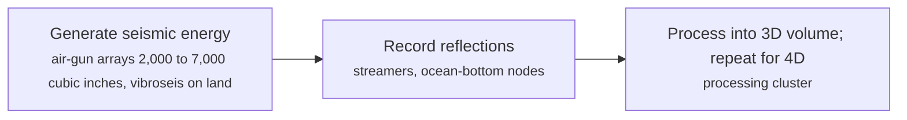

**Key equipment:** seismic vessel, air-gun arrays, streamers or nodes, ROV or node deployment, processing cluster.

**Performance:**
- towed-streamer depth: 5-15 m; marine streamer towing. [source](https://en.wikipedia.org/wiki/Reflection_seismology)
- streamers towed by a Ramform vessel: 24 streamers (up to); spreads can exceed one nautical mile. [source](https://en.wikipedia.org/wiki/Reflection_seismology)
- ocean-bottom node deployment depth: 3000 m (about, by ROV); 30-day battery example; node weight over 10 kg. [source](https://en.wikipedia.org/wiki/Reflection_seismology)

**Missing inputs:**
- survey cost per km2 with year (costs): Not in the free source; broker and vendor price data are commercial. Where: Wood Mackenzie or Westwood survey cost reports (paid). Next: Add a published cost range with year.
- named plants or projects with capacity and year (reference_plants): The sources read name no specific plant. Where: Licensor and operator press releases for the suppliers listed (open). Next: Add one or two plants with country, capacity and start-up year.
- TRL with a cited source (trl): The IEA ETP Clean Energy Technology Guide has no matching entry. Where: IEA ETP Clean Energy Technology Guide (collected): search for the technology name (catalog: iea-reports, open). Next: Find a TRL table that lists this technology, or leave maturity resting on the evidence on the card.
- process steps and equipment are general engineering practice, not taken from one source (process): The sources read describe the principle but not a full step-by-step flow. Where: Licensor process descriptions and textbooks (open). Next: Check the steps against a licensor description and name it.

Sources: [1](https://en.wikipedia.org/wiki/Reflection_seismology). Last reviewed 2026-10-25.

## Basin and petroleum systems modelling
<a id="ups-basin-petroleum-systems-modelling"></a>

Software reconstructs burial, heat flow and fluid flow in a sedimentary basin to estimate when and where source rocks generated oil or gas, how it migrated and whether a trap was in place. The general framework is source rock, burial heat, migration, reservoir, seal and trap.


**Key equipment:** basin modelling software, geochemical kinetic data, seismic-derived structure.

**Performance:**
- oil generation depth range: 1000-6000 m; about 60 to 150 °C. [source](https://en.wikipedia.org/wiki/Petroleum_system)

**Missing inputs:**
- modelling workflow, calibration data and uncertainty (performance): Not covered by the page read. Where: SLB PetroMod documentation (catalog: slb, open). Next: Add a documented workflow and an example result.
- capital cost and operating or unit cost, with dollar year and basis (costs): No open source read so far gives costs for this technology. Where: arXiv and open-access journals: techno-economic or review papers (MDPI is blocked by its CDN; use the manual inbox) (catalog: arxiv, open); Licensor and EPC studies; paid cost databases are catalog-only (paid); OSTI.GOV full-text reports from DOE labs: search the technology name plus 'techno-economic' (catalog: osti, blocked). Next: Look for an open techno-economic study; record each figure with metric, range, unit, dollar year, basis and source.
- named plants or projects with capacity and year (reference_plants): The sources read name no specific plant. Where: Licensor and operator press releases for the suppliers listed (open). Next: Add one or two plants with country, capacity and start-up year.
- TRL with a cited source (trl): The IEA ETP Clean Energy Technology Guide has no matching entry. Where: IEA ETP Clean Energy Technology Guide (collected): search for the technology name (catalog: iea-reports, open). Next: Find a TRL table that lists this technology, or leave maturity resting on the evidence on the card.
- process steps and equipment are general engineering practice, not taken from one source (process): The sources read describe the principle but not a full step-by-step flow. Where: Licensor process descriptions and textbooks (open). Next: Check the steps against a licensor description and name it.

Sources: [1](https://en.wikipedia.org/wiki/Petroleum_system). Last reviewed 2026-10-25.

## CO2 enhanced oil recovery (miscible CO2 flooding)
<a id="ups-co2-eor"></a>

CO2 is compressed and injected into an oil reservoir, usually one already waterflooded, where at or above the minimum miscibility pressure it mixes with the crude, swells it and lowers its viscosity so that residual oil can be swept to producing wells. Water and CO2 are often injected in alternating slugs (WAG). Produced CO2 is separated from oil and water, recompressed and reinjected, so most purchased CO2 stays underground.

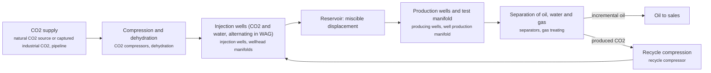

**Key equipment:** CO2 compressors, CO2 pipeline, injection and production wells, production manifold, oil-water-gas separators, recycle compressor.

**Performance:**
- incremental oil recovery over primary and secondary recovery: 4-15 % of original oil in place; NETL primer; primary plus secondary typically 30-35% OOIP; one pilot reported up to 22%. [source](https://www.netl.doe.gov/sites/default/files/netl-file/co2_eor_primer.pdf)
- water to CO2 injection ratio in WAG: 0.5-4 volumes of water per volume of CO2 at reservoir conditions; NETL primer; slug size 0.1-2% of pore volume. [source](https://www.netl.doe.gov/sites/default/files/netl-file/co2_eor_primer.pdf)
- cumulative CO2 injected: 15-30 % of hydrocarbon pore volume; NETL primer. [source](https://www.netl.doe.gov/sites/default/files/netl-file/co2_eor_primer.pdf)
- share of oil cost per barrel taken by CO2 purchase and recycle: 25-50 % of cost per barrel produced; NETL primer. [source](https://www.netl.doe.gov/sites/default/files/netl-file/co2_eor_primer.pdf)
- reservoir depth screening range: 2000-9800 ft; NETL primer screening table (other criteria: oil gravity above 27-30 °API, viscosity at or below 10-12 cp, pressure above 1,200-1,500 psia, residual oil saturation above 0.25-0.30). [source](https://www.netl.doe.gov/sites/default/files/netl-file/co2_eor_primer.pdf)

**Costs:**
- illustrative pre-tax economic margin: 15-25 USD/bbl (2008$); NETL primer example: oil USD 70/bbl, net wellhead USD 55, capital amortization USD 5-10, CO2 USD 15 (USD 2/Mcf purchase, USD 0.70/Mcf recycle), operations USD 10-15; dollar year not stated, data to 2008. [source](https://www.netl.doe.gov/sites/default/files/netl-file/co2_eor_primer.pdf)

**Reference plants:**
- Weyburn field, Saskatchewan (EnCana), CA: about 95 million ft3/d CO2 (4,935 t/d) from the Dakota Gasification plant via a 205-mile pipeline; 130 million bbl incremental oil expected; operating as of the primer (data to 2008). [source](https://www.netl.doe.gov/sites/default/files/netl-file/co2_eor_primer.pdf)
- Wasson field Denver Unit, West Texas (Shell), US: 31,500 bbl/d of which 26,850 bbl/d incremental from CO2; over 120 million bbl incremental to 2008; operating as of 2008. [source](https://www.netl.doe.gov/sites/default/files/netl-file/co2_eor_primer.pdf)
- Sukowati field, Bojonegoro (Pertamina EP, with JOGMEC and JAPEX), ID: pilot: about 500 t CO2 huff-and-puff into well SKW-18 over 7 days; first CO2 injection 7 December 2023; full implementation planned with CO2 from Jambaran Tiung Biru. [source](https://www.migas.esdm.go.id/post/implementasikan-ccus-lapangan-sukowati-injeksi-co2-perdana)

TRL source: [IEA ETP Clean Energy Technology Guide, dataset of 24 July 2026, 2025 assessment (IEA 1-11 scale): 'CO2-enhanced oil recovery' 9](https://www.iea.org/data-and-statistics/data-tools/etp-clean-energy-technology-guide)

**Missing inputs:**
- current CO2-EOR cost per barrel and CO2 utilisation (t CO2 per bbl) in USD with dollar year (costs): The only cost read is an illustrative example in a primer with data to 2008 and no dollar year. Where: NETL 'Next Generation CO2-EOR' report (collected: corpus/netl) (catalog: netl, open); IEA oil and gas industry in net-zero transitions (collected) (catalog: iea-reports, open). Next: Read the collected NETL 2011 report and IEA reports for utilisation and cost, then add dollar-year figures.
- Sukowati: full-scale CO2 injection after the 2023 pilot (status): Only the December 2023 launch page was read. Where: Ditjen Migas and Pertamina news after 2023 (catalog: id-ditjen-migas, open). Next: Check whether the Jambaran Tiung Biru CO2 supply started and update the reference plant.
- CO2-EOR operators in Malaysia and Indonesia beyond Pertamina (suppliers): No PETRONAS CO2-EOR source has been read. Where: PETRONAS technology pages and reports (record verified for personal non-commercial copies) (catalog: petronas-tech, open). Next: Collect PETRONAS EOR material into corpus/_inbox/petronas-tech and add any project.

Sources: [1](https://www.netl.doe.gov/sites/default/files/netl-file/co2_eor_primer.pdf), [2](https://www.migas.esdm.go.id/post/implementasikan-ccus-lapangan-sukowati-injeksi-co2-perdana), [3](https://www.iea.org/data-and-statistics/data-tools/etp-clean-energy-technology-guide). Last reviewed 2026-10-24.

## Casing drilling and expandable tubulars
<a id="ups-casing-drilling-expandable-tubulars"></a>

Expandable tubulars are run and then enlarged by pulling or pushing an expansion tool through them, cutting the diameter lost with each casing string and aiming at a monobore well. The Wikipedia page read does not cover casing drilling (drilling with the casing itself).

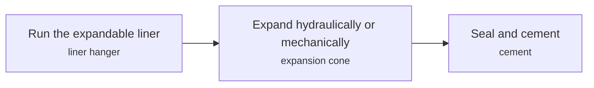

**Key equipment:** expandable liner or clad, expansion tool, liner hanger.

**Performance:**
- expansion ratio: 20-30 %; the page gives both 20% and 30%. [source](https://en.wikipedia.org/wiki/Expandable_tubular_technology)
- expansion length: 30-6000 ft; cold-working expansion. [source](https://en.wikipedia.org/wiki/Expandable_tubular_technology)

**Missing inputs:**
- casing drilling method, depth records and field results (process): Not covered. Where: Weatherford and Tesco casing drilling papers (catalog: weatherford, open). Next: Add a source for casing drilling.
- capital cost and operating or unit cost, with dollar year and basis (costs): No open source read so far gives costs for this technology. Where: arXiv and open-access journals: techno-economic or review papers (MDPI is blocked by its CDN; use the manual inbox) (catalog: arxiv, open); Licensor and EPC studies; paid cost databases are catalog-only (paid); OSTI.GOV full-text reports from DOE labs: search the technology name plus 'techno-economic' (catalog: osti, blocked). Next: Look for an open techno-economic study; record each figure with metric, range, unit, dollar year, basis and source.
- named plants or projects with capacity and year (reference_plants): The sources read name no specific plant. Where: Licensor and operator press releases for the suppliers listed (open). Next: Add one or two plants with country, capacity and start-up year.
- TRL with a cited source (trl): The IEA ETP Clean Energy Technology Guide has no matching entry. Where: IEA ETP Clean Energy Technology Guide (collected): search for the technology name (catalog: iea-reports, open). Next: Find a TRL table that lists this technology, or leave maturity resting on the evidence on the card.

Sources: [1](https://en.wikipedia.org/wiki/Expandable_tubular_technology). Last reviewed 2026-10-25.

## Chemical EOR (polymer and surfactant flooding)
<a id="ups-chemical-eor"></a>

Chemicals are added to injection water to recover oil that waterflooding leaves behind. Polymers such as hydrolyzed polyacrylamide (HPAM) raise the viscosity of the injected water so it sweeps the reservoir more evenly and water breaks through later. Surfactants lower the interfacial tension between oil and water so trapped oil droplets can move. Alkali-surfactant-polymer (ASP) combines both. Polymer and surfactant performance depends on salinity, temperature, adsorption on the rock and injectivity, so candidates are screened in the laboratory and by core flooding before a field pilot.

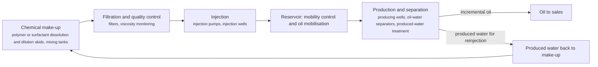

**Key equipment:** polymer or surfactant make-up units, filters, injection pumps, injection and production wells, produced water treatment.

**Performance:**
- incremental recovery, HPAM Polymer C at 3000 ppm, laboratory core floods: 8.8-10 % (two cores); Five commercial HPAM polymers tested at 500-5000 ppm, salinity 3,000-200,000 ppm, up to 90 °C; laboratory only. [source](https://journal.lemigas.esdm.go.id/index.php/SCOG/article/view/2125)
- average incremental recovery of HPAM injection in Daqing field blocks (field): 11 % over waterflooding; as reported in the HPAM article's introduction, which calls Daqing the world's largest commercial polymer flood; original study not read. [source](https://journal.lemigas.esdm.go.id/index.php/SCOG/article/view/2125)
- incremental recovery factor from palm-oil MES surfactant with 96% ethanol, laboratory coreflood: 29.24 % over waterflooding; total recovery factor 45.90%; MES 0.5-2.0%, best formulation 1.25% MES; laboratory only. [source](https://journal.lemigas.esdm.go.id/index.php/SCOG/article/view/2096)
- interfacial tension achieved: 0.521 mN/m; MES with ethanol co-surfactant. [source](https://journal.lemigas.esdm.go.id/index.php/SCOG/article/view/2096)

**Reference plants:**
- Daqing oilfield polymer flood, CN: average incremental recovery about 11% over waterflooding across tested blocks; described as the world's largest commercial polymer flood. [source](https://journal.lemigas.esdm.go.id/index.php/SCOG/article/view/2125)

**Missing inputs:**
- TRL with a cited source (trl): The IEA guide has no chemical EOR entry; 'commercial' rests on the Daqing statement in the HPAM article, which was read only second-hand. Where: IEA ETP Clean Energy Technology Guide (collected): search for the technology name (catalog: iea-reports, open); Peer-reviewed reviews of chemical EOR field projects (SPE, open journals) (catalog: doaj, open). Next: Find an independent review that lists field projects, and read the original Daqing study.
- chemical cost per barrel of incremental oil and project capex, with dollar year and basis (costs): No source read gives costs. Where: Open techno-economic papers (arXiv, LEMIGAS SCOG archive, Universitas Trisakti publications) (catalog: lemigas-scog, open). Next: Add cost per incremental barrel with dollar year.
- chemical EOR field projects in Southeast Asia (reference_plants): No source read names one; PETRONAS is listed in the register as a supplier. Where: PETRONAS and Pertamina EOR project reports (catalog: petronas-tech, open). Next: Add a Malaysian or Indonesian pilot with capacity and year.

Sources: [1](https://journal.lemigas.esdm.go.id/index.php/SCOG/article/view/2125), [2](https://journal.lemigas.esdm.go.id/index.php/SCOG/article/view/2096). Last reviewed 2026-10-24.

## Coiled tubing and well intervention
<a id="ups-coiled-tubing-intervention"></a>

A continuous steel pipe (normally 1 to 3.25 inch) on a reel is pushed into live wells for cleanouts, chemical placement, milling, logging and drilling. It trips faster than jointed pipe and acts as a nearly closed system, but cannot trip jointed pipe and needs a larger offshore footprint than wireline.


**Key equipment:** coiled-tubing reel, injector head, BOP stack, bottom-hole assembly.

**Performance:**
- coiled-tubing diameter: 1-3.25 in; 25 to 83 mm. [source](https://en.wikipedia.org/wiki/Coiled_tubing)
- steel yield strength: 55000-120000 psi; coil grades. [source](https://en.wikipedia.org/wiki/Coiled_tubing)

**Missing inputs:**
- day rate or job cost (costs): Not stated. Where: Operator intervention cost studies (open). Next: Add typical cost with year.
- named plants or projects with capacity and year (reference_plants): The sources read name no specific plant. Where: Licensor and operator press releases for the suppliers listed (open). Next: Add one or two plants with country, capacity and start-up year.
- TRL with a cited source (trl): The IEA ETP Clean Energy Technology Guide has no matching entry. Where: IEA ETP Clean Energy Technology Guide (collected): search for the technology name (catalog: iea-reports, open). Next: Find a TRL table that lists this technology, or leave maturity resting on the evidence on the card.
- process steps and equipment are general engineering practice, not taken from one source (process): The sources read describe the principle but not a full step-by-step flow. Where: Licensor process descriptions and textbooks (open). Next: Check the steps against a licensor description and name it.

Sources: [1](https://en.wikipedia.org/wiki/Coiled_tubing). Last reviewed 2026-10-25.

## Digital core and special core analysis
<a id="ups-digital-core-analysis"></a>

Cores are imaged by whole-core CT (0.5 mm slices), micro-CT and FIB-SEM, and the 3D images are used to compute porosity, permeability, capillary pressure and relative permeability in simulations. Schlumberger reports that analysis taking weeks or months can finish in hours or days.

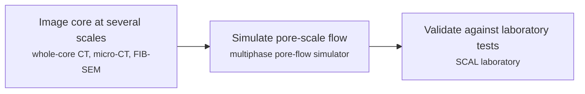

**Key equipment:** CT and micro-CT scanners, FIB-SEM, HPC simulation, SCAL laboratory.

**Performance:**
- whole-core CT slice resolution: 0.5 mm; 4-inch core in liner. [source](https://geoexpro.com/inside-the-rock/)

**Missing inputs:**
- service price (costs): Not published. Where: Vendor quotations (paid). Next: Leave unless a published price is found.
- named plants or projects with capacity and year (reference_plants): The sources read name no specific plant. Where: Licensor and operator press releases for the suppliers listed (open). Next: Add one or two plants with country, capacity and start-up year.
- TRL with a cited source (trl): The IEA ETP Clean Energy Technology Guide has no matching entry. Where: IEA ETP Clean Energy Technology Guide (collected): search for the technology name (catalog: iea-reports, open). Next: Find a TRL table that lists this technology, or leave maturity resting on the evidence on the card.
- process steps and equipment are general engineering practice, not taken from one source (process): The sources read describe the principle but not a full step-by-step flow. Where: Licensor process descriptions and textbooks (open). Next: Check the steps against a licensor description and name it.

Sources: [1](https://geoexpro.com/inside-the-rock/). Last reviewed 2026-10-25.

## Electric submersible pumps
<a id="ups-electric-submersible-pumps"></a>

A downhole multistage centrifugal pump driven by a submersible motor on a cable lifts 16 to 4,770 m³/d (100 to 30,000 bbl/d). SLB reports an installed base of 150,000 to 200,000 wells and notes ESPs are usually uneconomic below about 25 m³/d.

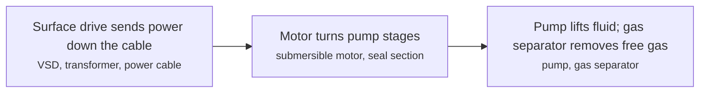

**Key equipment:** ESP pump, motor, seal section, gas separator, power cable, variable speed drive.

**Performance:**
- flow rate range: 16-4770 m3/d; 100 to 30,000 bbl/d. [source](https://www.slb.com/-/media/files/oilfield-review/defining-esp.ashx)
- installed ESP wells worldwide: 150000-200000 wells (estimate); SLB Oilfield Review. [source](https://www.slb.com/-/media/files/oilfield-review/defining-esp.ashx)
- ESP depth capability: 3000 m (about 10,000 ft); Wikipedia comparison table. [source](https://en.wikipedia.org/wiki/Artificial_lift)

**Missing inputs:**
- average run life (performance): Neither source states one. Where: SPE ESP run-life benchmarking papers (catalog: onepetro, open). Next: Add an average run life with basis.
- capital cost and operating or unit cost, with dollar year and basis (costs): No open source read so far gives costs for this technology. Where: arXiv and open-access journals: techno-economic or review papers (MDPI is blocked by its CDN; use the manual inbox) (catalog: arxiv, open); Licensor and EPC studies; paid cost databases are catalog-only (paid); OSTI.GOV full-text reports from DOE labs: search the technology name plus 'techno-economic' (catalog: osti, blocked). Next: Look for an open techno-economic study; record each figure with metric, range, unit, dollar year, basis and source.
- named plants or projects with capacity and year (reference_plants): The sources read name no specific plant. Where: Licensor and operator press releases for the suppliers listed (open). Next: Add one or two plants with country, capacity and start-up year.
- TRL with a cited source (trl): The IEA ETP Clean Energy Technology Guide has no matching entry. Where: IEA ETP Clean Energy Technology Guide (collected): search for the technology name (catalog: iea-reports, open). Next: Find a TRL table that lists this technology, or leave maturity resting on the evidence on the card.
- process steps and equipment are general engineering practice, not taken from one source (process): The sources read describe the principle but not a full step-by-step flow. Where: Licensor process descriptions and textbooks (open). Next: Check the steps against a licensor description and name it.

Sources: [1](https://www.slb.com/-/media/files/oilfield-review/defining-esp.ashx), [2](https://en.wikipedia.org/wiki/Artificial_lift). Last reviewed 2026-10-25.

## Extended-reach and multilateral wells
<a id="ups-extended-reach-multilateral-wells"></a>

Extended-reach drilling (ERD) reaches a large reservoir area from one surface location by drilling very long deviated wells; multilateral wells add branches from a main bore. The record ERD well (Orlan platform, Sakhalin-1, 24 April 2015) has a measured depth of 13,500 m and a horizontal displacement of 12,030 m.

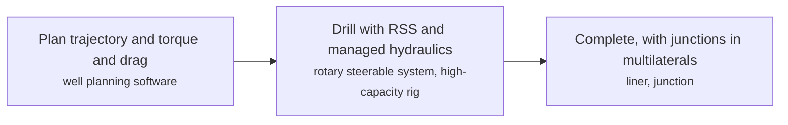

**Key equipment:** high-capacity rig, rotary steerable system, torque-and-drag management, junction systems for multilaterals.

**Performance:**
- record ERD measured depth: 13500 m; Orlan, Sakhalin-1, April 2015. [source](https://en.wikipedia.org/wiki/Extended_reach_drilling)
- record ERD horizontal displacement: 12030-12130 m; Orlan 12,030 m (2015); earlier Yastreb well 12,130 m (2014). [source](https://en.wikipedia.org/wiki/Extended_reach_drilling)

**Missing inputs:**
- cost versus several conventional wells (costs): Not stated. Where: SPE ERD papers (catalog: onepetro, open). Next: Add a published cost comparison.
- named plants or projects with capacity and year (reference_plants): The sources read name no specific plant. Where: Licensor and operator press releases for the suppliers listed (open). Next: Add one or two plants with country, capacity and start-up year.
- TRL with a cited source (trl): The IEA ETP Clean Energy Technology Guide has no matching entry. Where: IEA ETP Clean Energy Technology Guide (collected): search for the technology name (catalog: iea-reports, open). Next: Find a TRL table that lists this technology, or leave maturity resting on the evidence on the card.
- process steps and equipment are general engineering practice, not taken from one source (process): The sources read describe the principle but not a full step-by-step flow. Where: Licensor process descriptions and textbooks (open). Next: Check the steps against a licensor description and name it.

Sources: [1](https://en.wikipedia.org/wiki/Extended_reach_drilling), [2](https://jpt.spe.org/inflow-control-device-inflow-control-valves-aid-kuwaits-first-smart-multilateral-well). Last reviewed 2026-10-25.

## Flare gas recovery and zero routine flaring
<a id="ups-flare-gas-recovery"></a>

Gas that would be burned in a flare is instead collected, compressed and treated so that it can be sold, used for power or reinjected. Vapour recovery units capture low-pressure methane streams from tanks and compressor seals. Where no pipeline exists, small-scale GTL or power generation can use the gas on site. Routine, non-emergency flaring can then be ended.

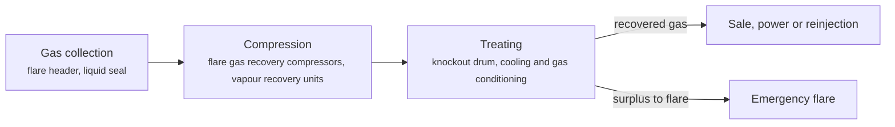

**Key equipment:** flare gas recovery compressors, liquid seal drum, vapour recovery units, gas treating skid, flare tip.

**Performance:**
- natural gas flared globally each year: 150 bcm; majority is routine, non-emergency flaring; IEA 2025 tracker. [source](https://iea.blob.core.windows.net/assets/b83c32dd-fc1b-4917-96e9-8cd918801cbf/GlobalMethaneTracker2025.pdf)

TRL source: [IEA ETP Clean Energy Technology Guide, dataset of 24 July 2026, 2025 assessment (IEA 1-11 scale): 'Flare gas recovery' 9](https://www.iea.org/data-and-statistics/data-tools/etp-clean-energy-technology-guide)

**Missing inputs:**
- capex per unit and payback with dollar year (costs): The tracker gives the flared volume only. Where: IEA Global Methane Tracker documentation (collected) (catalog: iea-methane-tracker, open); World Bank Global Gas Flaring Reduction partnership reports (open). Next: Add capex and payback with basis.
- recovery efficiency and turndown of recovery units (performance): No source read gives them. Where: Supplier datasheets for the companies listed (open). Next: Add recovery efficiency with source.
- named flare reduction projects in Malaysia and Indonesia (reference_plants): None read. Where: PETRONAS and Pertamina sustainability reports (catalog: petronas-tech, open). Next: Collect the reports and add a project with year and volume.

Sources: [1](https://iea.blob.core.windows.net/assets/b83c32dd-fc1b-4917-96e9-8cd918801cbf/GlobalMethaneTracker2025.pdf), [2](https://www.iea.org/data-and-statistics/data-tools/etp-clean-energy-technology-guide). Last reviewed 2026-10-24.

## Full-waveform inversion and seismic imaging
<a id="ups-full-waveform-inversion"></a>

An initial velocity model is updated iteratively until simulated seismic waveforms match recorded ones, producing a high-resolution subsurface velocity model that feeds migration and imaging. Compute needs are large and the method can fail when the starting model is too far off (cycle skipping); the SEG page read explains the geotechnical form of the method only.

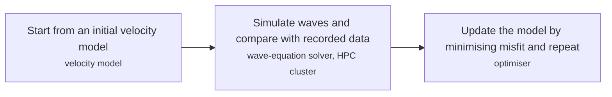

**Key equipment:** HPC cluster or GPUs, wave-equation solver, velocity model building software.

**Missing inputs:**
- oil and gas FWI results, frequency content and compute cost (performance): The SEG page covers soil characterisation; Wikipedia's page was not found. Where: SEG and EAGE FWI papers (open); CGG/Viridien and SLB technical articles (catalog: slb, open). Next: Add one marine FWI case with resolution and run-time figures.
- capital cost and operating or unit cost, with dollar year and basis (costs): No open source read so far gives costs for this technology. Where: arXiv and open-access journals: techno-economic or review papers (MDPI is blocked by its CDN; use the manual inbox) (catalog: arxiv, open); Licensor and EPC studies; paid cost databases are catalog-only (paid); OSTI.GOV full-text reports from DOE labs: search the technology name plus 'techno-economic' (catalog: osti, blocked). Next: Look for an open techno-economic study; record each figure with metric, range, unit, dollar year, basis and source.
- named plants or projects with capacity and year (reference_plants): The sources read name no specific plant. Where: Licensor and operator press releases for the suppliers listed (open). Next: Add one or two plants with country, capacity and start-up year.
- TRL with a cited source (trl): The IEA ETP Clean Energy Technology Guide has no matching entry. Where: IEA ETP Clean Energy Technology Guide (collected): search for the technology name (catalog: iea-reports, open). Next: Find a TRL table that lists this technology, or leave maturity resting on the evidence on the card.
- process steps and equipment are general engineering practice, not taken from one source (process): The sources read describe the principle but not a full step-by-step flow. Where: Licensor process descriptions and textbooks (open). Next: Check the steps against a licensor description and name it.

Sources: [1](https://wiki.seg.org/wiki/Full-waveform_inversion), [2](https://en.wikipedia.org/wiki/Seismic_inversion). Last reviewed 2026-10-25.

## Gas lift
<a id="ups-gas-lift"></a>

Compressed gas is injected into the production tubing through valves in mandrels to lighten the fluid column so the well flows. About 10% of US oil wells with insufficient reservoir pressure use gas lift, and side-pocket mandrels let valves be changed by wireline.

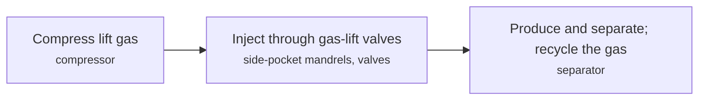

**Key equipment:** gas compressor, gas-lift mandrels and valves, injection manifold.

**Performance:**
- US oil wells using gas lift: 10 % (about); wells with insufficient reservoir pressure. [source](https://en.wikipedia.org/wiki/Gas_lift)
- gas lift depth and rate capability: 4600 m (up to 15,000 ft); up to 30,000 bbl/d; Wikipedia comparison. [source](https://en.wikipedia.org/wiki/Artificial_lift)

**Missing inputs:**
- efficiency and gas-liquid ratios (performance): Neither source gives them. Where: SPE gas lift design papers (catalog: onepetro, open). Next: Add typical injection GLR.
- capital cost and operating or unit cost, with dollar year and basis (costs): No open source read so far gives costs for this technology. Where: arXiv and open-access journals: techno-economic or review papers (MDPI is blocked by its CDN; use the manual inbox) (catalog: arxiv, open); Licensor and EPC studies; paid cost databases are catalog-only (paid); OSTI.GOV full-text reports from DOE labs: search the technology name plus 'techno-economic' (catalog: osti, blocked). Next: Look for an open techno-economic study; record each figure with metric, range, unit, dollar year, basis and source.
- named plants or projects with capacity and year (reference_plants): The sources read name no specific plant. Where: Licensor and operator press releases for the suppliers listed (open). Next: Add one or two plants with country, capacity and start-up year.
- TRL with a cited source (trl): The IEA ETP Clean Energy Technology Guide has no matching entry. Where: IEA ETP Clean Energy Technology Guide (collected): search for the technology name (catalog: iea-reports, open). Next: Find a TRL table that lists this technology, or leave maturity resting on the evidence on the card.
- process steps and equipment are general engineering practice, not taken from one source (process): The sources read describe the principle but not a full step-by-step flow. Where: Licensor process descriptions and textbooks (open). Next: Check the steps against a licensor description and name it.

Sources: [1](https://en.wikipedia.org/wiki/Gas_lift), [2](https://en.wikipedia.org/wiki/Artificial_lift). Last reviewed 2026-10-25.

## Hydraulic fracturing (plug-and-perf, electric frac fleets)
<a id="ups-hydraulic-fracturing"></a>

High-pressure fluid and proppant open fractures along a cased and perforated lateral in stages; plug-and-perf isolates each stage with a plug, while sliding sleeves open one at a time. Typical fluid is about 90% water, 9.5% sand and 0.5% additives, and pumps reach 100 MPa (15,000 psi).

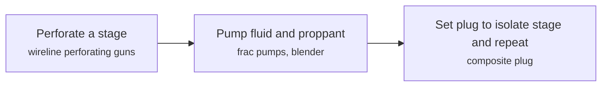

**Key equipment:** frac pumps (diesel, dual fuel or electric), blender, wireline unit, composite plugs, sand and water supply.

**Performance:**
- water per well: 1.2-3.5 million US gallons; up to 5 million for large projects. [source](https://en.wikipedia.org/wiki/Hydraulic_fracturing)
- maximum pump pressure: 100 MPa (15,000 psi); and 265 L/s. [source](https://en.wikipedia.org/wiki/Hydraulic_fracturing)
- emissions of electric fleet vs Tier 2 diesel: 30-45 % lower; 30% on reciprocating-engine power, up to 45% on ERCOT grid; Halliburton estimate. [source](https://www.halliburton.com/en/completions/stimulation/hydraulic-fracturing/zeus-fracturing-services)
- ZEUS pump unit hydraulic horsepower: 5000 HHP (up to); vendor. [source](https://www.halliburton.com/en/completions/stimulation/hydraulic-fracturing/zeus-fracturing-services)

**Missing inputs:**
- completion cost per stage or per well with year (costs): Neither page gives it. Where: EIA drilling productivity and well cost studies (catalog: eia-reports, open). Next: Add a well-cost figure with year.
- named plants or projects with capacity and year (reference_plants): The sources read name no specific plant. Where: Licensor and operator press releases for the suppliers listed (open). Next: Add one or two plants with country, capacity and start-up year.
- TRL with a cited source (trl): The IEA ETP Clean Energy Technology Guide has no matching entry. Where: IEA ETP Clean Energy Technology Guide (collected): search for the technology name (catalog: iea-reports, open). Next: Find a TRL table that lists this technology, or leave maturity resting on the evidence on the card.
- process steps and equipment are general engineering practice, not taken from one source (process): The sources read describe the principle but not a full step-by-step flow. Where: Licensor process descriptions and textbooks (open). Next: Check the steps against a licensor description and name it.

Sources: [1](https://en.wikipedia.org/wiki/Hydraulic_fracturing), [2](https://www.halliburton.com/en/completions/stimulation/hydraulic-fracturing/zeus-fracturing-services). Last reviewed 2026-10-25.

## Intelligent completions and inflow control devices
<a id="ups-intelligent-completions"></a>

Downhole valves, gauges and inflow control devices let operators monitor and adjust production from each zone without intervention. In Kuwait's first smart multilateral well, two 10-position hydraulic valves and nozzle-type ICDs controlled two laterals to fight early water breakthrough.


**Key equipment:** inflow control valves, inflow control devices, downhole gauges, control lines.

**Performance:**
- ICV positions: 10 positions per valve; two ICVs, one per lateral, Kuwait Minagish. [source](https://jpt.spe.org/inflow-control-device-inflow-control-valves-aid-kuwaits-first-smart-multilateral-well)

**Missing inputs:**
- production and water-cut results of the Kuwait well (performance): Shown only in a chart. Where: SPE paper behind the JPT article (catalog: onepetro, open). Next: Add oil rate and water cut vs a conventional well.
- capital cost and operating or unit cost, with dollar year and basis (costs): No open source read so far gives costs for this technology. Where: arXiv and open-access journals: techno-economic or review papers (MDPI is blocked by its CDN; use the manual inbox) (catalog: arxiv, open); Licensor and EPC studies; paid cost databases are catalog-only (paid); OSTI.GOV full-text reports from DOE labs: search the technology name plus 'techno-economic' (catalog: osti, blocked). Next: Look for an open techno-economic study; record each figure with metric, range, unit, dollar year, basis and source.
- named plants or projects with capacity and year (reference_plants): The sources read name no specific plant. Where: Licensor and operator press releases for the suppliers listed (open). Next: Add one or two plants with country, capacity and start-up year.
- TRL with a cited source (trl): The IEA ETP Clean Energy Technology Guide has no matching entry. Where: IEA ETP Clean Energy Technology Guide (collected): search for the technology name (catalog: iea-reports, open). Next: Find a TRL table that lists this technology, or leave maturity resting on the evidence on the card.
- process steps and equipment are general engineering practice, not taken from one source (process): The sources read describe the principle but not a full step-by-step flow. Where: Licensor process descriptions and textbooks (open). Next: Check the steps against a licensor description and name it.

Sources: [1](https://jpt.spe.org/inflow-control-device-inflow-control-valves-aid-kuwaits-first-smart-multilateral-well). Last reviewed 2026-10-25.

## Managed pressure drilling
<a id="ups-managed-pressure-drilling"></a>

IADC defines MPD as an adaptive drilling process that precisely controls the annular pressure profile; a rotating control device and automated choke let the driller hold bottomhole pressure within a narrow window. Variants include continuous circulation, constant bottomhole pressure, pressurised mud cap and dual-gradient drilling.

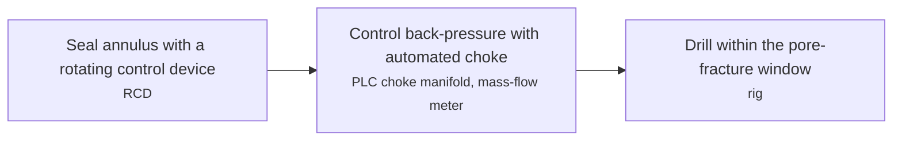

**Key equipment:** rotating control device (API 16RCD), automated choke manifold, mass-flow meter, non-return valves.

**Performance:**
- marine RCD tensile rating when placed below the riser tension ring: 3e+06 lb; typical. [source](https://iadc.org/wp-content/uploads/2015/08/preview-mpub.pdf)

**Missing inputs:**
- cost versus conventional drilling (costs): The preview gives none. Where: IADC MPD publications (open). Next: Add a published cost or time saving.
- named plants or projects with capacity and year (reference_plants): The sources read name no specific plant. Where: Licensor and operator press releases for the suppliers listed (open). Next: Add one or two plants with country, capacity and start-up year.
- TRL with a cited source (trl): The IEA ETP Clean Energy Technology Guide has no matching entry. Where: IEA ETP Clean Energy Technology Guide (collected): search for the technology name (catalog: iea-reports, open). Next: Find a TRL table that lists this technology, or leave maturity resting on the evidence on the card.
- process steps and equipment are general engineering practice, not taken from one source (process): The sources read describe the principle but not a full step-by-step flow. Where: Licensor process descriptions and textbooks (open). Next: Check the steps against a licensor description and name it.

Sources: [1](https://iadc.org/wp-content/uploads/2015/08/preview-mpub.pdf). Last reviewed 2026-10-25.

## Measurement and logging while drilling (MWD/LWD)
<a id="ups-mwd-lwd"></a>

Sensors in the bottom-hole assembly measure well direction (MWD) and formation properties (LWD) while drilling and send data to the surface, usually by mud pulses, for real-time geosteering. LWD measurements include gamma ray, resistivity, density, neutron porosity, sonic, NMR, images and formation testing.

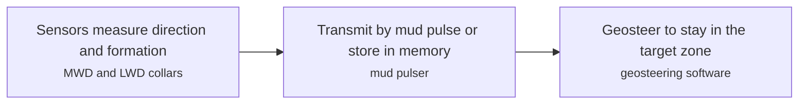

**Key equipment:** MWD tool, LWD collars, mud pulser, surface decoding.

**Missing inputs:**
- telemetry data rate and measurement accuracy (performance): Not on the page read. Where: Vendor datasheets (open). Next: Add bit rates and accuracy figures.
- capital cost and operating or unit cost, with dollar year and basis (costs): No open source read so far gives costs for this technology. Where: arXiv and open-access journals: techno-economic or review papers (MDPI is blocked by its CDN; use the manual inbox) (catalog: arxiv, open); Licensor and EPC studies; paid cost databases are catalog-only (paid); OSTI.GOV full-text reports from DOE labs: search the technology name plus 'techno-economic' (catalog: osti, blocked). Next: Look for an open techno-economic study; record each figure with metric, range, unit, dollar year, basis and source.
- named plants or projects with capacity and year (reference_plants): The sources read name no specific plant. Where: Licensor and operator press releases for the suppliers listed (open). Next: Add one or two plants with country, capacity and start-up year.
- TRL with a cited source (trl): The IEA ETP Clean Energy Technology Guide has no matching entry. Where: IEA ETP Clean Energy Technology Guide (collected): search for the technology name (catalog: iea-reports, open). Next: Find a TRL table that lists this technology, or leave maturity resting on the evidence on the card.
- process steps and equipment are general engineering practice, not taken from one source (process): The sources read describe the principle but not a full step-by-step flow. Where: Licensor process descriptions and textbooks (open). Next: Check the steps against a licensor description and name it.

Sources: [1](https://en.wikipedia.org/wiki/Logging_while_drilling). Last reviewed 2026-10-25.

## Methane leak detection and repair (LDAR, satellites and continuous monitoring)
<a id="ups-methane-leak-detection"></a>

Leaks are located by surveying facilities with optical gas imaging cameras, aircraft or drone sensors, fixed continuous sensors or satellites, and then quantified and repaired. Satellites flag large emission events and recurrent leaks, which are passed to operators for rapid repair. A repeat survey confirms the fix.

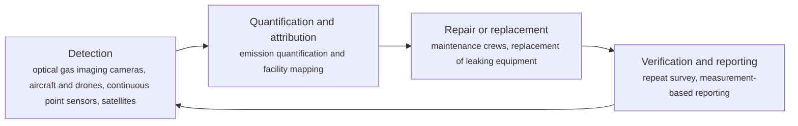

**Key equipment:** optical gas imaging cameras, continuous methane sensors, aircraft and drone payloads, satellite data feeds, repair crews and replacement equipment.

**Performance:**
- fossil-fuel methane emissions that could be avoided at no net cost: 30 % of 2024 fossil-fuel methane emissions; about 35 Mt; at average 2024 energy prices; oil and gas share higher than coal. [source](https://iea.blob.core.windows.net/assets/b83c32dd-fc1b-4917-96e9-8cd918801cbf/GlobalMethaneTracker2025.pdf)
- methane emitted by the fossil fuel sector: 200 bcm in 2024; abatement could have made nearly 100 bcm of gas available. [source](https://iea.blob.core.windows.net/assets/b83c32dd-fc1b-4917-96e9-8cd918801cbf/GlobalMethaneTracker2025.pdf)
- satellites in orbit able to observe methane emissions: 25 satellites (more than); MethaneSAT and Tanager-1 started in 2024. [source](https://iea.blob.core.windows.net/assets/b83c32dd-fc1b-4917-96e9-8cd918801cbf/GlobalMethaneTracker2025.pdf)
- share of satellite-detected oil and gas sources that were recurrent: 25 % (about); Carbon Mapper analysis of more than 2,000 plumes. [source](https://iea.blob.core.windows.net/assets/b83c32dd-fc1b-4917-96e9-8cd918801cbf/GlobalMethaneTracker2025.pdf)

TRL source: [IEA ETP Clean Energy Technology Guide, dataset of 24 July 2026, 2025 assessment (IEA 1-11 scale): 'Periodic methane emission monitoring in oil and gas facilities' 9; 'Satellite-based methane emission monitoring in oil and gas facilities' 9](https://www.iea.org/data-and-statistics/data-tools/etp-clean-energy-technology-guide)

**Missing inputs:**
- cost per survey, per sensor and per tonne of methane abated (costs): The tracker gives the no-net-cost share but the cost curves were not read in detail. Where: IEA Global Methane Tracker documentation (collected: corpus/iea-methane-tracker) (catalog: iea-methane-tracker, open). Next: Read the abatement cost curves and record USD per tonne with year.
- process steps are general practice, not taken from one source (process): The tracker names the technologies and measures; the sequence of steps is general knowledge. Where: OGMP 2.0 and OGDC guidance (open). Next: Cite a measurement guideline for the sequence.
- regional (Southeast Asia) service providers (suppliers): No source read names providers in Malaysia or Indonesia. Where: PETRONAS and Pertamina methane programmes (catalog: petronas-tech, open). Next: Add regional operators or providers.

Sources: [1](https://iea.blob.core.windows.net/assets/b83c32dd-fc1b-4917-96e9-8cd918801cbf/GlobalMethaneTracker2025.pdf), [2](https://www.iea.org/data-and-statistics/data-tools/etp-clean-energy-technology-guide). Last reviewed 2026-10-24.

## Multiphase flow metering
<a id="ups-multiphase-flow-metering"></a>

Meters measure oil, water and gas rates without separation. Emerson's Roxar 2600 combines a Venturi differential-pressure measurement with electrical impedance and optional gamma densitometry, reports at 10 Hz and covers 0 to 100% water-liquid ratio and 0 to 100% gas volume fraction.


**Key equipment:** Venturi, impedance sensors, gamma densitometer, flow computer.

**Performance:**
- Roxar 2600 measurement frequency: 10 Hz; phase rates in real time. [source](https://www.emerson.com/en-us/automation/measurement-instrumentation/flow-measurement/multiphase-meters)
- water-liquid ratio range: 0-100 %; WLR. [source](https://www.emerson.com/en-us/automation/measurement-instrumentation/flow-measurement/multiphase-meters)
- gas volume fraction range: 0-100 %; GVF. [source](https://www.emerson.com/en-us/automation/measurement-instrumentation/flow-measurement/multiphase-meters)

**Missing inputs:**
- uncertainty percentages and subsea installed count (performance): Not stated. Where: NFOGM and NORSOK I-104 documents (open). Next: Add uncertainty class with source.
- capital cost and operating or unit cost, with dollar year and basis (costs): No open source read so far gives costs for this technology. Where: arXiv and open-access journals: techno-economic or review papers (MDPI is blocked by its CDN; use the manual inbox) (catalog: arxiv, open); Licensor and EPC studies; paid cost databases are catalog-only (paid); OSTI.GOV full-text reports from DOE labs: search the technology name plus 'techno-economic' (catalog: osti, blocked). Next: Look for an open techno-economic study; record each figure with metric, range, unit, dollar year, basis and source.
- named plants or projects with capacity and year (reference_plants): The sources read name no specific plant. Where: Licensor and operator press releases for the suppliers listed (open). Next: Add one or two plants with country, capacity and start-up year.
- TRL with a cited source (trl): The IEA ETP Clean Energy Technology Guide has no matching entry. Where: IEA ETP Clean Energy Technology Guide (collected): search for the technology name (catalog: iea-reports, open). Next: Find a TRL table that lists this technology, or leave maturity resting on the evidence on the card.
- process steps and equipment are general engineering practice, not taken from one source (process): The sources read describe the principle but not a full step-by-step flow. Where: Licensor process descriptions and textbooks (open). Next: Check the steps against a licensor description and name it.

Sources: [1](https://www.emerson.com/en-us/automation/measurement-instrumentation/flow-measurement/multiphase-meters). Last reviewed 2026-10-25.

## Plunger lift and hydraulic jet pumps
<a id="ups-plunger-hydraulic-lift"></a>

Plunger lift uses the well's own gas pressure to push a plunger and liquid slug up the tubing; hydraulic pumps (piston, jet) are driven by power fluid from the surface. Jet pumps tolerate solids above 50% by volume and hydraulic pumps cover about 1,000 to 18,000 ft.

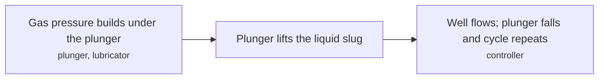

**Key equipment:** plunger, lubricator, controller, hydraulic jet pump and power-fluid system.

**Performance:**
- hydraulic pump depth range: 1000-18000 ft; piston, jet, turbine. [source](https://en.wikipedia.org/wiki/Artificial_lift)
- jet pump solids tolerance: 50 % volume (above); hydraulic pumps, Wikipedia comparison table. [source](https://en.wikipedia.org/wiki/Artificial_lift)

**Missing inputs:**
- plunger lift depth, rate and cycle performance (performance): Not stated. Where: SPE plunger lift papers (catalog: onepetro, open). Next: Add typical ranges.
- capital cost and operating or unit cost, with dollar year and basis (costs): No open source read so far gives costs for this technology. Where: arXiv and open-access journals: techno-economic or review papers (MDPI is blocked by its CDN; use the manual inbox) (catalog: arxiv, open); Licensor and EPC studies; paid cost databases are catalog-only (paid); OSTI.GOV full-text reports from DOE labs: search the technology name plus 'techno-economic' (catalog: osti, blocked). Next: Look for an open techno-economic study; record each figure with metric, range, unit, dollar year, basis and source.
- named plants or projects with capacity and year (reference_plants): The sources read name no specific plant. Where: Licensor and operator press releases for the suppliers listed (open). Next: Add one or two plants with country, capacity and start-up year.
- TRL with a cited source (trl): The IEA ETP Clean Energy Technology Guide has no matching entry. Where: IEA ETP Clean Energy Technology Guide (collected): search for the technology name (catalog: iea-reports, open). Next: Find a TRL table that lists this technology, or leave maturity resting on the evidence on the card.
- process steps and equipment are general engineering practice, not taken from one source (process): The sources read describe the principle but not a full step-by-step flow. Where: Licensor process descriptions and textbooks (open). Next: Check the steps against a licensor description and name it.

Sources: [1](https://en.wikipedia.org/wiki/Artificial_lift). Last reviewed 2026-10-25.

## Production optimisation and digital oilfield
<a id="ups-production-optimisation-digital-oilfield"></a>

Real-time data from wells and facilities feed models that recommend or set choke, lift and process settings, often from a remote operations centre. ADNOC and SLB report an AI-enabled real-time operations centre covering more than 120 rigs, with human effort down 30 to 40%; these are company claims relayed by a vendor article.


**Key equipment:** sensors, data platform, analytics software, remote operations centre.

**Performance:**
- human effort reduction at ADNOC rig operations centre: 30-40 %; ADNOC statement relayed by AVEVA. [source](https://www.aveva.com/en/our-industrial-life/type/article/when-the-rig-starts-thinking-the-rise-of-autonomous-drilling/)

**Missing inputs:**
- production uplift percentage with basis (performance): Sources give no production figures. Where: IEA oil and gas net-zero report, digitalisation section (catalog: iea-reports, open). Next: Add independent production or cost evidence.
- capital cost and operating or unit cost, with dollar year and basis (costs): No open source read so far gives costs for this technology. Where: arXiv and open-access journals: techno-economic or review papers (MDPI is blocked by its CDN; use the manual inbox) (catalog: arxiv, open); Licensor and EPC studies; paid cost databases are catalog-only (paid); OSTI.GOV full-text reports from DOE labs: search the technology name plus 'techno-economic' (catalog: osti, blocked). Next: Look for an open techno-economic study; record each figure with metric, range, unit, dollar year, basis and source.
- named plants or projects with capacity and year (reference_plants): The sources read name no specific plant. Where: Licensor and operator press releases for the suppliers listed (open). Next: Add one or two plants with country, capacity and start-up year.
- TRL with a cited source (trl): The IEA ETP Clean Energy Technology Guide has no matching entry. Where: IEA ETP Clean Energy Technology Guide (collected): search for the technology name (catalog: iea-reports, open). Next: Find a TRL table that lists this technology, or leave maturity resting on the evidence on the card.
- process steps and equipment are general engineering practice, not taken from one source (process): The sources read describe the principle but not a full step-by-step flow. Where: Licensor process descriptions and textbooks (open). Next: Check the steps against a licensor description and name it.

Sources: [1](https://www.aveva.com/en/our-industrial-life/type/article/when-the-rig-starts-thinking-the-rise-of-autonomous-drilling/). Last reviewed 2026-10-25.

## Reservoir simulation (black oil, compositional, thermal)
<a id="ups-reservoir-simulation"></a>

Numerical models solve mass conservation, phase behaviour and Darcy flow on a grid to forecast production and test recovery schemes. Black-oil models track oil, water and gas; compositional models track components with an equation of state; thermal models add energy balance for heavy oil.

```mermaid
flowchart LR
    MODEL["Build static grid and rock-fluid properties<br/><small>geological model, PVT data</small>"]
    HM["History match to production and pressure<br/><small>simulator</small>"]
    FORE["Forecast scenarios<br/><small>simulator</small>"]
    MODEL --> HM
    HM --> FORE
```

**Key equipment:** reservoir simulator, HPC cluster, PVT and SCAL data, history-matching tools.

**Missing inputs:**
- typical run times and model sizes (performance): The page gives no quantitative run times. Where: Simulator vendor benchmarks (open). Next: Add one published benchmark.
- capital cost and operating or unit cost, with dollar year and basis (costs): No open source read so far gives costs for this technology. Where: arXiv and open-access journals: techno-economic or review papers (MDPI is blocked by its CDN; use the manual inbox) (catalog: arxiv, open); Licensor and EPC studies; paid cost databases are catalog-only (paid); OSTI.GOV full-text reports from DOE labs: search the technology name plus 'techno-economic' (catalog: osti, blocked). Next: Look for an open techno-economic study; record each figure with metric, range, unit, dollar year, basis and source.
- named plants or projects with capacity and year (reference_plants): The sources read name no specific plant. Where: Licensor and operator press releases for the suppliers listed (open). Next: Add one or two plants with country, capacity and start-up year.
- TRL with a cited source (trl): The IEA ETP Clean Energy Technology Guide has no matching entry. Where: IEA ETP Clean Energy Technology Guide (collected): search for the technology name (catalog: iea-reports, open). Next: Find a TRL table that lists this technology, or leave maturity resting on the evidence on the card.
- process steps and equipment are general engineering practice, not taken from one source (process): The sources read describe the principle but not a full step-by-step flow. Where: Licensor process descriptions and textbooks (open). Next: Check the steps against a licensor description and name it.

Sources: [1](https://en.wikipedia.org/wiki/Reservoir_simulation). Last reviewed 2026-10-25.

## Rod lift and progressing cavity pumps
<a id="ups-rod-lift-pcp"></a>

A surface pumping unit moves a sucker-rod string that drives a downhole plunger pump (rod lift), or a rotating rod string drives a progressing cavity pump (PCP). PCPs reach about 1,800 m and 5,000 bbl/d, and aromatics can degrade the elastomer stator.

```mermaid
flowchart LR
    DRV["Surface unit or rotary drive<br/><small>pumping unit or PCP drive head</small>"]
    ROD["Rod string transmits motion<br/><small>sucker rods</small>"]
    PUMP["Downhole pump lifts fluid<br/><small>plunger pump or PCP</small>"]
    DRV --> ROD
    ROD --> PUMP
```

**Key equipment:** pumping unit, sucker rods, downhole pump, PCP stator and rotor.

**Performance:**
- PCP depth capability: 1800 m (6,000 ft); up to 5,000 bbl/day. [source](https://en.wikipedia.org/wiki/Artificial_lift)
- rod pump realistic output vs theoretical: 80 %; of theoretical output. [source](https://en.wikipedia.org/wiki/Artificial_lift)

**Missing inputs:**
- rod lift depth and rate capability (performance): The table gives no figures for rod pumps. Where: API 11 series and vendor datasheets (catalog: api-standards, open). Next: Add depth and rate ranges.
- capital cost and operating or unit cost, with dollar year and basis (costs): No open source read so far gives costs for this technology. Where: arXiv and open-access journals: techno-economic or review papers (MDPI is blocked by its CDN; use the manual inbox) (catalog: arxiv, open); Licensor and EPC studies; paid cost databases are catalog-only (paid); OSTI.GOV full-text reports from DOE labs: search the technology name plus 'techno-economic' (catalog: osti, blocked). Next: Look for an open techno-economic study; record each figure with metric, range, unit, dollar year, basis and source.
- named plants or projects with capacity and year (reference_plants): The sources read name no specific plant. Where: Licensor and operator press releases for the suppliers listed (open). Next: Add one or two plants with country, capacity and start-up year.
- TRL with a cited source (trl): The IEA ETP Clean Energy Technology Guide has no matching entry. Where: IEA ETP Clean Energy Technology Guide (collected): search for the technology name (catalog: iea-reports, open). Next: Find a TRL table that lists this technology, or leave maturity resting on the evidence on the card.
- process steps and equipment are general engineering practice, not taken from one source (process): The sources read describe the principle but not a full step-by-step flow. Where: Licensor process descriptions and textbooks (open). Next: Check the steps against a licensor description and name it.

Sources: [1](https://en.wikipedia.org/wiki/Artificial_lift). Last reviewed 2026-10-25.

## Rotary steerable systems
<a id="ups-rotary-steerable-systems"></a>

Downhole tools steer the bit while the whole string rotates, either by pushing pads against the wellbore (push-the-bit) or by bending the shaft inside the tool (point-the-bit). Continuous rotation improves cuttings transport and weight transfer and produces a smoother borehole than sliding with a mud motor.

```mermaid
flowchart LR
    DRILL["Rotate string from surface<br/><small>top drive</small>"]
    STEER["Tool adjusts bit direction downhole<br/><small>push or point-the-bit RSS</small>"]
    SURV["Survey and send commands by mud pulse<br/><small>MWD</small>"]
    DRILL --> STEER
    STEER --> SURV
```

**Key equipment:** rotary steerable tool, MWD tools, top drive, mud pumps.

**Missing inputs:**
- build rates, ROP gain and day rates (performance): The page gives none. Where: Vendor brochures and IADC/SPE papers (catalog: onepetro, open). Next: Add build rate and ROP statement with source.
- capital cost and operating or unit cost, with dollar year and basis (costs): No open source read so far gives costs for this technology. Where: arXiv and open-access journals: techno-economic or review papers (MDPI is blocked by its CDN; use the manual inbox) (catalog: arxiv, open); Licensor and EPC studies; paid cost databases are catalog-only (paid); OSTI.GOV full-text reports from DOE labs: search the technology name plus 'techno-economic' (catalog: osti, blocked). Next: Look for an open techno-economic study; record each figure with metric, range, unit, dollar year, basis and source.
- named plants or projects with capacity and year (reference_plants): The sources read name no specific plant. Where: Licensor and operator press releases for the suppliers listed (open). Next: Add one or two plants with country, capacity and start-up year.
- TRL with a cited source (trl): The IEA ETP Clean Energy Technology Guide has no matching entry. Where: IEA ETP Clean Energy Technology Guide (collected): search for the technology name (catalog: iea-reports, open). Next: Find a TRL table that lists this technology, or leave maturity resting on the evidence on the card.
- process steps and equipment are general engineering practice, not taken from one source (process): The sources read describe the principle but not a full step-by-step flow. Where: Licensor process descriptions and textbooks (open). Next: Check the steps against a licensor description and name it.

Sources: [1](https://en.wikipedia.org/wiki/Rotary_steerable_system). Last reviewed 2026-10-25.

## Sand control (gravel pack, frac pack, screens)
<a id="ups-sand-control"></a>

Sand control keeps formation sand out of the well in soft reservoirs, typically with compressive strength below about 1,000 psi, using gravel packs, frac packs or screens; excluding sand builds a filter cake that can impair productivity, while managed sand production is sometimes cheaper and recovers more oil. PetroWiki's page covers the managed approach, not the mechanical methods.

```mermaid
flowchart LR
    SCREEN["Run screens across the interval<br/><small>sand screens</small>"]
    PACK["Place gravel pack or frac pack<br/><small>gravel slurry, pumping unit</small>"]
    FLOW["Produce through the filter"]
    SCREEN --> PACK
    PACK --> FLOW
```

**Key equipment:** sand screens, gravel, packers, pumping equipment.

**Performance:**
- soft-formation compressive strength threshold: 1000 psi (under); typical definition. [source](https://petrowiki.spe.org/Sand_control)

**Missing inputs:**
- gravel pack and frac pack procedures and screen types (process): The PetroWiki page does not describe them. Where: SPE PetroWiki sand control sections (catalog: onepetro, open). Next: Add a source for the mechanical methods.
- capital cost and operating or unit cost, with dollar year and basis (costs): No open source read so far gives costs for this technology. Where: arXiv and open-access journals: techno-economic or review papers (MDPI is blocked by its CDN; use the manual inbox) (catalog: arxiv, open); Licensor and EPC studies; paid cost databases are catalog-only (paid); OSTI.GOV full-text reports from DOE labs: search the technology name plus 'techno-economic' (catalog: osti, blocked). Next: Look for an open techno-economic study; record each figure with metric, range, unit, dollar year, basis and source.
- named plants or projects with capacity and year (reference_plants): The sources read name no specific plant. Where: Licensor and operator press releases for the suppliers listed (open). Next: Add one or two plants with country, capacity and start-up year.
- TRL with a cited source (trl): The IEA ETP Clean Energy Technology Guide has no matching entry. Where: IEA ETP Clean Energy Technology Guide (collected): search for the technology name (catalog: iea-reports, open). Next: Find a TRL table that lists this technology, or leave maturity resting on the evidence on the card.

Sources: [1](https://petrowiki.spe.org/Sand_control). Last reviewed 2026-10-25.

## Well plug and abandonment (cement plugs, rig-based)
<a id="ups-well-plug-abandonment"></a>

A well that is no longer needed is permanently sealed so that formation fluids cannot reach the surface. Barriers, usually cement plugs set across producing zones, above the liner top and near the surface, are placed from a rig after the well is killed and equipment is removed. Standards differ in the barriers they require, for example Indonesia's SNI 13-6910-2002 and Norway's NORSOK D-010, and the choice drives cost. Newer methods such as through-tubing abandonment aim to avoid pulling the completion.

```mermaid
flowchart LR
    KIL["Well kill and completion removal<br/><small>rig or intervention unit, kill fluids, workover tools</small>"]
    BAR["Barrier placement<br/><small>cement plugs across perforations, liner top and surface, cement unit and additives</small>"]
    VER["Barrier verification<br/><small>pressure and tag tests</small>"]
    CUT["Wellhead and casing cutting<br/><small>casing cutters, wellhead removal</small>"]
    SIT["Site restoration"]
    KIL --> BAR
    BAR --> VER
    VER --> CUT
    CUT --> SIT
```

**Key equipment:** workover or drilling rig, cement unit, casing cutting tools, pressure testing equipment.

**Performance:**
- cement plugs in the SNI design for directional well H-11, Tambun field: 7 plugs; total 160.11 bbl cement (576 sacks), deepest plug 8,300-8,638 ft MD; one well, design study. [source](https://journal.lemigas.esdm.go.id/index.php/SCOG/article/view/2141)
- UKCS well abandonment spend in 2025: 1273 GBP million (in-year prices); 49% of total decommissioning spend; 2024 was GBP 1,168 million. [source](https://www.nstauthority.co.uk/media/w1fa3xvv/ukcs-decommissioning-cost-and-performance-update-2026.pdf)
- suspended UKCS wells awaiting final abandonment: 500 wells (approximate); backlog unchanged from 2024. [source](https://www.nstauthority.co.uk/media/w1fa3xvv/ukcs-decommissioning-cost-and-performance-update-2026.pdf)

**Costs:**
- estimated cost of abandoning directional well H-11 by SNI 13-6910-2002: 505738 USD (2026$); rig method, onshore Tambun field, Indonesia; design estimate; currency year not stated, publication year used. [source](https://journal.lemigas.esdm.go.id/index.php/SCOG/article/view/2141)
- estimated cost of abandoning the same well by NORSOK D-010: 1.17056e+06 USD (2026$); same well and method; the authors recommend SNI on technical, safety, regulatory and cost grounds. [source](https://journal.lemigas.esdm.go.id/index.php/SCOG/article/view/2141)

**Missing inputs:**
- average P&A cost per well offshore Southeast Asia and per well in the UKCS (costs): The NSTA report read gives totals and spend, not a clear cost per well; the LEMIGAS figure is one onshore well. Where: NSTA decommissioning benchmarking report (appendices); SKK Migas decommissioning guidance (catalog: uk-nsta, open). Next: Add cost per well with dollar year and basis from the NSTA appendices or SKK Migas.
- named service companies and new plug technologies (thermite, bismuth, through-tubing) (suppliers): The NSTA report mentions through-tubing abandonment trials but names no supplier; the register lists thermite and bismuth plugs (Interwell, BiSN) as demonstration, and they have no card yet. Where: Supplier pages for Interwell and BiSN; NSTA well P&A technology trials (catalog: uk-nsta, open). Next: Add a card for the new plug technologies and name suppliers of conventional P&A services.
- process steps are general practice, not taken from one source (process): Only the barrier layout in the LEMIGAS paper was read; the sequence of steps is general knowledge. Where: SKK Migas Work Procedure Guideline 040/PTK/SKKIA0000/2023/S9 Rev.02 and NORSOK D-010 (catalog: id-skkmigas, open). Next: Check the steps against the standards and name them.

Sources: [1](https://journal.lemigas.esdm.go.id/index.php/SCOG/article/view/2141), [2](https://www.nstauthority.co.uk/media/w1fa3xvv/ukcs-decommissioning-cost-and-performance-update-2026.pdf). Last reviewed 2026-10-24.

## AI-assisted seismic interpretation and history matching
<a id="ups-ai-seismic-interpretation-history-matching"></a>

Machine-learning models, mostly convolutional neural networks, pick faults, horizons and geobodies, classify lithofacies and speed up denoising and velocity work, while automated and assisted history matching tunes reservoir models. A review of more than 500 SEG and EAGE papers (2010 to 2021) finds ML improves individual tasks but has not yet replaced whole workflows.

```mermaid
flowchart LR
    TRAIN["Train on labelled seismic or simulation data<br/><small>training sets, GPUs</small>"]
    PRED["Predict faults, horizons or parameters<br/><small>trained network</small>"]
    QC["Interpreter review"]
    TRAIN --> PRED
    PRED --> QC
```

**Key equipment:** labelled data sets, GPU compute, interpretation platform.

**Missing inputs:**
- time saved and accuracy on a real field (performance): The review reports scores, not field time savings. Where: SLB, Halliburton and operator case studies (open). Next: Add one operator case with time saved.
- capital cost and operating or unit cost, with dollar year and basis (costs): No open source read so far gives costs for this technology. Where: arXiv and open-access journals: techno-economic or review papers (MDPI is blocked by its CDN; use the manual inbox) (catalog: arxiv, open); Licensor and EPC studies; paid cost databases are catalog-only (paid); OSTI.GOV full-text reports from DOE labs: search the technology name plus 'techno-economic' (catalog: osti, blocked). Next: Look for an open techno-economic study; record each figure with metric, range, unit, dollar year, basis and source.
- named plants or projects with capacity and year (reference_plants): The sources read name no specific plant. Where: Licensor and operator press releases for the suppliers listed (open). Next: Add one or two plants with country, capacity and start-up year.
- TRL with a cited source (trl): The IEA ETP Clean Energy Technology Guide has no matching entry. Where: IEA ETP Clean Energy Technology Guide (collected): search for the technology name (catalog: iea-reports, open). Next: Find a TRL table that lists this technology, or leave maturity resting on the evidence on the card.
- process steps and equipment are general engineering practice, not taken from one source (process): The sources read describe the principle but not a full step-by-step flow. Where: Licensor process descriptions and textbooks (open). Next: Check the steps against a licensor description and name it.

Sources: [1](https://pubs.geoscienceworld.org/seg/geophysics/article/89/1/WA157/629087/Machine-learning-for-seismic-exploration-Where-are). Last reviewed 2026-10-25.

## Downhole gas and water separation
<a id="ups-downhole-separation"></a>

Gravity or hydrocyclone separators split produced fluid downhole so the oil-rich stream is lifted and the water-rich stream is reinjected into another zone. Trials show properly operating systems may cut water brought to surface by about 75%.

```mermaid
flowchart LR
    IN["Packers isolate the zone and feed the intake<br/><small>packers</small>"]
    SEP["Hydrocyclone or gravity separation<br/><small>downhole hydrocyclone</small>"]
    OUT["Lift oil; reinject water<br/><small>ESP, injection zone</small>"]
    IN --> SEP
    SEP --> OUT
```

**Key equipment:** downhole hydrocyclone or gravity separator, ESP, packers.

**Performance:**
- water brought to surface reduced: 75 % (about); majority of properly operating DOWS in trials. [source](https://en.wikipedia.org/wiki/Downhole_oil%E2%80%93water_separation_technology)

**Missing inputs:**
- downhole gas separation results (performance): Only oil-water separation was found. Where: SPE downhole separation reviews (catalog: onepetro, open). Next: Add a source for gas separation.
- capital cost and operating or unit cost, with dollar year and basis (costs): No open source read so far gives costs for this technology. Where: arXiv and open-access journals: techno-economic or review papers (MDPI is blocked by its CDN; use the manual inbox) (catalog: arxiv, open); Licensor and EPC studies; paid cost databases are catalog-only (paid); OSTI.GOV full-text reports from DOE labs: search the technology name plus 'techno-economic' (catalog: osti, blocked). Next: Look for an open techno-economic study; record each figure with metric, range, unit, dollar year, basis and source.
- named plants or projects with capacity and year (reference_plants): The sources read name no specific plant. Where: Licensor and operator press releases for the suppliers listed (open). Next: Add one or two plants with country, capacity and start-up year.
- TRL with a cited source (trl): The IEA ETP Clean Energy Technology Guide has no matching entry. Where: IEA ETP Clean Energy Technology Guide (collected): search for the technology name (catalog: iea-reports, open). Next: Find a TRL table that lists this technology, or leave maturity resting on the evidence on the card.
- process steps and equipment are general engineering practice, not taken from one source (process): The sources read describe the principle but not a full step-by-step flow. Where: Licensor process descriptions and textbooks (open). Next: Check the steps against a licensor description and name it.

Sources: [1](https://en.wikipedia.org/wiki/Downhole_oil%E2%80%93water_separation_technology). Last reviewed 2026-10-25.

## Drilling automation and autonomous rigs
<a id="ups-drilling-automation"></a>

Software closes the loop between downhole sensing, rig control and well placement so the system adjusts weight on bit, rotation and hydraulics, and increasingly well trajectory, with limited human input. Halliburton reports 23.4% higher average ROP in three years of autonomous directional drilling on four Norwegian Continental Shelf rigs; these are company claims.

```mermaid
flowchart LR
    SENSE["Sense downhole and surface data<br/><small>sensors, MWD</small>"]
    DECIDE["Algorithm sets parameters or steers<br/><small>control software</small>"]
    ACT["Rig control executes and re-measures<br/><small>rig control system</small>"]
    SENSE --> DECIDE
    DECIDE --> ACT
```

**Key equipment:** rig control system, downhole sensors, automation software, remote operations centre.

**Performance:**
- average ROP, automated vs conventional (Halliburton NCS): 23.4 % improvement; 36.71 vs 29.75 m/h over three years, four rigs; vendor figure. [source](https://www.aveva.com/en/our-industrial-life/type/article/when-the-rig-starts-thinking-the-rise-of-autonomous-drilling/)
- autonomous share of operations in Guyana well: 93 % (over); SLB statement relayed by AVEVA. [source](https://www.aveva.com/en/our-industrial-life/type/article/when-the-rig-starts-thinking-the-rise-of-autonomous-drilling/)
- ROP gain in multi-basin closed-loop study: 1-58 % (laterals 1 to 22, intermediate up to 58); 100 wells, Bakken, Delaware, Eagle Ford. [source](https://www.gadrilling.com/glossary/autonomous-drilling)

**Missing inputs:**
- independent verification of ROP and cost savings (performance): All figures are from vendors or vendor-published papers. Where: SPE/IADC papers 223649, 223824, 223800, 223804 (catalog: onepetro, open). Next: Compare with independent operator studies.
- capital cost and operating or unit cost, with dollar year and basis (costs): No open source read so far gives costs for this technology. Where: arXiv and open-access journals: techno-economic or review papers (MDPI is blocked by its CDN; use the manual inbox) (catalog: arxiv, open); Licensor and EPC studies; paid cost databases are catalog-only (paid); OSTI.GOV full-text reports from DOE labs: search the technology name plus 'techno-economic' (catalog: osti, blocked). Next: Look for an open techno-economic study; record each figure with metric, range, unit, dollar year, basis and source.
- named plants or projects with capacity and year (reference_plants): The sources read name no specific plant. Where: Licensor and operator press releases for the suppliers listed (open). Next: Add one or two plants with country, capacity and start-up year.
- TRL with a cited source (trl): The IEA ETP Clean Energy Technology Guide has no matching entry. Where: IEA ETP Clean Energy Technology Guide (collected): search for the technology name (catalog: iea-reports, open). Next: Find a TRL table that lists this technology, or leave maturity resting on the evidence on the card.
- process steps and equipment are general engineering practice, not taken from one source (process): The sources read describe the principle but not a full step-by-step flow. Where: Licensor process descriptions and textbooks (open). Next: Check the steps against a licensor description and name it.

Sources: [1](https://www.aveva.com/en/our-industrial-life/type/article/when-the-rig-starts-thinking-the-rise-of-autonomous-drilling/), [2](https://www.gadrilling.com/glossary/autonomous-drilling). Last reviewed 2026-10-25.
