# WWT technology options

33 technologies, from commercial to lab stage. Generated from catalog/technologies/; every figure links to its source.

| Technology | Category | Maturity | TRL | Suppliers | Cost figures |
| --- | --- | --- | --- | --- | --- |
| [Aerobic granular sludge treatment (Nereda)](#wwt-aerobic-granular-sludge) | Biological treatment | commercial |  | Royal HaskoningDHV (Nereda aerobic granular sludge technology (licensor)) |  |
| [Anaerobic sludge digestion (mesophilic/thermophilic)](#wwt-sludge-digestion) | Sludge and biogas | commercial |  | Veolia (digestion configurations); Cambi (thermal hydrolysis pretreatment); Xergi (digester packages) |  |
| [Biological nutrient removal (BNR)](#wwt-bnr) | Biological treatment | commercial |  | Jacobs (BNR process consulting); Veolia (BNR configurations) |  |
| [Chlorination and dechlorination](#wwt-chlorination) | Disinfection and advanced oxidation | commercial |  | Evoqua Water Technologies (chlorination and dechlorination systems); Xylem (disinfection dosing) |  |
| [Coagulation-flocculation and chemical precipitation](#wwt-coagulation-precipitation) | Physical and chemical treatment | commercial |  | Kemira (coagulants and polymers); Veolia (turnkey chemical treatment trains) |  |
| [Conventional activated sludge](#wwt-activated-sludge) | Biological treatment | commercial |  | Xylem (Sanitaire aeration systems); Suez (aeration and clarification) |  |
| [Dissolved air flotation (DAF)](#wwt-daf) | Physical and chemical treatment | commercial |  | Veolia (DAF flotation systems); Evoqua (DAF systems) |  |
| [Internal-circulation anaerobic reactor (Paques BIOPAQ IC)](#wwt-anaerobic-internal-circulation) | Anaerobic treatment | commercial |  | Paques (BIOPAQ IC / ICX internal-circulation reactors; BIOPAQ UASB family) |  |
| [Lamella and high-rate clarifiers](#wwt-lamella-clarifier) | Physical and chemical treatment | commercial |  | Veolia (Actiflo high-rate clarifier); WesTech (lamella clarifiers) |  |
| [Mechanical sludge dewatering](#wwt-sludge-dewatering) | Sludge and biogas | commercial |  | Alfa Laval (decanters for sludge); Andritz (belt and filter presses); Flottweg (Tricanter/decanters); HUBER SE (screw presses (Q-PRESS)) |  |
| [Membrane bioreactor (MBR) wastewater treatment](#wwt-membrane-bioreactor) | Biological treatment | commercial |  | Kubota (Submerged Membrane Unit (SMU) flat-plate MBR, marketed since 1985); Suez (ZeeWeed hollow-fibre MBR); Toray (submerged flat-sheet MBR modules); Mitsubishi Chemical Aqua Solutions (submerged MBR membrane) |  |
| [Microfiltration and ultrafiltration pretreatment](#wwt-uf-pretreatment) | Membrane and reuse | commercial |  | Suez (ZeeWeed 500D/1000 hollow-fibre UF); DuPont Water Solutions (IntegraFlux UF) |  |
| [Moving bed biofilm reactor (MBBR/IFAS)](#wwt-mbbr) | Biological treatment | commercial |  | Veolia (AnoxKaldnes MBBR carriers and process licensor); Headworks BIO (carrier media) |  |
| [Nanofiltration for selective separations](#wwt-nanofiltration) | Membrane and reuse | commercial |  | DuPont Water Solutions (FilmTec NF270 family); Toray (NFC/NF elements) |  |
| [Nutrient recovery (struvite and ammonia)](#wwt-struvite-recovery) | Resource recovery and ZLD | commercial |  | Ostara (Pearl process and Crystal Green fertiliser); Paques (PHOSPAQ combined recovery) |  |
| [Ozonation and ozone-BAC filtration](#wwt-ozone) | Disinfection and advanced oxidation | commercial |  | Xylem (Wedeco ozone systems); Primozone (high-concentration ozone generation) |  |
| [Potable reuse schemes (IPR/DPR)](#wwt-potable-reuse-schemes) | Membrane and reuse | commercial |  | Singapore PUB (NEWater scheme owner (operating model)); Suez (advanced purification equipment) |  |
| [Produced-water treatment (oil and gas fields)](#wwt-produced-water-treatment) | Physical and chemical treatment | commercial |  | Frames Group (produced-water packages); CETCO (CROSFLOW produced-water membranes) |  |
| [Reverse-osmosis water reuse train (NEWater-style)](#wwt-ro-reuse-train) | Membrane and reuse | commercial |  | DuPont Water Solutions (FilmTec RO and NF elements); Nitto (Hydranautics) (CPA/ESPA RO elements); Toray (ROMEMBRA RO elements); Suez (ZeeWeed MF/UF) |  |
| [Screening and grit removal](#wwt-screening-grit) | Physical and chemical treatment | commercial |  | HUBER SE (Ro9 grit treatment, ROTAMAT screens); Hydro International (vortex grit separators) |  |
| [Sequencing batch reactor (SBR)](#wwt-sbr) | Biological treatment | commercial |  | Aqua-Aerobic Systems (SBR decanters and Selector technology); Veolia (SBR configurations) |  |
| [Sludge incineration and co-incineration](#wwt-sludge-incineration) | Sludge and biogas | commercial |  | Veolia (sludge incineration operations); Hitachi Zosen (sludge incineration plants) |  |
| [Sludge thickening](#wwt-sludge-thickening) | Sludge and biogas | commercial |  | HUBER SE (rotary drum and disc thickeners); Veolia (gravity and DAF thickeners); WesTech Engineering (gravity thickeners) |  |
| [Thermal sludge drying and pyrolysis](#wwt-sludge-drying) | Sludge and biogas | commercial |  | Andritz (drum/belt dryers); HUBER SE (SRT sludge dryers) |  |
| [Trickling filters and rotating biological contactors](#wwt-trickling-filters) | Biological treatment | commercial |  | WesTech Engineering (trickling filter and clarifier equipment); HUBER SE (biological filter media) |  |
| [UV disinfection](#wwt-uv-disinfection) | Disinfection and advanced oxidation | commercial |  | Trojan Technologies (UVSwift/UltraFlow municipal reactors); Xylem (Wedeco UV systems) |  |
| [Upflow anaerobic sludge blanket (UASB/EGSB)](#wwt-uasb) | Anaerobic treatment | commercial |  | Paques (BIOPAQ UASB / UASBplus reactors); Biothane (Veolia) (Biobed EGSB reactors) |  |
| [Water minimisation and reuse pinch for industry](#wwt-water-pinch) | Resource recovery and ZLD | commercial |  | Jacobs (water network and pinch consulting); GHD (water reuse advisory) |  |
| [Zero liquid discharge (ZLD)](#wwt-zld) | Resource recovery and ZLD | commercial |  | Aquatech International (ZLD trains (HERO, MVR evaporators, crystallisers)); Veolia (HPD evaporator-crystalliser technology) |  |
| [Advanced oxidation processes (AOP)](#wwt-aop) | Disinfection and advanced oxidation | demonstration |  | Trojan Technologies (UV AOP reactors); Xylem (Wedeco AOP systems) |  |
| [Anaerobic membrane bioreactor (AnMBR)](#wwt-anmbr) | Anaerobic treatment | demonstration |  | Kubota (submerged flat-plate membranes for AnMBR); ADI Systems (Veolia) (AnMBR configurations) |  |
| [Brine concentration and selective salt recovery](#wwt-brine-concentration) | Resource recovery and ZLD | demonstration |  | Aquatech International (HERO concentrate treatment); Gradiant (brine concentration and salt recovery) |  |
| [Forward osmosis](#wwt-forward-osmosis) | Membrane and reuse | pilot |  | Modern Water (commercial FO systems); Oasys Water (FO draw technology) |  |

## Aerobic granular sludge treatment (Nereda)
<a id="wwt-aerobic-granular-sludge"></a>

Follows the Royal HaskoningDHV Nereda licensor flow: one cyclical SBR-style reactor with a granular biomass that settles 3-8x faster than flocculent sludge. Simultaneous nitrification/denitrification and bio-P removal happen inside the dense granules (aerobic shell, anoxic/anaerobic core). The published Nereda cycle is: (1) feed/draw from the bottom while decanted clear water leaves the top, (2) aeration/reaction with simultaneous fill, (3) settling of the fast-settling granules, (4) decant of treated effluent; excess sludge is wasted as well-settling granules that dewater easily.

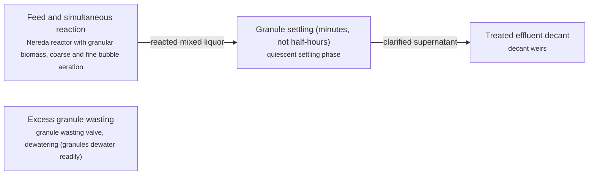

**Key equipment:** Nereda reactor (single-tank cyclic), aeration system, decant weirs, granule wasting and dewatering.

**Performance:**
- footprint vs conventional activated sludge: 0.25-0.5 x; vendor claim: up to 4x smaller footprint. [source](https://www.nereda.net/)
- energy vs conventional activated sludge: 0.5-0.7 x; vendor claim: 20-50% energy saving. [source](https://www.nereda.net/)

**Missing inputs:**
- installed cost per m3/d, dollar year (costs): Licensor does not publish prices. Where: [ICIS Water or Global Water Intelligence cost benchmarks](https://www.globalwaterintel.com/). Next: Ask owner for a priced reference or use a published benchmark (e.g. a reuse-scheme annual report).

Sources: [1](https://www.nereda.net/). Last reviewed 2026-11-13.

## Anaerobic sludge digestion (mesophilic/thermophilic)
<a id="wwt-sludge-digestion"></a>

Standard published practice: thickened sludge is heated and held 15-25 d (mesophilic, ~35 C) or 8-12 d (thermophilic, ~55 C) in complete-mix digesters where methanogens convert volatile solids to biogas (~60% CH4); optional thermal hydrolysis (Cambi/CNS) pretreatment raises biogas yield and dewaterability; digestate is dewatered and the biogas drives CHP or upgrading.

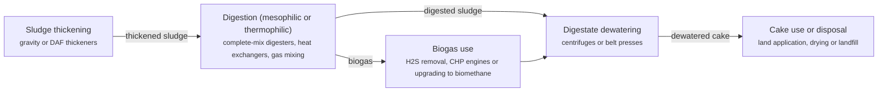

**Key equipment:** complete-mix digesters, heating and gas mixing, biogas handling, dewatering.

**Performance:**
- volatile solids destruction: 40-55 %; published mesophilic digestion range. [source](https://www.veoliawatertech.com/)
- biogas yield: 700-1100 m3/t VS destroyed; published municipal sludge biogas yields. [source](https://www.veoliawatertech.com/)

**Reference plants:**
- Tuas Water Reclamation Park (co-located sludge energy): ; . [source](https://www.pub.gov.sg/)

**Missing inputs:**
- cost per t dry solids, dollar year (costs): Vendor/licensor sites do not publish plant prices. Where: [Global Water Intelligence cost benchmarks](https://www.globalwaterintel.com/). Next: Ask owner for a priced reference or use GWI benchmarks.

Sources: [1](https://www.veoliawatertech.com/). Last reviewed 2026-11-13.

## Biological nutrient removal (BNR)
<a id="wwt-bnr"></a>

Standard published configurations (A2/O, UCT, Bardenpho): anaerobic/anoxic/aerobic zone sequencing lets phosphate-accumulating organisms release and luxury-uptake phosphorus and denitrifiers reduce nitrate with influent carbon; internal mixed-liquor recirculation returns nitrified liquor to the anoxic zone. Commodity process knowledge.

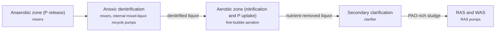

**Key equipment:** zone partitioning, internal recirculation pumps, aeration system.

**Performance:**
- total N to below: 3-10 mg/L; published BNR effluent limits. [source](https://www.veoliawatertech.com/)
- total P to below: 0.1-0.3 mg/L; published BNR effluent limits. [source](https://www.veoliawatertech.com/)

**Missing inputs:**
- cost per m3/d, dollar year (costs): Vendor/licensor sites do not publish plant prices. Where: [Global Water Intelligence cost benchmarks](https://www.globalwaterintel.com/). Next: Ask owner for a priced reference or use GWI benchmarks.

Sources: [1](https://www.veoliawatertech.com/). Last reviewed 2026-11-13.

## Chlorination and dechlorination
<a id="wwt-chlorination"></a>

Dosed chlorine (gas, hypochlorite or on-site electrochlorination) forms hypochlorous acid that inactivates pathogens; a contact basin gives the required CT (concentration x time); where chlorinated organics or aquatic toxicity matter, sulphur-dioxide or bisulphite dechlorination strips residual before discharge.

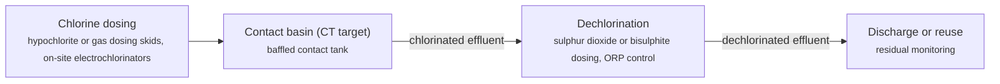

**Key equipment:** dosing skids, contact basin, dechlorination dosing, residual analysers.

**Performance:**
- contact time (CT) for bacteria: 15-30 mg.min/L; published CT targets at typical pH. [source](https://www.evoqua.com/)

**Missing inputs:**
- chemical cost per m3, dollar year (costs): Vendor/licensor sites do not publish operating costs. Where: [Global Water Intelligence cost benchmarks](https://www.globalwaterintel.com/). Next: Ask owner for a priced reference or use GWI benchmarks.

Sources: [1](https://www.evoqua.com/). Last reviewed 2026-11-13.

## Coagulation-flocculation and chemical precipitation
<a id="wwt-coagulation-precipitation"></a>

Standard published practice: rapid mixing of coagulant (alum, ferric, PAC) destabilises colloids; slow flocculation builds settleable flocs; precipitation reagents (lime, caustic, metal sulphide) convert dissolved phosphate, metals and fluoride to insoluble solids removed by clarification; pH trim finishes the train.

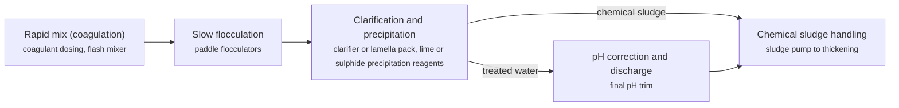

**Key equipment:** chemical dosing systems, flash mixers, flocculators, clarifier.

**Performance:**
- phosphorus removal to below: 0.1-0.5 mg P/L; published enhanced precipitation performance. [source](https://www.veoliawatertech.com/)

**Missing inputs:**
- chemical cost per m3, dollar year (costs): Vendor/licensor sites do not publish plant prices. Where: [Global Water Intelligence cost benchmarks](https://www.globalwaterintel.com/). Next: Ask owner for a priced reference or use GWI benchmarks.

Sources: [1](https://www.veoliawatertech.com/). Last reviewed 2026-11-13.

## Conventional activated sludge
<a id="wwt-activated-sludge"></a>

The workhorse municipal process: primary-settled sewage is aerated with return activated sludge so a flocculent mixed community oxidises BOD and nitrifies ammonia; secondary clarification separates sludge, part returned as RAS, part wasted. Commodity process knowledge; vendors supply aeration and clarification equipment.

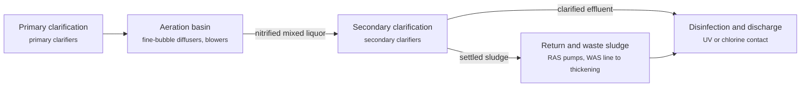

**Key equipment:** aeration blowers and diffusers, secondary clarifiers, RAS/WAS pumping.

**Performance:**
- BOD removal: 90-98 %; published design performance. [source](https://www.xylem.com/)
- design loading: 0.3-1 kg BOD/m3.d; conventional design range. [source](https://www.xylem.com/)

**Reference plants:**
- Changi Water Reclamation Plant, Singapore: ; . [source](https://www.pub.gov.sg/)

**Missing inputs:**
- cost per m3/d, dollar year (costs): Vendor/licensor sites do not publish plant prices. Where: [Global Water Intelligence cost benchmarks](https://www.globalwaterintel.com/). Next: Ask owner for a priced reference or use GWI benchmarks.

Sources: [1](https://www.xylem.com/). Last reviewed 2026-11-13.

## Dissolved air flotation (DAF)
<a id="wwt-daf"></a>

Follows the published Veolia/evoqua DAF flow: coagulated water meets 50-70% recycle flow saturated with air at 4-6 bar, released as 30-100 um microbubbles in a contact zone; flocs float and are scraped off as float sludge; clarified water leaves under weirs. Licensor equipment: saturation vessel, injection nozzles, full-surface scraper.

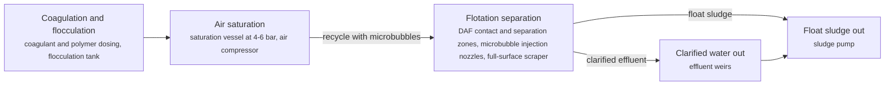

**Key equipment:** saturation vessel, microbubble injection system, DAF basin, scraper.

**Performance:**
- microbubble size: 30-100 um; published DAF design range. [source](https://www.veoliawatertech.com/)
- hydraulic loading rate: 5-15 m/h; typical DAF design HLR. [source](https://www.veoliawatertech.com/)

**Missing inputs:**
- cost per m3/h design flow, dollar year (costs): Vendor/licensor sites do not publish plant prices. Where: [Global Water Intelligence cost benchmarks](https://www.globalwaterintel.com/). Next: Ask owner for a priced reference or use GWI benchmarks.

Sources: [1](https://www.veoliawatertech.com/). Last reviewed 2026-11-13.

## Internal-circulation anaerobic reactor (Paques BIOPAQ IC)
<a id="wwt-anaerobic-internal-circulation"></a>

Follows the Paques BIOPAQ IC licensor flow: a tall (16-28 m) reactor treats wastewater in two stages inside one vessel. In the first stage the upflow anaerobic sludge blanket converts most COD to biogas; the gas is captured in the first separator and the rising gas-lift drives an internal circulation loop that returns the mixed liquor to the reactor bottom without external pumps. The pre-treated water then flows to a second, low-loading polishing stage with a gas separator at the top. The published Paques arrangement is: influent distribution at the bottom, first-stage granular sludge blanket, gas-liquid separator and gas-lift riser/downer forming the internal circulation, second polishing stage, treated-water outlet with optional degassing.

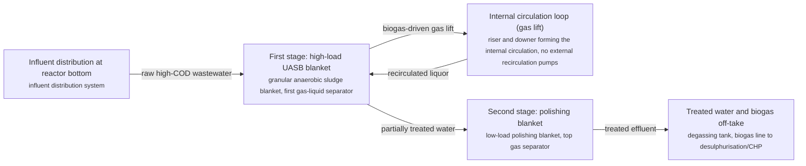

**Key equipment:** BIOPAQ IC reactor vessel (16-28 m tall), internal circulation riser/downer, granular sludge blanket, biogas handling (to THIOPAQ desulphurisation or CHP).

**Performance:**
- COD removal at design load: 80-90 %; vendor-published performance for BIOPAQ IC on high-strength industrial effluent. [source](https://www.paques.nl/products/biopaq-ic)
- volumetric loading capacity advantage vs single-stage UASB: 2-3 x; internal circulation allows higher loads at the same removal. [source](https://www.paques.nl/products/biopaq-ic)

**Missing inputs:**
- reactor cost per kg COD/d, dollar year (costs): Licensor does not publish prices. Where: [ICIS Water or Global Water Intelligence cost benchmarks](https://www.globalwaterintel.com/). Next: Ask owner for a priced reference or use a published benchmark (e.g. a reuse-scheme annual report).

Sources: [1](https://www.paques.nl/products/biopaq-ic). Last reviewed 2026-11-13.

## Lamella and high-rate clarifiers
<a id="wwt-lamella-clarifier"></a>

Follows the published Veolia Actiflo-type high-rate flow: coagulated water plus recirculated microsand forms ballasted flocs that settle on 55-degree inclined lamella plates giving 8-10x the effective settling area; a hydrocyclone recovers microsand and recirculates it, allowing hydraulic loading of 60-120 m/h versus 1-2 m/h conventional.

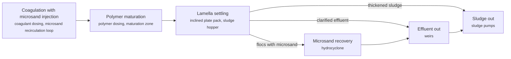

**Key equipment:** lamella plate pack, microsand recirculation with hydrocyclone, flocculation tank.

**Performance:**
- hydraulic loading: 60-120 m/h; published Actiflo design range. [source](https://www.veoliawatertech.com/)

**Missing inputs:**
- cost per m3/h, dollar year (costs): Vendor/licensor sites do not publish plant prices. Where: [Global Water Intelligence cost benchmarks](https://www.globalwaterintel.com/). Next: Ask owner for a priced reference or use GWI benchmarks.

Sources: [1](https://www.veoliawatertech.com/). Last reviewed 2026-11-13.

## Mechanical sludge dewatering
<a id="wwt-sludge-dewatering"></a>

Standard published practice: conditioned sludge (polymer dosed) is dewatered by decanter centrifuges (2,500-4,000 rpm bowl), belt filter presses (gravity drain + wedge press) or membrane/plate filter presses (batch 12-16 bar); cake dryness 18-35% DS depending on device and sludge type; licensor equipment from Alfa Laval, Andritz, Flottweg, HUBER (screw presses).

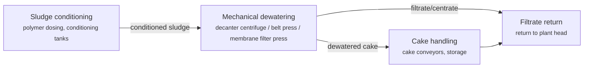

**Key equipment:** decanter centrifuges, belt filter presses, membrane filter presses, polymer system.

**Performance:**
- cake dry solids, centrifuge on digested sludge: 22-30 % DS; published centrifuge performance. [source](https://www.alfalaval.com/)
- cake dry solids, membrane filter press: 30-40 % DS; published filter-press performance. [source](https://www.andritz.com/)

**Missing inputs:**
- cost per t DS, dollar year (costs): Vendor/licensor sites do not publish plant prices. Where: [Global Water Intelligence cost benchmarks](https://www.globalwaterintel.com/). Next: Ask owner for a priced reference or use GWI benchmarks.

Sources: [1](https://www.alfalaval.com/). Last reviewed 2026-11-13.

## Membrane bioreactor (MBR) wastewater treatment
<a id="wwt-membrane-bioreactor"></a>

A membrane bioreactor replaces the secondary clarifier of an activated-sludge plant with a submerged ultrafiltration/microfiltration membrane unit inside (or immediately after) the bioreactor. Mixed liquor is filtered directly at 0.1-0.4 um, giving a solids-free, turbidity-low effluent ready for disinfection or RO reuse, at a much smaller footprint and higher mixed-liquor concentration (8-15 g/L MLSS typical). Per licensor-first rule this card follows the Kubota Submerged Membrane Unit (SMU) flat-plate configuration published by Kubota Water & Environment: coarse screening to fine screening, equalisation, anoxic/aerobic bioreactor, submerged flat-plate membrane tank with coarse-bubble air scour, permeate drawn at low trans-membrane pressure, and in-tank membrane cleaning by backwash with chlorine and periodic recovery chemical clean.

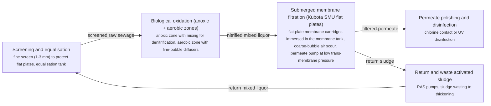

**Key equipment:** submerged flat-plate membrane cartridges (Kubota SMU), membrane tank and air-scour blowers, permeate pumps, fine screens and equalisation.

**Performance:**
- mixed-liquor concentration in membrane tank: 8-15 g MLSS/L; typical submerged MBR operating range (vendor literature). [source](https://kubota-membrane.com/en/mbr-system/)
- permeate turbidity: 0.05-0.2 NTU; flat-plate MBR permeate is effectively solids-free. [source](https://kubota-membrane.com/en/mbr-system/)

**Reference plants:**
- Pantai 2 STP, Kuala Lumpur (underground MBR plant): ; . [source](https://www.iwk.com.my/)

**Missing inputs:**
- installed cost per m3/d with dollar year (costs): Vendor sites do not publish plant-level prices. Where: [ICIS Water or Global Water Intelligence cost benchmarks](https://www.globalwaterintel.com/). Next: Ask owner for a priced reference or use a published benchmark (e.g. a reuse-scheme annual report).

Sources: [1](https://kubota-membrane.com/en/mbr-system/). Last reviewed 2026-11-13.

## Microfiltration and ultrafiltration pretreatment
<a id="wwt-uf-pretreatment"></a>

Follows published licensor flows (Suez ZeeWeed, DuPont): submerged or pressurised hollow-fibre membranes with 0.02-0.1 um pores remove suspended solids, pathogens and colloids from secondary effluent, delivering a low-turbidity feed that lets downstream RO run reliably; periodic backpulse and chemically enhanced backwash maintain flux.

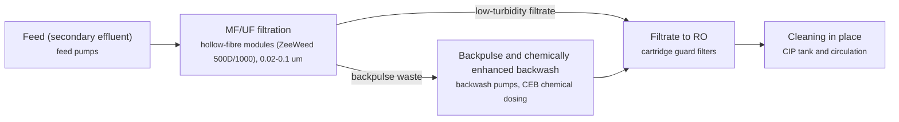

**Key equipment:** hollow-fibre MF/UF modules, backwash/CEB systems, CIP skid.

**Performance:**
- pore size: 0.02-0.1 um; published MF/UF membrane ratings. [source](https://www.suezwatertechnologies.com/)
- filtrate turbidity: 0.05-0.1 NTU; published UF filtrate quality. [source](https://www.suezwatertechnologies.com/)

**Missing inputs:**
- cost per m3/d, dollar year (costs): Vendor/licensor sites do not publish plant prices. Where: [Global Water Intelligence cost benchmarks](https://www.globalwaterintel.com/). Next: Ask owner for a priced reference or use GWI benchmarks.

Sources: [1](https://www.suezwatertechnologies.com/). Last reviewed 2026-11-13.

## Moving bed biofilm reactor (MBBR/IFAS)
<a id="wwt-mbbr"></a>

Follows the Veolia/AnoxKaldnes licensor flow: protected biofilm grows on free-floating polyethylene carrier elements (K1/K3) kept moving by aeration or mixing; retention screens keep carriers in each basin; IFAS retrofits add carriers to existing activated-sludge basins to boost capacity 50-100% without new tanks.

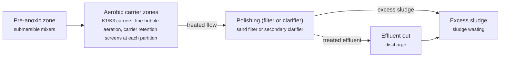

**Key equipment:** biofilm carrier elements, retention screens, aeration system.

**Performance:**
- protected biofilm area: 500-800 m2/m3; AnoxKaldnes K1/K3 published values. [source](https://www.veoliawatertech.com/)
- IFAS capacity boost: 1.5-2 x; published retrofit range. [source](https://www.veoliawatertech.com/)

**Missing inputs:**
- cost per m3/d, dollar year (costs): Vendor/licensor sites do not publish plant prices. Where: [Global Water Intelligence cost benchmarks](https://www.globalwaterintel.com/). Next: Ask owner for a priced reference or use GWI benchmarks.

Sources: [1](https://www.veoliawatertech.com/). Last reviewed 2026-11-13.

## Nanofiltration for selective separations
<a id="wwt-nanofiltration"></a>

Published licensor practice (DuPont FilmTec NF, Toray): spiral-wound NF elements pass monovalent salts but reject divalent ions, organics (200+ Da) and micropollutants at roughly half the pressure of RO; used for softening, selective salt fractionation and polishing in reuse trains.

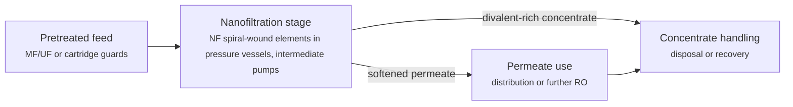

**Key equipment:** NF elements, pressure vessels, pumps.

**Performance:**
- divalent salt rejection: 95-99 %; published FilmTec NF performance. [source](https://www.dupont.com/water.html)
- operating pressure vs RO: 0.4-0.6 x; NF runs at roughly half RO pressure. [source](https://www.dupont.com/water.html)

**Missing inputs:**
- cost per m3/d, dollar year (costs): Vendor/licensor sites do not publish plant prices. Where: [Global Water Intelligence cost benchmarks](https://www.globalwaterintel.com/). Next: Ask owner for a priced reference or use GWI benchmarks.

Sources: [1](https://www.dupont.com/water.html). Last reviewed 2026-11-13.

## Nutrient recovery (struvite and ammonia)
<a id="wwt-struvite-recovery"></a>

Licensor-first (Ostara Pearl published flow): centrate is fed a reactor where Mg and controlled pH precipitate struvite (MgNH4PO4.6H2O) as spherical pellets harvested continuously; Ostara markets the pellets as Crystal Green fertiliser; ammonia-stripping variants recover N as ammonium sulphate; Paques PHOSPAQ pairs struvite with anaerobic ammonium oxidation.

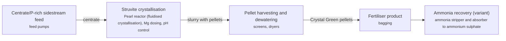

**Key equipment:** struvite crystalliser, Mg dosing, pellet harvesting, ammonia stripper (variant).

**Performance:**
- P recovery from centrate: 80-90 %; published Pearl performance. [source](https://ostara.com/)

**Missing inputs:**
- cost per kg P recovered, dollar year (costs): Vendor/licensor sites do not publish plant prices. Where: [Global Water Intelligence cost benchmarks](https://www.globalwaterintel.com/). Next: Ask owner for a priced reference or use GWI benchmarks.

Sources: [1](https://ostara.com/). Last reviewed 2026-11-13.

## Ozonation and ozone-BAC filtration
<a id="wwt-ozone"></a>

Published licensor practice (Xylem Wedeco): ozone generated from dry air or oxygen by silent corona discharge is dissolved in side-stream injection Contact tanks; O3 oxidises micropollutants, colour and pathogens (CT dose 0.5-3 mg/L), then residual ozone is quenched and water polished on biologically active carbon (BAC); biofilters then colonise with degrading biomass.

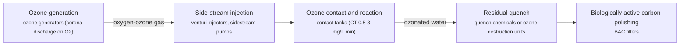

**Key equipment:** ozone generators, side-stream injection, contact tanks, BAC filters.

**Performance:**
- ozone dose for micropollutant control: 0.5-3 mg/L; published ozone dosing. [source](https://www.xylem.com/)
- micropollutant removal: 80-99 %; published ozone-BAC performance. [source](https://www.xylem.com/)

**Missing inputs:**
- cost per m3/d, dollar year (costs): Vendor/licensor sites do not publish plant prices. Where: [Global Water Intelligence cost benchmarks](https://www.globalwaterintel.com/). Next: Ask owner for a priced reference or use GWI benchmarks.

Sources: [1](https://www.xylem.com/). Last reviewed 2026-11-13.

## Potable reuse schemes (IPR/DPR)
<a id="wwt-potable-reuse-schemes"></a>

Scheme-level card: advanced purification (MF/UF + RO + UV/AOP per wwt-ro-reuse-train) is inserted between secondary treatment and the potable network, either indirectly (reservoir/aquifer environmental buffer, IPR) or directly (DPR with engineered storage and intensified monitoring); Singapore NEWater (PUB) is the flagship SEA reference meeting up to 40% of demand.

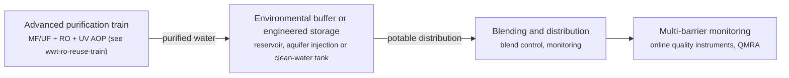

**Key equipment:** advanced purification train, environmental buffer or engineered storage, quality monitoring.

**Performance:**
- NEWater share of Singapore demand: 30-40 %; PUB published NEWater contribution. [source](https://www.pub.gov.sg/)

**Reference plants:**
- Changi WRP (Singapore, NEWater supplier): ; . [source](https://www.pub.gov.sg/)
- Tuas Water Reclamation Park (Singapore, under construction): ; . [source](https://www.pub.gov.sg/)

**Missing inputs:**
- cost per m3 purified, dollar year (costs): Vendor/licensor sites do not publish plant prices. Where: [Global Water Intelligence cost benchmarks](https://www.globalwaterintel.com/). Next: Ask owner for a priced reference or use GWI benchmarks.

Sources: [1](https://www.pub.gov.sg/). Last reviewed 2026-11-13.

## Produced-water treatment (oil and gas fields)
<a id="wwt-produced-water-treatment"></a>

Standard published produced-water practice: degassing and desanding, multi-stage induced gas flotation for dispersed oil, hydrocyclones or nut-shell filters for tight oil removal, then polishing to reinjection or discharge standards; bridges the WWT sector to upstream operations.

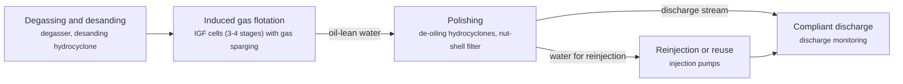

**Key equipment:** IGF cells, de-oiling hydrocyclones, nut-shell filters, reinjection pumps.

**Performance:**
- oil-in-water after treatment: 10-30 mg/L; typical discharge compliance range. [source](https://www.frames-group.com/)

**Reference plants:**
- Pengerang Integrated Complex effluent systems: ; . [source](https://www.petronas.com/)

**Missing inputs:**
- cost per m3/d, dollar year (costs): Vendor/licensor sites do not publish plant prices. Where: [Global Water Intelligence cost benchmarks](https://www.globalwaterintel.com/). Next: Ask owner for a priced reference or use GWI benchmarks.

Sources: [1](https://www.veoliawatertech.com/). Last reviewed 2026-11-13.

## Reverse-osmosis water reuse train (NEWater-style)
<a id="wwt-ro-reuse-train"></a>

Follows the published advanced-purification (NEWater-style) train with licensor membrane equipment: secondary effluent passes microfiltration/ultrafiltration (licensor: Suez ZeeWeed / DuPont), then cartridge filtration, then reverse osmosis at high pressure (DuPont FilmTec / Hydranautics elements), then UV disinfection/advanced oxidation and mineralisation. The RO stage rejects salts, organics, pathogens and trace contaminants; UV destroys trace organics and provides a second pathogen barrier; conditioning restores hardness and pH for distribution.

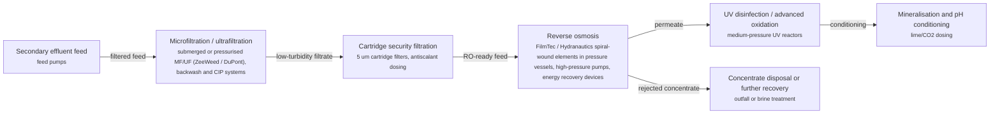

**Key equipment:** MF/UF membrane systems, RO trains with energy recovery, UV/AOP reactors, cleaning-in-place skids.

**Performance:**
- RO permeate recovery in reuse trains: 75-85 %; typical municipal reuse RO design recovery. [source](https://www.dupont.com/water.html)
- log removal of pathogens across full train: 8-12 log; multi-barrier claim of advanced purification schemes. [source](https://www.dupont.com/water.html)

**Missing inputs:**
- installed cost per m3/d with dollar year (costs): OEM sites do not publish train prices. Where: [ICIS Water or Global Water Intelligence cost benchmarks](https://www.globalwaterintel.com/). Next: Ask owner for a priced reference or use a published benchmark (e.g. a reuse-scheme annual report).

Sources: [1](https://www.dupont.com/water.html). Last reviewed 2026-11-13.

## Screening and grit removal
<a id="wwt-screening-grit"></a>

The first barrier of any plant: coarse and fine screens stop rags and plastics; grit chambers settle sand before biological stages. Follows standard published headworks practice (HUBER published equipment flows: bar/fine screens followed by grit washers and classifiers).

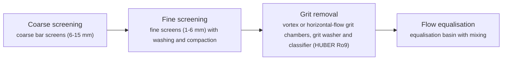

**Key equipment:** coarse and fine screens, screenings washer-compactor, grit chamber, grit classifier.

**Performance:**
- screen opening range: 0.75-15 mm; coarse to fine screening openings. [source](https://www.huber.de/)
- grit removal at 0.2 mm: 90-95 %; vortex grit chamber design range. [source](https://www.huber.de/)

**Missing inputs:**
- installed cost per m3/d design flow, dollar year (costs): Vendor/licensor sites do not publish plant prices. Where: [Global Water Intelligence cost benchmarks](https://www.globalwaterintel.com/). Next: Ask owner for a priced reference or use GWI benchmarks.

Sources: [1](https://www.huber.de/). Last reviewed 2026-11-13.

## Sequencing batch reactor (SBR)
<a id="wwt-sbr"></a>

A fill-and-draw activated sludge variant: all treatment phases run sequentially in one basin per cycle (fill, react, settle, decant, idle), eliminating secondary clarifiers and RAS pumping; licensor equipment (Aqua-Aerobic decanters, Veolia configurations) supplies the decanter and cycle control.

```mermaid
flowchart LR
    FILL["Fill (static, mixed or aerated)<br/><small>influent valves, mixers and aerators</small>"]
    REACT["React (aerated and anoxic phases)<br/><small>fine-bubble aeration, mixers</small>"]
    SETTLE["Settle (quiescent)<br/><small>no equipment active</small>"]
    DECANT["Decant treated effluent<br/><small>decanter weirs</small>"]
    IDLE["Idle and sludge wasting<br/><small>WAS pumps</small>"]
    FILL --> REACT
    REACT -->|reacted liquor| SETTLE
    SETTLE --> DECANT
    DECANT -->|effluent out| IDLE
```

**Key equipment:** decanter weirs, aeration system, cycle control PLC.

**Performance:**
- BOD and N removal: 90-95 %; published SBR performance. [source](https://www.veoliawatertech.com/)

**Missing inputs:**
- cost per m3/d, dollar year (costs): Vendor/licensor sites do not publish plant prices. Where: [Global Water Intelligence cost benchmarks](https://www.globalwaterintel.com/). Next: Ask owner for a priced reference or use GWI benchmarks.

Sources: [1](https://www.veoliawatertech.com/). Last reviewed 2026-11-13.

## Sludge incineration and co-incineration
<a id="wwt-sludge-incineration"></a>

Published practice: dewatered sludge is fired in fluidised-bed or multiple-hearth furnaces (self-sustaining above ~28% DS with heat recovery to steam/hot flue gas); flue gas cleaning (SNCR, fabric filters, wet scrubbers) meets EU IED; mono-ash retains phosphorus for recovery (e.g. EasyMining Ash2Product); co-incineration routes sludge to cement kilns or coal plants.

```mermaid
flowchart LR
    FEED["Dewatered sludge feed<br/><small>piston pumps or belt feeders</small>"]
    FBC["Fluidised-bed incineration<br/><small>fluidised-bed furnace (850+ C), sand bed</small>"]
    FGT["Flue gas treatment<br/><small>SNCR, fabric filter, wet scrubber stages</small>"]
    STACK["Stack and monitoring<br/><small>CEMS</small>"]
    ASH["Ash handling and P recovery (option)<br/><small>ash silos, Ash2Product-type recovery</small>"]
    FEED -->|sludge fuel| FBC
    FBC -->|hot flue gas| FGT
    FGT -->|clean gas| STACK
    STACK --> ASH
```

**Key equipment:** fluidised-bed furnace, flue gas treatment, ash handling.

**Performance:**
- furnace temperature: 850-950 C; published fluidised-bed operation. [source](https://www.veoliawatertech.com/)

**Missing inputs:**
- cost per t DS, dollar year (costs): Vendor/licensor sites do not publish plant prices. Where: [Global Water Intelligence cost benchmarks](https://www.globalwaterintel.com/). Next: Ask owner for a priced reference or use GWI benchmarks.

Sources: [1](https://www.veoliawatertech.com/). Last reviewed 2026-11-13.

## Sludge thickening
<a id="wwt-sludge-thickening"></a>

Removes free water before digestion or dewatering: gravity thickeners settle sludge to 2-5% DS, DAF thickeners to 4-6% DS (better for waste activated sludge with poor settleability), rotary drum and gravity-belt thickeners to 4-8% DS with polymer; higher feed solids cut digester volume and dewatering load.

```mermaid
flowchart LR
    FEED["Sludge feed and screening<br/><small>sludge screens</small>"]
    THICK["Thickening<br/><small>gravity thickener / DAF thickener / rotary drum thickener with polymer</small>"]
    THK["Thickened sludge out<br/><small>sludge pumps to digestion</small>"]
    OVF["Overflow and filtrate return<br/><small>return to plant head</small>"]
    FEED --> THICK
    THICK -->|thickened sludge| THK
    THK --> OVF
```

**Key equipment:** gravity or DAF thickener, rotary drum thickener, polymer dosing.

**Performance:**
- thickened solids, gravity: 2-5 % DS; published gravity thickener range. [source](https://www.huber.de/)
- thickened solids, drum thickener: 4-8 % DS; published drum thickener performance. [source](https://www.huber.de/)

**Missing inputs:**
- cost per t DS, dollar year (costs): Vendor sites do not publish plant prices. Where: [Global Water Intelligence cost benchmarks](https://www.globalwaterintel.com/). Next: Ask owner for a priced reference or use GWI benchmarks.

Sources: [1](https://www.huber.de/). Last reviewed 2026-11-13.

## Thermal sludge drying and pyrolysis
<a id="wwt-sludge-drying"></a>

Published practice (Andritz, HUBER, KOPF): dewatered cake (20-28% DS) is dried with waste heat or steam in belt/drum dryers to 90%+ DS (biosolids pellets); pyrolysis variants heat sludge 400-600 C oxygen-free to biochar and syngas, now scaling as a phosphorus-recovery route; evaporated water condensate returns to the plant head.

```mermaid
flowchart LR
    FEED["Dewatered cake feed<br/><small>cake pumps and feeders</small>"]
    DRY["Thermal drying<br/><small>belt or drum dryer (low-temperature, waste-heat driven)</small>"]
    PELLET["Pelletising and storage<br/><small>pellet mills, silos</small>"]
    PYRO["Pyrolysis (variant route)<br/><small>pyrolysis kiln 400-600 C</small>"]
    CHAR["Biochar product<br/><small>char handling</small>"]
    FEED -->|wet cake| DRY
    DRY -->|dried granules| PELLET
    PELLET --> PYRO
    PYRO -->|biochar| CHAR
```

**Key equipment:** belt/drum dryers, pellet mills, pyrolysis kiln (variant).

**Performance:**
- dried solids content: 90-95 % DS; published dryer output. [source](https://www.huber.de/)

**Missing inputs:**
- cost per t DS, dollar year (costs): Vendor/licensor sites do not publish plant prices. Where: [Global Water Intelligence cost benchmarks](https://www.globalwaterintel.com/). Next: Ask owner for a priced reference or use GWI benchmarks.

Sources: [1](https://www.andritz.com/products-separation). Last reviewed 2026-11-13.

## Trickling filters and rotating biological contactors
<a id="wwt-trickling-filters"></a>

Attached-growth on fixed media: wastewater trickles over rock or plastic media colonised by biofilm; air drawn through by natural or forced ventilation supplies oxygen; a secondary clarifier with recirculation settles sloughed biomass. RBCs rotate partially submerged discs in the flow for the same biofilm effect with low power demand.

```mermaid
flowchart LR
    PRIM["Primary settlement<br/><small>primary clarifier</small>"]
    TF["Trickling filter bed<br/><small>rock or plastic media (2-10 m deep), rotary distributor, ventilation</small>"]
    SEC["Secondary clarification<br/><small>humus tank</small>"]
    REC["Recirculation and sludge<br/><small>recirculation pumps, humus sludge wasting</small>"]
    OUT["Effluent out<br/><small>disinfection</small>"]
    PRIM --> TF
    TF -->|biofilm-treated flow| SEC
    SEC -->|sloughed biomass| REC
    SEC -->|treated effluent| OUT
    REC --> OUT
```

**Key equipment:** filter media and distributor, secondary clarifier, recirculation pumps, RBC shafts and discs (variant).

**Performance:**
- BOD removal per pass: 70-90 %; published trickling-filter performance. [source](https://www.westech-inc.com/)
- organic loading (low-rate): 0.08-0.4 kg BOD/m3.d; published loading bands. [source](https://www.westech-inc.com/)

**Missing inputs:**
- cost per m3/d, dollar year (costs): Vendor/licensor sites do not publish plant prices. Where: [Global Water Intelligence cost benchmarks](https://www.globalwaterintel.com/). Next: Ask owner for a priced reference or use GWI benchmarks.

Sources: [1](https://www.westech-inc.com/). Last reviewed 2026-11-13.

## UV disinfection
<a id="wwt-uv-disinfection"></a>

Published licensor practice (Trojan, Xylem Wedeco): water passes banks of low-pressure or medium-pressure UV lamps (or emerging LED arrays) emitting ~254 nm UV-C that damages microbial DNA/UV-C proteins at a delivered dose of 20-100 mJ/cm2; no chemical residual, no DBPs; reactors sized with validated dose-monitoring and automatic lamp-intensity control.

```mermaid
flowchart LR
    FEED["Filtered effluent feed<br/><small>feed channel</small>"]
    UV["UV reactor exposure<br/><small>low- or medium-pressure lamp banks (Trojan UVSwift/UltraFlow), dose monitoring sensors, automatic wipers</small>"]
    OUT["Disinfected outfall<br/><small>discharge</small>"]
    MAINT["Lamp maintenance<br/><small>sleeve wiping, lamp replacement schedule</small>"]
    FEED --> UV
    UV -->|disinfected water| OUT
    OUT --> MAINT
```

**Key equipment:** UV lamp banks, dose sensors, wiping systems.

**Performance:**
- delivered UV dose: 20-100 mJ/cm2; published municipal dose range. [source](https://www.trojantechnologies.com/)
- log reduction of bacteria/viruses: 4-6 log; published UV performance. [source](https://www.trojantechnologies.com/)

**Missing inputs:**
- cost per m3/d, dollar year (costs): Vendor/licensor sites do not publish plant prices. Where: [Global Water Intelligence cost benchmarks](https://www.globalwaterintel.com/). Next: Ask owner for a priced reference or use GWI benchmarks.

Sources: [1](https://www.trojantechnologies.com/). Last reviewed 2026-11-13.

## Upflow anaerobic sludge blanket (UASB/EGSB)
<a id="wwt-uasb"></a>

Follows the Paques BIOPAQ UASB licensor flow: wastewater is fed evenly at the bottom of a tall reactor and flows upward through a dense blanket of anaerobic granular sludge that converts COD to biogas; a three-phase (gas-liquid-solid) separator at the top retains granules, degasses the effluent and discharges treated water. EGSB adds higher upflow velocities and effluent recirculation for dilute streams.

```mermaid
flowchart LR
    FEED["Bottom influent distribution<br/><small>distribution nozzles</small>"]
    BLANKET["Granular sludge blanket (COD to biogas)<br/><small>granular anaerobic sludge blanket</small>"]
    SEP["Three-phase separator<br/><small>gas-liquid-solid separator at reactor top</small>"]
    OUT["Treated water out<br/><small>degassing and outlet weirs</small>"]
    GAS["Biogas off-take<br/><small>biogas line to desulphurisation and CHP</small>"]
    FEED --> BLANKET
    BLANKET -->|liquor with gas| SEP
    SEP -->|treated effluent| OUT
    SEP -->|biogas| GAS
    OUT --> GAS
```

**Key equipment:** UASB/EGSB reactor, three-phase separator, granular sludge, biogas handling.

**Performance:**
- COD removal: 70-90 %; published UASB performance on industrial effluent. [source](https://www.paques.nl/)
- organic loading rate: 5-20 kg COD/m3.d; published UASB design range. [source](https://www.paques.nl/)

**Missing inputs:**
- reactor cost per kg COD/d, dollar year (costs): Vendor/licensor sites do not publish plant prices. Where: [Global Water Intelligence cost benchmarks](https://www.globalwaterintel.com/). Next: Ask owner for a priced reference or use GWI benchmarks.

Sources: [1](https://www.paques.nl/products/biopaq-uasb). Last reviewed 2026-11-13.

## Water minimisation and reuse pinch for industry
<a id="wwt-water-pinch"></a>

Mass-exchange pinch analysis treats water as a network resource: each use has a limiting contaminant concentration, so streams can be cascaded from the cleanest duty to the dirtiest before treatment. Targeting gives the minimum fresh-water and wastewater flows, and a regenerator (DAF, membrane, ion exchange) placed at the pinch relaxes the constraint, cutting both intake and downstream ZLD load.

```mermaid
flowchart LR
    AUDIT["Water audit and contaminant data<br/><small>stream characterisation (COD, TDS, hardness, oil)</small>"]
    TARGET["Pinch targeting<br/><small>mass-exchange pinch analysis software</small>"]
    NET["Water network design<br/><small>cascade reuse network, regenerator placement</small>"]
    REG["Partial regeneration<br/><small>DAF / membrane / ion exchange regenerator</small>"]
    REUSE["Reuse and discharge<br/><small>reuse allocation and final effluent</small>"]
    AUDIT --> TARGET
    TARGET --> NET
    NET -->|streams needing treatment| REG
    REG -->|regenerated water| REUSE
```

**Key equipment:** pinch analysis software, regenerator units, monitoring instrumentation.

**Performance:**
- fresh-water reduction typical of a pinch retrofit: 20-40 %; published industrial water-pinch case range. [source](https://www.metito.com/)

**Missing inputs:**
- consultancy cost per study, dollar year (costs): Advisory firms do not publish study prices. Where: Ask the owner for a benchmarked study cost. Next: Ask owner for a priced reference.

Sources: [1](https://www.metito.com/). Last reviewed 2026-11-13.

## Zero liquid discharge (ZLD)
<a id="wwt-zld"></a>

Licensor-first (Aquatech published trains): pretreated wastewater passes membrane concentration (RO/HERO), then mechanical vapour-recompression or falling-film evaporators, then spray-dryers or forced-circulation crystallisers; distillate is recycled to process and salts crystallise as a solid product/waste — no liquid discharge. Aquatech published performance: brine concentrated to >250,000 mg/L TDS; distillate <10 mg/L.

```mermaid
flowchart LR
    PRE["Membrane concentration<br/><small>RO or HERO pretreatment trains</small>"]
    EVAP["Evaporation (MVR/falling film)<br/><small>mechanical vapour recompression evaporators</small>"]
    CRYST["Crystallisation<br/><small>forced-circulation crystallisers or spray dryers</small>"]
    SALT["Salt solids handling<br/><small>drying, bagging</small>"]
    DIST["Distillate recycle<br/><small>polish, return to process</small>"]
    PRE -->|pre-concentrated brine| EVAP
    EVAP -->|further concentrated liquor| CRYST
    CRYST -->|salt solids| SALT
    CRYST -->|distillate| DIST
    SALT --> DIST
```

**Key equipment:** RO/HERO concentration, MVR evaporators, crystallisers, salt handling.

**Performance:**
- distillate quality: 1-10 mg/L TDS; Aquatech published ZLD performance. [source](https://www.aquatech.com/)
- brine concentration reached: 200000-280000 mg/L TDS; Aquatech published ZLD performance. [source](https://www.aquatech.com/)

**Missing inputs:**
- cost per m3/d, dollar year (costs): Vendor/licensor sites do not publish plant prices. Where: [Global Water Intelligence cost benchmarks](https://www.globalwaterintel.com/). Next: Ask owner for a priced reference or use GWI benchmarks.

Sources: [1](https://www.aquatech.com/). Last reviewed 2026-11-13.

## Advanced oxidation processes (AOP)
<a id="wwt-aop"></a>

Published practice: hydroxyl radicals are generated by UV/H2O2, UV/persulfate, O3/H2O2 or photo-Fenton systems; radicals non-selectively oxidise compounds ozone alone misses; applied after conventional treatment on relatively clean matrices; licensor equipment: UV-AOP reactors (Trojan/Xylem), peroxide/persulfate dosing.

```mermaid
flowchart LR
    PRE["Polished feed<br/><small>filtered, low-turbidity feed</small>"]
    OX["Radical generation and oxidation<br/><small>UV/H2O2 or UV/persulfate reactors (Trojan UV AOP), chemical dosing</small>"]
    POST["Residual quench and polishing<br/><small>quench, GAC polish</small>"]
    PRE --> OX
    OX -->|oxidised water| POST
```

**Key equipment:** UV-AOP reactors, chemical dosing, quench/polish.

**Performance:**
- trace-organism removal: 70-95 %; published AOP performance on trace organics. [source](https://www.trojantechnologies.com/)

**Missing inputs:**
- cost per m3, dollar year (costs): Vendor/licensor sites do not publish plant prices. Where: [Global Water Intelligence cost benchmarks](https://www.globalwaterintel.com/). Next: Ask owner for a priced reference or use GWI benchmarks.

Sources: [1](https://www.trojantechnologies.com/). Last reviewed 2026-11-13.

## Anaerobic membrane bioreactor (AnMBR)
<a id="wwt-anmbr"></a>

Combines anaerobic treatment with membrane solids retention: an anaerobic reactor (CSTR or UASB-style) paired with submerged or sidestream UF/MF membranes holds all biomass and solids, enabling long SRT at short HRT, biogas capture from dilute feeds and a solids-free effluent; licensor equipment follows Kubota/ADI published configurations (submerged flat-plate or hollow-fibre modules under gas scour).

```mermaid
flowchart LR
    REACT["Anaerobic reactor<br/><small>complete-mix or upflow anaerobic reactor, mixing and heating</small>"]
    MEM["Membrane solids retention<br/><small>submerged UF/MF modules with gas scour, permeate pump</small>"]
    PERM["Permeate polishing<br/><small>nutrient or sulphide polishing as needed</small>"]
    GAS["Biogas capture<br/><small>gas dome and handling</small>"]
    RAS["Biomass return<br/><small>recirculation pumps</small>"]
    REACT -->|digested liquor| MEM
    MEM -->|solids-free permeate| PERM
    MEM -->|retained biomass| RAS
    PERM --> GAS
    GAS --> RAS
```

**Key equipment:** anaerobic reactor, submerged membrane modules, biogas handling.

**Performance:**
- COD removal: 85-95 %; published AnMBR performance on industrial effluent. [source](https://kubota-membrane.com/)
- operating flux: 7-15 LMH; typical submerged AnMBR flux. [source](https://kubota-membrane.com/)

**Missing inputs:**
- cost per m3/d, dollar year (costs): Vendor/licensor sites do not publish plant prices. Where: [Global Water Intelligence cost benchmarks](https://www.globalwaterintel.com/). Next: Ask owner for a priced reference or use GWI benchmarks.

Sources: [1](https://kubota-membrane.com/). Last reviewed 2026-11-13.

## Brine concentration and selective salt recovery
<a id="wwt-brine-concentration"></a>

Steps ahead of full ZLD: high-pressure RO/HERO, membrane distillation or electrodialysis reversal push brine from a typical 4-8% up to 15-25% salt, cutting evaporator duty; nanofiltration fractionation or selective crystallisation then splits mixed brine into saleable single salts (NaCl, Na2SO4) instead of a mixed waste.

```mermaid
flowchart LR
    FEED["Brine feed and softening<br/><small>softening if needed</small>"]
    CONC["Concentration<br/><small>high-pressure RO / HERO / membrane distillation / EDR</small>"]
    FRAC["Selective salt recovery<br/><small>nanofiltration fractionation, crystallisers for single salts</small>"]
    SALT["Salt product handling<br/><small>drying and bagging</small>"]
    PERM["Permeate recycle<br/><small>polish before reuse</small>"]
    FEED --> CONC
    CONC -->|concentrated brine| FRAC
    CONC -->|permeate to reuse| PERM
    FRAC -->|single-salt product| SALT
    SALT --> PERM
```

**Key equipment:** high-pressure RO or HERO, membrane distillation or EDR, crystallisers.

**Performance:**
- brine concentration reached before evaporation: 15-25 % salt; published concentration targets. [source](https://www.aquatech.com/)

**Missing inputs:**
- cost per m3 of brine, dollar year (costs): Vendor sites do not publish plant prices. Where: [Global Water Intelligence cost benchmarks](https://www.globalwaterintel.com/). Next: Ask owner for a priced reference or use GWI benchmarks.

Sources: [1](https://www.aquatech.com/). Last reviewed 2026-11-13.

## Forward osmosis
<a id="wwt-forward-osmosis"></a>

Published pilot practice (Modern Water, Oasys): water diffuses across a dense active layer driven by an osmotic draw solution instead of hydraulic pressure, giving low-fouling concentration of difficult feeds; the draw is then regenerated (RO, distillation) releasing clean water; commercial deployment remains niche.

```mermaid
flowchart LR
    FO["FO membrane stage<br/><small>spiral or plate FO modules, draw solution circulation</small>"]
    REGEN["Draw regeneration<br/><small>RO or distillation regeneration</small>"]
    PROD["Product water out<br/><small>polishing</small>"]
    CONC["Concentrated feed out<br/><small>disposal or recovery</small>"]
    FO -->|diluted draw| REGEN
    REGEN -->|product water| PROD
    PROD --> CONC
```

**Key equipment:** FO membrane modules, draw solution loop, draw regeneration.

**Performance:**
- water flux: 10-25 LMH; published FO pilot fluxes. [source](https://www.ostara.com/)

**Missing inputs:**
- cost per m3, dollar year (costs): Vendor/licensor sites do not publish plant prices. Where: [Global Water Intelligence cost benchmarks](https://www.globalwaterintel.com/). Next: Ask owner for a priced reference or use GWI benchmarks.

Sources: [1](https://www.suezwatertechnologies.com/). Last reviewed 2026-11-13.
