# WWT technology options

33 technologies, from commercial to lab stage. Generated from catalog/technologies/; every figure links to its source.

| Technology | Category | Maturity | TRL | Suppliers | Cost figures |
| --- | --- | --- | --- | --- | --- |
| [Aerobic granular sludge treatment (Nereda)](#wwt-aerobic-granular-sludge) | Biological treatment | commercial |  | Royal HaskoningDHV (Nereda aerobic granular sludge technology (licensor)) | installed capital cost, AGS plus tertiary UF upgrade: 1863 NIS per m3/d of capacity |
| [Anaerobic sludge digestion (mesophilic/thermophilic)](#wwt-sludge-digestion) | Sludge and biogas | commercial |  | Veolia (digestion configurations); Cambi (thermal hydrolysis pretreatment); Xergi (digester packages) | capital cost, two-stage anaerobic digestion system, 12 MGD plant (Grand Island, Nebraska): 10.7 USD million (2006$)<br>capital cost, two-stage TPAD anaerobic digestion system, 43 MGD plant (WLSSD Duluth): 32.6 USD million (2006$)<br>operation and maintenance cost, anaerobic digestion: 9.39-51.51 USD per dry ton through the digesters (1999$) |
| [Biological nutrient removal (BNR)](#wwt-bnr) | Biological treatment | commercial |  | Jacobs (BNR process consulting); Veolia (BNR configurations) | capital cost, BNR retrofit: 588000-6.972e+06 USD per mgd of capacity (2006$) |
| [Chlorination and dechlorination](#wwt-chlorination) | Disinfection and advanced oxidation | commercial |  | Evoqua Water Technologies (chlorination and dechlorination systems); Xylem (disinfection dosing) | annualised capital cost, chlorination plus dechlorination plus fire-code compliance: 1.127e+06-1.434e+07 USD per mgd of capacity (1995$)<br>chemical-only disinfectant cost, sodium hypochlorite: 0.0166-0.066 USD per m3 treated (2024$) |
| [Coagulation-flocculation and chemical precipitation](#wwt-coagulation-precipitation) | Physical and chemical treatment | commercial |  | Kemira (coagulants and polymers); Veolia (turnkey chemical treatment trains) | bulk coagulant price, liquid alum (iron-free): 152-269 USD per tonne (2000$) |
| [Conventional activated sludge](#wwt-activated-sludge) | Biological treatment | commercial |  | Xylem (Sanitaire aeration systems); Suez (aeration and clarification) | capital cost, extended-aeration activated sludge package plant, per gallon per day of capacity (plants above 0.02 MGD): 2-2.5 USD per gallon per day (2000$)<br>capital cost, extended-aeration activated sludge package plant, per gallon per day of capacity (plants below 0.02 MGD): 4-6 USD per gallon per day (2000$)<br>plant electricity use, secondary treatment including sludge management: 1500-1700 kWh per million gallons treated<br>electricity cost, secondary treatment including sludge management: 0.036-0.0405 USD per m3 treated |
| [Dissolved air flotation (DAF)](#wwt-daf) | Physical and chemical treatment | commercial |  | Veolia (DAF flotation systems); Evoqua (DAF systems) | total installed cost, dissolved air flotation thickener: 2640 USD per m3/h of design flow |
| [Internal-circulation anaerobic reactor (Paques BIOPAQ IC)](#wwt-anaerobic-internal-circulation) | Anaerobic treatment | commercial |  | Paques (BIOPAQ IC / ICX internal-circulation reactors; BIOPAQ UASB family) |  |
| [Lamella and high-rate clarifiers](#wwt-lamella-clarifier) | Physical and chemical treatment | commercial |  | Veolia (Actiflo high-rate clarifier); WesTech (lamella clarifiers) | equipment cost, lamella settler in SUS 304: 300-600 USD per m3/h of design flow (2026$) |
| [Mechanical sludge dewatering](#wwt-sludge-dewatering) | Sludge and biogas | commercial |  | Alfa Laval (decanters for sludge); Andritz (belt and filter presses); Flottweg (Tricanter/decanters); HUBER SE (screw presses (Q-PRESS)) | capital cost, belt filter press (0.5 m belt, about 500 dry lb/h): 47500 USD per press (2000$)<br>capital cost, belt filter press (1.5 m belt, about 1,625 dry lb/h): 115000 USD per press (2000$)<br>operation and maintenance cost, belt filter press: 80-200 USD per dry ton of solids (2000$) |
| [Membrane bioreactor (MBR) wastewater treatment](#wwt-membrane-bioreactor) | Biological treatment | commercial |  | Kubota (Submerged Membrane Unit (SMU) flat-plate MBR, marketed since 1985); Suez (ZeeWeed hollow-fibre MBR); Toray (submerged flat-sheet MBR modules); Mitsubishi Chemical Aqua Solutions (submerged MBR membrane) | installed capital cost, MBR package plant: 7-20 USD per gallon per day (2007$)<br>installed capital cost, MBR plus granular activated carbon (12 MGD design, Loudoun County VA): 12 USD per gallon per day (2007$) |
| [Microfiltration and ultrafiltration pretreatment](#wwt-uf-pretreatment) | Membrane and reuse | commercial |  | Suez (ZeeWeed 500D/1000 hollow-fibre UF); DuPont Water Solutions (IntegraFlux UF) | installed capital cost, hollow-fibre UF ahead of NF: 0.67 USD per gallon per day (2018$) |
| [Moving bed biofilm reactor (MBBR/IFAS)](#wwt-mbbr) | Biological treatment | commercial |  | Veolia (AnoxKaldnes MBBR carriers and process licensor); Headworks BIO (carrier media) | packaged MBBR plant, equipment: 4160 USD per m3/d of capacity |
| [Nanofiltration for selective separations](#wwt-nanofiltration) | Membrane and reuse | commercial |  | DuPont Water Solutions (FilmTec NF270 family); Toray (NFC/NF elements) | installed capital cost, hollow-fibre loose NF with sand filtration: 1.96-2.49 USD per gallon per day (2018$) |
| [Nutrient recovery (struvite and ammonia)](#wwt-struvite-recovery) | Resource recovery and ZLD | commercial |  | Ostara (Pearl process and Crystal Green fertiliser); Paques (PHOSPAQ combined recovery) | break-even cost, electrochemical struvite recovery: 6.03 USD per kg struvite recovered (2022$)<br>break-even cost per kg phosphorus recovered: 47.9 USD per kg P (2022$) |
| [Ozonation and ozone-BAC filtration](#wwt-ozone) | Disinfection and advanced oxidation | commercial |  | Xylem (Wedeco ozone systems); Primozone (high-concentration ozone generation) | annual operation and maintenance cost, 1 MGD ozone disinfection system, excluding power: 18500 USD per year (1998$)<br>total installed capital cost, ozone disinfection: 389000 USD per mgd of capacity (1998$) |
| [Potable reuse schemes (IPR/DPR)](#wwt-potable-reuse-schemes) | Membrane and reuse | commercial |  | Singapore PUB (NEWater scheme owner (operating model)); Suez (advanced purification equipment) | treated water cost, indirect potable reuse (full advanced treatment): 2.8-4.1 USD per 1,000 gallons |
| [Produced-water treatment (oil and gas fields)](#wwt-produced-water-treatment) | Physical and chemical treatment | commercial |  | Frames Group (produced-water packages); CETCO (CROSFLOW produced-water membranes) | capital cost, advanced produced-water treatment complex (MBBR + evaporation/crystallisation): 4583 USD per barrel per day of capacity (2015$) |
| [Reverse-osmosis water reuse train (NEWater-style)](#wwt-ro-reuse-train) | Membrane and reuse | commercial |  | DuPont Water Solutions (FilmTec RO and NF elements); Nitto (Hydranautics) (CPA/ESPA RO elements); Toray (ROMEMBRA RO elements); Suez (ZeeWeed MF/UF) | installed capital cost, potable reuse train (MF/RO/UVAOP): 6 USD per gallon per day (2013$) |
| [Screening and grit removal](#wwt-screening-grit) | Physical and chemical treatment | commercial |  | HUBER SE (Ro9 grit treatment, ROTAMAT screens); Hydro International (vortex grit separators) | construction cost, headworks screening facility: 98-108 USD per m3/d of design flow (2019$) |
| [Sequencing batch reactor (SBR)](#wwt-sbr) | Biological treatment | commercial |  | Aqua-Aerobic Systems (SBR decanters and Selector technology); Veolia (SBR configurations) | operation and maintenance cost, sequencing batch reactor: 800-2000 USD per million gallons treated (1999$)<br>installed cost, SBR system: 1.65-5 USD per gallon per day of capacity (1998$) |
| [Sludge incineration and co-incineration](#wwt-sludge-incineration) | Sludge and biogas | commercial |  | Veolia (sludge incineration operations); Hitachi Zosen (sludge incineration plants) | operating cost, biosolids incineration: 83-269 USD per dry Mg (2002$)<br>capital cost, new fluidised-bed incineration facility: 60000 USD per dry tonne per day of capacity (1994$) |
| [Sludge thickening](#wwt-sludge-thickening) | Sludge and biogas | commercial |  | HUBER SE (rotary drum and disc thickeners); Veolia (gravity and DAF thickeners); WesTech Engineering (gravity thickeners) | installed capital cost, gravity thickener, by plant capacity (2-25 MGD): 199000-3.2e+06 USD (2000$)<br>unit cost, gravity thickening operation: 0.3-3 USD per dry ton (2000$) |
| [Thermal sludge drying and pyrolysis](#wwt-sludge-drying) | Sludge and biogas | commercial |  | Andritz (drum/belt dryers); HUBER SE (SRT sludge dryers) | total cost, heat drying of biosolids: 323-441 USD per dry tonne (1994$) |
| [Trickling filters and rotating biological contactors](#wwt-trickling-filters) | Biological treatment | commercial |  | WesTech Engineering (trickling filter and clarifier equipment); HUBER SE (biological filter media) | construction cost, trickling filter plant: 760000-6.34e+07 USD per mgd of capacity |
| [UV disinfection](#wwt-uv-disinfection) | Disinfection and advanced oxidation | commercial |  | Trojan Technologies (UVSwift/UltraFlow municipal reactors); Xylem (Wedeco UV systems) | total capital cost, UV disinfection system: 244000 USD (1999$)<br>capital cost, UV disinfection at plant peak flow: 11-21.1 USD per m3/d of capacity (2004$) |
| [Upflow anaerobic sludge blanket (UASB/EGSB)](#wwt-uasb) | Anaerobic treatment | commercial |  | Paques (BIOPAQ UASB / UASBplus reactors); Biothane (Veolia) (Biobed EGSB reactors) | UASB acquisition cost per organic load: 262 USD per kg COD/d of design load (2019$) |
| [Water minimisation and reuse pinch for industry](#wwt-water-pinch) | Resource recovery and ZLD | commercial |  | Jacobs (water network and pinch consulting); GHD (water reuse advisory) |  |
| [Zero liquid discharge (ZLD)](#wwt-zld) | Resource recovery and ZLD | commercial |  | Aquatech International (ZLD trains (HERO, MVR evaporators, crystallisers)); Veolia (HPD evaporator-crystalliser technology) | total water cost, ZLD by direct-contact membrane distillation plus cooling crystallisation: 0.64-1.41 USD per barrel of clean water (2025$) |
| [Advanced oxidation processes (AOP)](#wwt-aop) | Disinfection and advanced oxidation | demonstration |  | Trojan Technologies (UV AOP reactors); Xylem (Wedeco AOP systems) | total treatment cost, UV/H2O2 (Calgon Carbon estimate): 0.084-1.08 USD per m3 treated<br>total treatment cost, H2O2/O3: 0.092-0.955 USD per m3 treated |
| [Anaerobic membrane bioreactor (AnMBR)](#wwt-anmbr) | Anaerobic treatment | demonstration |  | Kubota (submerged flat-plate membranes for AnMBR); ADI Systems (Veolia) (AnMBR configurations) | net treatment cost, mainstream AnMBR: 0.35-0.42 EUR per m3 treated |
| [Brine concentration and selective salt recovery](#wwt-brine-concentration) | Resource recovery and ZLD | demonstration |  | Aquatech International (HERO concentrate treatment); Gradiant (brine concentration and salt recovery) | levelised cost of water, single-stage mechanical vapour compression: 3.6-6.1 USD per m3 of product water (2024$) |
| [Forward osmosis](#wwt-forward-osmosis) | Membrane and reuse | pilot |  | Modern Water (commercial FO systems); Oasys Water (FO draw technology) | water cost, FO-RO plus AnMBR municipal treatment: 0.81-1.27 EUR per m3 treated |

## Aerobic granular sludge treatment (Nereda)
<a id="wwt-aerobic-granular-sludge"></a>

Follows the Royal HaskoningDHV Nereda licensor flow: one cyclical SBR-style reactor with a granular biomass that settles 3-8x faster than flocculent sludge. Simultaneous nitrification/denitrification and bio-P removal happen inside the dense granules (aerobic shell, anoxic/anaerobic core). The published Nereda cycle is: (1) feed/draw from the bottom while decanted clear water leaves the top, (2) aeration/reaction with simultaneous fill, (3) settling of the fast-settling granules, (4) decant of treated effluent; excess sludge is wasted as well-settling granules that dewater easily.

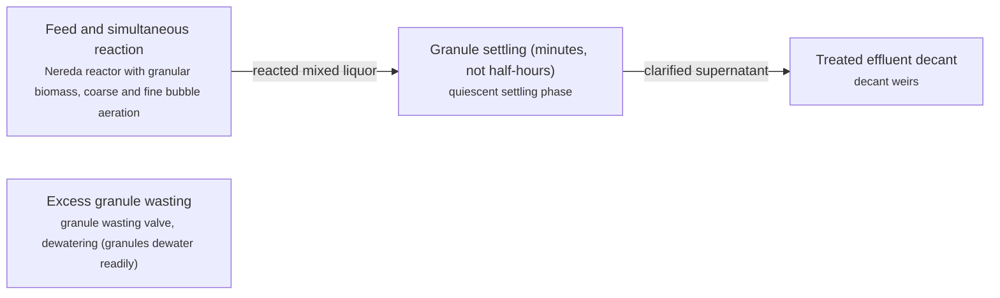

**Key equipment:** Nereda reactor (single-tank cyclic), aeration system, decant weirs, granule wasting and dewatering.

**Performance:**
- footprint vs conventional activated sludge: 0.25-0.5 x; vendor claim: up to 4x smaller footprint. [source](https://www.nereda.net/)
- energy vs conventional activated sludge: 0.5-0.7 x; vendor claim: 20-50% energy saving. [source](https://www.nereda.net/)

**Costs:**
- installed capital cost, AGS plus tertiary UF upgrade: 1863 NIS per m3/d of capacity; Soreq WWTP train 5, 75,000 m3/d basis, built up from equipment costs, membrane quotations and independent review; excludes replacing outdated equipment in existing trains and the new feed pump station. A second case gives 1,758 NIS/m3/d on 79,500 m3/d.. [source](https://iwaponline.com/wpt/article/21/8/3544/112830/Experiences-with-aerobic-granular-sludge-for-large)

Sources: [1](https://www.nereda.net/). Last reviewed 2026-11-16.

## Anaerobic sludge digestion (mesophilic/thermophilic)
<a id="wwt-sludge-digestion"></a>

Standard published practice: thickened sludge is heated and held 15-25 d (mesophilic, ~35 C) or 8-12 d (thermophilic, ~55 C) in complete-mix digesters where methanogens convert volatile solids to biogas (~60% CH4); optional thermal hydrolysis (Cambi/CNS) pretreatment raises biogas yield and dewaterability; digestate is dewatered and the biogas drives CHP or upgrading.

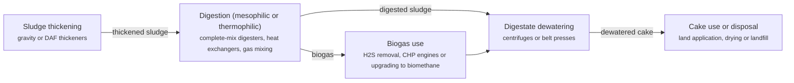

**Key equipment:** complete-mix digesters, heating and gas mixing, biogas handling, dewatering.

**Performance:**
- volatile solids destruction: 40-55 %; published mesophilic digestion range. [source](https://www.veoliawatertech.com/)
- biogas yield: 700-1100 m3/t VS destroyed; published municipal sludge biogas yields. [source](https://www.veoliawatertech.com/)

**Costs:**
- capital cost, two-stage anaerobic digestion system, 12 MGD plant (Grand Island, Nebraska): 10.7 USD million (2006$); EPA 832-F-06-031 COSTS section: a USD 10.7 million two-stage anaerobic digestion system in design for a 12 MGD plant receiving about 40 percent industrial agricultural flow. Figure published 2006; no dollar year stated.. [source](https://www.epa.gov/sites/default/files/2018-11/documents/multistage-anaerobic-digestion-factsheet.pdf)
- capital cost, two-stage TPAD anaerobic digestion system, 43 MGD plant (WLSSD Duluth): 32.6 USD million (2006$); Same section: the WLSSD two-stage TPAD system at a 43 MGD regional plant, in operation from 2001, had a construction cost of USD 32.6 million. Figure published 2006; no dollar year stated.. [source](https://www.epa.gov/sites/default/files/2018-11/documents/multistage-anaerobic-digestion-factsheet.pdf)
- operation and maintenance cost, anaerobic digestion: 9.39-51.51 USD per dry ton through the digesters (1999$); Operation $5.30-41.03 (average $17.47), maintenance $4.09-10.48 (average $7.44): total $9.39-51.51, average $24.91 per dry ton. Figures from the Multi-Agency Benchmarking Study (Dec 1999) reproduced in the EPA fact sheet. Uplift for a UK cross-check (Ofwat/Jacobs 2021) is per wet tonne, not per dry tonne, so it is not used here.. [source](https://www.epa.gov/sites/default/files/2018-11/documents/multistage-anaerobic-digestion-factsheet.pdf)

**Reference plants:**
- Tuas Water Reclamation Park (co-located sludge energy): ; . [source](https://www.pub.gov.sg/)

**Missing inputs:**
- unit capital cost per dry tonne of solids stabilised (costs): O&M per dry tonne is now recorded ($9.39-51.51, average $24.91, 1999 USD). A capital figure normalised per dry tonne was not found; the card holds named-facility capital costs instead. Where: WEF/EPA biosolids cost studies reporting USD per dry tonne for digestion. Next: Leave open until a source states a capital cost per dry tonne.

Sources: [1](https://www.veoliawatertech.com/). Last reviewed 2026-11-16.

## Biological nutrient removal (BNR)
<a id="wwt-bnr"></a>

Standard published configurations (A2/O, UCT, Bardenpho): anaerobic/anoxic/aerobic zone sequencing lets phosphate-accumulating organisms release and luxury-uptake phosphorus and denitrifiers reduce nitrate with influent carbon; internal mixed-liquor recirculation returns nitrified liquor to the anoxic zone. Commodity process knowledge.

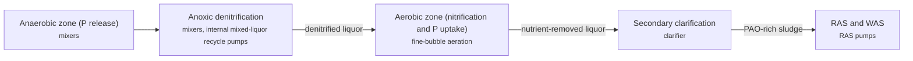

**Key equipment:** zone partitioning, internal recirculation pumps, aeration system.

**Performance:**
- total N to below: 3-10 mg/L; published BNR effluent limits. [source](https://www.veoliawatertech.com/)
- total P to below: 0.1-0.3 mg/L; published BNR effluent limits. [source](https://www.veoliawatertech.com/)

**Costs:**
- capital cost, BNR retrofit: 588000-6.972e+06 USD per mgd of capacity (2006$); Retrofit upgrades (engineering, pilot study, design, construction) across 43 Maryland and 23 Connecticut plants by size band: >10 mgd $588,000/mgd; 1-10 mgd $1,742,000/mgd; 0.1-1.0 mgd $6,972,000/mgd. 2006 USD, ENR 7910.81. Retrofit, not greenfield.. [source](https://nepis.epa.gov/Exe/ZyPURL.cgi?Dockey=60000G2U.TXT)

Sources: [1](https://www.veoliawatertech.com/). Last reviewed 2026-11-16.

## Chlorination and dechlorination
<a id="wwt-chlorination"></a>

Dosed chlorine (gas, hypochlorite or on-site electrochlorination) forms hypochlorous acid that inactivates pathogens; a contact basin gives the required CT (concentration x time); where chlorinated organics or aquatic toxicity matter, sulphur-dioxide or bisulphite dechlorination strips residual before discharge.

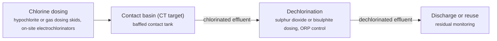

**Key equipment:** dosing skids, contact basin, dechlorination dosing, residual analysers.

**Performance:**
- contact time (CT) for bacteria: 15-30 mg.min/L; published CT targets at typical pH. [source](https://www.evoqua.com/)

**Costs:**
- annualised capital cost, chlorination plus dechlorination plus fire-code compliance: 1.127e+06-1.434e+07 USD per mgd of capacity (1995$); WERF 1995 study at 1 mgd ADWF, 5 mg/L dose: chlorination $410,000 + dechlorination $290,000 + UFC compliance $239,000 = $1,127,000; 10 mgd $3,137,000 (5 mg/L); 100 mgd $14.34M. Dechlorination adds 30-50%. O&M $49,300/yr at 1 mgd (about $0.036/m3), $158,200/yr at 10 mgd.. [source](https://nepis.epa.gov/Exe/ZyPURL.cgi?Dockey=200044E0.TXT)
- chemical-only disinfectant cost, sodium hypochlorite: 0.0166-0.066 USD per m3 treated (2024$); Derived: 12.5% hypochlorite at $1.79/gal (Oct 2024 unit-price sheet) = $1.50/lb available Cl2 ($3.31/kg) assuming SG 1.20; dose 5-20 mg/L (EPA) gives 0.0166-0.066 USD/m3. Chemical only - no power, labour or dechlorination. A Dec 2023 Baytown bid ($0.2300/lb solution) gives about $0.021/m3 at 5 mg/L, an independent check.. [source](https://public.destinyhosted.com/casagdocs/2024/CCREG/20241007_2380/7630_Unit_Prices.pdf)

Sources: [1](https://www.evoqua.com/). Last reviewed 2026-11-16.

## Coagulation-flocculation and chemical precipitation
<a id="wwt-coagulation-precipitation"></a>

Standard published practice: rapid mixing of coagulant (alum, ferric, PAC) destabilises colloids; slow flocculation builds settleable flocs; precipitation reagents (lime, caustic, metal sulphide) convert dissolved phosphate, metals and fluoride to insoluble solids removed by clarification; pH trim finishes the train.

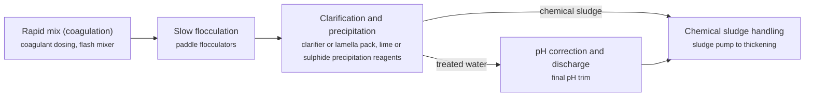

**Key equipment:** chemical dosing systems, flash mixers, flocculators, clarifier.

**Performance:**
- phosphorus removal to below: 0.1-0.5 mg P/L; published enhanced precipitation performance. [source](https://www.veoliawatertech.com/)

**Costs:**
- bulk coagulant price, liquid alum (iron-free): 152-269 USD per tonne (2000$); EPA fact sheet, January 2000: liquid alum $269/t iron-free and $152/t; ferric chloride $255-300/t; hydrated lime $70/t; enclosed lime feed system $110,000-130,000. A plating-waste study also gives $0.04/gal total treatment cost (1995) - industrial scope, not municipal.. [source](https://nepis.epa.gov/Exe/ZyPDF.cgi?Dockey=P1001QTR.PDF)

**Missing inputs:**
- chemical cost per m3 treated (dose x bulk price), with dollar year (costs): Bulk coagulant prices are now recorded (alum, ferric chloride, lime, Jan 2000). A per-m3 figure needs a dose, which no loaded source pairs with these prices; the $0.04/gal figure found is for metal-plating waste, not municipal sewage. Where: [Global Water Intelligence cost benchmarks](https://www.globalwaterintel.com/). Next: Leave open until a source states this metric; do not derive it from an unrelated scope.

Sources: [1](https://www.veoliawatertech.com/). Last reviewed 2026-11-16.

## Conventional activated sludge
<a id="wwt-activated-sludge"></a>

The workhorse municipal process: primary-settled sewage is aerated with return activated sludge so a flocculent mixed community oxidises BOD and nitrifies ammonia; secondary clarification separates sludge, part returned as RAS, part wasted. Commodity process knowledge; vendors supply aeration and clarification equipment.

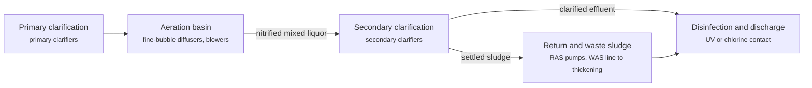

**Key equipment:** aeration blowers and diffusers, secondary clarifiers, RAS/WAS pumping.

**Performance:**
- BOD removal: 90-98 %; published design performance. [source](https://www.xylem.com/)
- design loading: 0.3-1 kg BOD/m3.d; conventional design range. [source](https://www.xylem.com/)

**Costs:**
- capital cost, extended-aeration activated sludge package plant, per gallon per day of capacity (plants above 0.02 MGD): 2-2.5 USD per gallon per day (2000$); EPA fact sheet, figure as published: for larger plants capital costs are approximately USD 2 to USD 2.50 per gallon of wastewater treated. Sheet dated September 2000 and states no dollar year, so the document year is recorded.. [source](https://www.epa.gov/sites/default/files/2015-06/documents/package_plant.pdf)
- capital cost, extended-aeration activated sludge package plant, per gallon per day of capacity (plants below 0.02 MGD): 4-6 USD per gallon per day (2000$); Smaller extended-aeration package plants designed for less than 0.02 MGD cost approximately USD 4 to USD 6 per gallon of water treated, based on capital costs; routine maintenance averages USD 350 per year. Document year recorded; no dollar year stated in the sheet.. [source](https://www.epa.gov/sites/default/files/2015-06/documents/package_plant.pdf)
- plant electricity use, secondary treatment including sludge management: 1500-1700 kWh per million gallons treated; Whole-plant electricity for an activated-sludge plant including residuals management; about 0.40-0.45 kWh/m3. Aeration alone is 30-80% of plant electricity (67% in NYSERDA's typical plant).. [source](https://www.nyserda.ny.gov/-/media/Project/Nyserda/Files/Publications/Research/Environmental/Energy-Efficiency-Municipal-WWTP.pdf)
- electricity cost, secondary treatment including sludge management: 0.036-0.0405 USD per m3 treated; Derived: 1,500-1,700 kWh per million gallons (0.40-0.45 kWh/m3) at the $0.09/kWh statewide average NYSERDA quotes. Electricity only - no labour, chemicals, sludge haulage or maintenance. Dollar year not stated: the quoted electricity price line carries no date.. [source](https://www.nyserda.ny.gov/-/media/Project/Nyserda/Files/Publications/Research/Environmental/Energy-Efficiency-Municipal-WWTP.pdf)

**Reference plants:**
- Changi Water Reclamation Plant, Singapore: ; . [source](https://www.pub.gov.sg/)

**Missing inputs:**
- non-energy operating cost per m3 treated, with dollar year (costs): Energy demand and its electricity cost are now recorded (1,500-1,700 kWh/MG; about $0.036-0.041/m3 at the quoted $0.09/kWh). Labour, chemicals, maintenance and sludge haulage were not priced in any source loaded on 2026-11-16. Where: EPA fact sheets state no operating energy figure for activated sludge; plant energy benchmarks are in utility and WEF publications. Next: Leave open until a source states this metric; do not derive it from an unrelated scope.

Sources: [1](https://www.xylem.com/). Last reviewed 2026-11-16.

## Dissolved air flotation (DAF)
<a id="wwt-daf"></a>

Follows the published Veolia/evoqua DAF flow: coagulated water meets 50-70% recycle flow saturated with air at 4-6 bar, released as 30-100 um microbubbles in a contact zone; flocs float and are scraped off as float sludge; clarified water leaves under weirs. Licensor equipment: saturation vessel, injection nozzles, full-surface scraper.

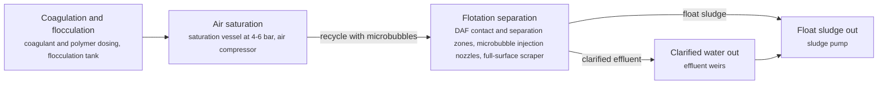

**Key equipment:** saturation vessel, microbubble injection system, DAF basin, scraper.

**Performance:**
- microbubble size: 30-100 um; published DAF design range. [source](https://www.veoliawatertech.com/)
- hydraulic loading rate: 5-15 m/h; typical DAF design HLR. [source](https://www.veoliawatertech.com/)

**Costs:**
- total installed cost, dissolved air flotation thickener: 2640 USD per m3/h of design flow; Derived from a manufacturer example: USD 600,000 installed for a 40 ft diameter DAF on 1,000 gpm (~227 m3/h) waste-activated-sludge feed at 5,000 mg/L, with 1,200 gpm recycle. Dollar year not stated; manufacturer figure, order-of-magnitude only.. [source](https://www.westechwater.com/blog/reduce-energy-costs-using-dissolved-air-flotation-for-waste-activated-sludge-thickening)

Sources: [1](https://www.veoliawatertech.com/). Last reviewed 2026-11-16.

## Internal-circulation anaerobic reactor (Paques BIOPAQ IC)
<a id="wwt-anaerobic-internal-circulation"></a>

Follows the Paques BIOPAQ IC licensor flow: a tall (16-28 m) reactor treats wastewater in two stages inside one vessel. In the first stage the upflow anaerobic sludge blanket converts most COD to biogas; the gas is captured in the first separator and the rising gas-lift drives an internal circulation loop that returns the mixed liquor to the reactor bottom without external pumps. The pre-treated water then flows to a second, low-loading polishing stage with a gas separator at the top. The published Paques arrangement is: influent distribution at the bottom, first-stage granular sludge blanket, gas-liquid separator and gas-lift riser/downer forming the internal circulation, second polishing stage, treated-water outlet with optional degassing.

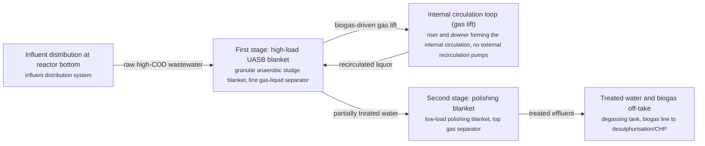

**Key equipment:** BIOPAQ IC reactor vessel (16-28 m tall), internal circulation riser/downer, granular sludge blanket, biogas handling (to THIOPAQ desulphurisation or CHP).

**Performance:**
- COD removal at design load: 80-90 %; vendor-published performance for BIOPAQ IC on high-strength industrial effluent. [source](https://www.paques.nl/products/biopaq-ic)
- volumetric loading capacity advantage vs single-stage UASB: 2-3 x; internal circulation allows higher loads at the same removal. [source](https://www.paques.nl/products/biopaq-ic)

**Missing inputs:**
- reactor cost per kg COD/d, dollar year (costs): Searched 2026-11-16: the per-kg-COD figure exists in the literature (Wiley, doi 10.1002/cjce.70351) but Cloudflare blocked the HTML, PDF and XML routes; vendors quote only lump-sum equipment ($200k-400k) with no flow basis. Where: [ICIS Water or Global Water Intelligence cost benchmarks](https://www.globalwaterintel.com/). Next: Retry the Wiley paper through the owner's browser; otherwise request the figure from a licensor quote.

Sources: [1](https://www.paques.nl/products/biopaq-ic). Last reviewed 2026-11-16.

## Lamella and high-rate clarifiers
<a id="wwt-lamella-clarifier"></a>

Follows the published Veolia Actiflo-type high-rate flow: coagulated water plus recirculated microsand forms ballasted flocs that settle on 55-degree inclined lamella plates giving 8-10x the effective settling area; a hydrocyclone recovers microsand and recirculates it, allowing hydraulic loading of 60-120 m/h versus 1-2 m/h conventional.

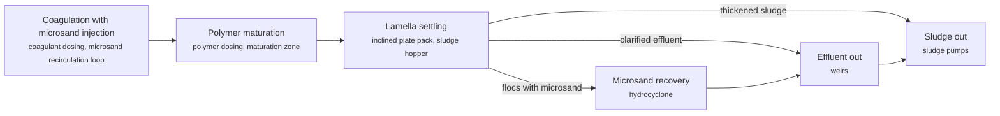

**Key equipment:** lamella plate pack, microsand recirculation with hydrocyclone, flocculation tank.

**Performance:**
- hydraulic loading: 60-120 m/h; published Actiflo design range. [source](https://www.veoliawatertech.com/)

**Costs:**
- equipment cost, lamella settler in SUS 304: 300-600 USD per m3/h of design flow (2026$); Vendor price list, May 2026: standard SUS 304 lamella settler, price per m3/h falling with size and rising for premium alloys or customisation. The page does not itemise what the figure includes; vendor rule of thumb, not a benchmark.. [source](https://www.weilanwaters.com/lamella-settler-prices)

Sources: [1](https://www.veoliawatertech.com/). Last reviewed 2026-11-16.

## Mechanical sludge dewatering
<a id="wwt-sludge-dewatering"></a>

Standard published practice: conditioned sludge (polymer dosed) is dewatered by decanter centrifuges (2,500-4,000 rpm bowl), belt filter presses (gravity drain + wedge press) or membrane/plate filter presses (batch 12-16 bar); cake dryness 18-35% DS depending on device and sludge type; licensor equipment from Alfa Laval, Andritz, Flottweg, HUBER (screw presses).

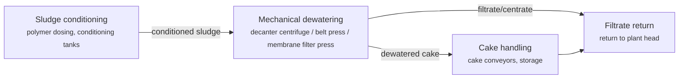

**Key equipment:** decanter centrifuges, belt filter presses, membrane filter presses, polymer system.

**Performance:**
- cake dry solids, centrifuge on digested sludge: 22-30 % DS; published centrifuge performance. [source](https://www.alfalaval.com/)
- cake dry solids, membrane filter press: 30-40 % DS; published filter-press performance. [source](https://www.andritz.com/)

**Costs:**
- capital cost, belt filter press (0.5 m belt, about 500 dry lb/h): 47500 USD per press (2000$); Vendor estimates in EPA 832-F-00-057: USD 47,500 for a 0.5 m belt (about 500 dry pounds per hour) on 5 percent solids feed. Excludes installation, shipping and ancillary equipment such as flow control and centrate management. Document year recorded; no dollar year stated.. [source](https://www.epa.gov/sites/default/files/2018-11/documents/belt-filter-press-factsheet.pdf)
- capital cost, belt filter press (1.5 m belt, about 1,625 dry lb/h): 115000 USD per press (2000$); Same sheet: USD 115,000 for a 1.5 m belt (about 1,625 dry pounds per hour), 5 percent solids feed, excluding installation, shipping and ancillary equipment.. [source](https://www.epa.gov/sites/default/files/2018-11/documents/belt-filter-press-factsheet.pdf)
- operation and maintenance cost, belt filter press: 80-200 USD per dry ton of solids (2000$); Overall operation and maintenance costs range from USD 80 to USD 200 per dry ton of solids. Polymer conditioning adds USD 2.65-91.15 per million gallons (average USD 24.38), and permanganate about USD 1 per million gallons.. [source](https://www.epa.gov/sites/default/files/2018-11/documents/belt-filter-press-factsheet.pdf)

Sources: [1](https://www.alfalaval.com/). Last reviewed 2026-11-14.

## Membrane bioreactor (MBR) wastewater treatment
<a id="wwt-membrane-bioreactor"></a>

A membrane bioreactor replaces the secondary clarifier of an activated-sludge plant with a submerged ultrafiltration/microfiltration membrane unit inside (or immediately after) the bioreactor. Mixed liquor is filtered directly at 0.1-0.4 um, giving a solids-free, turbidity-low effluent ready for disinfection or RO reuse, at a much smaller footprint and higher mixed-liquor concentration (8-15 g/L MLSS typical). Per licensor-first rule this card follows the Kubota Submerged Membrane Unit (SMU) flat-plate configuration published by Kubota Water & Environment: coarse screening to fine screening, equalisation, anoxic/aerobic bioreactor, submerged flat-plate membrane tank with coarse-bubble air scour, permeate drawn at low trans-membrane pressure, and in-tank membrane cleaning by backwash with chlorine and periodic recovery chemical clean.

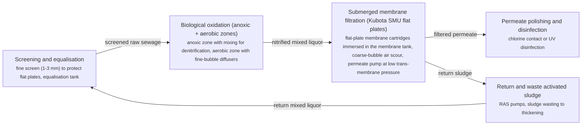

**Key equipment:** submerged flat-plate membrane cartridges (Kubota SMU), membrane tank and air-scour blowers, permeate pumps, fine screens and equalisation.

**Performance:**
- mixed-liquor concentration in membrane tank: 8-15 g MLSS/L; typical submerged MBR operating range (vendor literature). [source](https://kubota-membrane.com/en/mbr-system/)
- permeate turbidity: 0.05-0.2 NTU; flat-plate MBR permeate is effectively solids-free. [source](https://kubota-membrane.com/en/mbr-system/)

**Costs:**
- installed capital cost, MBR package plant: 7-20 USD per gallon per day (2007$); EPA fact sheet: US Filter/Siemens Memcor package plants have installed costs of USD 7-20 per gallon treated. Document dated September 2007 and states no dollar year, so the document year is recorded.. [source](https://www.epa.gov/sites/default/files/2019-08/documents/membrane_bioreactor_fact_sheet_p100il7g.pdf)
- installed capital cost, MBR plus granular activated carbon (12 MGD design, Loudoun County VA): 12 USD per gallon per day (2007$); Fleischer et al. (2005) cost comparison for a 12 MGD design: MBR plus GAC at USD 12 per gallon treated was the same order of magnitude as multiple-point alum addition, high lime treatment and post-secondary alternatives. Compiled in EPA 832-F-07-015 (2007); no dollar year stated.. [source](https://www.epa.gov/sites/default/files/2019-08/documents/membrane_bioreactor_fact_sheet_p100il7g.pdf)

**Reference plants:**
- Pantai 2 STP, Kuala Lumpur (underground MBR plant): ; . [source](https://www.iwk.com.my/)

Sources: [1](https://kubota-membrane.com/en/mbr-system/). Last reviewed 2026-11-14.

## Microfiltration and ultrafiltration pretreatment
<a id="wwt-uf-pretreatment"></a>

Follows published licensor flows (Suez ZeeWeed, DuPont): submerged or pressurised hollow-fibre membranes with 0.02-0.1 um pores remove suspended solids, pathogens and colloids from secondary effluent, delivering a low-turbidity feed that lets downstream RO run reliably; periodic backpulse and chemically enhanced backwash maintain flux.

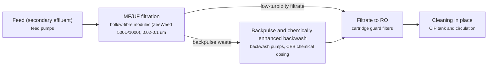

**Key equipment:** hollow-fibre MF/UF modules, backwash/CEB systems, CIP skid.

**Performance:**
- pore size: 0.02-0.1 um; published MF/UF membrane ratings. [source](https://www.suezwatertechnologies.com/)
- filtrate turbidity: 0.05-0.1 NTU; published UF filtrate quality. [source](https://www.suezwatertechnologies.com/)

**Costs:**
- installed capital cost, hollow-fibre UF ahead of NF: 0.67 USD per gallon per day (2018$); 2 mgd hollow-fibre UF, equipment $1.04M, part of a $2.49/gpd total train with NF.. [source](https://www.deswater.com/readfulltextopenaccess.php?id=RFdUX2FydGljbGVzL3ZvbF8xMjRfcGFwZXJzLzEyNF8yMDE4XzEucGRm)

Sources: [1](https://www.suezwatertechnologies.com/). Last reviewed 2026-11-16.

## Moving bed biofilm reactor (MBBR/IFAS)
<a id="wwt-mbbr"></a>

Follows the Veolia/AnoxKaldnes licensor flow: protected biofilm grows on free-floating polyethylene carrier elements (K1/K3) kept moving by aeration or mixing; retention screens keep carriers in each basin; IFAS retrofits add carriers to existing activated-sludge basins to boost capacity 50-100% without new tanks.

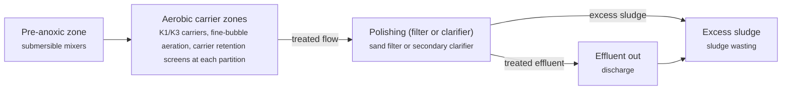

**Key equipment:** biofilm carrier elements, retention screens, aeration system.

**Performance:**
- protected biofilm area: 500-800 m2/m3; AnoxKaldnes K1/K3 published values. [source](https://www.veoliawatertech.com/)
- IFAS capacity boost: 1.5-2 x; published retrofit range. [source](https://www.veoliawatertech.com/)

**Costs:**
- packaged MBBR plant, equipment: 4160 USD per m3/d of capacity; Derived from a 5 m3/d all-in-one packaged unit at USD 20,800 (average 5, maximum 8 m3/d): screen, equalisation, anoxic tank, MBBR tank, central tube, chlorine contact, filtration and sludge holding; media and spares listed separately. Vendor quotes 2021, price year not stated. A small packaged unit has no economy of scale - do not read it as a municipal MBBR benchmark.. [source](https://ejfa.me/index.php/journal/article/download/2848/1631)

Sources: [1](https://www.veoliawatertech.com/). Last reviewed 2026-11-16.

## Nanofiltration for selective separations
<a id="wwt-nanofiltration"></a>

Published licensor practice (DuPont FilmTec NF, Toray): spiral-wound NF elements pass monovalent salts but reject divalent ions, organics (200+ Da) and micropollutants at roughly half the pressure of RO; used for softening, selective salt fractionation and polishing in reuse trains.

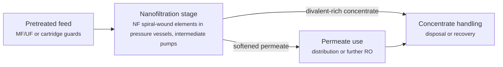

**Key equipment:** NF elements, pressure vessels, pumps.

**Performance:**
- divalent salt rejection: 95-99 %; published FilmTec NF performance. [source](https://www.dupont.com/water.html)
- operating pressure vs RO: 0.4-0.6 x; NF runs at roughly half RO pressure. [source](https://www.dupont.com/water.html)

**Costs:**
- installed capital cost, hollow-fibre loose NF with sand filtration: 1.96-2.49 USD per gallon per day (2018$); 2 mgd plant on Florida groundwater: HF-LNF $1.96/gpd (total $4.482M); seawater-NF alternative $2.49/gpd. O&M $0.06/gpd (HF-LNF) and $0.11/gpd (SW-NF).. [source](https://www.deswater.com/readfulltextopenaccess.php?id=RFdUX2FydGljbGVzL3ZvbF8xMjRfcGFwZXJzLzEyNF8yMDE4XzEucGRm)

Sources: [1](https://www.dupont.com/water.html). Last reviewed 2026-11-16.

## Nutrient recovery (struvite and ammonia)
<a id="wwt-struvite-recovery"></a>

Licensor-first (Ostara Pearl published flow): centrate is fed a reactor where Mg and controlled pH precipitate struvite (MgNH4PO4.6H2O) as spherical pellets harvested continuously; Ostara markets the pellets as Crystal Green fertiliser; ammonia-stripping variants recover N as ammonium sulphate; Paques PHOSPAQ pairs struvite with anaerobic ammonium oxidation.

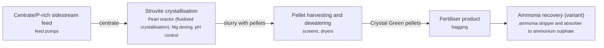

**Key equipment:** struvite crystalliser, Mg dosing, pellet harvesting, ammonia stripper (variant).

**Performance:**
- P recovery from centrate: 80-90 %; published Pearl performance. [source](https://ostara.com/)

**Costs:**
- break-even cost, electrochemical struvite recovery: 6.03 USD per kg struvite recovered (2022$); Pearl 500 reactor at a 45,425 m3/d plant with anaerobic digestion, 18-33% phosphorus recovery: capital $2.16/kg and O&M $0.34/kg against a $6.03/kg break-even.. [source](https://www.mdpi.com/2071-1050/14/20/13657)
- break-even cost per kg phosphorus recovered: 47.9 USD per kg P (2022$); Derived from $6.03/kg struvite at 0.126 kg P per kg struvite; the conversion is ours, not the paper's.. [source](https://www.mdpi.com/2071-1050/14/20/13657)

Sources: [1](https://ostara.com/). Last reviewed 2026-11-16.

## Ozonation and ozone-BAC filtration
<a id="wwt-ozone"></a>

Published licensor practice (Xylem Wedeco): ozone generated from dry air or oxygen by silent corona discharge is dissolved in side-stream injection Contact tanks; O3 oxidises micropollutants, colour and pathogens (CT dose 0.5-3 mg/L), then residual ozone is quenched and water polished on biologically active carbon (BAC); biofilters then colonise with degrading biomass.

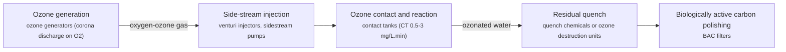

**Key equipment:** ozone generators, side-stream injection, contact tanks, BAC filters.

**Performance:**
- ozone dose for micropollutant control: 0.5-3 mg/L; published ozone dosing. [source](https://www.xylem.com/)
- micropollutant removal: 80-99 %; published ozone-BAC performance. [source](https://www.xylem.com/)

**Costs:**
- annual operation and maintenance cost, 1 MGD ozone disinfection system, excluding power: 18500 USD per year (1998$); EPA 832-F-99-063 Table 2 (typical cost estimate for a 1 MGD system, source Champion Technology 1998): labour USD 12,000/yr plus other consumables USD 6,500/yr (filter replacements, compressor oil, spare dielectric); power demand 90 kW is listed but not costed. The USD 18,500 total is the sum of the two listed items and excludes power.. [source](https://www.epa.gov/sites/default/files/2015-06/documents/ozon.pdf)
- total installed capital cost, ozone disinfection: 389000 USD per mgd of capacity (1998$); Line items for 1 mgd of secondary effluent (BOD<30, SS<30 mg/L): oxygen feed gas and compressor $245,500; contact vessel $4,000-5,000; off-gas destruct $800-1,200; non-component $35,000; engineering $12,000-15,000; plus 30% contingency. O&M: labour $12,000/yr, 90 kW power, other $6,500/yr.. [source](https://www.epa.gov/sites/default/files/2015-06/documents/ozon.pdf)

Sources: [1](https://www.xylem.com/). Last reviewed 2026-11-16.

## Potable reuse schemes (IPR/DPR)
<a id="wwt-potable-reuse-schemes"></a>

Scheme-level card: advanced purification (MF/UF + RO + UV/AOP per wwt-ro-reuse-train) is inserted between secondary treatment and the potable network, either indirectly (reservoir/aquifer environmental buffer, IPR) or directly (DPR with engineered storage and intensified monitoring); Singapore NEWater (PUB) is the flagship SEA reference meeting up to 40% of demand.

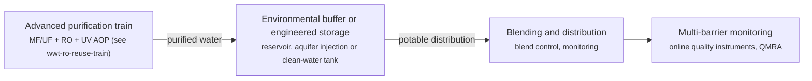

**Key equipment:** advanced purification train, environmental buffer or engineered storage, quality monitoring.

**Performance:**
- NEWater share of Singapore demand: 30-40 %; PUB published NEWater contribution. [source](https://www.pub.gov.sg/)

**Costs:**
- treated water cost, indirect potable reuse (full advanced treatment): 2.8-4.1 USD per 1,000 gallons; 10 mgd IPR facility, annualised over 20 years; about 0.74-1.08 USD/m3. The document is 2017 but the quoted sentence gives no base year - dollar year not stated.. [source](https://19january2021snapshot.epa.gov/sites/static/files/2018-01/documents/potablereusecompendium.pdf)

**Reference plants:**
- Changi WRP (Singapore, NEWater supplier): ; . [source](https://www.pub.gov.sg/)
- Tuas Water Reclamation Park (Singapore, under construction): ; . [source](https://www.pub.gov.sg/)

Sources: [1](https://www.pub.gov.sg/). Last reviewed 2026-11-16.

## Produced-water treatment (oil and gas fields)
<a id="wwt-produced-water-treatment"></a>

Standard published produced-water practice: degassing and desanding, multi-stage induced gas flotation for dispersed oil, hydrocyclones or nut-shell filters for tight oil removal, then polishing to reinjection or discharge standards; bridges the WWT sector to upstream operations.

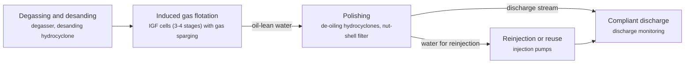

**Key equipment:** IGF cells, de-oiling hydrocyclones, nut-shell filters, reinjection pumps.

**Performance:**
- oil-in-water after treatment: 10-30 mg/L; typical discharge compliance range. [source](https://www.frames-group.com/)

**Costs:**
- capital cost, advanced produced-water treatment complex (MBBR + evaporation/crystallisation): 4583 USD per barrel per day of capacity (2015$); Antero Clearwater, WV: USD 275M for 60,000 bbl/d (~28,800 USD per m3/d), treating flowback and produced water to a $4.00/bbl fee. NOTE the scope is an evaporation/crystallisation ZLD complex, not the CPI/IGF plus hydrocyclone de-oiling train this card describes - it is not a de-oiling benchmark.. [source](https://www.anteroresources.com/investors/press-releases/detail/55/antero-announces-60000-barrel-per-day-advanced-wastewater)

**Reference plants:**
- Pengerang Integrated Complex effluent systems: ; . [source](https://www.petronas.com/)

**Missing inputs:**
- capital cost per m3/d for a CPI/IGF plus hydrocyclone de-oiling train, with dollar year (costs): The 2015 Antero figure is recorded but its scope is evaporation/crystallisation ZLD, not de-oiling. No loaded source prices the simpler train as a unit cost; searched 2026-11-16. Where: [Global Water Intelligence cost benchmarks](https://www.globalwaterintel.com/). Next: Leave open until a source states this exact metric and scope.

Sources: [1](https://www.veoliawatertech.com/). Last reviewed 2026-11-16.

## Reverse-osmosis water reuse train (NEWater-style)
<a id="wwt-ro-reuse-train"></a>

Follows the published advanced-purification (NEWater-style) train with licensor membrane equipment: secondary effluent passes microfiltration/ultrafiltration (licensor: Suez ZeeWeed / DuPont), then cartridge filtration, then reverse osmosis at high pressure (DuPont FilmTec / Hydranautics elements), then UV disinfection/advanced oxidation and mineralisation. The RO stage rejects salts, organics, pathogens and trace contaminants; UV destroys trace organics and provides a second pathogen barrier; conditioning restores hardness and pH for distribution.

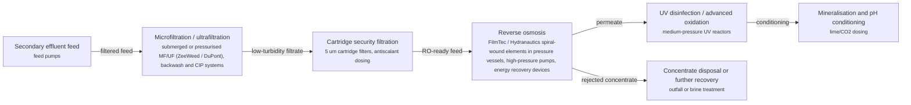

**Key equipment:** MF/UF membrane systems, RO trains with energy recovery, UV/AOP reactors, cleaning-in-place skids.

**Performance:**
- RO permeate recovery in reuse trains: 75-85 %; typical municipal reuse RO design recovery. [source](https://www.dupont.com/water.html)
- log removal of pathogens across full train: 8-12 log; multi-barrier claim of advanced purification schemes. [source](https://www.dupont.com/water.html)

**Costs:**
- installed capital cost, potable reuse train (MF/RO/UVAOP): 6 USD per gallon per day (2013$); 20 mgd train, secondary-effluent feed with ocean disposal of concentrate: $120M capital = $6.00/gpd (~1,585 USD per m3/d). O&M $5.9M/yr separately; a 5 mgd train costs $52M.. [source](https://watereuse.org/wp-content/uploads/2015/12/2013_Watereuse_Webcast_Schimmoller_Kealy-Rev1.pdf)

Sources: [1](https://www.dupont.com/water.html). Last reviewed 2026-11-16.

## Screening and grit removal
<a id="wwt-screening-grit"></a>

The first barrier of any plant: coarse and fine screens stop rags and plastics; grit chambers settle sand before biological stages. Follows standard published headworks practice (HUBER published equipment flows: bar/fine screens followed by grit washers and classifiers).

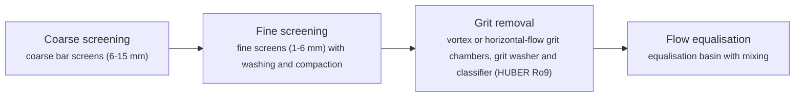

**Key equipment:** coarse and fine screens, screenings washer-compactor, grit chamber, grit classifier.

**Performance:**
- screen opening range: 0.75-15 mm; coarse to fine screening openings. [source](https://www.huber.de/)
- grit removal at 0.2 mm: 90-95 %; vortex grit chamber design range. [source](https://www.huber.de/)

**Costs:**
- construction cost, headworks screening facility: 98-108 USD per m3/d of design flow (2019$); Derived from a Class 5 estimate for the Roberto Bustamante WWTP headworks: screening facility construction $19.0M (total project $20.9M) against the 51 mgd AADF expansion flow the headworks is designed for (193,055 m3/d). Dividing by permitted peak flow instead gives a much lower figure, so the flow basis travels with the number: $98/m3/d construction, $108/m3/d project cost.. [source](https://cdnsm5-hosted.civiclive.com/UserFiles/Servers/Server_6843404/File/Business%20Center/Purchasing%20Overview/Bids/Professional%20Services/RFQ114-19/Condition%20Assessment%20and%20Alternatives%20Evaluation%20TM.pdf)

Sources: [1](https://www.huber.de/). Last reviewed 2026-11-16.

## Sequencing batch reactor (SBR)
<a id="wwt-sbr"></a>

A fill-and-draw activated sludge variant: all treatment phases run sequentially in one basin per cycle (fill, react, settle, decant, idle), eliminating secondary clarifiers and RAS pumping; licensor equipment (Aqua-Aerobic decanters, Veolia configurations) supplies the decanter and cycle control.

```mermaid
flowchart LR
    FILL["Fill (static, mixed or aerated)<br/><small>influent valves, mixers and aerators</small>"]
    REACT["React (aerated and anoxic phases)<br/><small>fine-bubble aeration, mixers</small>"]
    SETTLE["Settle (quiescent)<br/><small>no equipment active</small>"]
    DECANT["Decant treated effluent<br/><small>decanter weirs</small>"]
    IDLE["Idle and sludge wasting<br/><small>WAS pumps</small>"]
    FILL --> REACT
    REACT -->|reacted liquor| SETTLE
    SETTLE --> DECANT
    DECANT -->|effluent out| IDLE
```

**Key equipment:** decanter weirs, aeration system, cycle control PLC.

**Performance:**
- BOD and N removal: 90-95 %; published SBR performance. [source](https://www.veoliawatertech.com/)

**Costs:**
- operation and maintenance cost, sequencing batch reactor: 800-2000 USD per million gallons treated (1999$); EPA fact sheet: operation and maintenance costs are site specific and may range from USD 800 to USD 2,000 per million gallons treated. Document dated September 1999 and states no dollar year, so the document year is recorded.. [source](https://www.epa.gov/system/files/documents/2022-10/sequencing-batch-reactors-factsheet.pdf)
- installed cost, SBR system: 1.65-5 USD per gallon per day of capacity (1998$); March 1998 USD, ENR 5875, complete installed SBR including sludge handling: $1.96-5.00/gal at 0.5-1.0 mgd, $1.83-2.69 at 1.1-1.5 mgd, $1.65-3.29 at 1.5-2.0 mgd. Equipment only (excluding tanks and sitework) $150,000-350,000 at 1 mgd. O&M $800-2,000 per million gallons treated.. [source](https://www.epa.gov/system/files/documents/2022-10/sequencing-batch-reactors-factsheet.pdf)

Sources: [1](https://www.veoliawatertech.com/). Last reviewed 2026-11-16.

## Sludge incineration and co-incineration
<a id="wwt-sludge-incineration"></a>

Published practice: dewatered sludge is fired in fluidised-bed or multiple-hearth furnaces (self-sustaining above ~28% DS with heat recovery to steam/hot flue gas); flue gas cleaning (SNCR, fabric filters, wet scrubbers) meets EU IED; mono-ash retains phosphorus for recovery (e.g. EasyMining Ash2Product); co-incineration routes sludge to cement kilns or coal plants.

```mermaid
flowchart LR
    FEED["Dewatered sludge feed<br/><small>piston pumps or belt feeders</small>"]
    FBC["Fluidised-bed incineration<br/><small>fluidised-bed furnace (850+ C), sand bed</small>"]
    FGT["Flue gas treatment<br/><small>SNCR, fabric filter, wet scrubber stages</small>"]
    STACK["Stack and monitoring<br/><small>CEMS</small>"]
    ASH["Ash handling and P recovery (option)<br/><small>ash silos, Ash2Product-type recovery</small>"]
    FEED -->|sludge fuel| FBC
    FBC -->|hot flue gas| FGT
    FGT -->|clean gas| STACK
    STACK --> ASH
```

**Key equipment:** fluidised-bed furnace, flue gas treatment, ash handling.

**Performance:**
- furnace temperature: 850-950 C; published fluidised-bed operation. [source](https://www.veoliawatertech.com/)

**Costs:**
- operating cost, biosolids incineration: 83-269 USD per dry Mg (2002$); EPA 832-F-03-013: operating costs in one study range from USD 83 to USD 269 per dry Mg (USD 76-245 per dry ton), adjusted using 2002 ENR values. Comparable figures in the same sheet: landfill USD 127/dry Mg (USD 115/dry ton), land application about USD 15.40/dry Mg (USD 14/dry ton).. [source](https://www.epa.gov/sites/default/files/2018-11/documents/use-incineration-biosolids-management-factsheet.pdf)
- capital cost, new fluidised-bed incineration facility: 60000 USD per dry tonne per day of capacity (1994$); New FBF in North Carolina serving 136,000 m3/d (36 MGD): $6M facility. EPA prints the unit figure as $66/dry Mg ($60/dry ton); the '/day' and thousands are implied by the context, so treat as indicative. O&M $76-245/dry ton (2002 ENR).. [source](https://nepis.epa.gov/Exe/ZyPURL.cgi?Dockey=P10053DX.TXT)

Sources: [1](https://www.veoliawatertech.com/). Last reviewed 2026-11-16.

## Sludge thickening
<a id="wwt-sludge-thickening"></a>

Removes free water before digestion or dewatering: gravity thickeners settle sludge to 2-5% DS, DAF thickeners to 4-6% DS (better for waste activated sludge with poor settleability), rotary drum and gravity-belt thickeners to 4-8% DS with polymer; higher feed solids cut digester volume and dewatering load.

```mermaid
flowchart LR
    FEED["Sludge feed and screening<br/><small>sludge screens</small>"]
    THICK["Thickening<br/><small>gravity thickener / DAF thickener / rotary drum thickener with polymer</small>"]
    THK["Thickened sludge out<br/><small>sludge pumps to digestion</small>"]
    OVF["Overflow and filtrate return<br/><small>return to plant head</small>"]
    FEED --> THICK
    THICK -->|thickened sludge| THK
    THK --> OVF
```

**Key equipment:** gravity or DAF thickener, rotary drum thickener, polymer dosing.

**Performance:**
- thickened solids, gravity: 2-5 % DS; published gravity thickener range. [source](https://www.huber.de/)
- thickened solids, drum thickener: 4-8 % DS; published drum thickener performance. [source](https://www.huber.de/)

**Costs:**
- installed capital cost, gravity thickener, by plant capacity (2-25 MGD): 199000-3.2e+06 USD (2000$); EPA 832-F-03-022 Table 5, adjusted to the year 2000: construction plus engineering and administration of USD 199,000 at 2 MGD, 426,000 at 4 MGD, 914,000 at 8 MGD, 1,825,000 at 15 MGD, 2,504,000 at 20 MGD and 3,200,000 at 25 MGD (construction only: 162,000 to 2,610,000). The range spans plant capacity, not uncertainty at one size.. [source](https://www.epa.gov/sites/default/files/2018-11/documents/gravity-thickening-factsheet.pdf)
- unit cost, gravity thickening operation: 0.3-3 USD per dry ton (2000$); Economies of scale, larger plants at the low end. EPA describes these as unit costs for the thickening operation and does not state whether capital is included, so treat as O&M-side only.. [source](https://nepis.epa.gov/Exe/ZyPURL.cgi?Dockey=P10053EB.TXT)

Sources: [1](https://www.huber.de/). Last reviewed 2026-11-16.

## Thermal sludge drying and pyrolysis
<a id="wwt-sludge-drying"></a>

Published practice (Andritz, HUBER, KOPF): dewatered cake (20-28% DS) is dried with waste heat or steam in belt/drum dryers to 90%+ DS (biosolids pellets); pyrolysis variants heat sludge 400-600 C oxygen-free to biochar and syngas, now scaling as a phosphorus-recovery route; evaporated water condensate returns to the plant head.

```mermaid
flowchart LR
    FEED["Dewatered cake feed<br/><small>cake pumps and feeders</small>"]
    DRY["Thermal drying<br/><small>belt or drum dryer (low-temperature, waste-heat driven)</small>"]
    PELLET["Pelletising and storage<br/><small>pellet mills, silos</small>"]
    PYRO["Pyrolysis (variant route)<br/><small>pyrolysis kiln 400-600 C</small>"]
    CHAR["Biochar product<br/><small>char handling</small>"]
    FEED -->|wet cake| DRY
    DRY -->|dried granules| PELLET
    PELLET --> PYRO
    PYRO -->|biochar| CHAR
```

**Key equipment:** belt/drum dryers, pellet mills, pyrolysis kiln (variant).

**Performance:**
- dried solids content: 90-95 % DS; published dryer output. [source](https://www.huber.de/)

**Costs:**
- total cost, heat drying of biosolids: 323-441 USD per dry tonne (1994$); Indirect dryer $323/dry ton, direct dryer $441/dry ton at ~35 dry metric t/d; capital $26.8M indirect vs $37M direct. O&M separately $180-300/dry ton.. [source](https://www.epa.gov/sites/default/files/2018-11/documents/heat-drying-factsheet.pdf)

Sources: [1](https://www.andritz.com/products-separation). Last reviewed 2026-11-16.

## Trickling filters and rotating biological contactors
<a id="wwt-trickling-filters"></a>

Attached-growth on fixed media: wastewater trickles over rock or plastic media colonised by biofilm; air drawn through by natural or forced ventilation supplies oxygen; a secondary clarifier with recirculation settles sloughed biomass. RBCs rotate partially submerged discs in the flow for the same biofilm effect with low power demand.

```mermaid
flowchart LR
    PRIM["Primary settlement<br/><small>primary clarifier</small>"]
    TF["Trickling filter bed<br/><small>rock or plastic media (2-10 m deep), rotary distributor, ventilation</small>"]
    SEC["Secondary clarification<br/><small>humus tank</small>"]
    REC["Recirculation and sludge<br/><small>recirculation pumps, humus sludge wasting</small>"]
    OUT["Effluent out<br/><small>disinfection</small>"]
    PRIM --> TF
    TF -->|biofilm-treated flow| SEC
    SEC -->|sloughed biomass| REC
    SEC -->|treated effluent| OUT
    REC --> OUT
```

**Key equipment:** filter media and distributor, secondary clarifier, recirculation pumps, RBC shafts and discs (variant).

**Performance:**
- BOD removal per pass: 70-90 %; published trickling-filter performance. [source](https://www.westech-inc.com/)
- organic loading (low-rate): 0.08-0.4 kg BOD/m3.d; published loading bands. [source](https://www.westech-inc.com/)

**Costs:**
- construction cost, trickling filter plant: 760000-6.34e+07 USD per mgd of capacity; Complete TF system at 1 mgd $0.76M, 10 mgd $6.34M, 50 mgd $25M, 100 mgd $63.4M, with labour $0.05-1.0M and O&M $0.063-1.3M/yr; adapted from Martin & Martin (1990), base year not stated on the sheet - order of magnitude.. [source](https://www.epa.gov/system/files/documents/2022-10/trickling-filters-factsheet.pdf)

Sources: [1](https://www.westech-inc.com/). Last reviewed 2026-11-16.

## UV disinfection
<a id="wwt-uv-disinfection"></a>

Published licensor practice (Trojan, Xylem Wedeco): water passes banks of low-pressure or medium-pressure UV lamps (or emerging LED arrays) emitting ~254 nm UV-C that damages microbial DNA/UV-C proteins at a delivered dose of 20-100 mJ/cm2; no chemical residual, no DBPs; reactors sized with validated dose-monitoring and automatic lamp-intensity control.

```mermaid
flowchart LR
    FEED["Filtered effluent feed<br/><small>feed channel</small>"]
    UV["UV reactor exposure<br/><small>low- or medium-pressure lamp banks (Trojan UVSwift/UltraFlow), dose monitoring sensors, automatic wipers</small>"]
    OUT["Disinfected outfall<br/><small>discharge</small>"]
    MAINT["Lamp maintenance<br/><small>sleeve wiping, lamp replacement schedule</small>"]
    FEED --> UV
    UV -->|disinfected water| OUT
    OUT --> MAINT
```

**Key equipment:** UV lamp banks, dose sensors, wiping systems.

**Performance:**
- delivered UV dose: 20-100 mJ/cm2; published municipal dose range. [source](https://www.trojantechnologies.com/)
- log reduction of bacteria/viruses: 4-6 log; published UV performance. [source](https://www.trojantechnologies.com/)

**Costs:**
- total capital cost, UV disinfection system: 244000 USD (1999$); Equipment $120,000 + structural $64,000 + electrical $20,000 + miscellaneous $40,000; O&M $19,190/yr (energy $3,300, lamps/chemicals $2,840, cleaning $1,180, maintenance $1,440, process control $6,240, testing $4,160). The sheet does NOT state the design flow, so it cannot be normalised to m3/d; the underlying WERF study covers 1, 10 and 100 mgd with lamps banded 1-5, 5-10 and 19-100 mgd.. [source](https://www.epa.gov/sites/default/files/2015-06/documents/uv.pdf)
- capital cost, UV disinfection at plant peak flow: 11-21.1 USD per m3/d of capacity (2004$); Derived: $3,350,000 for low-pressure high-output UV sized for 42 mgd (158,987 m3/d) = $21.1/m3/d. About half the capital was modifying the outfall into a UV chamber; with an existing chlorine contact tank the report says the cost could fall by up to $1.6M, giving about $11/m3/d. Chlorination/dechlorination for the same flow was $1,150,000.. [source](https://kh.aquaenergyexpo.com/wp-content/uploads/2023/02/UV-Disinfection-Options-for-Wastewater-Treatment-Plants.pdf)

Sources: [1](https://www.trojantechnologies.com/). Last reviewed 2026-11-16.

## Upflow anaerobic sludge blanket (UASB/EGSB)
<a id="wwt-uasb"></a>

Follows the Paques BIOPAQ UASB licensor flow: wastewater is fed evenly at the bottom of a tall reactor and flows upward through a dense blanket of anaerobic granular sludge that converts COD to biogas; a three-phase (gas-liquid-solid) separator at the top retains granules, degasses the effluent and discharges treated water. EGSB adds higher upflow velocities and effluent recirculation for dilute streams.

```mermaid
flowchart LR
    FEED["Bottom influent distribution<br/><small>distribution nozzles</small>"]
    BLANKET["Granular sludge blanket (COD to biogas)<br/><small>granular anaerobic sludge blanket</small>"]
    SEP["Three-phase separator<br/><small>gas-liquid-solid separator at reactor top</small>"]
    OUT["Treated water out<br/><small>degassing and outlet weirs</small>"]
    GAS["Biogas off-take<br/><small>biogas line to desulphurisation and CHP</small>"]
    FEED --> BLANKET
    BLANKET -->|liquor with gas| SEP
    SEP -->|treated effluent| OUT
    SEP -->|biogas| GAS
    OUT --> GAS
```

**Key equipment:** UASB/EGSB reactor, three-phase separator, granular sludge, biogas handling.

**Performance:**
- COD removal: 70-90 %; published UASB performance on industrial effluent. [source](https://www.paques.nl/)
- organic loading rate: 5-20 kg COD/m3.d; published UASB design range. [source](https://www.paques.nl/)

**Costs:**
- UASB acquisition cost per organic load: 262 USD per kg COD/d of design load (2019$); Derived from a Brazilian pulp-and-paper mill: UASB acquisition cost USD 3.4M against a design organic loading rate of 12,960 kg COD/d (9,288 m3/d wastewater). Acquisition cost only, single retrofit, no civils breakdown - an order-of-magnitude anchor, not a cost curve.. [source](https://www.biofueljournal.com/article_92201_58ae1ca2f4769904c302d9aee827e1c9.pdf)

Sources: [1](https://www.paques.nl/products/biopaq-uasb). Last reviewed 2026-11-16.

## Water minimisation and reuse pinch for industry
<a id="wwt-water-pinch"></a>

Mass-exchange pinch analysis treats water as a network resource: each use has a limiting contaminant concentration, so streams can be cascaded from the cleanest duty to the dirtiest before treatment. Targeting gives the minimum fresh-water and wastewater flows, and a regenerator (DAF, membrane, ion exchange) placed at the pinch relaxes the constraint, cutting both intake and downstream ZLD load.

```mermaid
flowchart LR
    AUDIT["Water audit and contaminant data<br/><small>stream characterisation (COD, TDS, hardness, oil)</small>"]
    TARGET["Pinch targeting<br/><small>mass-exchange pinch analysis software</small>"]
    NET["Water network design<br/><small>cascade reuse network, regenerator placement</small>"]
    REG["Partial regeneration<br/><small>DAF / membrane / ion exchange regenerator</small>"]
    REUSE["Reuse and discharge<br/><small>reuse allocation and final effluent</small>"]
    AUDIT --> TARGET
    TARGET --> NET
    NET -->|streams needing treatment| REG
    REG -->|regenerated water| REUSE
```

**Key equipment:** pinch analysis software, regenerator units, monitoring instrumentation.

**Performance:**
- fresh-water reduction typical of a pinch retrofit: 20-40 %; published industrial water-pinch case range. [source](https://www.metito.com/)

**Missing inputs:**
- consultancy cost per study, dollar year (costs): Searched 2026-11-16: no page prices a pinch/process-integration study. Consultancy fees are commercially confidential and are not published. Where: Ask the owner for a benchmarked study cost. Next: Ask the owner's preferred consultancy for a typical fee, or record the gap as permanently owner-held.

Sources: [1](https://www.metito.com/). Last reviewed 2026-11-16.

## Zero liquid discharge (ZLD)
<a id="wwt-zld"></a>

Licensor-first (Aquatech published trains): pretreated wastewater passes membrane concentration (RO/HERO), then mechanical vapour-recompression or falling-film evaporators, then spray-dryers or forced-circulation crystallisers; distillate is recycled to process and salts crystallise as a solid product/waste — no liquid discharge. Aquatech published performance: brine concentrated to >250,000 mg/L TDS; distillate <10 mg/L.

```mermaid
flowchart LR
    PRE["Membrane concentration<br/><small>RO or HERO pretreatment trains</small>"]
    EVAP["Evaporation (MVR/falling film)<br/><small>mechanical vapour recompression evaporators</small>"]
    CRYST["Crystallisation<br/><small>forced-circulation crystallisers or spray dryers</small>"]
    SALT["Salt solids handling<br/><small>drying, bagging</small>"]
    DIST["Distillate recycle<br/><small>polish, return to process</small>"]
    PRE -->|pre-concentrated brine| EVAP
    EVAP -->|further concentrated liquor| CRYST
    CRYST -->|salt solids| SALT
    CRYST -->|distillate| DIST
    SALT --> DIST
```

**Key equipment:** RO/HERO concentration, MVR evaporators, crystallisers, salt handling.

**Performance:**
- distillate quality: 1-10 mg/L TDS; Aquatech published ZLD performance. [source](https://www.aquatech.com/)
- brine concentration reached: 200000-280000 mg/L TDS; Aquatech published ZLD performance. [source](https://www.aquatech.com/)

**Costs:**
- total water cost, ZLD by direct-contact membrane distillation plus cooling crystallisation: 0.64-1.41 USD per barrel of clean water (2025$); $1.41/bbl with steam heat (~8.87 USD/m3) and $0.64/bbl with waste heat (~4.02 USD/m3) at 500,000 GPD on high-salinity produced water. Capital $0.12/bbl; operating cost dominates at $1.29/bbl.. [source](https://pmc.ncbi.nlm.nih.gov/articles/PMC12471401)

Sources: [1](https://www.aquatech.com/). Last reviewed 2026-11-16.

## Advanced oxidation processes (AOP)
<a id="wwt-aop"></a>

Published practice: hydroxyl radicals are generated by UV/H2O2, UV/persulfate, O3/H2O2 or photo-Fenton systems; radicals non-selectively oxidise compounds ozone alone misses; applied after conventional treatment on relatively clean matrices; licensor equipment: UV-AOP reactors (Trojan/Xylem), peroxide/persulfate dosing.

```mermaid
flowchart LR
    PRE["Polished feed<br/><small>filtered, low-turbidity feed</small>"]
    OX["Radical generation and oxidation<br/><small>UV/H2O2 or UV/persulfate reactors (Trojan UV AOP), chemical dosing</small>"]
    POST["Residual quench and polishing<br/><small>quench, GAC polish</small>"]
    PRE --> OX
    OX -->|oxidised water| POST
```

**Key equipment:** UV-AOP reactors, chemical dosing, quench/polish.

**Performance:**
- trace-organism removal: 70-95 %; published AOP performance on trace organics. [source](https://www.trojantechnologies.com/)

**Costs:**
- total treatment cost, UV/H2O2 (Calgon Carbon estimate): 0.084-1.08 USD per m3 treated; Derived from the source's USD per 1,000 gal: 0.32/1,000 gal at 1,380 m3/h and 20 ug/L pollutant, rising to 4.11/1,000 gal at 13.8 m3/h and 2,000 ug/L. Total treatment cost (amortised capital plus O&M), not capital only; price year not stated.. [source](https://iopscience.iop.org/article/10.1088/1757-899x/206/1/012089/pdf)
- total treatment cost, H2O2/O3: 0.092-0.955 USD per m3 treated; Derived from 0.35/1,000 gal at 1,380 m3/h to 3.62/1,000 gal at 13.8 m3/h; photo-Fenton is quoted at 2.88/m3 under optimum conditions. Price year not stated.. [source](https://iopscience.iop.org/article/10.1088/1757-899x/206/1/012089/pdf)

Sources: [1](https://www.trojantechnologies.com/). Last reviewed 2026-11-16.

## Anaerobic membrane bioreactor (AnMBR)
<a id="wwt-anmbr"></a>

Combines anaerobic treatment with membrane solids retention: an anaerobic reactor (CSTR or UASB-style) paired with submerged or sidestream UF/MF membranes holds all biomass and solids, enabling long SRT at short HRT, biogas capture from dilute feeds and a solids-free effluent; licensor equipment follows Kubota/ADI published configurations (submerged flat-plate or hollow-fibre modules under gas scour).

```mermaid
flowchart LR
    REACT["Anaerobic reactor<br/><small>complete-mix or upflow anaerobic reactor, mixing and heating</small>"]
    MEM["Membrane solids retention<br/><small>submerged UF/MF modules with gas scour, permeate pump</small>"]
    PERM["Permeate polishing<br/><small>nutrient or sulphide polishing as needed</small>"]
    GAS["Biogas capture<br/><small>gas dome and handling</small>"]
    RAS["Biomass return<br/><small>recirculation pumps</small>"]
    REACT -->|digested liquor| MEM
    MEM -->|solids-free permeate| PERM
    MEM -->|retained biomass| RAS
    PERM --> GAS
    GAS --> RAS
```

**Key equipment:** anaerobic reactor, submerged membrane modules, biogas handling.

**Performance:**
- COD removal: 85-95 %; published AnMBR performance on industrial effluent. [source](https://kubota-membrane.com/)
- operating flux: 7-15 LMH; typical submerged AnMBR flux. [source](https://kubota-membrane.com/)

**Costs:**
- net treatment cost, mainstream AnMBR: 0.35-0.42 EUR per m3 treated; CAPEX plus OPEX minus electricity revenue, 100-1,100 mg COD/L influent. Not a capital cost per m3/d, which is what the gap asks for.. [source](https://diposit.ub.edu/bitstreams/1de7dcf1-7b79-4842-863f-b130a02a1f57/download)

**Missing inputs:**
- capital cost per m3/d of installed capacity, with dollar year (costs): Total treatment cost (0.35-0.42 EUR/m3) is now recorded. Capital cost per m3/d was not present in any source loaded on 2026-11-16; the gap is narrowed to that. Where: [Global Water Intelligence cost benchmarks](https://www.globalwaterintel.com/). Next: Leave open until a source states this metric; do not derive it from an unrelated scope.

Sources: [1](https://kubota-membrane.com/). Last reviewed 2026-11-16.

## Brine concentration and selective salt recovery
<a id="wwt-brine-concentration"></a>

Steps ahead of full ZLD: high-pressure RO/HERO, membrane distillation or electrodialysis reversal push brine from a typical 4-8% up to 15-25% salt, cutting evaporator duty; nanofiltration fractionation or selective crystallisation then splits mixed brine into saleable single salts (NaCl, Na2SO4) instead of a mixed waste.

```mermaid
flowchart LR
    FEED["Brine feed and softening<br/><small>softening if needed</small>"]
    CONC["Concentration<br/><small>high-pressure RO / HERO / membrane distillation / EDR</small>"]
    FRAC["Selective salt recovery<br/><small>nanofiltration fractionation, crystallisers for single salts</small>"]
    SALT["Salt product handling<br/><small>drying and bagging</small>"]
    PERM["Permeate recycle<br/><small>polish before reuse</small>"]
    FEED --> CONC
    CONC -->|concentrated brine| FRAC
    CONC -->|permeate to reuse| PERM
    FRAC -->|single-salt product| SALT
    SALT --> PERM
```

**Key equipment:** high-pressure RO or HERO, membrane distillation or EDR, crystallisers.

**Performance:**
- brine concentration reached before evaporation: 15-25 % salt; published concentration targets. [source](https://www.aquatech.com/)

**Costs:**
- levelised cost of water, single-stage mechanical vapour compression: 3.6-6.1 USD per m3 of product water (2024$); Feed 25-150 g/kg, recovery 40-80%, annualised capital plus operating cost. Brine concentration by MVC; per m3 of product, not per m3 of feed.. [source](https://www.osti.gov/servlets/purl/2476217)

Sources: [1](https://www.aquatech.com/). Last reviewed 2026-11-16.

## Forward osmosis
<a id="wwt-forward-osmosis"></a>

Published pilot practice (Modern Water, Oasys): water diffuses across a dense active layer driven by an osmotic draw solution instead of hydraulic pressure, giving low-fouling concentration of difficult feeds; the draw is then regenerated (RO, distillation) releasing clean water; commercial deployment remains niche.

```mermaid
flowchart LR
    FO["FO membrane stage<br/><small>spiral or plate FO modules, draw solution circulation</small>"]
    REGEN["Draw regeneration<br/><small>RO or distillation regeneration</small>"]
    PROD["Product water out<br/><small>polishing</small>"]
    CONC["Concentrated feed out<br/><small>disposal or recovery</small>"]
    FO -->|diluted draw| REGEN
    REGEN -->|product water| PROD
    PROD --> CONC
```

**Key equipment:** FO membrane modules, draw solution loop, draw regeneration.

**Performance:**
- water flux: 10-25 LMH; published FO pilot fluxes. [source](https://www.ostara.com/)

**Costs:**
- water cost, FO-RO plus AnMBR municipal treatment: 0.81-1.27 EUR per m3 treated; Minimum 0.81 EUR/m3 at 50% FO recovery, rising to 1.01 at 80% and 1.27 at 90%; open-loop freshwater comparison 0.80 EUR/m3. Pre-2018 prices as published.. [source](https://diposit.ub.edu/bitstreams/f1e99a08-bd96-44ab-9655-0dc9686198f3/download)

Sources: [1](https://www.suezwatertechnologies.com/). Last reviewed 2026-11-16.
