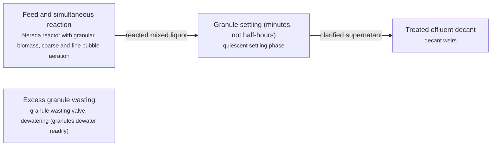
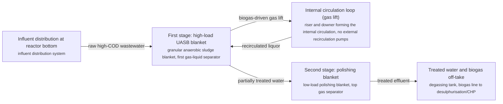
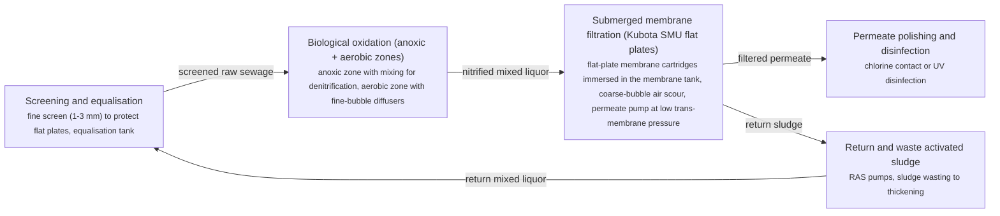
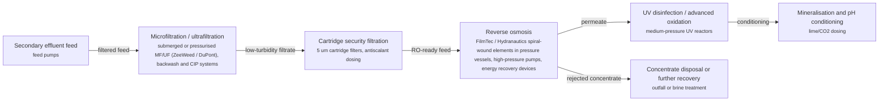

# WWT technology options

4 technologies, from commercial to lab stage. Generated from catalog/technologies/; every figure links to its source.

| Technology | Category | Maturity | TRL | Suppliers | Cost figures |
| --- | --- | --- | --- | --- | --- |
| [Aerobic granular sludge treatment (Nereda)](#wwt-aerobic-granular-sludge) | Biological treatment | commercial |  | Royal HaskoningDHV (Nereda aerobic granular sludge technology (licensor)) |  |
| [Internal-circulation anaerobic reactor (Paques BIOPAQ IC)](#wwt-anaerobic-internal-circulation) | Anaerobic treatment | commercial |  | Paques (BIOPAQ IC / ICX internal-circulation reactors; BIOPAQ UASB family) |  |
| [Membrane bioreactor (MBR) wastewater treatment](#wwt-membrane-bioreactor) | Biological treatment | commercial |  | Kubota (Submerged Membrane Unit (SMU) flat-plate MBR, marketed since 1985); Suez (ZeeWeed hollow-fibre MBR); Toray (submerged flat-sheet MBR modules); Mitsubishi Chemical Aqua Solutions (submerged MBR membrane) |  |
| [Reverse-osmosis water reuse train (NEWater-style)](#wwt-ro-reuse-train) | Membrane and reuse | commercial |  | DuPont Water Solutions (FilmTec RO and NF elements); Nitto (Hydranautics) (CPA/ESPA RO elements); Toray (ROMEMBRA RO elements); Suez (ZeeWeed MF/UF) |  |

## Aerobic granular sludge treatment (Nereda)

Follows the Royal HaskoningDHV Nereda licensor flow: one cyclical SBR-style reactor with a granular biomass that settles 3-8x faster than flocculent sludge. Simultaneous nitrification/denitrification and bio-P removal happen inside the dense granules (aerobic shell, anoxic/anaerobic core). The published Nereda cycle is: (1) feed/draw from the bottom while decanted clear water leaves the top, (2) aeration/reaction with simultaneous fill, (3) settling of the fast-settling granules, (4) decant of treated effluent; excess sludge is wasted as well-settling granules that dewater easily.

**Key equipment:** Nereda reactor (single-tank cyclic), aeration system, decant weirs, granule wasting and dewatering.

**Performance:**
- footprint vs conventional activated sludge: 0.25-0.5 x; vendor claim: up to 4x smaller footprint. [source](https://www.nereda.net/)
- energy vs conventional activated sludge: 0.5-0.7 x; vendor claim: 20-50% energy saving. [source](https://www.nereda.net/)

**Missing inputs:**
- installed cost per m3/d, dollar year (costs): Licensor does not publish prices. Where: [ICIS Water or Global Water Intelligence cost benchmarks](https://www.globalwaterintel.com/). Next: Ask owner for a priced reference or use a published benchmark (e.g. a reuse-scheme annual report).

Sources: [1](https://www.nereda.net/). Last reviewed 2026-11-13.

## Internal-circulation anaerobic reactor (Paques BIOPAQ IC)

Follows the Paques BIOPAQ IC licensor flow: a tall (16-28 m) reactor treats wastewater in two stages inside one vessel. In the first stage the upflow anaerobic sludge blanket converts most COD to biogas; the gas is captured in the first separator and the rising gas-lift drives an internal circulation loop that returns the mixed liquor to the reactor bottom without external pumps. The pre-treated water then flows to a second, low-loading polishing stage with a gas separator at the top. The published Paques arrangement is: influent distribution at the bottom, first-stage granular sludge blanket, gas-liquid separator and gas-lift riser/downer forming the internal circulation, second polishing stage, treated-water outlet with optional degassing.

**Key equipment:** BIOPAQ IC reactor vessel (16-28 m tall), internal circulation riser/downer, granular sludge blanket, biogas handling (to THIOPAQ desulphurisation or CHP).

**Performance:**
- COD removal at design load: 80-90 %; vendor-published performance for BIOPAQ IC on high-strength industrial effluent. [source](https://www.paques.nl/products/biopaq-ic)
- volumetric loading capacity advantage vs single-stage UASB: 2-3 x; internal circulation allows higher loads at the same removal. [source](https://www.paques.nl/products/biopaq-ic)

**Missing inputs:**
- reactor cost per kg COD/d, dollar year (costs): Licensor does not publish prices. Where: [ICIS Water or Global Water Intelligence cost benchmarks](https://www.globalwaterintel.com/). Next: Ask owner for a priced reference or use a published benchmark (e.g. a reuse-scheme annual report).

Sources: [1](https://www.paques.nl/products/biopaq-ic). Last reviewed 2026-11-13.

## Membrane bioreactor (MBR) wastewater treatment

A membrane bioreactor replaces the secondary clarifier of an activated-sludge plant with a submerged ultrafiltration/microfiltration membrane unit inside (or immediately after) the bioreactor. Mixed liquor is filtered directly at 0.1-0.4 um, giving a solids-free, turbidity-low effluent ready for disinfection or RO reuse, at a much smaller footprint and higher mixed-liquor concentration (8-15 g/L MLSS typical). Per licensor-first rule this card follows the Kubota Submerged Membrane Unit (SMU) flat-plate configuration published by Kubota Water & Environment: coarse screening to fine screening, equalisation, anoxic/aerobic bioreactor, submerged flat-plate membrane tank with coarse-bubble air scour, permeate drawn at low trans-membrane pressure, and in-tank membrane cleaning by backwash with chlorine and periodic recovery chemical clean.

**Key equipment:** submerged flat-plate membrane cartridges (Kubota SMU), membrane tank and air-scour blowers, permeate pumps, fine screens and equalisation.

**Performance:**
- mixed-liquor concentration in membrane tank: 8-15 g MLSS/L; typical submerged MBR operating range (vendor literature). [source](https://kubota-membrane.com/en/mbr-system/)
- permeate turbidity: 0.05-0.2 NTU; flat-plate MBR permeate is effectively solids-free. [source](https://kubota-membrane.com/en/mbr-system/)

**Missing inputs:**
- installed cost per m3/d with dollar year (costs): Vendor sites do not publish plant-level prices. Where: [ICIS Water or Global Water Intelligence cost benchmarks](https://www.globalwaterintel.com/). Next: Ask owner for a priced reference or use a published benchmark (e.g. a reuse-scheme annual report).

Sources: [1](https://kubota-membrane.com/en/mbr-system/). Last reviewed 2026-11-13.

## Reverse-osmosis water reuse train (NEWater-style)

Follows the published advanced-purification (NEWater-style) train with licensor membrane equipment: secondary effluent passes microfiltration/ultrafiltration (licensor: Suez ZeeWeed / DuPont), then cartridge filtration, then reverse osmosis at high pressure (DuPont FilmTec / Hydranautics elements), then UV disinfection/advanced oxidation and mineralisation. The RO stage rejects salts, organics, pathogens and trace contaminants; UV destroys trace organics and provides a second pathogen barrier; conditioning restores hardness and pH for distribution.

**Key equipment:** MF/UF membrane systems, RO trains with energy recovery, UV/AOP reactors, cleaning-in-place skids.

**Performance:**
- RO permeate recovery in reuse trains: 75-85 %; typical municipal reuse RO design recovery. [source](https://www.dupont.com/water.html)
- log removal of pathogens across full train: 8-12 log; multi-barrier claim of advanced purification schemes. [source](https://www.dupont.com/water.html)

**Missing inputs:**
- installed cost per m3/d with dollar year (costs): OEM sites do not publish train prices. Where: [ICIS Water or Global Water Intelligence cost benchmarks](https://www.globalwaterintel.com/). Next: Ask owner for a priced reference or use a published benchmark (e.g. a reuse-scheme annual report).

Sources: [1](https://www.dupont.com/water.html). Last reviewed 2026-11-13.
