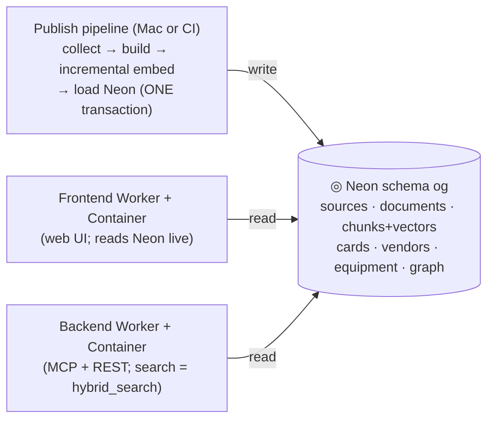

# Frontend / backend split plan (decision #34)

Owner-approved 2026-10-31 ("ok, write the full plan so that i can start in new session").
Goal: **separate the web-UI deployment from the API deployment while they stay in sync** —
when the backend receives new data, the frontend shows it without any redeploy.

If anything conflicts with [AGENTS.md](../AGENTS.md), AGENTS.md wins. Follow
[SOURCE_DISCOVERY_PLAN.md](SOURCE_DISCOVERY_PLAN.md) §1–§4 conventions for state files,
gates and worker use. Track progress in `research/frontend-split/state.json`.

## 0. Why, and the one rule that makes sync free

Today one container serves web UI + MCP + REST and reads its own SQLite index, so every
change is an image rebuild (and with baked embeddings, a ~35–65 min one). In the split
architecture **Neon is the single source of truth**:



- **Data changes** (new vendor, source, equipment class, card figure) → publish step only.
  Both containers show it on the next request. **No deploy.**
- **Code changes** → deploy only the touched container. UI edits are minutes (the frontend
  image has no embed step at all).
- Embeddings are computed **only in the publish pipeline**, incrementally (R6).

## 1. Requirements (owner inputs 2026-10-30/31)

| # | Requirement |
| --- | --- |
| R1 | No embed at deploy — embeddings happen only in the publish pipeline, on the Mac or CI |
| R2 | The equipment layer (decision #33: `og.equipment`, hybrid_search join, vendor rows' equipment classes) is part of every migration step |
| R3 | Atomic publish: the Neon load replaces all tables inside ONE transaction (already how `tools/load_postgres.py` works) — never relax this; the frontend must never see half-updated data |
| R4 | Drift stamp: `/api/stats` (or `/api/version`) exposes a data version (counts + max `last_reviewed`) so frontend/backend/data agreement is visible at a glance |
| R5 | Graceful degradation: if Neon is unreachable the frontend shows a static notice, not a stack trace |
| R6 | **Incremental embedding**: `agent/embed.py` gains a mode that embeds only new/changed rows (per-kind and by-id), so a one-supplier publish is ~1–2 min, not a 12k-row re-embed |

## 2. Target architecture

- **Frontend Worker + Container** at `https://techlib.hilir.app` — `agent/web.py` only
  (page routes, session auth, `/account`/`/admin`), reading Neon via `agent/pg.py`
  (read-only role). No SQLite dependency for correctness (kept as offline fallback, R5).
- **Backend Worker + Container** at `https://api.hilir.app` (domain: owner may override)
  — `agent/server.py --http` + `agent/api.py`: MCP tools, REST, API-key/OAuth auth.
  Search = Neon `hybrid_search` (already fuses keyword + vectors + equipment) with the
  container's fastembed providing the query vector (local — exact parity, no edge call).
- **Publish pipeline** (unchanged commands, run by the owner's Mac session or CI):
  `tools/build.py` → `agent/library.py build` → `agent/embed.py --incremental` →
  `tools/load_postgres.py --embeddings sqlite --include-restricted` (one transaction).
- The edge `/__embed` route is retired in Phase 3 (search embeds locally; keep only if
  the owner wants an external embedding utility).
- Single-container mode is kept working until Phase 3 completes (rollback path).

## 3. Phases

### Phase 0 — audit (first task of the new session)

1. Read AGENTS.md, this plan, `research/frontend-split/state.json`.
2. Produce `research/frontend-split/read-paths.md`: for EVERY `agent/web.py` handler,
   list what it reads today (library.py SQLite call / pg.py call / disk read) and its
   Neon counterpart or gap. Known at planning time: cards (og.card + figures),
   vendors (og.vendor), sources (og.source), chunks (og.chunk), equipment
   (og.equipment), register, graph — all present; VERIFY documents full text
   (og.document), gaps view (v_gap), register table, and `library_stats` equivalents.
3. Check `db/schema.sql` + Neon for any missing view/table the UI needs; add migration
   SQL to `db/` if needed (e.g. a `v_gap` variant the UI can consume).

Done = read-paths.md complete with a Neon mapping for every handler.

### Phase 1 — frontend reads Neon (no deployment change)

Batch per handler group; keep the SQLite path as automatic fallback:
`pg.primary(data) or sqlite_fallback` — the UI must work in a Neon-less dev checkout
(tests must stay green offline).

1. `library_stats` → Neon counts.
2. Technologies list + card page (`compare_technologies`, `get_technology`) → og.card.
3. Vendors (`list_vendors`/`get_vendor`, coverage queue notes) → og.vendor.
4. Sources + documents → og.source / og.document (+ read_document text; VERIFY text
   storage first — Phase 0 finding).
5. Gaps page → v_gap; Register → register table.
6. Equipment pages/search section → og.equipment + hybrid_search join (R2).
7. `/search` and `/database/search` → Neon `hybrid_search` for all kinds; container
   fastembed supplies qvec (local parity). If a kind is missing from hybrid_search,
   extend the SQL function in `db/schema.sql` and reload.

Gates per batch: `tools/build.py` + `pytest -q tests`; add tests that render each page
against a scratch Neon (`TEST_DATABASE_URL`) asserting identical content to the SQLite
render. Commit per batch. Update state.json.

### Phase 2 — split the deployments

1. Split `deploy/cloudflare` into `deploy/frontend/` and `deploy/backend/` (two
   wrangler configs, two containers, two routes: `techlib.hilir.app` = frontend,
   `api.hilir.app` = backend — confirm domain with owner first, marked owner-decision).
2. Frontend Worker: session-cookie auth only; forwards UI paths + `/api/stats`.
   Backend Worker: API-key + OAuth (`/mcp`, `/api/*`) only.
3. Container split: frontend image = web.py + pg client (no embed, no corpus private
   docs handling beyond what it reads from Neon); backend image = server/api + embed
   tooling. **Neither Dockerfile runs embed.py** (R1) — remove the RUN embed layer.
4. MCP server registration on the owner's Mac and claude.ai connector re-point to
   `api.hilir.app/mcp` (owner action; listed in state.json parked_owner).
5. Live verification: both `/health`s, a search from each container, publish-cycle dry
   run (one vendor added → visible on both without deploy).

### Phase 3 — cleanup

1. Remove `/__embed` from the edge (or keep as utility — owner-decision).
2. Drift stamp (R4): expose Neon counts + max last_reviewed via `/api/version` on both.
3. Demote SQLite to explicit fallback (R5): Neon down → static notice page; document
   the degradation in HOSTING.md.
4. Update docs: ARCHITECTURE.md, HOSTING.md, POSTGRES.md, USER_GUIDE.md, this plan's log.

## 4. The update flow after the split (worked example: one supplier)

1. Add `catalog/vendors/<id>.json` (one file).
2. Publish step (~1–2 min): `build.py` → `embed.py --incremental` (only the new vendor
   row) → Neon load (one transaction).
3. **No deploy.** Frontend `/vendors`, search, card links and the graph `supplies` edge
   show the new supplier on the next request; backend MCP/REST search finds it too.
4. Container deploys happen only for code changes (UI edits → frontend image, minutes;
   API changes → backend image).

## 5. Ops notes for the executing agent

- `.venv/bin/python -m pytest -q tests` (never the bare pytest shim);
  `tools/build.py` must print "N records valid" before every commit.
- Neon DSNs live in `.env.local` (quoted values — strip the quotes); owner UNPOOLED DSN
  for loads, `og_mcp_read` pooled DSN is the runtime read role. The frontend container
  gets a Neon DSN via a Worker secret (`DATABASE_URL`), exactly as today.
- Wrangler credential fix if "Login failed with code: 1":
  `security delete-internet-password -s registry.cloudflare.com` then retry.
- Assume concurrent Mac sessions: `git fetch` before push, stage only your files.
- Image builds: after the split neither container embeds, so builds stay ~3–5 min.
- Every code change: gates → commit → push; deploy when a phase lands; verify live
  (`/api/stats`, page spot checks) and record the version id in state.json.

## 6. New-session prompt

```
Read AGENTS.md, docs/FRONTEND_BACKEND_SPLIT_PLAN.md and research/frontend-split/state.json
in the hilir-tech-library repo, then execute the frontend/backend split (decision #34)
starting at the first open task in state.json (Phase 0 audit). Work phase by phase:
gates (tools/build.py + .venv/bin/python -m pytest -q tests) per batch, commit+push after
every completed task, update state.json after every outcome, and continue to the next task
without waiting for me. Stop only at items marked owner-decision. Ops notes are in the
plan's §5 (venv python, Neon DSNs in .env.local, wrangler credential fix, concurrent
sessions). Report each phase's completion with the live verification results.
```

## 7. Session log

Newest first.

- **2026-10-31:** Plan written from the owner's proposal review (decision #34). Revisions
  vs the first proposal: embeddings leave deploys entirely (R1 + R6 incremental), the
  equipment layer joins every migration step (R2), atomic-publish invariant documented
  (R3), drift stamp (R4), graceful degradation (R5). Prompt for the new session in §6.
